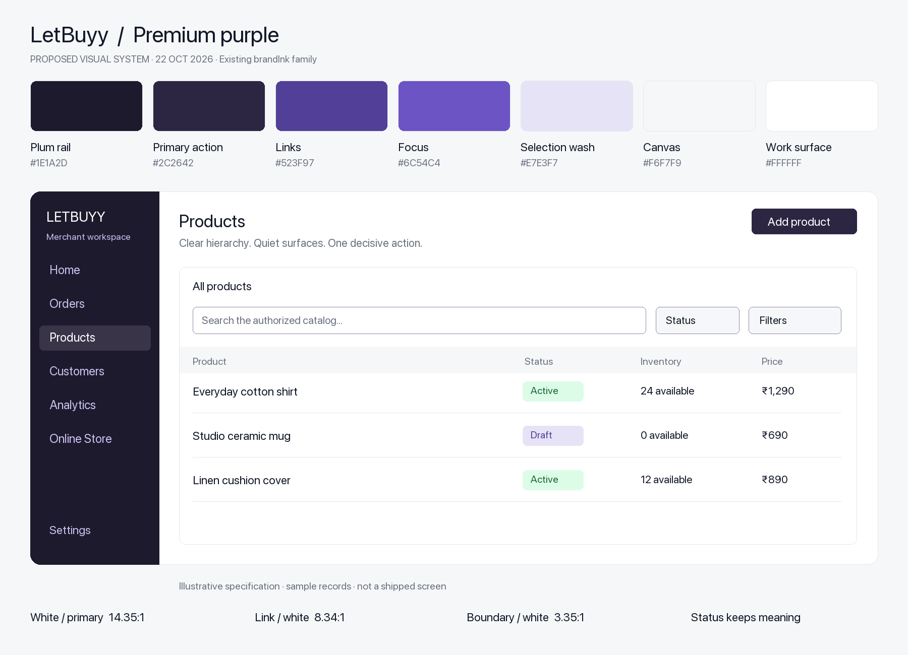

# LetBuyy identity and merchant experience implementation plan

23 October 2026 · Active implementation programme; premium purple and shared Merchant/Settings contracts verified locally · Source HEAD `85aac99043d8dc10469e12cbb810609a3b6f1b0d`

LetBuyy already has much of the machinery needed for a professional merchant application: a canonical identity issuer, resumable onboarding, shared navigation and tokens, product save recovery, a theme library, schema-driven editing, undo/redo, draft versions and publication recovery. The largest difference from the observed Shopify experience is the consistency of the journey around that machinery: preserving work, explaining readiness, acknowledging navigation, distinguishing errors from empty results, and choosing the right container and density for each task.

The canonical-system follow-up adds **32 pattern mappings** and extends the same register to **46 findings**. Fresh research verified Shopify's shared dirty-bar family across product editing and General settings. Fresh LetBuyy checks demonstrated invisible saved-bar keyboard controls and nested main landmarks. The [canonical comparison](08_CANONICAL_PATTERN_COMPARISON.md) specifies the shared header/action/form/section changes, preserving the 12 existing work packages.

**Current owner direction — 23 October 2026:** The premium purple palette role mapping is now authorized for Merchant and Settings. Existing layouts, architecture and domain behavior remain preserved. The earlier unchanged-palette reports remain historical records of their own slices. The palette board governs color roles, not replacement page layouts. Identity remains light-only; storefront themes remain independent.

**Previous continuation:** all 114 gate validators pass in the owned validation snapshot; merchant tests 215 + 810 and shared UI 56 pass. Current-store/session reads run concurrently, repeated store reads share request scope, and expired sessions retain the exact return path/query. Production-mode HTTP timings are recorded separately from development compilation and browser readiness. The full programme is still open.

**Latest tranche:** premium purple roles, shared Card/Section/MetricCard surfaces, explicit headers, input boundaries and capability-aware SaveBar are adopted across the representative Merchant and Settings families. Merchant **220 + 810**, shared UI **61**, traversal **38**, and all **114** governance validators pass; Merchant and Storybook production builds pass. Real product/General save, protected departure, readback and discard were checked at desktop/tablet/mobile sizes. See the current results and adoption inventory below for exact limits and retained fixtures.

[Implementation results and remaining acceptance](09_IMPLEMENTATION_RESULTS.md) records the navigation, product protection, shared SaveBar/header/landmark and Settings work, including responsive browser evidence and validation limits.

The [canonical adoption tranche](10_CANONICAL_ADOPTION.md) records shared owners, real consumer migration, responsive evidence, exceptions and current validation. The full 46-finding programme remains open.

## Read the plan

| Document | Purpose |
| --- | --- |
| [Current state and Shopify comparison](01_CURRENT_STATE_AND_COMPARISON.md) | What exists, what Shopify demonstrates, what to preserve, and where LetBuyy differs |
| [Prioritized gap register](02_GAP_REGISTER.md) | Stable findings, evidence, consequences, implementation targets and acceptance |
| [Premium purple visual system](03_PREMIUM_PURPLE_SYSTEM.md) | Approved color-role mapping, contrast and visual references; existing layouts remain the foundation |
| [Implementation sequence](04_IMPLEMENTATION_PLAN.md) | Work packages, dependencies, source ownership, contracts, validation and rollback |
| [Local tests and coverage](05_TEST_AND_COVERAGE.md) | Actual local startup, journeys and test results, fixtures and remaining acceptance |
| [Surface and journey specifications](06_SURFACE_AND_JOURNEY_SPECIFICATIONS.md) | Modal/page/drawer decisions, navigation loading, identity, tables, forms, domains, themes and AI |
| [Route coverage inventory](07_ROUTE_COVERAGE.md) | All 13 identity and 80 merchant page files inventoried in this snapshot; coverage is explicitly classified |
| [Canonical pattern comparison](08_CANONICAL_PATTERN_COMPARISON.md) | Shared header/action/save/form/widget rules, 32 pattern owners and four additional shared-component findings |
| [Implementation results](09_IMPLEMENTATION_RESULTS.md) | Delivered first slice, current source hashes, responsive browser evidence, tests and remaining acceptance |
| [Canonical adoption inventory](10_CANONICAL_ADOPTION.md) | Shared component owners, migrated families, intentional exceptions and responsive acceptance |

Machine-readable companions: [gap register](gap-register.json), [source inventory](evidence/route-source-inventory.json), [contrast calculations](assets/contrast-pairs.json), [evidence manifest](evidence-manifest.json).

## Mockups before implementation

The owner requested a responsive visual stage before source changes. The [20-board mockup plan](mockups/README.md) covers all 32 canonical pattern families, with desktop/tablet/mobile on every board. Browse the [image gallery](mockups/GALLERY.md) or [standalone catalogue](mockups/index.html); generation/review status and prompts are recorded in the [manifest](mockups/mockup-manifest.json). These are proposed images, not application screenshots, completed Storybook stories or end-to-end evidence. Exact token/behavior contracts take precedence over incidental generated details. The owner subsequently directed implementation to preserve the existing UI. The boards are available as references; they are no longer a prerequisite or an exact page specification.

## First implementation priorities

1. Fix the navigation wait experience reported by the owner: immediate activation feedback, scoped pending/loading/error states and investigation of the underlying delay. Preserve private-route read-cost and authorization controls.
2. Prevent the reproduced product draft loss when leaving through the sidebar. Preserve the editor's existing idempotency and uncertain-save recovery.
3. Complete the existing sign-in MFA continuation; preserve deep-link return context; make email/resend outcomes truthful. Do not add another authentication system.
4. Align setup completion with its claims. A draft product with zero stock currently completes the step described as creating a sellable item. “Catalog item created” and “ready to sell” need distinct meaning.
5. Remove unavailable app dead ends, distinguish search failures from no matches, and move product matching/pagination beyond the first loaded 100 records. Keep the deferred app platform disabled.
6. Apply the authorized premium purple role mapping while completing shared component behavior, domain continuity and the wide-screen theme editor. Rich product descriptions require a safe content contract, not arbitrary HTML execution.

## Local verification completed

The existing PostgreSQL database and backend were retained. Identity, merchant and gateway are reachable; commerce renders the signed editor preview and denies anonymous access to the private fixture storefront as expected. Marketing and console entry points also respond. No reset, reseed, payment, external message, app-platform activation or deployment was performed.

Normal browser work created the private `UX Research Fixture` store, verified onboarding reload recovery, reproduced product draft loss, saved and reloaded a draft product, checked product search/selection, exercised theme undo/redo/save/reload, inspected rename and preview dialogs, and tested Settings search and domain validation. Existing suites passed: identity **50 + 6**, merchant **204 + 810**, and shared UI **51** reported tests. A separate canonical API probe passed **10/10**, including login, session, positive ownership control, different-owner denial and logout. These are different evidence classes, not a count of fully accepted user journeys.

No production speed comparison, full accessibility certification, paid provider acceptance or exhaustive role/device coverage is claimed. The detailed coverage document names those remaining checks.

## Architecture and scope

This is a subordinate implementation programme for `apps/platform/identity`, `apps/merchant/web`, `packages/typescript/ui` and their existing API/domain contracts. It does not replace the [Constitution](../../../GOVERNANCE_REWRITE_2026_06_10/LETBUYY_CONSTITUTION.md), [canonical registry](../../../GOVERNANCE_REWRITE_2026_06_10/LETBUYY_CANONICAL_SYSTEMS.md), [UI governance](../../../GOVERNANCE_REWRITE_2026_06_10/LETBUYY_UI_UX_GOVERNANCE.md) or the existing delivery programme.

Preserve the monolith and satellites, sole asymmetric issuer, site tenancy, existing ledger/provider authority, hosted checkout and Liquid-first themes. No additional runtime, parallel token source, second draft system or app marketplace is proposed. The Shopify research is a usability reference, not authority to fill frozen seams.

The reference is the [dated twelve-chapter Shopify study](../../research/shopify-product-intelligence/identity-onboarding-2026-10-22/README.md). Its observations span several Shopify visual generations and task-specific systems. They do not establish one universal Shopify palette, component size or verified flow for every account.
