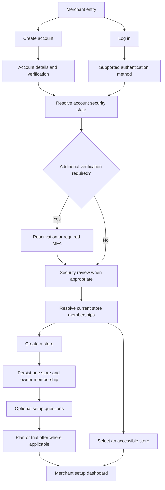

# Proposed LetBuyy account and store creation flow

Date: 2 November 2026
Status: Proposal for discussion and product review
Scope: Merchant account entry, login, registration, recovery, security review, store selection, store creation, optional onboarding, and first dashboard arrival.

This is a proposed product journey, not an implementation specification or a report of current capability. It authorizes no source changes, account actions, provider configuration, schema changes, billing changes, or deployment. Existing Constitution, canonical systems, and approved commercial terms remain authoritative. Implementation would begin with a comparison against the current Accounts and Merchant journeys.

## 1. Product intent

Let a merchant reach the correct store with minimal repeated input, clear security checks, recoverable failures, and understandable subscription terms. Each screen should present one primary task and retain the context needed for the next step.

The proposed experience has four connected parts:

1. Establish who the person is through Accounts.
2. Resolve account security and current store access.
3. Select or create the intended store through the canonical backend.
4. Personalize setup and arrive at a useful Merchant dashboard.

Account creation, successful authentication, store creation, subscription enrollment, and storefront launch are distinct outcomes. Completing one must not imply the others have completed.

## 2. Shopify reference and interpretation

The reference is the fourteen screenshots supplied on 2 November 2026 and the preceding discussion. Preserve LetBuyy's logo, purple identity, typography, shared components, and supported scope.

| Reference images | Observed behavior | Proposed lesson for LetBuyy |
| --- | --- | --- |
| 1–3 | Email entry, remembered method, password, change email, alternative login methods | Preserve the selected account while moving between supported methods |
| 4 | Accounts landing page with destinations across Shopify products | Route an authenticated person to an eligible destination; show only actual LetBuyy capabilities |
| 5–6 | Registration fields, password visibility and strength feedback | Give immediate, accessible guidance without a long preliminary questionnaire |
| 7–8 | Google-owned authentication and basic identity consent | Make the provider handoff clear and return safely to the original task |
| 9 | Reactivation after inactivity through an email code, resend, and lost-email help | Explain additional verification and offer a real recovery path |
| 10 | Security review showing passkeys, two-step status, and recovery options | Present actual security status and relevant next actions |
| 11 | Trial/subscription offer, renewal terms, payment method, and Skip | Keep commercial enrollment separate from identity and explain future charges |
| 12–13 | Optional multiselect business goals with Back and Skip | Ask only questions that affect a supported setup journey |
| 14 | Store dashboard with trial state and relevant setup tasks | Convert persisted answers and genuine completion state into useful next steps |

The Google sequence reaches an existing inactive account; it does not establish that Gmail addresses universally trigger Google login. Image 10 is a security review with two-step authentication off, not proof of completed enrollment. The captures show no visible bot interruption, but do not identify Shopify's bot provider or guarantee challenge-free access. The exact server-side moment of store provisioning is not visible. Trial prices in the images are captured Shopify offers, not LetBuyy commercial decisions.

## 3. Proposed journey map

This diagram proposes the default ordering. Whether an optional subscription offer appears before or after the setup questions remains a product decision. Required access, verification, and billing restrictions cannot be skipped through an optional screen.

## 4. Entry and returning accounts

The Merchant entry should preserve an allowlisted intended destination, such as the store and page the person originally requested. Accounts receives bounded context rather than trusting an arbitrary return URL.

Offer a clear primary login action and a separate create-account action. A remembered-account shortcut may show a suitable local display hint and last-used method, with a direct way to use another account. It must not imply a valid session or disclose store details before authorization.

If the person already has a valid session, resolve current memberships and the intended destination without unnecessarily repeating login. An expired session should lead to a clear sign-in journey, not a redirect loop.

## 5. Email and password login

### Email step

- One labeled email field with appropriate autofill and keyboard behavior.
- Continue with email as the primary action.
- Genuine supported alternatives, when available.
- A create-account link and accessible help.
- Non-enumerating responses where account existence is sensitive.

Do not force Google solely because an address ends in a particular domain. Available methods depend on configured capability and safely resolved account state.

### Password step

Keep the chosen email visible with Change email. Provide a labeled password field, show/hide control, Forgot password, a primary login button, and an alternative-method action where another method is available.

Preserve the email when changing methods. Never place the password in a URL, logs, analytics, local storage, or remembered-account metadata. Prevent duplicate submissions while an attempt is pending, and recover failed requests without presenting a false success.

Authenticate credentials and complete any required second-factor checkpoint before issuing the normal authenticated session. An inactive, suspended, or restricted account must follow its actual server state rather than being granted access because its password was correct.

## 6. Account registration

Proposed fields are email, display name or appropriate name fields, and password for the email/password route. The precise name model and password policy require confirmation against current Accounts contracts. Do not impose a surname on people whose names do not fit that structure.

Provide password visibility, concise requirements, and accessible strength guidance. Strength feedback supplements the server's actual policy. Allow password managers and paste. Explain submission errors beside the relevant input and retain safe fields.

Verify control of the email through the canonical Accounts journey before granting full Merchant access or creating an owned store. The verification mechanism should reuse the approved existing flow; choosing a different code or link format is not part of this proposal.

Separate acceptance of required terms from optional marketing consent. Persist applicable consent and policy versions through their canonical owner. Do not copy the reference's bundled marketing wording as a new LetBuyy policy.

Duplicate registration attempts must resolve through an appropriate login/recovery path without exposing private account details or creating duplicate identities.

## 7. Google and other external methods

Google is a proposed extension only where the current approved capability supports it. Other provider buttons should appear only when fully configured and usable. A button must not lead to a stub or unsupported signup.

The proposed Google journey is:

1. The person deliberately selects Google.
2. Accounts creates a short-lived, bound authorization intent.
3. Google handles provider authentication and consent on its own origin.
4. Accounts validates the authorization response and provider identity.
5. Accounts resolves the linked identity or follows an explicit new-account/linking journey.
6. Remaining account-security and store-access checks run before Merchant entry.

Use the provider's stable subject identifier, with the proper issuer, rather than treating email text as permanent identity. Do not silently link accounts using an unverified email match. Preserve explicit account-linking consent and the required existing-account proof.

Handle provider cancellation, refusal, unavailable service, expired intent, changed browser context, and callback replay with a clear restart. Retain the allowlisted destination where safe. OAuth state, nonce, codes, and private callback URLs must not appear in analytics or documentation.

Google confirms identity; it does not decide LetBuyy store ownership, grants, account reactivation, or billing eligibility. Accounts remains the sole LetBuyy session issuer.

## 8. Account reactivation and recovery

### Inactivity verification

If an approved account policy requires additional verification after inactivity, explain that reason and the destination for the verification message. Provide code/link verification, a bounded resend action, and a lost-access route through the existing recovery owner.

Do not adopt Shopify's observed three-month threshold as a LetBuyy rule. Whether inactivity alone requires reactivation, its threshold, and any trusted-session exceptions remain open decisions.

Verification should be short-lived, single-use, attempt-limited, and bound to the account and intended operation. Refreshing the page or resending must not create ambiguous valid challenges. Define the behavior of an older code after resend. Show a clear expiry/restart state and distinguish request acceptance from actual email delivery.

### Password recovery

Use a privacy-preserving request response and the canonical single-use recovery intent. Password replacement must honor the existing verification, CSRF, session revocation, and audit contracts. A page being reachable is not proof that its visitor may change a password.

### Lost email or authentication factor

Offer a genuine supported recovery route. Do not invent a working support process where none exists, and never offer an email-based shortcut that bypasses a required second factor. Preserve recovery-code and identity-review requirements where applicable.

An inactive account, a suspended account, a lost factor, and a store paused for subscription reasons require distinct explanations and resolution paths.

## 9. Security checkpoint and review

Required MFA is an access checkpoint; optional security recommendations are a separate review screen. Completing a review must not mark an unconfigured factor as enabled.

The review may show actual MFA status, available recovery options, and supported security actions. Enrollment should include proof that the new factor works before enabling it. Backup and recovery-code handling must use the existing security system and must never log private factors or codes.

Passkeys are a future UX proposal subject to the canonical registry's DEFERRED status. Keep the passkey seam dormant until the necessary authorization and qualification exist. This document does not activate WebAuthn or change the registry.

An optional review may offer Continue and Manage security. Required security policy must remain enforced regardless of how the review is presented.

## 10. Quiet bot verification

Use supported Turnstile configuration to reduce unnecessary interruption while keeping verification effective. Managed interaction-only appearance is a candidate configuration to evaluate; its suitability depends on the actual widget and allowed hostnames. Do not invent an invisible size or hide a challenge that requires interaction.

Proposed behavior:

- Prepare verification in time for the intended action.
- Refresh expired or consumed tokens before a deliberate retry.
- Validate tokens on the server with the appropriate action and hostname checks.
- Keep rate limits, CSRF protection, and authentication checks intact.
- Show an understandable pending state while verification finishes.
- If interaction is needed, show it accessibly within the flow.
- On timeout, unsupported browser, or blocked script, retain safe input and provide retry/help.
- Avoid indefinite spinners, repeated challenges caused by application bugs, and confusing generic login failures.

The product goal is low-friction verification. It is not a promise that a challenge will never appear. Turnstile tokens are single-use and expire after five minutes, so forms left open need explicit expiry handling.

## 11. Store selection and creation

After authentication, resolve current store memberships and permissions from the server.

| Account situation | Proposed destination |
| --- | --- |
| One accessible store with a valid intended page | Enter that store and page |
| Several accessible stores | Show store selection, preserving the intended task |
| No accessible stores and store creation is permitted | Offer Create store |
| Current access was revoked | Explain unavailable access; show only other authorized destinations |
| Staff account without creation permission | Offer accessible stores or a supported request/help path |
| Existing account explicitly requests another store | Recheck creation eligibility and limits before provisioning |

Use current ownership and membership checks. A remembered store, saved URL, or historical session does not authorize entry.

### Proposed creation details

Request only information needed to establish a usable store: a display name, the supported store/site type when relevant, and a supported business location. A default display name may be offered if product policy permits it. Optional business questions should not obstruct creation.

LetBuyy's current envelope is India-only. Propose India as the supported location and disclose that limitation; do not copy a global country selector. Currency, locale, timezone, and other operational defaults should come from canonical supported configuration and remain reviewable where allowed. Do not infer GST registration or tax liability from a location answer.

Show domain availability and normalization clearly if a handle is requested. The backend owns unique identifiers and final availability. Use the canonical configured LetBuyy domain, never copied reference domains or route-local hardcoded hostnames.

### Provisioning contract

The creation action must be authorized, idempotent, and recoverable. Retries, refreshes, multiple tabs, and lost responses must not create extra stores. Return the persisted store identity and read it back before navigation reports success.

The Gateway owns the durable creation operation, owner membership, supported defaults, and required audit/outbox effects. Database ownership remains `sites`; this proposal does not introduce a parallel `stores` table. Reuse existing transactional contracts and initial theme/default provisioning rather than defining a second system.

If setup is incomplete, show its actual recoverable state. A partially created store must not appear launch-ready. Preserve the original operation intent after an uncertain response and reconcile it before allowing another creation attempt.

## 12. Optional business questions

Proposed introductory copy: “What would you like to do with LetBuyy?” Explain that answers tailor setup, allow supported multiselect options, and provide Back, Continue, and Skip.

| Proposed question | Proposed answers | Concrete use |
| --- | --- | --- |
| Are you starting fresh or moving an existing business? | Starting fresh; moving an existing business; decide later | Prioritize product creation or supported catalog import |
| What will you sell? | Only currently supported product/business types | Show applicable fields and setup tasks |
| Where do you plan to sell? | Only implemented, eligible selling channels | Prioritize the relevant channel configuration |
| What is your business location? | Supported India location details | Set reviewable regional defaults; collect only necessary detail |

Dropshipping, print on demand, digital products, POS, migration apps, and partner/community destinations are not automatically approved LetBuyy features because they appear in Shopify. Each option needs a real supported consequence before it is offered.

Save confirmed answers per store through existing contracts. Back and refresh should restore the last saved state. Skipping leaves an explicit unanswered state, not invented answers. Optional preferences must not override entitlements, permissions, prices, or tax rules.

## 13. Trial and subscription offer

Treat subscription enrollment as a separate commercial action. Offer timing, trial eligibility, plan availability, promotional terms, taxes, payment methods, and Skip behavior must come from approved LetBuyy policy and server data.

Show, where applicable: what is payable today, trial end, first future charge, promotional duration, renewal amount/cadence, applicable taxes, cancellation conditions, and the selected store and plan. Do not hardcode Shopify's trial, price, dates, or UPI experience.

A free-trial entry must not silently create a paid subscription or recurring mandate. A payment-method submission must not be reported as successful enrollment until the canonical provider-backed state confirms it. Preserve original intent and idempotency through uncertain replies.

If policy permits skipping, explain the resulting access and later activation requirement. Real plan restrictions still apply. Unsupported live AutoPay remains unavailable; a sandbox mandate must stay clearly identified as a test record. LetBuyy's permanent zero transaction-fee policy remains unchanged.

## 14. First Merchant dashboard

Show the persisted store name, honest trial/plan state, and the next useful setup tasks. Personalize priority from saved answers, then derive completion from real configuration.

Possible tasks include adding a product, importing an existing catalog where supported, customizing the installed theme, configuring supported payment methods, reviewing shipping/GST settings, and connecting a domain.

Each card needs a real destination and a measurable completion condition. Clicking a task does not complete it. An unavailable backend read must not produce zero metrics, a false empty state, or an all-complete checklist. Security-sensitive provider readiness must come from its authoritative owner.

Keep the existing canonical Merchant shell. The onboarding wrapper may be focused and simpler, but it must not become a second navigation or design system. Store creation and dashboard arrival do not publish the storefront or activate checkout.

## 15. Proposed screen and state checklist

| Screen | Required normal behavior | Required recovery behavior |
| --- | --- | --- |
| Account entry | Login/create choice and safe remembered-account shortcut | Change account; invalid destination fallback |
| Email entry | Validation and supported method continuation | Verification unavailable; throttle; safe generic error |
| Password | Account context, visibility, recovery, pending state | Incorrect credentials; expired form; retry without losing email |
| Alternative methods | Preserve account context | Provider unavailable; return to another supported method |
| Registration | Accessible fields, consent, policy feedback | Duplicate submission; validation failure; existing-account handling |
| Email verification | Show intended task and appropriate destination hint | Wrong/expired code; resend limit; lost access |
| Provider handoff | Clear provider origin and bound callback | Cancelled/denied/replayed/expired response |
| Reactivation | Explain verification requirement | Expiry; resend; supported account recovery |
| Required MFA | Complete an enrolled factor before session access | Backup method; recovery code; reviewed recovery |
| Security review | Actual factor/recovery status | Unavailable status; incomplete enrollment |
| Store selection | Current memberships and eligible creation action | Revoked membership; no access; read outage |
| Store creation | One persisted owned store and visible readback | Lost response; duplicate tabs; provisioning failure |
| Setup questions | Save and restore answers; optional Skip | Save failure; refresh; Back; missing capability |
| Trial/plan offer | Approved server terms and explicit commercial action | Provider failure; uncertain enrollment; unsupported method |
| Dashboard arrival | Correct store, real setup status, actionable cards | Partial provisioning; read outage; permission change |

## 16. Shared UX and accessibility requirements

Use the existing canonical typography, spacing, color, controls, alerts, and focus treatment. Keep one primary action per task, readable widths, consistent account context, and predictable Back behavior. Preserve responsive layouts without clipping on phones, tablets, or browser zoom.

Provide programmatic labels, password-manager semantics, keyboard navigation, meaningful focus movement, screen-reader announcements for errors and verification status, and visible focus. Permit complete-code paste into verification input. Do not rely on color alone for password strength, errors, or selected goals.

Loading, verification pending, submission pending, denied access, expired flow, unavailable service, and successful persisted completion should be distinguishable. Explain what the person can do next without displaying internal infrastructure details.

## 17. Ownership and capability boundaries

| Owner | Responsibility |
| --- | --- |
| Existing Accounts/identity-platform | Authentication, external identity integration where approved, verification/recovery, MFA, session issuance and revocation |
| Existing API Gateway | Store ownership/membership, authorized provisioning, preferences, entitlements, billing and domain contracts |
| Existing Postgres and canonical domain contracts | Durable records, uniqueness, tenant isolation, transactional effects and authoritative state |
| Existing Merchant web and shared UI | Presentation, navigation, form state, transport, recovery guidance and readback display |
| Existing queue/provider adapters | Authorized asynchronous delivery and provider operations, with honest delivery evidence |

This proposal adds no runtime, issuer, authorization system, renderer, schema authority, or subscription engine. Buyer and operator realms retain their own access boundaries.

## 18. Open decisions before implementation

1. Which already approved authentication methods should be offered at initial release? Confirm Google readiness separately; passkeys remain deferred.
2. Should inactivity alone trigger reactivation? If so, approve the threshold, exceptions, and recovery policy.
3. What account and operational actions require MFA, and when should optional security review appear?
4. Should optional setup questions appear before or after store creation, and which answers have implemented consumers?
5. Confirm the minimum name/location fields and whether a default store name is acceptable.
6. Confirm server-authoritative trial/plan terms, whether a payment offer is optional, and the exact access after Skip.
7. Confirm the supported lost-email/lost-factor assistance path before exposing it as a working action.
8. Define the measured verification/friction targets and the browser/device/accessibility acceptance matrix.

These questions remain proposals. Discussion approval does not establish that the backend, providers, or UI already implement them.

## 19. Future acceptance criteria

A future implementation should demonstrate normal email and supported provider journeys; correct account/membership resolution; safe callback continuation; wrong/expired/replayed challenge refusal; required MFA enforcement; non-enumerating recovery; accessible bot-interaction fallback; single-store creation under retry/concurrency/lost response; saved onboarding answers; accurate commercial terms; and real dashboard readback.

Verify representative phone/tablet/desktop and keyboard/screen-reader behavior. Distinguish source/unit checks, disposable database/browser evidence, hosted sessions, real provider delivery, subscription acceptance, and storefront launch. None of those gates is marked passed by this proposal.

## 20. Reference sources

The following official pages were checked during the preceding analysis on 2 November 2026. Product details can change; implementation should recheck applicable provider contracts.

- [Shopify account destinations](https://accounts.shopify.com/)
- [Shopify login methods](https://help.shopify.com/en/manual/your-account/logging-in)
- [Shopify login troubleshooting](https://help.shopify.com/en/manual/your-account/logging-in/troubleshooting-login)
- [Shopify passkeys](https://help.shopify.com/en/manual/your-account/logging-in/passkeys)
- [Shopify two-step authentication](https://help.shopify.com/en/manual/your-account/logging-in/secure-sign-in)
- [Shopify recovery codes](https://help.shopify.com/en/manual/your-account/logging-in/secure-sign-in/recovery-codes)
- [Shopify free-trial setup](https://help.shopify.com/en/manual/intro-to-shopify/pricing-plans/free-trial)
- [Google OpenID Connect](https://developers.google.com/identity/openid-connect/openid-connect)
- [Cloudflare Turnstile widget configuration](https://developers.cloudflare.com/turnstile/get-started/client-side-rendering/widget-configurations/)
- [Cloudflare Turnstile server validation](https://developers.cloudflare.com/turnstile/get-started/server-side-validation/)

The supplied screenshots remain visual references. Personal email addresses, OAuth URLs containing session state, verification codes, passwords, and security-factor material are intentionally not reproduced here.
