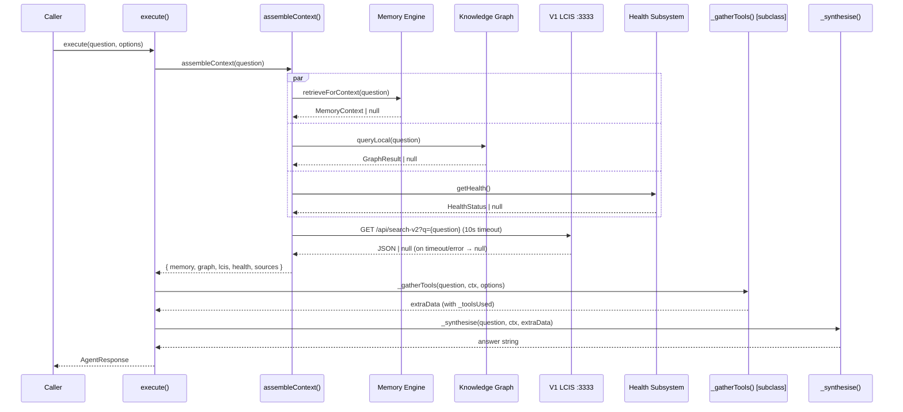

# LCIS V2 — Agent Framework

**Source:** `tools/central-intelligence/agents/`  
**Server:** `tools/central-intelligence/intelligence-api/server.mjs` (port `3334`)  
**V1 LCIS target:** `http://localhost:3333` (env `LCIS_V1_URL`)

---

## 1. Design Philosophy

The LCIS V2 agent framework is built around a single, shared intelligence pipeline rather than a collection of isolated agents that each maintain their own data connections. Every agent — regardless of domain — routes its baseline context assembly through the same four-source pipeline: the LCIS Memory Engine, the knowledge graph, the V1 LCIS API, and the health subsystem. This means a `SecurityAgent` and a `ReleaseAgent` reading about the same symbol are drawing from the same memory index, the same graph snapshot, and the same V1 LCIS endpoints. There is no duplication of retrieval logic, no divergence in what "the platform knows," and no risk of two agents returning contradictory answers from independently maintained local caches.

Graceful degradation is a first-class contract, not an afterthought. `assembleContext()` wraps all four sources in `Promise.allSettled()`, which means any individual source failure — a V1 LCIS endpoint timeout, a transient graph error, a cold memory index — degrades that source to `null` without throwing. The agent logs a `warn`-level message, records the degraded source in its internal `_logger` buffer, and continues synthesis with whatever sources did respond. Every domain method in every agent follows the same pattern: parallel `Promise.allSettled()`, per-branch null guards, and a result that is always structurally valid regardless of which sources succeeded. An agent never propagates an uncaught exception to the HTTP layer.

The technology primitives behind the pipeline are intentionally hidden from consumers. Agents and callers refer to "the LCIS Memory Engine," "the knowledge graph," "the V1 LCIS API," and "the health subsystem." The concrete implementations — `MemoryRetriever`, `GraphQueryEngine`, `BrowserIntelligenceEngine`, `HealthService` — are internal to the `AgentFramework` base class. Subclasses access them through six named tool methods (`useMemory`, `useGraph`, `useBrowser`, `useKnowledge`, `useLCISV1`, and `log`) and never import these services directly for context assembly. This abstraction boundary means the underlying technology can change without rewriting every agent.

---

## 2. AgentFramework Base Class

**File:** `tools/central-intelligence/agents/AgentFramework.mjs`

### 2.1 AgentResponse Schema

Every agent's `execute()` method returns an `AgentResponse` object with the following shape:

```typescript
{
  agent:       string,                             // agent name, e.g. 'KnowledgeAgent'
  question:    string,                             // the original question passed in
  answer:      string,                             // synthesised plain-text answer
  sources:     Array<{
    type:  string,                                 // 'memory' | 'graph' | 'lcis-v1' | 'health'
    ref:   string,                                 // source identifier or URL
    score?: number,                                // relevance score when available
  }>,
  confidence:  number,                             // 0–1, rounded to 3 decimal places
  executionMs: number,                             // wall-clock time for the full execute() call
  toolsUsed:   string[],                           // de-duplicated list of tool identifiers used
}
```

### 2.2 Constructor

```javascript
constructor(name: string, capabilities: string[] = [])
```

Stores `this.name`, `this.capabilities`, and initialises `this._logger = []`. The logger buffer holds `{ level, message, ts, agent }` entries and is written to via `this.log()`.

### 2.3 `assembleContext(question)`

Runs three sources concurrently via `Promise.allSettled`, then fetches the V1 LCIS search endpoint sequentially (but with its own timeout):

1. `MemoryRetriever.retrieveForContext(question)` — the LCIS Memory Engine's context-optimised retrieval
2. `Promise.resolve(GraphQueryEngine.queryLocal(question))` — the synchronous knowledge graph local query, wrapped in a Promise for `allSettled` compatibility
3. `HealthService.getHealth()` — the LCIS health subsystem

After the settled results are resolved, it fetches:

4. `V1 LCIS /api/search-v2?q={question}` — the V1 semantic search endpoint, with a 10-second `AbortController` timeout

Each failure records a `warn` log and sets that source to `null`. The returned context object is:

```typescript
{
  memory: MemoryContext | null,
  graph:  GraphResult   | null,
  lcis:   unknown       | null,
  health: HealthStatus  | null,
  sources: Array<{ type: string, ref: string, score?: number }>,
}
```

Sources are aggregated as: up to 5 memory hits (with `score`), one graph entry (if `graph.success`), one V1 LCIS entry, and one health entry.

### 2.4 `execute(question, options?)` Pipeline

```javascript
async execute(question: string, options?: { maxTokens?: number, includeHealth?: boolean }): Promise<AgentResponse>
```

Execution steps in order:

1. Record `startMs = Date.now()`
2. Call `assembleContext(question)` → `ctx`; append `['memory', 'graph', 'lcis-v1', 'health']` to `toolsUsed`
3. If `this._gatherTools` is defined (subclass override), call it with `(question, ctx, options)`. Any `extraData._toolsUsed` array is merged into `toolsUsed`. Failure is caught and logged as `warn` — `extraData` stays `null`
4. Call `this._synthesise(question, ctx, extraData)` → `answer`
5. Call `this._computeConfidence(ctx, extraData)` → `confidence`
6. Return `AgentResponse` with `toolsUsed` de-duplicated via `new Set()`

### 2.5 Execute Sequence Diagram



### 2.6 Six Tool Methods

| Method | Signature | What It Does |
|--------|-----------|--------------|
| `useMemory` | `async (query: string)` | Calls `MemoryRetriever.retrieveForContext(query)` — context-optimised path |
| `useGraph` | `(query: string)` — synchronous | Calls `GraphQueryEngine.queryLocal(query)` directly; returns synchronously |
| `useBrowser` | `async (url: string)` | Calls `BrowserIntelligenceEngine.captureEvidence(url, '{name}-{Date.now()}')` |
| `useKnowledge` | `async (query: string)` | Routes through `MemoryRetriever.retrieve(query, { limit: 10 })` — the raw retrieval path |
| `useLCISV1` | `async (endpoint: string)` | Fetches `LCIS_V1_URL + endpoint` with a 10-second `AbortController` timeout; throws on non-2xx |
| `log` | `(message: string, level?: 'info'\|'warn'\|'error')` | Appends `{ level, message, ts, agent }` to `this._logger`; also writes to `console` |

`useLCISV1` is the only tool that can throw — callers must `.catch()` it or use `Promise.allSettled`. All other tools are non-throwing by design; `useBrowser` surfaces errors as `{ status: 'NOT AVAILABLE', reason }` result objects.

### 2.7 `_synthesise(question, ctx, extraData)`

Default synthesis builds a plain-text answer from up to four parts, joined by `'\n\n'`:

| Part | Source | Max length |
|------|--------|-----------|
| `[Graph] …` | `ctx.graph.answer` (when `ctx.graph.success`) | 1 000 chars |
| `[Memory] …` | `ctx.memory.context` | 800 chars |
| `[LCIS V1] …` | `ctx.lcis` (string or `JSON.stringify`) | 500 chars |
| `[Domain] …` | `extraData._summary` | 600 chars |

If no parts are available, returns: `Agent {name} could not find sufficient context for: {question}`.

Subclasses override `_synthesise` to compose richer, domain-specific answers.

### 2.8 `_computeConfidence(ctx, extraData)`

Averages a contribution score from each non-null source:

| Source | Present → score | Absent → excluded |
|--------|----------------|-------------------|
| `memory` | `ctx.memory.relevanceScore ?? 0` | excluded when `null` |
| `graph` | `0.7` if `graph.success`, else `0.1` | excluded when `null` |
| `lcis` | `0.6` | excluded when `null` |
| `health` | `0.8` if `overall === 'HEALTHY'`, else `0.4` | excluded when `null` |

Result: `Math.round((sum / count) * 1000) / 1000`. Returns `0` if all sources are `null`.

---

## 3. Agent Catalog

### 3.1 KnowledgeAgent

**File:** `tools/central-intelligence/agents/KnowledgeAgent.mjs`

```javascript
new KnowledgeAgent()
// name: 'KnowledgeAgent'
// capabilities: ['runbook-lookup', 'architecture-query', 'security-docs', 'documentation-qa', 'change-history']
```

**Domain Methods**

| Method | Signature | Returns |
|--------|-----------|---------|
| `findRunbook` | `(domain: string)` | `{ memoryRunbook: {content, source, score}\|null, lcisRunbook: unknown\|null, sources: string[] }` |
| `findArchitecture` | `(topic: string)` | `{ hits: object[], graphAnswer: string, lcisAnswer: unknown\|null }` |
| `findSecurity` | `(component: string)` | `{ hits: object[], summary: string, lcisAnswer: unknown\|null }` |
| `answerDocQuestion` | `(question: string)` | `AgentResponse` (delegates to `execute()`) |
| `whatChanged` | `(domain: string, since: string)` | `{ changes: object[], lcisTimeTravel: unknown\|null }` |

**V1 LCIS Endpoints Called**

| Method | V1 Endpoint |
|--------|------------|
| `findRunbook` | `/api/runbook?domain={domain}` |
| `findArchitecture` | `/api/explain?node={topic}` |
| `findSecurity` | `/api/security-intelligence` |
| `whatChanged` | `/api/time-travel?domain={domain}&since={since}` |

**Memory Collections Queried**

| Method | Collections | Limit | minScore |
|--------|-------------|-------|---------|
| `findRunbook` | (via `retrieveRunbook`) | — | — |
| `findArchitecture` | `architecture`, `docs` | 8 | 0.25 |
| `findSecurity` | (via `retrieveSecurityContext`) | — | — |
| `whatChanged` | `migrations`, `changelogs`, `architecture` | 10 | 0.2 |

**Browser Intelligence:** Not used.

---

### 3.2 SecurityAgent

**File:** `tools/central-intelligence/agents/SecurityAgent.mjs`

```javascript
new SecurityAgent()
// name: 'SecurityAgent'
// capabilities: ['risk-assessment', 'vulnerability-check', 'rls-coverage', 'anomaly-detection', 'security-posture']
```

Imports `AnomalyDetectionService` directly from `tools/central-intelligence/observability/AnomalyDetectionService.mjs` — the only agent with a direct observability dependency beyond `HealthService`.

**Domain Methods**

| Method | Signature | Returns |
|--------|-----------|---------|
| `assessRisk` | `(component: string)` | `{ riskLevel: 'LOW'\|'MEDIUM'\|'HIGH'\|'CRITICAL', findings: {source, text, score}[], graphRisk: string, lcisRisk: unknown\|null }` |
| `checkVulnerabilities` | `(component: string)` | `{ vulnerabilities: {id, source, summary, score}[], graphFindings: string }` |
| `reviewRLSCoverage` | `()` | `{ lcisSecurityIntelligence: unknown\|null, rlsDocs: {source, text, score}[], coverage: string }` |
| `detectAnomalies` | `()` | `{ anomalies: object[], securityCorrelations: {anomaly, relatedDocs}[] }` |
| `getSecurityPosture` | `()` | `{ posture: 'SECURE'\|'AT_RISK'\|'COMPROMISED'\|'UNKNOWN', lcisPosture: unknown\|null, anomalyCount: number, topFindings: object[] }` |

**Risk Level Derivation (`assessRisk`)**

The `riskLevel` is derived from the maximum score across security memory hits:

| Top score | `riskLevel` |
|-----------|-------------|
| ≥ 0.8 | `CRITICAL` |
| ≥ 0.6 | `HIGH` |
| ≥ 0.4 | `MEDIUM` |
| < 0.4 | `LOW` |

**Posture Logic (`getSecurityPosture`)**

`criticalHits` = memory hits with `score >= 0.75`.

| Condition | `posture` |
|-----------|-----------|
| `anomalyCount > 5` OR `criticalHits > 3` | `COMPROMISED` |
| `anomalyCount > 0` OR `criticalHits > 0` | `AT_RISK` |
| V1 LCIS responded | `SECURE` |
| None of the above | `UNKNOWN` |

**V1 LCIS Endpoints Called**

| Method | V1 Endpoint |
|--------|------------|
| `assessRisk` | `/api/security-intelligence` |
| `reviewRLSCoverage` | `/api/security-intelligence` |
| `getSecurityPosture` | `/api/security-intelligence` |

**Memory Collections Queried**

| Method | Collections | Limit | minScore |
|--------|-------------|-------|---------|
| `assessRisk` | (via `retrieveSecurityContext`) | — | — |
| `checkVulnerabilities` | `security` | 10 | 0.25 |
| `reviewRLSCoverage` | `security`, `architecture` | 10 | 0.2 |
| `detectAnomalies` | `security`, `incidents` | 3 per anomaly | 0.2 |
| `getSecurityPosture` | (via `retrieveSecurityContext('platform')`) | — | — |

**Browser Intelligence:** Not used.

---

### 3.3 OperationsAgent

**File:** `tools/central-intelligence/agents/OperationsAgent.mjs`

```javascript
new OperationsAgent()
// name: 'OperationsAgent'
// capabilities: ['incident-detection', 'failure-diagnosis', 'fix-recommendation', 'operational-status', 'runbook-retrieval']
```

Imports `GraphQueryEngine` directly in addition to the base class — uses `GraphQueryEngine.getImpact(domain)` (a higher-level method not exposed through `useGraph()`).

**Domain Methods**

| Method | Signature | Returns |
|--------|-----------|---------|
| `detectIncident` | `(domain: string)` | `{ detection: unknown\|null, graphImpact: string, incidents: {id, source, summary, score, collection}[], liveTelemetry: unknown\|null }` |
| `diagnoseFailure` | `(error: string, domain: string)` | `{ rootCause: unknown\|null, relatedIncidents: {id, summary, score}[], graphDiagnosis: string, runbook: {content, source, score}\|null }` |
| `recommendFix` | `(incident: { domain?, error?, summary? })` | `{ fixPlan: unknown\|null, knowledgeHits: {source, text, score}[], graphRecommendation: string }` |
| `getOperationalStatus` | `()` | `{ observability: unknown\|null, aiOps: unknown\|null, launchStatus: unknown\|null }` |
| `runbookForDomain` | `(domain: string)` | `{ lcisRunbook: unknown\|null, memoryRunbook: {content, source, score}\|null, escalation: string }` |

**Escalation fallback (`runbookForDomain`):** when `lcisRunbook.escalation` is absent, `escalation` is set to `'Escalation chain: NOT CONNECTED — requires live LCIS V1 runbook endpoint'`.

**V1 LCIS Endpoints Called**

| Method | V1 Endpoint |
|--------|------------|
| `detectIncident` | `/api/detection?domain={domain}`, `/api/live-metrics?domain={domain}` |
| `diagnoseFailure` | `/api/investigate?q={domain}+{error}` |
| `recommendFix` | `/api/fix-engine?domain={domain}` |
| `getOperationalStatus` | `/api/observability`, `/api/ai-ops`, `/api/launch-status` |
| `runbookForDomain` | `/api/runbook?domain={domain}` |

**Memory Collections Queried**

| Method | Collections | Limit | minScore |
|--------|-------------|-------|---------|
| `detectIncident` | (via `retrieveIncidents(domain)`) | — | — |
| `diagnoseFailure` | (via `retrieveIncidents(domain, { limit: 8 })`), (via `retrieveRunbook(domain)`) | 8, — | —, — |
| `recommendFix` | `runbooks`, `architecture`, `incidents` | 8 | 0.2 |

**Browser Intelligence:** Not used.

---

### 3.4 MerchantAgent

**File:** `tools/central-intelligence/agents/MerchantAgent.mjs`

```javascript
new MerchantAgent()
// name: 'MerchantAgent'
// capabilities: ['merchant-health', 'store-validation', 'merchant-risk', 'theme-status', 'theme-comparison']
```

Imports `GraphQueryEngine` and `BrowserIntelligenceEngine` directly. Uses a lazy dynamic import for `browser-intelligence/agents/ThemeAgent.mjs` inside `getThemeStatus()` to avoid circular references.

**Domain Methods**

| Method | Signature | Returns |
|--------|-----------|---------|
| `getMerchantHealth` | `(siteId: string)` | `{ graphHealth: string, lcisHealth: unknown\|null, memoryContext: string, siteId: string }` |
| `getStoreValidation` | `(storeUrl: string)` | `{ evidence: unknown, storeUrl: string, timestamp: string }` |
| `getMerchantRisk` | `(siteId: string)` | `{ lcisRisk: unknown\|null, graphRisk: string, memoryRisk: {source, text, score}[], riskLevel: 'LOW'\|'MEDIUM'\|'HIGH'\|'CRITICAL'\|'UNKNOWN' }` |
| `getThemeStatus` | `(storeUrl: string)` | `{ browserTheme: unknown, lcisTheme: unknown\|null, storeUrl: string }` |
| `compareThemes` | `(storeUrl1: string, storeUrl2: string)` | `{ store1: object, store2: object, differences: string[] }` |

**Risk Level Derivation (`getMerchantRisk`)**

Priority order:
1. Use `lcisRisk.riskLevel` if the V1 LCIS endpoint responded and the field is present
2. Otherwise derive from top memory score: `≥ 0.7 → HIGH`, `≥ 0.4 → MEDIUM`, `graphRisk truthy → LOW`, else `UNKNOWN`

**Theme diff (`compareThemes`):** calls `getThemeStatus()` for both URLs in parallel, then performs a key-by-key structural diff on the `browserTheme` result objects. Each differing key is reported as `{key}: store1={v1.slice(0,100)} | store2={v2.slice(0,100)}`.

**V1 LCIS Endpoints Called**

| Method | V1 Endpoint |
|--------|------------|
| `getMerchantHealth` | `/api/merchant-health?siteId={siteId}` |
| `getMerchantRisk` | `/api/merchant-risk?siteId={siteId}` |
| `getThemeStatus` | `/api/theme-intelligence` |

**Memory Collections Queried**

| Method | Collections | Limit | minScore |
|--------|-------------|-------|---------|
| `getMerchantHealth` | (all, no filter) | 5 | 0.2 |
| `getMerchantRisk` | `incidents`, `security` | 6 | 0.2 |

**Browser Intelligence:** `BrowserIntelligenceEngine.captureEvidence()` in `getStoreValidation()`; lazy-imported `browser-intelligence/agents/ThemeAgent.validateRendering()` in `getThemeStatus()`.

---

### 3.5 ReleaseAgent

**File:** `tools/central-intelligence/agents/ReleaseAgent.mjs`

```javascript
new ReleaseAgent()
// name: 'ReleaseAgent'
// capabilities: ['release-assessment', 'deployment-validation', 'change-impact', 'go-no-go', 'release-notes']
```

Imports `GraphQueryEngine` and `BrowserIntelligenceEngine` directly. Uses `GraphQueryEngine.getImpact(component)` per-component in `getChangeImpact()` (up to 5 components in parallel).

**Domain Methods**

| Method | Signature | Returns |
|--------|-----------|---------|
| `assessRelease` | `(branch: string)` | `{ blastRadius: unknown\|null, graphImpact: string, releaseHistory: {source, text, score}[], branch: string }` |
| `validateDeployment` | `(deploymentUrl: string)` | `{ evidence: unknown, deploymentUrl: string, validatedAt: string }` |
| `getChangeImpact` | `(components: string[])` | `{ lcisImpact: unknown\|null, graphImpacts: {component, impact}[], affectedDomains: string[] }` |
| `goNoGo` | `()` | `{ verdict: 'GO'\|'NO-GO'\|'AT_RISK'\|'UNKNOWN', launchCenter: unknown\|null, memoryBlockers: {source, text, score}[], graphCritical: string }` |
| `generateReleaseNotes` | `(since: string)` | `{ changes: {id, source, text, collection, score}[], lcisTimeTravel: unknown\|null, generatedAt: string }` |

**GO/NO-GO Verdict Logic (`goNoGo`)**

Evaluated in priority order:
1. `launchCenter.verdict` → use it directly
2. `launchCenter.blockers.length > 0` → `'NO-GO'`
3. `launchCenter.status === 'READY'` → `'GO'`
4. `memBlockers.length > 0` → `'AT_RISK'`
5. No signal → `'UNKNOWN'`

**Affected Domains Extraction (`getChangeImpact`)**

If `lcisImpact.affectedDomains` is an array, it is used directly. Otherwise, domain names are extracted from all graph impact answers using the regex:
```
/\b(?:payments?|orders?|checkout|identity|themes?|merchants?|inventory)\b/gi
```
Results are lowercased and deduplicated.

**V1 LCIS Endpoints Called**

| Method | V1 Endpoint |
|--------|------------|
| `assessRelease` | `/api/blast?q={branch}` |
| `getChangeImpact` | `/api/change-impact?key={components.join(',')}` |
| `goNoGo` | `/api/launch-command-center` |
| `generateReleaseNotes` | `/api/time-travel?since={since}` |

**Memory Collections Queried**

| Method | Collections | Limit | minScore |
|--------|-------------|-------|---------|
| `assessRelease` | `migrations`, `changelogs`, `architecture` | 8 | 0.2 |
| `goNoGo` | `architecture`, `incidents`, `runbooks` | 8 | 0.25 |
| `generateReleaseNotes` | `migrations`, `changelogs`, `architecture` | 15 | 0.15 |

**Browser Intelligence:** `BrowserIntelligenceEngine.captureEvidence()` in `validateDeployment()` (labelled `release-validate-{timestamp}`).

---

### 3.6 ThemeAgent

**File:** `tools/central-intelligence/agents/ThemeAgent.mjs`

**Note:** This is the LCIS orchestration-layer agent. It is distinct from `tools/central-intelligence/browser-intelligence/agents/ThemeAgent.mjs`, which is the browser automation layer. The LCIS ThemeAgent delegates browser rendering work to the browser-layer ThemeAgent via a lazy dynamic import.

```javascript
new ThemeAgent()
// name: 'ThemeAgent'
// capabilities: ['theme-validation', 'theme-documentation', 'theme-version-diff', 'liquid-issues']
```

**Domain Methods**

| Method | Signature | Returns |
|--------|-----------|---------|
| `validateTheme` | `(themeId: string, storeUrl: string)` | `{ browserValidation: unknown, memoryDocs: {source, text, score}[], lcisTheme: unknown\|null, themeId: string, storeUrl: string }` |
| `getThemeDocumentation` | `(themeId: string)` | `{ docs: {source, text, score}[], lcisThemeDomain: unknown\|null, graphDescription: string }` |
| `compareThemeVersions` | `(v1: string, v2: string)` | `{ v1Docs: object[], v2Docs: object[], differences: string[] }` |
| `getLiquidIssues` | `(themeId: string)` | `{ lcisThemeDomain: unknown\|null, liquidIssues: {source, text, score}[], graphIssues: string }` |

**`_getBrowserThemeAgent()` (private)**

```javascript
async _getBrowserThemeAgent(): Promise<typeof import('../browser-intelligence/agents/ThemeAgent.mjs').default>
```

Performs a dynamic `import()` on each call. Used inside `validateTheme()`. If the import fails, `browserValidation` is set to `{ status: 'NOT AVAILABLE', reason: '...' }` — the method does not throw.

**Version diff (`compareThemeVersions`):** queries memory separately for `v1` and `v2`, then computes:
- `NEW in v{v2}: {source}` for sources in v2 not in v1
- `REMOVED in v{v2} (was in v{v1}): {source}` for sources in v1 not in v2
- If no differences: `'No structural document differences detected between {v1} and {v2}'`

**V1 LCIS Endpoints Called**

| Method | V1 Endpoint |
|--------|------------|
| `validateTheme` | `/api/domain?key=themes` |
| `getThemeDocumentation` | `/api/theme-intelligence` |
| `getLiquidIssues` | `/api/domain?key=themes` |

**Memory Collections Queried**

| Method | Collections | Limit | minScore |
|--------|-------------|-------|---------|
| `validateTheme` | (all, no filter) | 8 | 0.2 |
| `getThemeDocumentation` | (all, no filter) | 12 | 0.2 |
| `compareThemeVersions` (v1) | (all, no filter) | 6 | 0.15 |
| `compareThemeVersions` (v2) | (all, no filter) | 6 | 0.15 |
| `getLiquidIssues` | `security`, `architecture` | 8 | 0.2 |

**Browser Intelligence:** lazy-imported `browser-intelligence/agents/ThemeAgent.validateRendering()` in `validateTheme()`.

**Registration status:** ThemeAgent is loaded and exported as a singleton but is **not** in `AGENT_MAP` in `server.mjs`. Its methods must be called directly.

---

### 3.7 MonitoringAgent

**File:** `tools/central-intelligence/agents/MonitoringAgent.mjs`

**Note:** This is the LCIS orchestration-layer agent. It is distinct from `tools/central-intelligence/browser-intelligence/agents/MonitoringAgent.mjs`, which implements browser-level `runAllChecks()`. The LCIS MonitoringAgent orchestrates health rounds that delegate browser checks to the browser-layer MonitoringAgent via a lazy dynamic import.

```javascript
new MonitoringAgent()
// name: 'MonitoringAgent'
// capabilities: ['store-monitoring', 'health-rounds', 'incident-detection', 'monitoring-reports']
```

**Internal State**

| Property | Type | Description |
|----------|------|-------------|
| `_monitors` | `Map<string, { intervalId, intervalMs }>` | Active interval monitors keyed by store URL |
| `_roundHistory` | `object[]` | Ring buffer of health round results, capped at `_maxHistory` entries |
| `_maxHistory` | `number` | `100` — maximum retained round history entries |

**Domain Methods**

| Method | Signature | Returns |
|--------|-----------|---------|
| `startMonitoring` | `(storeUrls: string[], options?: { intervalMs?: number })` | `{ started: string[], intervalMs: number }` — synchronous |
| `stopMonitoring` | `(storeUrl?: string)` | `{ stopped: string[] }` — synchronous; omit `storeUrl` to stop all |
| `runHealthRound` | `(storeUrls?: string[])` | `Promise<{ timestamp, systemHealth, storeResults, incidentSignals }>` |
| `getMonitoringReport` | `()` | `Promise<{ monitorCount, monitoredUrls, roundCount, latestRound, recentIncidents, reportGeneratedAt }>` |

**`startMonitoring` behaviour:**
- Skips URLs already in `_monitors` (logs `warn`)
- Creates a `setInterval` per URL; calls `intervalId.unref()` to prevent the Node.js process from being kept alive by monitoring timers
- Default interval: `60 000` ms

**`runHealthRound` steps:**
1. `HealthService.getHealth()` — system health of LCIS subsystems
2. For each URL: `import('../browser-intelligence/agents/MonitoringAgent.mjs').then(m => m.default.runAllChecks(url))` — lazy import per round
3. `this.useLCISV1('/api/detection')` — V1 LCIS incident detection signals

Round results are appended to `_roundHistory`. When length exceeds `_maxHistory`, the surplus is spliced from the front.

**V1 LCIS Endpoints Called**

| Method | V1 Endpoint |
|--------|------------|
| `runHealthRound` | `/api/detection` |

**Memory Collections Queried**

| Method | Collections | Limit | minScore |
|--------|-------------|-------|---------|
| `getMonitoringReport` | `incidents`, `runbooks` | 10 | 0.2 |

**Browser Intelligence:** lazy-imported `browser-intelligence/agents/MonitoringAgent.runAllChecks(url)` in each `runHealthRound()` call.

**Registration status:** MonitoringAgent is loaded and exported as a singleton but is **not** in `AGENT_MAP` in `server.mjs`. Its methods must be called directly.

---

## 4. Context Assembly

How `assembleContext()` draws from each intelligence source:

| Source | Tool Method | What It Returns | Used By |
|--------|-------------|----------------|---------|
| LCIS Memory Engine | `useMemory(query)` / `MemoryRetriever.retrieveForContext(query)` | `{ context: string, sources: {source, score}[], relevanceScore: number }` | All agents via `assembleContext()`; domain methods via `MemoryRetriever.retrieve()` / `retrieveSecurityContext()` / `retrieveRunbook()` / `retrieveIncidents()` |
| Knowledge Graph | `useGraph(query)` / `GraphQueryEngine.queryLocal(query)` | `{ success: boolean, answer: string }` | All agents via `assembleContext()`; OperationsAgent and ReleaseAgent use `GraphQueryEngine.getImpact()` directly |
| V1 LCIS API | `useLCISV1(endpoint)` | `unknown` (parsed JSON from `:3333`) | All agents via `assembleContext()` (`/api/search-v2`); domain methods call specific endpoints |
| Health Subsystem | `HealthService.getHealth()` | `{ overall: 'HEALTHY'\|other, ... }` | `assembleContext()` contributes to `confidence`; MonitoringAgent's `runHealthRound()` calls it directly |

---

## 5. Tool Routing Table

| Tool | Method | Timeout | Source | Returns |
|------|--------|---------|--------|---------|
| `useMemory` | `MemoryRetriever.retrieveForContext()` | None (in-process) | Qdrant-backed vector index | `{ context, sources, relevanceScore }` |
| `useGraph` | `GraphQueryEngine.queryLocal()` | None (synchronous) | GraphRAG in-process | `{ success: boolean, answer: string }` |
| `useBrowser` | `BrowserIntelligenceEngine.captureEvidence()` | Managed by browser engine | Headless browser (Playwright) | Browser evidence object |
| `useKnowledge` | `MemoryRetriever.retrieve(query, { limit: 10 })` | None (in-process) | Qdrant-backed vector index | `Array<{ id, score, payload }>` |
| `useLCISV1` | `fetch(LCIS_V1_URL + endpoint)` | 10 000 ms (`AbortController`) | V1 LCIS server at `:3333` | `unknown` (parsed JSON); throws on non-2xx |
| `log` | Internal buffer + `console.*` | Instant | `this._logger` array | `void` |

---

## 6. Multi-Agent Orchestration

Several agents delegate to specialist agents in other layers. All cross-layer calls use lazy dynamic imports to prevent circular dependencies at module load time.

### MonitoringAgent → browser-intelligence MonitoringAgent

`tools/central-intelligence/agents/MonitoringAgent.mjs` runs health rounds that call:

```javascript
import('../browser-intelligence/agents/MonitoringAgent.mjs')
  .then(m => m.default.runAllChecks(url))
```

This is a lazy import executed **inside `runHealthRound()`** — not at module load time. The browser-layer MonitoringAgent (`tools/central-intelligence/browser-intelligence/agents/MonitoringAgent.mjs`) implements `runAllChecks(url)` using Playwright to perform live HTTP/browser checks against each store URL. If the import fails or the check throws, the LCIS MonitoringAgent catches the error and records `{ status: 'NOT AVAILABLE', reason }` for that URL — health rounds never abort.

### MerchantAgent → browser-intelligence ThemeAgent

`tools/central-intelligence/agents/MerchantAgent.mjs` delegates theme rendering checks in `getThemeStatus()`:

```javascript
import('../browser-intelligence/agents/ThemeAgent.mjs')
  .then(m => m.default.validateRendering(storeUrl))
```

Again a lazy import inside the method body. The browser-layer ThemeAgent (`tools/central-intelligence/browser-intelligence/agents/ThemeAgent.mjs`) runs Playwright-based Liquid/React rendering validation. On failure, `browserTheme` is set to `{ status: 'NOT AVAILABLE', reason }`.

### ThemeAgent (LCIS) → browser-intelligence ThemeAgent

`tools/central-intelligence/agents/ThemeAgent.mjs` uses the private helper `_getBrowserThemeAgent()`:

```javascript
async _getBrowserThemeAgent() {
  const mod = await import('../browser-intelligence/agents/ThemeAgent.mjs');
  return mod.default;
}
```

This is called inside `validateTheme()`. The returned agent instance's `validateRendering(storeUrl)` method is invoked with an additional `.catch()` guard so that browser failures degrade the field rather than abort the method.

### ReleaseAgent → BrowserIntelligenceEngine (direct)

`tools/central-intelligence/agents/ReleaseAgent.mjs` imports `BrowserIntelligenceEngine` at the top of the module:

```javascript
import BrowserIntelligenceEngine from '../browser-intelligence/BrowserIntelligenceEngine.mjs';
```

It calls `BrowserIntelligenceEngine.captureEvidence(deploymentUrl, 'release-validate-{timestamp}')` directly in `validateDeployment()`. This is not a lazy import; circular dependency risk is avoided because `BrowserIntelligenceEngine` does not import any agent.

### MerchantAgent → BrowserIntelligenceEngine (direct, for store validation)

`tools/central-intelligence/agents/MerchantAgent.mjs` also imports `BrowserIntelligenceEngine` at the top of the module and calls `BrowserIntelligenceEngine.captureEvidence(storeUrl, 'merchant-validate-{timestamp}')` in `getStoreValidation()`.

---

## 7. API Endpoints

These endpoints are registered in `tools/central-intelligence/intelligence-api/server.mjs` and served on port `3334`.

### Agent-Specific Endpoints

| Method | Path | Params | Response | Notes |
|--------|------|--------|----------|-------|
| `GET` | `/intelligence/agents/execute` | `?agent={name}&q={question}` | `{ agent, query, result: AgentResponse }` | Routes to registered agent in `AGENT_MAP`; returns HTTP 400 for unknown agent name, 503 if agent module unavailable |
| `GET` | `/intelligence/agents/status` | — | `{ agents: [{ name, available, capabilities }] }` | Probes all 5 registered agents; `available: false` means module failed to load |

### AGENT_MAP — Registered Agents

```javascript
// tools/central-intelligence/intelligence-api/server.mjs
const AGENT_MAP = {
  knowledge:  () => loadModule('../agents/KnowledgeAgent.mjs'),
  security:   () => loadModule('../agents/SecurityAgent.mjs'),
  operations: () => loadModule('../agents/OperationsAgent.mjs'),
  merchant:   () => loadModule('../agents/MerchantAgent.mjs'),
  release:    () => loadModule('../agents/ReleaseAgent.mjs'),
};
```

`ThemeAgent` and `MonitoringAgent` are not in `AGENT_MAP`. They are available as module singletons but must be called by importing the module directly or through custom server routes.

### Flagship Endpoint

| Method | Path | Params | Response |
|--------|------|--------|----------|
| `GET` | `/intelligence/ask` | `?q={question}` | `{ routing: {agent, ...}, answer, sources, confidence, ... }` |

`/intelligence/ask` uses `QueryRouter` to select the appropriate agent from `AGENT_MAP`, runs `agent.execute(question)`, assembles parallel V1 and V2 context, and synthesises a unified response via `ResponseSynthesizer`. This is the primary entry point for natural-language questions that cross agent boundaries.

### Supporting V1 Subsystem Endpoints (selected)

| Method | Path | Params | Response |
|--------|------|--------|----------|
| `GET` | `/intelligence/memory/search` | `?q=&collection=&limit=` | `{ query, results, count }` |
| `POST` | `/intelligence/memory/ingest` | body: `{ text, collection, metadata }` | `{ ingested, result }` |
| `GET` | `/intelligence/memory/health` | — | Memory health object |
| `GET` | `/intelligence/graph/query` | `?q=&method=` | `{ query, method, result }` |
| `GET` | `/intelligence/graph/impact` | `?entity=` | `{ entity, impact }` |
| `GET` | `/intelligence/browser/validate` | `?url=` | `{ url, result }` |
| `GET` | `/intelligence/browser/theme` | `?url=&themeId=` | `{ url, themeId, result }` |
| `GET` | `/intelligence/observability/health` | — | Health object |
| `GET` | `/intelligence/observability/anomalies` | — | `{ anomalies }` |

### V2 Subsystem Endpoints (selected)

| Method | Path | Params | Response |
|--------|------|--------|----------|
| `GET` | `/intelligence/context/assemble` | `?q=&budget=` | Context assembly result |
| `GET` | `/intelligence/architecture` | — | Architecture snapshot |
| `GET` | `/intelligence/architecture/drift` | — | Drift detection result |
| `GET` | `/intelligence/reason` | `?q=` | Reasoning result |
| `GET` | `/intelligence/reason/why` | `?incident=` | Root-cause reasoning |
| `POST` | `/intelligence/correlate` | body: `{ event }` | Correlation result |
| `GET` | `/intelligence/correlate/root-cause` | `?domain=` | Root-cause correlation |
| `GET` | `/intelligence/operations/assess` | — | Operational assessment |
| `GET` | `/intelligence/operations/recommendations` | — | Engineering recommendations |
| `GET` | `/intelligence/self/model` | — | Self-model JSON |
| `GET` | `/intelligence/self/explain` | `?topic=platform\|services\|deploy\|failure\|incident\|operations` | Platform explanation |
| `GET` | `/intelligence/command-center` | — | Operator dashboard overview |

All endpoints return JSON. CORS is enabled for origins in: `localhost:3000`, `localhost:3001`, `localhost:3333`, `localhost:3334`. Unknown endpoints return HTTP 404 with the full `ENDPOINTS` list.

---

## 8. Adding New Agents

### Step-by-Step

**1. Create the agent file** in `tools/central-intelligence/agents/MyDomainAgent.mjs`. Extend `AgentFramework` and export a singleton:

```javascript
import { AgentFramework } from './AgentFramework.mjs';
import MemoryRetriever from '../memory-engine/MemoryRetriever.mjs';

class MyDomainAgent extends AgentFramework {
  constructor() {
    super('MyDomainAgent', [
      'capability-one',
      'capability-two',
    ]);
  }

  /**
   * Optional: override _gatherTools to fetch domain-specific data before synthesis.
   * This runs after assembleContext() and before _synthesise().
   * Any _toolsUsed entries are merged into AgentResponse.toolsUsed.
   */
  async _gatherTools(question, ctx, options) {
    const domainData = await this.useLCISV1('/api/my-domain').catch(() => null);
    return {
      _toolsUsed: ['my-domain-endpoint'],
      _summary: domainData ? JSON.stringify(domainData).slice(0, 600) : '',
      domainData,
    };
  }

  /**
   * Optional: override _synthesise for custom answer construction.
   * ctx has .memory, .graph, .lcis, .health from assembleContext().
   * extraData is the return value of _gatherTools().
   */
  _synthesise(question, ctx, extraData) {
    // Build domain-specific answer, then fall back to base synthesis
    return super._synthesise(question, ctx, extraData);
  }

  /**
   * Example domain method.
   * Always use Promise.allSettled; never throw.
   */
  async myDomainMethod(param) {
    this.log(`myDomainMethod: param=${param}`);

    const [memResult, lcisResult] = await Promise.allSettled([
      MemoryRetriever.retrieve(`${param} relevant query`, { limit: 8, minScore: 0.25 }),
      this.useLCISV1(`/api/my-endpoint?q=${encodeURIComponent(param)}`),
    ]);

    return {
      memoryHits: memResult.status === 'fulfilled' ? memResult.value : [],
      lcisData: lcisResult.status === 'fulfilled' ? lcisResult.value : null,
    };
  }
}

export default new MyDomainAgent();
```

**2. Register the agent in `server.mjs`** by adding an entry to `AGENT_MAP`:

```javascript
// tools/central-intelligence/intelligence-api/server.mjs

const AGENT_MAP = {
  knowledge:  () => loadModule('../agents/KnowledgeAgent.mjs'),
  security:   () => loadModule('../agents/SecurityAgent.mjs'),
  operations: () => loadModule('../agents/OperationsAgent.mjs'),
  merchant:   () => loadModule('../agents/MerchantAgent.mjs'),
  release:    () => loadModule('../agents/ReleaseAgent.mjs'),
  'my-domain': () => loadModule('../agents/MyDomainAgent.mjs'),  // ← add here
};
```

The key becomes the `?agent=` parameter value: `GET /intelligence/agents/execute?agent=my-domain&q=...`.

**3. Verify** the agent appears in the status endpoint:

```bash
curl http://localhost:3334/intelligence/agents/status
# → { agents: [..., { name: 'MyDomainAgent', available: true, capabilities: ['capability-one', 'capability-two'] }] }
```

And that `execute` works:

```bash
curl "http://localhost:3334/intelligence/agents/execute?agent=my-domain&q=test+question"
```

### Design Rules for New Agents

| Rule | Rationale |
|------|-----------|
| Always use `Promise.allSettled()` for parallel source calls | Partial failures must not abort the response |
| Never throw from domain methods | Callers expect a structured result object even on failure; use `{ status: 'NOT AVAILABLE', reason }` fallbacks |
| Use `this.log(message, level)` for all logging | Messages are buffered in `this._logger` and written to `console`; do not call `console.*` directly |
| Lazy-import any browser agent | `import('../browser-intelligence/agents/…')` inside a method body, not at module top, prevents circular dependency at load time |
| Export a singleton (`export default new MyDomainAgent()`) | `loadModule()` in `server.mjs` resolves `mod.default`; class exports will not work |
| Use `_gatherTools()` for extra domain data, not a constructor side effect | `_gatherTools` runs inside the traced `execute()` pipeline and contributes to `toolsUsed` |
| Keep `_synthesise()` non-throwing | Base class synthesis returns a fallback string; subclass overrides must do the same |

### Available Memory Collections

Pass these as the `collections` filter in `MemoryRetriever.retrieve()`:

| Collection | Contents |
|------------|----------|
| `architecture` | Architecture docs, ADRs, design decisions |
| `docs` | General documentation |
| `security` | Security findings, policies, RLS docs |
| `incidents` | Past incidents, postmortems |
| `runbooks` | Operational runbooks |
| `migrations` | Database migration history |
| `changelogs` | Release changelogs |
| `knowledge` | General knowledge base (default catch-all) |

### Available V1 LCIS Endpoints (common)

These are the V1 LCIS endpoints most frequently used by agents. All are fetched via `this.useLCISV1(path)`:

| Endpoint | Used By |
|----------|---------|
| `/api/runbook?domain=` | KnowledgeAgent, OperationsAgent |
| `/api/explain?node=` | KnowledgeAgent |
| `/api/security-intelligence` | KnowledgeAgent, SecurityAgent |
| `/api/time-travel?domain=&since=` | KnowledgeAgent |
| `/api/detection?domain=` | OperationsAgent |
| `/api/live-metrics?domain=` | OperationsAgent |
| `/api/investigate?q=` | OperationsAgent |
| `/api/fix-engine?domain=` | OperationsAgent |
| `/api/observability` | OperationsAgent |
| `/api/ai-ops` | OperationsAgent |
| `/api/launch-status` | OperationsAgent |
| `/api/merchant-health?siteId=` | MerchantAgent |
| `/api/merchant-risk?siteId=` | MerchantAgent |
| `/api/theme-intelligence` | MerchantAgent, ThemeAgent |
| `/api/blast?q=` | ReleaseAgent |
| `/api/change-impact?key=` | ReleaseAgent |
| `/api/launch-command-center` | ReleaseAgent |
| `/api/domain?key=themes` | ThemeAgent |
| `/api/search-v2?q=` | All agents (via `assembleContext()`) |
| `/api/detection` | MonitoringAgent |
