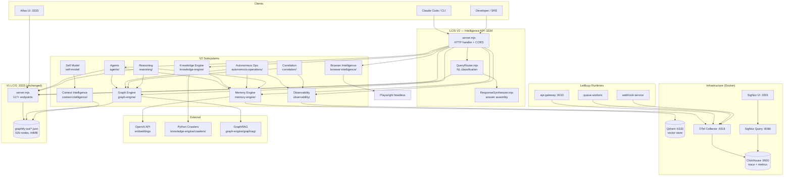

# LCIS V2 — Master Architecture Document

**Version:** 2.0.0  
**Last Updated:** 2026-06-19  
**Owner:** @saai-sidd  
**Port:** `:3334` (Intelligence API)  
**Location:** `tools/central-intelligence/`  
**Status:** Structurally complete; live telemetry NOT CONNECTED until OTel SDK wired in each runtime

---

## Executive Architecture Statement

LCIS V1 (tools/graph-server/, port 3333) is a rigorously built structural intelligence platform: 13 layers, 81 engine files, 117+ REST endpoints, 107 deterministic governance validators, 52,246-node code graph, 414 tables, 156 RPCs — answering every architectural question from pre-computed JSON artifacts at sub-millisecond latency. Its hard limitation: **structurally complete, operationally blind**. All 7 live provider adapters are NOT CONNECTED. Knowledge is static at `pnpm graph:omega` build time. Agents are prompt files only (no execution runtime). The system cannot observe actual storefront behavior.

LCIS V2 closes every gap in V1 without replacing a single line of it. It layers on top of V1 as a composing intelligence platform:

- **Semantic Memory** — vector search over all governance, runbooks, security, and knowledge documents
- **Autonomous Knowledge Acquisition** — continuous crawling via Python crawlers, auto-ingested into memory
- **Graph-Native Reasoning** — entity relationship extraction from docs; "what breaks if X" with relationship evidence
- **Browser Intelligence** — real browser observation of live storefronts and checkout flows, no guessing
- **Structured Observability** — OTel traces, metrics, logs collected through SigNoz; PII-safe at the collector
- **Autonomous Agent Runtime** — 5 typed agents (knowledge, security, operations, merchant, release) with shared memory
- **Context Intelligence** — compressed context maps for AI consumption (top-300 files by PageRank)
- **Reasoning Engine** — multi-step chains: dependency, operational, incident, architecture, deployment, security
- **Correlation Engine** — links code changes to runtime anomalies, predicts impact before deployment
- **Autonomous Operations** — anomaly, drift, dependency-risk, degradation detectors; ranked recommendations
- **Self-Model** — LCIS introspects itself; tracks capabilities, gaps, and subsystem topology
- **Intelligence API** — single HTTP entry point on `:3334` composing V1 + all V2 subsystems

The **NOT CONNECTED contract** from V1 is inherited: every live value is either real-source or explicitly labeled `NOT CONNECTED + the exact env var`. Nothing is fabricated.

---

## Architecture Principles

### 1. Layer-Over, Don't Replace
V2 runs on port `:3334`. V1 continues unchanged on `:3333`. Every V2 subsystem that needs structural intelligence fetches it from V1 endpoints (`LCIS_V1_URL`). No V1 file is modified. This preserves the 107-validator gate and ensures V1 remains the authoritative structural source.

### 2. Technology as Hidden Primitives
Qdrant, GraphRAG, Crawl4AI, Playwright, SigNoz, OpenTelemetry — none of these are first-class concepts in the V2 API surface. Every caller sees only V2 service abstractions: MemoryRetriever, GraphQueryEngine, BrowserIntelligenceEngine, TelemetryService. Swapping the underlying technology requires no API change.

### 3. NOT CONNECTED Contract
Inherited from V1 and strengthened. The rule: if a live value requires a running service or credential to produce, the response must either contain the real value (when connected) or the string `NOT CONNECTED` plus the exact env var name that would connect it. No responses contain estimates or fabricated metrics.

### 4. Fail-Graceful Subsystems
Every subsystem is loaded lazily (`loadModule(relPath)`) at the Intelligence API layer. A missing module (npm not installed, Python dep absent) returns a 503 with a clear error — it never crashes the server. Agents follow the same pattern: each `assembleContext()` call catches individual source failures and degrades gracefully without propagating errors.

### 5. Production-Grade Defaults
- Node.js >= 20 (ES modules throughout)
- Headless browser (`PLAYWRIGHT_HEADLESS=true` default)
- CORS locked to `localhost:3000/3001/3333/3334`
- OTel collector strips `authorization`, `cookie`, `set-cookie`, `x-api-key`, `enduser.id`, `enduser.email`, `user.email`, `user.name` before export
- Only `site_id` survives as tenant identifier in telemetry

---

## Full System Diagram



---

## The 13 Subsystems

### 1. Memory Engine (`memory-engine/`)

**Purpose:** Provides semantic vector memory for all of LCIS. Replaces the V1 keyword-matching memory with cosine-similarity search over OpenAI embeddings. The only component that knows about Qdrant.

**Key Services:**
- `MemoryService.mjs` — singleton; owns Qdrant connection, all embed/search/ingest/delete operations
- `MemoryIndexer.mjs` — reads governance docs, runbooks, security docs, central-intelligence docs, lcis-v2 docs and ingests them into collections in 1000-char overlapping chunks
- `MemoryRetriever.mjs` — public retrieval surface: `retrieve(query, options)` → ranked hits with payload
- `MemoryIngestionPipeline.mjs` — batched ingestion from text or file; supports `runFromText()` for POST payloads
- `MemoryHealthMonitor.mjs` — checks Qdrant connectivity, returns per-collection point counts and latency

**Qdrant Collections (8):**

| Collection | Description |
|-----------|-------------|
| `architecture` | Governance docs, AGENTS.md, LETBUYY_CONSTITUTION.md, CLAUDE.md, architectural decisions |
| `runbooks` | Operational runbooks, incident response, recovery playbooks, escalation docs |
| `incidents` | Historical incident records, post-mortems, root cause analyses, timelines |
| `security` | Security policies, RLS definitions, OAuth flows, webhook signing, vulnerability docs |
| `deployments` | Deployment manifests, CI/CD pipeline docs, environment configs, release procedures |
| `knowledge` | General platform knowledge, API docs, data models, integration guides |
| `merchants` | Merchant onboarding, control plane docs, store configuration guides |
| `themes` | Theme engine docs, Liquid template specs, preset configs, Urban Kicks theme data |

All collections use `text-embedding-3-small`, 1536 dimensions, Cosine distance. Embedding is disabled and returns null when `OPENAI_API_KEY` is absent — the NOT CONNECTED contract is enforced inside `MemoryService.embed()`.

**Endpoints exposed by Intelligence API:**
- `GET /intelligence/memory/search?q=&collection=&limit=`
- `POST /intelligence/memory/ingest` `{text, collection, metadata}`
- `GET /intelligence/memory/health`
- `GET /intelligence/memory/stats`

**Integration Points:** All 5 agents import `MemoryRetriever` directly. `QueryRouter` calls `MemoryRetriever.retrieve()` for every `/intelligence/ask` request.

---

### 2. Knowledge Engine (`knowledge-engine/`)

**Purpose:** Continuous autonomous knowledge acquisition. Runs Python crawlers (Crawl4AI hidden) on a schedule, collects structured markdown from external and internal doc sources, and ingests output into the Memory Engine.

**Key Services:**
- `KnowledgeAcquisitionService.mjs` — spawns Python crawler scripts, pipes stdout to `MemoryIngestionPipeline`; per-source schedules via `setInterval`
- `KnowledgeSourceRegistry.mjs` — catalog of named knowledge sources with crawl schedules, URLs, and target collections
- `KnowledgeFreshnessService.mjs` — tracks last-crawl timestamps per source, returns stale sources
- `KnowledgeChangeDetector.mjs` — diff-based detection; re-ingests only changed content
- `KnowledgeScheduler.mjs` — schedules `crawlSource()` calls at declared intervals

**Crawlers:** Python scripts at `knowledge-engine/crawlers/<sourceKey>-crawler.py`. Output is JSON lines written to `graphify-out/knowledge-crawls/`. The Knowledge Engine ingests them into the `knowledge` collection.

**Endpoints:**
- `GET /intelligence/knowledge/search?q=` — semantic search over `knowledge` collection
- `POST /intelligence/knowledge/crawl` `{sourceKey}` — trigger immediate crawl
- `GET /intelligence/knowledge/sources` — list registered sources with freshness
- `GET /intelligence/knowledge/freshness` — per-source staleness report

---

### 3. Graph Engine (`graph-engine/`)

**Purpose:** Entity relationship extraction and graph-native reasoning over LCIS knowledge. GraphRAG (Microsoft) is a hidden primitive — callers see `GraphQueryEngine` and `GraphExplorer`.

**Key Services:**
- `GraphBuilder.mjs` — orchestrates GraphRAG index construction from LCIS docs + domain-intel.json + knowledge crawls. Runs `python3 -m graphrag index --root graph-engine/graphrag/`. Three build modes: `buildFromLCIS()`, `buildFromKnowledge()`, `buildFull()`. Build timeout: 30 minutes.
- `GraphQueryEngine.mjs` — queries the GraphRAG index; supports `global` (community-level summary) and `local` (entity-level) methods
- `GraphExplorer.mjs` — `whatBreaksIf(entity)` and `explainEntity(name)` semantic impact queries
- `GraphDiagnostics.mjs` — `getHealth()` probe; checks if the GraphRAG output artifacts exist and are non-empty
- `GraphIndexer.mjs` — incremental re-indexing when source documents change

**Artifacts (gitignored):**
- `graph-engine/graphrag/input/` — source documents copied before each build
- `graph-engine/graphrag/output/artifacts/*.parquet` — entities, relationships, communities

**Endpoints:**
- `GET /intelligence/graph/query?q=&method=`
- `GET /intelligence/graph/impact?entity=`
- `GET /intelligence/graph/entities?name=`
- `GET /intelligence/graph/health`

**Cost note:** Full GraphRAG build consumes OpenAI API tokens for entity extraction. Estimated $0.50–$2.00 per full build with `gpt-4o-mini`. Build on schedule, not per-commit.

---

### 4. Browser Intelligence (`browser-intelligence/`)

**Purpose:** Real browser observation of live storefronts, themes, and checkout flows. Playwright is the hidden primitive. Evidence (screenshot, HTML, console logs, network errors) is written to `graphify-out/browser-evidence/<date>/<label>/`.

**Key Services:**
- `BrowserIntelligenceEngine.mjs` — main façade; `validateStore()`, `validateTheme()`, `validateCheckout()`, `runHealthCheck()`, `captureEvidence()`, `getStatus()`
- `agents/ThemeAgent.mjs` — renders theme, checks H1/nav/mobile/fonts/images
- `agents/CheckoutAgent.mjs` — walks checkout flow, halts before any payment gateway redirect
- `agents/StoreAgent.mjs` — full store health: HTTP status, title, H1, HTTPS, console errors

**Safety contracts (hard-coded in engine):**
- `PLAYWRIGHT_HEADLESS=true` by default — overridden only by env var
- Checkout agent halts at gateway redirect — no payment execution ever
- No cookie injection, no session injection, no authenticated crawls
- User-Agent identifies as `LCIS-BrowserIntelligence/2.0` — transparent to site operators
- `BROWSER_INTELLIGENCE_TIMEOUT=30000ms` per navigation

**Session management:** `SessionPool` class; one browser per operation, closed in `finally` block. Never re-uses sessions across callers.

**Endpoints:**
- `GET /intelligence/browser/validate?url=`
- `GET /intelligence/browser/theme?url=&themeId=`
- `GET /intelligence/browser/checkout?url=`
- `GET /intelligence/browser/status`

---

### 5. Observability (`observability/`)

**Purpose:** Distributed tracing, metrics, anomaly detection, and incident detection for LetBuyy runtimes. OTel SDK is the hidden primitive; SigNoz provides the storage and query backend.

**Key Services:**
- `TelemetryService.mjs` — initializes `NodeSDK` with `OTLPTraceExporter` pointing at `OTEL_EXPORTER_OTLP_ENDPOINT`; emits only `site_id` as tenant identifier; never emits PII
- `TracingService.mjs` — creates named tracers per service; provides `withSpan(name, fn)` wrapper
- `MetricsService.mjs` — OpenTelemetry Metrics API for counters, histograms, gauges
- `AnomalyDetectionService.mjs` — statistical anomaly detection (`ANOMALY_SIGMA_THRESHOLD` std-dev baseline); `getAllAnomalies()` returns current signals
- `IncidentDetectionService.mjs` — reads incidents from `graphify-out/incidents.jsonl`; detects error rate > `INCIDENT_ERROR_RATE_THRESHOLD` and slow queries > `INCIDENT_SLOW_QUERY_MS`
- `HealthService.mjs` — aggregate health: probes Qdrant, V1 LCIS, OTel collector; returns `HEALTHY/DEGRADED/DOWN`; `getProductionHealth()` marks live sources NOT CONNECTED where telemetry is absent
- `instrument-api-gateway.mjs` — OTel instrumentation bootstrap for the `api-gateway` service
- `otel-collector-signoz.yml` — OTel Collector configuration; see collector section below

**OTel Collector pipeline:**

| Pipeline | Receivers | Processors | Exporters |
|----------|----------|-----------|----------|
| traces | otlp (grpc:4317, http:4318) | memory_limiter, attributes/redaction, batch | clickhouse, debug |
| metrics | otlp | memory_limiter, batch | prometheus (:9464), debug |
| logs | otlp | memory_limiter, attributes/redaction, batch | clickhouse, debug |

**Redaction (attributes/redaction processor):** Deletes `authorization`, `cookie`, `set-cookie`, `x-api-key`, `enduser.id`, `enduser.email`, `user.email`, `user.name` before any export. Only `site_id` survives as tenant context.

**Endpoints:**
- `GET /intelligence/observability/health`
- `GET /intelligence/observability/incidents`
- `GET /intelligence/observability/anomalies`

---

### 6. Agents (`agents/`)

**Purpose:** Autonomous agent runtime with shared intelligence pipeline. 5 typed agents, each backed by the same `AgentFramework` base class that assembles context from Memory + Graph + V1 LCIS + Health in parallel.

**AgentFramework base (`AgentFramework.mjs`):**
```
assembleContext(question) → {
  memory:  MemoryRetriever.retrieveForContext(question),
  graph:   GraphQueryEngine.queryLocal(question),
  health:  HealthService.getHealth(),
  lcis:    fetchV1("/api/search-v2?q="),
  sources: [ ... ]
}
```
Each source is caught individually — one failure never propagates. The agent builds its answer from available sources and reports confidence.

**Agent implementations:**

| Agent | File | Strategy keywords | V1 endpoints consulted |
|-------|------|------------------|----------------------|
| `knowledge` | `KnowledgeAgent.mjs` | architecture, explain, domain, overview, onboard | `/api/explain`, `/api/workspace`, `/api/unified-intelligence` |
| `security` | `SecurityAgent.mjs` | security, rls, auth, oauth, jwt, attack, xss | `/api/security-intelligence`, `/api/security`, `/api/audit` |
| `operations` | `OperationsAgent.mjs` | what breaks, blast, impact, incident, recover, failing | `/api/blast`, `/api/runbook`, `/api/operations` |
| `merchant` | `MerchantAgent.mjs` | merchant, store, tenant, onboarding, billing | `/api/merchant-intelligence`, `/api/merchant-health` |
| `release` | `ReleaseAgent.mjs` | launch, deploy, ready, production, release, ship | `/api/launch-command-center`, `/api/production-readiness-v2` |

**Endpoints:**
- `GET /intelligence/agents/execute?agent=&q=`
- `GET /intelligence/agents/status`

---

### 7. Intelligence API (`intelligence-api/`)

**Purpose:** Single HTTP entry point on `:3334`. Zero external runtime dependencies — `node:http`, `node:url`, `node:path`, `node:fs` only. All subsystems loaded lazily at first request.

**Key modules:**
- `server.mjs` — HTTP server, 24 registered endpoints, CORS, unified error handling. `loadModule(relPath)` caches subsystem singletons; returns `null` on import failure (module unavailable → 503)
- `QueryRouter.mjs` — keyword-based question classification (8 rule categories + default), parallel V1 context assembly, V2 context assembly (memory + graph)
- `ResponseSynthesizer.mjs` — merges V1 structural data + V2 semantic memory + agent output into final answer

**All registered endpoints:**

| Method | Path | Handler |
|--------|------|---------|
| GET | `/intelligence/health` | HealthService aggregate |
| GET | `/intelligence/status` | subsystem matrix + V1 stats |
| GET | `/intelligence/memory/search?q=&collection=&limit=` | MemoryRetriever |
| POST | `/intelligence/memory/ingest` | MemoryIngestionPipeline |
| GET | `/intelligence/memory/health` | MemoryHealthMonitor |
| GET | `/intelligence/memory/stats` | MemoryHealthMonitor metrics |
| GET | `/intelligence/knowledge/search?q=` | MemoryRetriever (knowledge collection) |
| POST | `/intelligence/knowledge/crawl` | KnowledgeAcquisitionService |
| GET | `/intelligence/knowledge/sources` | KnowledgeSourceRegistry |
| GET | `/intelligence/knowledge/freshness` | KnowledgeFreshnessService |
| GET | `/intelligence/graph/query?q=&method=` | GraphQueryEngine |
| GET | `/intelligence/graph/impact?entity=` | GraphExplorer |
| GET | `/intelligence/graph/entities?name=` | GraphExplorer |
| GET | `/intelligence/graph/health` | GraphDiagnostics |
| GET | `/intelligence/browser/validate?url=` | BrowserIntelligenceEngine |
| GET | `/intelligence/browser/theme?url=&themeId=` | ThemeAgent |
| GET | `/intelligence/browser/checkout?url=` | CheckoutAgent |
| GET | `/intelligence/browser/status` | BrowserIntelligenceEngine |
| GET | `/intelligence/observability/health` | HealthService |
| GET | `/intelligence/observability/incidents` | incidents.jsonl reader |
| GET | `/intelligence/observability/anomalies` | AnomalyDetectionService |
| GET | `/intelligence/agents/execute?agent=&q=` | AGENT_MAP dispatcher |
| GET | `/intelligence/agents/status` | all agents capability report |
| GET | `/intelligence/ask?q=` | QueryRouter + ResponseSynthesizer |

---

### 8. Context Intelligence (`context-intelligence/`)

**Purpose:** Compressed context maps for AI model consumption. Reads `graphify-out/graph.json` (44MB, 52k nodes), runs PageRank, extracts top-300 files, and writes 5 artifacts to `graphify-out/context-intelligence/`.

**Key Services:**
- `RepositoryGraphBuilder.mjs` — builds file-level import graph from `graph.json`
- `DependencyGraphBuilder.mjs` — module-level dependency analysis, cycle detection
- `ArchitectureGraphBuilder.mjs` — extracts services, domains, layers, queues, workers
- `ContextOptimizer.mjs` — PageRank over the repo graph; ranks files by importance
- `ContextCompressionPipeline.mjs` — full pipeline orchestrator; produces the 5 artifacts
- `ContextAssembler.mjs` — assembles on-demand context windows for specific questions
- `TokenOptimizer.mjs` — trims assembled context to fit target token budgets
- `ContextHealthMonitor.mjs`, `ContextDiagnostics.mjs` — freshness and validity checks

**Output artifacts:**

| Artifact | Description |
|----------|-------------|
| `LCIS_CONTEXT_MAP.json` | Top-300 files by PageRank, role-classified (api-route, middleware, component, etc.) |
| `LCIS_ARCHITECTURE_GRAPH.json` | Services, domains, layers, queues, workers |
| `LCIS_DEPENDENCY_GRAPH.json` | Module nodes, edges, critical modules, cycle report |
| `LCIS_IMPORTANCE_RANKING.json` | Full file ranking with PageRank scores |
| `LCIS_CONTEXT_SUMMARY.md` | Human-readable repo overview (< 20k tokens) |

Run with: `npm run context:build` or `npm run context:map`

---

### 9. Reasoning (`reasoning/`)

**Purpose:** Multi-step reasoning chains over combined Memory + Graph + Observability + V1 data. Produces structured answers with evidence chains.

**Key Services:**
- `ReasoningEngine.mjs` — facade; routes questions to the correct specialist reasoner
- `DependencyReasoner.mjs` — "what does X depend on / what calls X" chains
- `OperationalReasoner.mjs` — "how does X work in production" chains
- `IncidentReasoner.mjs` — "why did X fail / how do I recover" chains
- `ArchitectureReasoner.mjs` — "what is the architecture of X / who owns X" chains
- `DeploymentReasoner.mjs` — "what is the deploy topology / what changed" chains
- `SecurityReasoner.mjs` — "what is the security posture of X / RLS gaps" chains

---

### 10. Correlation (`correlation/`)

**Purpose:** Cross-signal correlation — links code changes to runtime anomalies, predicts deployment impact before changes land.

**Key Services:**
- `IntelligenceCorrelationEngine.mjs` — master correlator; accepts change signals + anomaly signals
- `SignalCollector.mjs` — aggregates signals from Memory, Graph, Observability
- `ImpactPredictor.mjs` — uses Graph blast radius + historical incidents to predict impact
- `RootCauseAnalyzer.mjs` — root cause hypothesis ranking
- `RiskScorer.mjs` — combined risk score from structure + history + live signals

---

### 11. Autonomous Operations (`autonomous-operations/`)

**Purpose:** Self-healing detection, ranked recommendations, and autonomous reporting. Four detectors assess the platform continuously; the Recommendation Engine ranks findings by impact.

**Key Services:**
- `AnomalyDetector.mjs` — detects statistical deviations in telemetry signals (structural topology, live NOT CONNECTED)
- `DriftDetector.mjs` — detects architecture drift from declared state (govenance violations, import drift)
- `DependencyRiskDetector.mjs` — identifies high-blast-radius dependencies in recent changes
- `DegradationDetector.mjs` — performance degradation patterns from OTel metrics
- `RecommendationEngine.mjs` — ranks findings by severity × blast radius; produces ordered fix list
- `OperationsReasoningEngine.mjs` — facade; orchestrates all four detectors → RecommendationEngine → report
- `IntelligenceReportGenerator.mjs` — generates the daily intelligence report artifact

---

### 12. Self-Model (`self-model/`)

**Purpose:** LCIS V2 models itself — introspects its own subsystem topology, file counts, declared layers vs. actual files, and capability gaps.

**Key Services:**
- `SelfModelBuilder.mjs` — scans `tools/central-intelligence/` subsystem directories; maps 13 declared layers to actual `.mjs` file counts; reads `graphify-out/*.json` for stats; writes 5 structured JSON artifacts to `graphify-out/self-model/`
- `SelfDiagnostics.mjs` — runs a self-check: are all declared subsystems present? What is missing?
- `PlatformExplainer.mjs` — generates human-readable capability descriptions from the self-model

**The 13 declared layers** (from `SelfModelBuilder` `DECLARED_LAYERS`):
Memory, Knowledge, Graph, Browser, Observability, Agents, Context, Architecture, Reasoning, Correlation, AutonomousOps, SelfModel, IntelligenceAPI

---

### 13. Architecture Intelligence (`architecture-intelligence/`)

**Purpose:** Architecture-level discovery — service topology, domain mapping, layer discovery, dependency analysis, and drift detection from the codebase.

**Key Services:**
- `ArchitectureIntelligenceEngine.mjs` — master; produces architecture snapshot
- `ServiceDiscovery.mjs` — identifies all Next.js apps, Hono services, Cloudflare Workers
- `DomainDiscovery.mjs` — maps files to the 22 LetBuyy business domains
- `LayerDiscovery.mjs` — identifies architectural layers (API, UI, data, middleware)
- `DependencyDiscovery.mjs` — package.json + import analysis across the monorepo
- `ArchitectureDriftDetector.mjs` — compares current state to last snapshot; flags new violations
- `ArchitectureSnapshotService.mjs` — persists architecture snapshots to `graphify-out/`

---

## Data Architecture

### Qdrant Vector Collections

All 8 collections use identical vector configuration:
- **Vector size:** 1536 (matches `text-embedding-3-small`)
- **Distance:** Cosine
- **Optimizer:** `default_segment_number: 2`
- **Replication:** 1 (local dev); Qdrant Cloud multi-node for production

Chunk strategy in `MemoryIndexer`: 1000 chars max, 100-char overlap, min 20 chars, split on blank lines first.

### Knowledge Graph (GraphRAG)

- **Input:** docs/central-intelligence/ + domain-intel.json + knowledge-crawls/
- **Output:** `graph-engine/graphrag/output/artifacts/*.parquet` (entities, relationships, communities)
- **Build timeout:** 30 minutes
- **Cost:** ~$0.50–$2.00 per full build (OpenAI API, `gpt-4o-mini`)
- **Gitignored:** input/, output/, cache/, logs/ — rebuild on demand

### Telemetry Store (ClickHouse via SigNoz)

- **Tables:** `signoz_traces.signoz_index_v3`, `signoz_traces.signoz_logs`, `signoz_traces.signoz_metrics`
- **TTL:** 90 days (2160 hours)
- **Prometheus scrape:** `:9464/metrics`, namespace `letbuyy`
- **PII:** stripped at collector by `attributes/redaction` processor before ClickHouse write

### Context Intelligence Artifacts (graphify-out/context-intelligence/)

Five JSON/Markdown files built by `ContextCompressionPipeline`. Gitignored. Rebuilt by `npm run context:build`.

### Incident Log

`graphify-out/incidents.jsonl` — newline-delimited JSON. Last 50 lines served by `/intelligence/observability/incidents`. Written by `IncidentDetectionService`.

---

## Deployment Architecture

### Local Development

```
docker compose up -d qdrant signoz-otel-collector signoz-clickhouse
npm start                          # tools/central-intelligence/
pnpm dev                           # repo root — all apps including V1 :3333
```

Services on localhost:

| Port | Service |
|------|---------|
| 3333 | LCIS V1 Intelligence API (graph-server/) |
| 3334 | LCIS V2 Intelligence API (central-intelligence/) |
| 6333 | Qdrant REST + Dashboard |
| 6334 | Qdrant gRPC |
| 4317 | OTel Collector gRPC |
| 4318 | OTel Collector HTTP |
| 3301 | SigNoz UI |
| 8080 | SigNoz Query Service |
| 8123 | ClickHouse HTTP |
| 9000 | ClickHouse native |
| 9464 | Prometheus metrics scrape |

### Staging / Production

- Qdrant: Qdrant Cloud (managed, no Docker in prod)
- Telemetry: SigNoz Cloud (no self-hosted ClickHouse in prod)
- Intelligence API: Node.js process on a dedicated VM or Fly.io instance
- Python crawlers + GraphRAG: scheduled batch jobs (cron or GitHub Actions scheduled workflow)
- V1 LCIS: unchanged — static process serving `graphify-out/*.json`

See `docs/lcis-v2/LCIS_DEPLOYMENT_GUIDE.md` for full staging/production configuration.

---

## Security Architecture

### Credential Surface

| Credential | Location | Scope |
|-----------|---------|-------|
| `OPENAI_API_KEY` | `.env` (gitignored) | Embeddings + GraphRAG entity extraction |
| `QDRANT_API_KEY` | `.env` (gitignored) | Qdrant authentication (optional for local, required for cloud) |
| `QDRANT__SERVICE__API_KEY` | Docker env | Qdrant service-side key |

`.env` is listed in `tools/central-intelligence/.gitignore`. `.env.example` contains only placeholder values (no real keys). `setup.sh` validates `OPENAI_API_KEY` is set before proceeding; exits with error if absent.

### Network Isolation

- Qdrant, ClickHouse, SigNoz services run on the `letbuyy-intelligence` Docker bridge network — not exposed externally in production
- CORS: Intelligence API allows only `localhost:3000/3001/3333/3334` — no wildcard origins
- Browser Intelligence: outbound to storefront URLs only; no inbound ports; no webhook registration

### OTel PII Redaction

The `attributes/redaction` processor in `otel-collector-signoz.yml` deletes before export:
- `authorization`, `cookie`, `set-cookie`, `x-api-key` (auth headers)
- `enduser.id`, `enduser.email`, `user.email`, `user.name` (identity fields)

Only `site_id` is permitted as tenant context in telemetry. This is enforced at the collector, not in application code, making it bypass-proof even if a service accidentally emits a PII field.

### Browser Intelligence Constraints

- No payment execution: checkout agent halts before gateway redirect
- No authenticated crawls: no session tokens injected
- Headless by default: `PLAYWRIGHT_HEADLESS=true` — visual access not possible in CI
- Transparent user-agent: `LCIS-BrowserIntelligence/2.0` — not impersonating a real browser
- Evidence output: local only (`graphify-out/browser-evidence/`) — never transmitted

See `docs/lcis-v2/LCIS_SECURITY_MODEL.md` for complete threat model.

---

## Integration with V1 LCIS

V2 is explicitly designed to layer over V1 without modifying it. Integration points:

### QueryRouter V1 Fetching
`QueryRouter.mjs` classifies every natural-language question and fetches 2–3 V1 endpoints in parallel (2s timeout, fail-safe). Results are passed to `ResponseSynthesizer` alongside V2 memory and graph context.

### AgentFramework LCIS V1 Call
Every agent calls `useLCISV1('/api/search-v2?q=...')` as one of its context sources. The result enriches the agent answer; a V1 failure degrades gracefully.

### HealthService V1 Probe
`HealthService.getHealth()` includes a V1 connectivity check (fetches `/api/stats` with 5s timeout). The aggregate health shows `DEGRADED` if V1 is down.

### Intelligence API V1 Proxy
`fetchV1(path)` in `server.mjs` with 3s timeout — used by `/intelligence/status` to include V1 stats in the status payload.

---

## Environment Variables Reference

| Variable | Default | Required | Description |
|----------|---------|---------|-------------|
| `OPENAI_API_KEY` | — | **YES** | OpenAI Embeddings API + GraphRAG entity extraction |
| `QDRANT_URL` | `http://localhost:6333` | No | Qdrant instance URL |
| `QDRANT_API_KEY` | — | No | Qdrant API key (required for Qdrant Cloud) |
| `EMBED_MODEL` | `text-embedding-3-small` | No | OpenAI embedding model |
| `EMBED_DIMENSIONS` | `1536` | No | Vector dimensions (must match model) |
| `OTEL_EXPORTER_OTLP_ENDPOINT` | `http://localhost:4318` | No | OTel Collector OTLP HTTP endpoint |
| `OTEL_SERVICE_NAME` | `lcis-intelligence` | No | Service name in traces |
| `OTEL_ENVIRONMENT` | `development` | No | Environment tag on spans |
| `PLAYWRIGHT_HEADLESS` | `true` | No | Run browsers headless |
| `BROWSER_INTELLIGENCE_TIMEOUT` | `30000` | No | Per-page navigation timeout (ms) |
| `INCIDENT_ERROR_RATE_THRESHOLD` | `0.05` | No | Error rate fraction triggering incident signal |
| `INCIDENT_SLOW_QUERY_MS` | `5000` | No | DB query duration (ms) triggering slow-query event |
| `ANOMALY_SIGMA_THRESHOLD` | `3.0` | No | Std-dev threshold for anomaly signals |
| `LCIS_V2_PORT` | `3334` | No | Intelligence API port |
| `LCIS_V1_URL` | `http://localhost:3333` | No | V1 LCIS proxy target |

---

## Maturity Roadmap

| Capability | Current State | Next Milestone |
|-----------|--------------|---------------|
| Semantic memory (8 collections) | Structurally complete | Connect OPENAI_API_KEY → first indexAll() run |
| Knowledge crawlers | Framework complete | Write per-source crawler scripts |
| GraphRAG index | Builder complete | First `buildFull()` run after pip install |
| Browser Intelligence | Engine + 3 agents complete | Wire into CI for theme validation |
| OTel instrumentation | TelemetryService complete | Wire into api-gateway via instrument-api-gateway.mjs |
| Agent runtime | 5 agents complete | Schedule KnowledgeAgent for daily knowledge refresh |
| Context maps | Pipeline complete | Run context:build after graphify update |
| Self-model | Builder complete | Schedule self:model weekly |
| Reasoning chains | 6 reasoners complete | Integrate into /intelligence/ask routing |
| Correlation engine | 4 detectors complete | Connect to live OTel stream |
| Autonomous Ops | Detectors + recs complete | Schedule daily IntelligenceReportGenerator |
| Live telemetry | NOT CONNECTED (all 7 providers) | Wire OTel SDK in api-gateway (first runtime) |
