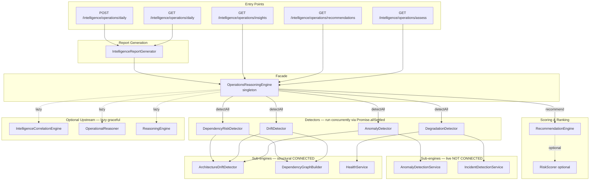

# LCIS Autonomous Operations — Authoritative Reference

**Maintainer:** Principal SRE / Architecture  
**Layer:** LCIS v5 / OMEGA — Autonomous Detection & Recommendation  
**Source path:** `tools/central-intelligence/autonomous-operations/`  
**Last verified:** 2026-06-19 (daily report `graphify-out/autonomous-operations/daily-intelligence-2026-06-19.md`)

---

## 1. Purpose

The Autonomous Operations subsystem is LCIS's self-driving SRE layer. It continuously assesses the system's structural health and live signal connectivity, produces ranked engineering recommendations, and generates daily intelligence reports — all without requiring a human to manually query the graph or grep the codebase.

It does NOT operate on mocked data. Every finding is either:

- **CONNECTED** — derived from the live code/dependency graph (topology, blast-radius, drift, cycles) and therefore accurate at the time the graph was last indexed; or
- **NOT CONNECTED** — a structural probe that requires a live telemetry or infrastructure credential to resolve, reported honestly as such with the exact environment variable required.

The operating contract is simple: LCIS tells you what it knows with evidence, and tells you exactly what it cannot know yet and why.

---

## 2. Architecture

### Component overview



### Posture formula

`OperationsReasoningEngine.assess()` computes the overall posture after all four detectors complete:

| Condition | Posture |
|-----------|---------|
| Any finding with severity `critical` AND `connected: true` | `DEGRADED` |
| Any finding with severity `high` AND `connected: true` | `AT RISK` |
| No connected critical or high findings | `STABLE` |

Posture is evaluated in priority order: `DEGRADED` beats `AT RISK` beats `STABLE`. A `DEGRADED` posture signals that a structurally verifiable, high-blast-radius risk exists — it is not a claim that the production system is broken right now.

---

## 3. Detection Types

All four detectors run concurrently inside `OperationsReasoningEngine.detectAll()` via `Promise.allSettled`. A detector failure is isolated; remaining results are normalized and ranked.

### Full detection matrix

| Detector | Sub-method | Type | Connected | Signal source |
|----------|-----------|------|-----------|---------------|
| `AnomalyDetector` | `detectStatistical()` | Statistical — HTTP, DB, queue, payment, worker metrics | NOT CONNECTED | `AnomalyDetectionService` — requires `OTEL_EXPORTER_OTLP_ENDPOINT`; returns info-severity when metric windows empty |
| `AnomalyDetector` | `detectStructural()` | Structural — blast-radius, layer violations, high coupling, money-domain | CONNECTED | `ArchitectureDriftDetector.getArchitectureRiskReport()` from code graph |
| `DriftDetector` | `#detectArchitecture()` | Topology drift vs. last snapshot | CONNECTED (NOT CONNECTED if no snapshot — run `pnpm graph:infra` first) | `ArchitectureDriftDetector.detectDriftFromLatest()` + `generateDriftReport()` |
| `DriftDetector` | `detectDependencyDrift()` | New dependency delta ≥ 5 = high severity | CONNECTED | `ArchitectureDriftDetector.getArchitectureRiskReport()` blast-radius risks |
| `DriftDetector` | `detectConfigDrift()` | Wrangler binding/var/kv/d1/queue diff vs. `graphify-out/autonomous-operations/config-snapshot.json` | CONNECTED (local); live deployed config NOT CONNECTED | Scans all `wrangler.toml` in `apps/`, `services/`, `workers/`; persists new baseline on first run; requires `CLOUDFLARE_API_TOKEN` for live comparison |
| `DependencyRiskDetector` | `getSinglePointsOfFailure()` | In-degree ≥ 4 in dependency graph; known LCIS hotspots always included | CONNECTED | `DependencyGraphBuilder._dependents` map + hardcoded symbols: `getSupabaseAdmin` (115 files), `create_checkout_order`, `signQueueTenantEnvelope`, `verifySiteOwnership` |
| `DependencyRiskDetector` | `getCycles()` | DFS cycle detection on dependency graph | CONNECTED | `DependencyGraphBuilder._deps` Map |
| `DependencyRiskDetector` | `#getArchitectureRisks()` | Money-domain + high-coupling categories | CONNECTED | Architecture risk report |
| `DegradationDetector` | `detectFromHealth()` | Per-subsystem health status; DOWN → critical, DEGRADED → high | CONNECTED | `HealthService.getHealth()` — local LCIS health endpoint |
| `DegradationDetector` | `detectFromMetrics()` | HTTP error rate, DB slow queries, queue backlog, payment failures, worker crashes | NOT CONNECTED | See `NOT_CONNECTED_SOURCE` map below |

### DegradationDetector — NOT_CONNECTED_SOURCE map

| Metric check | Threshold | Required credential |
|-------------|-----------|-------------------|
| `http-error-rate` | > 5% | `OTEL_EXPORTER_OTLP_ENDPOINT` |
| `db-slow-queries` | > 5000 ms | `DATABASE_URL` + `SUPABASE_SERVICE_ROLE_KEY` |
| `queue-backlog` | > 1000 items | `CLOUDFLARE_ACCOUNT_ID` + `CLOUDFLARE_API_TOKEN` |
| `payment-failures` | > 10% | `RAZORPAY_WEBHOOK_SECRET` |
| `worker-crashes` | heartbeat gap > 5 min | `CLOUDFLARE_API_TOKEN` |

### AnomalyDetector — statistical probe metrics

All six metrics are NOT CONNECTED until `OTEL_EXPORTER_OTLP_ENDPOINT` is configured:

| Metric | Purpose |
|--------|---------|
| `http.request.duration_ms` | Request latency baseline |
| `http.error_rate` | Error rate anomaly |
| `db.query.duration_ms` | Database latency |
| `queue.depth` | Queue saturation |
| `payment.failure_rate` | Payment error detection |
| `worker.heartbeat_gap_ms` | Worker liveness |

When metric windows are empty the detector emits a single `info`-severity finding: "No live metric samples ingested."

### AnomalyDetector — structural constants

| Constant | Value |
|----------|-------|
| `HIGH_COUPLING_THRESHOLD` | 5 dependents |
| `ORPHAN_ROUTE_PATTERN` | `/\/(api|routes?)\//i` |

---

## 4. Recommendation Engine

### Ranking formula

`RecommendationEngine.recommend()` scores each finding and sorts descending:

```
score = severityBase × min(10, blastFactor) × urgencyFactor × connectedBonus
```

| Factor | Values |
|--------|--------|
| `SEVERITY_SCORE` | critical = 100, high = 50, medium = 20, low = 5, info = 1 |
| `blastFactor` | blast-radius fan-out, capped at 10 |
| `urgencyFactor` | P0 = 4, P1 = 3, medium = 2, else = 1 |
| `connectedBonus` | 1.5 if `connected: true`; 1.0 if NOT CONNECTED |

Connected findings receive a 1.5× bonus. This ensures that structurally verified blast-radius risks always rank above unresolved live-signal probes of the same nominal severity.

`getEngineeringRecommendations()` applies a post-filter: only connected findings are surfaced. NOT CONNECTED findings are present in the full assessment response but excluded from the engineering backlog so on-call engineers are not triaging phantom signals.

### Effort estimates by finding category

| Category | Effort estimate |
|----------|----------------|
| `blast-radius-guard` | 1–2 hours |
| `layer-violation` | 2–4 hours |
| `cycle` | 4–8 hours |
| `wire-telemetry` | 0.5–1 day |
| `rls` | 1–2 hours |
| `money-mutation` | 2–4 hours |
| `coupling` | 1–3 days |

### Recommendation templates by finding type

| Finding type | Recommendation template |
|-------------|------------------------|
| `statistical-not-connected` | Wire telemetry (OTEL endpoint) to enable live anomaly detection |
| `structural` / `spof` | Add blast-radius guard (circuit-breaker, versioned interface, feature flag) |
| `layer-violation` | Fix architectural layer violation (move code to correct layer) |
| `high-coupling` | Reduce coupling (extract shared interface, invert dependency) |
| `money-domain` | Audit ledger — confirm only SECURITY DEFINER RPCs mutate money tables |
| `cycle` | Break dependency cycle (introduce abstraction or invert control) |
| `drift` | Review drift report before next deploy |
| `subsystem-degradation` | Restore degraded subsystem (see runbook `/api/runbook?domain=`) |
| `metric-check-not-connected` | Connect live telemetry (exact env var listed per finding) |

---

## 5. Reports

`IntelligenceReportGenerator` produces four report artifacts. All writes go to `graphify-out/autonomous-operations/` (directory is gitignored; re-generate with `POST /intelligence/operations/daily` or `pnpm graph:reports`).

### Report types

| Report | Output path | Trigger | Content |
|--------|-------------|---------|---------|
| Daily intelligence | `daily-intelligence-YYYY-MM-DD.md` | `generateDailyReport()` — called via POST endpoint | Overall posture, total findings by severity, recommendation count, connected vs. not-connected signal breakdown, critical finding list, DEGRADED posture explanation |
| Operational insights | `operational-insights.json` | `generateOperationalInsights()` | `{posture, criticalCount, highCount, notConnectedSignals, topActions, insights}` — structured for on-call consumption |
| Engineering recommendations | `engineering-recommendations.md` | `generateEngineeringRecommendations()` | Ranked connected findings only; effort estimates; priority mapping |
| Incident intelligence | `incident-intelligence-{domain}-{date}.md` | `generateIncidentIntelligenceReport(incident)` | Fetches from LCIS V1 `/api/incident-intelligence` and `/api/cross-domain`; includes recovery playbook steps with escalation chain |

`getLatestReport()` reads the most recent daily report from the filesystem by filename sort, returning it for the GET endpoint without re-running assessment.

### 2026-06-19 daily report — actual figures

| Metric | Value |
|--------|-------|
| Generated | 2026-06-19T17:56:51.398Z |
| Overall posture | DEGRADED |
| Total findings | 58 |
| Critical findings | 20 |
| High findings | 30 |
| Recommendations generated | 47 |
| Connected structural findings | 52 |
| NOT CONNECTED live signals | 0 |
| Informational findings | 6 |

**Representative critical findings from that report:**

| Symbol / Domain | Blast radius / Risk |
|-----------------|-------------------|
| `@letbuyy/shared-types` | 25 direct dependents |
| `@letbuyy/auth-core` | 16 direct dependents |
| `@letbuyy/ui` | 9 direct dependents |
| `@letbuyy/api-client` | 8 direct dependents |
| `gift-cards` domain | 3 money tables, 7 RPCs |
| `orders` domain | 3 money tables, 12 RPCs |
| `getSupabaseAdmin` | 115 files — highest blast-radius symbol in the codebase |

All 20 critical findings are structural (CONNECTED). Zero live metrics are connected, which is why `notConnectedSignals = 0` in the insights JSON — there are no false positives from probes that never ran; the system honestly reports that no live signal sources are wired yet.

---

## 6. API Endpoints

All endpoints are served by `server.mjs` under the LCIS intelligence layer. They are registered in the `ENDPOINTS` array and available at `http://localhost:3333` during local development.

| Method | Path | Handler | Purpose |
|--------|------|---------|---------|
| `GET` | `/intelligence/operations/assess` | `OperationsReasoningEngine.assess()` | Full assessment: all 4 detectors run concurrently, findings normalized, posture computed, recommendations ranked. Returns complete JSON payload including connected and NOT CONNECTED findings. |
| `GET` | `/intelligence/operations/recommendations` | `OperationsReasoningEngine.getEngineeringRecommendations()` | Engineering backlog: connected findings only, ranked by scoring formula. Safe for automated consumption (no NOT CONNECTED noise). |
| `GET` | `/intelligence/operations/insights` | `OperationsReasoningEngine.getOperationalInsights()` | On-call summary: `{posture, criticalCount, highCount, notConnectedSignals, topActions, insights}`. Designed for dashboards and paging integrations. |
| `GET` | `/intelligence/operations/daily` | `IntelligenceReportGenerator.getLatestReport()` | Returns the most recently generated daily intelligence Markdown report from filesystem. Does NOT trigger a new assessment. |
| `POST` | `/intelligence/operations/daily` | `IntelligenceReportGenerator.generateDailyReport()` | Triggers a fresh full assessment and writes a new dated Markdown report to `graphify-out/autonomous-operations/`. Use in CI or on a cron schedule. |

---

## 7. The Honesty Contract

### DEGRADED posture — what it means and what it does not mean

The 2026-06-19 report shows **DEGRADED** posture with 20 critical findings. This is an honest structural assessment, not an incident.

- `DEGRADED` means: at least one connected (structurally verified) critical finding exists. In this case, symbols like `getSupabaseAdmin` (115-file blast radius) and shared packages with 8–25 direct dependents represent real architectural concentration risk. Any regression in those symbols cascades widely.
- `DEGRADED` does NOT mean: production is down, orders are failing, or payment is broken. Live telemetry is entirely NOT CONNECTED, so there are no live error signals of any kind. The system may be running perfectly in production.
- The correct response to DEGRADED posture: review the engineering recommendations for blast-radius guards, audit money-domain RPCs, wire at least one live telemetry adapter so future DEGRADED signals can be validated or refuted by real data.

### Connected / NOT CONNECTED signal table

| Data category | Status | Reason / required env var |
|---------------|--------|--------------------------|
| Structural topology (code graph, imports, dependency fan-out) | CONNECTED | Indexed by Graphify — refresh with `pnpm graph:update` |
| Architecture drift (topology snapshot diff) | CONNECTED | `ArchitectureDriftDetector`; requires prior `pnpm graph:infra` run for baseline |
| Dependency risk (cycles, SPOF, blast-radius) | CONNECTED | `DependencyGraphBuilder` from code graph |
| LCIS subsystem health | CONNECTED | `HealthService.getHealth()` — local LCIS process |
| HTTP error rates / request latency | NOT CONNECTED | `OTEL_EXPORTER_OTLP_ENDPOINT` |
| Database slow queries | NOT CONNECTED | `DATABASE_URL` + `SUPABASE_SERVICE_ROLE_KEY` |
| Queue backlog depth | NOT CONNECTED | `CLOUDFLARE_ACCOUNT_ID` + `CLOUDFLARE_API_TOKEN` |
| Payment failure rate | NOT CONNECTED | `RAZORPAY_WEBHOOK_SECRET` |
| Worker health / heartbeat gap | NOT CONNECTED | `CLOUDFLARE_API_TOKEN` |
| Live deployed Cloudflare config | NOT CONNECTED | `CLOUDFLARE_API_TOKEN` (local wrangler.toml diff is CONNECTED) |

### Wiring live telemetry

To promote any NOT CONNECTED signal to CONNECTED, set the corresponding environment variable and restart LCIS (`pnpm graph:v5` to rebuild, then restart the Atlas server). The detector will automatically switch from "no data" informational findings to real threshold-crossing alerts.

The recommended first adapter to wire is `OTEL_EXPORTER_OTLP_ENDPOINT`: it unlocks all six statistical anomaly probes in `AnomalyDetector` and all five metric checks in `DegradationDetector` simultaneously — the highest coverage-per-credential ratio of any single credential in the stack.

### Known LCIS hotspots — always tracked regardless of graph freshness

These symbols are hardcoded as SPOF candidates in `DependencyRiskDetector` because their blast radius is high enough that they warrant perpetual monitoring regardless of the current graph state:

| Symbol | Confirmed blast radius |
|--------|----------------------|
| `getSupabaseAdmin` | 115 files |
| `create_checkout_order` | money RPC — canonical ledger entry point |
| `signQueueTenantEnvelope` | all async tenant jobs |
| `verifySiteOwnership` | all authenticated merchant operations |
| `@letbuyy/shared-types` | 25+ direct dependents |
| `@letbuyy/api-client` | 8+ direct dependents |
| `@letbuyy/ui` | 9+ direct dependents |

Any PR touching these symbols must run `pnpm graph:intel blast "<symbol>"` before merge.
