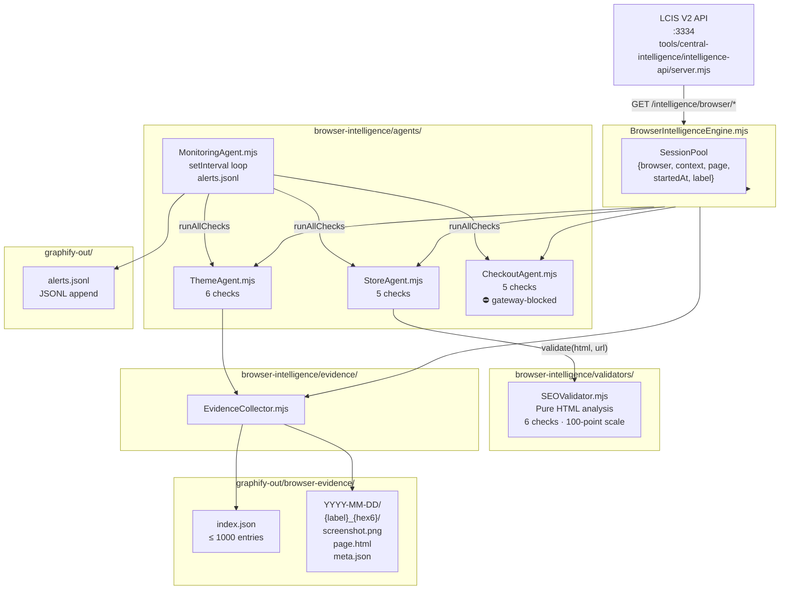

# LCIS Browser Intelligence

> **LCIS V2** · `tools/central-intelligence/` · Port **:3334**

---

## 1. Overview — Why Browser Intelligence Exists

The LetBuyy Central Intelligence System (LCIS) builds its knowledge of the platform through static analysis: the Graphify code graph, the DB intelligence layer, and the 22-domain model together answer architectural questions without touching a running store. That coverage is thorough but blind to runtime behavior. A store can pass every structural check and still fail in a browser: a misconfigured CDN serves broken images, a font fails to load over SSL, a navigation link returns 404, or a checkout form is missing the address field entirely. None of these failures are visible in source code.

The LCIS Browser Intelligence Engine fills that gap by launching a real browser, navigating to live store URLs, and observing actual rendered behavior. It answers questions that only a browser can answer: does the page paint correctly at 360 px, does add-to-cart work, are Open Graph tags present in the delivered HTML, does the custom domain resolve without a redirect loop? Every check is grounded in what a real user's browser would see — not what the source code or deployment config says should happen.

A second layer on top of the per-check agents provides continuous monitoring. The MonitoringAgent can watch any number of stores on a configurable interval, emit structured alerts when a check degrades or fails, and append those alerts to a persistent `graphify-out/alerts.jsonl` log so that the LCIS operations surfaces (Launch Command Center, AI-Ops, etc.) can surface real-world incidents alongside structural risk findings.

---

## 2. Architecture



**Data flow in brief:**
1. An API request (or a MonitoringAgent tick) reaches the engine.
2. The engine acquires a browser session from the SessionPool (viewport 1280×800, user-agent `LCIS-BrowserIntelligence/2.0`).
3. The appropriate agent runs its checks via `Promise.allSettled`, so a single failing check never prevents the others from completing.
4. Evidence (full-page screenshot, serialized HTML, console logs, network errors) is written by the EvidenceCollector to a date-partitioned directory under `graphify-out/browser-evidence/` and indexed in `index.json`.
5. The result object — with `overallStatus`, per-check results, and the evidence path — is returned to the caller.

---

## 3. Agents Reference

### 3.1 ThemeAgent

**File:** `tools/central-intelligence/browser-intelligence/agents/ThemeAgent.mjs`

Validates the visual and interactive quality of a live storefront theme across six independent dimensions. All six checks run in parallel via `Promise.allSettled`.

#### Methods

---

**`validateRendering(storeUrl: string): Promise<RenderingCheck>`**

Navigates to `storeUrl` with a 1280×800 viewport, waits 2000 ms for deferred scripts to run, then asserts that the HTTP status is 200, `<body>` is visible, and zero browser console errors were emitted.

```ts
// Return shape
{
  check: 'rendering',
  pass: boolean,          // true when httpStatus===200 && bodyVisible && 0 console errors
  httpStatus: number,
  consoleErrors: string[],
  bodyVisible: boolean,
  duration: number        // ms
}
```

---

**`validateMobileLayout(storeUrl: string): Promise<MobileLayoutCheck>`**

Iterates the three canonical breakpoints — **mobile** (360×640), **tablet** (768×1024), **desktop** (1280×800) — and checks each for horizontal overflow (`document.body.scrollWidth > window.innerWidth`). A positive overflow value means the layout has broken out of its container at that width.

```ts
{
  check: 'mobileLayout',
  pass: boolean,          // true when ALL breakpoints pass
  breakpoints: {
    mobile:  { width: 360,  pass: boolean, httpStatus, hasHorizOverflow, duration },
    tablet:  { width: 768,  pass: boolean, httpStatus, hasHorizOverflow, duration },
    desktop: { width: 1280, pass: boolean, httpStatus, hasHorizOverflow, duration }
  }
}
```

---

**`validateNavigation(storeUrl: string): Promise<NavigationCheck>`**

Looks for `nav`, `[role="navigation"]`, or `header` elements. Counts anchor links within those landmarks, then clicks the first internal link (href starts with `/`, length > 1) to verify the target does not return HTTP 404.

```ts
{
  check: 'navigation',
  pass: boolean,           // navExists && linksInNav > 0 && navLinkWorking !== false
  navExists: boolean,
  linksInNav: number,
  navLinkWorking: boolean | null,
  duration: number
}
```

---

**`validateProductPage(storeUrl: string, productPath?: string): Promise<ProductPageCheck>`**

Navigates to `{storeUrl}{productPath}` (default `/products`) and checks for HTTP 200, an `<h1>` title, a price element (selectors: `[class*="price"]`, `[data-price]`, `.price`, `.product-price`), and an add-to-cart button (`button[type="submit"]`, `[data-add-to-cart]`, `.add-to-cart`, `button:has-text("Add")`).

```ts
{
  check: 'productPage',
  url: string,
  pass: boolean,           // httpStatus===200 && hasProductTitle
  httpStatus: number,
  hasProductTitle: boolean,
  hasPriceElement: boolean,
  hasAddToCart: boolean,
  duration: number
}
```

---

**`validateImages(storeUrl: string): Promise<ImageCheck>`**

Evaluates all `` elements in-browser using the browser's own loading state: an image is broken when `img.complete === true && img.naturalWidth === 0 && img.src.length > 0`.

```ts
{
  check: 'images',
  pass: boolean,           // broken.length === 0
  total: number,
  broken: number,
  brokenUrls: string[],
  duration: number
}
```

---

**`validateFonts(storeUrl: string): Promise<FontCheck>`**

Queries the browser's `document.fonts` FontFaceSet API. A font entry whose `status` is `'error'` is counted as failed. Also reads computed `fontFamily` from `document.body` and the first `<h1>` element for diagnostic context.

```ts
{
  check: 'fonts',
  pass: boolean,           // failedFonts.length === 0
  fontsLoaded: number,
  fontsFailed: number,
  failedFontFamilies: string[],
  bodyFont: string,
  h1Font: string | null,
  duration: number
}
```

---

**`runFull(storeUrl: string): Promise<ThemeValidationReport>`**

Runs all six checks concurrently. `overallStatus` is `'PASS'` when zero checks fail, `'DEGRADED'` when one or two checks fail, and `'FAIL'` when three or more checks fail.

```ts
{
  themeId: string,         // 'unknown' unless page exposes a meta/data-attribute
  storeUrl: string,
  renderCheck: RenderingCheck,
  mobileCheck: MobileLayoutCheck,
  navCheck: NavigationCheck,
  productCheck: ProductPageCheck,
  imageCheck: ImageCheck,
  fontCheck: FontCheck,
  overallStatus: 'PASS' | 'DEGRADED' | 'FAIL',
  failedChecks: string[],
  evidence: [],
  duration: number,
  timestamp: string        // ISO-8601
}
```

---

### 3.2 StoreAgent

**File:** `tools/central-intelligence/browser-intelligence/agents/StoreAgent.mjs`

Validates store-level health signals that determine whether a live storefront is healthy for customers: homepage quality, SEO baseline, page speed, SSL validity, and custom domain resolution. All five checks run in parallel via `Promise.allSettled`.

#### Methods

---

**`validateHomepage(storeUrl: string): Promise<HomepageCheck>`**

Checks HTTP 200, a non-empty `<title>`, a `<meta name="description">` with content, at least one `<h1>`, a hero/banner section, and a CTA element (`a:has-text("Shop")`, `a:has-text("Buy")`, `a:has-text("Explore")`, `button:has-text("Shop")`, etc.).

```ts
{
  check: 'homepage',
  pass: boolean,           // all 6 sub-checks pass
  checks: {
    httpOk:   { pass: boolean, value: number },
    hasTitle: { pass: boolean, value: string },
    hasMeta:  { pass: boolean, value: string | null },
    hasH1:    { pass: boolean, value: string | null },
    hasHero:  { pass: boolean, value: boolean },
    hasCTA:   { pass: boolean, value: boolean }
  },
  failedChecks: string[],
  duration: number
}
```

---

**`validateSEO(storeUrl: string): Promise<SEOCheck>`**

Serializes the fully rendered page HTML via `page.content()`, then delegates to the synchronous `SEOValidator.validate(html, storeUrl)`. The check passes when the SEO score is **60 or above** (out of 100).

```ts
{
  check: 'seo',
  pass: boolean,           // score >= 60
  score: number,           // 0–100
  issues: string[],
  checks: SEOChecks,       // see SEOValidator reference
  duration: number
}
```

---

**`validatePageSpeed(storeUrl: string): Promise<PageSpeedCheck>`**

Navigates with `waitUntil: 'networkidle'` to ensure all resources have loaded, then reads the browser's `PerformanceNavigationTiming` entry for `domContentLoadedEventEnd`, `loadEventEnd`, `transferSize`, and `responseStart − requestStart` (TTFB). Falls back to wall-clock timing if the Performance API is unavailable. Passes when effective load time is **< 3000 ms**.

```ts
{
  check: 'pageSpeed',
  pass: boolean,           // effectiveLoad < 3000
  loadTimeMs: number,
  ttfbMs: number | null,
  meetsTarget: boolean,
  httpStatus: number | null,
  perfMetrics: {
    domContentLoaded: number,
    loadEvent: number,
    transferSize: number,
    ttfb: number
  } | null,
  duration: number
}
```

---

**`validateSSL(storeUrl: string): Promise<SSLCheck>`**

First asserts the URL starts with `https://`. If so, navigates with a `requestfailed` listener that captures any `ssl` or `cert` string in the error text. An SSL error string or a failed navigation returns `pass: false`.

```ts
{
  check: 'ssl',
  pass: boolean,
  isHttps: boolean,
  sslError: string | null,
  httpStatus: number | null,
  duration: number
}
```

---

**`validateCustomDomain(storeUrl: string): Promise<CustomDomainCheck>`**

Navigates to `storeUrl` while collecting 3xx responses from a `response` listener. Reads `page.url()` after navigation to get the final resolved URL. The check passes when the final hostname matches the requested hostname and the HTTP status is 200.

```ts
{
  check: 'customDomain',
  pass: boolean,           // domainMatches && httpStatus === 200
  requestedDomain: string,
  resolvedDomain: string,
  domainMatches: boolean,
  httpStatus: number | null,
  redirectCount: number,
  finalUrl: string,
  duration: number
}
```

---

**`runFull(storeUrl: string): Promise<StoreHealthReport>`**

Runs all five checks concurrently. `overallStatus` thresholds: `'PASS'` (0 failures), `'DEGRADED'` (≤ 2 failures), `'FAIL'` (> 2 failures).

```ts
{
  storeUrl: string,
  homepage: HomepageCheck,
  seo: SEOCheck,
  pageSpeed: PageSpeedCheck,
  ssl: SSLCheck,
  customDomain: CustomDomainCheck,
  overallStatus: 'PASS' | 'DEGRADED' | 'FAIL',
  failedChecks: string[],
  duration: number,
  timestamp: string
}
```

---

### 3.3 CheckoutAgent

**File:** `tools/central-intelligence/browser-intelligence/agents/CheckoutAgent.mjs`

Validates the checkout user journey from product page through payment option visibility. This agent enforces a strict **no-payment guarantee** — see Section 8.

#### Methods

---

**`validateCheckoutAccessible(storeUrl: string): Promise<AccessibleCheck>`**

Navigates to `{storeUrl}/checkout`. HTTP 200 and 302-to-cart are both acceptable. HTTP 404 and HTTP 500 are failures.

```ts
{
  check: 'checkoutAccessible',
  pass: boolean,
  checkoutUrl: string,
  httpStatus: number | null,
  duration: number
}
```

---

**`validateCartFlow(storeUrl: string, productPath?: string): Promise<CartFlowCheck>`**

Navigates to the product path (default `/products`) and attempts to click an add-to-cart control using these selectors in order: `button[name="add"]`, `button[data-add-to-cart]`, `.add-to-cart`, `button:has-text("Add to cart")`, `button:has-text("Add to bag")`, `input[name="add"]`, `[data-testid="add-to-cart"]`. After a click succeeds, checks whether a cart count indicator (`[class*="cart-count"]`, `[class*="cart-qty"]`, `[data-cart-count]`, `[aria-label*="cart"]`) is present on the page.

```ts
{
  check: 'cartFlow',
  pass: boolean,           // addedToCart
  addedToCart: boolean,
  cartIndicatorFound: boolean,
  productUrl: string,
  duration: number
}
```

---

**`validateCheckoutForm(storeUrl: string): Promise<CheckoutFormCheck>`**

Navigates to `{storeUrl}/checkout` and checks for the presence of six standard form fields via flexible selectors. Minimum requirement for `pass` is that both `email` and `address` fields are present.

```ts
{
  check: 'checkoutForm',
  pass: boolean,           // fieldChecks.email && fieldChecks.address
  fieldChecks: {
    firstName: boolean,
    lastName: boolean,
    email: boolean,
    phone: boolean,
    address: boolean,
    pincode: boolean
  },
  presentFields: string[],
  missingFields: string[],
  duration: number
}
```

---

**`validatePaymentOptions(storeUrl: string): Promise<PaymentOptionsCheck>`**

Navigates to `{storeUrl}/checkout` and detects whether Razorpay (via `script[src*="razorpay"]`, `window.Razorpay`, or branded UI elements) and/or COD (Cash on Delivery via `label:has-text("Cash on Delivery")`, `input[value*="cod" i]`, etc.) are visible in the UI. Detection is read-only — no buttons are clicked, no Razorpay SDK is invoked, and no payment modal is triggered.

```ts
{
  check: 'paymentOptions',
  pass: boolean,           // razorpayVisible || codVisible
  razorpayVisible: boolean,
  codVisible: boolean,
  duration: number
}
```

---

**`validateOrderConfirmation(storeUrl: string): Promise<OrderConfirmationCheck>`**

Probes four candidate confirmation URL paths — `/orders/confirmation`, `/checkout/success`, `/order/success`, `/thank-you` — and reports which are accessible (non-404). No real order is placed; the check passes if any candidate path is reachable.

```ts
{
  check: 'orderConfirmation',
  pass: boolean,
  candidatePaths: Array<{ path: string, status: number | null, accessible: boolean }>,
  duration: number
}
```

---

**`runFlow(storeUrl: string, testProduct: object | null): Promise<CheckoutFlowReport>`**

Runs all five checks concurrently. `status` thresholds: `'PASS'` (0 failures), `'DEGRADED'` (≤ 2 failures), `'FAIL'` (> 2 failures). The `safetyNote` field is always present in the return value.

```ts
{
  storeUrl: string,
  testProduct: object | null,
  status: 'PASS' | 'DEGRADED' | 'FAIL',
  checks: {
    checkoutAccessible: AccessibleCheck,
    cartFlow: CartFlowCheck,
    checkoutForm: CheckoutFormCheck,
    paymentOptions: PaymentOptionsCheck,
    orderConfirmation: OrderConfirmationCheck
  },
  failedChecks: string[],
  safetyNote: 'Flow halted before payment gateway — no real payment attempted',
  duration: number,
  timestamp: string
}
```

---

### 3.4 MonitoringAgent

**File:** `tools/central-intelligence/browser-intelligence/agents/MonitoringAgent.mjs`

Provides continuous health monitoring for any number of stores. Uses `node:timers` `setInterval` with `.unref()` so the Node process can exit cleanly even when monitors are active. Alert records are written to `graphify-out/alerts.jsonl` as newline-delimited JSON.

**Alert types (enum `AlertType`):** `DOWN`, `SLOW`, `CHECKOUT_BROKEN`, `THEME_ERROR`, `SSL_EXPIRED`.

**SLOW threshold:** `loadTimeMs > 5000 ms`.

#### Methods

---

**`alert(storeUrl: string, type: AlertType, details: object): AlertEntry`**

Validates `type` against the `AlertType` enum (throws on unknown type), logs to stdout with the prefix `[LCIS-ALERT][{type}]`, and appends a JSONL entry to `graphify-out/alerts.jsonl`. Returns the entry object.

```ts
// AlertEntry shape
{
  storeUrl: string,
  type: 'DOWN' | 'SLOW' | 'CHECKOUT_BROKEN' | 'THEME_ERROR' | 'SSL_EXPIRED',
  details: object,
  timestamp: string   // ISO-8601
}
```

---

**`runAllChecks(storeUrl: string): Promise<MonitorResult>`**

Runs `StoreAgent.runFull()`, `ThemeAgent.runFull()`, and `CheckoutAgent.runFlow()` concurrently. After all results are settled, evaluates five alert conditions:

| Condition | Alert type |
|-----------|-----------|
| Store homepage non-200 and `overallStatus === 'FAIL'` | `DOWN` |
| `pageSpeed.loadTimeMs > 5000` | `SLOW` |
| `checkout.status === 'FAIL'` | `CHECKOUT_BROKEN` |
| `theme.overallStatus === 'FAIL'` | `THEME_ERROR` |
| `ssl.pass === false` | `SSL_EXPIRED` |

`overallStatus` is `'PASS'` only when all three sub-checks pass; `'FAIL'` when store or checkout fails; `'DEGRADED'` otherwise.

```ts
{
  storeUrl: string,
  timestamp: string,
  duration: number,
  store: StoreHealthReport,
  theme: ThemeValidationReport,
  checkout: CheckoutFlowReport,
  overallStatus: 'PASS' | 'DEGRADED' | 'FAIL'
}
```

---

**`monitorStore(storeUrl: string, intervalMs?: number): Promise<MonitorEntry>`**

Starts a monitoring loop for `storeUrl`. Default interval: **60 000 ms** (1 minute). Runs an immediate check without blocking the caller, then sets a repeating interval with `.unref()`. If a monitor for this URL is already active, returns the existing entry without creating a duplicate. Logs `[LCIS-MONITOR]` lines on each check.

```ts
// MonitorEntry shape
{
  storeUrl: string,
  intervalMs: number,
  lastCheck: MonitorResult | null,
  startedAt: string   // ISO-8601
}
```

---

**`stopMonitoring(storeUrl: string): boolean`**

Clears the interval and removes the entry from the internal map. Returns `true` if a monitor was active, `false` if none was found.

---

**`getMonitoringStatus(): MonitoringStatus`**

Returns the current state of all active monitors plus the path to the alerts file.

```ts
{
  activeMonitors: number,
  monitors: Array<{
    storeUrl: string,
    intervalMs: number,
    startedAt: string,
    lastCheck: {
      timestamp: string,
      overallStatus: string,
      duration: number
    } | null
  }>,
  alertsFile: string   // absolute path to graphify-out/alerts.jsonl
}
```

---

## 4. SEOValidator Reference

**File:** `tools/central-intelligence/browser-intelligence/validators/SEOValidator.mjs`

A pure, synchronous HTML-string analyser. It takes raw HTML and a page URL and produces a 0–100 score, a list of human-readable issue strings, and per-check detail objects. It performs no network requests and launches no browser; it is a pure function over strings.

**Pass threshold for `StoreAgent.validateSEO`:** `score >= 60`.

### Scoring weights

| Check | Weight |
|-------|--------|
| `title` | 20 |
| `metaDescription` | 15 |
| `ogTags` | 15 |
| `canonical` | 15 |
| `robots` | 15 |
| `structuredData` | 20 |
| **Total** | **100** |

Checks that return `degraded: true` (partially valid but below optimal) receive **50 % of the check's weight**.

### Check methods

---

**`checkTitle(html: string)`**

Extracts `<title>` tag content. Fails when: tag is missing, content is shorter than 10 chars, outside the optimal 50–60 char range, or matches a generic pattern (`home`, `welcome`, `untitled`, `page`, `my store`, `new store`). Returns `degraded: true` when the title exists and is non-generic but outside the length target.

```ts
{ pass: boolean, degraded: boolean, value: string | null, length: number, issues: string[] }
```

---

**`checkMetaDescription(html: string)`**

Extracts `<meta name="description" content="...">` (both attribute-order variants). Passes when content is 120–160 chars. Returns `degraded: true` when present and 50–200 chars (partial credit). Issues include exact character counts.

```ts
{ pass: boolean, degraded: boolean, value: string | null, length: number, issues: string[] }
```

---

**`checkOgTags(html: string)`**

Checks for the presence of all three required Open Graph properties: `og:title`, `og:description`, and `og:image`. All three must be present for `pass: true`. Missing any one generates a specific issue string. Returns `degraded: true` when at least one (but not all) are present.

```ts
{ pass: boolean, degraded: boolean, ogTitle, ogDescription, ogImage: string | null, issues: string[] }
```

---

**`checkCanonical(html: string, url: string)`**

Extracts `<link rel="canonical" href="...">` (both attribute-order variants). Normalizes both the tag value and `url` by removing trailing slashes and lowercasing before comparison.

```ts
{ pass: boolean, value: string | null, canonMatches: boolean, issues: string[] }
```

---

**`checkRobots(html: string)`**

Extracts `<meta name="robots" content="...">`. Absence of the tag is treated as passing (the browser defaults to `index,follow`). A `noindex` directive in the content value is a failure.

```ts
{ pass: boolean, value: string | null, noindex: boolean, nofollow: boolean, issues: string[] }
```

---

**`checkStructuredData(html: string)`**

Scans for all `<script type="application/ld+json">` blocks using a global regex, parses each as JSON, and counts valid blocks. Extracts `@type` values from each valid block. Passes when at least one valid JSON-LD block is found.

```ts
{ pass: boolean, count: number, types: string[], issues: string[] }
```

---

**`validate(html: string, url: string)`**

Runs all six checks, sums scores with partial credit for `degraded` checks, caps the total at 100, and collects all issue strings.

```ts
{
  checks: { title, metaDescription, ogTags, canonical, robots, structuredData },
  score: number,    // 0–100
  issues: string[]
}
```

---

## 5. Evidence System

**File:** `tools/central-intelligence/browser-intelligence/evidence/EvidenceCollector.mjs`

Every validation run that navigates a browser page can produce a permanent evidence artifact: a full-page screenshot, serialized HTML, and a metadata record. The EvidenceCollector manages the artifact directory tree and a shared index.

### Artifact directory structure

```
graphify-out/
└── browser-evidence/
    ├── index.json                         ← shared index, newest-first, max 1000 entries
    ├── 2026-06-19/
    │   ├── store_validate_a3f7b2/
    │   │   ├── screenshot.png             ← full-page screenshot
    │   │   ├── page.html                  ← serialized DOM at capture time
    │   │   └── meta.json                  ← evidence metadata record
    │   └── theme_urban_kicks_c91d04/
    │       ├── screenshot.png
    │       ├── page.html
    │       └── meta.json
    └── 2026-06-18/
        └── ...
```

- **Date directory:** `YYYY-MM-DD` (ISO date of the capture).
- **Artifact directory name:** `{safeLabel}_{6-byte-hex}` where `safeLabel` is the label string with non-alphanumeric characters replaced by `_`, truncated to 80 chars, and `6-byte-hex` is a cryptographically random suffix from `crypto.randomBytes(6).toString('hex')`.
- **`meta.json` fields:** `id`, `label`, `url`, `timestamp` (ISO-8601), `screenshotPath`, `htmlPath`, `consoleLogs`, `networkErrors`, `httpStatus`, `artifactDir`.

### `index.json`

A flat JSON array stored at `graphify-out/browser-evidence/index.json`. Entries are stored **newest first** (prepended on each write). The array is capped at **1000 entries** — the oldest entries are dropped when the cap is exceeded. Each entry is the full `meta.json` object for that artifact.

### API

---

**`collect(url: string, label: string, page: PlaywrightPage): Promise<EvidenceArtifact>`**

Captures a screenshot (`fullPage: true`), serializes the page HTML, reads any `page._lcisConsoleLogs` and `page._lcisNetworkErrors` arrays attached by callers, and writes all three files plus `meta.json` to a new artifact directory. Calls `store()` to update the index.

---

**`store(evidence: object): void`**

Prepends an evidence object to `index.json` and writes the updated array, capping it at 1000 entries.

---

**`list(filter?: { label?: string, url?: string, since?: string }): object[]`**

Reads `index.json` and returns entries matching all supplied filter criteria. `since` is compared as an ISO-8601 string (lexicographic comparison). Returns all entries when no filter is supplied.

---

**`getLatest(label: string): object | null`**

Returns the first (most recent) entry whose `label` field contains the supplied string. Returns `null` when no match is found.

---

**`clean(olderThanMs: number): { removed: number, kept: number }`**

Calculates a cutoff timestamp as `now - olderThanMs`. Iterates the index and removes artifact directories whose `timestamp` is older than the cutoff using `fs.rmSync`. Updates the index with only the surviving entries. Also scans the filesystem for empty date-directories under `graphify-out/browser-evidence/` and removes them with `fs.rmdirSync`.

---

## 6. Validation Protocols

| Check Name | Agent | Pass Criteria | Failure Indicators |
|---|---|---|---|
| `rendering` | ThemeAgent | HTTP 200, `<body>` visible, 0 console errors | Non-200 response; body not rendered; JS errors in console |
| `mobileLayout` | ThemeAgent | No horizontal overflow at 360 px, 768 px, or 1280 px | `document.body.scrollWidth > window.innerWidth` at any breakpoint |
| `navigation` | ThemeAgent | `nav`/`header` exists, ≥ 1 nav link, first link returns non-404 | No navigation landmarks; no links; first nav link is 404 |
| `productPage` | ThemeAgent | HTTP 200 at `/products`, `<h1>` present | Non-200; missing product title |
| `images` | ThemeAgent | Zero broken images | Any `` with `complete && naturalWidth === 0 && src.length > 0` |
| `fonts` | ThemeAgent | Zero FontFace entries with `status === 'error'` | Any font with error status in `document.fonts` |
| `homepage` | StoreAgent | HTTP 200, title, meta description, `<h1>`, hero section, CTA all present | Any of the six sub-checks fails |
| `seo` | StoreAgent | SEOValidator score ≥ 60 | Score < 60; see SEOValidator issues array for specifics |
| `pageSpeed` | StoreAgent | `loadEventEnd − startTime < 3000 ms` | Effective load time ≥ 3000 ms |
| `ssl` | StoreAgent | URL is `https://`, no SSL/cert error from `requestfailed` listener | URL is HTTP; TLS handshake error in request failure text |
| `customDomain` | StoreAgent | Final `page.url()` hostname matches requested hostname and HTTP 200 | Hostname mismatch after redirect; non-200 final status |
| `checkoutAccessible` | CheckoutAgent | HTTP status is not 404 or 500 at `/checkout` | 404 or 500 from the checkout route |
| `cartFlow` | CheckoutAgent | Add-to-cart selector found and click succeeded | No recognized add-to-cart element; click timeout |
| `checkoutForm` | CheckoutAgent | Both `email` and `address` field selectors match | Either email or address input is absent from the DOM |
| `paymentOptions` | CheckoutAgent | Razorpay or COD UI elements visible in checkout | Neither Razorpay nor COD indicators are present |
| `orderConfirmation` | CheckoutAgent | At least one of the four candidate paths returns non-404 | All four candidate paths return 404 |

---

## 7. API Endpoints

The LCIS V2 server (`tools/central-intelligence/intelligence-api/server.mjs`) exposes the browser intelligence layer through four HTTP endpoints, all served on port **:3334**.

| Method | Path | Parameters | Response |
|--------|------|------------|----------|
| `GET` | `/intelligence/browser/validate` | `url=<store-url>` (required) | `{ url, result: { url, status, checks, evidence, duration, timestamp } }` |
| `GET` | `/intelligence/browser/theme` | `url=<store-url>` (required), `themeId=<id>` | `{ url, themeId, result: ThemeValidationReport }` |
| `GET` | `/intelligence/browser/checkout` | `url=<store-url>` (required) | `{ url, result: CheckoutFlowReport }` |
| `GET` | `/intelligence/browser/status` | — | `{ playwrightInstalled, headless, activeSessions, lastRun }` |

All endpoints return `Content-Type: application/json`. A `503` with `{ "error": "BrowserIntelligenceEngine unavailable" }` (or the equivalent for the specific agent) is returned when the browser automation package is not installed.

**Example requests:**

```bash
# Validate a store homepage
curl "http://localhost:3334/intelligence/browser/validate?url=https://demo.letbuyy.com"

# Run a full theme validation
curl "http://localhost:3334/intelligence/browser/theme?url=https://demo.letbuyy.com&themeId=urban-kicks"

# Run the checkout flow check (with no-payment guarantee)
curl "http://localhost:3334/intelligence/browser/checkout?url=https://demo.letbuyy.com"

# Check engine status
curl "http://localhost:3334/intelligence/browser/status"
```

---

## 8. Security Constraints

### Headless-only operation

All browser sessions are launched with `headless: true` by default, controlled by `PLAYWRIGHT_HEADLESS` (see Section 10). Setting this to `'false'` requires an explicit opt-in and is intended only for local debugging — never for CI or production monitoring environments.

The user-agent string is fixed: `Mozilla/5.0 (compatible; LCIS-BrowserIntelligence/2.0; +https://letbuyy.com)`. This identifies the browser automation layer to server logs so its traffic is distinguishable from real user traffic.

### NO-PAYMENT GUARANTEE

**No validation run ever submits a payment, charges a card, or triggers a payment gateway transaction.** This guarantee is enforced in code via `page.route()` in `CheckoutAgent.mjs` — every navigation request whose URL matches a payment gateway hostname is aborted with `'blockedbyclient'` before the network connection is established.

The blocked gateway hostname list is:

```
razorpay.com · api.razorpay.com · checkout.razorpay.com
paypal.com · www.paypal.com · payu.in · paytm.com
ccavenue.com · instamojo.com · stripe.com · checkout.stripe.com
```

The `isPaymentGatewayUrl()` function also matches subdomains: any hostname that ends with `.{gateway}` is blocked. This means even dynamically loaded gateway scripts that attempt to navigate or POST to a gateway are intercepted before the browser issues the request.

The `validatePaymentOptions` check is **read-only detection only**: it checks whether Razorpay or COD indicators are present in the DOM. It does not click any payment button, does not trigger the Razorpay SDK, and does not open any payment modal.

The checkout flow unconditionally halts at the payment selection screen, and the `safetyNote` field in `CheckoutFlowReport` is always set to `'Flow halted before payment gateway — no real payment attempted'`.

### No credential access

The browser automation layer does not read, write, or transmit any credentials, session tokens, or API keys. `ignoreHTTPSErrors` is set to `false` on every browser context — SSL errors cause checks to fail visibly rather than being silently bypassed. No authentication cookies are injected; the browser sees stores exactly as an unauthenticated visitor would.

### No form submission

Beyond the add-to-cart click in `validateCartFlow`, no form is filled in and no submit button is clicked. The `validateCheckoutForm` check reads the presence of form field selectors from the DOM; it does not fill them. No POST request to the store's checkout or order-creation endpoints is ever made by the browser automation layer.

---

## 9. Operations

### Install browser automation package

The `playwright` package is listed as a dependency in `tools/central-intelligence/package.json`. Install it together with the required browser binary:

```bash
# From the repo root
cd tools/central-intelligence
pnpm install            # or: npm install

# Install the Chromium browser binary used by the engine
npx playwright install chromium
```

If you see `{ "status": "NOT AVAILABLE", "reason": "playwright not installed" }` from any endpoint, the package or binary is missing. The engine gracefully degrades — all checks return a `NOT AVAILABLE` sentinel rather than crashing.

### Start the LCIS V2 server

```bash
# Production start
cd tools/central-intelligence
node intelligence-api/server.mjs

# Development (watch mode — restarts on file changes)
node --watch intelligence-api/server.mjs

# Or via package.json scripts
pnpm start
pnpm start:dev
```

The server binds to port `3334` by default (overridable via `LCIS_V2_PORT`). Verify it is running:

```bash
curl -sf http://localhost:3334/intelligence/browser/status | jq
```

### Run a validation

```bash
# Full store health check (homepage + SEO + page speed + SSL + custom domain)
curl "http://localhost:3334/intelligence/browser/validate?url=https://yourstore.letbuyy.com" | jq

# Theme visual validation
curl "http://localhost:3334/intelligence/browser/theme?url=https://yourstore.letbuyy.com&themeId=urban-kicks" | jq

# Checkout flow (no-payment guarantee applies)
curl "http://localhost:3334/intelligence/browser/checkout?url=https://yourstore.letbuyy.com" | jq
```

You can also invoke the engine script directly for one-off testing:

```bash
cd tools/central-intelligence
node browser-intelligence/BrowserIntelligenceEngine.mjs
```

### Start continuous monitoring

Use `MonitoringAgent` from within your own script or REPL:

```js
import MonitoringAgent from './browser-intelligence/agents/MonitoringAgent.mjs';

// Start monitoring every 60 seconds (default)
await MonitoringAgent.monitorStore('https://demo.letbuyy.com');

// Custom interval (every 5 minutes)
await MonitoringAgent.monitorStore('https://demo.letbuyy.com', 5 * 60 * 1000);

// Stop
MonitoringAgent.stopMonitoring('https://demo.letbuyy.com');

// View active monitors and alerts file path
console.log(MonitoringAgent.getMonitoringStatus());
```

Alerts are appended to `graphify-out/alerts.jsonl`. To tail them:

```bash
tail -f graphify-out/alerts.jsonl | while read line; do echo "$line" | jq; done
```

### Clean old evidence

```bash
# Remove evidence older than 7 days
node -e "
import('./browser-intelligence/evidence/EvidenceCollector.mjs').then(m => {
  const result = m.default.clean(7 * 24 * 60 * 60 * 1000);
  console.log(result);
});
"
```

---

## 10. Environment Variables

The following variables are documented in `tools/central-intelligence/.env.example`. Copy `.env.example` to `.env` in that directory before starting the server. Never commit `.env`.

| Variable | Default | Purpose |
|----------|---------|---------|
| `PLAYWRIGHT_HEADLESS` | `true` | Controls whether the browser automation layer runs in headless mode. Set to `false` only for local debugging; always `true` in CI and server environments. |
| `BROWSER_INTELLIGENCE_TIMEOUT` | `30000` | Per-page navigation timeout in milliseconds. Applied via `page.setDefaultTimeout()` on every browser session. Increase for slow international store URLs; decrease for aggressive failure detection. |
| `LCIS_V2_PORT` | `3334` | Port the LCIS V2 intelligence API server binds to. |
| `LCIS_V1_URL` | `http://localhost:3333` | Base URL of the LCIS V1 graph server (the Graphify code graph). Used by the V2 server to proxy requests to V1 LCIS surfaces. |
| `OPENAI_API_KEY` | — | Required for the memory and reasoning engines in the broader LCIS V2 platform. Not used by the browser intelligence layer itself. |
| `QDRANT_URL` | `http://localhost:6333` | Qdrant vector store URL for the memory engine. Not used by the browser intelligence layer itself. |

---

*Source files:*
- `tools/central-intelligence/browser-intelligence/BrowserIntelligenceEngine.mjs`
- `tools/central-intelligence/browser-intelligence/agents/ThemeAgent.mjs`
- `tools/central-intelligence/browser-intelligence/agents/StoreAgent.mjs`
- `tools/central-intelligence/browser-intelligence/agents/CheckoutAgent.mjs`
- `tools/central-intelligence/browser-intelligence/agents/MonitoringAgent.mjs`
- `tools/central-intelligence/browser-intelligence/validators/SEOValidator.mjs`
- `tools/central-intelligence/browser-intelligence/evidence/EvidenceCollector.mjs`
- `tools/central-intelligence/intelligence-api/server.mjs`
- `tools/central-intelligence/package.json`
- `tools/central-intelligence/.env.example`
