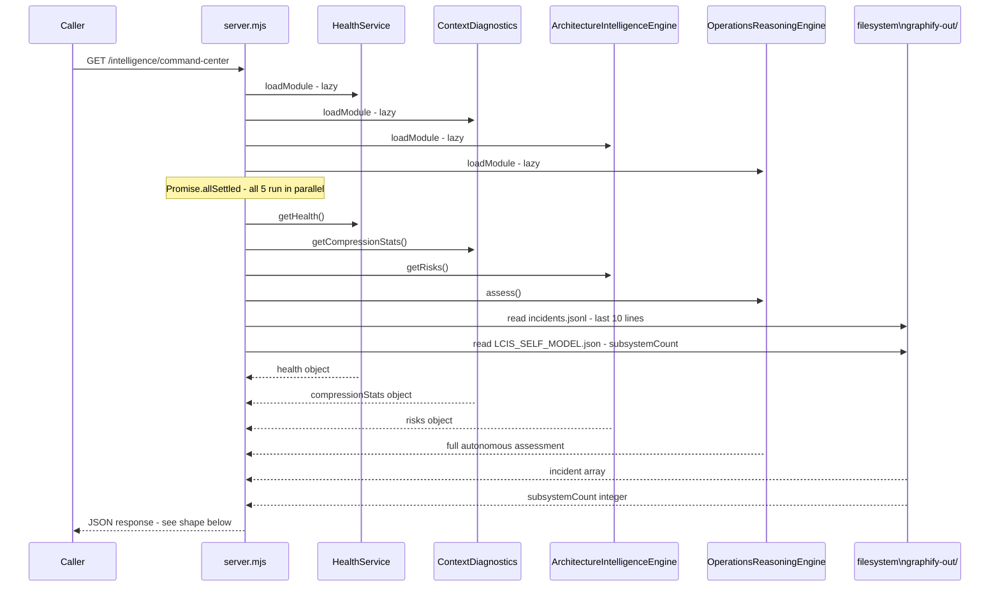
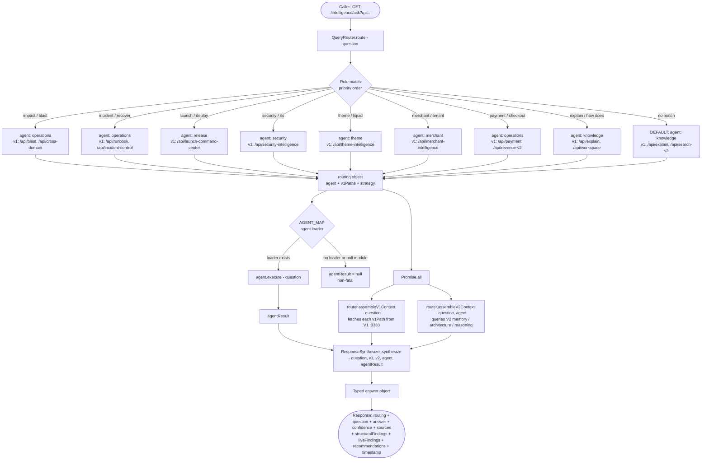

# LCIS V2 Command Center — Authoritative Reference

**Author:** Principal SRE / Platform Architect  
**Source:** `tools/central-intelligence/intelligence-api/server.mjs` (verified 2026-06-19)  
**Status:** Production — do not edit without updating the source first

---

## 1. Overview

LCIS V2 is the unified operator intelligence surface for the LetBuyy platform. It exposes a single HTTP API on **port 3334** that bridges the V1 LCIS graph server (port 3333) with six additional V2 subsystem layers: context compression, architecture intelligence, multi-hop reasoning, cross-signal correlation, autonomous operations assessment, and a self-model. No external npm dependencies are used — the server runs on `node:http`, `node:url`, `node:path`, and `node:fs` only.

The design principle is **lazy module loading with graceful degradation**. Every subsystem is loaded on first use and returns a `NOT CONNECTED` / 503 response if the module file is absent rather than crashing the server. The command-center aggregate endpoint uses `Promise.allSettled` so a single subsystem failure never breaks the operator overview.

### Key coordinates

| Attribute | Value |
|-----------|-------|
| Source file | `tools/central-intelligence/intelligence-api/server.mjs` |
| Port | `3334` (override: `LCIS_V2_PORT` env var) |
| V1 proxy target | `http://localhost:3333` (override: `LCIS_V1_URL` env var) |
| Total registered endpoints | 43 |
| CORS allowed origins | `localhost:3000`, `3001`, `3333`, `3334` |
| Launch command | `node tools/central-intelligence/intelligence-api/server.mjs` |
| Auto-start | Yes — when `process.argv[1]` matches `import.meta.url` |

---

## 2. Architecture

The diagram below shows how clients reach V2 subsystems and when V2 proxies back to V1.

```mermaid
graph TD
    subgraph Clients
        DASH[Operator dashboard\n:3333 V1 UI]
        AI[AI / Claude Code\ncurl / fetch]
        DEV[Developer browser\nlocalhost:3000]
    end

    subgraph "LCIS V2 API :3334"
        SERVER[server.mjs\nHTTP router]

        subgraph "V1 subsystem layer - lazy"
            MEM[MemoryRetriever\nMemoryIngestionPipeline\nMemoryHealthMonitor]
            KNOW[KnowledgeAcquisitionService\nKnowledgeSourceRegistry\nKnowledgeFreshnessService]
            GRAPH[GraphQueryEngine\nGraphExplorer\nGraphDiagnostics]
            BROWSER[BrowserIntelligenceEngine\nThemeAgent\nCheckoutAgent]
            OBS[HealthService\nAnomalyDetectionService]
            AGENTS[KnowledgeAgent\nSecurityAgent\nOperationsAgent\nMerchantAgent\nReleaseAgent]
        end

        subgraph "V2 subsystem layer - lazy"
            CTX[ContextAssembler\nContextCompressionPipeline\nContextDiagnostics]
            ARCH[ArchitectureIntelligenceEngine]
            RSN[ReasoningEngine]
            CORR[IntelligenceCorrelationEngine]
            OPS[OperationsReasoningEngine\nIntelligenceReportGenerator]
            SELF[SelfModelBuilder\nPlatformExplainer]
        end

        ASK[/intelligence/ask\nFLAGSHIP]
        CC[/intelligence/command-center\nAGGREGATE]
    end

    subgraph "V1 LCIS :3333"
        V1API[V1 API server\n/api/* endpoints]
    end

    subgraph "File artifacts - graphify-out/"
        INC[incidents.jsonl]
        CTX_MAP[context-intelligence/\nLCIS_CONTEXT_MAP.json]
        SM[self-model/\nLCIS_SELF_MODEL.json]
    end

    Clients --> SERVER
    SERVER --> MEM & KNOW & GRAPH & BROWSER & OBS & AGENTS
    SERVER --> CTX & ARCH & RSN & CORR & OPS & SELF
    SERVER --> ASK
    SERVER --> CC

    ASK --> AGENTS
    ASK --> V1API
    ASK --> CTX & ARCH & RSN

    CC --> OBS
    CC --> CTX
    CC --> ARCH
    CC --> OPS
    CC --> INC
    CC --> SM

    GRAPH -.->|fetchV1| V1API
    ASK   -.->|assembleV1Context| V1API
```

### Subsystem module map

All modules live under `tools/central-intelligence/` relative to the repo root. The server holds a cache (`Map`) keyed by relative import path; a module is loaded once and reused for the lifetime of the process.

| Loader alias | Relative path | Class / export |
|---|---|---|
| `mem` | `memory-engine/MemoryRetriever.mjs` | `MemoryRetriever` |
| `pip` | `memory-engine/MemoryIngestionPipeline.mjs` | `MemoryIngestionPipeline` |
| `mhm` | `memory-engine/MemoryHealthMonitor.mjs` | `MemoryHealthMonitor` |
| `kas` | `knowledge-engine/KnowledgeAcquisitionService.mjs` | `KnowledgeAcquisitionService` |
| `ksr` | `knowledge-engine/KnowledgeSourceRegistry.mjs` | `KnowledgeSourceRegistry` |
| `kfs` | `knowledge-engine/KnowledgeFreshnessService.mjs` | `KnowledgeFreshnessService` |
| `gqe` | `graph-engine/GraphQueryEngine.mjs` | `GraphQueryEngine` |
| `gex` | `graph-engine/GraphExplorer.mjs` | `GraphExplorer` |
| `gdi` | `graph-engine/GraphDiagnostics.mjs` | `GraphDiagnostics` |
| `bie` | `browser-intelligence/BrowserIntelligenceEngine.mjs` | `BrowserIntelligenceEngine` |
| `bta` | `browser-intelligence/agents/ThemeAgent.mjs` | `ThemeAgent` |
| `bca` | `browser-intelligence/agents/CheckoutAgent.mjs` | `CheckoutAgent` |
| `hss` | `observability/HealthService.mjs` | `HealthService` |
| `ads` | `observability/AnomalyDetectionService.mjs` | `AnomalyDetectionService` |
| `ctx` | `context-intelligence/ContextAssembler.mjs` | `ContextAssembler` |
| `ccp` | `context-intelligence/ContextCompressionPipeline.mjs` | `ContextCompressionPipeline` |
| `cdi` | `context-intelligence/ContextDiagnostics.mjs` | `ContextDiagnostics` |
| `aie` | `architecture-intelligence/ArchitectureIntelligenceEngine.mjs` | `ArchitectureIntelligenceEngine` |
| `rse` | `reasoning/ReasoningEngine.mjs` | `ReasoningEngine` |
| `ice` | `correlation/IntelligenceCorrelationEngine.mjs` | `IntelligenceCorrelationEngine` |
| `ore` | `autonomous-operations/OperationsReasoningEngine.mjs` | `OperationsReasoningEngine` |
| `irg` | `autonomous-operations/IntelligenceReportGenerator.mjs` | `IntelligenceReportGenerator` |
| `smb` | `self-model/SelfModelBuilder.mjs` | `SelfModelBuilder` |
| `pex` | `self-model/PlatformExplainer.mjs` | `PlatformExplainer` |

---

## 3. The `/intelligence/command-center` Aggregate Endpoint

`GET /intelligence/command-center`

This is the primary operator readiness surface. It fans out to four live subsystems and two file artifacts via `Promise.allSettled`, returns within the slowest individual subsystem timeout, and never fails catastrophically — every field degrades to `{ status: 'NOT CONNECTED' }` if its source is unavailable.

### Execution sequence



### Response shape

```jsonc
{
  "timestamp": "2026-06-19T00:00:00.000Z",   // ISO-8601, server wall clock
  "version": "2.0",

  // HealthService.getHealth() - or { status: 'NOT CONNECTED' }
  "health": {
    "status": "...",          // e.g. "healthy" | "degraded" | "NOT CONNECTED"
    "memory": "...",
    // ... additional fields from HealthService
  },

  // ContextDiagnostics.getCompressionStats() - or { status: 'NOT CONNECTED' }
  "context": {
    // token budget usage, compression ratio, source counts, etc.
  },

  // ArchitectureIntelligenceEngine.getRisks() - or { status: 'NOT CONNECTED' }
  "architecture": {
    // risk objects: { severity, component, description, ... }[]
  },

  // OperationsReasoningEngine.assess() - the FULL autonomous assessment
  // or { status: 'NOT CONNECTED' }
  "operations": {
    // production posture, ranked recommendations, incident signals, etc.
  },

  // Derived from graphify-out/self-model/LCIS_SELF_MODEL.json
  // sm.subsystems.length ?? sm.layers.length ?? 0
  "selfModel": {
    "subsystemCount": 0       // 0 if LCIS_SELF_MODEL.json absent
  },

  // graphify-out/incidents.jsonl - last 10 lines parsed and reversed
  "incidents": {
    "recent": [],             // array of incident objects, newest first
    "note": null              // non-null string if incidents.jsonl absent
  }
}
```

### Field source table

| Response field | Source | Failure mode |
|---|---|---|
| `health` | `HealthService.getHealth()` | `{ status: 'NOT CONNECTED' }` |
| `context` | `ContextDiagnostics.getCompressionStats()` | `{ status: 'NOT CONNECTED' }` |
| `architecture` | `ArchitectureIntelligenceEngine.getRisks()` | `{ status: 'NOT CONNECTED' }` |
| `operations` | `OperationsReasoningEngine.assess()` (full) | `{ status: 'NOT CONNECTED' }` |
| `selfModel.subsystemCount` | `graphify-out/self-model/LCIS_SELF_MODEL.json` — `subsystems.length ?? layers.length ?? 0` | `0` |
| `incidents.recent` | `graphify-out/incidents.jsonl` — last 10 lines, parsed, reversed | `[]` with `note` set |

---

## 4. The `/intelligence/ask` Flagship

`GET /intelligence/ask?q=<natural-language question>`

This is the primary entry point for AI agents and operators who want a single answer from the full intelligence stack. It routes the question, dispatches an agent, gathers V1 and V2 context in parallel, and synthesizes a unified typed answer.

### Flow



### Answer schema (from `ResponseSynthesizer`)

```jsonc
{
  // From QueryRouter
  "routing": {
    "agent": "operations",    // which agent was selected
    "v1Paths": ["/api/blast"],
    "strategy": "impact"
  },

  // Synthesized answer fields
  "question": "what breaks if payments fail?",
  "answer": "...",           // plain-language synthesis
  "confidence": "HIGH",      // "HIGH" | "MEDIUM" | "LOW"
  "sources": [
    {
      "name": "Blast",       // derived from path label (strip /api/, capitalize)
      "type": "structural",  // "structural" | "live" | "agent" | "memory"
      "excerpt": "...",      // <= 300 chars of raw data
      "url": "/api/blast"
    }
  ],
  "structuralFindings": [],  // from V1 graph data
  "liveFindings": [],        // from V2 memory / correlation
  "recommendations": [],     // string array
  "timestamp": "2026-06-19T00:00:00.000Z"
}
```

### QueryRouter classification rules (priority order, first match wins)

| Priority | Keywords | Agent | Strategy | V1 endpoints |
|---|---|---|---|---|
| 1 | what breaks, blast radius, impact, breaks if, depends on, dependency | `operations` | `impact` | `/api/blast`, `/api/cross-domain`, `/api/impact-score` |
| 2 | runbook, recover, recovery, incident, root cause, diagnose, failing, failed, down | `operations` | `incident` | `/api/runbook`, `/api/incident-control`, `/api/diagnose`, `/api/operations` |
| 3 | launch, go live, ready, production ready, go-live, ship, release, deploy, blockers | `release` | `release` | `/api/launch-command-center`, `/api/production-readiness-v2`, `/api/decision-v2` |
| 4 | security, rls, row level, policy, auth, oauth, jwt, token, attack, vulnerability, xss, injection | `security` | `security` | `/api/security-intelligence`, `/api/security`, `/api/audit` |
| 5 | theme, liquid, template, storefront, render, preset, urban kicks, layout | `theme` | `theme` | `/api/domain?key=themes`, `/api/theme-intelligence`, `/api/explain?node=themes` |
| 6 | merchant, store, tenant, seller, onboarding, subscription, plan, billing | `merchant` | `merchant` | `/api/merchant-intelligence`, `/api/merchant-health`, `/api/merchant-ops` |
| 7 | payment, razorpay, checkout, order, refund, payout, gst, invoice, cod, money, ledger | `operations` | `payment` | `/api/payment`, `/api/commerce-control`, `/api/revenue-v2` |
| 8 | architecture, how does, explain, what is, understand, onboard, overview, domain | `knowledge` | `explain` | `/api/explain`, `/api/workspace`, `/api/unified-intelligence` |
| DEFAULT | (no match) | `knowledge` | `general` | `/api/explain`, `/api/search-v2` |

### Agent registry (`AGENT_MAP`)

| Key | Module path |
|---|---|
| `knowledge` | `tools/central-intelligence/agents/KnowledgeAgent.mjs` |
| `security` | `tools/central-intelligence/agents/SecurityAgent.mjs` |
| `operations` | `tools/central-intelligence/agents/OperationsAgent.mjs` |
| `merchant` | `tools/central-intelligence/agents/MerchantAgent.mjs` |
| `release` | `tools/central-intelligence/agents/ReleaseAgent.mjs` |

Each agent must export a default object with an `execute(question: string)` method and optionally a `capabilities` or `CAPABILITIES` array. Agents are lazy-loaded; a missing file degrades silently (`agentResult = null`), the synthesis still runs from V1 + V2 context alone.

Note: the `theme` strategy maps to no registered agent key — `AGENT_MAP['theme']` is `undefined`, so the question falls through to V1-only context assembly with the `knowledge` fallback default.

---

## 5. Full Endpoint Catalog

All 43 registered endpoints. `subsystem` is the V1 or V2 layer the handler delegates to.

### V1 subsystem endpoints (24)

| Method | Path | Handler / module | Subsystem | Purpose |
|---|---|---|---|---|
| GET | `/intelligence/health` | `HealthService.getHealth()` | observability | Unified health check across memory, graph, observability layers |
| GET | `/intelligence/status` | `HealthService` + `GraphDiagnostics` + `MemoryHealthMonitor` + V1 `/api/stats` | observability | Aggregate version, layer statuses, V1 availability |
| GET | `/intelligence/memory/search` | `MemoryRetriever.retrieve(q, {collections, limit})` | memory-engine | Vector/keyword search across memory collections; params: `q`, `collection`, `limit` (default 10) |
| POST | `/intelligence/memory/ingest` | `MemoryIngestionPipeline.runFromText(text, collection, metadata)` | memory-engine | Ingest free-form text into a named collection |
| GET | `/intelligence/memory/health` | `MemoryHealthMonitor.getHealth()` | memory-engine | Memory subsystem health |
| GET | `/intelligence/memory/stats` | `MemoryHealthMonitor.getMetrics()` | memory-engine | Memory usage metrics |
| GET | `/intelligence/knowledge/search` | `MemoryRetriever.retrieve(q, {collections:['knowledge']})` | knowledge-engine | Search the `knowledge` collection specifically; param: `q` |
| POST | `/intelligence/knowledge/crawl` | `KnowledgeAcquisitionService.crawlSource(sourceKey)` | knowledge-engine | Trigger a crawl for a registered knowledge source |
| GET | `/intelligence/knowledge/sources` | `KnowledgeSourceRegistry.getSources()` | knowledge-engine | List all registered knowledge sources |
| GET | `/intelligence/knowledge/freshness` | `KnowledgeFreshnessService.checkFreshness()` | knowledge-engine | Staleness check across knowledge sources |
| GET | `/intelligence/graph/query` | `GraphQueryEngine.query(q, method)` | graph-engine | Raw graph query; params: `q`, `method` (default `global`) |
| GET | `/intelligence/graph/impact` | `GraphExplorer.whatBreaksIf(entity)` | graph-engine | Blast radius / impact for a named entity; param: `entity` |
| GET | `/intelligence/graph/entities` | `GraphExplorer.explainEntity(name)` | graph-engine | Explain a named entity from the code/DB graph; param: `name` |
| GET | `/intelligence/graph/health` | `GraphDiagnostics.getHealth()` | graph-engine | Graph subsystem health |
| GET | `/intelligence/browser/validate` | `BrowserIntelligenceEngine.validateStore(url)` | browser-intelligence | End-to-end store validation via headless browser; param: `url` |
| GET | `/intelligence/browser/theme` | `ThemeAgent.runFull(url, themeId)` | browser-intelligence | Full theme audit for a store URL; params: `url`, `themeId` |
| GET | `/intelligence/browser/checkout` | `CheckoutAgent.runFlow(url)` | browser-intelligence | Checkout flow validation; param: `url` |
| GET | `/intelligence/browser/status` | `BrowserIntelligenceEngine.getStatus()` | browser-intelligence | Browser engine availability and last run status |
| GET | `/intelligence/observability/health` | `HealthService.getHealth()` | observability | Same as `/intelligence/health`; kept for path ergonomics |
| GET | `/intelligence/observability/incidents` | `graphify-out/incidents.jsonl` (last 50, reversed) | observability | Recent incidents from the incident log file |
| GET | `/intelligence/observability/anomalies` | `AnomalyDetectionService.getAllAnomalies()` | observability | All detected anomalies |
| GET | `/intelligence/agents/execute` | `AGENT_MAP[agent].execute(q)` | agents | Execute a named agent with a question; params: `agent`, `q` |
| GET | `/intelligence/agents/status` | `AGENT_MAP` — all loaders | agents | Availability + capabilities of all five agents |
| GET | `/intelligence/ask` | `QueryRouter` + `ResponseSynthesizer` (flagship) | all | Natural-language question — routed, agent-executed, V1+V2 synthesized answer |

### V2 context intelligence endpoints (5)

| Method | Path | Handler / module | Subsystem | Purpose |
|---|---|---|---|---|
| GET | `/intelligence/context/assemble` | `ContextAssembler.assemble(q, {tokenBudget})` | context-intelligence | Assemble a token-budgeted context payload for a question; params: `q`, `budget` (default 8000) |
| GET | `/intelligence/context/map` | `graphify-out/context-intelligence/LCIS_CONTEXT_MAP.json` | context-intelligence | Serve the pre-built context map artifact |
| POST | `/intelligence/context/build` | `ContextCompressionPipeline.run()` | context-intelligence | Rebuild and write `LCIS_CONTEXT_MAP.json` |
| GET | `/intelligence/context/health` | `ContextDiagnostics.getHealth()` | context-intelligence | Context subsystem health |
| GET | `/intelligence/context/compression` | `ContextDiagnostics.getCompressionStats()` | context-intelligence | Token budget usage and compression statistics |

### V2 architecture intelligence endpoints (4)

| Method | Path | Handler / module | Subsystem | Purpose |
|---|---|---|---|---|
| GET | `/intelligence/architecture` | `ArchitectureIntelligenceEngine.getArchitecture()` | architecture-intelligence | Full architecture snapshot |
| GET | `/intelligence/architecture/drift` | `ArchitectureIntelligenceEngine.whatChanged()` | architecture-intelligence | What changed since last known-good state |
| GET | `/intelligence/architecture/risks` | `ArchitectureIntelligenceEngine.getRisks()` | architecture-intelligence | Ranked architecture risk list |
| GET | `/intelligence/architecture/depends` | `ArchitectureIntelligenceEngine.whatDependsOn(component)` | architecture-intelligence | What depends on a given component; param: `component` (required) |

### V2 reasoning engine endpoints (4)

| Method | Path | Handler / module | Subsystem | Purpose |
|---|---|---|---|---|
| GET | `/intelligence/reason` | `ReasoningEngine.reason(q)` | reasoning | General-purpose multi-hop reasoning over the graph; param: `q` (required) |
| GET | `/intelligence/reason/why` | `ReasoningEngine.whyDidThisHappen(incident)` | reasoning | Root-cause reasoning for a named incident; param: `incident` (required) |
| GET | `/intelligence/reason/affected` | `ReasoningEngine.whatIsAffected(component)` | reasoning | What is affected by changes to a component; param: `component` (required) |
| GET | `/intelligence/reason/risk-dependency` | `ReasoningEngine.highestRiskDependency()` | reasoning | Identify the single highest-risk dependency in the graph |

### V2 correlation engine endpoints (4)

| Method | Path | Handler / module | Subsystem | Purpose |
|---|---|---|---|---|
| POST | `/intelligence/correlate` | `IntelligenceCorrelationEngine.correlate(event)` | correlation | Correlate an event object against known signals; body: `{ event }` (required) |
| GET | `/intelligence/correlate/root-cause` | `IntelligenceCorrelationEngine.correlateIncident({domain})` | correlation | Correlate signals to find root cause for a domain; param: `domain` (required) |
| GET | `/intelligence/correlate/impact` | `IntelligenceCorrelationEngine.predictImpact({component})` | correlation | Predict propagation impact for a component; param: `component` (required) |
| GET | `/intelligence/correlate/risk` | `IntelligenceCorrelationEngine.getRiskScore(target)` | correlation | Composite risk score for a named target; param: `target` (required) |

### V2 autonomous operations endpoints (5)

| Method | Path | Handler / module | Subsystem | Purpose |
|---|---|---|---|---|
| GET | `/intelligence/operations/assess` | `OperationsReasoningEngine.assess()` | autonomous-operations | Full autonomous production posture assessment |
| GET | `/intelligence/operations/recommendations` | `OperationsReasoningEngine.getEngineeringRecommendations()` | autonomous-operations | Ranked engineering action list |
| GET | `/intelligence/operations/insights` | `OperationsReasoningEngine.getOperationalInsights()` | autonomous-operations | Operational observations and signals |
| GET | `/intelligence/operations/daily` | `IntelligenceReportGenerator.getLatestReport()` | autonomous-operations | Retrieve most-recently generated daily intelligence report |
| POST | `/intelligence/operations/daily` | `IntelligenceReportGenerator.generateDailyReport()` | autonomous-operations | Trigger regeneration of the daily report |

### V2 self-model endpoints (3)

| Method | Path | Handler / module | Subsystem | Purpose |
|---|---|---|---|---|
| GET | `/intelligence/self/model` | `graphify-out/self-model/LCIS_SELF_MODEL.json` | self-model | Serve the self-model artifact (subsystem topology, capabilities) |
| POST | `/intelligence/self/build` | `SelfModelBuilder.build()` | self-model | Rebuild and write `LCIS_SELF_MODEL.json` |
| GET | `/intelligence/self/explain` | `PlatformExplainer` | self-model | Plain-language platform explanation; param: `topic` — one of `platform`, `services`, `deploy`, `failure` (+ `domain` param), `incident`, `operations` |

### V2 command center endpoint (1)

| Method | Path | Handler / module | Subsystem | Purpose |
|---|---|---|---|---|
| GET | `/intelligence/command-center` | `HealthService` + `ContextDiagnostics` + `ArchitectureIntelligenceEngine` + `OperationsReasoningEngine` + filesystem | aggregate | Operator overview: health + context + architecture risks + full ops assessment + recent incidents + self-model subsystem count |

---

## 6. How to Launch

### Prerequisites

- Node.js 18+ (ESM support required)
- V1 LCIS server running on port 3333 (optional — V2 degrades gracefully without it)
- `graphify-out/` artifacts present for incident log and self-model reads (optional)

### Start command

```bash
node tools/central-intelligence/intelligence-api/server.mjs
```

The server auto-starts when `process.argv[1]` matches the file's `import.meta.url`. It also exports a `start()` function for programmatic use from an orchestrator.

### Environment variables

| Variable | Default | Description |
|---|---|---|
| `LCIS_V2_PORT` | `3334` | Port the V2 API listens on |
| `LCIS_V1_URL` | `http://localhost:3333` | Base URL of the V1 LCIS graph server |

No other environment variables are read by the server itself. Subsystem modules may read their own env vars when loaded.

### Startup output

On successful start the server logs:

```
[LCIS-V2] Memory engine health: <status>
[LCIS-V2] Intelligence API running on http://localhost:3334
[LCIS-V2] V1 proxy target: http://localhost:3333
[LCIS-V2] 43 registered endpoints:
[LCIS-V2]   V1 subsystems: N endpoints
[LCIS-V2]   V2 subsystems: N endpoints (context/architecture/reasoning/correlation/operations/self-model/command-center)
[LCIS-V2]   GET  /intelligence/health
  ... (all 43 listed)
```

If a port conflict occurs, `server.on('error', ...)` calls `process.exit(1)`.

### Verify it is running

```bash
curl -s http://localhost:3334/intelligence/health | jq .status
curl -s http://localhost:3334/intelligence/command-center | jq '{health:.health.status, subsystems:.selfModel.subsystemCount}'
```

---

## 7. Operator Workflows

Common tasks mapped to the minimal set of endpoints to query.

### Investigate current production posture

Goal: understand health, risks, and what needs fixing right now.

```bash
# Single-call operator overview
curl http://localhost:3334/intelligence/command-center

# Drill into ranked engineering actions
curl http://localhost:3334/intelligence/operations/recommendations

# Drill into operational signals
curl http://localhost:3334/intelligence/operations/insights
```

| Field to read | What it tells you |
|---|---|
| `health.status` | Overall system health from HealthService |
| `architecture` | Ranked risk list — what is structurally unsound |
| `operations` | Full autonomous assessment — what the engine thinks is wrong |
| `incidents.recent` | Last 10 incidents from the incident log |
| `selfModel.subsystemCount` | How many subsystems the self-model knows about |

### Ask a natural-language question

Goal: get a synthesized answer without knowing which endpoint to call.

```bash
# Impact question
curl "http://localhost:3334/intelligence/ask?q=what+breaks+if+payments+fail"

# Incident root cause
curl "http://localhost:3334/intelligence/ask?q=why+did+checkout+fail+last+night"

# Launch readiness
curl "http://localhost:3334/intelligence/ask?q=are+we+ready+to+launch"

# Onboarding / explain
curl "http://localhost:3334/intelligence/ask?q=how+does+the+order+flow+work"
```

The response `routing.strategy` field tells you which rule matched and which agent was used.

### Check architecture drift

Goal: understand what changed structurally since the last known-good state.

```bash
# What changed
curl http://localhost:3334/intelligence/architecture/drift

# Current risk surface
curl http://localhost:3334/intelligence/architecture/risks

# What depends on a specific component
curl "http://localhost:3334/intelligence/architecture/depends?component=create_checkout_order"
```

### Get ranked engineering recommendations

Goal: prioritized action list for the on-call engineer.

```bash
# Recommendations from OperationsReasoningEngine
curl http://localhost:3334/intelligence/operations/recommendations

# Or via the ask flagship
curl "http://localhost:3334/intelligence/ask?q=what+should+I+fix+next"
```

### Rebuild the self-model and context map

Goal: refresh V2 artifacts after a major codebase change.

```bash
# 1. Rebuild LCIS_SELF_MODEL.json
curl -X POST http://localhost:3334/intelligence/self/build

# 2. Rebuild LCIS_CONTEXT_MAP.json
curl -X POST http://localhost:3334/intelligence/context/build

# 3. Regenerate daily intelligence report
curl -X POST http://localhost:3334/intelligence/operations/daily

# 4. Verify artifacts loaded correctly
curl http://localhost:3334/intelligence/command-center | jq '.selfModel'
curl http://localhost:3334/intelligence/context/compression
```

Artifacts are written to `graphify-out/self-model/LCIS_SELF_MODEL.json` and `graphify-out/context-intelligence/LCIS_CONTEXT_MAP.json`. Both paths are gitignored.

### Correlate a live incident

Goal: given an observed failure signal, get root cause and impact.

```bash
# Correlate an event
curl -X POST http://localhost:3334/intelligence/correlate \
  -H 'Content-Type: application/json' \
  -d '{"event": {"type": "payment_failure", "domain": "payments", "timestamp": "..."}}'

# Root cause for a domain
curl "http://localhost:3334/intelligence/correlate/root-cause?domain=payments"

# Impact prediction for a component
curl "http://localhost:3334/intelligence/correlate/impact?component=create_checkout_order"

# Risk score
curl "http://localhost:3334/intelligence/correlate/risk?target=razorpay"
```

### Validate a storefront end-to-end

Goal: headless browser validation of a live store.

```bash
# Full store validation
curl "http://localhost:3334/intelligence/browser/validate?url=https://demo.letbuyy.com"

# Theme audit
curl "http://localhost:3334/intelligence/browser/theme?url=https://demo.letbuyy.com&themeId=urban-kicks"

# Checkout flow
curl "http://localhost:3334/intelligence/browser/checkout?url=https://demo.letbuyy.com"
```

---

## Appendix: Error Handling Contract

All handlers follow the same error contract:

| Condition | HTTP status | Body |
|---|---|---|
| Module not loaded (file missing) | `503` | `{ "error": "<Module> unavailable" }` |
| Required query param missing | `400` | `{ "error": "<param> parameter required" }` |
| Unknown agent name in `/agents/execute` | `400` | `{ "error": "Unknown agent: <name>" }` |
| Agent has no `execute()` method | `500` | `{ "error": "Agent '<name>' has no execute() method" }` |
| Unknown path | `404` | `{ "error": "unknown endpoint", "endpoints": [...] }` |
| Unhandled exception in handler | `500` | `{ "error": "<message>" }` |

CORS preflight (`OPTIONS`) returns `204` with the `Access-Control-*` headers. If the request `Origin` header is not in the allowed set, the response uses `http://localhost:3333` as the reflected origin.
