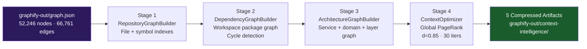

# LCIS Context Compression

> **LCIS V2 — Phase 14**  
> Entry point: `tools/central-intelligence/context-intelligence/ContextCompressionPipeline.mjs`  
> Token optimizer: `tools/central-intelligence/context-intelligence/TokenOptimizer.mjs`  
> Output: `graphify-out/context-intelligence/`

---

## Purpose

Context Compression transforms the raw repository graph (52,246 nodes, 66,761 edges) into a set of compact, structured artifacts that AI agents can consume without reading source files. The pipeline achieves a **96.2% token reduction** — compressing an estimated 626,952-token repository into approximately 24,000 tokens of structured context.

This is not lossy compression of source text. It is a semantic distillation: the pipeline extracts the structural skeleton of the repository — services, domains, dependency relationships, file importance rankings — and discards implementation detail that an AI agent does not need to reason about architecture, triage incidents, or assess change risk.

---

## Pipeline

The pipeline runs four stages in sequence, each building on the output of the previous:



### Stage 1 — Repository Understanding

`RepositoryGraphBuilder.load()` reads `graphify-out/graph.json` and builds four in-memory indexes: node map, forward/reverse file adjacency, symbol map, and path-keyed file map. This is the foundation — all subsequent stages draw from these indexes.

**Guard:** the pipeline checks for `graphify-out/graph.json` existence before proceeding. If absent, it exits with a clear error: `"graph.json not found — run: pnpm graph:update"`.

### Stage 2 — Dependency Model

`DependencyGraphBuilder.build()` collapses file-level import edges to workspace-package edges and merges with declared `package.json` dependencies. Tarjan's SCC algorithm detects import cycles. The result is a 34-module, 112-edge dependency graph.

### Stage 3 — Architecture Model

`ArchitectureGraphBuilder.build()` reads `graphify-out/infra-intel.json` and `graphify-out/domain-intel.json` to build a 43-node, 153-edge service + domain topology. Nodes are classified into four layers (edge, gateway, async, data).

### Stage 4 — Context Optimization

`ContextOptimizer.rankGlobally()` runs unseeded PageRank over the 3,401-file dependency graph. Parameters: damping `d = 0.85`, 30 iterations, convergence threshold `ε = 1e-6`. The result is a score vector over all files, normalized so scores sum to 1.

### Artifact Write

All five artifacts are written atomically to `graphify-out/context-intelligence/` with a `generatedAt` ISO timestamp and a `stats` summary.

---

## The 5 Artifacts

### 1. `LCIS_CONTEXT_MAP.json` — 174 KB

The primary navigation map for AI agents. Contains the top-300 files by global PageRank score, each with:

```json
{
  "generatedAt": "2026-06-19T17:52:31.531Z",
  "gitHead": "742192cf",
  "repoStats": {
    "nodeCount": 52246,
    "edgeCount": 66761,
    "fileCount": 3401,
    "communityCount": 3279
  },
  "topFiles": [
    {
      "file": "packages/dart/api_client/lib/src/api_client.dart",
      "role": "library",
      "score": 0.04865116,
      "rank": 1,
      "symbols": ["ApiClient", "StoresApi", "StorePaymentConfigApi", "CustomDomainsApi"],
      "dependsOn": ["packages/dart/api_client/lib/src/graphql.dart"],
      "lines": 892
    }
  ],
  "domainIndex": { /* files grouped by domain */ },
  "serviceIndex": { /* files grouped by service */ }
}
```

**Schema:**

| Field | Type | Description |
|-------|------|-------------|
| `file` | `string` | Repo-relative path |
| `role` | `string` | Heuristic role: `library`, `module`, `config`, `test`, `migration` |
| `score` | `number` | PageRank score (0–1) |
| `rank` | `number` | Ordinal rank (1 = most important) |
| `symbols` | `string[]` | Up to 20 exported/defined symbols |
| `dependsOn` | `string[]` | Direct file dependencies |
| `lines` | `number` | Line count |

### 2. `LCIS_ARCHITECTURE_GRAPH.json` — 88 KB

The service + domain topology graph. Consumed by architecture reasoning and the Atlas graph explorer.

```json
{
  "generatedAt": "2026-06-19T17:52:31.531Z",
  "stats": {
    "nodeCount": 43,
    "edgeCount": 153,
    "byType": { "worker": 4, "queue": 12, "service": 5, "domain": 22 },
    "byRelation": {
      "produces": 5, "processes": 7, "depends-on": 8,
      "cross-domain": 49, "belongs-to": 84
    },
    "layerCounts": { "edge": 5, "gateway": 2, "async": 14, "data": 22 }
  },
  "services": [ /* 9 service nodes */ ],
  "domains": [ /* 22 domain nodes */ ],
  "layers": {
    "edge": [ /* 5 Vercel apps */ ],
    "gateway": [ /* api-gateway worker, mobile-bff worker */ ],
    "async": [ /* queue-workers, webhook-service, 12 queues */ ],
    "data": [ /* 22 domain entries with tables/rpcs/routes */ ]
  },
  "queues": [ /* 12 Cloudflare Queue bindings */ ],
  "workers": [ /* 4 Worker entries with wrangler config */ ],
  "edges": [ /* 153 typed edges */ ]
}
```

**Edge schema:**

```json
{ "from": "letbuyy-api", "to": "EVENT_QUEUE", "relation": "produces" }
{ "from": "domain:orders", "to": "domain:payments", "relation": "cross-domain" }
{ "from": "storefront-runtime", "to": "edge", "relation": "belongs-to" }
```

### 3. `LCIS_DEPENDENCY_GRAPH.json` — 19 KB

The workspace-package dependency graph. Small but structurally dense — captures the highest-blast-radius relationships.

```json
{
  "generatedAt": "2026-06-19T17:52:31.531Z",
  "stats": {
    "moduleCount": 34,
    "workspacePackageCount": 31,
    "edgeCount": 112,
    "cycleCount": 1,
    "cycleGroups": [["@letbuyy/infrastructure", "@letbuyy/api-gateway"]]
  },
  "criticalModules": [
    { "module": "@letbuyy/shared-types", "inDegree": 27, "outDegree": 0 },
    { "module": "@letbuyy/auth-core", "inDegree": 16, "outDegree": 1 }
  ],
  "cycles": [["@letbuyy/infrastructure", "@letbuyy/api-gateway"]],
  "nodes": [ /* 34 module nodes */ ],
  "edges": [ /* 112 dependency edges */ ]
}
```

**Note on the detected cycle:** `@letbuyy/infrastructure ↔ @letbuyy/api-gateway` is the single detected circular dependency. This is a real structural finding — not a false positive. It should be tracked as a technical-debt item. The cycle does not break the build at present because TypeScript and the bundler resolve it through declaration merging, but it makes independent versioning impossible.

### 4. `LCIS_IMPORTANCE_RANKING.json` — 482 KB

The full PageRank ranking of all 3,401 source files. This is the complete ranking — not truncated to top-300. Used by `ContextOptimizer` for budget-constrained selection.

```json
{
  "generatedAt": "2026-06-19T17:52:31.495Z",
  "algorithm": "PageRank(d=0.85, iter=30, ε=1e-6)",
  "totalFiles": 3401,
  "entries": [
    { "file": "packages/dart/api_client/lib/src/api_client.dart", "score": 0.04865116, "rank": 1 },
    { "file": "packages/dart/api_client/lib/src/graphql.dart", "score": 0.03323841, "rank": 2 },
    { "file": "packages/shared-types/src/index.ts", "score": 0.02937124, "rank": 3 }
  ]
}
```

**Schema:** each entry has `file` (repo-relative path), `score` (float, normalized PageRank), and `rank` (integer, 1-based ordinal).

### 5. `LCIS_CONTEXT_SUMMARY.md` — 6 KB

A human-readable overview of the repository, generated automatically from all four prior stages. This document is the standard entrypoint for human onboarding and AI orientation. It contains:

- Repository overview table (node/edge/file/community counts, git HEAD)
- Compression stats table (raw tokens, summary tokens, ratio)
- Architectural layers summary
- All 22 business domains listed with keys
- Module dependency graph stats
- Top-20 most important files by PageRank (rank, path, role, score, key symbols)

---

## Token Economics

### The Math

```
Raw repository (full file contents):
  3,401 files × 3,000 avg tokens/file = 10,203,000 potential token load
                                         (if every file were read in full)

Realistic "grep everything" scenario:
  3,401 files × ~184 bytes avg/chars × (1 token / 4 chars) ≈ 626,952 tokens

Context map (top-300, compact summaries):
  300 entries × ~80 tokens/entry = 24,000 tokens

Compression ratio:
  24,000 / 626,952 = 0.0383   →   96.2% reduction

Query-scoped assembly (8k budget):
  ~100 files × ~80 tokens/entry = ~8,000 tokens
  8,000 / 626,952 = 0.0128    →   98.7% reduction
```

### Token Estimation Formula

`TokenOptimizer.estimateTokens(text)` = `ceil(text.length / 4)`

This is the standard approximation for English + TypeScript/SQL mixed text. It slightly overestimates for terse code and slightly underestimates for verbose prose, making it a conservative budget allocator.

### File-Level Summary Compression

`summarizeFile(filePath)` extracts declarations from a file by regex — capturing `export`, `function`, `class`, `const`, `type`, `interface`, `enum` — and produces a compact block:

```
// packages/shared-types/src/index.ts [22.4KB, 412 lines]
// exports: UuidSchema, QueryBooleanSchema, PaginationQuery, IdParam, SortOrder, ...
```

This single-line summary replaces 22 KB of TypeScript with ~80 tokens — a 280× compression for that file alone — while preserving everything an AI agent needs to know about what the file provides.

---

## How to Build

### Prerequisites

```bash
# The graph must exist first
pnpm graph:update   # runs graphify and produces graphify-out/graph.json
pnpm graph:infra    # produces graphify-out/infra-intel.json
pnpm graph:domain   # produces graphify-out/domain-intel.json
```

### Run the Pipeline

```bash
node tools/central-intelligence/context-intelligence/ContextCompressionPipeline.mjs
```

Or via the monorepo task (runs all prerequisites automatically):

```bash
pnpm context:build
```

The pipeline prints progress to stdout and exits 0 on success. Total runtime is typically 8–15 seconds for the LetBuyy graph.

### Verify

```bash
ls -lh graphify-out/context-intelligence/
# Should show 5 files:
# LCIS_CONTEXT_MAP.json         ~174 KB
# LCIS_ARCHITECTURE_GRAPH.json   ~88 KB
# LCIS_DEPENDENCY_GRAPH.json     ~19 KB
# LCIS_IMPORTANCE_RANKING.json  ~482 KB
# LCIS_CONTEXT_SUMMARY.md         ~6 KB

# Check health
curl localhost:3333/intelligence/context/health
# → { "status": "HEALTHY", ... }
```

---

## Freshness and Staleness

Artifacts become stale when the underlying graph changes. `ContextHealthMonitor` detects staleness by comparing artifact mtime against `graph.json` mtime.

| Condition | Status |
|-----------|--------|
| Artifact absent | `STALE` |
| Artifact mtime < `graph.json` mtime − 24h | `STALE` |
| Artifact mtime ≥ `graph.json` mtime − 24h | `FRESH` |

The 24-hour grace window prevents unnecessary rebuilds during iterative development sessions where `graph.json` is updated frequently.

**When to rebuild:**
- After merging a PR that adds/moves/removes files
- After any `pnpm graph:update` run
- When `ContextHealthMonitor.recommendRebuild()` returns `{ rebuild: true }`
- Before any major AI-assisted refactoring session

**The artifacts are gitignored.** They are generated outputs, not source. They are not committed. Every developer and CI runner builds them from source on demand.

---

## How AI Agents Consume the Artifacts

### Direct artifact consumption

For a fresh agent session with no prior context, the optimal consumption order is:

1. **`LCIS_CONTEXT_SUMMARY.md`** — Read first. Provides the orientation paragraph: what the system is, how big it is, what layers exist, what domains exist, and which 20 files are structurally most important.

2. **`LCIS_CONTEXT_MAP.json` → `topFiles`** — Scan the top-50 entries to understand which files matter before reading any of them. Use the `symbols` array to decide whether a file is relevant to the task at hand.

3. **`LCIS_DEPENDENCY_GRAPH.json` → `criticalModules`** — Check which packages have the highest in-degree. Any change to these must be assessed for blast radius before proceeding.

4. **`LCIS_ARCHITECTURE_GRAPH.json` → `layers` and `edges`** — Understand the service topology and which domains are coupled to which before making cross-domain changes.

### Via LCIS API (preferred)

Rather than consuming raw JSON files, AI agents should use the assembled context endpoint, which applies query-specific personalized PageRank and returns only the relevant slice:

```
GET /intelligence/context/assemble?q=<task-description>&budget=8000
```

This returns a ranked, budget-constrained subset of `LCIS_CONTEXT_MAP.json`, pre-filtered for the task at hand. The agent then reads only the files that surface in the result — typically 50–150 files out of 3,401.

### Token budget guidance

| Task type | Recommended budget | Typical file count returned |
|-----------|-------------------|-----------------------------|
| Quick lookup / specific symbol | 4,000 | 30–50 files |
| Feature implementation | 8,000 (default) | 80–120 files |
| Domain audit | 16,000 | 150–200 files |
| Full architecture review | 24,000 (top-300) | All 300 map entries |
