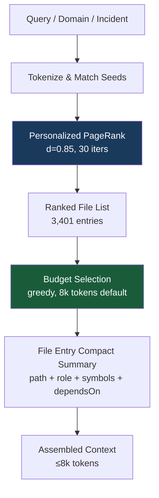

# LCIS Context Intelligence

> **LCIS V2 — Phase 14**  
> Module: `tools/central-intelligence/context-intelligence/`  
> Artifacts: `graphify-out/context-intelligence/`

---

## The Problem: Understanding a Repository Without Loading It

A 3,401-file TypeScript/Dart/SQL monorepo cannot fit into any AI context window. Naively concatenating every source file would require roughly **626,952 tokens** — an order of magnitude beyond current limits, and filled with noise (generated files, lock files, test fixtures, build outputs) that dilutes the signal the AI actually needs.

The classical workaround — manually curating which files to include — does not scale. It requires a human who already knows the codebase, defeats the purpose of AI-assisted development, and goes stale the moment code moves.

LCIS Context Intelligence solves this with a different framing: **AI agents do not need to read files; they need to know which files matter and what those files export.** A ranked, compressed map of the repository — built once from the full graph, updated on demand — gives an AI agent ~96% of the structural signal in ~4% of the tokens.

---

## Architecture

The subsystem is composed of seven cooperating classes, each a singleton module:

```
tools/central-intelligence/context-intelligence/
├── RepositoryGraphBuilder.mjs    — graph.json loader + file/symbol indexes
├── DependencyGraphBuilder.mjs    — workspace-package dependency graph + cycle detection
├── ArchitectureGraphBuilder.mjs  — service/domain/layer graph from infra-intel + domain-intel
├── ContextOptimizer.mjs          — PageRank-based file importance ranker
├── ContextAssembler.mjs          — query→budget→context assembler (consumer-facing API)
├── ContextDiagnostics.mjs        — health checks, self-tests, compression stats
├── ContextHealthMonitor.mjs      — artifact freshness + staleness detection
└── ContextCompressionPipeline.mjs — full build pipeline; writes 5 artifacts
```

### RepositoryGraphBuilder

Loads `graphify-out/graph.json` (52,246 nodes, 66,761 edges, ~44 MB) and builds four in-memory indexes:

| Index | Structure | Purpose |
|-------|-----------|---------|
| `_byId` | `Map<id, node>` | O(1) node lookup |
| `_adj` / `_radj` | `Map<fileId, Set<fileId>>` | forward + reverse file adjacency |
| `_symbols` | `Map<fileId, string[]>` | up to 20 symbols per file |
| `_files` | `Map<path, node>` | path-keyed lookup |

**Dependency edge relations tracked:** `imports_from`, `imports`, `calls`, `references`, `re_exports`, `inherits`  
**Symbol-producing relations tracked:** `defines`, `exports`, `method`, `implements`, `extends`

The `load()` method is idempotent — subsequent calls return immediately if already loaded. `buildAndCache()` additionally writes `graphify-out/context-intelligence/repo-file-graph.json` with the top-20 symbols per file.

### DependencyGraphBuilder

Resolves workspace-package (`@letbuyy/*`) dependency relationships from two sources:

1. **Declared dependencies** — `package.json` files across `apps/*`, `services/*`, `packages/*` (all three dependency fields: `dependencies`, `devDependencies`, `peerDependencies`)
2. **Observed imports** — file-level import edges from `RepositoryGraphBuilder`, collapsed to the package level

Only workspace-to-workspace edges are retained (no npm registry packages). Cycle detection uses Tarjan's strongly-connected-component algorithm. The result is a 34-module, 112-edge graph with 31 workspace packages. One cycle is detected: `@letbuyy/infrastructure ↔ @letbuyy/api-gateway`.

### ArchitectureGraphBuilder

Reads `graphify-out/infra-intel.json` and `graphify-out/domain-intel.json` to build a 43-node, 153-edge service + domain topology graph. Every node is classified into one of four logical layers:

| Layer | Members |
|-------|---------|
| `edge` | `storefront-runtime`, `merchant-control-plane`, `identity-platform`, `marketing-site`, `platform-console` |
| `gateway` | `api-gateway` (Cloudflare Worker), `mobile-bff` (Cloudflare Worker) |
| `async` | `queue-workers`, `webhook-service`, plus all 12 Cloudflare Queues |
| `data` | All 22 business domains |

Edge relations: `belongs-to` (84), `cross-domain` (49), `depends-on` (8), `processes` (7), `produces` (5).

Cache output: `graphify-out/context-intelligence/architecture-graph.json`

### ContextOptimizer — The PageRank Repo-Map

This is the ranking engine. It implements a pure-JavaScript personalized PageRank over the file dependency graph, inspired by the repo-map concept from Aider's open-source codebase.

#### Algorithm

```
PageRank parameters:
  damping factor  d = 0.85
  iterations        = 30
  convergence ε   = 1e-6
```

At each iteration, every file's score is updated as:

```
PR(v) = (1-d) / N  +  d × Σ [ PR(u) / out_degree(u) ]
         for all u → v
```

For **personalized** ranking (query-specific), the teleportation term is non-uniform: seed files receive proportionally higher teleportation probability, causing the random walk to preferentially return to files relevant to the query. This is what makes the ranking useful for a specific task rather than just measuring global structural centrality.

#### Query Seeding

`rankForQuery(query)` tokenizes the query string (tokens ≥ 3 characters), then matches seed files by:

| Match type | Score added |
|------------|-------------|
| Filename matches a token | +3 |
| File path contains a token | +2 |
| File exports a symbol matching a token | +1 |

The seed scores are normalized, injected as the personalized teleportation vector, and the power-iteration runs for 30 iterations.

#### Methods

| Method | Description |
|--------|-------------|
| `rankFiles(seedFiles)` | Personalized PageRank biased toward the given seed file list |
| `rankGlobally()` | Unseeded structural PageRank; result is cached after first run |
| `rankForQuery(query)` | Tokenizes query → seeds → personalized PageRank |
| `selectWithinBudget(rankedFiles, tokenBudget)` | Greedy selection fitting a token budget (token estimate = `chars / 4`, fallback `symbol_count × 30`) |
| `estimateTokens(text)` | `ceil(text.length / 4)` |
| `cache()` | Writes top-500 ranked files to `LCIS_IMPORTANCE_RANKING.json` |

### ContextAssembler

The consumer-facing API. Assembles the minimal relevant context for a query without loading full source files. Default token budget: **8,000 tokens**.

Each assembled file entry contains:

```json
{
  "path": "packages/shared-types/src/index.ts",
  "role": "module",
  "symbols": ["UuidSchema", "QueryBooleanSchema", "PaginationQuery", "IdParam"],
  "dependsOn": ["packages/auth-core/src/index.ts"],
  "importanceScore": 0.02937,
  "lines": 412
}
```

**Assembly modes:**

| Method | Seeding strategy |
|--------|-----------------|
| `assemble(query, opts)` | `rankForQuery(query)` — seeds from query token matches |
| `assembleForDomain(domainKey, opts)` | Seeds with domain-specific tables, RPCs, and route files from `domain-intel.json` |
| `assembleForIncident(incidentDomain, opts)` | Seeds with incident domain files + runbook-referenced files from `graphify-out/runbooks.json` |
| `explainRepo(opts)` | `rankGlobally()` — top structurally-important files as a repo overview |

### ContextDiagnostics

Self-monitoring for the subsystem. Three public methods:

**`getHealth()`** — Returns one of:

| Status | Condition |
|--------|-----------|
| `HEALTHY` | `graph.json` loaded, all 4 artifacts present and valid |
| `DEGRADED` | Graph loaded but one or more artifacts missing or invalid JSON |
| `NOT_BUILT` | `graph.json` absent; includes remediation command |

**`runSelfTest()`** — 6-step automated self-test:
1. Load `graph.json`
2. Build file graph
3. Compute global PageRank
4. Compute personalized PageRank for a seed
5. Assemble context for query `"checkout payment"` within the default 8,000-token budget
6. Run `explainRepo()` for top-file overview

Returns `PASS` / `FAIL` with per-step detail.

**`getCompressionStats()`** — Reports estimated total repo tokens (`fileCount × 3,000` average), typical assembly tokens (8,000), and the resulting compression ratio.

**`validateArtifacts()`** — Checks that all four cache artifacts exist, parse as valid JSON, and contain required `generatedAt` / `stats` keys.

### ContextHealthMonitor

Monitors artifact freshness. An artifact is considered **STALE** if it is missing or if `graph.json` is newer than the artifact by more than 24 hours (configurable via `maxAgeMs`).

```
graphify-out/context-intelligence/
├── repo-file-graph.json       — from RepositoryGraphBuilder.buildAndCache()
├── dependency-graph.json      — from DependencyGraphBuilder.cache()
├── architecture-graph.json    — from ArchitectureGraphBuilder.cache()
└── importance-ranking.json    — from ContextOptimizer.cache()
```

**`getMetrics()`** returns a lightweight dashboard snapshot: `graphPresent`, `graphSizeBytes`, `artifactsPresent`, `staleness`.

**`recommendRebuild()`** returns `{ rebuild: boolean, reason: string }`. The rebuild command is:
```bash
node tools/central-intelligence/context-intelligence/build-all.mjs
```

---

## Context Assembly Flow



**Step by step:**

1. **Seed identification** — query tokens are matched against file paths and exported symbols to identify candidate seed files. For domain assembly, the seed set is the tables/RPCs/routes for that domain.

2. **Personalized PageRank** — seeds are injected into the teleportation vector; 30 iterations of power-iteration converge on a score vector over all 3,401 files.

3. **Budget-constrained selection** — files are added greedily in rank order until the token budget is exhausted. Token estimate: `ceil(byteLength / 4)` per file entry (not full source — just the compact summary JSON).

4. **Compact summary output** — each entry is the path, heuristic role, top symbols, key dependencies, importance score, and line count. Full source is never included.

---

## Token Optimization

`TokenOptimizer` provides the token accounting layer:

```
Total repo tokens (estimated):
  3,401 files × avg 3,000 tokens/file ≈ 626,952 tokens

Typical assembled context:
  300 compact file entries × ~80 tokens/entry ≈ 24,000 tokens
  (or 8,000 tokens for a query-scoped 8k-budget assembly)

Compression ratio: 24,000 / 626,952 ≈ 0.038  (96.2% reduction)
```

**`summarizeFile(filePath)`** extracts a symbol-level summary from a file using regex — it captures `export`, `function`, `class`, `const`, `type`, `interface`, and `enum` declarations. The output is a compact block showing `relPath [sizeKB, lines]` plus the symbol list, **not** the full source code.

**Skipped paths** (never counted or included):
`node_modules`, `.git`, `.next`, `.turbo`, `dist`, `build`, `.cache`, `coverage`, `graphify-out`

**Text extensions tracked:** `.ts`, `.tsx`, `.js`, `.jsx`, `.mjs`, `.cjs`, `.json`, `.md`, `.toml`, `.yaml`, `.yml`, `.sql`, `.graphql`, `.css`, `.scss`, `.html`, `.txt`, `.env`, `.sh`

---

## Services Reference

### RepositoryGraphBuilder (`RepositoryGraphBuilder.mjs`)

| Method | Returns |
|--------|---------|
| `load()` | `Promise<void>` — idempotent graph load |
| `isLoaded()` | `boolean` |
| `getFileGraph()` | `{ files: FileNode[], edges: FileEdge[] }` — serializable |
| `getFileDependencies(file)` | `FileEdge[]` — outgoing edges |
| `getFileDependents(file)` | `FileEdge[]` — incoming edges |
| `getSymbolsForFile(file)` | `string[]` — exported symbol labels |
| `getStats()` | `{ nodeCount, edgeCount, fileCount, communityCount, fileEdgeCount, builtAtCommit }` |
| `buildAndCache()` | `Promise<void>` — load + write `repo-file-graph.json` |

### DependencyGraphBuilder (`DependencyGraphBuilder.mjs`)

| Method | Returns |
|--------|---------|
| `build()` | `Promise<void>` — idempotent |
| `getModuleDependencies(module)` | `string[]` — what this module depends on |
| `getDependents(module)` | `string[]` — what depends on this module |
| `getCriticalModules(top?)` | `ModuleRisk[]` — highest in-degree modules |
| `detectCycles()` | `string[][]` — SCC cycle groups |
| `getStats()` | `{ moduleCount, workspacePackageCount, edgeCount, cycleCount, cycleGroups }` |
| `cache()` | `Promise<void>` — writes `dependency-graph.json` |

### ArchitectureGraphBuilder (`ArchitectureGraphBuilder.mjs`)

| Method | Returns |
|--------|---------|
| `build()` | `Promise<void>` — idempotent |
| `getServices()` | `Service[]` — all discovered services |
| `getDomains()` | `Domain[]` — all 22 business domains |
| `getServiceDependencies(name)` | `string[]` — dependencies of a named service |
| `getDomainCoupling()` | `CouplingMap` — cross-domain edge counts |
| `getLayers()` | `LayerMap` — nodes grouped by layer |
| `getStats()` | `{ nodeCount, edgeCount, byType, byRelation, layerCounts }` |
| `cache()` | `Promise<void>` — writes `architecture-graph.json` |

### ContextOptimizer (`ContextOptimizer.mjs`)

| Method | Returns |
|--------|---------|
| `rankFiles(seedFiles)` | `RankedFile[]` — personalized PageRank toward seeds |
| `rankGlobally()` | `RankedFile[]` — cached unseeded structural rank |
| `rankForQuery(query)` | `RankedFile[]` — query-seeded personalized PageRank |
| `selectWithinBudget(rankedFiles, tokenBudget)` | `RankedFile[]` — greedy budget selection |
| `estimateTokens(text)` | `number` — `ceil(text.length / 4)` |
| `cache()` | `Promise<void>` — writes `LCIS_IMPORTANCE_RANKING.json` (top 500) |

### ContextAssembler (`ContextAssembler.mjs`)

| Method | Returns |
|--------|---------|
| `assemble(query, opts?)` | `Promise<AssembledContext>` |
| `assembleForDomain(domainKey, opts?)` | `Promise<AssembledContext>` |
| `assembleForIncident(incidentDomain, opts?)` | `Promise<AssembledContext>` |
| `explainRepo(opts?)` | `Promise<AssembledContext>` |

### ContextDiagnostics (`ContextDiagnostics.mjs`)

| Method | Returns |
|--------|---------|
| `getHealth()` | `{ status, graphLoaded, fileCount, artifacts, remediationCommand? }` |
| `runSelfTest()` | `{ status, steps: SelfTestStep[] }` |
| `getCompressionStats()` | `{ rawTokens, assemblyTokens, ratio }` |
| `validateArtifacts()` | `{ valid, artifacts: ArtifactValidation[] }` |

### ContextHealthMonitor (`ContextHealthMonitor.mjs`)

| Method | Returns |
|--------|---------|
| `getHealth()` | `HealthReport` — diagnostics + freshness + rebuild recommendation |
| `checkFreshness(maxAgeMs?)` | `FreshnessReport` — per-artifact mtime vs `graph.json` |
| `getMetrics()` | `MetricSnapshot` — `graphPresent`, `graphSizeBytes`, `artifactsPresent`, `staleness` |
| `recommendRebuild()` | `{ rebuild: boolean, reason: string }` |

---

## API Endpoints

All endpoints are served from the LCIS graph server. Context Intelligence endpoints are prefixed `/intelligence/context/`:

| Method | Endpoint | Handler |
|--------|----------|---------|
| `GET` | `/intelligence/context/assemble?q=<query>&budget=<n>` | `ContextAssembler.assemble()` |
| `GET` | `/intelligence/context/domain?key=<key>&budget=<n>` | `ContextAssembler.assembleForDomain()` |
| `GET` | `/intelligence/context/incident?domain=<domain>&budget=<n>` | `ContextAssembler.assembleForIncident()` |
| `GET` | `/intelligence/context/repo` | `ContextAssembler.explainRepo()` |
| `GET` | `/intelligence/context/health` | `ContextHealthMonitor.getHealth()` |
| `GET` | `/intelligence/context/metrics` | `ContextHealthMonitor.getMetrics()` |
| `GET` | `/intelligence/context/diagnostics` | `ContextDiagnostics.getHealth()` |
| `GET` | `/intelligence/context/self-test` | `ContextDiagnostics.runSelfTest()` |
| `GET` | `/intelligence/context/compression-stats` | `ContextDiagnostics.getCompressionStats()` |
| `GET` | `/intelligence/context/ranking?top=<n>` | Returns top-N from `LCIS_IMPORTANCE_RANKING.json` |

---

## Proven Results

All figures are from the real pipeline run on commit `57760d0c` / `0f257ca199`:

| Metric | Value |
|--------|-------|
| Graph nodes loaded | 52,246 |
| Graph edges loaded | 66,761 |
| Source files indexed | 3,401 |
| File dependency edges | 3,689 |
| Graph communities | 3,279 |
| Workspace packages | 31 |
| Module dependency edges | 112 |
| Import cycles detected | 1 (`@letbuyy/infrastructure ↔ @letbuyy/api-gateway`) |
| Estimated raw repo tokens | 626,952 |
| Context map entries (top-300) | 300 |
| Estimated summary tokens | ~24,000 |
| Compression ratio | 0.0383 (≈ 96.2% reduction) |
| LCIS_CONTEXT_MAP.json size | 174 KB |
| LCIS_IMPORTANCE_RANKING.json size | 482 KB (3,401 entries) |
| LCIS_ARCHITECTURE_GRAPH.json size | 88 KB |
| LCIS_DEPENDENCY_GRAPH.json size | 19 KB |

**Top-5 files by global PageRank:**

| Rank | File | Score |
|------|------|-------|
| 1 | `packages/dart/api_client/lib/src/api_client.dart` | 4.865e-2 |
| 2 | `packages/dart/api_client/lib/src/graphql.dart` | 3.324e-2 |
| 3 | `packages/shared-types/src/index.ts` | 2.937e-2 |
| 4 | `packages/dart/api_client/lib/src/types.dart` | 2.097e-2 |
| 5 | `scripts/validators/governance-common.mjs` | 1.532e-2 |

`packages/shared-types/src/index.ts` has the highest in-degree of any TypeScript workspace package (27 direct dependents), making it the single highest-blast-radius TypeScript module in the repository.

---

## How AI Agents Use Context Intelligence

### Pattern 1 — Query-scoped assembly

An AI agent working on a checkout bug calls:

```
GET /intelligence/context/assemble?q=checkout+payment+razorpay&budget=8000
```

The assembler tokenizes `["checkout", "payment", "razorpay"]`, matches seeds against the 3,401-file graph, runs personalized PageRank, and returns the top ~100 files that fit within 8,000 tokens — each as a compact symbol map, not full source.

### Pattern 2 — Domain-scoped assembly

An agent working on the payments domain calls:

```
GET /intelligence/context/domain?key=payments&budget=16000
```

The assembler seeds with the 18 payment domain files (routes, RPCs, tables) and returns a ranked context focused on the money subsystem.

### Pattern 3 — Incident-scoped assembly

An AI performing incident response for a failed order calls:

```
GET /intelligence/context/incident?domain=orders&budget=12000
```

The assembler adds runbook-referenced files on top of domain seeds, providing recovery-focused context.

### Pattern 4 — Repo overview

An agent onboarding to the codebase calls:

```
GET /intelligence/context/repo
```

Returns the top globally-ranked files — the skeleton of the codebase without any query bias. Useful as an initial orientation before narrowing to a task.

### Consumption contract

AI agents should treat Context Intelligence output as a **navigation map**, not as executable source. The map tells the agent:

- **Which files** contain the logic relevant to the query
- **What symbols** those files export (so the agent knows what to look for when it reads them)
- **How files depend on each other** (so the agent understands cascading effects)
- **How important each file is** globally (so the agent can prioritize reading)

The agent then uses `Read` tool calls on only the specific files the map surfaces, rather than scanning the whole tree.
