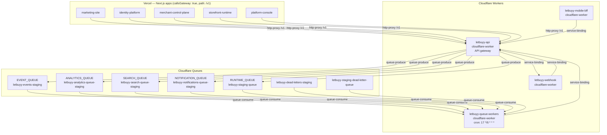
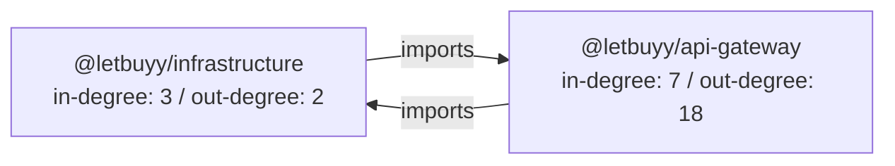
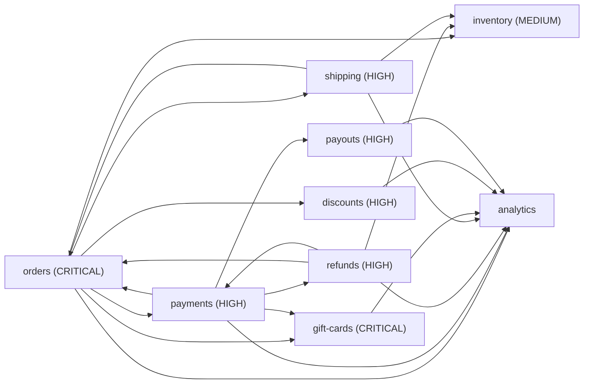
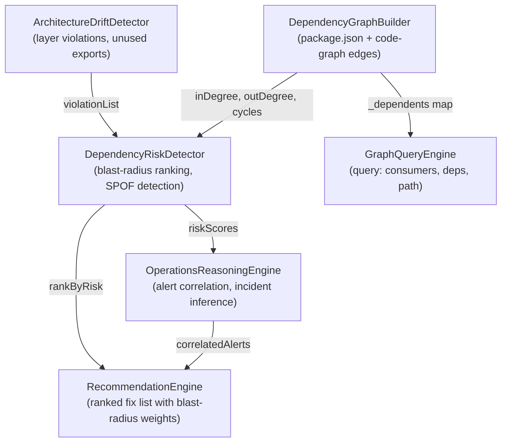

# LCIS Dependency Model

**Version:** 2026-06-19  
**Generated from:** `LCIS_DEPENDENCY_GRAPH.json` (2026-06-19T17:52:31.517Z) · `LCIS_DEPENDENCY_MODEL.json` (2026-06-19T17:59:03.418Z)  
**Authority:** Principal SRE / Platform Architecture  
**Refresh command:** `pnpm graph:omega` (rebuilds db + infra + domain + dependency graphs)

---

## 1. Purpose

The dependency model captures **two complementary graphs**:

| Graph | What it models | Why it matters |
|-------|----------------|----------------|
| **Module/package dependency graph** | Which workspace packages depend on which others (workspace protocol + cross-file import edges collapsed to package boundaries) | Determines blast radius of any package-level change; ranks which modules are SPOFs |
| **Service/runtime dependency graph** | How the 9 deployed services wire to each other via HTTP proxies, Cloudflare service bindings, and queue produce/consume relationships | Determines failure propagation paths and cascade topology at runtime |

Together these two graphs answer **the most important pre-change question**: *if I modify X, what breaks, who owns it, and how many services/merchants are affected?*

The model is the primary input to the `DependencyRiskDetector` and `RecommendationEngine` inside the LCIS Operations Reasoning Engine. Every change-risk score is derived from it. It is also the source queried by `GraphQueryEngine.query(entity, 'consumers')` when any audit agent asks "who depends on this?"

### Why blast radius matters here

LetBuyy is a multi-tenant India-first commerce platform. A single shared codebase serves all stores. There is no per-tenant isolation at the package level — a regression in `@letbuyy/shared-types` (in-degree 27) simultaneously degrades every app, every store, and every active checkout. The dependency model makes this risk quantitative and auditable rather than intuitive.

---

## 2. The Platform Dependency Model

### 2.1 Service topology (9 nodes)



### 2.2 Service dependency table

| Source service | Target | Link type | Notes |
|----------------|--------|-----------|-------|
| marketing-site | letbuyy-api | http-proxy | /v1 path prefix |
| identity-platform | letbuyy-api | http-proxy | /v1 path prefix |
| merchant-control-plane | letbuyy-api | http-proxy | /v1 path prefix |
| storefront-runtime | letbuyy-api | http-proxy | /v1 path prefix; host-routed via proxy.ts |
| platform-console | letbuyy-api | http-proxy | /v1 path prefix |
| letbuyy-api | letbuyy-webhook | service-binding | `WEBHOOK_SERVICE` binding |
| letbuyy-api | EVENT_QUEUE | queue-produce | `EVENT_QUEUE` binding |
| letbuyy-api | ANALYTICS_QUEUE | queue-produce | `ANALYTICS_QUEUE` binding |
| letbuyy-api | SEARCH_QUEUE | queue-produce | `SEARCH_QUEUE` binding |
| letbuyy-api | NOTIFICATION_QUEUE | queue-produce | `NOTIFICATION_QUEUE` binding |
| letbuyy-api | RUNTIME_QUEUE | queue-produce | `RUNTIME_QUEUE` binding |
| letbuyy-queue-workers | letbuyy-api | service-binding | `API_GATEWAY_SERVICE` binding |
| letbuyy-webhook | letbuyy-api | service-binding | `API_GATEWAY_SERVICE` binding |
| letbuyy-mobile-bff | letbuyy-api | service-binding | `API_GATEWAY_SERVICE` binding |
| letbuyy-events-staging | letbuyy-queue-workers | queue-consume | — |
| letbuyy-analytics-queue-staging | letbuyy-queue-workers | queue-consume | — |
| letbuyy-search-queue-staging | letbuyy-queue-workers | queue-consume | — |
| letbuyy-notifications-queue-staging | letbuyy-queue-workers | queue-consume | — |
| letbuyy-dead-letters-staging | letbuyy-queue-workers | queue-consume | DLQ |
| letbuyy-staging-queue | letbuyy-queue-workers | queue-consume | — |
| letbuyy-staging-dead-letter-queue | letbuyy-queue-workers | queue-consume | DLQ |

**Total service dependencies: 21** (`serviceDependencyCount: 21`)

### 2.3 Gateway bindings (letbuyy-api complete binding set)

| Binding | Type | Direction |
|---------|------|-----------|
| EVENT_QUEUE | Queue | produce |
| ANALYTICS_QUEUE | Queue | produce |
| SEARCH_QUEUE | Queue | produce |
| NOTIFICATION_QUEUE | Queue | produce |
| RUNTIME_QUEUE | Queue | produce |
| R2_BUCKET | R2 | read/write |
| CACHE | KV | read/write |
| HYPERDRIVE | Hyperdrive | DB proxy |
| RUNTIME_DB | D1 | read/write |
| WEBHOOK_SERVICE | Service binding | outbound |
| RUNTIME_TELEMETRY | Analytics Engine | write |

`hasCron: false` — the gateway is request-driven only. Scheduled jobs belong exclusively to `letbuyy-queue-workers` (cron `17 */6 * * *`).

---

## 3. Critical Modules / High Blast Radius

### 3.1 Full ranked table (LCIS_DEPENDENCY_GRAPH.json, 34 modules, 112 edges)

| Rank | Module | In-degree | Out-degree | Risk tier |
|------|--------|-----------|------------|-----------|
| 1 | `@letbuyy/shared-types` | 27 | 0 | CRITICAL — universal SPOF |
| 2 | `@letbuyy/auth-core` | 16 | 1 | CRITICAL |
| 3 | `packages/typescript` | 9 | 4 | HIGH — compiler config |
| 4 | `@letbuyy/api-gateway` | 7 | 18 | HIGH + import cycle (see §4) |
| 5 | `@letbuyy/theme-engine` | 6 | 1 | HIGH |
| 6 | `@letbuyy/identity-core` | 6 | 2 | HIGH |
| 7 | `@letbuyy/developer-portal` | 4 | 2 | MEDIUM (FROZEN) |
| 8 | `@letbuyy/tenant-core` | 4 | 2 | MEDIUM |
| 9 | `@letbuyy/event-core` | 4 | 1 | MEDIUM |
| 10 | `@letbuyy/billing-core` | 3 | 2 | MEDIUM |
| 11 | `@letbuyy/cms-core` | 3 | 1 | MEDIUM |
| 12 | `@letbuyy/commerce-core` | 3 | 1 | MEDIUM |
| 13 | `@letbuyy/infrastructure` | 3 | 2 | MEDIUM + import cycle (see §4) |
| 14 | `@letbuyy/payments` | 3 | 1 | MEDIUM — money domain |
| 15 | `@letbuyy/checkout-core` | 2 | 2 | MEDIUM — money domain |
| 16 | `@letbuyy/queue-workers` | 2 | 5 | MEDIUM |
| 17 | `@letbuyy/app-marketplace` | 2 | 6 | LOW (FROZEN) |

Modules with in-degree 0 and out-degree ≤ 1 are leaves and are not listed above. Total workspace packages: 31.

### 3.2 CLAUDE.md hotspots (cross-referenced with DependencyRiskDetector thresholds)

These four symbols exceed the `SPOF_IN_DEGREE_THRESHOLD` defined in the risk detector and are subject to mandatory `graph:intel blast` review before any PR that touches them is merged:

| Symbol | Type | Blast radius | Risk |
|--------|------|-------------|------|
| `getSupabaseAdmin` | Function (Supabase admin client factory) | 115 files | CRITICAL — any regression here degrades every DB-touching operation across all apps |
| `@letbuyy/shared-types` | Package | 27 direct workspace dependents | CRITICAL — universal type contract; breaking change = full monorepo rebuild |
| `@letbuyy/api-client` | Package | 8 dependents (all frontends) | HIGH — all UI apps call the gateway via this client |
| `create_checkout_order` | PostgreSQL RPC (SECURITY DEFINER) | All active checkouts | CRITICAL — canonical money entry point; canonical-ledger-only validator enforces this is the only write path |

`create_checkout_order` is not a TypeScript module but is the single authorized write path for order + payment creation. The dependency model flags it because every money mutation route in the API gateway resolves to this RPC.

---

## 4. Import Cycles

### 4.1 Detected cycle

**Cycle group (from Tarjan SCC, cycleCount: 1):**

```
@letbuyy/infrastructure  ↔  @letbuyy/api-gateway
```



### 4.2 Risk analysis

| Dimension | Assessment |
|-----------|------------|
| Severity | HIGH — a circular import between infrastructure primitives and the API gateway means neither package has a clean initialization order |
| Build risk | TypeScript compilation may succeed if the cycle resolves through `type`-only imports, but runtime initialization (module load order, singleton instantiation) is non-deterministic |
| Test risk | Unit tests for either package cannot mock the other cleanly; a change to `@letbuyy/infrastructure` always exercises `@letbuyy/api-gateway` code paths transitively |
| Deployment risk | If `@letbuyy/api-gateway` (out-degree 18) adds a new dependency on `@letbuyy/infrastructure`, the cycle tightens and the blast radius merges: effectively 7 + 3 = 10 in-degree packages all coupled to a circular graph |
| Cascade risk | `@letbuyy/api-gateway` is the single gateway for all 5 Vercel apps and is also depended upon by `letbuyy-queue-workers`, `letbuyy-webhook`, and `letbuyy-mobile-bff` via service bindings |

### 4.3 Remediation

The canonical fix is **dependency inversion**: extract the shared contract (types, interfaces, constants) that both packages currently import from each other into a third package — typically `@letbuyy/shared-types` (already in-degree 27, already the dependency sink) or a new `@letbuyy/infrastructure-types` package. Neither `@letbuyy/infrastructure` nor `@letbuyy/api-gateway` should import the other directly.

Suggested steps (ARB sign-off required before merge per CLAUDE.md operational rules):

1. `pnpm graph:intel blast "@letbuyy/infrastructure"` — enumerate the full blast radius before touching either package.
2. Identify which imports from `@letbuyy/api-gateway` are needed inside `@letbuyy/infrastructure`. These are candidates for extraction.
3. Create `@letbuyy/infrastructure-types` (types/interfaces only, zero runtime code).
4. Redirect both packages to import from the new types package.
5. Verify `detectCycles()` returns an empty SCC set after the change.
6. Run the 107-validator gate and `pnpm --filter @letbuyy/api-gateway build`.

**Do not suppress the cycle detector.** The Tarjan SCC result is a first-class gate signal.

### 4.4 LCIS-internal bidirectional dependency (informational)

`LCIS_SYSTEM_GRAPH.json` records a bidirectional dependency between `context-intelligence` and `architecture-intelligence` inside the LCIS tooling itself. This is an LCIS-internal concern and does not affect the production workspace packages. It is noted here to distinguish it from the production cycle above.

---

## 5. Cross-Domain Dependencies

The model records **49 cross-domain dependency edges** (`crossDomainDependencyCount: 49`). A cross-domain edge is created when an RPC or queue job in domain A reads from or writes to a table that belongs to domain B.

### 5.1 Dependency matrix (key paths)

| Source domain | Depends on | Nature of dependency |
|---------------|-----------|---------------------|
| `inventory` | products, analytics, merchant, orders | Stock-level checks on product creation; analytics events on inventory change; merchant ownership; order reservation |
| `payments` | orders, analytics, gift-cards, refunds, payouts | Order status update on payment; revenue analytics; gift-card redemption; refund initiation; payout ledger |
| `refunds` | orders, payments, analytics, inventory | Order status revert; payment ledger credit; refund analytics; inventory restore (COD inventory leak fixed 2026-06-19) |
| `orders` | shipping, gift-cards, discounts, payments, inventory, analytics, products | The broadest fan-out — orders touch 7 other domains |
| `shipping` | orders, inventory, analytics | Rate computation needs order total and inventory location |
| `themes` | merchant, storefront, analytics | Theme assignment is tenant-scoped; storefront rendering; theme adoption events |
| `operations` | notifications, products, orders, payouts, gift-cards, merchant, payments, analytics, discounts, shipping, refunds, inventory, storefront, authorization, themes | Operations is the widest consumer — 15 downstream domains |
| `analytics` | operations, merchant | Reverse edge: analytics reads operational state + merchant rows |
| `storefront` | analytics | Storefront emits render/session events |
| `notifications` | operations, authorization | Notification triggers come from operations; auth gates delivery |
| `authentication` | operations | Session state tied to operational health checks |

### 5.2 Money-domain dependency subgraph



All money domains (`gift-cards`, `orders`, `payments`, `refunds`, `payouts`, `discounts`, `shipping`, `inventory`, `operations`) are subject to the **canonical-ledger-only** constraint: money mutations flow exclusively through SECURITY DEFINER RPCs (`create_checkout_order`, `confirm_order_payment_with_ledger`, `complete_order_refund`, `issue_gift_card`, `set_gift_card_status`, `restore_gift_card_on_refund`). Cross-domain edges in the money subgraph are RPC call chains, never direct table writes from TypeScript.

### 5.3 Layer violation count

`layerViolationCount: 0` — no domain currently writes directly to another domain's owned tables from TypeScript. The canonical-ledger-only validator enforces this at CI time.

---

## 6. Change Risk Assessment

### 6.1 The risk scoring formula

The `DependencyRiskDetector` computes a risk score for any proposed change as:

```
risk_score = severity × blast_radius × urgency
```

Where:

| Factor | Source | Range |
|--------|--------|-------|
| `severity` | Type of change: type-only (1) → runtime logic (3) → money logic (5) → security/auth (5) | 1–5 |
| `blast_radius` | `inDegree` from `LCIS_DEPENDENCY_GRAPH.json` for the target module; 115 file references for functions like `getSupabaseAdmin` | 1–∞ |
| `urgency` | Time-to-live before the change is needed in production; inversely proportional to prep time | 0.5–2.0 |

High scores (> 15) require ARB review. Scores > 25 require a dedicated rollback plan documented in the PR before merge.

### 6.2 Change planning checklist

Before modifying any module in the critical list (§3):

1. **Query LCIS first:** `pnpm graph:intel blast "<module>"` or `curl localhost:3333/api/blast?q=<module>`. Never estimate blast radius manually.
2. **Check the cycle detector:** if the module is `@letbuyy/infrastructure` or `@letbuyy/api-gateway`, re-run `pnpm graph:intel` and confirm the cycle has not spread.
3. **Identify money domains:** if any cross-domain edge in §5 is in the change path, verify all mutations go through canonical RPCs. Run `canonical-ledger-only-validator`.
4. **Scope the test surface:** in-degree N means at minimum N packages should have their build verified (`pnpm --filter <pkg> build`). For in-degree > 10, run the full monorepo build.
5. **Check the 107-validator gate:** `node scripts/validate-governance.mjs`. This gate is deterministic and authoritative — LCIS findings are advisory.

### 6.3 Per-tier thresholds

| In-degree | Tier | Required action |
|-----------|------|----------------|
| 1–3 | LOW | Standard PR review |
| 4–8 | MEDIUM | Graph query + reviewer with domain ownership |
| 9–16 | HIGH | `graph:intel blast` + ARB awareness + build-gate for all dependents |
| 17–27 | CRITICAL | ARB sign-off + rollback plan + full monorepo build |
| Function with 50+ file references | CRITICAL | Same as above; treat as in-degree > 17 |

---

## 7. How It Is Built

### 7.1 DependencyGraphBuilder sources

`tools/central-intelligence/context-intelligence/DependencyGraphBuilder.mjs` builds the module graph from two independent sources, then merges them:

**Source 1 — package.json workspace declarations**

For every `package.json` found under `apps/*`, `services/*`, and `packages/*` (the three `WORKSPACE_ROOTS`), the builder reads the `dependencies`, `devDependencies`, and `peerDependencies` fields. Entries using the `workspace:` protocol (`"@letbuyy/shared-types": "workspace:*"`) are resolved to their canonical package name and recorded as directed edges `(consumer → dependency)`.

**Source 2 — cross-file import edges from RepositoryGraphBuilder**

The `RepositoryGraphBuilder` emits `imports_from`, `imports`, and `re_exports` edges between individual TypeScript/JavaScript files. The `DependencyGraphBuilder` **collapses** these file-level edges to workspace-package boundaries: if `apps/merchant-control-plane/src/foo.ts` imports from `packages/auth-core/src/bar.ts`, the collapsed edge is `@letbuyy/merchant-control-plane → @letbuyy/auth-core`.

This collapse is what allows the builder to detect **implicit dependencies** — packages that are used at the code level but not yet declared in `package.json`. These appear as edges in the code graph but not in the workspace graph, and are flagged as undeclared dependencies.

### 7.2 Internal data structures

```
_deps:       Map<string, Set<string>>   // module → Set of packages it depends on
_dependents: Map<string, Set<string>>   // module → Set of packages that depend on it
```

The `build()` method is **idempotent** — calling it multiple times returns the same graph. The builder loads once and can be shared across the reasoning pipeline.

### 7.3 Tarjan SCC cycle detection

`detectCycles()` implements **Tarjan's Strongly Connected Components** algorithm over the directed package graph. Any SCC with more than one member is a cycle. The algorithm runs in O(V + E) time over the package graph (V = 34 modules, E = 112 edges as of 2026-06-19).

```
Input:  directed graph (34 nodes, 112 edges)
Output: [["@letbuyy/infrastructure", "@letbuyy/api-gateway"]]   // cycleCount: 1
```

### 7.4 getCriticalModules ranking

`getCriticalModules(top)` iterates `_dependents`, sorts by `Set.size` descending, and returns the top N entries. This is a pure in-degree ranking — it does not weight by edge type (workspace vs. code-graph). The table in §3.1 reflects the current ranking at `top = 17`.

### 7.5 Cache output

`.cache()` serializes the graph to:

```
graphify-out/context-intelligence/dependency-graph.json
```

This file is gitignored. Rebuild it with:

```bash
pnpm graph:omega        # full rebuild (db + infra + domain + dependency)
# or, incrementally:
pnpm graph:v4           # db + infra + domain
```

---

## 8. How Reasoning and Correlation Use It

### 8.1 Pipeline



### 8.2 DependencyRiskDetector responsibilities

- **SPOF detection:** any module with `inDegree >= SPOF_IN_DEGREE_THRESHOLD` (current threshold derived from `@letbuyy/auth-core` in-degree 16) is flagged as a single point of failure.
- **Cycle risk:** cycles detected by Tarjan SCC are elevated to HIGH severity automatically.
- **Undeclared dependency detection:** edges present in the code graph but absent from `package.json` are flagged as implicit coupling (runtime risk if hoisting behavior changes).
- **Money-domain adjacency:** any change touching a module with a cross-domain edge into a money domain (`payments`, `orders`, `refunds`, `payouts`, `gift-cards`) is promoted to at least MEDIUM severity regardless of in-degree.

### 8.3 RecommendationEngine integration

The `RecommendationEngine` receives a ranked list of `{module, riskScore, blastRadius, cyclic, moneyAdjacent}` records from `DependencyRiskDetector`. It uses `inDegree` as the primary weight for ordering recommendations: higher blast radius = higher priority fix. The fix order output is available at `/api/decision-v2` and `/api/fix-engine`.

### 8.4 GraphQueryEngine consumers query

```javascript
// Find all packages that depend on @letbuyy/shared-types
GraphQueryEngine.query('@letbuyy/shared-types', 'consumers')
// Returns: 27 packages (the _dependents Set for that module)

// Find all packages that @letbuyy/api-gateway depends on
GraphQueryEngine.query('@letbuyy/api-gateway', 'deps')
// Returns: 18 packages (the _deps Set for that module)
```

The `consumers` query is the primary mechanism used by audit agents in `.claude/commands/agent-*.md` when they need to answer "who depends on X?".

---

## 9. Schema Reference

### 9.1 LCIS_DEPENDENCY_GRAPH.json

Top-level summary fields:

| Field | Type | Description |
|-------|------|-------------|
| `generatedAt` | ISO-8601 string | Build timestamp |
| `moduleCount` | number | Total distinct module names in the graph (34) |
| `workspacePackageCount` | number | Packages resolved via `workspace:` protocol (31) |
| `edgeCount` | number | Total directed dependency edges (112) |
| `cycleCount` | number | Number of SCC groups with > 1 member (1) |
| `cycleGroups` | `string[][]` | Each inner array is one cycle: `[["@letbuyy/infrastructure", "@letbuyy/api-gateway"]]` |
| `criticalModules` | `CriticalModule[]` | Ranked by in-degree descending (see below) |
| `edges` | `Edge[]` | All directed edges `{from, to, type}` |

`CriticalModule` schema:

| Field | Type | Description |
|-------|------|-------------|
| `module` | string | Package name (npm-scope format) |
| `inDegree` | number | Number of packages that depend on this module |
| `outDegree` | number | Number of packages this module depends on |
| `rank` | number | 1-indexed rank by in-degree |

`Edge` schema:

| Field | Type | Description |
|-------|------|-------------|
| `from` | string | Dependent package name |
| `to` | string | Dependency package name |
| `type` | `'workspace' \| 'code-graph'` | Source of the edge |

### 9.2 LCIS_DEPENDENCY_MODEL.json

Top-level summary fields:

| Field | Type | Description |
|-------|------|-------------|
| `generatedAt` | ISO-8601 string | Build timestamp |
| `stats.serviceCount` | number | Total service nodes (9) |
| `stats.serviceDependencyCount` | number | Total service-to-service edges (21) |
| `stats.crossDomainDependencyCount` | number | Cross-domain RPC/queue edges (49) |
| `services` | `Service[]` | All 9 runtime services (see below) |
| `crossDomainDependencies` | `CrossDomainEdge[]` | All 49 cross-domain edges |
| `architectureSummary` | object | Summary counts + layer violations |

`Service` schema:

| Field | Type | Description |
|-------|------|-------------|
| `name` | string | Service identifier (e.g. `letbuyy-api`) |
| `type` | `'cloudflare-worker' \| 'vercel-nextjs'` | Deployment platform |
| `bindings` | `string[]` | Cloudflare binding names (workers only) |
| `produces` | `string[]` | Queue names this service publishes to |
| `consumes` | `string[]` | Queue names this service reads from |
| `hasCron` | boolean | Whether the worker has a scheduled trigger |
| `cronExpression` | string | Cron string if `hasCron: true` |
| `callsGateway` | boolean | True for Vercel apps that proxy to `/v1` |
| `gatewayPath` | string | Proxy path prefix (Vercel apps only) |

`CrossDomainEdge` schema:

| Field | Type | Description |
|-------|------|-------------|
| `from` | string | Source business domain |
| `to` | string | Target business domain |
| `via` | `string[]` | RPC name(s) or queue binding(s) that cross the boundary |
| `moneyDomain` | boolean | True if either domain is in the 9 money domains |

`architectureSummary` schema:

| Field | Type | Description |
|-------|------|-------------|
| `totalServices` | number | 31 listed services/packages |
| `crossDomainEdgeCount` | number | 49 |
| `layerViolationCount` | number | 0 (enforced by canonical-ledger-only-validator) |
| `moneyDomains` | `MoneyDomainEntry[]` | 9 entries with `name`, `criticality` |

`MoneyDomainEntry` criticality values: `critical`, `high`, `medium`.

---

## Operational notes

- **This document is generated from source files.** If `LCIS_DEPENDENCY_GRAPH.json` or `LCIS_DEPENDENCY_MODEL.json` are stale, run `pnpm graph:omega` before referencing the numbers in §2, §3, or §5.
- **The 107-validator gate is authoritative.** All findings here are advisory. A `layerViolationCount: 0` from the model does not override a validator failure.
- **Cycle remediation requires ARB sign-off** per CLAUDE.md operational rules. Do not inline-fix the `@letbuyy/infrastructure ↔ @letbuyy/api-gateway` cycle without that approval.
- **Money RPCs are immutable contracts.** The six canonical RPCs listed in §5.2 must not have their signatures changed without a coordinated migration covering all callers. Their cross-domain edges in the model reflect runtime coupling, not mere import coupling.
