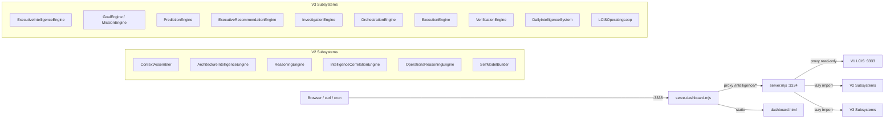

# LCIS Executive Command Center — V2/V3 Intelligence API

The Intelligence API (`tools/central-intelligence/intelligence-api/server.mjs`) is the unified HTTP surface for all LCIS V1, V2, and V3 capabilities. It runs on port 3334, has zero external Node.js dependencies, and exposes 80 endpoints across three generation layers. The Operator Dashboard (`tools/central-intelligence/operator-platform/dashboard.html`, served on port 3335) renders all 80 endpoints as interactive sections with a V3 Executive hero card at the top.

---

## 1. Overview

| Attribute | Value |
|---|---|
| Server file | `tools/central-intelligence/intelligence-api/server.mjs` (1,143 lines) |
| Dashboard file | `tools/central-intelligence/operator-platform/dashboard.html` (1,906 lines) |
| Dashboard server | `tools/central-intelligence/operator-platform/serve-dashboard.mjs` |
| API port | 3334 (override: `LCIS_V2_PORT` env var) |
| Dashboard port | 3335 (override: `LCIS_DASH_PORT` env var) |
| V1 proxy target | `http://localhost:3333` (override: `LCIS_V1_URL` env var) |
| Total endpoints | 80 (24 V1 + 24 V2 + 32 V3, including `/intelligence/command-center`) |
| External dependencies | Zero — `node:http`, `node:url`, `node:path`, `node:fs` only |
| Module loading | All subsystems lazy-loaded via dynamic `import()` with a shared module cache; a missing module returns `null` and the handler returns `503` |

---

## 2. Architecture



`serve-dashboard.mjs` is a thin static file server plus reverse proxy. Every request to `/intelligence/*` is piped verbatim (including query string) to port 3334. All other requests serve `dashboard.html` (SPA fallback). The proxy has no authentication — it is intended for local operator use only.

CORS is enforced in `server.mjs` for the origin allowlist: `localhost:3000`, `3001`, `3333`, `3334`. The server auto-starts when run directly (`process.argv[1]` check) and can be imported as a module (`export async function start()`).

---

## 3. Complete Endpoint Catalog

### V1 Subsystems (24 endpoints)

| Method | Path | Purpose |
|---|---|---|
| `GET` | `/intelligence/health` | HealthService overall health |
| `GET` | `/intelligence/status` | Multi-layer status: memory / graph / V1 / agents |
| `GET` | `/intelligence/memory/search?q=&collection=&limit=` | Semantic memory retrieval (Qdrant via MemoryRetriever) |
| `POST` | `/intelligence/memory/ingest` | Ingest text into a memory collection |
| `GET` | `/intelligence/memory/health` | MemoryHealthMonitor status |
| `GET` | `/intelligence/memory/stats` | MemoryHealthMonitor metrics |
| `GET` | `/intelligence/knowledge/search?q=` | Knowledge-collection semantic search |
| `POST` | `/intelligence/knowledge/crawl` | Crawl a registered knowledge source |
| `GET` | `/intelligence/knowledge/sources` | List KnowledgeSourceRegistry entries |
| `GET` | `/intelligence/knowledge/freshness` | KnowledgeFreshnessService check |
| `GET` | `/intelligence/graph/query?q=&method=` | GraphQueryEngine query (global/local) |
| `GET` | `/intelligence/graph/impact?entity=` | GraphExplorer.whatBreaksIf(entity) |
| `GET` | `/intelligence/graph/entities?name=` | GraphExplorer entity lookup |
| `GET` | `/intelligence/graph/health` | GraphDiagnostics health |
| `GET` | `/intelligence/browser/validate?url=` | BrowserIntelligenceEngine storefront validation |
| `GET` | `/intelligence/browser/theme?url=&themeId=` | ThemeAgent theme validation (never executes payment) |
| `GET` | `/intelligence/browser/checkout?url=` | CheckoutAgent checkout flow validation |
| `GET` | `/intelligence/browser/status` | Browser intelligence subsystem status |
| `GET` | `/intelligence/observability/health` | HealthService observability check |
| `GET` | `/intelligence/observability/incidents` | Recent incidents from `graphify-out/incidents.jsonl` |
| `GET` | `/intelligence/observability/anomalies` | AnomalyDetectionService anomalies |
| `GET` | `/intelligence/agents/execute?agent=&q=` | Execute a named agent (knowledge/security/operations/merchant/release) |
| `GET` | `/intelligence/agents/status` | Agent registry status |
| `GET` | `/intelligence/ask?q=` | Flagship NL query — routes to right engine |

### V2 Subsystems (24 endpoints)

| Method | Path | Purpose |
|---|---|---|
| `GET` | `/intelligence/context/assemble?q=&budget=` | ContextAssembler — build a token-budgeted context package |
| `GET` | `/intelligence/context/map` | Top-300 ranked files context map |
| `POST` | `/intelligence/context/build` | Trigger a full context build |
| `GET` | `/intelligence/context/health` | ContextDiagnostics health |
| `GET` | `/intelligence/context/compression` | ContextCompressionPipeline compression stats |
| `GET` | `/intelligence/architecture` | Full architecture snapshot |
| `GET` | `/intelligence/architecture/drift` | Architecture drift since last snapshot |
| `GET` | `/intelligence/architecture/risks` | Architecture risk list |
| `GET` | `/intelligence/architecture/depends?component=` | Dependency graph for a component |
| `GET` | `/intelligence/reason?q=` | ReasoningEngine — general question |
| `GET` | `/intelligence/reason/why?incident=` | Root cause reasoning for an incident |
| `GET` | `/intelligence/reason/affected?component=` | What is affected if component changes |
| `GET` | `/intelligence/reason/risk-dependency` | Cross-domain risk dependency analysis |
| `POST` | `/intelligence/correlate` | IntelligenceCorrelationEngine correlation run |
| `GET` | `/intelligence/correlate/root-cause?domain=` | Root cause correlation for a domain |
| `GET` | `/intelligence/correlate/impact?component=` | Impact correlation for a component |
| `GET` | `/intelligence/correlate/risk?target=` | Risk correlation for a target |
| `GET` | `/intelligence/operations/assess` | OperationsReasoningEngine full posture assessment |
| `GET` | `/intelligence/operations/recommendations` | Operational recommendations |
| `GET` | `/intelligence/operations/insights` | Operational insights (top findings) |
| `GET` | `/intelligence/operations/daily` | V2 IntelligenceReportGenerator latest report |
| `POST` | `/intelligence/operations/daily` | Generate a fresh V2 daily report |
| `GET` | `/intelligence/self/model` | Read `graphify-out/self-model/LCIS_SELF_MODEL.json` |
| `POST` | `/intelligence/self/build` | SelfModelBuilder.build() — regenerate self model |
| `GET` | `/intelligence/self/explain?topic=` | PlatformExplainer — topics: platform / services / deploy / failure / incident / operations |
| `GET` | `/intelligence/command-center` | Aggregate: all V2 + V3 subsystems in one call |

### V3 Subsystems (32 endpoints)

| Method | Path | Purpose |
|---|---|---|
| `GET` | `/intelligence/executive/briefing` | ExecutiveIntelligenceEngine executive briefing |
| `GET` | `/intelligence/executive/next` | What should happen next (prioritized actions) |
| `POST` | `/intelligence/executive/decide` | Decision support — body: `{situation}` |
| `POST` | `/intelligence/executive/plan` | Goal planning — body: `{goal}` |
| `GET` | `/intelligence/executive/synthesize?topic=` | Synthesize platform state for a topic |
| `GET` | `/intelligence/goals?category=` | GoalEngine goals list, optional category filter |
| `GET` | `/intelligence/goals/at-risk` | Goals with at-risk or blocked status |
| `GET` | `/intelligence/missions` | MissionEngine missions list |
| `GET` | `/intelligence/predict?target=` | PredictionEngine.predict(target) for a specific target |
| `GET` | `/intelligence/predict/all` | PredictionEngine.predictAll() — ranked predictions |
| `GET` | `/intelligence/predict/incidents` | PredictionEngine.predict('incidents') |
| `GET` | `/intelligence/recommend` | ExecutiveRecommendationEngine.recommendAll() |
| `GET` | `/intelligence/recommend/domain?domain=` | Domain-scoped recommendations (engineering / operational / security / architecture / merchant) |
| `GET` | `/intelligence/investigate/domain?domain=` | InvestigationEngine.investigateDomain(domain) |
| `POST` | `/intelligence/investigate` | Full incident investigation — body: `{incident: {domain, error, severity}}` |
| `GET` | `/intelligence/orchestrate/health` | OrchestrationEngine health assessment |
| `GET` | `/intelligence/orchestrate/risk` | OrchestrationEngine risk assessment |
| `GET` | `/intelligence/orchestrate/architecture` | OrchestrationEngine architecture review |
| `GET` | `/intelligence/orchestrate/workflows` | OrchestrationEngine workflow list |
| `POST` | `/intelligence/execute` | ExecutionEngine.execute(action, params) — SafetyGuard whitelist enforced |
| `GET` | `/intelligence/execute/actions` | ActionRegistry registered action list |
| `GET` | `/intelligence/execute/audit` | ExecutionEngine audit log |
| `POST` | `/intelligence/verify` | VerificationEngine.verify(conclusion) — body: `{conclusion}` |
| `GET` | `/intelligence/verify/report` | VerificationEngine.getVerificationReport() |
| `GET` | `/intelligence/brief/daily` | DailyIntelligenceSystem.getLatestBrief('daily') |
| `POST` | `/intelligence/brief/generate` | DailyIntelligenceSystem.generateAll() |
| `GET` | `/intelligence/brief/executive` | ExecutiveSummaryGenerator.generate() |
| `GET` | `/intelligence/loop/state` | LCISOperatingLoop.getLoopState() |
| `POST` | `/intelligence/loop/run-once` | LCISOperatingLoop.runOnce() |
| `GET` | `/intelligence/loop/history` | LCISOperatingLoop.getHistory(10) |

---

## 4. The /intelligence/command-center Aggregate

`GET /intelligence/command-center` is the single call that hydrates the full operator dashboard. It fires all subsystems in parallel via `Promise.allSettled` and returns a version `3.0` response.

**Engines called in parallel (first wave — V2 base):**
`HealthService`, `ContextDiagnostics`, `ArchitectureIntelligenceEngine`, `OperationsReasoningEngine`

**Second parallel wave — V3 enrichments:**
`ExecutiveIntelligenceEngine`, `GoalEngine`, `PredictionEngine`, `ExecutiveRecommendationEngine`, `LCISOperatingLoop`, `VerificationEngine`

**Response shape:**

```json
{
  "timestamp": "<ISO string>",
  "version": "3.0",
  "health":         { "<HealthService result or NOT CONNECTED>" },
  "context":        { "<ContextDiagnostics compression stats or NOT CONNECTED>" },
  "architecture":   { "<ArchitectureIntelligenceEngine risks or NOT CONNECTED>" },
  "operations":     { "<OperationsReasoningEngine assess() or NOT CONNECTED>" },
  "selfModel":      { "subsystemCount": "<number from LCIS_SELF_MODEL.json or 0>" },
  "incidents":      { "recent": ["<last 10 from graphify-out/incidents.jsonl>"] },
  "executive": {
    "briefing":     { "<ExecutiveIntelligenceEngine.getExecutiveBriefing() or NOT CONNECTED>" }
  },
  "goals": {
    "atRisk":       ["<GoalEngine.getGoalsAtRisk() or []>"],
    "atRiskCount":  "<number or NOT CONNECTED>"
  },
  "predictions": {
    "top":          ["<top 3 from PredictionEngine.predictAll()>"],
    "count":        "<total or NOT CONNECTED>"
  },
  "recommendations": {
    "top":          ["<top 3 from ExecutiveRecommendationEngine.recommendAll()>"],
    "count":        "<total or NOT CONNECTED>"
  },
  "loop":           { "<LCISOperatingLoop.getLoopState() or NOT CONNECTED>" },
  "verification":   { "<VerificationEngine.getVerificationReport() or NOT CONNECTED>" }
}
```

`selfModel.subsystemCount` is derived from `graphify-out/self-model/LCIS_SELF_MODEL.json` — it reads `.subsystems.length` or `.layers.length`. If the file does not exist the count is 0.

`incidents.recent` reads the last 10 lines from `graphify-out/incidents.jsonl`, parses each as JSON, and reverses for newest-first order.

Every field that depends on an engine uses `Promise.allSettled` — a rejected promise yields `NOT CONNECTED` for that field without aborting the response.

---

## 5. The /intelligence/ask Flagship

`GET /intelligence/ask?q=<natural language question>` is the entry point for any operator who does not know which specific endpoint to call. The `ResponseSynthesizer` (`tools/central-intelligence/intelligence-api/ResponseSynthesizer.mjs`) routes the question to the most relevant engine based on semantic content:

- Questions about what breaks / impact / blast radius → `GraphExplorer.whatBreaksIf()`
- Questions about incidents, root cause, why something failed → `ReasoningEngine.reasonWhy()`
- Questions about architecture, drift, depends → `ArchitectureIntelligenceEngine`
- Questions about operations, posture, what to fix → `OperationsReasoningEngine`
- General or ambiguous questions → `ContextAssembler` context package + `GraphQueryEngine` + `MemoryRetriever` synthesis

The response is synthesized from all available sources and returned as a single JSON object with `{question, answer, sources, confidence}`. When no engines are available the response explains which services need to be running.

---

## 6. Dashboard Sections

The dashboard at `http://localhost:3335` is a single-page application with 29 sections organized in a CSS grid. Sections with `section-full` class span the full grid width.

### V2 Sections (18)

| Section ID | Title | Badge | Notes |
|---|---|---|---|
| `sec-health` | System Health | Observability | `GET /intelligence/health` |
| `sec-context` | Context Intelligence | Context | `GET /intelligence/context/compression` |
| `sec-architecture` | Architecture Intelligence | Architecture | `GET /intelligence/architecture` |
| `sec-arch-drift` | Architecture Evolution | Drift | `GET /intelligence/architecture/drift` |
| `sec-reasoning` | Reasoning Engine | Reasoning | `GET /intelligence/reason?q=` |
| `sec-risk` | Risk Intelligence | Risk | `GET /intelligence/correlate/risk?target=` |
| `sec-dependency` | Dependency Intelligence | Deps | `GET /intelligence/architecture/depends?component=` |
| `sec-engineering` | Engineering Intelligence | Recommendations | `GET /intelligence/recommend/domain?domain=engineering` |
| `sec-operations` | Operational Recommendations | Ops | `GET /intelligence/operations/recommendations` |
| `sec-self` | System Understanding | Self Model | `GET /intelligence/self/model` |
| `sec-repo` | Repository Understanding | Context | `GET /intelligence/context/map` |
| `sec-knowledge` | Knowledge | Knowledge Engine | `GET /intelligence/knowledge/sources` |
| `sec-memory` | Memory | Memory Engine | `GET /intelligence/memory/stats` |
| `sec-graph` | Graph | Graph Engine | `GET /intelligence/graph/health` |
| `sec-observability` | Observability | Signals | `GET /intelligence/observability/health` |
| `sec-browser` | Browser Intelligence | Browser | `GET /intelligence/browser/status` |
| `sec-agents` | Agents | Agents | `GET /intelligence/agents/status` |
| `sec-incidents` | Incidents | Observability | `GET /intelligence/observability/incidents` — `section-full` |

### V3 Sections (11)

| Section ID | Title | Badge | Notes |
|---|---|---|---|
| `sec-executive` | Executive Intelligence | V3 | `GET /intelligence/executive/briefing` — `section-full` |
| `sec-predictions` | Predictions | V3 | `GET /intelligence/predict/all` |
| `sec-recommendations` | Recommendations | V3 | `GET /intelligence/recommend` |
| `sec-goals` | Goals & Missions | V3 | `GET /intelligence/goals` + `GET /intelligence/missions` |
| `sec-risk-intel` | Risk Intelligence | V3 | `GET /intelligence/orchestrate/risk` |
| _(no id)_ | Platform Health | V3 | `GET /intelligence/orchestrate/health` |
| `sec-arch-health` | Architecture Health | V3 | `GET /intelligence/orchestrate/architecture` |
| _(no id)_ | Operational Health | V3 | `GET /intelligence/operations/assess` |
| _(no id)_ | Merchant Health | V3 | `GET /intelligence/recommend/domain?domain=merchant` |
| `sec-investigations` | Investigations | V3 | `GET /intelligence/investigate/domain?domain=` |
| `sec-loop` | Operating Loop | V3 | `GET /intelligence/loop/state` + "Run Cycle" button — `section-full` |

---

## 7. Executive Hero Card

Above the 29-section grid, the dashboard renders two stacked bars:

**Executive Command Center — V3 (exec-hero):** Eight tiles populated from `GET /intelligence/command-center`:

| Tile ID | Label | Source field |
|---|---|---|
| `ec-next` | Next Action | `executive.briefing` |
| `ec-goals-at-risk` | Goals At Risk | `goals.atRiskCount` |
| `ec-top-pred` | Top Prediction | `predictions.top[0]` |
| `ec-top-rec` | Top Recommendation | `recommendations.top[0]` |
| `ec-loop` | Loop State | `loop.status` |
| `ec-verify` | Verification | `verification.status` |
| `ec-pred-count` | Predictions | `predictions.count` (sub: "total ranked") |
| `ec-rec-count` | Recommendations | `recommendations.count` (sub: "cross-domain") |

**System Overview (command-bar):** Seven tiles — Health (`cc-health`), Context (`cc-context`), Architecture (`cc-arch`), Operations (`cc-ops`), Self Model subsystem count (`cc-self`), Recent Incidents (`cc-incidents`), Last Refresh timestamp (`cc-ts`).

The page header also contains a global search bar (`/intelligence/ask?q=`) with an API connectivity indicator dot and a "Refresh All" button that calls all section loaders in sequence.

---

## 8. How to Launch

```bash
# Terminal 1 — Intelligence API (V2/V3 endpoints at :3334)
node tools/central-intelligence/intelligence-api/server.mjs

# Terminal 2 — Operator Dashboard (static + proxy at :3335)
node tools/central-intelligence/operator-platform/serve-dashboard.mjs

# Open dashboard
open http://localhost:3335
```

**Environment overrides:**

```bash
LCIS_V2_PORT=4000   node tools/central-intelligence/intelligence-api/server.mjs
LCIS_DASH_PORT=4001 LCIS_V2_PORT=4000 node tools/central-intelligence/operator-platform/serve-dashboard.mjs
LCIS_V1_URL=http://localhost:3333 node tools/central-intelligence/intelligence-api/server.mjs
```

V1 LCIS must be running at `:3333` for the command-center aggregate and all V1-sourced fields to return data rather than NOT CONNECTED. Start V1 with `node tools/graph-server/server.mjs` (or `pnpm graph:ui`).

If the Intelligence API is not running, `serve-dashboard.mjs` returns a 502 with a hint message on any `/intelligence/*` request — the dashboard remains navigable but all sections show "API not reachable".

---

## 9. Operator Workflows

### Workflow 1 — Investigate an Incident

Use when a merchant reports an error or monitoring alerts on a domain.

```bash
# 1. Submit the incident for investigation
curl -X POST http://localhost:3334/intelligence/investigate \
  -H 'Content-Type: application/json' \
  -d '{"incident": {"domain": "payments", "error": "Razorpay signature verification failed", "severity": "HIGH"}}'

# 2. Get domain-level investigation (all prior findings for payments)
curl 'http://localhost:3334/intelligence/investigate/domain?domain=payments'

# 3. Correlate root cause
curl 'http://localhost:3334/intelligence/correlate/root-cause?domain=payments'
```

### Workflow 2 — Assess Platform Posture

Use at the start of a shift or before a deploy.

```bash
# 1. One-call aggregate (all subsystems)
curl http://localhost:3334/intelligence/command-center

# 2. Full operations posture
curl http://localhost:3334/intelligence/operations/assess

# 3. Architecture risks
curl http://localhost:3334/intelligence/architecture/risks

# 4. Goals at risk
curl http://localhost:3334/intelligence/goals/at-risk

# 5. Top predictions
curl http://localhost:3334/intelligence/predict/all
```

### Workflow 3 — Run the Operating Loop

Use to trigger a full LCIS refresh cycle (observe → assess → plan → act → verify → learn).

```bash
# 1. Check current loop state
curl http://localhost:3334/intelligence/loop/state

# 2. Run one full cycle
curl -X POST http://localhost:3334/intelligence/loop/run-once

# 3. Review cycle history (last 10 runs)
curl http://localhost:3334/intelligence/loop/history

# 4. After the loop completes, generate fresh briefs
curl -X POST http://localhost:3334/intelligence/brief/generate

# 5. Read the latest daily brief
curl http://localhost:3334/intelligence/brief/daily
```

The Operating Loop's `runOnce()` returns the full cycle result including which stages ran, what changed, and any errors encountered. The loop does not write to the database or execute production actions — all actions are read-only intelligence operations unless `ExecutionEngine.execute()` is explicitly called with an approved action from the ActionRegistry whitelist.
