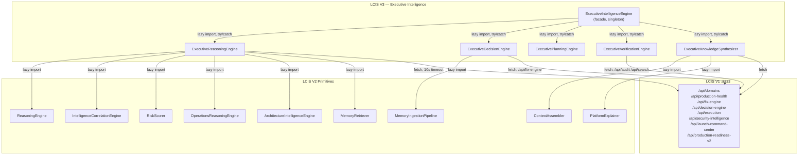

# LCIS V3 Executive Intelligence

> **Layer:** V3 — Executive Intelligence  
> **Entry point:** `tools/central-intelligence/executive-intelligence/ExecutiveIntelligenceEngine.mjs`  
> **Runtime:** LCIS V2 Intelligence API, port 3334  
> **V1 dependency:** LCIS graph server, port 3333 (probed via `fetch('http://localhost:3333/api/domains')`, 5s timeout)

---

## Purpose

LCIS V3 Executive Intelligence is the decision-making facade layered over the V2 autonomous intelligence platform. It converts raw structural knowledge and V2 reasoning into four executive capabilities: **what to do next**, **what to decide**, **how to plan**, and **what is known**. It is not an analytics dashboard — it is an opinionated synthesis engine that answers executive questions with evidence, assigns priorities (P0–P3), and marks every live data gap honestly as NOT CONNECTED with the exact source required.

V3 does not replace V1 (:3333) or V2 (:3334). V1 remains the structural brain (graph, topology, 107 validators). V2 provides autonomous operations, reasoning, and memory. V3 wraps both as a unified read-only intelligence facade.

---

## Architecture



---

## Sub-Engines

| Engine | File | Responsibility |
|--------|------|----------------|
| `ExecutiveReasoningEngine` | `executive-intelligence/ExecutiveReasoningEngine.mjs` | Fan-out reasoning across all V2 primitives; answer four executive questions |
| `ExecutiveDecisionEngine` | `executive-intelligence/ExecutiveDecisionEngine.mjs` | Score and rank decision options; JSONL decision log |
| `ExecutivePlanningEngine` | `executive-intelligence/ExecutivePlanningEngine.mjs` | Decompose goals into topologically-ordered execution plans |
| `ExecutiveVerificationEngine` | `executive-intelligence/ExecutiveVerificationEngine.mjs` | Verify conclusions, decisions, and plans against evidence standards |
| `ExecutiveKnowledgeSynthesizer` | `executive-intelligence/ExecutiveKnowledgeSynthesizer.mjs` | Unify memory + context + self-model + reasoning into role-specific briefings |

All sub-engine imports are **lazy** (wrapped in `try/catch`, returning `null` on failure). `Promise.allSettled` is used throughout. One engine failure never blocks another.

---

## Facade API

All methods live on the singleton exported from `ExecutiveIntelligenceEngine.mjs`.

### `getExecutiveBriefing()`

Aggregates all four executive questions in one call via `Promise.allSettled`.

```js
const briefing = await engine.getExecutiveBriefing();
// Returns: { nextActions, highestRisk, leadershipSummary, platformState, timestamp }
```

### `whatShouldHappenNext()`

Delegates to `ExecutiveReasoningEngine.whatShouldHappenNext()`. Pulls from `/api/execution`, `/api/decision-engine`, and `OperationsReasoningEngine.getEngineeringRecommendations()`.

Returns `ExecutiveInsight`: `{ question, conclusion, priority, evidence, confidence, recommendedOwner, timestamp }`.

### `decide(situation)`

Delegates to `ExecutiveDecisionEngine.decide(situation)`. Scores each option via the formula `raw = (i * 4 + c * 3 - r * 2 - e * 1)`, normalized to 0–100. Appends to `graphify-out/executive-intelligence/decisions.jsonl`.

### `plan(goal)`

Delegates to `ExecutivePlanningEngine.plan(goal)`. Uses `ReasoningEngine`, `OperationsReasoningEngine`, V1 `/api/fix-engine`, and `MemoryRetriever` to decompose the goal, then topologically sorts steps with Kahn's algorithm.

### `verify(conclusion)`

Delegates to `ExecutiveVerificationEngine.verify(conclusion)`. Checks evidence quality, source labeling, and fabrication patterns. Returns `VerificationResult`: `{ verified, confidence, evidence, sources, gaps, status }`.

### `synthesize(topic)`

Delegates to `ExecutiveKnowledgeSynthesizer.synthesize(topic)`. Fans out to `MemoryRetriever`, `ContextAssembler`, `PlatformExplainer`, `ReasoningEngine`, and V1 `/api/search`.

### `getHealth()`

Probes all 5 sub-engines + 9 V2 primitives + V1 LCIS. Returns structured reachability map.

---

## V2 Primitive Probes

`getHealth()` probes these V2 primitives by attempting lazy import and checking the default export is non-null:

| Primitive | Import path |
|-----------|-------------|
| `ReasoningEngine` | `../reasoning/ReasoningEngine.mjs` |
| `IntelligenceCorrelationEngine` | `../correlation/IntelligenceCorrelationEngine.mjs` |
| `RiskScorer` | `../correlation/RiskScorer.mjs` |
| `OperationsReasoningEngine` | `../autonomous-operations/OperationsReasoningEngine.mjs` |
| `ArchitectureIntelligenceEngine` | `../architecture-intelligence/ArchitectureIntelligenceEngine.mjs` |
| `ContextAssembler` | `../context-intelligence/ContextAssembler.mjs` |
| `MemoryRetriever` | `../memory-engine/MemoryRetriever.mjs` |
| `MemoryIngestionPipeline` | `../memory-engine/MemoryIngestionPipeline.mjs` |
| `PlatformExplainer` | `../self-model/PlatformExplainer.mjs` |

---

## Honesty Contract

The V3 Executive Intelligence layer enforces the same honesty contract as V1 and V2:

| Data category | Status |
|---------------|--------|
| Structural topology (code graph, 414 tables, 156 RPCs, 651 policies) | CONNECTED |
| V1 LCIS `/api/*` endpoints | CONNECTED when V1 running at :3333 |
| V2 primitives (reasoning, memory, correlation) | CONNECTED when V2 running at :3334 |
| Live telemetry (error rates, latencies, queue depths) | NOT CONNECTED — source: `OTEL_EXPORTER_OTLP_ENDPOINT` |
| Active merchant counts, GMV, refund totals | NOT CONNECTED — source: Supabase ledger RPCs |
| Live deploy versions | NOT CONNECTED — source: Vercel Deploy API / Cloudflare Workers API |
| Production secret presence | NOT CONNECTED — source: Vercel env API (deploy-time) |

`NOT CONNECTED` disclosures always include the exact source and how to wire it — never a fabricated value.

---

## Safety Constraints

V3 Executive Intelligence is **read-only**. No engine in this layer:

- Writes to application database tables
- Calls canonical money RPCs (`create_checkout_order`, `confirm_order_payment_with_ledger`, etc.)
- Modifies RLS policies, secrets, or Vercel environment variables
- Triggers Razorpay payments or refunds

All writes in LCIS are handled by the **Execution Engine** (`execution-engine/ExecutionEngine.mjs`) which enforces `SafetyGuard` rejection of any production-mutation request. The Executive Intelligence engines write only to `graphify-out/` (gitignored artifacts): `decisions.jsonl`, `plans/*.json`, `executive-intelligence/recommendations.jsonl`.

---

## Starting V3

```bash
# Start V1 LCIS structural brain (required dependency)
cd tools/graph-server && node server.mjs

# Start V2 + V3 Intelligence API
cd tools/central-intelligence && bash setup.sh && npm start

# Verify Executive Intelligence health
curl http://localhost:3334/intelligence/executive/health
```

---

## Related Documents

- `docs/lcis-v2/LCIS_GOAL_ENGINE.md` — Goal Engine, Mission Engine, Objective Tracker, Outcome Tracker
- `docs/lcis-v2/LCIS_PREDICTION_ENGINE.md` — TrendAnalyzer, RiskForecaster, CapacityForecaster, IncidentPredictor
- `docs/lcis-v2/LCIS_RECOMMENDATION_ENGINE.md` — ExecutiveRecommendationEngine, RecommendationRanker, RecommendationValidator
- `docs/lcis-v2/LCIS_INVESTIGATION_ENGINE.md` — InvestigationEngine, IncidentEvidenceCollector, TimelineBuilder, RootCauseInvestigator
- `docs/lcis-v2/LCIS_ORCHESTRATION_ENGINE.md` — OrchestrationEngine, WorkflowRegistry, WorkflowExecutor
- `docs/lcis-v2/LCIS_ARCHITECTURE_V2.md` — V2 architecture overview
