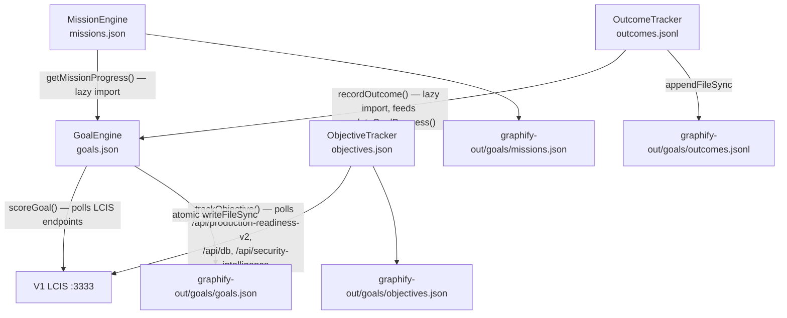

# LCIS V3 Goal Engine

> **Layer:** V3 — Executive Intelligence  
> **Files:** `tools/central-intelligence/goal-engine/`  
> **Persistence:** `graphify-out/goals/goals.json`, `missions.json`, `objectives.json`, `outcomes.jsonl`

---

## Purpose

The Goal Engine tracks strategic platform goals, decomposes them into measurable objectives with key results (KRs), and provides a continuous learning loop via outcome tracking. It is the planning and accountability layer of LCIS V3 — goals give context to predictions, recommendations, and decisions.

The engine is honest about its connectivity: structural evidence (file counts, policy counts, RPC presence) is CONNECTED and refreshes from V1 LCIS on every `scoreGoal()` call. Live business KRs (onboarding completion rates, active merchant counts, GMV) are explicitly NOT CONNECTED with the exact source named.

---

## Module Map

| Class | File | Responsibility |
|-------|------|----------------|
| `GoalEngine` | `GoalEngine.mjs` (506 lines) | CRUD, scoring, progress, risk-detection for Goals |
| `MissionEngine` | `MissionEngine.mjs` (317 lines) | Missions = collections of goals with a shared vision and horizon |
| `ObjectiveTracker` | `ObjectiveTracker.mjs` (543 lines) | Objectives (milestones) with Key Results per goal |
| `OutcomeTracker` | `OutcomeTracker.mjs` (349 lines) | Append-only outcome log; trend analysis; learning loop |

All four classes are singletons exported as `default`. They share the `graphify-out/goals/` persistence directory.

---

## Architecture



---

## Seeded Goals (5)

The `GoalEngine` seeds these goals idempotently on construction — existing progress is never overwritten.

| ID | Category | Owner | Status (default) | Scored from |
|----|----------|-------|-----------------|-------------|
| `launch-readiness` | strategic | founder | at-risk | `/api/production-readiness-v2` |
| `107-validator-gate-green` | engineering | engineering | on-track | `/api/audit` |
| `zero-money-ledger-drift` | reliability | payments-engineering | on-track | `/api/security-intelligence` |
| `rls-force-coverage` | security | security | on-track | `db-intel.json` (651 policies / 414 tables) |
| `merchant-onboarding-completion` | merchant | merchant-experience | at-risk | structural ~60; live NOT CONNECTED (source: identity-platform onboarding analytics) |

### Goal Schema

```ts
interface Goal {
  id: string;
  category: 'strategic' | 'engineering' | 'reliability' | 'security' | 'merchant';
  title: string;
  description: string;
  target: number;           // 0–100 progress target
  owner: string;
  status: 'on-track' | 'at-risk' | 'blocked' | 'achieved';
  progress: number;         // 0–100
  evidence: Array<{
    source: string;
    value: string | number;
    capturedAt: string;
    connected: boolean;
  }>;
  createdAt: string;
  updatedAt: string;
}
```

### Status Derivation

`_statusFromProgress(progress, blockers)`:

| Condition | Status |
|-----------|--------|
| progress ≥ 100 | `achieved` |
| progress ≥ 75 | `on-track` |
| progress < 40 OR blocker present | `blocked` |
| Otherwise | `at-risk` |

---

## GoalEngine API

| Method | Returns | Notes |
|--------|---------|-------|
| `defineGoal(goal)` | `Goal` | Creates or replaces a goal; saves atomically |
| `getGoals(category?)` | `Goal[]` | Filter by category or return all |
| `getGoal(id)` | `Goal \| null` | Lookup by ID |
| `updateGoalProgress(id, evidence)` | `Goal \| null` | Append evidence item; recompute status |
| `scoreGoal(id)` | `{ progress, connected, liveNote }` | Polls LCIS and refreshes progress |
| `reasonAgainstGoals(event)` | `{ relevantGoals, reasoning }` | Correlate an event to affected goals |
| `getGoalsAtRisk()` | `Goal[]` | Filter by status `at-risk` or `blocked` |
| `refreshAll()` | `Goal[]` | Scores all goals in parallel |

**LCIS_BASE:** `process.env.LCIS_URL ?? 'http://localhost:3333'`

---

## Seeded Missions (2)

`MissionEngine` seeds these idempotently. A mission links multiple goals under a shared vision with a time horizon.

| ID | Linked Goals | Horizon | Vision |
|----|-------------|---------|--------|
| `letbuyy-ga-launch` | `launch-readiness`, `107-validator-gate-green`, `zero-money-ledger-drift` | quarter | "Ship LetBuyy to general availability..." |
| `merchant-security-foundation` | `rls-force-coverage`, `merchant-onboarding-completion` | quarter | "Establish a bulletproof multi-tenant security posture..." |

### `getMissionProgress(id)`

Computes the mean progress score of all linked goals via a lazy import of `GoalEngine`. The result includes:

```
liveNote: "Progress derived from structural evidence (CONNECTED). Live merchant counts / GMV: NOT CONNECTED — source: Supabase ledger + Analytics Engine."
```

---

## Objectives and Key Results

`ObjectiveTracker` manages **6 seeded objectives** across all 5 goals. Each objective has typed Key Results (KRs) with explicit connectivity labels.

### Seeded Objectives

| Objective ID | Goal | KR Count | Blocked by |
|-------------|------|----------|-----------|
| `obj-lr-blockers` | `launch-readiness` | 3 | Open blockers NOT CONNECTED (source: `/api/production-readiness-v2`) |
| `obj-lr-certs` | `launch-readiness` | 4 | CAP-C01..C04 all NOT CONNECTED (source: Vercel env API) |
| `obj-gate-violations` | `107-validator-gate-green` | 3 | CI signal NOT CONNECTED (source: `validate-governance.mjs` local run) |
| `obj-ledger-rpc-only` | `zero-money-ledger-drift` | 3 | 6 canonical RPCs CONNECTED; drift check NOT CONNECTED (source: Supabase DB) |
| `obj-rls-coverage` | `rls-force-coverage` | 4 | 651 policies CONNECTED; USING(true) scan NOT CONNECTED |
| `obj-onboarding-flow` | `merchant-onboarding-completion` | 4 | Onboarding page CONNECTED; funnel rates NOT CONNECTED (source: analytics) |

### Key Result Schema

```ts
interface KeyResult {
  kr: string;
  target: string | number;
  current: string | number;      // 'NOT CONNECTED' when live data required
  met: boolean;
  source: string;                // exact source + connection status
  connected: boolean;
}
```

`trackObjective(id)` auto-refreshes only CONNECTED KRs — it never overwrites a `NOT CONNECTED` value without a live source.

Objective status derived by `_objectiveStatusFromKRs`:

- All met → `achieved`
- No met + hard blocker (NOT CONNECTED required KR) → `blocked`
- Otherwise → `in-progress`

---

## Outcome Tracker

`OutcomeTracker` is an append-only learning loop. Every recorded outcome:

1. Appends a JSON line to `graphify-out/goals/outcomes.jsonl`
2. Feeds the related goal via `GoalEngine.updateGoalProgress()` (lazy import, graceful)
3. Computes an impact score

### Impact Weights

| Type | Base weight |
|------|------------|
| `achievement` | +30 |
| `progress` | +15 |
| `blocker` | -25 |
| `regression` | -20 |

Severity modifier: `critical` × 2.0, `high` × 1.5, `medium` × 1.0, `low` × 0.5

Category modifier: `zero-money-ledger-drift` × 1.8, `rls-force-coverage` × 1.6, `launch-readiness` × 1.4, `107-validator-gate-green` × 1.2, others × 1.0

Final score: `Math.max(-100, Math.min(100, Math.round(base × severity × category)))`.

Business impact fields (`merchantsAffected`, `revenueAtRisk`) are always `NOT CONNECTED` — source: Supabase `sites` table count + canonical ledger RPCs.

### Trend Analysis

`getOutcomeTrend(goalId)` operates on the 10 most recent outcomes, split into two halves:

- `delta > 5` → `improving`
- `delta < -5` → `degrading`
- Otherwise → `stable`
- Fewer than 2 outcomes → `insufficient-data`

Live velocity (PRs merged/day, test pass rate) is NOT CONNECTED — source: CI telemetry adapter.

### Goal Correlation

`correlateOutcomeToGoal(outcome)` uses the keyword map:

| Goal ID | Keywords |
|---------|---------|
| `launch-readiness` | launch, blocker, readiness, go-live, production, cert, razorpay-route |
| `107-validator-gate-green` | validator, gate, governance, validate-governance, violation, 107 |
| `zero-money-ledger-drift` | ledger, money, payment, refund, payout, order, rpc, drift, reconcil |
| `rls-force-coverage` | rls, row-level, security, policy, tenant, auth, identity, cross-tenant |
| `merchant-onboarding-completion` | onboarding, merchant, store-create, theme-assign, setup-complete, first-order |

Returns `{ goalId, confidence: 'high'|'medium'|'low', matches }`.

---

## Persistence

| File | Format | Written by | Notes |
|------|--------|-----------|-------|
| `graphify-out/goals/goals.json` | JSON | `GoalEngine` | Atomic `writeFileSync`; read synchronously in constructor |
| `graphify-out/goals/missions.json` | JSON | `MissionEngine` | Same pattern |
| `graphify-out/goals/objectives.json` | JSON | `ObjectiveTracker` | Constructor loads synchronously |
| `graphify-out/goals/outcomes.jsonl` | JSONL (append) | `OutcomeTracker` | `appendFileSync`, never truncated |

All files are in `graphify-out/` which is gitignored.

---

## Querying Goals at Runtime

```bash
# Via V3 Intelligence API
curl http://localhost:3334/intelligence/goals
curl http://localhost:3334/intelligence/goals/launch-readiness
curl http://localhost:3334/intelligence/goals/at-risk
curl http://localhost:3334/intelligence/missions
curl http://localhost:3334/intelligence/missions/letbuyy-ga-launch/progress
```
