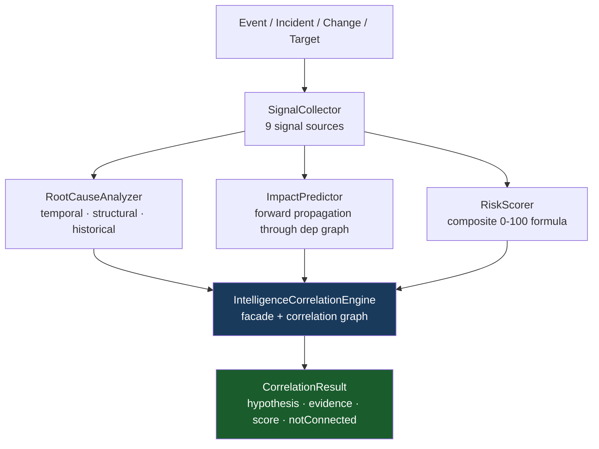

# LCIS Intelligence Correlation

> **LCIS V2 — Phase 16**  
> Module: `tools/central-intelligence/correlation/`  
> Entry point: `IntelligenceCorrelationEngine.mjs` (facade)

---

## Purpose

Intelligence Correlation is the feedback layer that connects all other LCIS subsystems. Where Context Intelligence understands the repository structure and Reasoning Intelligence explains what breaks and why, Correlation Intelligence answers a different question: **given everything LCIS knows — incidents, deployments, code changes, architecture state, live signals, historical memory — what is the most likely root cause, what will be impacted, and how risky is this target right now?**

Correlation operates across temporal, structural, and historical dimensions simultaneously. It does not replace individual subsystems — it composes them. A single `correlate(event)` call draws evidence from nine signal sources, runs three root-cause strategies in parallel, propagates impact forward through the dependency graph, and produces a composite risk score.

The honesty contract is strict: every live magnitude in the output is either real-source (connected) or explicitly `NOT CONNECTED` with the exact source named. No values are interpolated or estimated from averages.

---

## What It Correlates

The `SignalCollector` draws from nine signal subsystems in parallel:

| Signal type | Source | Connected? |
|-------------|--------|-----------|
| `incidents` | `incidents.jsonl` → `IncidentDetectionService` → snapshot | Structural only until incident store is wired |
| `anomalies` | `AnomalyDetectionService` → `telemetry-intelligence.json` | NOT CONNECTED — source: Cloudflare Analytics Engine |
| `deployments` | LCIS `/api/deployment-state` + `git log -20` + snapshot | `git log` connected; deploy live state NOT CONNECTED |
| `architectureDrift` | `ArchitectureDriftDetector` + snapshot files | CONNECTED (filesystem-based) |
| `dependencies` | `DependencyGraphBuilder` → `graph.json` | CONNECTED (graph-based) |
| `metrics` | `HealthService` → `MetricsService` → `/api/live-metrics` → snapshots | NOT CONNECTED — source: Cloudflare Analytics Engine / Supabase |
| `memory` | `MemoryRetriever` → `memory-v2.json` | CONNECTED when memory file exists |
| `knowledge` | `KnowledgeAcquisitionService` → `knowledge-graphs.json` | CONNECTED when knowledge file exists |
| `graphContext` | `GraphExplorer` → `domain-intel.json` | CONNECTED |

Every signal carries a `connected: boolean` field. The correlation engine propagates this flag into its output — a root cause candidate derived from a disconnected signal is marked accordingly.

**Signal correlation** within the collector: two signals are considered correlated if they share the same domain AND one of the following:
- Both are `connected: true` (strong correlation)
- They are temporally proximate (within a 15-minute window, scored with a temporal decay boost)

---

## Architecture



### Correlation Graph (in-process)

The engine maintains an in-process correlation graph: a set of `nodes` (signals, components, domains) and typed `edges` (correlated-with, caused-by, affected-by). The graph is trimmed to the last **500 nodes** to prevent unbounded memory growth.

Every `correlate(event)` call adds the event's domain to the graph and creates edges to all correlated signals. The graph accumulates over the process lifetime and can be queried via `getCorrelationGraph()`.

---

## Root Cause Analysis

`RootCauseAnalyzer` applies three independent strategies and merges the results.

### Strategy 1 — Temporal Analysis

Correlates recent git commits (within a 1-hour decay window) to the incident or event. Scoring:

```
candidate_score = temporalScore × 0.6  +  domainAffinity × 0.4

temporalScore   = 1.0 if within 5 min, decays to 0.0 at 1 hour
domainAffinity  = 1.0 if commit touches same domain, 0.5 if adjacent domain, 0.1 otherwise
```

Source: `git log --oneline -20` (always connected) + domain file mapping from `domain-intel.json`.

### Strategy 2 — Structural Analysis

Uses three structural sources:
1. LCIS `/api/blast` high-blast-radius components in the affected domain
2. Dependency graph traversal: direct + 1-hop dependents of the reported component
3. Money/tenant domain flags — components in the `payments`, `orders`, `checkout`, `authentication`, `authorization` domains are weighted upward regardless of structural position

Each structural candidate receives a base confidence of 0.5–0.75, boosted by:
- `+0.15` if the component appears in the known-hotspot baseline (`getSupabaseAdmin`, `create_checkout_order`, `@letbuyy/shared-types`, `@letbuyy/api-client`)
- `+0.10` if the component is in a money domain
- `+0.08` if the component is a tenant-touching symbol (`site_id`, `RLS`, `verifySiteOwnership`)

### Strategy 3 — Historical Analysis

Queries `MemoryRetriever` with:
- `limit: 8` — top 8 memory entries
- `minScore: 0.4` — relevance threshold
- Collections searched: `incidents`, `runbooks`, `architecture`

Memory entries that match the event's domain and symptom description contribute a confidence proportional to their relevance score. Example: a prior incident "Razorpay webhook HMAC failure" in memory will boost the candidate "RAZORPAY_WEBHOOK_SECRET rotation" for any new payment webhook incident.

### Candidate Merging

After all three strategies run, candidates are merged by type + cause. Two candidates are merged if:
- Same `cause` string
- Same `type` string
- Confidence values are within `0.05` of each other

Merged candidates have their evidence arrays concatenated and their confidence averaged. The final list is sorted descending by confidence.

---

## Impact Prediction

`ImpactPredictor` propagates a change or incident forward through the dependency graph to determine what is affected.

### Multi-Tenant Blast Rule

Any change to a **shared service** or **shared schema component** affects **ALL merchants**. There is no per-tenant isolation at the schema level — all stores share the same Supabase schema. A change to `@letbuyy/shared-types` or `getSupabaseAdmin` is therefore a platform-wide event, not a single-tenant event.

### Affected Surface Computation

| Method | Computation |
|--------|-------------|
| `getAffectedServices(component)` | DependencyDiscovery transitive dependents → map to service roots |
| `getAffectedDomains(component)` | DomainDiscovery cross-domain edges from component's home domain |
| `getAffectedMerchants(component)` | If shared service/schema: ALL merchants; else: site-scoped from DB |
| `estimateRevenueAtRisk(component)` | `NOT CONNECTED` — source: `payment_transactions` ledger + Razorpay API |
| `getBlastRadius(component)` | Union of affected services + domains + merchants |

**Known high-blast symbols** (hardcoded for rapid pre-graph lookup):

| Symbol | Affected files | Affected domains |
|--------|---------------|-----------------|
| `getSupabaseAdmin` | 115 | All 22 |
| `@letbuyy/shared-types` | ~80 | All 22 |
| `@letbuyy/api-client` | ~60 | All 22 |
| `create_checkout_order` | ~40 | orders, payments, inventory, checkout |

**Money tables (8) — any change to these triggers maximum blast:**
`orders`, `order_items`, `payment_transactions`, `refunds`, `payouts`, `gift_card_accounts`, `gift_card_ledger_entries`, `gift_card_redemptions`

**Canonical money RPCs (6) — same treatment:**
`create_checkout_order`, `confirm_order_payment_with_ledger`, `complete_order_refund`, `issue_gift_card`, `set_gift_card_status`, `restore_gift_card_on_refund`

**Revenue at risk** is explicitly `NOT CONNECTED`. The source is named as the `payment_transactions` ledger (Supabase) + Razorpay reconciliation API. LCIS maps the topology; it does not fabricate amounts.

---

## Risk Scoring

`RiskScorer` computes a 0–100 composite risk score from four structural dimensions and one anomaly signal.

### The Formula

```
risk = min(100,
  blastDomainPct  × 40   +   // Fraction of 22 domains in blast radius × 40
  moneyFlag       × 25   +   // 25 pts if touches canonical money table/RPC/domain
  tenantFlag      × 20   +   // 20 pts if touches auth/identity/RLS/tenancy
  driftSignal     × 10   +   // 0–10 pts from ArchitectureDriftDetector severity
  anomalySignal   ×  5       // 0–5 pts from z-score-based anomaly detection
)
```

**Dimension breakdown:**

| Dimension | Max pts | Source | Connected? |
|-----------|---------|--------|-----------|
| `blastDomainPct × 40` | 40 | `DependencyDiscovery` + domain mapping | CONNECTED |
| `moneyFlag × 25` | 25 | Hardcoded money table/RPC/domain list | CONNECTED |
| `tenantFlag × 20` | 20 | auth/identity/RLS/tenancy pattern match | CONNECTED |
| `driftSignal × 10` | 10 | `ArchitectureDriftDetector` severity | CONNECTED |
| `anomalySignal × 5` | 5 | `AnomalyDetectionService` z-score | NOT CONNECTED |

**Conservative defaults when sources unavailable:**
- `blastDomainPct` defaults to `0.5` (11 of 22 domains) when the dependency graph is unavailable
- `anomalySignal` defaults to `0` when the telemetry adapter is `NOT CONNECTED`

**Risk labels:**

| Score | Label |
|-------|-------|
| ≥ 80 | `CRITICAL` |
| ≥ 60 | `HIGH` |
| ≥ 40 | `MEDIUM` |
| < 40 | `LOW` |

### Scoring Variants

`scoreDeployment(changedComponents[])`:
- Scores each changed component individually
- Takes the maximum component score as the base
- Adds `+2 pts per additional file` (beyond the first), capped at `+20`
- Rationale: larger changesets have higher probability of unintended interactions

`scoreDomain(domainKey)`:
- Uses the domain's table count, RPC count, and cross-domain edge count
- Automatically sets `moneyFlag` and `tenantFlag` from `DomainDiscovery`

---

## CorrelationResult Schema

```typescript
interface CorrelationResult {
  // Identity
  event: string | object;
  correlatedAt: string;         // ISO timestamp
  
  // Root cause
  rootCauseCandidates: RootCauseCandidate[];
  
  // Impact
  affectedServices: string[];
  affectedDomains: string[];
  affectedMerchants: 'ALL' | string[];
  revenueAtRisk: 'NOT CONNECTED' | number;
  
  // Risk
  riskScore: number;            // 0–100
  riskLabel: 'CRITICAL' | 'HIGH' | 'MEDIUM' | 'LOW';
  riskBreakdown: {
    blastDomainPct: number;
    moneyFlag: boolean;
    tenantFlag: boolean;
    driftSignal: number;
    anomalySignal: number;
  };
  
  // Evidence chain
  signals: CollectedSignal[];
  notConnected: NotConnectedMarker[];
  
  // Honesty
  structuralConfidence: number; // Confidence based on connected sources only
  liveConfidence: number;       // Additional confidence if live sources connected
}

interface RootCauseCandidate {
  type: 'temporal' | 'structural' | 'historical';
  cause: string;
  confidence: number;           // 0.0–1.0
  evidence: string[];
  connected: boolean;
}

interface NotConnectedMarker {
  signal: string;
  value: 'NOT CONNECTED';
  source: string;               // Exact data source (e.g., "Cloudflare Analytics Engine")
  envVar?: string;              // Credential needed to connect (e.g., "CF_API_TOKEN")
}
```

---

## Facade API — IntelligenceCorrelationEngine

`IntelligenceCorrelationEngine` is the single entry point for all correlation queries.

| Method | Description |
|--------|-------------|
| `correlate(event)` | Full correlation: collect signals → root cause → impact → risk score |
| `correlateIncident(incident)` | Incident-specific correlation with runbook cross-reference |
| `getRootCauseCandidates(incident)` | Root cause candidates only (all three strategies) |
| `predictImpact(change)` | Impact prediction only: services + domains + merchants + revenue |
| `getRiskScore(target)` | Risk score only: 0–100 + breakdown |
| `getCorrelationGraph()` | In-process correlation graph (last 500 nodes) |

---

## API Endpoints

Correlation endpoints are prefixed `/intelligence/correlate/`:

| Method | Endpoint | Handler |
|--------|----------|---------|
| `POST` | `/intelligence/correlate` | `IntelligenceCorrelationEngine.correlate(event)` |
| `POST` | `/intelligence/correlate/incident` | `IntelligenceCorrelationEngine.correlateIncident(incident)` |
| `POST` | `/intelligence/correlate/root-cause` | `IntelligenceCorrelationEngine.getRootCauseCandidates(incident)` |
| `POST` | `/intelligence/correlate/impact` | `IntelligenceCorrelationEngine.predictImpact(change)` |
| `GET` | `/intelligence/correlate/risk?target=<component>` | `IntelligenceCorrelationEngine.getRiskScore(target)` |
| `GET` | `/intelligence/correlate/risk/domain?key=<key>` | `RiskScorer.scoreDomain(domainKey)` |
| `POST` | `/intelligence/correlate/risk/deployment` | `RiskScorer.scoreDeployment(changedComponents)` |
| `GET` | `/intelligence/correlate/risk/breakdown?target=<component>` | `RiskScorer.getScoringBreakdown(target)` |
| `GET` | `/intelligence/correlate/graph` | `IntelligenceCorrelationEngine.getCorrelationGraph()` |
| `GET` | `/intelligence/correlate/signals` | `SignalCollector.collectAll()` (last collected signal set) |

**Request body format for `POST /intelligence/correlate`:**
```json
{
  "event": {
    "type": "incident",
    "domain": "payments",
    "description": "Razorpay webhook delivery failing for site abc123",
    "severity": "critical",
    "reportedAt": "2026-06-19T14:23:00Z"
  }
}
```

---

## Honesty — Live Magnitudes NOT CONNECTED

The following values are **always** `NOT CONNECTED` until the corresponding adapter is wired with live credentials. LCIS maps the topology and names the source; it never fabricates a value.

| Value | Source when connected |
|-------|----------------------|
| Metric values (error rate, latency, throughput) | Cloudflare Analytics Engine (env: `CF_API_TOKEN`, `CF_ACCOUNT_ID`) |
| Active session count | Supabase `auth.sessions` (env: `SUPABASE_SERVICE_ROLE_KEY`) |
| Queue depth / dead-letter count | Cloudflare Queues API (env: `CF_API_TOKEN`) |
| Revenue at risk / order volume | `payment_transactions` table + Razorpay API (env: `RAZORPAY_KEY_ID`) |
| Merchant active status | `sites` table (env: `SUPABASE_SERVICE_ROLE_KEY`) |
| Anomaly z-scores | `telemetry-intelligence.json` (populated by AnomalyDetectionService when telemetry adapter is live) |
| Deployment live versions | Cloudflare Workers API + Vercel API (env: `CF_API_TOKEN`, `VERCEL_TOKEN`) |

When any of these sources is `NOT CONNECTED`, the affected field in `CorrelationResult` is set to the string `"NOT CONNECTED"` with a `source` annotation. The `structuralConfidence` field reflects confidence based on connected (structural) evidence only; `liveConfidence` shows the additional confidence that would be added if all live sources were connected.

This architecture means the correlation engine is **always useful** — structural risk scores, blast-radius analysis, root-cause candidates from git history and memory, and impact prediction across the dependency graph are all available without any live credentials. The NOT CONNECTED markers tell operators exactly what to wire to get the full picture.
