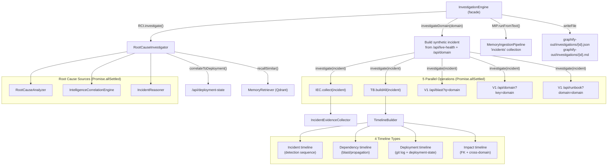

# LCIS V3 Investigation Engine

> **Layer:** V3 — Executive Intelligence  
> **Files:** `tools/central-intelligence/investigation-engine/`  
> **Proven result (payments domain):** 4 timelines, 7 root-cause candidates, 14 evidence items, 7 NOT CONNECTED disclosures  
> **Output:** `graphify-out/investigations/{id}.json` + `{id}.md`

---

## Purpose

The Investigation Engine performs autonomous root-cause analysis for incidents. Given a domain or an incident descriptor, it builds 4 typed timelines, collects evidence from structural and live sources, runs 5 parallel root-cause analysis strategies, enriches candidates with deployment correlation and memory recall, and produces a ranked investigation report with explicit NOT CONNECTED disclosures for all live data gaps.

---

## Module Map

| Class | File | Responsibility |
|-------|------|----------------|
| `InvestigationEngine` | `InvestigationEngine.mjs` (513 lines) | Facade; `investigate()` and `investigateDomain()` |
| `IncidentEvidenceCollector` | `IncidentEvidenceCollector.mjs` (347 lines) | Structural + live evidence collection; NOT CONNECTED labeling |
| `TimelineBuilder` | `TimelineBuilder.mjs` (530 lines) | Builds 4 typed timelines in parallel |
| `RootCauseInvestigator` | `RootCauseInvestigator.mjs` (308 lines) | Parallel root-cause analysis from 3 sources |

---

## Architecture



---

## Investigation ID

```js
`inv-{domain}-{sha256_8chars}`
```

Example: `inv-payments-a1b2c3d4`

---

## `investigateDomain(domain)`

Entry point for operator use. Builds a synthetic incident object from:
- `GET http://localhost:3333/api/live-health?domain={domain}` (structural health)
- `GET http://localhost:3333/api/domain?key={domain}` (domain metadata)

Then calls `investigate(incident)`.

---

## `investigate(incident)` — Core Flow

Loads 3 V2 primitives lazily:
- `IncidentEvidenceCollector`
- `TimelineBuilder`
- `RootCauseInvestigator`

Runs 5 parallel operations via `Promise.allSettled`:

| Operation | Source | Connected |
|-----------|--------|-----------|
| `IEC.collect(incident)` | structural + live | Structural CONNECTED; live NOT CONNECTED |
| `TB.buildAll(incident)` | git, V1 endpoints, graph | Mostly CONNECTED; live timestamps NOT CONNECTED |
| `V1 /api/blast?q=domain` | V1 LCIS | CONNECTED when V1 running |
| `V1 /api/domain?key=domain` | V1 LCIS | CONNECTED when V1 running |
| `V1 /api/runbook?domain=domain` | V1 LCIS | CONNECTED when V1 running |

`confidence = rootCauseResult?.confidence ?? 0`

After investigation: calls `MemoryIngestionPipeline.runFromText(text, 'incidents', metadata)` to feed the learning loop.

---

## Proven Investigation: `payments` Domain

```
investigateDomain('payments') result:
  timelines: 4 (incident, dependency, deployment, impact)
  rootCauseCandidates: 7
  evidenceItems: 14
  notConnectedDisclosures: 7
```

**7 NOT CONNECTED disclosures** in a payments investigation include:
1. Live metric values (OTel adapter not wired)
2. Revenue impact amounts (GMV, refund totals — canonical ledger RPCs not queried without service-role key)
3. Dependency signal timestamps (Cloudflare Analytics Engine / OTel)
4. Anomaly detection results (OTel / SigNoz not wired)
5. V1 blast radius (V1 not running)
6. Historical incidents (Qdrant not wired)
7. Live deploy versions (Vercel/CF API — deploy-time credentials)

---

## InvestigationReport Schema

```ts
interface InvestigationReport {
  id: string;                          // inv-{domain}-{sha256_8chars}
  incident: object;                    // original incident descriptor
  timelines: {
    incident: Timeline;                // detection sequence
    dependency: Timeline;              // blast/propagation order
    deployment: Timeline;              // git commits + deployment-state
    impact: Timeline;                  // FK propagation + cross-domain
  };
  rootCauseCandidates: Array<{
    id: string;
    cause: string;
    confidence: number;
    reasoning: string[];
    source: string;
    evidence: object[];
    relatedDeployment?: object;
    similarIncidents?: object[];
  }>;
  affected: {
    services: string[];
    domains: string[];
    merchants: {
      note: "All stores share the schema (multi-tenant)";
      liveAffectedCount: "NOT CONNECTED — query site_id from Supabase sites table";
    };
  };
  confidence: number;                  // highest candidate confidence, or 0
  recommendations: object[];
  evidence: EvidenceItem[];            // from IEC.collect()
  notConnected: string[];              // all NOT CONNECTED disclosures
  startedAt: string;
  completedAt: string;
}
```

---

## IncidentEvidenceCollector

Collects in two parallel batches:

### Structural Evidence (CONNECTED)

| Source | Type |
|--------|------|
| `V1 /api/blast?q={domain}` | blast-radius |
| `V1 /api/incident-response?domain={domain}` | incident-response |
| `V1 /api/runbook?domain={domain}` | runbook |
| `ArchitectureDriftDetector.getArchitectureRiskReport()` | architecture-drift |
| `GraphExplorer.explainEntity(domain)` | graph-entity |
| `GraphExplorer.whatBreaksIf(domain)` | blast-graph |
| `V1 /api/domain?key={domain}` | domain-intel |
| `V1 /api/cross-domain?key={domain}` | cross-domain |

### Live Evidence (NOT CONNECTED)

| Source | Type | NOT CONNECTED source |
|--------|------|---------------------|
| `SignalCollector.collectDependencySignals()` | live-signals | Cloudflare Analytics Engine / OTel |
| `SignalCollector.collectAnomalies()` | anomalies | OTel / SigNoz |
| `SignalCollector.collectMetrics()` | metrics | Cloudflare Analytics Engine |
| `V1 /api/live-metrics` | live-metrics | telemetry adapter not wired |
| `MemoryRetriever.retrieveIncidents()` | historical-incidents | Qdrant not wired |
| `IntelligenceCorrelationEngine.getRiskScore()` | risk-score | structural (CONNECTED if available) |
| Supabase ledger / Razorpay / CF Analytics | live-revenue-impact | service-role key not in repo |

Every evidence item: `{ source, type, connected: bool, fact, timestamp }`.

---

## TimelineBuilder

Builds all 4 timelines in parallel via `Promise.allSettled`:

### 1. Incident Timeline (`buildIncidentTimeline`)

Ordered by detection sequence:

| Event | Source | Connected |
|-------|--------|-----------|
| `T+0` — Incident detected | investigation-engine | CONNECTED |
| `T+{N}s` — Dependency signals | SignalCollector | NOT CONNECTED (timestamps structural ordering only) |
| `T+{N}s` — Anomalies | SignalCollector | NOT CONNECTED |
| `T+structural` — V1 incident-response | V1 /api/incident-response | CONNECTED |
| `T+structural+1` — Runbook | V1 /api/runbook | CONNECTED |

### 2. Dependency Timeline (`buildDependencyTimeline`)

Structural propagation order from:
- `V1 /api/blast?q={domain}` → affected list
- `GraphExplorer.whatBreaksIf(domain)` → downstream entities
- `V1 /api/domain?key={domain}` → dependsOn + consumedBy edges

Note: `"Structural propagation order — live propagation timing NOT CONNECTED (source: Cloudflare Analytics Engine)"`

### 3. Deployment Timeline (`buildDeploymentTimeline`)

Uses `git log --since={window}` (24h default) via `execSync`. Real commit hashes, ISO timestamps, authors, subjects.

Also queries:
- `V1 /api/deployment-state` (HEAD + latest migration + targets)
- `V1 /api/time-travel` (migrations and changes)

NOT CONNECTED: live deploy versions (Vercel Deploy API / Cloudflare Workers API — no credentials in repo).

### 4. Impact Timeline (`buildImpactTimeline`)

Cross-domain + FK propagation:
- `V1 /api/cross-domain?key={domain}` → downstream domains
- `V1 /api/relationships?table=sites` → FK chain (first 10 FK relations)
- `GraphExplorer.getAffectedMerchants(domain)` → merchant impact
- `V1 /api/business-impact?domain={domain}` → business impact data

Revenue impact: always NOT CONNECTED — source: `confirm_order_payment_with_ledger` RPC.

---

## RootCauseInvestigator

Runs 5 parallel operations:

| Operation | Source | What it produces |
|-----------|--------|-----------------|
| `_runRootCauseAnalyzer(incident, signals)` | `RootCauseAnalyzer` | Temporal + structural candidates |
| `_runCorrelationEngine(incident)` | `IntelligenceCorrelationEngine.getRootCauseCandidates()` | Cross-signal correlation candidates |
| `_runIncidentReasoner(incident, domain)` | `IncidentReasoner.rankCauses()` + `getMostLikelyAffected()` | Ranked causes + affected list |
| `correlateToDeployment(incident)` | `DeploymentReasoner` + `/api/deployment-state` | Deploy-correlated enrichment |
| `recallSimilar(incident)` | `MemoryRetriever` (collection: `'incidents'`, minScore: 0.5) | Similar past incidents |

Deduplication: case-insensitive cause string equality, keeping highest confidence.

Ranking: confidence DESC, then evidence count DESC.

**Confidence scoring** (if not already a number):
- Base: 0.3
- Evidence boost: `min(evidence.length × 0.1, 0.3)`
- Reasoning boost: `min(reasoning.length × 0.05, 0.2)`
- Deployment boost: +0.15 if `relatedDeployment` present
- Similar incident boost: +0.05 if past incidents recalled
- Max: 0.95

---

## Multi-Tenant Merchant Impact

All stores share the database schema. Affected merchant count is always NOT CONNECTED at investigation time:

```json
{
  "note": "All stores share the schema (multi-tenant)",
  "liveAffectedCount": "NOT CONNECTED — query site_id from Supabase sites table"
}
```

To get live count: `SELECT count(*) FROM sites` with `SUPABASE_SERVICE_ROLE_KEY`.

---

## Memory Ingestion

After every completed investigation, `InvestigationEngine` calls:

```js
await MemoryIngestionPipeline.runFromText(reportText, 'incidents', {
  domain,
  investigationId: id,
  rootCause: ranked[0]?.cause ?? 'unknown',
  confidence
});
```

This feeds the `incidents` collection in Qdrant, enabling future `recallSimilar()` lookups across incidents.

---

## Querying Investigations

```bash
# Investigate a domain
curl http://localhost:3334/intelligence/investigate/payments

# List all investigations
curl http://localhost:3334/intelligence/investigations

# Get specific investigation
curl http://localhost:3334/intelligence/investigations/inv-payments-a1b2c3d4
```
