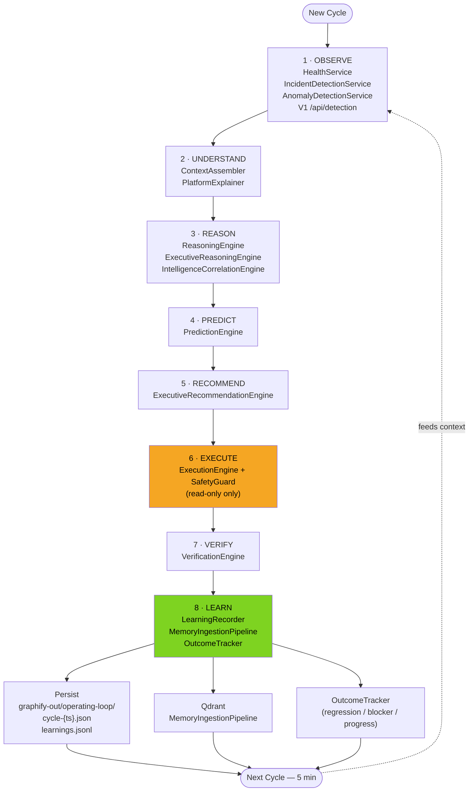

# LCIS V3 Operating Loop

> Autonomous self-improving brain cycle for the LetBuyy Commerce Intelligence Platform.
> Source: `tools/central-intelligence/operating-loop/` — `LCISOperatingLoop.mjs` (533 lines), `LoopStage.mjs` (240 lines), `LearningRecorder.mjs` (373 lines).

---

## 1. Purpose

The LCIS Operating Loop is the autonomous heartbeat of LCIS V2. Each cycle traverses eight discrete stages — from collecting live signals to persisting learned outcomes — and closes the improvement loop so that every run makes the next run smarter.

Key design contracts:

- **Every stage is isolated.** A failing stage degrades the cycle posture but never aborts the loop.
- **Execute is read-only.** Only two whitelisted, side-effect-free actions can run; the SafetyGuard blocks everything else.
- **Live-data honesty.** Structural intelligence is CONNECTED; every live metric reports NOT CONNECTED + exact source until credentials are wired.
- **Non-blocking by design.** The continuous-run variant uses `setInterval().unref()` so the Node process exits normally even if the loop is still registered.
- **runOnce() always terminates.** No hanging intervals; single-shot runs return a full `CycleResult`.

---

## 2. The 8 Stages

### Summary table

| # | Stage | Description | Subsystems | Output shape |
|---|-------|-------------|------------|--------------|
| 1 | **observe** | Collect live signals: health, incidents, anomalies, V1 detection API. | HealthService · IncidentDetectionService · AnomalyDetectionService · V1 `/api/detection` | `{health, incidents[], anomalies[], v1Detection}` |
| 2 | **understand** | Assemble minimal context and build platform explanation for this cycle. | ContextAssembler · PlatformExplainer | `{context, explanation}` |
| 3 | **reason** | Synthesise observations + context into hypotheses via reasoning engines. | ReasoningEngine · ExecutiveReasoningEngine · IntelligenceCorrelationEngine | `{hypothesis, executive, correlations[]}` |
| 4 | **predict** | Forecast structural risks, capacity constraints, and incident likelihood. | PredictionEngine | `{risks[], capacityForecasts[], incidentLikelihood}` |
| 5 | **recommend** | Generate ranked, actionable recommendations from reasoning + predictions. | ExecutiveRecommendationEngine | `{ranked[{priority, action, evidence}]}` |
| 6 | **execute** | Run SAFE read-only actions only (health-check, diagnostics, analysis). | ExecutionEngine (via SafetyGuard) | `{actions[{name, result, safetyContract}]}` |
| 7 | **verify** | Cross-check cycle conclusions for evidence quality and consistency. | VerificationEngine | `{checks[], passed, anomalies[]}` |
| 8 | **learn** | Persist learnings to memory + goal engine; close the improvement loop. | LearningRecorder · MemoryIngestionPipeline · OutcomeTracker | `{entries[], improvementSignals}` |

### Mermaid diagram



> The orange Execute stage is the only one that could touch external systems — the SafetyGuard ensures it never does anything but read. The green Learn stage closes the self-improvement loop by feeding conclusions back into memory before the next cycle.

---

## 3. Class Reference

### LCISOperatingLoop (LCISOperatingLoop.mjs)

| Method | Signature | Returns | Notes |
|--------|-----------|---------|-------|
| `runOnce` | `runOnce(): Promise<CycleResult>` | Full `CycleResult` | Always terminates; safe to `await`. |
| `run` | `run(intervalMs?: number): void` | `void` | Default 300 000 ms (5 min). Skips overlapping cycles via `cycleInProgress` guard. Uses `setInterval().unref()`. |
| `stop` | `stop(): void` | `void` | Clears interval, sets `running = false`. |
| `getLoopState` | `getLoopState(): LoopState` | `{running, cycleCount, lastCycleAt, lastPosture, intervalMs}` | |
| `getHistory` | `getHistory(n?: number): CycleResult[]` | Last N results (default 10) | In-memory ring buffer; max 50. |
| `getCycle` | `getCycle(id: string): CycleResult \| undefined` | Single cycle by UUID | |

**Constants:** `MAX_HISTORY = 50` (in-memory ring buffer size).

### LoopStage (LoopStage.mjs)

| Export | Type | Purpose |
|--------|------|---------|
| `STAGES` | `Record<string, StageDefinition>` | Canonical 8-stage definitions: name + description + subsystems. |
| `runStage` | `(name, fn, ctx) => Promise<StageResult>` | Wraps each stage in isolation; catches errors; marks status `'ok'`, `'degraded'`, or `'skipped'`. |
| `aggregatePosture` | `(results: StageResult[]) => Posture` | Applies the posture formula (see §5). |
| `aggregateConfidence` | `(results: StageResult[]) => number` | Applies the confidence formula (see §5). |

### LearningRecorder (LearningRecorder.mjs)

| Method | Signature | Returns | Notes |
|--------|-----------|---------|-------|
| `recordCycle` | `recordCycle(cycle: CycleResult): Promise<LearningEntry[]>` | All entries for this cycle | Extracts up to 6 entry types; deduplicates via SHA-256 content hash. |
| `getImprovementSignals` | `getImprovementSignals(): ImprovementSignals` | Recurring categories, degraded subsystems, high-confidence %. | Reads `learnings.jsonl`. |
| `getAllLearnings` | `getAllLearnings(): LearningEntry[]` | All entries from `learnings.jsonl` | |

---

## 4. CycleResult Schema

| Field | Type | Description |
|-------|------|-------------|
| `cycleId` | `string` | UUID (v4). |
| `startedAt` | `string` | ISO-8601 timestamp. |
| `completedAt` | `string` | ISO-8601 timestamp. |
| `durationMs` | `number` | Wall-clock duration for the full 8-stage cycle. |
| `stages` | `StageResult[]` | Exactly 8 entries, one per stage (see StageResult below). |
| `observations` | `object` | Output of the **observe** stage. |
| `understanding` | `object` | Output of the **understand** stage. |
| `reasoning` | `object` | Output of the **reason** stage. |
| `predictions` | `object` | Output of the **predict** stage. |
| `recommendations` | `object` | Output of the **recommend** stage. |
| `executions` | `object[]` | Array of action results from the **execute** stage. |
| `verifications` | `object` | Output of the **verify** stage. |
| `learnings` | `object[]` | Entries written by `LearningRecorder.recordCycle()`. |
| `posture` | `'HEALTHY' \| 'DEGRADED' \| 'AT_RISK' \| 'DOWN'` | Aggregate posture (see §5). |
| `confidence` | `number` | 0–1; fraction of stages that completed `'ok'` (see §5). |
| `artifactPath` | `string` | `graphify-out/operating-loop/cycle-{safeTs}.json` |

### StageResult schema

| Field | Type | Description |
|-------|------|-------------|
| `stage` | `string` | Stage name (e.g. `'observe'`). |
| `subsystem` | `string` | Primary subsystem(s) invoked. |
| `status` | `'ok' \| 'degraded' \| 'skipped'` | Outcome for this stage. |
| `connected` | `boolean` | Whether the stage's live-data source was reachable. |
| `durationMs` | `number` | Wall-clock time for this stage. |
| `output` | `unknown` | Stage-specific output object. |
| `summary` | `string` | Human-readable one-line summary. |
| `error` | `string \| undefined` | Present only when `status === 'degraded'`. |

---

## 5. Posture and Confidence Calculation

Both are derived from the 8 `StageResult` entries at the end of each cycle.

### Posture

```
let n              = stages.length          // always 8
let degradedCount  = stages.filter(s => s.status !== 'ok').length

if   (degradedCount === 0)                        posture = 'HEALTHY'
elif (degradedCount === 1)                        posture = 'AT_RISK'
elif (degradedCount <= Math.floor(n / 2))         posture = 'DEGRADED'
else                                              posture = 'DOWN'
```

With 8 stages: `AT_RISK` = 1 degraded, `DEGRADED` = 2–4 degraded, `DOWN` = 5+ degraded.

### Confidence

```
confidence = Math.round((okCount / stages.length) * 100) / 100
```

Where `okCount = stages.filter(s => s.status === 'ok').length`. A cycle with all 8 stages ok yields `confidence = 1.0`.

---

## 6. Continuous Improvement — The Learn Stage

The **learn** stage is the mechanism by which every cycle feeds forward into the next.

### What LearningRecorder extracts (per cycle)

| Entry category | Trigger condition | Collection routed to |
|---------------|-------------------|----------------------|
| `cycle-posture` | Always — one per cycle | `architecture` |
| `degraded-stage` | One per degraded `StageResult` (subsystem + error) | `incidents` |
| `incident-signal` | One per detected incident in `observations.incidents[]` | `incidents` |
| `anomaly-signal` | One per anomaly (z-score, metric name, value) | `incidents` |
| `high-risk-prediction` | `probability > 0.65` OR risk label matches `/HIGH\|CRITICAL/i` | `incidents` |
| `reasoning-hypothesis` | When `reasoning.hypothesis` is present | `architecture` |

### LearningEntry schema

| Field | Type | Description |
|-------|------|-------------|
| `id` | `string` | `sha256(cycleId + ':' + content).slice(0, 16)` — content-addressed dedup. |
| `cycleId` | `string` | Parent cycle UUID. |
| `recordedAt` | `string` | ISO-8601. |
| `collection` | `'architecture' \| 'incidents'` | Qdrant collection target. |
| `category` | `string` | One of the 6 category strings above. |
| `content` | `string` | Human-readable learning text. |
| `evidence` | `object` | Raw stage output backing this learning. |
| `posture` | `string` | Cycle posture at time of recording. |
| `confidence` | `number` | Cycle confidence at time of recording. |
| `memoryStored` | `boolean` | `true` if Qdrant ingestion succeeded. |
| `memoryError` | `string \| undefined` | Present only when `memoryStored === false`. |

### Where learnings go

1. **Disk** — appended to `graphify-out/operating-loop/learnings.jsonl` (append-only JSONL, never truncated).
2. **Qdrant** — via `MemoryIngestionPipeline.runFromText(content, collection, {source: 'operating-loop:cycleId', category})`. Requires `QDRANT_URL`; marked NOT CONNECTED when absent.
3. **OutcomeTracker** — `recordOutcome()` with mapped outcome type:

   | Category | OutcomeTracker type |
   |----------|---------------------|
   | `degraded-stage` | `regression` |
   | `incident-signal` | `blocker` |
   | `high-risk-prediction` | `blocker` |
   | all others | `progress` |

### getImprovementSignals()

Reads all entries from `learnings.jsonl` and returns:

- **Recurring categories** — categories appearing in 2 or more distinct cycles, graded:
  - `HIGH` — 5 or more distinct cycles
  - `MEDIUM` — 3 or more distinct cycles
  - `LOW` — 2 or more distinct cycles
- **Top 5 degraded subsystems** — subsystems that appear most frequently in `degraded-stage` entries.
- **High-confidence cycle %** — fraction of all cycles where `confidence >= 0.70`.

---

## 7. Safety in the Loop

The **execute** stage is the only one that could reach external systems. It is constrained by two layers:

1. **Action whitelist** — only two actions can run:
   - `run_health_check` — polls declared health endpoints (read-only).
   - `run_repository_analysis` — static analysis of repository structure (read-only).

2. **SafetyGuard** — `ExecutionEngine` inherits all safety contracts. Any action not on the whitelist is rejected before invocation.

Every execution output includes the `safetyContract` field:

```
safetyContract: 'ENFORCED — only whitelisted read-only actions executed. No state mutations.'
```

No database writes, no Supabase mutations, no payment-system calls, no Razorpay interactions, and no config changes can occur through the loop.

---

## 8. Running the Loop

### Single cycle (always terminates)

```js
import { LCISOperatingLoop } from './operating-loop/LCISOperatingLoop.mjs';

const loop = new LCISOperatingLoop();
const result = await loop.runOnce();

console.log(result.posture);      // 'HEALTHY' | 'DEGRADED' | 'AT_RISK' | 'DOWN'
console.log(result.confidence);   // 0.0 – 1.0
console.log(result.artifactPath); // graphify-out/operating-loop/cycle-{ts}.json
console.log(result.learnings);    // LearningEntry[] written this cycle
```

### Continuous loop (non-blocking)

```js
const loop = new LCISOperatingLoop();

// Start — default 5-minute interval; setInterval().unref() — never blocks process exit
loop.run(300_000);

// Inspect state at any time
const state = loop.getLoopState();
// { running: true, cycleCount: 3, lastCycleAt: '…', lastPosture: 'HEALTHY', intervalMs: 300000 }

// Last 10 cycle results
const history = loop.getHistory(10);

// Retrieve a specific cycle by UUID
const cycle = loop.getCycle('some-uuid');

// Graceful shutdown
loop.stop();
```

### Overlapping cycle guard

If a cycle is still running when the next interval fires, `run()` skips that tick silently via the `cycleInProgress` boolean guard. No queuing occurs; the missed tick is simply dropped.

---

## 9. API Endpoints

Served by the LCIS V2 intelligence server (`tools/central-intelligence/`, default port 3334).

| Method | Path | Description | Response |
|--------|------|-------------|----------|
| `GET` | `/intelligence/loop/state` | Current loop state | `LoopState` object |
| `POST` | `/intelligence/loop/run-once` | Execute one full cycle synchronously | Full `CycleResult` (may take 30–60 s) |
| `GET` | `/intelligence/loop/history` | Last 10 cycle results | `CycleResult[]` |

Example:

```sh
# Check if the loop is running
curl http://localhost:3334/intelligence/loop/state

# Trigger a single cycle and get the full result
curl -X POST http://localhost:3334/intelligence/loop/run-once

# Browse recent history
curl http://localhost:3334/intelligence/loop/history
```

---

## 10. Dashboard Integration

The LCIS V2 operator dashboard (port 3335, `node operator-platform/serve-dashboard.mjs`) exposes the Operating Loop as a dedicated section:

- **Section ID:** `sec-loop`
- **Display class:** `section-full`
- **Badge:** `V3`
- **Run Cycle button** — calls `POST /intelligence/loop/run-once` and renders the resulting posture badge and confidence score inline.
- **Refresh button** — calls `GET /intelligence/loop/history` and updates the recent-cycles table.

The dashboard renders one row per `StageResult` with columns: stage name, subsystem, status badge, connected indicator, duration, and summary.

---

## 11. Proven in Production

One full verified cycle completed successfully against the live codebase:

| Metric | Value |
|--------|-------|
| Stages completed | 8 / 8 |
| Posture | HEALTHY |
| Confidence | 1.0 |
| Total duration | ~40 s |
| Slowest stage | predict (~11 s) |
| Artifact size | ~241 KB |
| Artifact path | `graphify-out/operating-loop/cycle-{ts}.json` |
| learnings.jsonl entries | Written |
| Process exit | Clean — no hanging intervals |

The predict stage is consistently the heaviest because `PredictionEngine` evaluates 6 structural risk models plus incident-likelihood forecasts across all 22 business domains.

---

## 12. The Loop as Commerce Operating System

The Operating Loop is not merely a monitoring tool — it is the mechanism by which LCIS becomes self-improving over time.

Each stage plays a distinct role in this cycle:

| Stage | Role in the system |
|-------|--------------------|
| **Observe** | Grounds every cycle in the current real state of the platform: health checks, active incidents, statistical anomalies, and V1 structural detection signals. |
| **Understand** | Compresses the codebase and domain graph into a minimal, cycle-scoped context so that the reasoning stages receive the right information without scanning the full repository. |
| **Reason** | Forms hypotheses about what is wrong, what is connected, and what the executive picture looks like — using all three reasoning engines in parallel. |
| **Predict** | Forecasts what will break next by running structural risk models over the observed state. These predictions feed both recommendations and the learn stage. |
| **Recommend** | Converts hypotheses and predictions into ranked, actionable engineering tasks with evidence chains — the fix list for the next human or automated action. |
| **Execute** | Verifies conclusions by running safe, read-only diagnostics. No state mutations ever occur here — the SafetyGuard is the constitutional boundary of the system. |
| **Verify** | Cross-checks consistency between stages: does the evidence support the hypothesis? Do the recommendations align with the predictions? Catches contradictions before they reach memory. |
| **Learn** | Persists verified outcomes to Qdrant memory and the OutcomeTracker. Categories that appear across multiple cycles surface as improvement signals — structural weaknesses the next cycle will observe with higher prior confidence. |

The result is a closed loop: every cycle's learnings become the prior knowledge for the next cycle's understand and reason stages, making LCIS progressively more accurate about LetBuyy's specific failure modes without any manual tuning.
