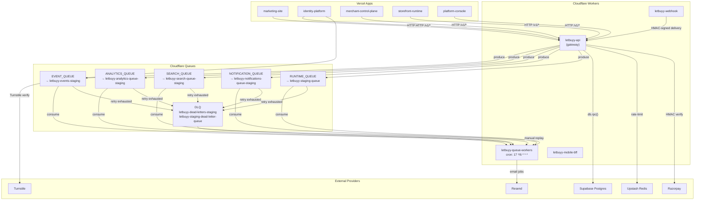
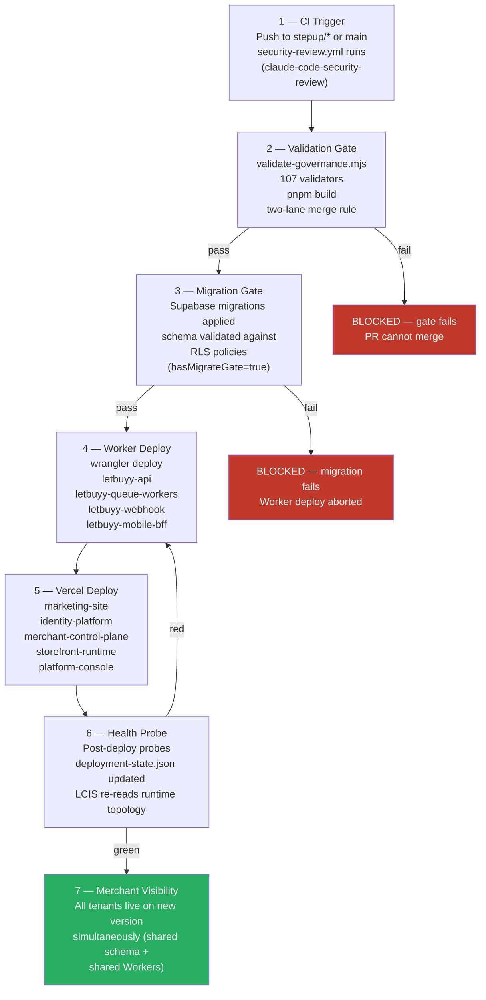
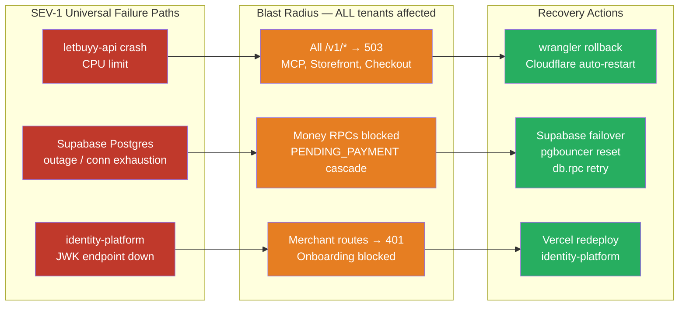
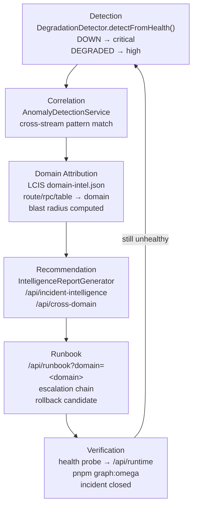

# LCIS Operational Model

**Version:** 1.0.0
**Source artifact:** `graphify-out/self-model/LCIS_OPERATIONAL_MODEL.json` (generated 2026-06-19T17:59:03.420Z)
**Owner:** @saai-sidd
**Audience:** SRE, on-call engineers, architecture reviewers, AI agents

---

## 1. Purpose

This document describes **how LetBuyy operations function** at runtime: what executes where, how work moves through queues, how incidents emerge from signals, how deployments propagate to all tenants simultaneously, and how the recovery loop closes.

It is generated from `SelfModelBuilder.generateOperationalModel()` in LCIS V2 and represents the authoritative operational topology derived from `infra-intel.json`, `domain-intel.json`, and `runtime-intel.json`. The model captures five things:

| Dimension | What It Captures |
|-----------|-----------------|
| **Topology** | Which Cloudflare Workers run, which queues they produce/consume, which Vercel apps exist, which providers are wired |
| **Incident emergence** | The exact 6-step path from a raw signal to an actionable incident with domain attribution and blast radius |
| **Deployment propagation** | The 7-gate pipeline from CI push to simultaneous merchant visibility |
| **Failure propagation** | Per-domain cascade chains — what breaks downstream and in what order when a critical path fails |
| **Recovery model** | The autonomous loop: detection → correlation → LCIS attribution → runbook invocation → health confirmation |

**Operational constraint:** every live value in this document is real-source or labeled `NOT CONNECTED`. No figures are fabricated. Live telemetry values (queue depths, error rates, latency p99, revenue amounts) are query-bound to Cloudflare Analytics Engine and the Supabase ledger — LCIS supplies the topology and the exact source but does not emit synthetic metrics.

---

## 2. Operational Topology

### 2.1 Cloudflare Workers

| Worker | Produces Queues | Consumes Queues | Cron | Schedule |
|--------|----------------|-----------------|------|----------|
| `letbuyy-api` | `EVENT_QUEUE`, `ANALYTICS_QUEUE`, `SEARCH_QUEUE`, `NOTIFICATION_QUEUE`, `RUNTIME_QUEUE` | — | No | — |
| `letbuyy-queue-workers` | — | `letbuyy-events-staging`, `letbuyy-analytics-queue-staging`, `letbuyy-search-queue-staging`, `letbuyy-notifications-queue-staging`, `letbuyy-dead-letters-staging`, `letbuyy-staging-queue`, `letbuyy-staging-dead-letter-queue` | Yes | `17 */6 * * *` |
| `letbuyy-webhook` | — | — | No | — |
| `letbuyy-mobile-bff` | — | — | No | — |

`letbuyy-api` is the sole queue producer. `letbuyy-queue-workers` is the sole consumer and the only worker with a scheduled cron job (runs at minute 17 of every sixth hour). `letbuyy-webhook` and `letbuyy-mobile-bff` are stateless HTTP workers with no queue involvement.

### 2.2 Vercel Applications

| App | Role |
|-----|------|
| `marketing-site` | Public marketing and landing pages |
| `identity-platform` | Merchant authentication, ES256 JWK issuer, store creation, onboarding |
| `merchant-control-plane` | Merchant dashboard, settings, products, orders, analytics UI |
| `storefront-runtime` | Customer-facing storefronts; host-routing via `src/proxy.ts` middleware |
| `platform-console` | Internal operator console |

All five apps deploy independently via Vercel and proxy data calls through `letbuyy-api` (the Cloudflare Worker gateway at `/v1/*`). They do not write to Postgres directly.

### 2.3 Queue Depth Reference

| Layer | Binding Names |
|-------|---------------|
| **Producers** (gateway emits) | `EVENT_QUEUE`, `ANALYTICS_QUEUE`, `SEARCH_QUEUE`, `NOTIFICATION_QUEUE`, `RUNTIME_QUEUE` |
| **Consumers** (queue-workers reads) | `letbuyy-events-staging`, `letbuyy-analytics-queue-staging`, `letbuyy-search-queue-staging`, `letbuyy-notifications-queue-staging`, `letbuyy-dead-letters-staging`, `letbuyy-staging-queue`, `letbuyy-staging-dead-letter-queue` |

The producer binding names (uppercase env-var style) map to the staging queue names at runtime. The `letbuyy-dead-letters-staging` and `letbuyy-staging-dead-letter-queue` bindings are DLQ sinks — messages that exhaust retries land here and require manual replay.

Live queue depths: `NOT CONNECTED` — source is Cloudflare Queues API (env var: `CLOUDFLARE_API_TOKEN`).

### 2.4 External Providers

| Provider | Role |
|----------|------|
| **Supabase** | Postgres database (RLS, RPCs, auth helpers), storage |
| **Resend** | Transactional email delivery |
| **Cloudflare Turnstile** | Bot-proof CAPTCHA on registration and login |
| **Upstash Redis** | Rate-limiting, session caching, idempotency key store |

### 2.5 Worker → Queue → Consumer Flow



---

## 3. Incident Flow

Incidents follow a strict 6-step emergence path. No step is skipped — omitting domain attribution (step 3) would produce an incident without a blast radius, making escalation impossible to scope.

```mermaid
sequenceDiagram
    participant CE as Cloudflare<br/>Analytics Engine
    participant ADS as AnomalyDetection<br/>Service
    participant IDS as IncidentDetection<br/>Service
    participant LCIS as LCIS Domain<br/>Attribution
    participant OPS as On-Call /<br/>Runbook
    participant INFRA as Infra /<br/>Rollback

    Note over CE: Step 1 — Signal Detection
    CE->>ADS: error rate spike<br/>latency p99 breach<br/>queue depth threshold<br/>RPC error count rise

    Note over ADS,IDS: Step 2 — Anomaly Correlation
    ADS->>IDS: correlate across<br/>metric streams
    IDS->>IDS: classify severity<br/>(critical / high / medium)

    Note over LCIS: Step 3 — Domain Attribution
    IDS->>LCIS: failing route / rpc / table
    LCIS->>LCIS: map to owning domain<br/>(domain-intel.json)
    LCIS->>LCIS: compute blast radius

    Note over IDS: Step 4 — Incident Creation
    IDS->>OPS: Incident {domain, severity,<br/>affected RPCs/routes,<br/>affected merchants,<br/>evidence, timestamp}

    Note over OPS: Step 5 — Escalation
    OPS->>OPS: invoke runbook<br/>escalation chain
    OPS->>OPS: page on-call
    OPS->>INFRA: identify rollback<br/>candidate from<br/>deployment-state.json

    Note over INFRA: Step 6 — Recovery
    INFRA->>INFRA: rollback or fix applied
    INFRA->>INFRA: migration gate re-evaluated
    INFRA->>CE: health probe confirms green
    INFRA->>LCIS: incident closed;<br/>pnpm graph:omega refresh
```

---

## 4. Deployment Propagation

Deployments are atomic at the Cloudflare Worker level. Because all tenants share the same Worker and Postgres schema, a successful deploy is immediately live for every merchant simultaneously — there is no per-tenant rollout or dark-launch gate.



**Key enforcement points:**

| Gate | Tool | Failure Consequence |
|------|------|---------------------|
| Validation Gate | `node scripts/validate-governance.mjs` | Merge blocked; PR requires remediation |
| Build Gate | `pnpm --filter <app> build` | Merge blocked |
| Migration Gate | Supabase CLI migrations | Worker deploy aborted; schema drift prevented |
| Two-Lane Rule | Checked in CI config | Concurrent infra + feature deploys rejected |
| Health Probe | Post-deploy probe endpoints | Automatic rollback candidate surfaced |

---

## 5. Failure Propagation

### 5.1 Per-Domain Failure Paths

| Domain | Failure Point | Cascade Chain | Affected Domains | Recovery Path |
|--------|--------------|---------------|-----------------|---------------|
| **payments** | Razorpay webhook delivery failure or HMAC mismatch | `confirm_order_payment_with_ledger` not called → order stuck in `PENDING_PAYMENT` → inventory not decremented → gift-card not applied → customer sees no confirmation | orders, inventory, gift-cards, customers | Replay webhook from Razorpay dashboard; `idempotency_key` prevents double-credit |
| **api-gateway** | `letbuyy-api` worker crash / CPU limit | All `/v1/*` routes 503 → merchant-control-plane loses all data APIs → storefront checkout fails → queue producers fail (`EVENT_QUEUE`, `ANALYTICS_QUEUE`) → webhook-service cannot call gateway | **all** — gateway is single bottleneck | Cloudflare auto-restarts Worker; `wrangler rollback` to prior version |
| **database** | Supabase Postgres outage or connection exhaustion | All `SECURITY DEFINER` RPCs fail → money mutations blocked → RLS policies unevaluatable → auth token verification may fail | **all** — single Postgres instance | Supabase failover (managed); pgbouncer pooler reset; retry logic in `db.rpc` |
| **queue-workers** | `letbuyy-queue-workers` crash or DLQ saturation | `EVENT_QUEUE` messages back-fill → analytics events lost → search index stale → notification emails delayed or lost → cron (`17 */6 * * *`) misses | analytics, search, notifications, events | `wrangler rollback`; DLQ replay; analytics backfill from ledger |
| **identity-platform** | ES256 JWK endpoint down | Merchant JWT verification fails in api-gateway → all authenticated merchant routes 401 → merchant cannot manage store → new merchant onboarding blocked | auth, merchants, products, orders, settings | Vercel redeploy identity-platform; JWK cached in gateway (short TTL) |

### 5.2 Universal Critical Paths

Three failure domains affect **all** tenants simultaneously. Every on-call runbook must treat these as SEV-1.



The `payments` and `queue-workers` failure paths have bounded blast — they affect specific downstream domains rather than every route. They are SEV-2 unless they compound with a gateway or database failure.

---

## 6. Incident Emergence

Incident emergence is the process by which a raw infrastructure signal becomes an actionable incident with a named domain owner, quantified blast radius, and escalation chain. LCIS participates at steps 3–6.

### 6.1 Signal Detection (Step 1)

Signals originate from three sources:

| Source | Signal Types |
|--------|-------------|
| Cloudflare Analytics Engine | HTTP error rate spike; latency p99 breach per Worker |
| Cloudflare Queues | Queue depth above threshold; DLQ ingestion rate |
| Supabase / db.rpc | RPC error count; connection pool exhaustion events |

Live signal values are `NOT CONNECTED` until `CLOUDFLARE_API_TOKEN` and `SUPABASE_SERVICE_ROLE_KEY` are provided to the V2 telemetry adapters. The LCIS `DegradationDetector` runs `HealthService.detectFromHealth()` against `DOWN` → critical and `DEGRADED` → high classifications.

### 6.2 Anomaly Correlation (Step 2)

`AnomalyDetectionService` correlates across all metric streams in a single evaluation window. A spike in HTTP 5xx errors from `letbuyy-api` is correlated with a simultaneous rise in `EVENT_QUEUE` depth — the conjunction pattern indicates gateway distress, not a queue-specific anomaly. `IncidentDetectionService` then classifies overall severity before attribution.

### 6.3 Domain Attribution (Step 3)

This is the LCIS-specific step. `domain-intel.json` (built by `pnpm graph:domain`) maps every route prefix, RPC name, and table name to a canonical business domain. Given a failing RPC (e.g., `confirm_order_payment_with_ledger`), LCIS resolves:

1. **Owning domain:** payments
2. **Cross-domain edges:** domains that call into payments (orders, inventory, gift-cards)
3. **Blast radius:** merchants affected = all (shared schema); RPCs at risk; routes that surface to customers

Attribution is the prerequisite for meaningful escalation. Without it, a runbook cannot be scoped.

### 6.4 Incident Creation (Step 4)

An Incident object is created with the following schema:

```json
{
  "domain": "payments",
  "severity": "critical",
  "affectedRPCs": ["confirm_order_payment_with_ledger"],
  "affectedRoutes": ["/v1/checkout/confirm", "/v1/webhooks/razorpay"],
  "affectedMerchants": "all",
  "evidence": { "errorRate": "NOT CONNECTED", "source": "Cloudflare Analytics Engine" },
  "timestamp": "2026-06-19T17:59:03.420Z"
}
```

`affectedMerchants` is always `all` for gateway/database incidents (shared infrastructure). For queue-workers incidents, it is domain-scoped (analytics, search, notifications).

### 6.5 Escalation (Step 5)

The runbook escalation chain is loaded from `graphify-out/runbook-intel.json` via `/api/runbook?domain=<domain>`. The chain includes:

1. Domain owner (CODEOWNERS)
2. On-call engineer (paged via configured alerting integration)
3. Rollback candidate — identified from `deployment-state.json` (HEAD commit SHA, last deployed migration version, Vercel deployment URL)

The escalation chain is domain-scoped. A payments incident escalates to the payments owner; a gateway incident escalates to infrastructure.

### 6.6 Recovery (Step 6)

Recovery is confirmed by a health probe sequence:

1. Worker or Vercel redeploy / rollback applied
2. Migration gate re-evaluated (if the incident involved a schema change)
3. Health probe at `/api/runtime` confirms all Workers `UP`
4. Incident closed; LCIS refreshed via `pnpm graph:omega`

---

## 7. How Operations Function

These are the eight immutable operating principles of the LetBuyy runtime. They are not guidelines — any deviation is a security or data integrity violation.

| # | Principle | Rationale |
|---|-----------|-----------|
| 1 | All merchant stores share the same Cloudflare Workers and Postgres schema (multi-tenant, `site_id` partitioned) | Operational simplicity; instant global deploys; no per-tenant infrastructure overhead |
| 2 | Money mutations go exclusively through `SECURITY DEFINER` RPCs — never direct table writes from TypeScript | The `canonical-ledger-only-validator` enforces this; prevents balance inconsistencies and audit gaps |
| 3 | Deployments are atomic per Cloudflare Worker — all merchants see the new version simultaneously | Shared Worker means no version skew between tenants; backward-compatible migrations required |
| 4 | Queue workers process async events (analytics, search, notifications) separately from the gateway | Decouples latency-sensitive paths from eventually-consistent background work |
| 5 | RLS policies enforce tenant isolation at the DB layer — service-role access only through `verifySiteOwnership` | Defense-in-depth: even if a bug bypasses application-layer checks, DB enforces tenant boundaries |
| 6 | Webhooks are HMAC-signed (`signQueueTenantEnvelope`) before enqueue; verified on delivery | Prevents forged queue messages from triggering money RPCs or state mutations |
| 7 | The two-lane merge rule prevents concurrent infra and feature deploys from conflicting | Avoids race conditions between schema migrations and Worker code changes |
| 8 | LCIS monitors operational state via `/api/runtime`, `/api/operations`, `/api/deployment-state` | Single observability source of truth; enables autonomous anomaly detection without per-service instrumentation |

---

## 8. Recovery Model

The recovery model is a closed autonomous loop. It runs inside LCIS V2's `IntelligenceReportGenerator` and `DegradationDetector`, and is queryable at runtime via the LCIS HTTP API.

### 8.1 The Autonomous Recovery Loop



### 8.2 Exact CLI Commands for Recovery

Use these commands in the order shown for any incident. Substitute `<domain>` with the affected domain name (e.g., `payments`, `orders`, `auth`, `search`).

```bash
# Step 1 — determine blast radius for the failing symbol or domain
pnpm graph:intel blast "<symbol_or_rpc_name>"

# Step 2 — check live health for the affected domain
curl http://localhost:3333/api/live-health?domain=<domain>

# Step 3 — load the domain runbook and escalation chain
curl http://localhost:3333/api/runbook?domain=<domain>

# Step 4 — check the escalation chain from the runbook response
# Escalation fields: owner (CODEOWNERS), on-call, rollbackCandidate (commit SHA + deployment URL)

# Step 5 — after rollback or fix, refresh all LCIS intelligence
pnpm graph:omega

# Step 6 — confirm the domain is green
curl http://localhost:3333/api/live-health?domain=<domain>
```

For a Worker rollback specifically:

```bash
# Rollback letbuyy-api to prior version
wrangler rollback --name letbuyy-api

# Rollback queue-workers
wrangler rollback --name letbuyy-queue-workers

# Verify post-rollback
curl http://localhost:3333/api/deployment-state
```

For a DLQ replay (queue-workers crash recovery):

```bash
# Inspect DLQ depth (requires Cloudflare API token)
# Source: Cloudflare Queues API — NOT CONNECTED until CLOUDFLARE_API_TOKEN set

# After queue-workers are restored, replay dead-letter queue
# via Cloudflare dashboard: Workers & Pages → Queues → letbuyy-dead-letters-staging → Replay
```

### 8.3 LCIS Health Endpoints Reference

| Endpoint | What It Returns |
|----------|----------------|
| `/api/runtime` | Worker UP/DOWN, Vercel app status, queue-worker health |
| `/api/operations` | Active incidents, runbook status, escalation chain |
| `/api/deployment-state` | HEAD commit SHA, last migration version, Vercel deployment URLs |
| `/api/live-health` | Per-domain health (22 domains); `DOWN` / `DEGRADED` / `UP` |
| `/api/live-health?domain=<domain>` | Single-domain health + evidence |
| `/api/runbook?domain=<domain>` | Full runbook: detection / diagnosis / recovery / rollback / verification + escalation chain |
| `/api/incident-intelligence?domain=<domain>` | Incident object + blast radius + cross-domain impact |
| `/api/cross-domain?key=<domain>` | Domains that depend on `<domain>` and will cascade if it fails |
| `/api/deployment-state` | Structural deployment topology (live values NOT CONNECTED) |

---

## 9. Schema Reference

The canonical schema for `graphify-out/self-model/LCIS_OPERATIONAL_MODEL.json`:

```typescript
interface LcisOperationalModel {
  /** ISO 8601 timestamp of when this model was generated */
  generatedAt: string;

  /** Human-readable description of this artifact */
  description: string;

  operationalTopology: {
    workers: Array<{
      name: string;                    // Cloudflare Worker name (matches wrangler.toml)
      queuesProduced: string[];        // Queue binding names this Worker writes to
      queuesConsumed: string[];        // Queue binding names this Worker reads from
      hasCron: boolean;                // Whether this Worker has a scheduled trigger
      cronSchedules: string[];         // Cron expressions (empty if hasCron=false)
    }>;
    vercelApps: string[];              // App names as they appear in Vercel project settings
    queueDepth: {
      producers: string[];             // All producer binding names across all Workers
      consumers: string[];             // All consumer binding names across all Workers
    };
    providers: string[];               // External service providers wired to the platform
  };

  incidentEmergence: {
    summary: string;
    steps: Array<{
      step: number;                    // 1–6
      name: string;                    // Step name
      description: string;            // What happens at this step
    }>;
  };

  deploymentPropagation: {
    summary: string;
    steps: Array<{
      step: number;                    // 1–7
      name: string;
      description: string;
    }>;
  };

  failurePropagation: {
    summary: string;
    paths: Array<{
      domain: string;                  // Owning domain of the failure
      failurePoint: string;           // Specific failure mode
      cascade: string[];              // Ordered downstream effects
      affectedDomains: string[];      // Other domains impacted
      recoveryPath: string;           // Recovery procedure summary
    }>;
  };

  operationsHowItWorks: string[];     // 8 immutable operational principles

  /** Code graph node count — null if ArchitectureGraphBuilder not loaded */
  archGraphNodeCount: number | null;

  /** Code graph edge count — null if ArchitectureGraphBuilder not loaded */
  archGraphEdgeCount: number | null;

  /** True if graphify-out/runtime-intel.json exists at generation time */
  runtimeIntelPresent: boolean;
}
```

**Key fields:**

| Field | Significance |
|-------|-------------|
| `generatedAt` | Timestamp of last `pnpm graph:omega` run; stale if > 24 hours old during active development |
| `operationalTopology.workers[].hasCron` | Only `letbuyy-queue-workers` is `true`; cron miss is an operational incident |
| `operationalTopology.queueDepth.consumers` | Includes two DLQ sinks; DLQ saturation signals retry exhaustion |
| `failurePropagation.paths[*].affectedDomains` | `"all"` means SEV-1; domain-scoped means SEV-2 or lower |
| `runtimeIntelPresent` | `true` confirms `runtime-intel.json` was available at generation; `false` means topology may be incomplete |
| `archGraphNodeCount / archGraphEdgeCount` | `null` in this artifact (lazy-loaded from `ArchitectureGraphBuilder`); query `/api/atlas` for live counts |

---

*Generated from `SelfModelBuilder.generateOperationalModel()` · LCIS V2 · Source: `tools/central-intelligence/`*
*Refresh: `pnpm graph:omega` → `pnpm graph:reports`*
*Live telemetry status: `NOT CONNECTED` — wire `CLOUDFLARE_API_TOKEN` + `SUPABASE_SERVICE_ROLE_KEY` to activate live adapters*
