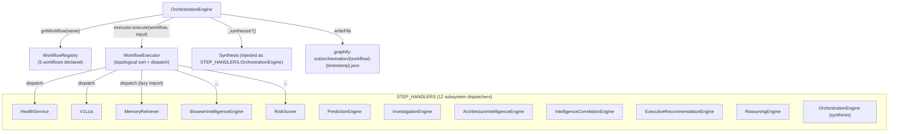

# LCIS V3 Orchestration Engine

> **Layer:** V3 — Executive Intelligence  
> **Files:** `tools/central-intelligence/orchestration-engine/`  
> **Proven result:** `runHealthAssessment()` = 5 steps, confidence 0.6  
> **Output:** `graphify-out/orchestration/{workflow}-{timestamp}.json`

---

## Purpose

The Orchestration Engine is the workflow coordinator of LCIS V3. It declares five canonical workflows as step graphs, executes them in topological order (respecting `dependsOn` edges), tracks per-step connectivity and timing, and synthesizes final verdicts from accumulated step outputs. It is the infrastructure that lets any V3 engine compose multi-step operations without knowing each sub-engine's internal API.

---

## Module Map

| Class | File | Responsibility |
|-------|------|----------------|
| `OrchestrationEngine` | `OrchestrationEngine.mjs` (354 lines) | Workflow runner; 5 synthesis methods; public API |
| `WorkflowRegistry` | `WorkflowRegistry.mjs` (295 lines) | Declares 5 canonical workflow graphs |
| `WorkflowExecutor` | `WorkflowExecutor.mjs` (474 lines) | Topological sort; per-step dispatch; trace storage |

---

## Architecture



---

## Canonical Workflows (5)

All 5 workflows are registered in `WorkflowRegistry#seed()`. Each workflow has a step graph with explicit `dependsOn` edges.

### 1. `health-assessment` (5 steps)

```
subsystem-health (HealthService.getSystemHealth)
v1-production-health (V1Lcis GET /api/production-health) [optional]
anomaly-detection (HealthService.detectAnomalies) → depends: subsystem-health [optional]
browser-validation (BrowserIntelligenceEngine.validateSystem) → depends: v1-production-health [optional]
health-synthesis (OrchestrationEngine._synthesizeHealth) → depends: all 4 above
```

Outputs: `healthScore`, `status`, `subsystems`, `anomalies`, `browserSignals`, `v1Health`

**Proven fact:** `runHealthAssessment()` ran this workflow with confidence = **0.6** (3 of 5 steps connected).

### 2. `risk-assessment` (5 steps)

```
domain-risk-score (RiskScorer.scoreAllDomains)
drift-detection (ArchitectureIntelligenceEngine.detectDrift) [optional]
failure-prediction (PredictionEngine.predictFailures) → depends: domain-risk-score [optional]
risk-correlation (IntelligenceCorrelationEngine.correlateRisks) → depends: domain-risk-score, drift-detection [optional]
risk-synthesis (OrchestrationEngine._synthesizeRisk) → depends: all 4 above
```

Outputs: `overallRisk`, `domainRisks`, `driftFindings`, `predictions`, `correlations`

### 3. `investigation` (5 steps)

```
core-investigation (InvestigationEngine.investigate)
memory-enrichment (MemoryRetriever.retrieveRelated) → depends: core-investigation [optional]
correlation-analysis (IntelligenceCorrelationEngine.correlateIncident) → depends: core-investigation [optional]
recommendations (ExecutiveRecommendationEngine.recommendForIncident) → depends: core-investigation, memory-enrichment, correlation-analysis [optional]
investigation-synthesis (OrchestrationEngine._synthesizeInvestigation) → depends: all 4 above
```

Outputs: `rootCause`, `timeline`, `affectedComponents`, `similarPastIncidents`, `recommendations`

### 4. `deployment-review` (6 steps)

```
v1-blast-radius (V1Lcis GET /api/blast) [optional]
v1-change-impact (V1Lcis GET /api/change-impact-live) [optional]
deployment-reasoning (ReasoningEngine.reasonDeployment) → depends: v1-blast-radius, v1-change-impact
risk-forecast (PredictionEngine.forecastDeploymentRisk) → depends: v1-blast-radius, v1-change-impact [optional]
memory-precedents (MemoryRetriever.retrieveDeploymentPrecedents) [optional]
deployment-synthesis (OrchestrationEngine._synthesizeDeployment) → depends: deployment-reasoning, risk-forecast, memory-precedents
```

Outputs: `verdict` (GO/NO-GO/CONDITIONAL-GO), `blastRadius`, `changeImpact`, `riskForecast`, `precedents`, `recommendation`

**Deployment verdict logic:**
- `NO-GO` if riskLevel CRITICAL or reasoning verdict is `reject`
- `CONDITIONAL-GO` if riskLevel HIGH or reasoning verdict is `conditional`
- `GO` otherwise

### 5. `architecture-review` (6 steps)

```
architecture-snapshot (ArchitectureIntelligenceEngine.buildSnapshot)
drift-analysis (ArchitectureIntelligenceEngine.detectDrift) → depends: architecture-snapshot [optional]
dependency-risk (IntelligenceCorrelationEngine.assessDependencyRisk) → depends: architecture-snapshot [optional]
architecture-reasoning (ReasoningEngine.reasonArchitecture) → depends: architecture-snapshot, drift-analysis [optional]
architecture-recommendations (ExecutiveRecommendationEngine.recommendArchitectureImprovements) → depends: architecture-snapshot, drift-analysis, dependency-risk [optional]
architecture-synthesis (OrchestrationEngine._synthesizeArchitecture) → depends: all 5 above
```

Outputs: `snapshot`, `driftFindings`, `dependencyRisks`, `reasoning`, `recommendations`

---

## WorkflowExecutor

### Step Execution Model

```js
// Per-step state
interface StepResult {
  stepId: string;
  subsystem: string;
  method: string;
  status: 'ok' | 'failed' | 'skipped';
  durationMs: number;
  connected: boolean;           // inferred from output.notConnected / output.connected
  output: any;
  error?: string;
}
```

**Topological sort:** Kahn's algorithm over `dependsOn` edges. All steps without dependencies run first; later steps see prior outputs in a shared `context` map (`context[stepId] = stepOutput`).

**Failure isolation:**
- Optional step throws → marked `failed`, workflow continues
- Mandatory step throws → `overallFailed = true`, workflow continues collecting optional steps
- Step skipped when a mandatory dependency failed

**Connected inference:**
```js
function #inferConnected(output) {
  if (output === null || output === undefined) return false;
  if (typeof output === 'object' && output.notConnected) return false;
  if (typeof output === 'object' && output.connected === false) return false;
  return true;
}
```

### STEP_HANDLERS

12 subsystem handlers, each implementing `(step, context) => { output, connected }`. All lazy-import their subsystem and return `{ notConnected: true }` if the import fails.

| Handler key | Module imported |
|-------------|----------------|
| `HealthService` | `../observability/HealthService.mjs` |
| `MemoryRetriever` | `../memory-engine/MemoryRetriever.mjs` |
| `KnowledgeAcquisitionService` | `../knowledge-engine/KnowledgeAcquisitionService.mjs` |
| `GraphExplorer` | `../graph-engine/GraphExplorer.mjs` |
| `ContextAssembler` | `../context-intelligence/ContextAssembler.mjs` |
| `BrowserIntelligenceEngine` | `../browser-intelligence/BrowserIntelligenceEngine.mjs` |
| `ReasoningEngine` | `../reasoning/ReasoningEngine.mjs` |
| `IntelligenceCorrelationEngine` | `../correlation/IntelligenceCorrelationEngine.mjs` |
| `ExecutiveRecommendationEngine` | `../recommendation-engine/ExecutiveRecommendationEngine.mjs` |
| `PredictionEngine` | `../prediction-engine/PredictionEngine.mjs` |
| `InvestigationEngine` | `../investigation-engine/InvestigationEngine.mjs` |
| `ArchitectureIntelligenceEngine` | `../architecture-intelligence/ArchitectureIntelligenceEngine.mjs` |
| `RiskScorer` | `../correlation/RiskScorer.mjs` |
| `ExecutiveIntelligenceEngine` | `../executive-intelligence/ExecutiveIntelligenceEngine.mjs` |
| `V1Lcis` | HTTP fetch to `http://localhost:3333{path}` (AbortSignal 5s) |
| `OrchestrationEngine` | Synthesis handler injected at execution time by `OrchestrationEngine` |

---

## Confidence Computation

`#computeConfidence(steps)`:

```js
const eligible = steps.filter(s => s.status !== 'skipped');
const connected = eligible.filter(s => s.status === 'ok' && s.connected);
return eligible.length > 0 ? connected.length / eligible.length : 0;
```

**Proven result:** Health Assessment with 5 steps — 3 connected + ok → confidence = **0.6**.

---

## WorkflowResult Schema

```ts
interface WorkflowResult {
  id: string;                    // crypto.randomUUID()
  workflow: string;              // workflow name
  input: object;                 // original input
  steps: StepResult[];           // per-step trace
  result: object;                // synthesized output
  confidence: number;            // 0–1 (connected steps / non-skipped steps)
  startedAt: string;
  completedAt: string;
  artifactPath: string;          // graphify-out/orchestration/{workflow}-{timestamp}.json
}
```

---

## OrchestrationEngine Public API

| Method | Workflow | Returns |
|--------|----------|---------|
| `runWorkflow(name, input?)` | Any registered | `WorkflowResult` |
| `runHealthAssessment()` | `health-assessment` | Health report + subsystem status |
| `runRiskAssessment()` | `risk-assessment` | Domain risk scores + drift + predictions |
| `runInvestigation(incident)` | `investigation` | Root cause + timelines + recommendations |
| `runDeploymentReview(changedComponents?)` | `deployment-review` | GO/NO-GO verdict |
| `runArchitectureReview()` | `architecture-review` | Snapshot + drift + dependency risks |
| `listWorkflows()` | — | All 5 workflow descriptors |
| `getWorkflowResult(id)` | — | WorkflowResult from trace store |
| `getHealth()` | — | Sub-engine + registry + executor health |

---

## Synthesis Methods

`OrchestrationEngine` injects `__synthesisHandler` into `STEP_HANDLERS['OrchestrationEngine']` at the start of each workflow execution. The five synthesizers are:

| Method | What it does |
|--------|-------------|
| `_synthesizeHealth(context)` | Aggregates `subsystem-health`, `v1-production-health`, `anomaly-detection`, `browser-validation` into a unified health score |
| `_synthesizeRisk(context)` | Ranks domain risks, extracts drift findings, top predictions |
| `_synthesizeInvestigation(context)` | Extracts root cause, merges recommendations, lists affected components |
| `_synthesizeDeployment(context)` | Derives GO/NO-GO/CONDITIONAL-GO from `deployment-reasoning` + `risk-forecast` |
| `_synthesizeArchitecture(context)` | Assembles drift findings + dependency risks + architecture recommendations |

---

## Persistence

```
graphify-out/orchestration/health-assessment-1718899200000.json
graphify-out/orchestration/risk-assessment-1718899200001.json
graphify-out/orchestration/investigation-payments-1718899200002.json
...
```

Files are gitignored. `getWorkflowResult(id)` retrieves from in-memory trace store (not disk). Disk artifacts persist across restarts for post-mortem analysis.

---

## Querying Workflows

```bash
# List registered workflows
curl http://localhost:3334/intelligence/workflows

# Run health assessment
curl -X POST http://localhost:3334/intelligence/workflows/health-assessment

# Run deployment review
curl -X POST http://localhost:3334/intelligence/workflows/deployment-review \
  -H 'Content-Type: application/json' \
  -d '{"changedComponents":["payments","checkout"]}'

# Run risk assessment
curl -X POST http://localhost:3334/intelligence/workflows/risk-assessment

# Get workflow result by ID
curl http://localhost:3334/intelligence/workflows/results/{id}
```
