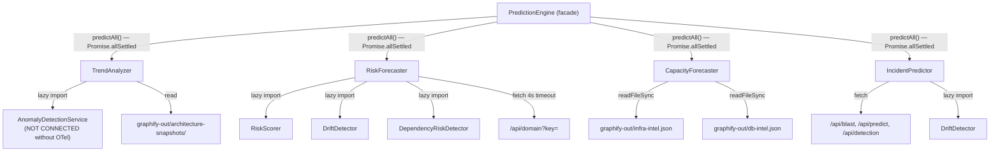

# LCIS V3 Prediction Engine

> **Layer:** V3 — Executive Intelligence  
> **Files:** `tools/central-intelligence/prediction-engine/`  
> **Proven result:** `predictAll()` returned **34 predictions**  
> **Output:** `graphify-out/predictions/prediction-report-{YYYY-MM-DD}.json`

---

## Purpose

The Prediction Engine answers "what will fail next?" and "what capacity or risk ceilings will we hit?" using structural evidence from the code graph and architecture snapshots. It does **not** generate predictions from absent telemetry. Every prediction discloses its connectivity status and the exact live signal needed to confirm or refute the structural predisposition.

---

## Module Map

| Class | File | Responsibility |
|-------|------|----------------|
| `PredictionEngine` | `PredictionEngine.mjs` (488 lines) | Facade; routes `predict(target)` to sub-analyzers |
| `TrendAnalyzer` | `TrendAnalyzer.mjs` (391 lines) | Metric trends from `AnomalyDetectionService` + structural snapshots |
| `RiskForecaster` | `RiskForecaster.mjs` (382 lines) | Domain-level risk outlook (current + forecasted) |
| `CapacityForecaster` | `CapacityForecaster.mjs` (409 lines) | Queue/DB/worker saturation from topology |
| `IncidentPredictor` | `IncidentPredictor.mjs` (469 lines) | Incident likelihood per domain from structural predisposition |

---

## Architecture



---

## Routing Logic

`PredictionEngine.routeTarget(target)` dispatches to the appropriate sub-analyzer using keyword matching:

| Keyword set | Routes to |
|-------------|-----------|
| `CAPACITY_KEYWORDS`: queue, workers, database, connections, concurrency, memory, cpu, throughput, latency, saturation | `CapacityForecaster` |
| `TREND_KEYWORDS`: trend, growth, change, drift, velocity, rate, increasing, decreasing | `TrendAnalyzer` |
| `INCIDENT_KEYWORDS`: incident, failure, outage, error, crash, degraded, unavailable | `IncidentPredictor` |
| Matches one of 22 `KNOWN_DOMAINS` | `RiskForecaster` (domain mode) |
| No match | All four analyzers |

---

## Canonical Prediction Shape

```ts
interface Prediction {
  target: string;
  type: 'incident' | 'risk' | 'capacity' | 'trend' | 'structural';
  prediction: string;
  confidence: number;          // 0–1; capped at 0.85 for structural-only
  basis: 'structural' | 'structural+live';
  connected: boolean;
  liveSignalNeeded: string;    // exact OTel/CF/Supabase source
  evidence: string[];
  horizon: string;             // e.g. "7-30 days (structural predisposition)"
  timestamp: string;
}
```

**Confidence cap:** structural-only predictions are capped at **0.85**. Reaching 1.0 requires live telemetry confirmation (`basis: 'structural+live'`).

---

## `predictAll()` — Proven Result: 34 Predictions

`predictAll()` runs all four sub-analyzers in parallel via `Promise.allSettled`, merges results, and sorts by:

1. Confidence DESC
2. Type priority: `{incident:0, risk:1, capacity:2, trend:3, structural:4}`

The final sorted, merged list is persisted to `graphify-out/predictions/prediction-report-{YYYY-MM-DD}.json`.

**Proven fact:** a run of `predictAll()` returned **34 predictions**.

---

## TrendAnalyzer

Analyzes metric trends in two modes:

### Live Metric Trends (NOT CONNECTED)

`analyze(metricName)` queries `AnomalyDetectionService.getBaseline(metricName)`. If the rolling window has fewer than 10 samples, returns `NOT CONNECTED`:

```
NOT CONNECTED — live samples for "{metricName}" are not present.
Source: OpenTelemetry collector → AnomalyDetectionService.addSample() ingestion pipeline.
Wire OTEL_EXPORTER_OTLP_ENDPOINT and a real telemetry adapter to populate rolling windows.
```

When connected (≥ 10 samples), slope is derived from the p99/p50 spread proxy:
`structuralSlope = (baseline.p99 - baseline.p50) / baseline.mean`

`classifySlope`: RISING (> 0.01), FALLING (< -0.01), STABLE.

### Structural Trends (CONNECTED)

`getStructuralTrends()` reads `graphify-out/architecture-snapshots/*.json` (chronological order). Compares first vs. latest snapshot across:

- Service count delta
- Total dependency count delta (internal + external)
- Architecture layer count delta
- Code graph node count from `graphify-out/graph.json` (single point)
- Fastest-growing services by dependency delta

Requires ≥ 2 snapshots for trend comparison. Refresh with `pnpm graph:infra`.

---

## RiskForecaster

Produces forward-looking risk outlook per business domain.

### Forecast Formula

```
rawForecast = currentRisk × driftMultiplier + dependencyRiskAdder
forecastedRisk = clamp(rawForecast, 0, 100)
```

**Drift multiplier** (from `DriftDetector.getDriftReport()`):
- `HIGH`/`CRITICAL` drift → × 1.30
- `MEDIUM` drift → × 1.15
- `LOW` drift → × 1.05
- No drift data → × 1.0

**Dependency risk adder** (from `DependencyRiskDetector.detect()`):
- `spofCount × 5 + cycleCount × 3`, capped at 20

**Confidence** starts at 0.5 (structural baseline):
- `RiskScorer` connected: +0.20
- Drift connected: +0.15
- Dependency risk connected: +0.10
- Live telemetry (AnomalyDetectionService ≥ 10 samples): +0.05

**Basis:** `'structural+live'` when live telemetry present; `'structural'` otherwise.

**Horizon:** `"7-30 days (structural predisposition — confirmed by live signals when connected)"`

### `forecastAll()`

Forecasts all 22 canonical domains in parallel. Sorted by `forecastedRisk` DESC.

```
22 canonical domains: payments, orders, checkout, refunds, gift_cards, payouts,
identity, auth, products, inventory, themes, customers, shipping, webhooks,
tenancy, billing, search, notifications, analytics, media, developer, marketplace
```

---

## CapacityForecaster

Forecasts saturation risk from structural topology. No live utilization is fabricated.

### Queue Saturation (structural CONNECTED)

From `infra-intel.json`:

| Dimension | Source | Connected |
|-----------|--------|-----------|
| Producer count, consumer count, producer/consumer ratio | `infra-intel.json → summary.queueProducers/Consumers` | CONNECTED |
| Dead-letter queue count (SPOF analysis) | infra-intel | CONNECTED |
| Throughput ceiling | `consumers.length × 100 msgs/invocation` (CF batch limit) | CONNECTED |
| Live queue depth | Cloudflare Analytics Engine | NOT CONNECTED |

Structural saturation risk: HIGH if imbalance (`producerConsumerRatio > 2`) OR (single DLQ AND producers > 3).

### Database Capacity (structural CONNECTED)

| Dimension | Source | Connected |
|-----------|--------|-----------|
| Table count (414), RPC count (156), policy count (651), index count (826), trigger count (395) | `graphify-out/db-intel.json` | CONNECTED |
| Hyperdrive binding presence | `infra-intel.json` | CONNECTED |
| Write pressure risk | trigger count > 400 → HIGH | CONNECTED |
| Live active connections (pg_stat_activity) | Supabase dashboard | NOT CONNECTED |
| Query latency p95/p99 | Supabase / direct SQL | NOT CONNECTED |

**Connection model risk:** without Hyperdrive, every serverless function opens a direct Postgres connection → exhaustion risk. PgBouncer limit: 60. Direct limit: 100.

### Worker Capacity (structural CONNECTED)

From `infra-intel.json`:

| Dimension | Source |
|-----------|--------|
| Worker count, cron schedules, queue consumer workers | wrangler.toml files (infra-intel) |
| Concurrency ceiling | `workerCount × 1000` (CF concurrent limit) |
| High-freq crons (≤ 30min interval) | parsed from cron expressions |
| Live invocations, CPU time p95, error rate | Cloudflare Analytics Engine — NOT CONNECTED |

---

## IncidentPredictor

Scores structural incident predisposition for each of the 22 business domains using static metadata embedded in the module (`DOMAIN_META`).

### Scoring Weights

| Factor | Points |
|--------|--------|
| Money path (payment_transactions, ledger RPCs) | 35 |
| Tenant/auth path (RLS + JWT issuer) | 25 |
| SPOF count × 8 (capped at 30) | 0–30 |
| Blast radius fraction × 20 | 0–20 |
| Architecture drift detected | 12 |

Maximum structural score: 100. Likelihood thresholds: HIGH ≥ 75, MEDIUM ≥ 45, LOW < 45.

**Confidence** starts at 0.4 (structural base):
- Blast radius from `/api/blast`: +0.15
- Drift connected: +0.10
- INFINITY `/api/predict` connected: +0.10
- Detection `/api/detection` connected: +0.05
- **Max without live telemetry: 0.85**

### Key Domain SPOFs (from static metadata)

| Domain | SPOFs |
|--------|-------|
| `payments` | `create_checkout_order`, `confirm_order_payment_with_ledger`, Razorpay HMAC verifier |
| `payouts` | Razorpay Route (H8 — not started), payout ledger RPC |
| `tenancy` | `getSupabaseAdmin` (115 files), `verifySiteOwnership`, sites table |
| `identity` | ES256 JWKS endpoint, `LETBUYY_IDENTITY_PUBLIC_JWKS`, identity-platform Vercel |
| `webhooks` | `signQueueTenantEnvelope`, `QUEUE_TENANT_ENVELOPE_SECRET`, DLQ |
| `billing` | Subscription billing (NOT IMPLEMENTED), Stripe integration |

### `whatWillFailNext()`

Returns ranked top-8 structural predisposition with:
- Rank, domain, likelihood, structuralScore
- Top structural driver
- Live confirmation needed (exact source per domain)

Executive summary format:
```
Based on structural analysis of 22 business domains:
HIGH predisposition domains (N): domain1, domain2, ...
MEDIUM predisposition (N): ...
Highest structural risk: "domain" (score X/100).
All scores reflect structural predisposition — no live telemetry connected.
```

---

## Honesty Contract Summary

| Signal type | Status |
|-------------|--------|
| Structural topology (blast radius, SPOFs, money paths, RLS) | CONNECTED |
| Architecture snapshots (`graphify-out/architecture-snapshots/`) | CONNECTED when present |
| `graphify-out/db-intel.json` (414 tables, 156 RPCs, 651 policies) | CONNECTED |
| `graphify-out/infra-intel.json` (workers, queues, Hyperdrive) | CONNECTED |
| Live metric windows (`AnomalyDetectionService`) | NOT CONNECTED — source: `OTEL_EXPORTER_OTLP_ENDPOINT` |
| Live queue depth | NOT CONNECTED — source: Cloudflare Analytics Engine |
| Live DB active connections | NOT CONNECTED — source: `pg_stat_activity` |
| Live deploy versions | NOT CONNECTED — source: Vercel/CF API |
