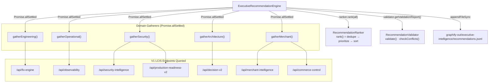

# LCIS V3 Recommendation Engine

> **Layer:** V3 — Executive Intelligence  
> **Files:** `tools/central-intelligence/recommendation-engine/`  
> **Proven result:** `recommendAll()` returned **18 cross-domain recommendations**  
> **Output:** `graphify-out/executive-intelligence/recommendations.jsonl`

---

## Purpose

The Recommendation Engine synthesizes intelligence from all five V1 LCIS knowledge domains (engineering, operational, security, architecture, merchant) into ranked, deduplicated, schema-validated executive recommendations. It wraps — never reimplements — the V2 `autonomous-operations/RecommendationEngine`. All 18 recommendations from a proven run are deduplicated, ranked, and schema-complete.

---

## Module Map

| Class | File | Responsibility |
|-------|------|----------------|
| `ExecutiveRecommendationEngine` | `ExecutiveRecommendationEngine.mjs` (607 lines) | Facade; 5 domain gatherers; deduplication; persistence |
| `RecommendationRanker` | `RecommendationRanker.mjs` (222 lines) | Scoring formula; priority assignment; deduplication |
| `RecommendationValidator` | `RecommendationValidator.mjs` (316 lines) | Schema validation; feasibility checks; conflict detection |

---

## Architecture



---

## Recommendation Schema (All Fields Required)

```ts
interface Recommendation {
  id: string;                     // recId(domain, title) = {domain.slice(0,3)}-{sha1(domain:title).slice(0,10)}
  domain: 'engineering' | 'operational' | 'security' | 'architecture' | 'merchant';
  title: string;                  // ≥ 5 characters
  action: string;                 // ≥ 5 characters, descriptive
  evidence: Array<{
    source: string;               // must be non-empty, non-'unknown'
    fact: string;
  }>;
  dependencies: string[];
  risks: string[];
  confidence: number;             // 0–1; 0.45 if NOT CONNECTED, 0.65 if connected
  expectedImpact: {
    scope: string;
    benefit: string;
    blastRadius: string;          // 'platform-wide' | 'cross-domain' | 'domain' | 'single'
  };
  effort: 'S' | 'M' | 'L';
  priority: 'P0' | 'P1' | 'P2' | 'P3';
  reversible: boolean;
  timestamp: string;
}
```

---

## `recommendAll()` — Proven Result: 18 Recommendations

`recommendAll()` runs all 5 domain gatherers in parallel via `Promise.allSettled`, then:

1. Flattens results into one array
2. Passes to `ranker.rank(all)` which: deduplicates → prioritizes → sorts by score DESC
3. Persists to `graphify-out/executive-intelligence/recommendations.jsonl` (JSONL append)
4. Returns the ranked array

**Proven fact:** a run of `recommendAll()` returned **18 cross-domain recommendations**.

---

## Domain Gatherers

### `gatherEngineering()` / `recommendEngineering()`

Queries V1 `/api/fix-engine`. Maps each fix into a recommendation with `domain: 'engineering'`.

Default confidence: 0.65 (V1 structural CONNECTED). Falls to 0.45 if V1 not reachable.

### `gatherOperational()` / `recommendOperational()`

Queries V1 `/api/observability`. Maps operational findings to `domain: 'operational'`.

### `gatherSecurity()` / `recommendSecurity()`

Queries V1 `/api/security-intelligence` and `/api/production-readiness-v2`. Security findings are always `reversible: false` where they touch auth or RLS.

### `gatherArchitecture()` / `recommendArchitecture()`

Queries V1 `/api/decision-v2`. Maps architectural decisions and blockers.

### `gatherMerchant()` / `recommendMerchant()`

Queries V1 `/api/merchant-intelligence` and `/api/commerce-control`. Maps merchant onboarding, funnel, and feature gaps.

---

## RecommendationRanker

### Scoring Formula

```js
// All values 0–1
const impact   = impactScore(rec.expectedImpact);  // blast radius → weight × benefit × scope multipliers
const conf     = rec.confidence;                    // 0–1
const bonus    = rec.reversible ? 0.05 : 0;
const penalty  = riskPenalty(rec.risks);            // 0–0.30
const divisor  = effortDivisor(rec.effort);         // S=1.0, M=1.5, L=2.5
const raw      = (impact * conf + bonus - penalty) / divisor;
const score    = Math.max(0, Math.round(raw * 100)); // 0–100
```

**Blast radius weights:**
- `'platform-wide'` or `'all-merchant'` → 1.0
- `'cross-domain'` → 0.8
- `'domain'` → 0.5
- `'single'` → 0.2
- Default → 0.3

**Benefit multipliers:** revenue/payment/security mentions → ×1.2; performance/reliability → ×1.1.

**Risk penalty** per risk item: data-loss/outage/revenue mention → +0.10; regression/breaking → +0.06; other → +0.02. Capped at 0.30.

### Priority Bands

| Score | Priority | Meaning |
|-------|----------|---------|
| ≥ 80 | P0 | Critical — act immediately |
| ≥ 60 | P1 | High — this sprint |
| ≥ 35 | P2 | Medium — next sprint |
| < 35 | P3 | Low — backlog |

### Deduplication

Two recommendations are "similar" when:
- Same `domain`, AND
- Title token overlap ≥ 60% (normalized, tokens > 2 chars)

When merged: evidence arrays are union-merged; the higher-scored recommendation survives as canonical.

---

## RecommendationValidator

Validates against the canonical schema (13 required fields).

### Feasibility Check

`assessFeasibility(rec)`:
- `confidence < 0.30` → not feasible
- Missing or empty evidence → not feasible
- No evidence from CONNECTED source (9 known sources: `v1-lcis`, `arch-intel`, `security-reasoner`, `arch-reasoner`, `risk-scorer`, `impact-predictor`, `v2-ops`, `memory-engine`, `domain-graph`) → feasible but low-confidence structural hypothesis

### Conflict Detection

`checkConflicts(recs)` flags pairs where:
1. Antonymous action verbs (`add`/`remove`, `enable`/`disable`, `enforce`/`relax`, etc.) on a shared artifact
2. Two irreversible P0 recs targeting the same domain and artifact (sequencing conflict)

### Soft Warnings

- `confidence < 0.30` — consider deferring
- No evidence from CONNECTED source — structural confidence reduced
- P0 priority + L effort — requires executive sign-off

---

## Honesty Contract

| Evidence source | Connected |
|-----------------|-----------|
| V1 LCIS `/api/fix-engine`, `/api/observability`, etc. | CONNECTED when V1 at :3333 is running |
| V2 autonomous operations `RecommendationEngine` | CONNECTED when V2 at :3334 is running |
| Live merchant impact (who is affected, how much revenue) | NOT CONNECTED — source: Supabase `sites` table + canonical ledger RPCs |
| PR/issue counts, CI pass rates | NOT CONNECTED — source: GitHub API |

Confidence defaults: 0.65 if V1 connected; 0.45 if NOT CONNECTED. The validator surfaces all NOT CONNECTED gaps via the `warnings` array.

---

## ID Generation

```js
function recId(domain, title) {
  const prefix = domain.slice(0, 3);
  const hash = createHash('sha1').update(`${domain}:${title}`).digest('hex').slice(0, 10);
  return `${prefix}-${hash}`;
}
```

Examples: `eng-a1b2c3d4e5`, `sec-f6g7h8i9j0`.

---

## Querying Recommendations

```bash
# All recommendations (ranked)
curl http://localhost:3334/intelligence/recommendations

# By domain
curl http://localhost:3334/intelligence/recommendations?domain=security

# By priority
curl http://localhost:3334/intelligence/recommendations?priority=P0

# Single recommendation by ID
curl http://localhost:3334/intelligence/recommendations/sec-f6g7h8i9j0

# Validation report
curl http://localhost:3334/intelligence/recommendations/validate
```
