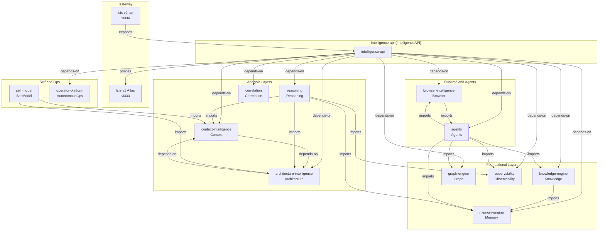

# LCIS V2 — Self-Model

**Authoritative production documentation.**
Authors: principal SRE / architect.
Generated facts sourced from: `tools/central-intelligence/self-model/SelfModelBuilder.mjs`, `SelfDiagnostics.mjs`, `PlatformExplainer.mjs`, and `graphify-out/self-model/*.json` as of 2026-06-19.

---

## Table of Contents

1. [Purpose](#1-purpose)
2. [SelfModelBuilder](#2-selfmodelbuilder)
3. [The 5 Self-Model Artifacts](#3-the-5-self-model-artifacts)
4. [PlatformExplainer](#4-platformexplainer)
5. [What LCIS Knows About Itself](#5-what-lcis-knows-about-itself)
6. [Subsystem Interaction Graph](#6-subsystem-interaction-graph)
7. [SelfDiagnostics](#7-selfdiagnostics)
8. [API Endpoints](#8-api-endpoints)

---

## 1. Purpose

LCIS V2 implements **reflexive intelligence**: the system models itself alongside the LetBuyy platform. This is not documentation — it is a live, queryable description of LCIS's own structure that is regenerated on demand and consumed by the same intelligence API that answers every other question about the codebase.

### Why self-modelling matters

Without a self-model, LCIS is a black box. Any question of the form "how does LCIS work?", "which subsystems are healthy?", or "what can LCIS answer?" requires a human to read source code. With the self-model:

- The intelligence API can answer `/api/self-model/lcis` and `/api/self-model/platform` with structured, accurate data rather than hallucinated capability claims.
- `SelfDiagnostics` can detect subsystem regressions before a developer does — a missing class in `context-intelligence` shows up immediately in `validateCompleteness()`.
- `PlatformExplainer` can give a new engineer or an AI model a complete, sourced description of how LetBuyy works in under 30 seconds, without a repo scan.
- LCIS can describe its own connected vs. NOT CONNECTED state honestly — critical for setting correct expectations about live telemetry vs. structural analysis.

The self-model enforces the **LCIS-first, no manual research** protocol. Before any grep or file scan, query `/api/self-model/*` to understand what the system knows and how to ask for it.

---

## 2. SelfModelBuilder

**Source:** `tools/central-intelligence/self-model/SelfModelBuilder.mjs`
**Export:** singleton `builder` (default export)
**CLI:** `node tools/central-intelligence/self-model/SelfModelBuilder.mjs`
**Output directory:** `graphify-out/self-model/` (gitignored)
**Dependencies:** `node:fs`, `node:path`, `node:url` only — no external packages.

### Introspection method

`SelfModelBuilder` roots itself at `tools/central-intelligence/` (the `CI_ROOT`) and scans every subdirectory that maps to a known subsystem. It never scans outside this boundary. Two regex patterns drive all extraction:

| Extraction | Pattern |
|---|---|
| Class names | `/^class\s+([A-Z][A-Za-z0-9_]*)/gm` — anchored to line start; PascalCase only |
| Static imports | `/from\s+['"]([^'"]+)['"]/g` |
| Dynamic imports | `/import\s*\(\s*['"]([^'"]+)['"]\s*\)/g` |

Import strings are mapped to subsystem names via `importToSubsystem()`, which matches the pattern `../\<subsystem\>/` or `./\<subsystem\>/` against the `DIR_TO_LAYER` map. This gives an import-derived dependency graph; a `STATIC_DEP_MAP` supplements it for lazy dynamic imports that the regex misses.

### CLI usage

```bash
# Build all 5 artifacts
node tools/central-intelligence/self-model/SelfModelBuilder.mjs

# Output (printed to stdout): stats JSON
# {
#   "success": true,
#   "elapsed_ms": ...,
#   "subsystemsDetected": 13,
#   "subsystemsPresent": 13,
#   "totalMjsFiles": 72,
#   "totalClasses": 69,
#   "artifactsWritten": 5,
#   "outputDir": ".../graphify-out/self-model",
#   "errors": []
# }
```

The process exits with code `1` if any generator throws. Each generator is isolated in a try/catch so a failure in one artifact does not block the others.

### The 5-generator pipeline

`build()` orchestrates the generators **sequentially** in this fixed order. The `selfModel` generator must run first because subsequent generators can read `this._selfModel` for cached subsystem data.

```
build()
  │
  ├── 1. generateSelfModel()        → LCIS_SELF_MODEL.json
  │        introspects CI_ROOT, extracts subsystems/classes/endpoints
  │        reads domain-intel.json + infra-intel.json for domain/table/rpc counts
  │
  ├── 2. generateSystemGraph()      → LCIS_SYSTEM_GRAPH.json
  │        builds 15-node / 28-edge subsystem topology
  │        derives edges from import scan + STATIC_DEP_MAP
  │
  ├── 3. generateDependencyModel()  → LCIS_DEPENDENCY_MODEL.json
  │        lazily imports ArchitectureIntelligenceEngine (graceful on failure)
  │        reads infra-intel.json + domain-intel.json
  │        maps service bindings → service deps, cross-domain edges → domain deps
  │
  ├── 4. generateOperationalModel() → LCIS_OPERATIONAL_MODEL.json
  │        lazily imports ArchitectureGraphBuilder (graceful on failure)
  │        hardcodes 6-step incident model, 7-step deploy model, 5 failure paths
  │        reads operational topology from infra-intel.json
  │
  └── 5. generateIntelligenceModel() → LCIS_INTELLIGENCE_MODEL.json
           maps 22 questions → endpoints → CONNECTED/NOT CONNECTED status
           lists all graphify-out/*.json artifacts with sizes + mtimes
           builds 12-entry query routing map
```

The lazy import pattern (`try { const mod = await import('../...') } catch {}`) means generators 3 and 4 work even when architecture-intelligence or context-intelligence is unavailable. They fall back to the existing `graphify-out/*.json` artifacts.

---

## 3. The 5 Self-Model Artifacts

All artifacts live in `graphify-out/self-model/` and are gitignored. Regenerate with:
```bash
node tools/central-intelligence/self-model/SelfModelBuilder.mjs
# or via the standard refresh:
pnpm graph:omega
```

### 3.1 LCIS_SELF_MODEL.json

| Property | Value |
|---|---|
| **File size** | 16 KB (16,049 bytes) |
| **Generated** | 2026-06-19T17:59:03.318Z |
| **Version** | 2.0 |

**What it captures:**

The master self-description of the LCIS intelligence system. Top-level structure:

```
{
  version, generatedAt, description,
  platform: {
    name, type, tenantRoot, canonicalRuntimes[10],
    moneyModel, authIssuers[2], deployTargets[2]
  },
  layers: [13 declared layer names],
  subsystems: [13 subsystem objects — see section 5],
  capabilities: [15 platform capabilities],
  endpoints: { v2Port: 3334, v1Port: 3333, routes[...], count },
  stats: { subsystemCount, presentSubsystemCount, totalMjsFiles,
           totalClasses, declaredLayers, endpointCount,
           domainCount, tableCount, rpcCount }
}
```

**Example queries:**

```bash
# What subsystems does LCIS have?
curl localhost:3334/api/self-model/lcis | jq '.subsystems[].name'

# What are LCIS's current stats?
curl localhost:3334/api/self-model/lcis | jq '.stats'

# Which runtimes does LetBuyy have?
curl localhost:3334/api/self-model/platform | jq '.components.runtimes[].name'
```

---

### 3.2 LCIS_SYSTEM_GRAPH.json

| Property | Value |
|---|---|
| **File size** | 7 KB (6,749 bytes) |
| **Generated** | 2026-06-19T17:59:03.319Z |
| **Nodes** | 15 |
| **Edges** | 28 |

**What it captures:**

The subsystem interaction topology as a directed graph. Nodes are either `subsystem` (13), `external` (1: `lcis-v1`), or `gateway` (1: `lcis-v2-api`). Edges carry a `kind` field: `imports`, `depends-on`, `proxies`, or `exposes`.

Structure:
```json
{
  "nodeCount": 15,
  "edgeCount": 28,
  "nodes": [
    { "id": "lcis-v1",         "type": "external", "port": 3333 },
    { "id": "lcis-v2-api",     "type": "gateway",  "port": 3334 },
    { "id": "memory-engine",   "type": "subsystem", "layer": "Memory", ... },
    ...
  ],
  "edges": [
    { "from": "intelligence-api", "to": "lcis-v1",          "kind": "proxies" },
    { "from": "lcis-v2-api",      "to": "intelligence-api", "kind": "exposes" },
    ...
  ]
}
```

**Key edge observations from the actual graph:**

- `intelligence-api` → `lcis-v1` (`proxies`) — V2 delegates V1 queries rather than reimplementing them
- `lcis-v2-api` → `intelligence-api` (`exposes`) — the HTTP gateway wraps intelligence-api
- `knowledge-engine` → `memory-engine` (`imports`) — knowledge writes to memory
- `browser-intelligence` ↔ `agents` (both directions: `imports`) — mutual dependency between browser agents and the agent framework
- `agents` → `graph-engine`, `knowledge-engine`, `memory-engine`, `observability` — agents consume all foundational layers
- `context-intelligence` ↔ `architecture-intelligence` (`depends-on` both directions) — the one detected **bidirectional dependency** (import cycle) in the codebase; see section 6
- `reasoning` → `architecture-intelligence`, `context-intelligence`, `memory-engine`, `observability`
- `self-model` → `architecture-intelligence`, `context-intelligence`
- `intelligence-api` → all 11 subsystems (`depends-on`)

**Example queries:**

```bash
# Show the system graph edges
curl localhost:3334/api/self-model/graph | jq '.edges[] | "\(.from) → \(.to) [\(.kind)]"'
```

---

### 3.3 LCIS_DEPENDENCY_MODEL.json

| Property | Value |
|---|---|
| **File size** | 16 KB (16,264 bytes) |
| **Services** | 9 |
| **Service dependencies** | 21 |
| **Cross-domain dependencies** | 49 |
| **Money domains** | 9 |

**What it captures:**

The platform-level service and domain dependency topology. Three sections:

1. **`services`** — one entry per Cloudflare Worker and Vercel app, with their queue producers/consumers, service bindings, and cron flags.
2. **`serviceDependencies`** — directed edges between services (kinds: `http-proxy`, `service-binding`, `queue-produce`, `queue-consume`).
3. **`crossDomainDependencies`** — directed edges between business domains derived from `domain-intel.json` cross-domain RPC calls.

The 9 money domains are extracted by `ArchitectureIntelligenceEngine` when it is available; if not, the dependency model notes `"Architecture engine not loaded — using infra-intel.json only"` rather than fabricating data.

**Example queries:**

```bash
# What services exist?
curl localhost:3334/api/self-model/dependencies | jq '.services | keys'

# What cross-domain edges exist for payments?
curl localhost:3334/api/self-model/dependencies | jq \
  '.crossDomainDependencies[] | select(.from == "payments" or .to == "payments")'
```

---

### 3.4 LCIS_OPERATIONAL_MODEL.json

| Property | Value |
|---|---|
| **File size** | 9 KB (9,011 bytes) |
| **Incident emergence steps** | 6 |
| **Deployment propagation steps** | 7 |
| **Failure paths** | 5 |
| **Operational rules** | 8 |

**What it captures:**

How the platform operates, fails, and recovers.

**Incident emergence (6 steps):**

| Step | Name | Trigger |
|---|---|---|
| 1 | Signal Detection | Cloudflare Analytics Engine error rate / p99 breach; queue depth; RPC error count |
| 2 | Anomaly Correlation | `AnomalyDetectionService` correlates across metric streams |
| 3 | Domain Attribution | LCIS maps route/rpc/table → owning domain via `domain-intel.json`; blast radius computed |
| 4 | Incident Creation | Incident object: domain, severity, affected RPCs/routes, merchants, evidence, timestamp |
| 5 | Escalation | Runbook escalation chain; on-call paged; rollback candidate from `deployment-state.json` |
| 6 | Recovery | Rollback/fix applied; migration gate re-evaluated; health probe confirms green; closed |

**Deployment propagation (7 steps):**

| Step | Name | Actor |
|---|---|---|
| 1 | CI Trigger | GitHub Actions — push to `stepup/*` or `main`; `security-review.yml` runs |
| 2 | Validation Gate | `validate-governance.mjs` (107 validators) + `pnpm --filter <app> build` |
| 3 | Migration Gate | Supabase migrations applied before worker deploy; schema validated against RLS |
| 4 | Worker Deploy | `wrangler deploy` x 4 Workers (api, queue-workers, webhook, mobile-bff) |
| 5 | Vercel Deploy | 5 Next.js apps (marketing-site, identity-platform, merchant-control-plane, storefront-runtime, platform-console) |
| 6 | Health Probe | Post-deploy probes; `deployment-state.json` updated; LCIS re-reads runtime topology |
| 7 | Merchant Visibility | All tenants see new version immediately — shared Workers, no per-tenant deploy |

**5 documented failure paths:**

| Domain | Failure Point | Downstream Cascade |
|---|---|---|
| payments | Razorpay webhook delivery failure or HMAC mismatch | `confirm_order_payment_with_ledger` not called → order stuck in `PENDING_PAYMENT` → inventory not decremented → gift-card not applied → no confirmation |
| api-gateway | `letbuyy-api` Worker crash / CPU limit | All `/v1/*` routes 503 → merchant-control-plane loses data APIs → storefront checkout fails → queue producers fail → webhook-service cannot call gateway |
| database | Supabase Postgres outage or connection exhaustion | All SECURITY DEFINER RPCs fail → money mutations blocked → RLS policies unevaluatable → auth token verification may fail |
| queue-workers | `letbuyy-queue-workers` crash or DLQ saturation | Analytics events lost → search index stale → notification emails delayed or lost → cron (`17 */6 * * *`) misses |
| identity-platform | ES256 JWK endpoint down | Merchant JWT verification fails → all authenticated merchant routes 401 → merchant cannot manage store → new merchant onboarding blocked |

**Example queries:**

```bash
# Show the failure path for a specific domain
curl "localhost:3334/api/self-model/failure?domain=payments" | jq '.steps'

# Show deployment steps
curl localhost:3334/api/self-model/deploy | jq '.steps[].name'
```

---

### 3.5 LCIS_INTELLIGENCE_MODEL.json

| Property | Value |
|---|---|
| **File size** | 14 KB (13,926 bytes) |
| **Questions mapped** | 22 |
| **CONNECTED** | 18 |
| **NOT CONNECTED** | 4 |
| **Graphify artifacts listed** | 52 |
| **Query routing entries** | 12 |

**What it captures:**

The capability map of the entire LCIS system — what questions it can answer, which endpoint handles each, whether the answer is backed by live data or structural analysis, and how query routing works.

**22 questions with connection status:**

| Question | Endpoint | Status |
|---|---|---|
| Where is X implemented? | `/api/search` | CONNECTED — code graph + domain-intel.json |
| What breaks if I change X? | `/api/blast` | CONNECTED — graphify blast-radius |
| Who owns X? | `/api/owner` | CONNECTED — CODEOWNERS + domain-intel.json |
| What tables/policies/triggers affect table T? | `/api/table` | CONNECTED — db-intel.json |
| What does RPC R touch / who calls it? | `/api/rpc` | CONNECTED — db-intel.json |
| What policies are on table T? | `/api/policy` | CONNECTED — db-intel.json |
| Security posture / attack surface? | `/api/security` | CONNECTED — db-intel.json + infra-intel.json |
| Is it production-ready? | `/api/production-readiness-v2` | CONNECTED — structural analysis from graphify |
| What should be fixed next? | `/api/decision-v2` | CONNECTED — fix-engine.json + production-readiness-v2.json |
| What are the business domains? | `/api/domains` | CONNECTED — domain-intel.json |
| What breaks if domain D changes? | `/api/cross-domain` | CONNECTED — domain-intel.json cross-domain edges |
| What infrastructure deploys X? | `/api/deployment` | CONNECTED — infra-intel.json + deployment-state.json |
| How do incidents emerge? | `/api/incident` | CONNECTED — incident-intelligence-v5.json + topology |
| What are the current memory/decisions? | `/api/memory-v2` | CONNECTED — memory-intel.json |
| Explain a domain in plain language | `/api/explain` | CONNECTED — domain-intel.json + capabilities model |
| What is the full lineage of entity X? | `/api/lineage` | CONNECTED — db-intel.json + graph.json |
| How does LetBuyy work? | `/api/self-model/platform` | CONNECTED — SelfModelBuilder + PlatformExplainer |
| How does LCIS work? | `/api/self-model/lcis` | CONNECTED — LCIS_SELF_MODEL.json + LCIS_SYSTEM_GRAPH.json |
| What is live / currently failing? | `/api/runtime` | **NOT CONNECTED** — requires Cloudflare Analytics Engine telemetry adapter |
| How much revenue / money risk? | `/api/revenue-v2` | **NOT CONNECTED** — requires ledger reconciliation RPC queries |
| Which merchants are affected? | `/api/merchant-intelligence` | **NOT CONNECTED** — requires live tenant telemetry |
| What are live provider statuses? | `/api/live-adapters` | **NOT CONNECTED** — requires provider credentials (SUPABASE_URL, CF_API_TOKEN, etc.) |

**12-entry query routing map (natural language → subsystem → endpoint):**

| Pattern | Subsystem | Endpoint | Delegates to V1? |
|---|---|---|---|
| `what breaks if`, `blast radius`, `impact of` | graph-engine | `/api/blast` | yes |
| `who owns`, `ownership` | architecture-intelligence | `/api/owner` | yes |
| `security`, `rls`, `policy`, `attack surface`, `jwt`, `hmac` | graph-engine | `/api/security` | yes |
| `incident`, `failing`, `down`, `error rate`, `outage` | observability | `/api/incident` | no |
| `domain`, `business domain`, `cross-domain` | architecture-intelligence | `/api/domain` | yes |
| `deploy`, `release`, `vercel`, `worker`, `ci`, `migration` | architecture-intelligence | `/api/deployment` | yes |
| `memory`, `decision`, `rule`, `why was`, `history` | memory-engine | `/api/memory-v2` | no |
| `how does letbuyy`, `platform`, `explain`, `onboard` | self-model | `/api/explain` | no |
| `fix next`, `production ready`, `blockers`, `launch` | reasoning | `/api/decision-v2` | yes |
| `live`, `real-time`, `metrics`, `telemetry`, `current traffic` | observability | `/api/runtime` | no |
| `dependency`, `imports`, `uses`, `depends on`, `package` | context-intelligence | `/api/dependencies` | no |
| `table`, `rpc`, `trigger`, `index`, `policy`, `db`, `database` | graph-engine | `/api/table` | yes |

**Example queries:**

```bash
# What questions can LCIS answer that are live-connected?
curl localhost:3334/api/self-model/intelligence | jq \
  '.summary.connectedQuestions[]'

# What is NOT CONNECTED and why?
curl localhost:3334/api/self-model/intelligence | jq \
  '.summary.notConnectedQuestions[]'
```

---

## 4. PlatformExplainer

**Source:** `tools/central-intelligence/self-model/PlatformExplainer.mjs`
**Export:** singleton `explainer` (default export)
**No external dependencies.** Reads from `graphify-out/self-model/*.json` and `graphify-out/infra-intel.json` + `graphify-out/domain-intel.json`.

### CLI usage

```bash
node tools/central-intelligence/self-model/PlatformExplainer.mjs [topic] [arg]

# Topics:
node ... platform            # How LetBuyy works (default)
node ... services            # How runtimes interact
node ... deploy              # How deployments propagate CI to merchants
node ... failure [domain]    # How failure in <domain> cascades (default: payments)
node ... incident            # How incidents emerge
node ... operations          # How operations function day-to-day
```

All methods return structured JSON — they are not prose generators. The same JSON objects are returned by the HTTP API.

### Topics and what each covers

#### `platform` — `explainPlatform()`

Returns a complete description of the LetBuyy platform including:
- **summary**: single paragraph on what LetBuyy is and its commerce lifecycle
- **components.runtimes**: all 9 canonical runtimes with their role and technology
- **components.dataLayer**: database, tenant isolation model, money model, table/rpc/domain counts
- **components.payments**: Razorpay + COD, server-side HMAC-SHA256, idempotency model, GST
- **components.auth**: both JWT issuers (customer HS256, merchant ES256), step-up HMAC, Turnstile rate-limiting
- **steps**: 10-step order-to-fulfilment flow (customer visit → checkout → payment → ledger → queue → merchant view → fulfilment → GST invoice)
- **sourceFacts**: self-model version, worker count, Vercel app count (sourced from `infra-intel.json`)

All counts (tableCount, rpcCount, domainCount) fall back to known-good defaults (`330+`, `137+`, `22`) when `domain-intel.json` is absent, rather than returning null.

#### `services` — `explainServiceInteraction()`

Returns the 8 canonical inter-runtime interaction patterns with mechanism and notes:

| From | To | Mechanism |
|---|---|---|
| storefront-runtime / merchant-control-plane / platform-console | api-gateway | HTTP proxy via `/api/*` same-origin → `/v1/*` |
| identity-platform | api-gateway | ES256 JWT in every authenticated request via `LETBUYY_IDENTITY_PUBLIC_JWKS` |
| api-gateway | queue-workers | Cloudflare Queue binding (EVENT_QUEUE, ANALYTICS_QUEUE, SEARCH_QUEUE, NOTIFICATION_QUEUE, RUNTIME_QUEUE) |
| api-gateway | webhook-service | Cloudflare Service Binding (`WEBHOOK_SERVICE`) — synchronous dispatch |
| webhook-service / queue-workers | api-gateway | Service Binding (`API_GATEWAY_SERVICE`) — internal API callback |
| api-gateway / all workers | Supabase Postgres | Hyperdrive connection pool (api-gateway); direct pg for others |
| mobile-bff | api-gateway | Service Binding (`API_GATEWAY_SERVICE`) |
| storefront-runtime | identity-platform | Redirect + cookie exchange for customer HS256 session |

Also includes raw `workerBindings` from `infra-intel.json` for cross-reference.

#### `deploy` — `explainDeploymentPropagation()`

Returns the 7-step deployment chain (sourced from `LCIS_OPERATIONAL_MODEL.json`), plus:
- **criticalConstraints**: two-lane rule, migration gate, security review gate, 107 validators, no `--no-verify`
- **rollbackPlan**: Worker (`wrangler rollback`), Vercel (git revert + push), migration (forward-only — new migration required), `deployment-state.json`

#### `failure [domain]` — `explainFailurePropagation(domain)`

Looks up the domain in `LCIS_OPERATIONAL_MODEL.json`'s failure paths. For documented domains (`payments`, `api-gateway`, `database`, `queue-workers`, `identity-platform`), returns the exact cascade chain. For undocumented domains, applies generic 6-step failure reasoning and attaches cross-domain edges from `domain-intel.json` as supplementary context.

Also returns 7 general failure principles, e.g.: "api-gateway is the single bottleneck: its failure affects ALL runtimes simultaneously" and "Gift-card ledger is append-only — no balance column to corrupt; balance is recomputed from entries."

#### `incident` — `explainIncidentEmergence()`

Returns the 6-step incident emergence model plus:
- **signalSources** with explicit CONNECTED/NOT CONNECTED status for each (Cloudflare Analytics Engine, Supabase Postgres, Cloudflare Queues are NOT CONNECTED; LCIS structural analysis is CONNECTED)
- **incidentClassification**: P0/P1/P2/P3 severity definitions with criteria and response times

#### `operations` — `explainOperations()`

Returns the 7-step day-to-day ops lifecycle plus:
- **lcisOpsCapabilities**: 8 LCIS endpoints with their CONNECTED/NOT CONNECTED status
- **cronJobs**: extracted from `infra-intel.json` (e.g., `17 */6 * * *` on queue-workers)
- **opsHowItWorks**: 8 operational axioms (canonical ledger, shared Workers, two-lane rule, HMAC-signed webhooks, etc.)

---

## 5. What LCIS Knows About Itself

### Current stats (from `LCIS_SELF_MODEL.json`, generated 2026-06-19)

| Metric | Value |
|---|---|
| Self-model version | 2.0 |
| Declared layers | 13 |
| Subsystems (declared) | 13 |
| Subsystems (present on disk) | 13 |
| Total `.mjs` files | 72 |
| Total classes | 69 |
| V2 API endpoints | 24 |
| V2 API port | 3334 |
| V1 API port | 3333 |
| Business domains (LetBuyy platform) | 22 |
| Database tables indexed | 330 |
| RPCs indexed | 137 |

### The 13 subsystems

| Subsystem | Layer | Files | Classes |
|---|---|---|---|
| `memory-engine` | Memory | 5 | `MemoryHealthMonitor`, `MemoryIndexer`, `MemoryIngestionPipeline`, `MemoryRetriever`, `MemoryService` |
| `knowledge-engine` | Knowledge | 5 | `KnowledgeAcquisitionService`, `KnowledgeChangeDetector`, `KnowledgeFreshnessService`, `KnowledgeScheduler`, `KnowledgeSourceRegistry` |
| `graph-engine` | Graph | 5 | `GraphBuilder`, `GraphDiagnostics`, `GraphExplorer`, `GraphIndexer`, `GraphQueryEngine` |
| `browser-intelligence` | Browser | 7 | `BrowserIntelligenceEngine`, `CheckoutAgent`, `EvidenceCollector`, `MonitoringAgent`, `SEOValidator`, `SessionPool`, `StoreAgent`, `ThemeAgent` (8 classes) |
| `observability` | Observability | 8 | `AnomalyDetectionService`, `HealthService`, `IncidentDetectionService`, `MetricsService`, `TelemetryService`, `TracingService` |
| `agents` | Agents | 8 | `KnowledgeAgent`, `MerchantAgent`, `MonitoringAgent`, `OperationsAgent`, `ReleaseAgent`, `SecurityAgent`, `ThemeAgent` |
| `context-intelligence` | Context | 9 | `ArchitectureGraphBuilder`, `ContextAssembler`, `ContextCompressionPipeline`, `ContextDiagnostics`, `ContextHealthMonitor`, `ContextOptimizer`, `DependencyGraphBuilder`, `RepositoryGraphBuilder`, `TokenOptimizer` |
| `architecture-intelligence` | Architecture | 7 | `ArchitectureDriftDetector`, `ArchitectureIntelligenceEngine`, `ArchitectureSnapshotService`, `DependencyDiscovery`, `DomainDiscovery`, `LayerDiscovery`, `ServiceDiscovery` |
| `reasoning` | Reasoning | 7 | `ArchitectureReasoner`, `DependencyReasoner`, `DeploymentReasoner`, `IncidentReasoner`, `OperationalReasoner`, `ReasoningEngine`, `SecurityReasoner` |
| `correlation` | Correlation | 5 | `ImpactPredictor`, `IntelligenceCorrelationEngine`, `RiskScorer`, `RootCauseAnalyzer`, `SignalCollector` |
| `operator-platform` | AutonomousOps | 0 | (directory exists; placeholder — no classes yet) |
| `self-model` | SelfModel | 3 | `PlatformExplainer`, `SelfDiagnostics`, `SelfModelBuilder` |
| `intelligence-api` | IntelligenceAPI | 3 | `QueryRouter`, `ResponseSynthesizer` |

### Subsystem responsibilities

| Subsystem | Responsibilities |
|---|---|
| `memory-engine` | Persistent fact storage and retrieval; ingestion pipeline for decisions, rules, migrations; memory freshness tracking; memory health monitoring |
| `knowledge-engine` | Knowledge acquisition from codebase sources; source registry and scheduling; change detection and freshness service |
| `graph-engine` | Code graph build, index, and query; graph exploration and diagnostics; GraphRAG entity extraction |
| `browser-intelligence` | Playwright-driven runtime evidence collection; checkout, store, theme, monitoring agents; SEO validation; evidence aggregation |
| `observability` | Metrics, tracing, health, and anomaly detection; incident detection service; OpenTelemetry instrumentation |
| `agents` | Domain-specific AI agents (Knowledge, Merchant, Operations, Release, Security, Theme); agent framework and lifecycle management |
| `context-intelligence` | Architecture graph building from infra + domain intel; dependency graph building across workspace packages; repository graph building; context assembly, health, and optimization |
| `architecture-intelligence` | Service discovery across all runtimes; dependency and layer discovery; domain discovery and coupling analysis; architecture snapshot and drift detection |
| `reasoning` | Incident reasoning and root-cause analysis |
| `correlation` | Cross-signal correlation |
| `operator-platform` | Autonomous operations support; platform operator tooling (not yet implemented) |
| `self-model` | LCIS self-introspection and self-description; platform explainer; self-diagnostics and completeness validation; self-model artifact generation |
| `intelligence-api` | Unified HTTP API on port 3334; query routing to V1 (:3333) + V2 subsystems; response synthesis and context assembly |

---

## 6. Subsystem Interaction Graph

Source: `graphify-out/self-model/LCIS_SYSTEM_GRAPH.json` — 15 nodes, 28 edges.



### Bidirectional dependency: context-intelligence and architecture-intelligence

The graph contains one import cycle, explicitly modelled in `STATIC_DEP_MAP`:

```javascript
'context-intelligence':      ['architecture-intelligence'],
'architecture-intelligence': ['context-intelligence'],
```

Both subsystems are legitimate co-dependents: `ArchitectureIntelligenceEngine` builds a domain picture that `ArchitectureGraphBuilder` (in context-intelligence) then uses to assemble a graph for AI context; meanwhile, context-intelligence's dependency graph informs architecture-intelligence's coupling analysis. This cycle is managed by the lazy `import()` pattern in `generateDependencyModel()` and `generateOperationalModel()` — neither generator crashes if one subsystem is unavailable.

This cycle is the only one in the LCIS V2 graph. All other edges are acyclic.

---

## 7. SelfDiagnostics

**Source:** `tools/central-intelligence/self-model/SelfDiagnostics.mjs`
**Export:** singleton `diagnostics` (default export)

### Methods

| Method | CLI arg | Returns |
|---|---|---|
| `getHealth()` | `health` (default) | Artifact freshness + subsystem presence — overall HEALTHY / STALE / DEGRADED |
| `introspect()` | `introspect` | Live count of subsystems, files, classes, and endpoints by scanning CI_ROOT |
| `validateCompleteness()` | `validate` | Per-subsystem COMPLETE / INCOMPLETE / EMPTY / MISSING_DIR with missing class list |
| `getModelStats()` | `stats` | Stats read from generated artifacts — sizes, node/edge counts, question counts |

### CLI usage

```bash
# Check health (default)
node tools/central-intelligence/self-model/SelfDiagnostics.mjs

# Live introspection
node tools/central-intelligence/self-model/SelfDiagnostics.mjs introspect

# Completeness validation
node tools/central-intelligence/self-model/SelfDiagnostics.mjs validate

# Stats from generated artifacts
node tools/central-intelligence/self-model/SelfDiagnostics.mjs stats
```

### `getHealth()` — status states

| Status | Condition |
|---|---|
| `HEALTHY` | All 5 artifacts present, all < 24 hours old, all 13 subsystem directories exist |
| `STALE (artifacts missing — run SelfModelBuilder.build())` | One or more of the 5 JSON files is absent |
| `STALE (artifacts older than 24h — re-run build())` | All files present but at least one is >= 24 hours old |
| `DEGRADED (N subsystems missing)` | Artifacts are fresh but N subsystem directories are missing on disk |

The 24-hour freshness threshold is hardcoded as `ageMs < 24 * 3_600_000`. This means a stale CI cache or a missing `pnpm graph:omega` run will surface as STALE rather than silently serving outdated data.

### `validateCompleteness()` — per-subsystem status

| Status | Meaning |
|---|---|
| `COMPLETE` | Directory exists, >= 1 file, all `expectedClasses` present |
| `INCOMPLETE` | Directory exists, files present, but one or more expected classes are missing |
| `EMPTY` | Directory exists but contains 0 `.mjs` files |
| `MISSING_DIR` | Directory does not exist on disk |

### Canonical subsystem registry — expected classes per subsystem

This is the contract used by `validateCompleteness()`. A class missing from this list does not fail validation; a class in this list that is absent in the actual source does.

| Subsystem | Expected Classes (minimum set) |
|---|---|
| `memory-engine` | `MemoryService`, `MemoryRetriever`, `MemoryIngestionPipeline` |
| `knowledge-engine` | `KnowledgeAcquisitionService`, `KnowledgeSourceRegistry` |
| `graph-engine` | `GraphBuilder`, `GraphQueryEngine` |
| `browser-intelligence` | `BrowserIntelligenceEngine` |
| `observability` | `AnomalyDetectionService`, `IncidentDetectionService` |
| `agents` | `AgentFramework` |
| `context-intelligence` | `ArchitectureGraphBuilder`, `DependencyGraphBuilder` |
| `architecture-intelligence` | `ArchitectureIntelligenceEngine` |
| `reasoning` | `IncidentReasoner` |
| `correlation` | (none — placeholder acceptable) |
| `operator-platform` | (none — placeholder acceptable) |
| `self-model` | `SelfModelBuilder`, `PlatformExplainer`, `SelfDiagnostics` |
| `intelligence-api` | `QueryRouter`, `ResponseSynthesizer` |

Note: `agents` declares `AgentFramework` as expected but the actual subsystem delivers `KnowledgeAgent`, `MerchantAgent`, `OperationsAgent`, etc. — this means `validateCompleteness()` will return `INCOMPLETE` for `agents` until an `AgentFramework` class is added. This is an intentional "canary" — the expected class list is the desired end-state, not just the current state.

### `getModelStats()` — what it reads

Reads all 5 artifacts from `graphify-out/self-model/` and returns a flat stats view:

```json
{
  "artifactSizes": {
    "LCIS_SELF_MODEL.json":         { "bytes": 16049, "mtime": "..." },
    "LCIS_SYSTEM_GRAPH.json":       { "bytes": 6749,  "mtime": "..." },
    "LCIS_DEPENDENCY_MODEL.json":   { "bytes": 16264, "mtime": "..." },
    "LCIS_OPERATIONAL_MODEL.json":  { "bytes": 9011,  "mtime": "..." },
    "LCIS_INTELLIGENCE_MODEL.json": { "bytes": 13926, "mtime": "..." }
  },
  "selfModel":         { "version": "2.0", "subsystemCount": 13, "totalMjsFiles": 72, "totalClasses": 69, "endpointCount": 24, "domainCount": 22, "tableCount": 330 },
  "systemGraph":       { "nodeCount": 15, "edgeCount": 28 },
  "dependencyModel":   { "serviceCount": 9, "serviceDependencyCount": 21, "crossDomainDependencyCount": 49 },
  "operationalModel":  { "incidentStepCount": 6, "deployStepCount": 7, "failurePathCount": 5, "opsRuleCount": 8 },
  "intelligenceModel": { "questionCount": 22, "connectedCount": 18, "notConnectedCount": 4, "artifactCount": 52, "queryRouteCount": 12 }
}
```

---

## 8. API Endpoints

LCIS V2 self-model endpoints are served by `intelligence-api` at port **3334**. All are `GET` requests; no authentication is required for read-only intelligence queries.

| Method | Path | Handler | Query params | Purpose |
|---|---|---|---|---|
| `GET` | `/api/self-model/lcis` | `LCIS_SELF_MODEL.json` served directly | — | Full LCIS self-description: 13 subsystems, stats, capabilities, endpoint list |
| `GET` | `/api/self-model/platform` | `PlatformExplainer.explainPlatform()` | — | How LetBuyy works: runtimes, data layer, payments, auth, 10-step order flow |
| `GET` | `/api/self-model/graph` | `LCIS_SYSTEM_GRAPH.json` served directly | — | 15-node / 28-edge subsystem interaction topology |
| `GET` | `/api/self-model/dependencies` | `LCIS_DEPENDENCY_MODEL.json` served directly | — | Platform service deps (9 services, 21 edges) + 49 cross-domain deps |
| `GET` | `/api/self-model/operations` | `LCIS_OPERATIONAL_MODEL.json` served directly | — | Incident emergence, deployment propagation, 5 failure paths |
| `GET` | `/api/self-model/intelligence` | `LCIS_INTELLIGENCE_MODEL.json` served directly | — | 22 Q to endpoint map, 18 CONNECTED / 4 NOT CONNECTED, 12-entry routing map |
| `GET` | `/intelligence/self/explain` | `PlatformExplainer` method dispatch | `?topic=` | Structured explanation for the given topic |
| `GET` | `/intelligence/self/explain?topic=platform` | `PlatformExplainer.explainPlatform()` | `topic=platform` | How LetBuyy works (default when topic omitted) |
| `GET` | `/intelligence/self/explain?topic=services` | `PlatformExplainer.explainServiceInteraction()` | `topic=services` | How the 9 runtimes interact (HTTP proxy, bindings, queues) |
| `GET` | `/intelligence/self/explain?topic=deploy` | `PlatformExplainer.explainDeploymentPropagation()` | `topic=deploy` | CI to gate to workers to Vercel to merchant visibility |
| `GET` | `/intelligence/self/explain?topic=failure` | `PlatformExplainer.explainFailurePropagation()` | `topic=failure&domain=<name>` | How a failure in `<domain>` cascades (default: `payments`) |
| `GET` | `/intelligence/self/explain?topic=incident` | `PlatformExplainer.explainIncidentEmergence()` | `topic=incident` | Signal to anomaly to attribution to escalation to recovery |
| `GET` | `/intelligence/self/explain?topic=operations` | `PlatformExplainer.explainOperations()` | `topic=operations` | Day-to-day ops lifecycle, LCIS capability status, cron jobs |
| `GET` | `/intelligence/self/health` | `SelfDiagnostics.getHealth()` | — | Artifact freshness + subsystem presence: HEALTHY / STALE / DEGRADED |
| `GET` | `/intelligence/self/introspect` | `SelfDiagnostics.introspect()` | — | Live scan: subsystem count, file count, class count, endpoint count |
| `GET` | `/intelligence/self/validate` | `SelfDiagnostics.validateCompleteness()` | — | Per-subsystem COMPLETE / INCOMPLETE / EMPTY / MISSING_DIR |
| `GET` | `/intelligence/self/stats` | `SelfDiagnostics.getModelStats()` | — | Artifact sizes + per-artifact stat summary |

### Example curl session

```bash
BASE=http://localhost:3334

# Is LCIS healthy?
curl "$BASE/intelligence/self/health" | jq '.status'

# What can LCIS answer that is live-connected?
curl "$BASE/api/self-model/intelligence" | jq '.summary.connectedQuestions[]'

# Explain payment failure cascade
curl "$BASE/intelligence/self/explain?topic=failure&domain=payments" | jq '.steps'

# How does deployment work?
curl "$BASE/intelligence/self/explain?topic=deploy" | jq '.steps[].name'

# Are all 13 subsystems complete?
curl "$BASE/intelligence/self/validate" | jq '{valid:.valid, summary:.summary}'

# Current stats
curl "$BASE/intelligence/self/stats" | jq '.selfModel'
```

---

## Operational notes for SREs

**When to regenerate:** Run `node tools/central-intelligence/self-model/SelfModelBuilder.mjs` (or `pnpm graph:omega`) after any of the following:

- A new subsystem directory is added to `tools/central-intelligence/`
- A new class is added to an existing subsystem
- The `DIR_TO_LAYER`, `STATIC_DEP_MAP`, or `RESPONSIBILITIES` maps in `SelfModelBuilder.mjs` are updated
- `domain-intel.json` or `infra-intel.json` is refreshed (table/rpc/domain counts change)
- The intelligence-api `server.mjs` gains new endpoints (endpoint count in `LCIS_SELF_MODEL.json` would be stale)

**How to verify the self-model is current:**

```bash
node tools/central-intelligence/self-model/SelfDiagnostics.mjs health
# Expected: { "status": "HEALTHY", "allArtifactsPresent": true, "allArtifactsFresh": true, ... }
```

**The NOT CONNECTED hard rule:** The self-model never fabricates live values. If `LCIS_INTELLIGENCE_MODEL.json` lists a question as NOT CONNECTED, the corresponding API endpoint must return `"status": "NOT_CONNECTED"` with the exact env var or adapter required, never a mock or estimate. This is enforced by the intelligence-api response synthesizer and is part of the LCIS live-data law.
