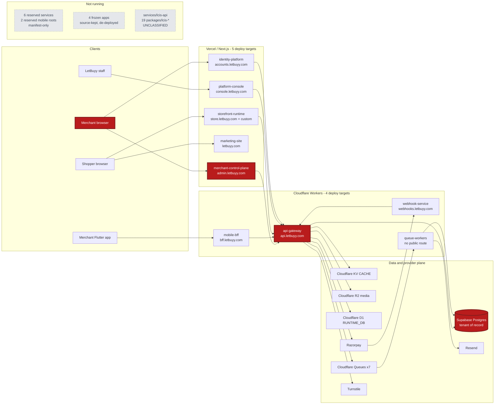
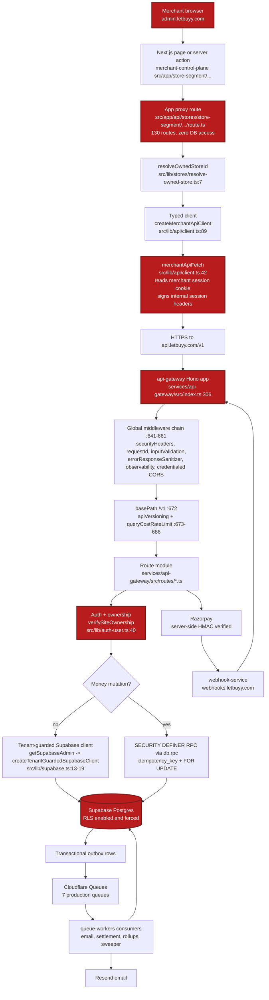
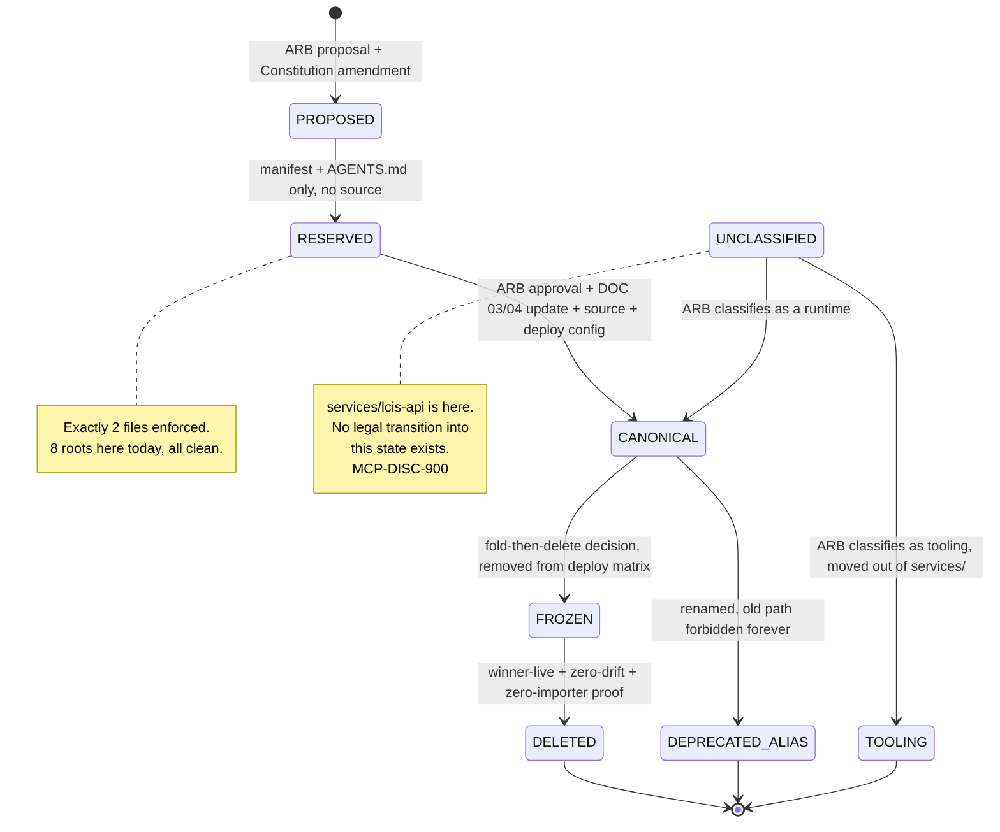

# 03 — SYSTEM AND RUNTIME MAP

| Field | Value |
|---|---|
| **Run ID** | `docs/merchant-system-discovery/2026-08-04T225330+0530-ee371182` |
| **Branch** | `stepup/main` |
| **Commit (pinned)** | `ee371182` |
| **Run date** | 2026-08-04 (+0530); this document authored 2026-08-04 → 2026-08-05 (+0530) |
| **Scope** | The canonical apps / services / packages / data / provider topology **as it actually is at HEAD** — the constitutional runtime set vs reality, the merchant-web / mobile / storefront / identity / platform-console boundaries, the reserved and frozen roots with proof, the unclassified LCIS estate, the real deploy matrix from the workflows, local dev ports, and where merchant data physically lives. |
| **Evidence basis** | Agent A's Phase-1 notes (`_agent-notes/A-governance-topology.md`, read in full), re-verified and enriched at authoring time by direct reads of `config/runtime/production-topology.json`, `scripts/validators/governance-common.mjs`, `scripts/dev/ports.mjs`, `pnpm-workspace.yaml`, the four `wrangler.toml` files, `.github/workflows/*`, `config/env/production.env.example`, `services/api-gateway/src/index.ts`, `services/mobile-bff/src/index.ts`, `apps/merchant-control-plane/src/lib/api/client.ts`, and read-only `git ls-tree` / `find` / `grep` censuses. |
| **METHOD DISCLOSURE** | **Nothing in this document was verified against a running LetBuyy system.** No app was built, booted, deployed, or contacted; no staging or production endpoint was called; no database was connected to. The only executions performed were read-only filesystem/git inspections of this working tree, plus one read-only re-run of `scripts/validators/sequential-migration-validator.mjs`. Every runtime status ceiling in this document is therefore **IMPLEMENTED_NOT_RUNTIME_VERIFIED**, and topology statements describe *declared and configured* topology, not *observed live* topology. |
| **Secrets** | **No secrets or PII appear in this document.** Environment-variable NAMES, Cloudflare binding NAMES, queue NAMES, and public hostnames only. Cloudflare KV / D1 / Hyperdrive resource identifiers present in `wrangler.toml` were deliberately **not** copied here. |

> **Observation-window warning (inherited and extended).** Agent A recorded a concurrent actor writing into the repository mid-audit (migration `196` at 23:05, seven rollbacks at 23:07). That has continued. **At authoring time the tree has moved again**: `database/supabase/migrations/` now holds **126** files on disk (highest `197_letbuyy_core_first_class_theme.sql`) and `database/supabase/rollback/` holds **48**. The committed tree at `ee371182` still holds **124** migrations (highest `195_contact_requests.sql`) and **40** rollbacks — verified by `git ls-tree -r --name-only HEAD`. Every count in this document is labelled **committed-tree** or **worktree**. Where they differ, the committed tree is the map; the worktree is the warning.

---

## 1. Recommendation / verdict

**The topology is the healthiest thing in this repository, and it is one classification decision away from being fully honest. Ship-blocking risk does not live in the shape of the system; it lives in the fact that the shape cannot currently be deployed.**

Five findings, stated directly:

1. **The declared topology matches the deployed topology exactly.** The production deploy matrix is 4 Cloudflare Workers + 5 Vercel Next apps = 9 targets, plus a dispatch-only Flutter release lane. That is precisely the constitutional canonical set. No frozen app and no reserved service appears in any deploy matrix. `DEPLOY-R2` is **HELD**. (`.github/workflows/production-deploy.yml:337-385, 390-402`)
2. **All eight reserved roots are genuinely, byte-for-byte empty.** Six reserved services and two reserved mobile roots each contain exactly two files — `runtime.manifest.json` and `AGENTS.md`. Zero source, zero tests, zero deploy config. Verified by direct `find` at authoring time. `ARCH-R4/R5/R6` and `R-16` are **HELD**. This is not inference from an absent `package.json`; it is a file census.
3. **All four frozen apps are genuinely de-deployed at the build layer.** They have no `vercel.json`, appear in no deploy matrix, and are excluded from root `build` / `lint` / `typecheck` by explicit `--filter=!` flags. They remain workspace members and remain source-tracked, which is what "source-kept, de-deployed" means. Residual: three of them still have production hostnames declared in `config/env/production.env.example:27,29,31`, and provider-side Vercel project deletion is still an open human seam.
4. **There is an eleventh service root and a nineteen-package estate that the governance machine cannot classify.** `services/lcis-api` + `packages/lcis-*` = **591 committed files** that are in none of `canonicalServiceRoots`, `reservedServiceRoots`, `frozenAppRoots`, or `production-topology.json`. It is not deployed — so `R-16` is intact — but `ARCH-R2` ("MUST NOT add a runtime root not in ARCH-R1 without a Constitution amendment + ARB approval **before** source is created") is breached on its face, and it is the direct cause of several current governance-gate failures. **This is an ARB decision, not an engineering fix.**
5. **The map is currently undeployable, for reasons this document does not own.** `git rev-list --count main..stepup/main` = **106**; `production-deploy.yml` triggers on push to `main`; the governance gate is RED (83 PASS / 25 FAIL per Agent A's individual runs); and `ci.yml` never triggers on `stepup/main`. Those are owned by the governance and deploy documents. They are restated here only because **a correct map of an undeployable system is still an undeployable system.**

**Recommended immediate action for the founder:** commission one ARB decision — *"what class is the LCIS estate?"* — before any topology-touching work package. It is cheap, it unblocks four gate validators, and every future "what is our topology?" answer is wrong until it is made.

---

## 2. Scope

**In scope.** The physical and declared topology of the repository at commit `ee371182`: every root under `apps/`, `services/`, `packages/`, `tools/`, and `database/`; their classification under the governance machine lists; their deploy configuration; the merchant request path from browser to Postgres; local development ports; and the provider surface (Cloudflare, Vercel, Supabase, and the named third-party providers) as configured in-repo.

**Out of scope for this document (owned elsewhere in this dossier).**

| Concern | Owner |
|---|---|
| The 25 failing governance validators, gate composition, `R-18` | Governance / gate document |
| The 106-commit branch lag, CI trigger gap, branch protection | Deploy / CI document |
| Migration↔rollback pairing (`R-23`), migration content | Database document |
| Issuer model (HS256 vs ES256), shared-secret fallbacks | Identity / auth document |
| Money RPCs, ledger invariants, Razorpay, payouts, GST | Payments document |
| Theme renderer freeze, Liquid canary | Theme document |
| Per-feature merchant capability status | Feature-domain documents |

**Explicitly not attempted.** No network call, no build, no boot, no deploy, no migration, no git state mutation. The worktree carries ~6,800 user-owned modifications which were never touched.

---

## 3. What a merchant actually touches — the five runtime surfaces

A merchant of LetBuyy interacts with exactly five runtime surfaces. Everything else in the topology is either behind them, beside them (buyers, platform operators), or not running.

| # | Surface | Runtime root | Kind | Production hostname (declared) | What the merchant does here |
|---|---|---|---|---|---|
| 1 | **Merchant web OS** | `apps/merchant-control-plane` | Vercel / Next.js | `admin.letbuyy.com` (`config/env/production.env.example:22`) | Everything: products, orders, refunds, customers, payouts, themes, settings, domains, GST, shipping. 77 pages, 130 proxy routes. |
| 2 | **Sign-in / account** | `apps/identity-platform` | Vercel / Next.js | `accounts.letbuyy.com` (`:18`) | Register, log in, store creation, onboarding, password intent. 10 pages. |
| 3 | **Merchant mobile** | `apps/mobile/merchant-app` | Flutter | app stores (dispatch-only release lane) | Dashboard, orders on the go. 157 `.dart` files. Talks to `bff.letbuyy.com`, not to `api.letbuyy.com` directly (`config/env/templates/mobile.dart-defines.example:4-5`). |
| 4 | **Their own storefront** (as an observer / previewer) | `apps/storefront-runtime` | Vercel / Next.js | `{store}.letbuyy.com` + connected custom domains (`NEXT_PUBLIC_STORE_ROOT_DOMAIN=letbuyy.com`, `:33`) | Preview a theme, view the live store. Host-routed by `apps/storefront-runtime/src/proxy.ts`. |
| 5 | **Marketing / pricing** (pre-signup) | `apps/marketing-site` | Vercel / Next.js | `letbuyy.com` (`:20`) | Discover the product, request a demo, see pricing. 17 pages. |

**Not a merchant surface:** `apps/platform-console` (LetBuyy staff only — the single surviving ops console under `ARCH-R10`, 24 pages, hostname inferred as `console.letbuyy.com` from `STOREFRONT_FRAME_ANCESTORS` at `config/env/production.env.example:73` — **no explicit production URL variable declares it**, so treat that hostname as UNVERIFIED).

**Never a merchant surface:** all four frozen apps, all six reserved services, both reserved mobile roots, and the entire LCIS estate.

---

## 4. Runtime classification matrix — the constitutional set vs reality

### 4.1 Resolving the "8 runtimes" naming confusion first

Three different counts circulate and all three are correct about different things. A reader must not conflate them.

| Count | What it means | Source |
|---|---|---|
| **8** | The constitutional canonical *runtime roles* table — gateway, queue-workers, mobile-bff, identity-platform, webhook-service, storefront-runtime, merchant-control-plane, marketing-site | `AGENTS.md:69-77` (`ARCH-R1`) |
| **10** | The machine-enforced `canonicalRuntimeRoots` = 6 app roots + 4 service roots. Adds `apps/platform-console` and `apps/mobile/merchant-app`, which `ARCH-R1` describes as "supporting, non-extractable surfaces that ride this topology" rather than as members of the 8 | `scripts/validators/governance-common.mjs:57-64, 97-102, 113-116` |
| **9** | Production **deploy targets** = 4 Workers + 5 Vercel apps. Excludes `apps/mobile/merchant-app` (its own dispatch-only workflow) | `.github/workflows/production-deploy.yml:337-385, 390-402` |

`ARCH-R1` also labels identity-platform as `services/identity-platform` with a parenthetical redirect to `apps/identity-platform` (`AGENTS.md:73`). **`services/identity-platform` does not exist.** The parenthetical rescues the statement but the table is misleading; a reader scanning for a services root will not find one.

**Verdict: 8, 10, and 9 are mutually consistent. Use 10 when talking about governance-enforced roots, 9 when talking about deployment, 8 only when quoting the Constitution.**

### 4.2 The complete classification matrix (every root under `apps/` and `services/`)

Counts are Agent A's Phase-1 census, spot-re-verified at authoring time. File counts exclude `node_modules`, `.next`, `dist`, `.wrangler`, `build`, `.turbo`.

| Root | Files | `package.json` | `wrangler.toml` | `vercel.json` | In prod deploy matrix | Classification | Status |
|---|---|---|---|---|---|---|---|
| `services/api-gateway` | 312 | YES | **YES** | — | YES (Worker) | **CANONICAL** | IMPLEMENTED_NOT_RUNTIME_VERIFIED |
| `services/queue-workers` | 26 | YES | **YES** | — | YES (Worker) | **CANONICAL** | IMPLEMENTED_NOT_RUNTIME_VERIFIED |
| `services/webhook-service` | 13 | YES | **YES** | — | YES (Worker) | **CANONICAL** | IMPLEMENTED_NOT_RUNTIME_VERIFIED |
| `services/mobile-bff` | 11 | YES | **YES** | — | YES (Worker) | **CANONICAL** | IMPLEMENTED_NOT_RUNTIME_VERIFIED — see §4.5 |
| `apps/identity-platform` | 96 | YES | — | YES | YES (Vercel) | **CANONICAL** | IMPLEMENTED_NOT_RUNTIME_VERIFIED |
| `apps/storefront-runtime` | 169 | YES | — | YES | YES (Vercel) | **CANONICAL** | IMPLEMENTED_NOT_RUNTIME_VERIFIED |
| `apps/merchant-control-plane` | 347 | YES | — | YES | YES (Vercel) | **CANONICAL** | IMPLEMENTED_NOT_RUNTIME_VERIFIED |
| `apps/marketing-site` | 126 | YES | — | YES | YES (Vercel) | **CANONICAL** | IMPLEMENTED_NOT_RUNTIME_VERIFIED |
| `apps/platform-console` | 64 | YES | — | YES | YES (Vercel) | **CANONICAL** (sole ops console, `ARCH-R10`) | IMPLEMENTED_NOT_RUNTIME_VERIFIED |
| `apps/mobile/merchant-app` | 332 (157 `.dart`) | `pubspec.yaml` | — | — | separate dispatch-only workflow | **CANONICAL** (Flutter) | IMPLEMENTED_NOT_RUNTIME_VERIFIED |
| `services/checkout-runtime` | **2** | no | no | no | no | **RESERVED-AND-EMPTY** ✅ | VERIFIED (file census) |
| `services/event-bus` | **2** | no | no | no | no | **RESERVED-AND-EMPTY** ✅ | VERIFIED (file census) |
| `services/notification-service` | **2** | no | no | no | no | **RESERVED-AND-EMPTY** ✅ | VERIFIED (file census) |
| `services/analytics-pipeline` | **2** | no | no | no | no | **RESERVED-AND-EMPTY** ✅ | VERIFIED (file census) |
| `services/media-service` | **2** | no | no | no | no | **RESERVED-AND-EMPTY** ✅ | VERIFIED (file census) |
| `services/search-service` | **2** | no | no | no | no | **RESERVED-AND-EMPTY** ✅ | VERIFIED (file census) |
| `apps/mobile/shopper-app` | **2** | no | no | no | no | **RESERVED-AND-EMPTY** ✅ | VERIFIED (file census) |
| `apps/mobile/operator-app` | **2** | no | no | no | no | **RESERVED-AND-EMPTY** ✅ | VERIFIED (file census) |
| `apps/app-marketplace` | 108 | YES | — | **no** | no | **FROZEN** | de-deployed at build layer |
| `apps/theme-marketplace` | 127 | YES | — | **no** | no | **FROZEN** | de-deployed at build layer |
| `apps/developer-portal` | 40 | YES | — | **no** | no | **FROZEN** | de-deployed at build layer |
| `apps/platform-operations-portal` | 53 | YES | — | **no** | no | **FROZEN** (fold-then-delete loser, `ARCH-R10`) | de-deployed at build layer |
| `services/lcis-api` | 9 | **YES** | **no** | no | no | **UNCLASSIFIED** | CONTRADICTORY_EVIDENCE — **MCP-DISC-900** |

### 4.3 Proof of emptiness for the eight reserved roots

Re-verified at authoring time with `find <root> -type f`. Each returns exactly two files:

```
services/checkout-runtime      -> 2 files: AGENTS.md runtime.manifest.json
services/event-bus             -> 2 files: AGENTS.md runtime.manifest.json
services/notification-service  -> 2 files: AGENTS.md runtime.manifest.json
services/analytics-pipeline    -> 2 files: AGENTS.md runtime.manifest.json
services/media-service         -> 2 files: AGENTS.md runtime.manifest.json
services/search-service        -> 2 files: AGENTS.md runtime.manifest.json
apps/mobile/shopper-app        -> 2 files: AGENTS.md runtime.manifest.json
apps/mobile/operator-app       -> 2 files: AGENTS.md runtime.manifest.json
```

`services/checkout-runtime/AGENTS.md` states the constraint in its own words: *MUST remain manifest-only; MUST NOT add source, tests, `package.json`, `wrangler.toml`, or deployment config; MUST NOT extract checkout, payments, inventory reservation, or order finalization into this root.* The named active owner is `services/api-gateway` plus the hosted storefront checkout.

**Evidence type: SERVICE_CODE (directory census). This is the single most reliably-held governance rule in the repository.**

### 4.4 Proof of de-deployment for the four frozen roots

Four independent, mutually reinforcing exclusions:

| Exclusion layer | Evidence |
|---|---|
| No Vercel config | `find apps/*/vercel.json` — present for the 5 canonical Next apps, **absent** for all 4 frozen apps (re-verified at authoring time) |
| Excluded from root build/lint/typecheck | `package.json:11,12,67` — `--filter=!@letbuyy/app-marketplace --filter=!@letbuyy/theme-marketplace --filter=!@letbuyy/developer-portal --filter=!@letbuyy/platform-operations-portal` |
| Absent from every deploy matrix | `production-deploy.yml:390-402`, `deploy-staging.yml:128-135` — 5-app matrices, none frozen |
| Declared frozen in the topology registry | `config/runtime/production-topology.json` — `environment: frozen`, `status: frozen`, `deploymentKind: not-deployed` |

`deploy-matrix-topology-validator.mjs` PASSES and reports "9 production deploy targets and staging/Vercel frozen exclusions checked" (Agent A, RUNTIME_OBSERVATION).

**Residual, and it is real:** `config/env/production.env.example:27,29,31` still declares `NEXT_PUBLIC_THEME_MARKETPLACE_URL=https://themes.letbuyy.com`, `NEXT_PUBLIC_APP_MARKETPLACE_URL=https://apps.letbuyy.com`, `NEXT_PUBLIC_DEVELOPER_PORTAL_URL=https://developer.letbuyy.com` — production hostnames for runtimes that are not deployed. Combined with the open `SKIP-D4-FROZEN-VERCEL-PROJECT-DELETION` seam (provider-side project deletion never performed), de-deployment is complete in the build lane and **incomplete in the environment and provider lanes**. → **MCP-DISC-904**.

### 4.5 `services/mobile-bff` — the "is it a stub?" question, resolved

Agent A flagged this UNVERIFIED (`G-A-10`) on a file count of 8 files / 1 source file, and correctly refused to judge it. **I re-opened the source and it is not a stub.**

`services/mobile-bff/src/index.ts` is **511 lines** and implements a genuine six-way fan-in composite:

```
services/mobile-bff/src/index.ts:382-388  Promise.all([
    /v1/analytics/dashboard,  /v1/analytics/orders,      /v1/analytics/revenue,
    /v1/analytics/top-products, /v1/analytics/traffic-sources, /v1/payouts/summary
])
:391-406  partial-failure handling — 502 MOBILE_DASHBOARD_UNAVAILABLE only when ALL six fail
:414-427  composed response with `partial_errors` and `provider_mode` surfaced
```

It signs its upstream calls with a session-derived header plan (`:360`) and forwards a request ID. **Correct status: BACKEND_ONLY / IMPLEMENTED_NOT_RUNTIME_VERIFIED, not STUB_OR_MOCK.** `WIN-R7` is satisfied in substance.

**But the contract name in law is wrong.** `AGENTS.md:72` declares the composite at **`/v1/dashboard`**. The route actually registered is **`/v1/mobile/dashboard`** (`services/mobile-bff/src/index.ts:475`). → **MCP-DISC-903**.

### 4.6 Deprecated aliases — held

None of `apps/admin`, `apps/analytics`, `apps/auth`, `apps/checkout`, `apps/internal`, `apps/merchant`, `apps/storefront`, `apps/mobile/operator-team-app`, or `apps/storefront-runtime/consumer-storefront` exists in the tree. `ARCH-R10` and `forbiddenRuntimeSubtrees` (`governance-common.mjs:78-95`) are **HELD**.

### 4.7 Diagram (a) — runtime topology, merchant request path highlighted



**Read the red path as: the merchant request path.** Merchant browser → `merchant-control-plane` → `api-gateway` → Supabase Postgres. Every merchant capability in this platform traverses exactly those four nodes. Nothing else is on the critical merchant path. The grey box is everything that exists in the repository but does not run.

---

## 5. Surface inventory and local development ports

### 5.1 Route / page surface per runtime (committed tree, re-verified at authoring time)

| Runtime | `page.tsx` | `api/**/route.ts` | Other |
|---|---|---|---|
| `apps/merchant-control-plane` | **77** | **130** (all under `src/app/api/`) | — |
| `apps/storefront-runtime` | 28 | 23 | `src/proxy.ts` (428 lines) host-routing gate |
| `apps/platform-console` | 24 | — | — |
| `apps/marketing-site` | 17 | — | — |
| `apps/identity-platform` | 10 | — | — |
| `services/api-gateway` | — | **67** top-level route modules, **97** including 5 subdirectories (`storefront/`, `themes/`, `app-store/`, `internal-console/`, `operations/`) | mounted under `app.basePath('/v1')` at `src/index.ts:672` |
| `apps/mobile/merchant-app` | — | — | 157 `.dart` files |

**Merchant control-plane page groups** (`apps/merchant-control-plane/src/app/[store]/`): `access_account · ai · analytics · appearance · apps · categories · certifications · comments · contact · coupons · customers · dashboard · education · experience · export · gallery · leads · login · marketing · online-store · orders · pages · payouts · posts · products · projects · reviews · settings · skills · testimonials`.

**Merchant control-plane proxy groups** (`apps/merchant-control-plane/src/app/api/stores/[store]/`): `ai · analytics · billing · blog-comments · categories · collections · commerce-analytics · commission · content · coupons · customers · dashboard · domains · form-submissions · founding · gift-cards · inventory · inventory-locations · kyc · localization · marketing · media · navigation · notifications · orders · pages · payment-config · payouts · plan · policies · posts · products · purchase-orders · resource-search · reviews · security · settings · shipping · smart-collections · suppliers · taxes · themes · transfers · upload · users`. Plus five top-level groups: `auth · employees · plans · subscribe · themes`.

**The structural fact that matters:** *every* one of the 130 merchant API routes is a **proxy**. None of them touches the database. Route ownership is a lockstep contract with the gateway.

### 5.2 Local development ports — there is a single source of truth, and it is honoured

`scripts/dev/ports.mjs` is the canonical registry, consumed by `scripts/dev/setup-local-env.mjs`, `scripts/dev/apply-dev-scripts.mjs`, and `docs/LOCAL_DEV.md`. Each package's `dev` script matches the registry exactly (spot-verified against all 9 app + 4 service `package.json` files).

| Port | Runtime | Class | `dev` command |
|---|---|---|---|
| 9000 | `apps/storefront-runtime` | CANONICAL | `next dev --webpack -p 9000` |
| **9001** | **`apps/merchant-control-plane`** | **CANONICAL** | `next dev --webpack -p 9001` |
| 9002 | `apps/identity-platform` | CANONICAL | `next dev --webpack -p 9002` |
| 9003 | `apps/app-marketplace` | **FROZEN** | `next dev -p 9003` |
| 9004 | `apps/developer-portal` | **FROZEN** | `next dev -p 9004` |
| 9005 | `apps/theme-marketplace` | **FROZEN** | `next dev --webpack -p 9005` |
| 9006 | `apps/marketing-site` | CANONICAL | `next dev --webpack -p 9006` |
| 9007 | `apps/platform-console` | CANONICAL | `next dev --webpack -p 9007` |
| 9008 | `apps/platform-operations-portal` | **FROZEN** | `next dev -p 9008` |
| 9009 | `packages/typescript/ui` (Storybook) | shared package | `storybook dev --port 9009 --no-open` |
| **9010** | **`services/api-gateway`** | **CANONICAL** | `wrangler dev --port 9010 --inspector-port 9110` |
| 9011 | `services/mobile-bff` | CANONICAL | `wrangler dev --port 9011 --inspector-port 9111` |
| 9012 | `services/webhook-service` | CANONICAL | `wrangler dev --port 9012 --inspector-port 9112` |
| 9013 | `services/queue-workers` | CANONICAL | `wrangler dev --port 9013 --inspector-port 9113` |
| 9110–9113 | Worker inspectors | — | avoids the well-known 9229 clash (`ports.mjs:28-31`) |

Citations: `scripts/dev/ports.mjs:13` (`APP_PORTS`), `:26` (`STORYBOOK_PORT`), `:33` (`SERVICE_PORTS`), `:47-48` (`API_ORIGIN` / `API_BASE_URL = http://localhost:9010/v1`).

**Note:** the four frozen apps still hold reserved dev ports. That is consistent with "source-kept" and is *not* a violation — but it means `pnpm dev` (which filters `./apps/*`) will attempt to start them. Use `pnpm dev:store` (`merchant-control-plane` + `identity-platform` + `api-gateway` + `ui`, concurrency 12) for merchant work.

**Local backend:** `scripts/dev/setup-local-env.mjs:61-125` points every local runtime at `http://localhost:54321` (a default `supabase start`) and generates untracked `.env.local` / `.dev.vars` files from the committed templates in `config/env/templates/`. The generated values are documented dev-only placeholders and Cloudflare's public "always passes" Turnstile test keys — **no real secret is generated or stored**.

### 5.3 LCIS / tooling ports (not part of the product runtime)

| Port | Surface | Root |
|---|---|---|
| 3333 | LCIS V1 graph server / Atlas | `tools/graph-server/server.mjs:78` |
| 3334 | LCIS V2/V3 intelligence API | `tools/central-intelligence/intelligence-api/server.mjs:21` |
| 3335 | LCIS operator dashboard | `tools/central-intelligence/operator-platform/` |
| 7100 | `@letbuyy/lcis-api` HTTP service | `services/lcis-api/src/server.ts:11` (`LCIS_API_PORT` default) |

The 7100 service is the one that sits inside `services/` and therefore inside the governance perimeter. The 3333/3334/3335 surfaces live under `tools/` and are outside the runtime-root lists entirely — which is arguably where `services/lcis-api` belongs. See **MCP-DISC-900**.

---

## 6. Backend / API / RPC / database mapping — the merchant request flow

### 6.1 Diagram (b) — merchant-control-plane → proxy → gateway → Postgres / provider



> Diagram note: `store-segment` in the two proxy nodes stands for the Next.js dynamic route segment written `[store]` on disk — the literal brackets are omitted only because they break mermaid label parsing. The real paths are `apps/merchant-control-plane/src/app/[store]/…` and `apps/merchant-control-plane/src/app/api/stores/[store]/…`.

### 6.2 The proxy contract, in code

`apps/merchant-control-plane/src/lib/api/client.ts` is the *only* egress. Three functions, 139 lines:

| Symbol | Line | Responsibility |
|---|---|---|
| `merchantApiBaseUrl()` | `:32-40` | Resolves the gateway base from `LETBUYY_API_BASE_URL` → `LETBUYY_API_URL` → `NEXT_PUBLIC_API_BASE_URL` → `NEXT_PUBLIC_API_URL`, falling back to `LETBUYY_PRODUCTION_API_BASE_URL` from `@letbuyy/api-client` |
| `merchantApiFetch()` | `:42-87` | Reads the merchant session cookie (`LETBUYY_MERCHANT_SESSION_COOKIE`), fails closed with `401` when `requireSession` and no cookie, sets `X-Client: admin-web` + `X-Request-ID`, then mints internal session headers via `createLetbuyyInternalSessionHeaders` using `INTERNAL_API_SECRET` / `LETBUYY_INTERNAL_API_SECRET`. A misconfigured secret returns `500 SERVER_MISCONFIGURED` — **it does not silently proceed unauthenticated**. Always `cache: 'no-store'`. |
| `createMerchantApiClient()` | `:89-99` | Wraps the shared typed client `createLetbuyyApiClient` from `@letbuyy/api-client` with `requireSession: true` on every call |

**Two access styles coexist**, both legitimate and both visible in the same feature: the typed client for list/read (`apps/merchant-control-plane/src/app/api/stores/[store]/orders/route.ts:29` → `createMerchantApiClient().orders.list(query)`) and raw `merchantApiFetch` for header-bearing mutations (the refund path, below).

### 6.3 END-TO-END TRACE — merchant lists orders (read path)

| Link | Evidence | Status |
|---|---|---|
| Merchant entry point | `apps/merchant-control-plane/src/app/[store]/orders/` page group | UI_CODE |
| Page/route | `apps/merchant-control-plane/src/app/api/stores/[store]/orders/route.ts:6-42` (`GET`) | UI_CODE |
| App proxy | same file — no DB import, no Supabase client | UI_CODE |
| Ownership pre-check | `resolveOwnedStoreId(...)` at `:14`, implemented `src/lib/stores/resolve-owned-store.ts:7-25`; resolves handle→UUID **through the gateway** (`stores.get` / `stores.getByHandle`), returns `401` on `LetbuyyApiError.status === 401`, `404` otherwise | UI_CODE + API_CLIENT_CODE |
| Typed client | `createMerchantApiClient().orders.list(query)` at `:29` | API_CLIENT_CODE |
| `/v1` gateway route | `services/api-gateway/src/routes/orders.ts`, mounted under `app.basePath('/v1')` (`src/index.ts:672`) | GATEWAY_CODE |
| Auth issuer + authz | Merchant realm ES256 verified at the gateway; internal session headers minted by the proxy. Ownership by `verifySiteOwnership(db, siteId, customUserId, sessionStoreId)` — `src/lib/auth-user.ts:40-66`, which rejects when `sessionStoreId !== siteId` and requires a `sites` row owned by `custom_user_id` or `user_id` with `deleted_at IS NULL` | GATEWAY_CODE |
| Server-authoritative computation | N/A (read) | — |
| RPC/tables + RLS | `orders` / `order_items` via the tenant-guarded client (`src/lib/supabase.ts:13-19`) | DB_SCHEMA |
| Webhook/queue/provider | none | — |
| Console/reporting consequence | order list renders in the merchant UI | UI_CODE |
| **Tests** | **MISSING at this seam** — no `ci /` job runs on `stepup/main` (`ci.yml:3-11`), so nothing typechecks or unit-tests this route on merge | — |
| **Runtime observation** | **MISSING** — not executed in this run | UNVERIFIED_RUNTIME |

### 6.4 END-TO-END TRACE — merchant issues a refund (money path) **[HIGH-STAKES]**

This is the highest-stakes merchant action that exists and the trace is worth reading in full. It is a two-hop proxy.

| Link | Evidence | Status |
|---|---|---|
| Merchant entry point | refund action in the merchant orders UI | UI_CODE |
| App proxy | `apps/merchant-control-plane/src/app/api/stores/[store]/orders/[orderId]/refund/route.ts:8-66` (`POST`) | UI_CODE |
| Ownership pre-check | `resolveOwnedStoreId` at `:13-14` | UI_CODE |
| **Hop 1 — resolve payment** | `:28-30` — `merchantApiFetch('/orders/:orderId', { requireSession: true })`, then `:36-38` extracts `data.payment_id`; **`422 PAYMENT_NOT_FOUND` if absent** (`:39-44`). The proxy does not guess a payment id. | UI_CODE |
| **Hop 2 — refund** | `:47-49` forwards `X-Step-Up-Token` and `X-Step-Up-Verified-At` headers; `:51-61` `POST /payments/:paymentId/refund` with `idempotency_key` mandatory and `amount_minor` / `reason` / `provider_refund_id` optional | UI_CODE |
| `/v1` gateway route | `services/api-gateway/src/routes/payments.ts` (the one path with its own CODEOWNERS line, `.github/CODEOWNERS`) | GATEWAY_CODE |
| Auth issuer + authz + **step-up** | Merchant ES256 session **plus** an HMAC step-up second factor gating refunds (`R-10`: "refund/payout second factor MUST be real cryptography"; `STEP_UP_SIGNING_SECRET` set at `production-deploy.yml:318`) | GATEWAY_CODE |
| Server-authoritative computation | Amount recomputed in the RPC from the DB, never trusted from the client (`R-11`, `PAY` rules) | RPC_FUNCTION *(asserted by law; content owned by the payments document)* |
| RPC/tables + RLS | `complete_order_refund` — a `SECURITY DEFINER` RPC called via `db.rpc`. **Direct writes to money tables from TypeScript are forbidden** (`canonical-ledger-only-validator`). | RPC_FUNCTION |
| Webhook/queue/provider | Razorpay refund + `webhook-service` callback ingress at `webhooks.letbuyy.com`; order-lifecycle email enqueued to `letbuyy-notifications-queue-production` → `queue-workers` → Resend | WEBHOOK_OR_JOB |
| Console/reporting consequence | order status, ledger, payout summary, and the mobile dashboard's `payout_summary` fan-in leg all move | GATEWAY_CODE |
| **Tests** | Contract + gateway unit tests exist (`tests/contracts/`, `services/api-gateway/src/__tests__/`) but **do not run on `stepup/main` PRs** — `ci.yml:3-11` | PARTIAL |
| **Runtime observation** | **MISSING** — `EXECUTION_LEDGER.md` row `V1-COMPLETION-BUILD` records that a *type error on the merchant refund-failure handler* (`orders/page.tsx:441`) shipped undetected because no `next build` runs in the gate. **This exact seam has already failed silently once.** | UNVERIFIED_RUNTIME |

**Verdict on the money path's shape:** the structure is correct — proxy-only app, ownership check, step-up header, idempotency key, `SECURITY DEFINER` RPC. The *verification* around it is what is missing.

### 6.5 Where merchant data physically lives

**One database. One region. One tenant column.**

| Store | What lives there | Configured at |
|---|---|---|
| **Supabase Postgres** (`ap-south-1`) | **Everything of record.** Sites (the tenant root), store_customers, products/collections/inventory, orders + order_items, the canonical money ledger (payment_transactions / refunds / payouts), gift-card accounts + ledger entries + redemptions, shipping rates, GST invoices, themes, and the transactional outbox. | `config/runtime/production-topology.json` runtime #1 (`runtimeRoot: database/supabase`, `outbox: "transactional outbox via Supabase/Postgres"`); `SUPABASE_URL` / `SUPABASE_SERVICE_ROLE_KEY` set at `production-deploy.yml:312-314` |
| Cloudflare **R2** (`R2_BUCKET` → `letbuyy-media-production`) | Merchant media/asset objects, served via `cdn.letbuyy.com` | `services/api-gateway/wrangler.toml` production `r2_buckets` block |
| Cloudflare **KV** (`CACHE`) | Storefront cache and — **as a founder-approved temporary measure** — the query-cost rate-limit backend, because no Upstash Redis is provisioned. `wrangler.toml:257-267` documents this explicitly, including the daily-write-quota limitation and "REPLACE WITH UPSTASH before scale". No business data. | `wrangler.toml` production `kv_namespaces` + `RATE_LIMIT_KV_FALLBACK = "on"` |
| Cloudflare **D1** (`RUNTIME_DB` → `letbuyy-production-d1`) | Runtime/edge state only; its own migration directory `database/cloudflare/d1/migrations`. **Not** a merchant data store. | `wrangler.toml` production `d1_databases` |
| Cloudflare **Durable Object** (`RUNTIME_COORDINATOR`) | Runtime coordination | `wrangler.toml` production `durable_objects` |
| Cloudflare **Queues** (7 production) | In-flight jobs only | see §7.2 |
| Cloudflare **Analytics Engine** (`RUNTIME_TELEMETRY` → `letbuyy-production-telemetry`) | Telemetry. **Live values NOT CONNECTED** — the honesty contract in `CLAUDE.md` applies. | `wrangler.toml` production `analytics_engine_datasets` |
| **Hyperdrive** (`HYPERDRIVE`) | Pooled Postgres connection for the storefront read path (`STOREFRONT_POOLED_SQL = "on"`) | `wrangler.toml` production `hyperdrive` |

**Multi-tenancy model: shared schema, `site_id` everywhere, RLS forced.** There is no per-merchant database and no per-merchant schema. Committed-tree schema census across `database/supabase/migrations/*.sql` (raw statement counts, not distinct objects — some are re-creations across migrations): 433 `CREATE TABLE`, 186 `CREATE FUNCTION`, 733 `CREATE POLICY`, 442 `ENABLE ROW LEVEL SECURITY`, 90 `FORCE ROW LEVEL SECURITY`. These are **grep counts of statements**, deliberately not presented as object counts; `CLAUDE.md` quotes the LCIS DB-graph figures (414 tables, 156 RPCs, 651 policies) which are distinct-object counts and are the better number to cite.

**The consequence a founder must internalise:** one Supabase project is a single point of failure for every merchant, every order, and the entire money ledger. `/api/merchant-intelligence` names this "single-tenant SPOF" in LCIS's own words. This map records it; the resilience decision is not this document's to make.

### 6.6 Database file census — committed tree vs worktree

| Measure | Committed tree @ `ee371182` | Worktree at authoring time |
|---|---|---|
| Migration files | **124** (`000_baseline` + `073…195` contiguous; `001–072` squashed into the baseline by design, `sequential-migration-validator.mjs:5-7`) | **126** (adds `196_theme_rls_tenant_hardening.sql`, 6,250 bytes; `197_letbuyy_core_first_class_theme.sql`, 19,974 bytes) |
| Highest migration | `195_contact_requests.sql` | `197_letbuyy_core_first_class_theme.sql` |
| Rollback files | **40** | **48** |

Verified by `git ls-tree -r --name-only HEAD database/supabase/migrations/` (124) vs `ls` (126).

---

## 7. State machines

### 7.1 The runtime lifecycle state machine (what this map is really governed by)



The critical property: **there is no sanctioned path into `UNCLASSIFIED`.** `ARCH-R2` requires amendment + ARB + doc update *before* source is created. `services/lcis-api` arrived without any of the three. The state machine has no edge that produced it, which is exactly why a validator cannot classify it and exactly why the gate fails.

### 7.2 Queue topology (production)

| Queue | Producer binding (gateway) | Consumer | DLQ |
|---|---|---|---|
| `letbuyy-events-production` | `EVENT_QUEUE` | queue-workers | `letbuyy-dead-letters-production` |
| `letbuyy-analytics-queue-production` | `ANALYTICS_QUEUE` | queue-workers | `letbuyy-dead-letters-production` |
| `letbuyy-search-queue-production` | `SEARCH_QUEUE` | queue-workers | `letbuyy-dead-letters-production` |
| `letbuyy-notifications-queue-production` | `NOTIFICATION_QUEUE` | queue-workers | `letbuyy-dead-letters-production` |
| `letbuyy-production-queue` | `RUNTIME_QUEUE` | queue-workers | `letbuyy-production-dead-letter-queue` |
| `letbuyy-dead-letters-production` | — | queue-workers (drain consumer) | — |
| `letbuyy-production-dead-letter-queue` | — | queue-workers (drain consumer) | — |

Producers: `services/api-gateway/wrangler.toml` production `queues.producers` (5). Consumers: `services/queue-workers/wrangler.toml:265-316` (6 consumer blocks + the runtime queue). Declared identically in `config/runtime/production-topology.json` → `queueProvider.queues` (7 named). **The producer/consumer graph is internally consistent** — a rare and good sign.

Gateway cron: `*/15 * * * *` in production (`wrangler.toml:236-237`), reduced from `*/1` with an in-file comment explaining the beta free-tier drain rationale.

---

## 8. Auth / tenant / invariant analysis (map level)

This section maps **trust boundaries**, not auth correctness. Correctness is the identity document's.

### 8.1 Trust boundaries crossed by a merchant request

| # | Boundary | Crossing mechanism | Invariant at risk |
|---|---|---|---|
| 1 | Browser → `merchant-control-plane` | Merchant session cookie (`LETBUYY_MERCHANT_SESSION_COOKIE`) over TLS to `admin.letbuyy.com` | auth |
| 2 | `merchant-control-plane` → `api-gateway` | Internal session headers minted with `INTERNAL_API_SECRET` / `LETBUYY_INTERNAL_API_SECRET` (`src/lib/api/client.ts:63-81`) — a **symmetric** shared secret | **[HIGH-STAKES]** auth |
| 3 | `api-gateway` → Postgres | `SUPABASE_SERVICE_ROLE_KEY` (RLS-bypassing) wrapped by `createTenantGuardedSupabaseClient` (`src/lib/supabase.ts:13-15`) — the guard, not RLS, is the tenancy chokepoint on this path | **[HIGH-STAKES]** tenancy |
| 4 | `api-gateway` → money tables | `SECURITY DEFINER` RPC only; direct TS writes banned by `canonical-ledger-only-validator` | **[HIGH-STAKES]** money |
| 5 | Razorpay → `webhook-service` → `api-gateway` | Provider HMAC verified **before** parsing side effects (`services/webhook-service/AGENTS.md`), then internal secret to the gateway | **[HIGH-STAKES]** money |
| 6 | `api-gateway` → `queue-workers` | `QUEUE_TENANT_ENVELOPE_SECRET`-signed tenant envelope (`signQueueTenantEnvelope`) | **[HIGH-STAKES]** tenancy |
| 7 | `mobile-bff` → `api-gateway` | Cloudflare **service binding** `API_GATEWAY_SERVICE` — never leaves the Cloudflare network | auth |
| 8 | `webhook-service` → `api-gateway` | Cloudflare **service binding** `API_GATEWAY_SERVICE` | auth |

Boundaries 7 and 8 are architecturally strong: service bindings mean those two hops are not internet-reachable at all. Boundary 2 is the weakest by construction — a shared symmetric secret across five Vercel apps plus the gateway (the identity document owns this; Agent A recorded it as `G-A-06`).

### 8.2 The tenancy chokepoint, named

`verifySiteOwnership` (`services/api-gateway/src/lib/auth-user.ts:40-66`) is **the** merchant tenancy gate. It:
- rejects immediately when a session-bound `sessionStoreId` disagrees with the requested `siteId` (`:46-48`);
- requires a `sites` row matching `custom_user_id.eq.<user>` OR `user_id.eq.<user>` (`:56`);
- filters `deleted_at IS NULL`, with a fallback query for schemas lacking the column (`:60-63`).

`getSupabaseAdmin` — the RLS-bypassing service-role client — is used in **121 files / 1,028 references** across apps, services, and packages (Agent A's grep; `CLAUDE.md:81` still says 115 files). Every one of those call sites is, in principle, a place where `verifySiteOwnership` must have already run. **That is the single largest structural tenancy risk in the system, and it is a count, not an audit.** The tenancy document owns the audit.

Corroborating signal: `tenant-isolation-validator` is currently **FAILING** — `services/api-gateway/src/tenant/tenant-tables.registry.ts` is out of sync with the schema-derived registry (Agent A, RUNTIME_OBSERVATION). **[HIGH-STAKES]**

### 8.3 Cookie scope observation

`config/env/production.env.example:65` sets `COOKIE_DOMAIN=.letbuyy.com` — a **parent-domain** cookie shared across `admin.`, `accounts.`, `store.`, `console.`, and every `{store}.letbuyy.com` subdomain. Local development deliberately does the opposite (`setup-local-env.mjs:83`: *"COOKIE_DOMAIN intentionally blank: localhost cookies must stay host-only"*), which shows the team understands the distinction. Recorded here as a **map fact with security consequences**; the identity/auth document owns the judgement.

---

## 9. Runtime and test evidence — and what was NOT verified

### 9.1 What was actually executed, ever, in this discovery run

| Execution | By whom | Result |
|---|---|---|
| All 108 gate-lane validators, invoked individually with `node`, bypassing the destructive wrapper | Agent A (Phase 1) | **83 PASS / 25 FAIL** at HEAD `ee371182` on a dirty worktree |
| Read-only `git ls-tree` / `git ls-files` / `find` / `grep` censuses | Agent A + this author | counts in this document |
| `scripts/validators/sequential-migration-validator.mjs` (re-run at authoring time) | this author | **exit 0** — see §9.3, this is a finding |

**That is the complete list.** Nothing else in this dossier was executed.

### 9.2 What was NOT verified — stated plainly

| Not verified | Why it matters | Status |
|---|---|---|
| **Any `next build` for any of the 5 Vercel apps** | No CI job runs `next build` on `stepup/main`. The workspace `build` for all four Workers is `tsc --noEmit` — **there is no bundling step in the gate at all**. `CLAUDE.md:76` says this explicitly and it is true. `EXECUTION_LEDGER.md` row `V1-COMPLETION-BUILD` proves it has already let four build-breaking type errors through. | UNVERIFIED_RUNTIME |
| **Any Worker actually starting** | `wrangler dev` was never run | UNVERIFIED_RUNTIME |
| **Any HTTP request to any `/v1` route** | No local or remote gateway was contacted | UNVERIFIED_RUNTIME |
| **Any database connection** | No Supabase instance, local or remote, was reached | UNVERIFIED_RUNTIME |
| **Staging or production live state** | BLOCKED_EXTERNAL by design — no provider credential exists in the repo, correctly so per `R-21` | BLOCKED_EXTERNAL |
| **Whether the committed tree alone passes the gate** | Requires a clean checkout, which the mission forbids | UNVERIFIED_RUNTIME |
| **Cloudflare / Vercel provider-side reality** (do the Workers, projects, queues, KV, D1, R2, DNS actually exist?) | Every provider fact in this document is read from `wrangler.toml` / workflow YAML — i.e. **declared intent, not observed provider state** | BLOCKED_EXTERNAL |
| **Flutter analyze / test for the merchant app** | `mobile-merchant-release.yml` is `workflow_dispatch` only; `ci.yml`'s `mobile-merchant` job never triggers on `stepup/main` | UNVERIFIED_RUNTIME |

### 9.3 A gate blind spot discovered while authoring this map

Agent A recorded (correctly, at 23:21) that `sequential-migration-validator` **FAILED** on the untracked migration `196_theme_rls_tenant_hardening.sql`. **At authoring time it PASSES**, reporting *"Migration sequence checked: no untracked files, no duplicate prefixes, no gaps after baseline"* — while migrations `196` (6,250 bytes) and `197` (19,974 bytes) sit uncommitted on disk.

Cause, proven:

```
git ls-files -s database/supabase/migrations/197_letbuyy_core_first_class_theme.sql
  -> 100644 e69de29bb2d1d6434b8b29ae775ad8c2e48c5391 0   (the EMPTY blob)
```

`e69de29b` is git's empty-blob hash — the signature of `git add -N` (**intent-to-add**). An intent-to-add file is:
- **included** by `getTrackedFiles()` (`governance-common.mjs:188-194`, `git ls-files -z`), so the validator counts it as committed;
- **excluded** by `getUntrackedFiles()` (`:196-201`, `git ls-files --others --exclude-standard`), so the untracked assertion at `sequential-migration-validator.mjs:17-26` never fires;
- **absent** from any CI checkout of the commit.

The same blind spot exists in the staging gate: `.github/workflows/deploy-staging.yml:45-52` uses the identical `git ls-files --others --exclude-standard database/supabase/migrations/` test.

**Net: `git add -N` silences both the untracked-migration validator and the staging untracked-migration guard, on the single most safety-critical file class in the repository.** This partially regresses closure item B4 of `FINAL_REPOSITORY_TRUTH_CERTIFICATION.md`. → **MCP-DISC-905**. Evidence type: RUNTIME_OBSERVATION. **[HIGH-STAKES]** — migration 196 is RLS/tenant hardening.

---

## 10. Implemented vs missing — topology conformance scoreboard

| Topology rule | Requirement | Reality | Verdict |
|---|---|---|---|
| `ARCH-R1` | 8 canonical runtimes are the entire active topology | 10 machine-enforced canonical roots; 9 production deploy targets; naming reconciled in §4.1 | **HELD** |
| `ARCH-R2` | No runtime root outside `ARCH-R1` without amendment + ARB + doc update before source | `services/lcis-api` exists with source, tests, and a root start script; no amendment, no ARB record, no topology entry | **BREACHED** → MCP-DISC-900 |
| `ARCH-R4/R5/R6` | Six reserved services + two reserved mobile roots stay manifest-only | All eight contain exactly 2 files | **HELD** (verified by census) |
| `ARCH-R10` | Deprecated aliases forbidden; `platform-console` the sole ops console | None of the 9 forbidden roots/subtrees exists; `platform-console` is the only ops console deployed | **HELD** |
| `ARCH-R11..R15` | Apps must not import apps; services must not import apps; packages must not import apps/services | `architecture-validator` PASSES over 6,904 tracked files; `import-validator` PASSES | **HELD** (static) |
| `R-16` | No reserved service deployed or declared `production` | `production-topology.json` declares all six `environment: reserved, status: reserved, deploymentKind: manifest-only`; none in any deploy matrix | **HELD** |
| `DEPLOY-R2` | One deploy matrix == the canonical runtimes | Production matrix = exactly 4 Workers + 5 Vercel apps; `deploy-matrix-topology-validator` PASSES | **HELD** |
| `DEPLOY-R3` | One canonical domain `letbuyy.com` | `production-topology.json.canonicalDomain = "letbuyy.com"`; **but** `platform-domain-literal-validator` currently FAILS on `letbuyy.store` literals in `apps/identity-platform/src/app/api/auth/create-store/route.ts:133` and `apps/identity-platform/src/app/onboarding/page.tsx:378` | **PARTIAL** — owned by the governance document |
| `ART-03` / `DEPLOY-R2` | Collapse duplicate staging workflows to one | Three exist (one active push-triggered, two dispatch/path-gated) | **PARTIAL** → MCP-DISC-902 |
| `DEPLOY-R1` / `R-20` | Deploy from the canonical branch; branch lag stays 0 | `main..stepup/main` = **106** | **BROKEN** — owned by the deploy document |
| Frozen-root de-deployment | Source-kept, de-deployed | Build/lint/typecheck/deploy exclusions complete; production URL declarations and provider projects remain | **PARTIAL** → MCP-DISC-904 |
| Topology registry completeness | One artifact answers "what is our topology?" | `production-topology.json` declares 21 runtimes; omits both reserved mobile roots, the entire LCIS estate, and `tools/*` | **PARTIAL** → MCP-DISC-901 |

**Score: 7 rules fully held, 4 partial, 1 breached, 1 broken (owned elsewhere).** For a repository of this size and history, a topology that holds 7 of 12 machine-checkable structural rules outright is genuinely good. The four partials are all cheap. The one breach is an ARB decision.

### 10.1 The full deploy matrix, as it actually is

| Workflow | Trigger | Governance gate | Targets |
|---|---|---|---|
| `production-deploy.yml` | `push: [main]` + dispatch (`:3-7`) | **YES** — `governance-gate` job; full chain `branch-lag-guard → governance-gate → release-preflight → migration-preflight → staging-e2e → migrate-production → deploy-workers-production → deploy-apps-production → release-required-jobs-succeeded → smoke-test-production` | **4 Workers**: api-gateway (`:337-338`), webhook-service (`:352-353`), queue-workers (`:368-369`), mobile-bff (`:384-385`). **5 Vercel apps** (`:390-402`): marketing-site, identity-platform, merchant-control-plane, storefront-runtime, platform-console |
| `deploy-staging.yml` | `push: [stepup/main]` + dispatch (`:3-6`) | **YES** — `node scripts/validate-governance.mjs --lane=gate` (`:43`) **and** untracked-Supabase-migration rejection (`:45-52`) | 4 Workers + 5 Vercel apps (`:128-135`) |
| `staging-deploy.yml` | **push disabled by comment** (`:3-7`); `workflow_dispatch` only | not the active lane | 4 Workers + 5 Vercel apps — a second, dormant, dispatch-reachable full matrix |
| `staging-runtime-deployment.yml` | `workflow_dispatch` + `push: [main, release/**]` + path filters | validate job present | Cloudflare primitives + the 4 Workers |
| `mobile-merchant-release.yml` | `workflow_dispatch` only | — | Flutter merchant app |
| `ci.yml` | `pull_request` / `push` on `[develop, main]` | jobs: typecheck, secret-hygiene, lint, unit-tests, merge-safety-gate, governance, mobile-merchant, build | **never fires on `stepup/main`** — owned by the deploy/CI document |
| `architecture-governance.yml` | `pull_request` + path filters, **no branch filter** | runs governance + design-system + topology + deployment + dependency validators | the only gate a `stepup/main` PR actually gets |
| `branch-lag-monitor.yml` | `schedule: "17 * * * *"` + dispatch | — | monitor only |
| `lcis-pr-analysis.yml` · `security-review.yml` | `pull_request` (all) | — | analysis |
| `full-security-audit.yml` | `schedule: Mondays 04:30 UTC` + dispatch | — | weekly audit |
| `hot-table-partition-maintenance.yml` | `schedule: monthly` + dispatch | — | DB maintenance |
| `environment-lifecycle.yml` · `graph-intelligence.yml` | `pull_request` / `push` + path filters | — | lifecycle + graph refresh |
| `live-production-certification.yml` · `production-rollout.yml` | `workflow_dispatch` only | — | certification / rollout |

**16 workflows. Two full deploy matrices are dispatch-reachable for staging where ART-03 mandates one.**

### 10.2 Production hostname map (declared, not observed)

| Hostname | Runtime | Declared at |
|---|---|---|
| `api.letbuyy.com` | api-gateway | `services/api-gateway/wrangler.toml` production `routes` |
| `webhooks.letbuyy.com` | webhook-service | `services/webhook-service/wrangler.toml:71-72` |
| `bff.letbuyy.com` | mobile-bff | `services/mobile-bff/wrangler.toml:89-90` |
| *(none)* | queue-workers | queue-consumer only — no public route, by design |
| `accounts.letbuyy.com` | identity-platform | `config/env/production.env.example:18`; also `LETBUYY_IDENTITY_ISSUER` (`:52`) |
| `admin.letbuyy.com` | merchant-control-plane | `:22`, `ADMIN_ORIGIN` `:72` |
| `store.letbuyy.com` + `{store}.letbuyy.com` + connected custom domains | storefront-runtime | `:24`, `NEXT_PUBLIC_STORE_ROOT_DOMAIN` `:33` |
| `letbuyy.com` | marketing-site | `:20` |
| `console.letbuyy.com` | platform-console | **inferred only** from `STOREFRONT_FRAME_ANCESTORS` `:73` — no explicit URL variable. **UNVERIFIED** |
| `checkout.letbuyy.com` | hosted checkout origin (storefront-runtime) | `CHECKOUT_ORIGIN` `:25`; also `wrangler.toml` production vars |
| `connect.letbuyy.com` | merchant custom-domain CNAME target | `config/env/templates/next-app.env.example:13` |
| `cdn.letbuyy.com` | asset/media base (R2) | `:36`; `ASSET_PUBLIC_BASE_URL` in `wrangler.toml` |
| `themes.` / `apps.` / `developer.letbuyy.com` | **FROZEN apps — declared but not deployed** | `:27,29,31` → MCP-DISC-904 |

### 10.3 Package estate

| Class | Members | Governance list |
|---|---|---|
| Domain packages (17) | `commerce-core`, `checkout-core`, `payments`, `auth-core`, `identity-core`, `token-core`, `session-core`, `permission-core`, `organization-core`, `audit-core`, `tenant-core`, `cms-core`, `theme-engine`, `event-core`, `notification-core`, `billing-core`, `shared-types` | `governance-common.mjs:118` (`domainPackageRoots`) |
| Infrastructure (1) | `packages/infrastructure` — **the only place provider SDKs may be imported** (`services/api-gateway/AGENTS.md:24-34`) | `governance-common.mjs` `infrastructurePackageRoots` |
| TypeScript shared (3) | `packages/typescript/api-client`, `api-types`, `ui` | `pnpm-workspace.yaml` glob |
| Dart shared (4) | `packages/dart/api_client`, `core`, `models`, `ui_kit` — **not** in `pnpm-workspace.yaml` (covered by root `pubspec.yaml`) | — |
| **LCIS (19)** | `lcis-adapters`, `lcis-business`, `lcis-cli`, `lcis-core`, `lcis-decision`, `lcis-engineering`, `lcis-execution`, `lcis-governance`, `lcis-live`, `lcis-mcp`, `lcis-operations`, `lcis-orchestration`, `lcis-performance`, `lcis-pr-check`, `lcis-quality`, `lcis-rootcause`, `lcis-security`, `lcis-tracking`, `lcis-twin` | **NONE** → MCP-DISC-900 |
| Tools (2, outside the workspace runtime lists) | `tools/graph-server`, `tools/central-intelligence` | **NONE** |

> **Correction to the source notes, re-verified from source.** Agent A's notes state "20 `packages/lcis-*` workspaces". Direct census returns **19** package directories and **19** `lcis-` entries in `pnpm-workspace.yaml:21-39`; the twentieth workspace member is `services/lcis-api`. The **591 committed-file** figure is confirmed exactly (`git ls-tree -r --name-only HEAD` filtered to `packages/lcis-` + `services/lcis-api`). Substance unchanged: 20 workspace members, 591 files, zero classification.

---

## 11. Gap IDs

> Scope discipline: this is a **map**, so only *topology* violations are registered here. Governance-enforcement failures (the RED gate, the CI trigger gap, the 106-commit branch lag, migration↔rollback pairing, issuer/secret model, theme freeze) are deliberately **not** allocated IDs in this document — see the mapping table in §17 for where each provisional ID goes.
>
> `[HIGH-STAKES]` = touches money / payments / refunds / gift cards / payouts / settlements / GST / auth / tenancy / RLS.
> No remediation below prescribes code, and none recommends a direct money-table write. Money mutates only via `SECURITY DEFINER` RPCs.

---

### MCP-DISC-900 — `services/lcis-api` + 19 `packages/lcis-*` are an undeclared runtime and package estate (591 committed files)

| Field | Value |
|---|---|
| **Domain** | Topology / governance classification |
| **Status** | `CONTRADICTORY_EVIDENCE` |
| **Severity** | **P1** · **Likelihood** HIGH (observed) · **Invariant** none directly · **Reversibility** reversible |

**User / business impact.** Nobody — human or agent — can answer *"what is our topology?"* from a single authoritative artifact, because 591 committed files under `services/` and `packages/` belong to no declared class. It is the direct cause of at least three governance-gate failures (`package-ownership-validator`, `typescript-governance-validator`, `provider-isolation-validator`), which means the estate is currently blocking every sanctioned deploy of merchant-facing work. It is *not* deployed, so there is no runtime or security exposure today.

**Exact evidence.**
- `services/lcis-api/package.json` — name `@letbuyy/lcis-api`, described as an internal read-only HTTP service over the LCIS engine (Hono), `start: tsx src/server.ts`, depends on 7 `@letbuyy/lcis-*` workspace packages.
- `services/lcis-api/src/{app,index,middleware,server}.ts`; `services/lcis-api/test/{app,execution}.test.ts`.
- `services/lcis-api/src/server.ts:11` — binds `LCIS_API_PORT` (default 7100).
- Root `package.json:7` — `"lcis:api": "tsx services/lcis-api/src/server.ts"`.
- `pnpm-workspace.yaml:21-39` — 19 `packages/lcis-*` members; `:41` — `services/*` glob pulls in `lcis-api`.
- `git ls-tree -r --name-only HEAD` filtered → **591 committed files**.
- **Absent from** `scripts/validators/governance-common.mjs:57` (`canonicalAppRoots`), `:66` (`frozenAppRoots`), `:97` (`canonicalServiceRoots`), `:104` (`reservedServiceRoots`), `:113` (`canonicalRuntimeRoots`), `:118` (`domainPackageRoots`).
- **Absent from** `config/runtime/production-topology.json` (21 runtimes declared; none is LCIS).
- No `runtime.manifest.json`, no `wrangler.toml`, no `vercel.json`, in **no** deploy workflow. Verified at authoring time.
- Governing rule: `AGENTS.md` `ARCH-R2` — *"MUST NOT add, deploy, or wire any runtime not in `ARCH-R1`. Adding a new runtime root requires a Constitution amendment + ARB approval + DOC 03/04 updates **before** source is created."*

**Expected behavior.** Every root under `services/` and every workspace `packages/*` member resolves to exactly one declared class in `governance-common.mjs`, and every root under `services/` appears in `production-topology.json` with an honest `environment` / `status`.

**Missing link / root cause.** LCIS grew as internal tooling and was placed under `services/` and `packages/` — inside the governance perimeter — without ever passing through the classification path. The sibling tooling (`tools/graph-server`, `tools/central-intelligence`) sits under `tools/`, outside the perimeter, and causes no failures. **The two were treated inconsistently.**

**Blast radius.** Three-to-four gate validators; `ARCH-R2` conformance; every future topology answer; every agent that reads `governance-common.mjs` to decide where code may live.

**Dependencies.** None. This is a prerequisite for closing several gate failures, not dependent on them.

**Recommended remediation APPROACH.** ARB decides the class explicitly. The evidence points to **tooling, not a runtime** — it is read-only, internal, undeployed, and its siblings already live under `tools/`. Two coherent options: (a) relocate `services/lcis-api` to `tools/` so the `services/*` perimeter means "product runtime" exactly, or (b) add an explicit `toolingRoots` class to `governance-common.mjs`, register the 20 members in it, and scope `package-ownership-validator` / `typescript-governance-validator` / `provider-isolation-validator` to that class. Record the decision in DOC 03 (`LETBUYY_CANONICAL_SYSTEMS.md`). **Do not silence a validator to go green** — that would breach `R-18` more seriously than the original omission.

**Acceptance criteria.**
1. Every `services/*` and workspace `packages/*` root resolves to exactly one declared class, asserted by a validator.
2. `production-topology.json` (or a named sibling registry) accounts for every root under `services/`.
3. The three validators pass **without a blanket suppression**.
4. An ARB record exists in DOC 03 and in `EXECUTION_LEDGER.md`.

**Required tests.** Negative control — add a fixture root under `services/` with a `package.json` and no class; the classification validator must fail.

**Required owner.** **ARB** (classification decision) + lead engineer (mechanical follow-through).

**Confidence.** HIGH on every fact. MEDIUM on the recommended option, which is a judgement about intent.

---

### MCP-DISC-901 — `production-topology.json` is not a complete topology registry

| Field | Value |
|---|---|
| **Domain** | Topology registry |
| **Status** | `PARTIAL` |
| **Severity** | **P2** · **Likelihood** HIGH (observed) · **Invariant** none · **Reversibility** reversible |

**User / business impact.** The repository's own answer to *"what runs, what is reserved, what is frozen?"* is incomplete in three specific ways, so an engineer or agent trusting it will build a wrong mental model of the system — the exact failure mode `DOC-R3` and `ANTI-R11` exist to prevent.

**Exact evidence.** `config/runtime/production-topology.json` declares **21** runtimes (11 production-active, 6 reserved, 4 frozen — enumerated at authoring time). Missing:
1. **`apps/mobile/shopper-app` and `apps/mobile/operator-app`** — both are reserved roots with their own `runtime.manifest.json`, both are enumerated in `governance-common.mjs:73-76` (`reservedMobileRuntimeRoots`), and neither appears in `production-topology.json`. The six reserved *services* do appear. The asymmetry is unexplained.
2. **The entire LCIS estate** (`services/lcis-api` + 19 packages) — see MCP-DISC-900.
3. **`tools/graph-server` and `tools/central-intelligence`** — two long-running HTTP servers (ports 3333/3334/3335) that are part of the operating picture and appear nowhere in the registry.

Corroborating: `topology-json-antifabrication-validator` and `runtime-topology-validator` both PASS (Agent A, RUNTIME_OBSERVATION) — meaning **the validators check that what *is* declared is honest, not that everything that exists *is* declared.** That is a coverage gap, not a validator defect.

**Expected behavior.** One artifact enumerates every root that exists, each with an honest class. Absence from the registry should be impossible for anything with a `runtime.manifest.json` or a `package.json`.

**Missing link.** No validator asserts registry *completeness* (tree → registry); the existing ones assert registry *honesty* (registry → tree).

**Blast radius.** Any consumer of `production-topology.json` — including LCIS's own deployment/topology engines, which will under-report.

**Dependencies.** MCP-DISC-900 must be decided first for item 2.

**Recommended remediation APPROACH.** Add a completeness assertion: enumerate every directory under `apps/`, `apps/mobile/`, and `services/` that contains a `runtime.manifest.json` or `package.json`, and require each to appear in `production-topology.json` with a class. Add the two reserved mobile roots immediately (mechanical, no decision required). Decide whether `tools/*` belongs in this registry or in a separate, explicitly-named tooling registry.

**Acceptance criteria.** A tree→registry completeness validator exists in the gate lane and passes; the two reserved mobile roots are declared `environment: reserved, status: reserved, deploymentKind: manifest-only`.

**Required tests.** Negative control — add a fixture root with a manifest and omit it from the registry; the validator must fail.

**Required owner.** Lead engineer (items 1 and 3) + ARB (item 2, gated on MCP-DISC-900).

**Confidence.** HIGH.

---

### MCP-DISC-902 — Three staging workflows exist, two carrying full deploy matrices, where `ART-03` mandates one

| Field | Value |
|---|---|
| **Domain** | Deploy topology |
| **Status** | `PARTIAL` |
| **Severity** | **P2** · **Likelihood** MEDIUM · **Invariant** none directly · **Reversibility** reversible |

*(Agent A rated this P3 on the grounds that the duplicates are dispatch-gated. I am raising it to P2 for one reason he did not state: `staging-deploy.yml` retains a **complete, dispatch-reachable** 4-Worker + 5-app deploy matrix. A dormant full deploy path is materially riskier than a dormant partial one, because a single `workflow_dispatch` can ship a different tree through a lane whose governance posture nobody has re-checked.)*

**User / business impact.** Two deploy paths to the same staging environment means two places where the governance posture must be maintained, and only one of them is exercised. Drift between them is silent.

**Exact evidence.**
- `.github/workflows/deploy-staging.yml:3-6` — the active lane: `push: [stepup/main]` + dispatch; governance gate at `:43`; untracked-migration rejection at `:45-52`; matrix at `:128-135`.
- `.github/workflows/staging-deploy.yml:3-7` — push trigger disabled **by comment**, not by deletion; `workflow_dispatch` retained; still carries a full 4-Worker + 5-Vercel-app matrix.
- `.github/workflows/staging-runtime-deployment.yml` — `workflow_dispatch` + `push: [main, release/**]` + path filters; deploys Cloudflare primitives + the 4 Workers.
- Governing rules: `LETBUYY_CONSTITUTION.md:160` (`ART-03` — collapse duplicate staging workflows to one); `AGENTS.md:331` (`DEPLOY-R2`).

**Expected behavior.** One staging lane.

**Missing link.** The collapse was started (push trigger disabled) but not finished (workflow not deleted or reduced).

**Blast radius.** Staging environment integrity; the governance posture of a dispatch-triggered deploy.

**Recommended remediation APPROACH.** Delete or archive `staging-deploy.yml` (its stated reason for existing — the `develop` branch — was retired 2026-06-12). Fold `staging-runtime-deployment.yml`'s Cloudflare-primitives step into `deploy-staging.yml`, or reduce it to a primitives-only lane with a documented purpose and no app/Worker matrix.

**Acceptance criteria.** Exactly one workflow can deploy application code to staging; `deploy-matrix-topology-validator` (or a successor) asserts the count.

**Required tests.** A validator assertion that at most one workflow contains a staging app-deploy matrix.

**Required owner.** Lead engineer.

**Confidence.** HIGH.

---

### MCP-DISC-903 — Runtime contract drift: `AGENTS.md` declares the mobile-BFF composite at `/v1/dashboard`; the deployed route is `/v1/mobile/dashboard`

| Field | Value |
|---|---|
| **Domain** | Topology documentation / runtime contract |
| **Status** | `CONTRADICTORY_EVIDENCE` |
| **Severity** | **P3** · **Likelihood** HIGH (observed) · **Invariant** none · **Reversibility** reversible |

**User / business impact.** Low but real: the supreme operating rulebook names a route that does not exist. Anyone integrating the Flutter app, writing a smoke test, or auditing the BFF from law alone will target a 404. It also caused a false uncertainty in Phase-1 discovery (Agent A's `G-A-10` could not tell whether the BFF was a stub).

**Exact evidence.**
- `AGENTS.md:72` — *"`services/mobile-bff` | Worker (satellite) | A real composite/fan-in BFF (`/v1/dashboard`) for the Flutter app"*.
- `services/mobile-bff/src/index.ts:475` — `app.get('/v1/mobile/dashboard', (c) => mobileDashboard(c.req.raw, c.env));`
- Also registered: `:473-474` `/health` and `/v1/health`; `:476` `POST /v1/auth/mobile/turnstile/verify`. No `/v1/dashboard` route exists in the file.
- **Substance resolved in the BFF's favour:** `:382-388` fans in six gateway endpoints (`/v1/analytics/dashboard`, `/v1/analytics/orders`, `/v1/analytics/revenue`, `/v1/analytics/top-products`, `/v1/analytics/traffic-sources`, `/v1/payouts/summary`); `:391-406` returns `502 MOBILE_DASHBOARD_UNAVAILABLE` only when **all six** legs fail; `:414-427` composes the response with `partial_errors` and `provider_mode`. 511 lines total. **This is a real composite, not a stub — `WIN-R7` is satisfied.**

**Expected behavior.** `ARCH-R1`'s runtime table names the actual route, or names no route at all.

**Missing link.** No validator asserts that route paths named in `AGENTS.md` exist in the runtime they describe.

**Blast radius.** Documentation only. `apps/mobile/merchant-app` presumably calls the correct path (it works against `BFF_BASE_URL=https://bff.letbuyy.com/v1` per `config/env/templates/mobile.dart-defines.example:4`) — **not verified by me**; the mobile document should confirm the Dart client's path.

**Recommended remediation APPROACH.** Correct `AGENTS.md:72` to `/v1/mobile/dashboard`. Separately, record in the dossier that `services/mobile-bff` is **BACKEND_ONLY / IMPLEMENTED_NOT_RUNTIME_VERIFIED**, superseding the Phase-1 stub suspicion.

**Acceptance criteria.** `AGENTS.md:72` names `/v1/mobile/dashboard`; the mobile document confirms the Dart client targets the same path.

**Required tests.** None new; a smoke assertion on `GET /v1/mobile/dashboard` would be cheap and valuable.

**Required owner.** Lead engineer.

**Confidence.** HIGH on the route facts. MEDIUM on the Dart-side consequence (not inspected).

---

### MCP-DISC-904 — Frozen-app de-deployment is incomplete: production hostnames still declared, provider projects still exist

| Field | Value |
|---|---|
| **Domain** | Topology / de-deployment |
| **Status** | `PARTIAL` |
| **Severity** | **P3** · **Likelihood** LOW · **Invariant** none · **Reversibility** reversible |

**User / business impact.** Three frozen apps have live-looking production URLs in the canonical environment example, and (per the open seam) their Vercel projects were never deleted. The build lane is clean; the **environment and provider lanes are not**, so "frozen" is not uniformly true across the stack. Worst realistic case: a stale provider project serves an unmaintained app on a real `letbuyy.com` subdomain.

**Exact evidence.**
- `config/env/production.env.example:27` `NEXT_PUBLIC_THEME_MARKETPLACE_URL=https://themes.letbuyy.com`; `:29` `NEXT_PUBLIC_APP_MARKETPLACE_URL=https://apps.letbuyy.com`; `:31` `NEXT_PUBLIC_DEVELOPER_PORTAL_URL=https://developer.letbuyy.com`.
- All four frozen apps: no `vercel.json` (verified at authoring time), absent from both deploy matrices, excluded from root `build`/`lint`/`typecheck` (`package.json:11,12,67`), declared `frozen` / `not-deployed` in `production-topology.json`.
- All four retain local dev ports (`scripts/dev/ports.mjs:13-23`: 9003, 9004, 9005, 9008) — consistent with "source-kept", **not** a defect.
- Open human seam: `SKIP-D4-FROZEN-VERCEL-PROJECT-DELETION` (provider-side project deletion never performed).

**Expected behavior.** A frozen runtime has no production URL declaration and no live provider project. Source retention is fine; addressability is not.

**Missing link.** De-deployment was executed in the build/CI lane and never propagated to the environment templates or the provider.

**Blast radius.** Three `letbuyy.com` subdomains; the accuracy of the environment contract.

**Dependencies.** Provider access (BLOCKED_EXTERNAL to this discovery).

**Recommended remediation APPROACH.** Remove the three URL variables from `config/env/production.env.example` and `production.env.template`, or comment them as frozen-not-deployed with a pointer to `ARCH-R10`. Separately, execute `SKIP-D4` — confirm what those three hostnames currently resolve to, then delete or park the provider projects. **Confirm before deleting**; provider-state deletion is irreversible and needs an owner decision.

**Acceptance criteria.** No frozen runtime has a production URL variable; `SKIP-D4` is closed with recorded evidence of the provider state before and after.

**Required tests.** A validator assertion that no `frozenAppRoots` member has a `NEXT_PUBLIC_*_URL` declaration in the production env templates.

**Required owner.** Lead engineer (repo side) + repository owner / founder (provider side, irreversible).

**Confidence.** HIGH on the repo evidence. **UNKNOWN** on what those hostnames actually serve today — BLOCKED_EXTERNAL.

---

### MCP-DISC-905 — `git add -N` (intent-to-add) silences both the untracked-migration validator and the staging untracked-migration guard **[HIGH-STAKES]**

| Field | Value |
|---|---|
| **Domain** | Gate integrity / migration safety (discovered during authoring — see note on re-homing) |
| **Status** | `BROKEN` |
| **Severity** | **P1** · **Likelihood** HIGH (observed live) · **Invariant** **[HIGH-STAKES]** — the currently-hidden migration is RLS/tenant hardening · **Reversibility** reversible (the detection fix); the *consequence* (a production schema divergence shipping unseen) would be irreversible-in-the-moment |

> **Re-homing note for the commander.** This is a governance-enforcement failure, not a topology violation, so by this document's scope discipline it arguably belongs to the governance or database document. It is registered here because it became observable only at authoring time (a concurrent actor ran `git add -N` between Phase 1 and now), and no other agent can have seen it. **Re-home it if the governance document prefers to own it — but do not drop it.**

**User / business impact.** Two independent controls that exist specifically to stop an uncommitted schema change from diverging from what CI deploys are **both blind to intent-to-add files**. Today, two real migrations — one of them RLS/tenant hardening — sit on disk, are invisible to both controls, and are absent from any CI checkout of `stepup/main`.

**Exact evidence (RUNTIME_OBSERVATION, at authoring time).**
- On disk and **not committed**: `database/supabase/migrations/196_theme_rls_tenant_hardening.sql` (6,250 bytes) and `197_letbuyy_core_first_class_theme.sql` (19,974 bytes). `git ls-tree -r --name-only HEAD` → 124 migrations, highest `195_contact_requests.sql`.
- Index state proves intent-to-add: `git ls-files -s database/supabase/migrations/197_letbuyy_core_first_class_theme.sql` → `100644 e69de29bb2d1d6434b8b29ae775ad8c2e48c5391 0` — **`e69de29b` is git's empty-blob hash**. `git diff --cached --diff-filter=A --name-only -- database/supabase/` returns **0** files.
- `node scripts/validators/sequential-migration-validator.mjs` → **exit 0**, *"Migration sequence checked: no untracked files, no duplicate prefixes, no gaps after baseline."*
- Mechanism: `scripts/validators/governance-common.mjs:188-194` `getTrackedFiles()` = `git ls-files -z` → **includes** intent-to-add; `:196-201` `getUntrackedFiles()` = `git ls-files --others --exclude-standard -z` → **excludes** intent-to-add. The assertion loop at `scripts/validators/sequential-migration-validator.mjs:17-26` iterates only `getUntrackedFiles()`.
- Same blind spot in CI: `.github/workflows/deploy-staging.yml:45-52` uses `git ls-files --others --exclude-standard database/supabase/migrations/`.
- **Regression context:** Agent A observed this validator **FAILING** on migration 196 at 23:21 on the same day, before the `git add -N`. This partially regresses closure item **B4** of `FINAL_REPOSITORY_TRUTH_CERTIFICATION.md` ("the gate lane remains blind to untracked migrations" — declared FIXED).

**Expected behavior.** A migration file that exists on disk but is not present in the committed tree fails both the validator and the staging guard, regardless of index state.

**Missing link / root cause.** Both controls equate "not in `git ls-files --others`" with "committed". Intent-to-add breaks that equivalence.

**Blast radius.** Every migration; both staging and (transitively, via the staging E2E dependency) production deploy paths. Today: migration 196 (theme RLS + tenant hardening) and 197.

**Dependencies.** None — this is a self-contained detection fix.

**Recommended remediation APPROACH.** Change the committed-ness test from an untracked-file listing to a **tree comparison**: for every `database/supabase/migrations/*.sql` on disk, assert the path exists in `git ls-tree HEAD` **and** its worktree content hashes to the committed blob. Apply the same change to `deploy-staging.yml`'s guard. Do **not** attempt to fix this by asking contributors not to use `git add -N`; the control must not depend on convention. **Do not commit, stage, unstage, or delete migrations 196/197 as part of this fix** — the worktree is user-owned and those files are the concurrent actor's in-progress work.

**Acceptance criteria.**
1. With a migration present on disk and registered via `git add -N`, `sequential-migration-validator` exits non-zero.
2. With the same state, `deploy-staging.yml`'s guard fails the job.
3. A negative-control fixture covering intent-to-add exists in the test suite.

**Required tests.** Negative control — fixture repo state with an intent-to-add migration; both controls must fail. Positive control — a fully committed migration must pass.

**Required owner.** Lead engineer + ARB (because it touches a control that a prior certification declared closed, so the closure record needs correcting).

**Confidence.** **HIGH** — directly observed, mechanism traced to the exact helper functions, and reproducible from the cited commands.

---

## 12. Completion contract and acceptance criteria

For the **topology** to be declared complete and truthful — this is the map's own definition of done, and it deliberately excludes the gate/CI/branch-lag work owned elsewhere.

| # | Criterion | Verified by | Gap |
|---|---|---|---|
| T-1 | Every root under `apps/`, `apps/mobile/`, `services/`, and every workspace `packages/*` member resolves to **exactly one** declared class in `governance-common.mjs` | a classification validator in the gate lane | MCP-DISC-900 |
| T-2 | `production-topology.json` (or a named sibling) enumerates **every** root carrying a `runtime.manifest.json` or `package.json`, each with an honest environment/status | a tree→registry completeness validator | MCP-DISC-901 |
| T-3 | The eight reserved roots still contain exactly two files each | existing reserved-activation validators (currently PASS) | — held |
| T-4 | No frozen runtime is addressable: no production URL variable, no live provider project | a frozen-URL validator + `SKIP-D4` closure evidence | MCP-DISC-904 |
| T-5 | Exactly one workflow can deploy application code to staging | a deploy-matrix count assertion | MCP-DISC-902 |
| T-6 | Production deploy matrix == the canonical runtime set, asserted mechanically | `deploy-matrix-topology-validator` (currently PASSES) | — held |
| T-7 | Every route path named in `AGENTS.md`'s runtime table exists in the runtime it describes | manual correction now; a doc↔route validator later | MCP-DISC-903 |
| T-8 | A migration on disk but absent from the committed tree fails both the validator and the staging guard, under **any** git index state | negative-control fixture including intent-to-add | MCP-DISC-905 |
| T-9 | `pnpm --filter @letbuyy/merchant-control-plane build` succeeds at HEAD (and for the other four Vercel apps) | run it — **nothing in the gate does** | owned by the deploy/CI document |
| T-10 | Each of the 9 production deploy targets is confirmed to exist provider-side (Worker, Vercel project, queue, KV, D1, R2, DNS) | a human with provider access | BLOCKED_EXTERNAL |

**T-9 and T-10 are the two that convert this map from "declared" to "observed". Neither can be done by an agent under this mission's constraints.**

---

## 13. Risks

| Risk | Likelihood | Severity | Mitigation |
|---|---|---|---|
| **The declared topology diverges from provider reality** — every Cloudflare/Vercel/DNS fact here is read from config, never observed. Workers, projects, queues, KV/D1/R2 namespaces, and DNS records may not exist, may be misconfigured, or may be extra | MEDIUM | **HIGH** — a deploy could fail late, or worse, half-succeed | T-10: a human with provider access reconciles `wrangler.toml` + the Vercel matrix against the actual accounts, once, and records the result |
| **Someone treats this map as production state** — the repository is 106 commits ahead of the deploy branch; this map describes `stepup/main`, not what is live | HIGH | **HIGH** | `ANTI-R11` already names this failure mode. Every consumer of this dossier must read §1 item 5 first |
| **The LCIS estate keeps growing while unclassified** — 591 files today, and the `services/*` + `packages/lcis-*` globs impose no ceiling | MEDIUM | MEDIUM | MCP-DISC-900: make the ARB decision **before** the next LCIS work package, not after |
| **An intent-to-add migration ships a schema divergence** — proven live today, on an RLS-touching migration | **HIGH** | **HIGH** | MCP-DISC-905: replace the untracked-listing test with a tree comparison in both controls |
| **A dormant dispatch-reachable deploy matrix ships a stale or ungoverned tree to staging** | LOW | MEDIUM | MCP-DISC-902: delete `staging-deploy.yml` |
| **Single-Supabase-project SPOF** — one project holds every merchant, every order, and the entire money ledger | LOW | **CRITICAL** | Out of scope for this map. Requires a founder/ARB resilience decision (backup/restore RTO, read replicas, region strategy) |
| **KV as the production rate-limit backend exhausts its daily write quota** — self-documented at `services/api-gateway/wrangler.toml:257-267`, founder-approved 2026-08-01 as temporary | MEDIUM at scale | MEDIUM (503s on `/v1` data routes) | Provision Upstash Redis (`UPSTASH_REDIS_REST_URL`/`_TOKEN`) before scale, exactly as the in-file comment instructs |
| **The reserved roots get "temporarily" populated** — the strongest-held rule in the repo is one commit away from being broken | LOW | MEDIUM | The reserved-activation validators currently catch this. Keep them in the gate lane; never demote |

---

## 14. Tradeoffs

**Deliberate architectural choices this map records without judging.** Each is defensible; each has a named cost.

| Choice | Benefit | Cost paid |
|---|---|---|
| **Modular monolith gateway** (one Worker, 97 route modules) rather than a service fleet | One deploy, one auth model, one DB connection strategy, no distributed transactions on the money path | `services/api-gateway/src/routes/themes.ts` is already 1,870 lines against a 1,500 limit (`route-line-count-validator` FAILS). The monolith's route surface grows faster than its structure |
| **Apps are proxy-only composition layers** (130 merchant routes, zero DB access) | One place enforces tenancy and money invariants. A compromised Next app cannot write to Postgres | Every merchant feature costs two implementations (gateway route + app proxy) and a route-ownership lockstep contract |
| **Reserved roots kept as empty manifests** rather than deleted | The intended future topology is legible and machine-enforced; nobody re-invents a `checkout-service` by accident | 16 files of pure governance overhead, plus a permanent temptation to fill them |
| **Frozen apps source-kept rather than deleted** | Reversible; the ~30k LOC is recoverable if a decision changes | Four workspace members, four dev ports, three stale hostnames, and an open provider-deletion seam |
| **`tsc --noEmit` as the Worker `build`** | Fast gate, no bundler in the critical governance path | **The gate never proves anything bundles or builds.** Four type errors already shipped undetected |
| **KV as the temporary rate-limit backend** | Unblocked production `/v1` routes that were failing closed with 503s | A documented daily-write-quota ceiling and an explicit "REPLACE BEFORE SCALE" |
| **Cloudflare service bindings for BFF→gateway and webhook→gateway** | Those two hops never touch the public internet | Ties the topology to Cloudflare; a future non-Cloudflare runtime would need a different auth mechanism for those hops |
| **LCIS built inside the repo, under `services/` and `packages/`** | Deep code/DB awareness, no external sync | 591 files inside the governance perimeter that the perimeter cannot classify → MCP-DISC-900 |

---

## 15. Open questions / human approvals needed

| # | Question | Who must answer | Blocking what | Reversible? |
|---|---|---|---|---|
| Q-1 | **What class is the LCIS estate?** Tooling (move out of `services/`) or a declared runtime (amend the Constitution)? | **ARB** | MCP-DISC-900, MCP-DISC-901 item 2, ~4 gate validators | Yes |
| Q-2 | Do the 9 production deploy targets actually exist provider-side — Workers, Vercel projects, 7 queues, KV, D1, R2, Hyperdrive, DNS including wildcard `*.letbuyy.com`? | Repository owner (provider access) | T-10; every provider claim in this document | Read-only check |
| Q-3 | What do `themes.letbuyy.com`, `apps.letbuyy.com`, `developer.letbuyy.com` serve **right now**? | Repository owner | MCP-DISC-904; `SKIP-D4` | Check is reversible; **deletion is IRREVERSIBLE** |
| Q-4 | Is `console.letbuyy.com` the real platform-console hostname? No env variable declares it | Founder / lead engineer | §10.2 accuracy | Yes |
| Q-5 | Should `tools/graph-server` and `tools/central-intelligence` appear in a topology registry at all, or in a separate tooling registry? | ARB | MCP-DISC-901 item 3 | Yes |
| Q-6 | Migrations 196 and 197 are uncommitted, unreviewed, RLS-touching, and authored by a concurrent actor. Who owns them and are they intended for this release? | **Repository owner** | MCP-DISC-905 context; the database document's census | **The files are user-owned — no agent may touch them** |
| Q-7 | Is one Supabase project an accepted SPOF for V1 launch, with a stated RTO? | **Founder + ARB** | Launch GO/NO-GO | Decision is reversible; an outage is not |
| Q-8 | Does the Flutter merchant app call `/v1/mobile/dashboard` (correct) or `/v1/dashboard` (as `AGENTS.md` says)? | Mobile document / lead engineer | MCP-DISC-903 blast radius | Yes |

---

## 16. Confidence and the main uncertainty

**Confidence by claim class.**

| Claim class | Confidence | Basis |
|---|---|---|
| Reserved roots are empty | **HIGH** | Direct file census, re-run at authoring time |
| Frozen apps are excluded from build and deploy | **HIGH** | Four independent exclusion layers, each read from source |
| The production deploy matrix is 4 Workers + 5 Vercel apps | **HIGH** | Read directly from `production-deploy.yml`; corroborated by a PASSING validator |
| Local dev ports | **HIGH** | Canonical registry + all 13 `package.json` `dev` scripts cross-checked |
| The LCIS estate is unclassified (591 files) | **HIGH** | `git ls-tree` census + absence from all six classification lists, each read |
| Cloudflare bindings, queues, crons | **HIGH as configuration**, **ZERO as observed reality** | `wrangler.toml` only |
| Merchant request path shape | **HIGH** | Every hop read in source, with line citations |
| `mobile-bff` is a real composite, not a stub | **HIGH** | 511-line source read, fan-in enumerated |
| The intent-to-add gate blind spot | **HIGH** | Directly observed; mechanism traced to two helper functions; reproducible |
| Production hostname assignments | **MEDIUM** | Read from `production.env.example`, which is an *example* file; `console.letbuyy.com` is inferred only |
| Statement counts for tables/policies/RPCs | **LOW as object counts** | Raw grep of `CREATE …` statements; LCIS's distinct-object figures are better |

**The main uncertainty, stated once and plainly:**

> **This document maps a repository, not a running system.** Every runtime, binding, queue, hostname, and provider relationship described here is read from configuration committed to git. Not one of them was observed to exist. The gap between "declared in `wrangler.toml`" and "running in Cloudflare" is exactly the gap that a 106-commit branch lag makes enormous — the deployed tree is `main` at `0b8a56e7`, and **this map describes `stepup/main` at `ee371182`, which has never been deployed.**
>
> Two independent facts make that gap dangerous rather than merely academic: (1) no CI job runs on `stepup/main`, so nothing has typechecked or built this tree; and (2) the governance gate is RED, so the sanctioned deploy path would refuse this tree today anyway.
>
> **Treat this document as an accurate map of a system that has not yet been switched on.**

A secondary uncertainty worth naming: **the repository mutated twice during this mission** — once during Phase 1 (migration 196 + 7 rollbacks) and again during authoring (migration 197, plus `git add -N` on both). Every count here is a timestamped snapshot with its `HEAD`-vs-worktree provenance labelled. Anyone re-running these commands may legitimately get different numbers without either of us being wrong. Reconcile by re-census, not by argument.

---

## 17. Provisional-ID → MCP-DISC-NNN mapping table

**Block allocated to this document: MCP-DISC-900 … MCP-DISC-919. Six IDs used (900–905); 906–919 remain unallocated.**

### 17.1 IDs allocated in this document

| Provisional ID | Final ID | One-line title | Severity |
|---|---|---|---|
| G-A-02 | **MCP-DISC-900** | `services/lcis-api` + 19 `packages/lcis-*` are an undeclared runtime and package estate (591 committed files) | P1 |
| *(new — this document)* | **MCP-DISC-901** | `production-topology.json` is not a complete topology registry (omits 2 reserved mobile roots, the LCIS estate, and `tools/*`) | P2 |
| G-A-08 | **MCP-DISC-902** | Three staging workflows exist, two carrying full dispatch-reachable deploy matrices, where ART-03 mandates one *(raised P3→P2)* | P2 |
| G-A-10 (resolved + re-scoped) | **MCP-DISC-903** | Runtime contract drift: `AGENTS.md:72` declares `/v1/dashboard`; the deployed route is `/v1/mobile/dashboard`. Also resolves the "is mobile-bff a stub?" question — **it is not** | P3 |
| *(new — this document)* | **MCP-DISC-904** | Frozen-app de-deployment incomplete: production hostnames still declared for 3 frozen apps; provider projects never deleted (`SKIP-D4`) | P3 |
| *(new — this document)* | **MCP-DISC-905** | `git add -N` silences both the untracked-migration validator and the staging untracked-migration guard **[HIGH-STAKES]** — partially regresses B4 | P1 |

### 17.2 Provisional IDs from these notes deliberately NOT allocated here

**These are not dropped.** They belong to other documents in this dossier by the scope discipline stated in §2 and §11. The commander must confirm each has an owner.

| Provisional ID | One-line title | Belongs to |
|---|---|---|
| G-A-01 | The 108-validator governance gate is RED; 25 validators fail at HEAD | Governance / gate document |
| G-A-03 | CI never runs on `stepup/main`; the integration branch merges without typecheck, build, tests, or Flutter analyze | Deploy / CI document |
| G-A-04 | The React-section freeze is directory-scoped and was walked around (`announcementBar`) | Theme document |
| G-A-05 | `R-23` / `MIG-R3` migration↔rollback pairing unenforced; 12–18 unpaired migrations ≥138 | Database document |
| G-A-06 | Shared symmetric secrets span 6 trust domains; `\|\| AUTH_SECRET` fallback chains persist despite `SEC-R7` **[HIGH-STAKES]** | Identity / auth document |
| G-A-07 | Gateway feature flags fail OPEN outside production; a checkout-extensions route is live in staging **[HIGH-STAKES]** | Gateway / security document |
| G-A-09 | `scripts/validate-governance.mjs` destroys local `node_modules` and build output as a side effect | Tooling / governance document |
| G-A-11 | `services/queue-workers/AGENTS.md` calls a canonical production runtime "Reserved" and "Incubating" | Governance-documentation document *(topology-adjacent — if the commander prefers this map to own it, allocate the next free ID in this block, 906)* |
| G-A-12 | No `database/AGENTS.md` **[HIGH-STAKES]** | Database document |
| G-A-13 | Liquid may auto-flip per theme whenever a `liquidBundle` exists, bypassing the ART-17 canary gate | Theme document |
| G-A-14 | `operational_feature_flags` table exists with no runtime reader | Feature-flags / database document |
| G-A-15 | CODEOWNERS has a single owner for every path; "no self-certification" is unsatisfiable | Governance document |
| G-A-16 | `CAPABILITY_BACKLOG.md` skips CAP-C13 and CAP-C14 with no supersession note | Governance-documentation document |
| G-A-17 | The "two-lane merge rule" is named as binding in `CLAUDE.md` but defined nowhere in the authority chain | Governance document |
| G-A-18 | Branch-lag meta-blocker (ART-03 / DEPLOY-R1 / R-20) has re-accumulated to 106 commits | Deploy document |

### 17.3 Corrections this document makes to the source notes

Both were re-verified from source before being stated, per the mission rule on contradicting notes.

| # | Note statement | Correction | Method |
|---|---|---|---|
| C-1 | "20 `packages/lcis-*` workspaces" (`A-governance-topology.md` §2.3) | **19** package directories and **19** `lcis-` entries in `pnpm-workspace.yaml:21-39`. The twentieth workspace member is `services/lcis-api`. The 591-file count is confirmed exactly. Substance unchanged | `ls -d packages/lcis-*`, `grep -c lcis pnpm-workspace.yaml`, `git ls-tree -r HEAD` |
| C-2 | `G-A-10` — `services/mobile-bff` may be a stub ("1 source file", UNVERIFIED) | **It is a real 511-line six-way fan-in composite.** Correct status BACKEND_ONLY / IMPLEMENTED_NOT_RUNTIME_VERIFIED. The residual defect is the route **name** in `AGENTS.md`, not the implementation → MCP-DISC-903 | read `services/mobile-bff/src/index.ts` in full |
| C-3 | `apps/storefront-runtime/src/proxy.ts:175` cited for the render-engine default | Line 175 is now `storeNotFound()`; the header derivation was **removed** (see the comment at `proxy.ts:207-208`). The substantive claim — **Liquid default is OFF, React is the live read path** — remains true via `packages/theme-engine/src/theme-governance.ts:14` and `wrangler.toml` production `FEATURE_LIQUID="false"` | grep + read |
| C-4 | Migration census "125 on disk / 124 tracked / highest 196 untracked" (@23:21) | **At authoring time: 126 on disk, highest `197_letbuyy_core_first_class_theme.sql`; committed tree unchanged at 124, highest `195`.** Rollbacks: 48 on disk, **40** committed. 196 and 197 are **intent-to-add**, not untracked — which is itself the finding in MCP-DISC-905 | `git ls-tree -r HEAD`, `ls`, `git ls-files -s` |

---

*End of document 03 — SYSTEM AND RUNTIME MAP. Written to the single permitted output path. No other file in the repository was created, modified, or deleted. No git state-changing command, no package install, no migration, no build, no deploy, and no network call was performed. Migrations 196 and 197 and every other user-owned worktree change were observed read-only and left untouched. No secret value, credential, connection string, provider resource identifier, or PII appears above — environment-variable names, binding names, queue names, and public hostnames only.*
