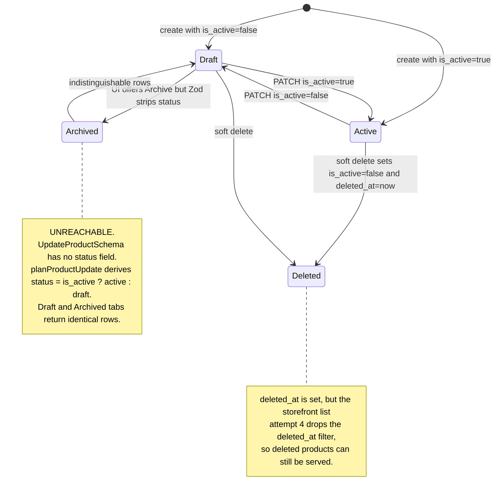

# 06 — CATALOG, PRODUCTS, COLLECTIONS

| Field | Value |
|---|---|
| Run ID | `docs/merchant-system-discovery/2026-08-04T225330+0530-ee371182` |
| Branch | `stepup/main` |
| Commit | `ee371182` |
| Run date | 2026-08-04 (+0530) |
| Scope | Merchant-facing catalog: products, variants/options, product media, publish/archive lifecycle, manual collections, smart collections, categories, tags, metafields, CSV import/export, catalog search/filter/sort, SEO handles, and the storefront propagation path for all of the above. Inventory quantities, locations, transfers, POs and gift cards are **out of scope** (agents D and B). |
| Evidence basis | Static source, migration DDL, generated tenant registry, `wrangler.toml` config, test sources — plus **one** module-level runtime reproduction. |
| **METHOD DISCLOSURE** | **Nothing in this document was verified end-to-end at runtime.** No HTTP request was issued against any gateway, no database was queried, no app was built or booted. The single runtime evidence in this domain is a scratch-harness execution of the real `createTenantGuardedSupabaseClient` + the real generated tenant registry against a synthetic chainable query builder (MCP-DISC-200). Every other status is therefore capped at `IMPLEMENTED_NOT_RUNTIME_VERIFIED`, and every `BROKEN` status is a static proof, not an observed failure. |
| Secrets | No secrets or PII appear in this document. |

---

## 1. Recommendation / verdict

**Do not ship the catalog. It is not merely incomplete — the primary merchant write path and the primary shopper read path are both statically proven broken, and the test suite cannot detect either.**

Four things must be understood by the founder before any launch conversation:

1. **A merchant cannot open, edit, delete, bulk-update, or finish creating a product.** Every by-`id` query against `products`, `collections`, `smart_collections` and `media_assets` is rejected before execution by the fail-closed tenant guard installed in `services/api-gateway/src/lib/supabase.ts:13-19`. This is not a theory: the real guard module was executed and it rejects the exact query shapes the routes issue (MCP-DISC-200). Product *create* fails too, because the create path calls `refreshProductVariantJsonbCache` (`services/api-gateway/src/execution/product-execution.adapter.ts:155` → `:581-584`), which is a `.update().eq('id', …)`.
2. **The shopper-side catalog is broken in two independent ways.** The product detail endpoint selects seven columns that do not exist in the canonical migrations and then swallows the PostgREST error into a 404 (MCP-DISC-201). The product list endpoint degrades through a four-attempt cascade whose final, always-successful attempt drops **both** `is_active = true` and `deleted_at IS NULL` — meaning draft and soft-deleted products get published to shoppers (MCP-DISC-202).
3. **The catalog violates the money invariant.** Catalog prices are `numeric(10,2)` rupee floats end-to-end — DB, Zod schema, UI `parseFloat`, adapter `Number()` — not `bigint` minor units. Order and ledger money is `*_minor bigint`. Every read of `products.price` into checkout therefore crosses a representation boundary, and merchant-entered `₹10.999` is silently rounded (MCP-DISC-203). This is a constitutional deviation (ART-10 / R-5) and its remediation is a **data migration of every existing price**, i.e. partially irreversible. It needs an ARB decision, not an engineering ticket.
4. **The green test suite is not evidence.** Every catalog "end-to-end" test in the repository is `readFileSync` + `assert.match` over source text. `services/api-gateway/src/__tests__/products.test.ts:37` asserts that `.from('products') … .eq('id', productId)` **exists** — it actively pins as the contract the exact pattern the tenant guard rejects (MCP-DISC-208). CI cannot catch a single defect in this document.

Beyond those four, the catalog also has: **zero per-site uniqueness** on SKU, barcode, slug or `url_handle` (MCP-DISC-204); **no storefront cache invalidation on any catalog mutation** — the only caller of `bumpStorefrontCacheVersion` in the entire repository is theme publish (MCP-DISC-205); a **487-line Categories UI and a 287-line gateway route over `product_categories`, a table that exists in no migration** (MCP-DISC-206); a `products.site_id` column that the tenant registry declares as *the* tenant column and that **no writer ever populates** (MCP-DISC-212); a 606-line smart-collections UI that **no shopper can ever see** (MCP-DISC-211); and a CSV import that **cannot carry SKU, barcode, or HSN** — the GST-critical field — and always creates, never upserts (MCP-DISC-207).

Recommended sequencing (no code in this document, approach only):

| Order | Work | Owner | Why first |
|---|---|---|---|
| 0 | Resolve **U-1** — get read-only staging DB access and diff the live `products` schema against `000_baseline.sql` | lead engineer + founder | Gates the severity of MCP-DISC-201/202/206 and explains the repo-wide "missing column" defensive fallbacks |
| 1 | MCP-DISC-200 (tenant guard) | lead engineer + security | Nothing else in the catalog can be tested until product CRUD executes |
| 2 | MCP-DISC-202, MCP-DISC-201 | lead engineer + security | Shopper-visible; 202 leaks unpublished products |
| 3 | MCP-DISC-208 (executable tests) | lead engineer | Without this, 1 and 2 regress silently |
| 4 | MCP-DISC-203 (money type) — **ARB decision, then migration plan** | ARB + founder + lead engineer | Cost grows with every product row created |
| 5 | MCP-DISC-204 (uniqueness), MCP-DISC-205 (cache), MCP-DISC-206 (categories decision) | lead engineer + ARB + founder | Data-integrity and merchant-trust blockers |

---

## 2. Scope

**In scope.** `apps/merchant-control-plane/src/app/[store]/products/**`, `.../categories/**`, `.../export/**`; the same-origin proxies under `apps/merchant-control-plane/src/app/api/stores/[store]/`; gateway routes `products.ts`, `categories.ts`, `smart-collections.ts`, `media.ts`, `metafields.ts`, `upload.ts`, `export.ts`, `resource-search.ts`, and the catalog portions of `storefront.ts` and `storefront/public-routes.ts`; `services/api-gateway/src/execution/product-execution.adapter.ts`; catalog planning/validation in `packages/commerce-core/src/index.ts`; catalog DDL, indexes, constraints and RLS in `database/supabase/migrations/`.

**Out of scope (owned elsewhere).** Inventory levels, locations, transfers, suppliers, purchase orders, receipts, reservations (agent D). Gift cards (agent B). Checkout consumption of catalog prices (agent E) — noted here only where the money-type boundary is crossed. Theme rendering of catalog data (theme agent). `services/queue-workers` was **not read** by the discovery agent; any catalog side-effect implemented there is unassessed (blocker B-3).

**Constitutional check performed.** `services/media-service`, `services/search-service`, `services/checkout-runtime`, `services/event-bus`, `services/notification-service`, `services/analytics-pipeline` each contain only `AGENTS.md` + `runtime.manifest.json`. **No reserved-runtime violation.** [PROVIDER_OR_CONFIG_EVIDENCE]

---

## 3. Current merchant user journeys — what a merchant can actually do today

Read this section as: *what happens when a real merchant clicks the button*, given the static evidence. No journey below was executed.

| Journey | What the merchant sees | What actually happens | Status |
|---|---|---|---|
| **Add a product** | Full 1300-line form: title, description, price, compare price, cost, SKU, barcode, images, tags, SEO, variant matrix | Proxy resolves the owned store and injects `store_id` server-side (correct). Gateway validates, checks staff permission + ownership + plan quota, inserts `products`, writes `product_options` and `product_variants`, sets inventory via RPC — then calls `refreshProductVariantJsonbCache`, a `.update().eq('id', …)` on a registered tenant table, which the guard **rejects with a thrown rejection**. The `await` throws, so no route `if (error)` branch runs and the handler 500s. A partially-created product is left behind. | **BROKEN** |
| **Open / edit a product** | Product row → edit form | `getOwnedProduct` does `.select('id, store_id, price').eq('id', productId)` with no tenant predicate → guard rejection → 500 before ownership is even evaluated | **BROKEN** |
| **List products** | Grid of products, tabs All/Active/Draft/Archived, a search box, a sort control | UI hard-codes `limit=100`, never sends `search`, never sends `page`, never uses the cursor. Search and sort are `Array.filter` / `Array.sort` over the ≤100 loaded rows. There is no pagination control in the file. A merchant with 101 products cannot see, search or reach product 101. | **BROKEN at scale** |
| **Publish / unpublish** | Toggle in the row menu | Works in intent: `is_active` survives Zod, `status` is derived from it | **PARTIAL** |
| **Archive a product** | An "Archive" action and an "Archived" tab | `UpdateProductSchema` has no `status` field, so Zod strips it. Archive and Draft both write `is_active=false, status='draft'`. The proxy folds `draft\|inactive\|archived` into `inactive` and the gateway enum is `active\|inactive\|all`. **The Draft and Archived tabs return identical rows.** | **BROKEN** |
| **Bulk publish 20 products** | Select rows → bulk action | The UI does **not** call the bulk endpoint; it issues N sequential PATCHes and counts failures client-side. Each PATCH is broken by the guard anyway. A partial bulk shows only a warning toast. | **BROKEN** (and PARTIAL by design) |
| **Duplicate a product** | — | No UI, no client method, no gateway route | **NOT_IMPLEMENTED** |
| **Upload product images** | Append-only image strip | Multipart upload through the worker to R2 under a tenant-scoped key; public unsigned URL returned. **No alt text field, no reorder, no primary-image selector.** The media-library row write is `.catch(() => null)` — a silent failure leaves an orphan R2 object. `products.thumbnail_url` is never written. | **PARTIAL** |
| **Enter an HSN code** | — | There is **no HSN input anywhere in the merchant UI** (`grep -rni "hsn" apps/merchant-control-plane/src` → one keyword string in a settings-search index). The schema and DB accept it; the merchant cannot supply it. | **NOT_IMPLEMENTED** (UI) — **[HIGH-STAKES]** GST |
| **Create a manual collection and add products** | Collections page with a product picker | Create works. The picker fetches `?limit=200`; `ListProductsQuery.limit` is `.max(100)` → **400 Bad Request** → the picker cannot load the catalog. Editing or deleting a collection hits the guard. | **BROKEN** |
| **Create a smart collection** | 606-line rules builder with live preview | Preview evaluates in memory over ≤500 products. Nothing materialises the result into `collection_products`. **No storefront route reads `smart_collections` at all.** There is no delete handler. | **UI_ONLY** |
| **Manage categories** | 487-line CRUD UI | GET returns `[]` (missing-table swallowed). POST returns **503 `CATEGORIES_SCHEMA_MISSING`**. DELETE issues `products.update({category_id:null}).eq('category_id', …)` — a column that does not exist, on a registered tenant table, without a tenant predicate → unhandled throw. | **NOT_IMPLEMENTED** (data) |
| **Import a product CSV** | Upload → "queued" | Only `name, price, description, category, stock, tags, images` are parsed. Always `createProduct`, never upsert — **a re-import duplicates the catalog**. Every row calls the broken variant-cache refresh. The UI never polls the job; no proxy for `/v1/export/jobs/:id` exists. Cap 500 rows, processed sequentially in `waitUntil`. | **BROKEN** |
| **Export a product CSV** | Download button | The merchant gets a **browser-built CSV of the first 100 products**. A correct server-side job pipeline with R2 streaming and HMAC-signed download exists in the gateway and is **unreachable** — no merchant proxy for `/v1/export/*`. Neither header set includes HSN. | **PARTIAL / CONTRADICTORY** |
| **Define custom fields (metafields)** | Settings → Custom data shows a `BackendNeededPane` reading *"No metafields, metaobjects, or custom-data gateway route was found in current services/packages."* | A **501-line, 8-handler metafields gateway route exists** over `store_metafield_definitions` / `store_metafield_values`, with `owner_type` covering `product`, `variant`, `collection`. The shipped UI asserts a falsehood. | **BACKEND_ONLY + CONTRADICTORY_EVIDENCE** |
| **See a change reflected on the storefront** | — | Nothing. No catalog mutation bumps the storefront cache version and no `revalidateTag` call exists anywhere in the repository. Propagation is 60 s TTL + 300 s stale-while-revalidate, with no manual refresh control. | **NOT_IMPLEMENTED** |

---

## 4. Feature matrix

Status ceiling reminder: **no row below is `VERIFIED_E2E`.** `BROKEN` rows are statically proven (plus, for the guard, one module-level runtime reproduction).

| # | Capability | Status | Primary evidence (path:line) | Evidence type | Gap ID |
|---|---|---|---|---|---|
| 1 | Create product | BROKEN | `services/api-gateway/src/execution/product-execution.adapter.ts:155,581-584` | SERVICE_CODE + RUNTIME_OBSERVATION | MCP-DISC-200 |
| 2 | Read one product (merchant) | BROKEN | `services/api-gateway/src/routes/products.ts:1074-1081` | GATEWAY_CODE | MCP-DISC-200 |
| 3 | Edit product | BROKEN | `services/api-gateway/src/execution/product-execution.adapter.ts:329-343` | SERVICE_CODE | MCP-DISC-200 |
| 4 | Soft-delete product | BROKEN | `services/api-gateway/src/execution/product-execution.adapter.ts:229-243` | SERVICE_CODE | MCP-DISC-200 |
| 5 | Bulk activate/deactivate/delete (gateway) | BROKEN | `services/api-gateway/src/execution/product-execution.adapter.ts:259-263` | SERVICE_CODE | MCP-DISC-200 |
| 6 | Bulk from the merchant UI | PARTIAL | `apps/merchant-control-plane/src/app/[store]/products/page.tsx:161-192` | UI_CODE | MCP-DISC-221 |
| 7 | List products (gateway capability) | IMPLEMENTED_NOT_RUNTIME_VERIFIED | `services/api-gateway/src/routes/products.ts:440-532` | GATEWAY_CODE | — |
| 8 | List products (merchant UI, >100) | BROKEN | `apps/merchant-control-plane/src/app/[store]/products/page.tsx:100-105,194-210` | UI_CODE | MCP-DISC-209 |
| 9 | Server-side search / filter / sort | BACKEND_ONLY | `services/api-gateway/src/routes/products.ts:475-478` vs UI above | GATEWAY_CODE + UI_CODE | MCP-DISC-209 |
| 10 | Duplicate product | NOT_IMPLEMENTED | no route, no client method, no UI | UI_CODE | MCP-DISC-223 |
| 11 | Variant / option matrix | PARTIAL | `services/api-gateway/src/execution/product-execution.adapter.ts:384-507` | SERVICE_CODE | MCP-DISC-217 |
| 12 | Variant barcode / weight / weight_unit / image_url (write) | NOT_IMPLEMENTED | `services/api-gateway/src/execution/product-execution.adapter.ts:590-609` | SERVICE_CODE | MCP-DISC-217 |
| 13 | Media upload to R2 | IMPLEMENTED_NOT_RUNTIME_VERIFIED | `services/api-gateway/src/routes/upload.ts:119-225` | GATEWAY_CODE | — |
| 14 | Media library row creation | PARTIAL (best-effort) | `apps/merchant-control-plane/src/app/api/stores/[store]/upload/route.ts:32-40` | PROXY_CODE | MCP-DISC-218 |
| 15 | Image alt text | NOT_IMPLEMENTED | `apps/merchant-control-plane/src/app/[store]/products/new/page.tsx:465-516` | UI_CODE | MCP-DISC-218 |
| 16 | Image ordering / primary image | NOT_IMPLEMENTED | same | UI_CODE | MCP-DISC-218 |
| 17 | Signed direct-to-R2 upload | BACKEND_ONLY | `services/api-gateway/src/routes/media.ts:44-86` (form does not use it) | GATEWAY_CODE | MCP-DISC-218 |
| 18 | Publish / unpublish | PARTIAL | `packages/commerce-core/src/index.ts:1190-1192` | SERVICE_CODE | MCP-DISC-214 |
| 19 | Archive | BROKEN | `packages/commerce-core/src/index.ts:64-97,1190-1192`; `apps/merchant-control-plane/src/app/api/stores/[store]/products/route.ts:6-10` | SERVICE_CODE + PROXY_CODE | MCP-DISC-214 |
| 20 | Optimistic concurrency (`version`) | PARTIAL (facade) | `packages/commerce-core/src/index.ts:96,603-633,1179-1208` | SERVICE_CODE | MCP-DISC-215 |
| 21 | Collections — create | PARTIAL | `services/api-gateway/src/routes/products.ts:625-675` | GATEWAY_CODE | — |
| 22 | Collections — edit / delete | BROKEN | `services/api-gateway/src/routes/products.ts:689-697,722-730,945-953` | GATEWAY_CODE | MCP-DISC-200 |
| 23 | Collections — product picker | BROKEN | `apps/merchant-control-plane/src/app/[store]/products/collections/page.tsx:217` vs `packages/commerce-core/src/index.ts:105` | UI_CODE + SERVICE_CODE | MCP-DISC-210 |
| 24 | Collections — assignment write (tenant validation) | IMPLEMENTED_NOT_RUNTIME_VERIFIED | `services/api-gateway/src/routes/products.ts:874-898` | GATEWAY_CODE | — |
| 25 | Collections — storefront SEO handle | NOT_IMPLEMENTED | `database/supabase/migrations/000_baseline.sql:8733-8747` (no slug column) | DB_SCHEMA | MCP-DISC-204 |
| 26 | Collections >100 products on storefront | PARTIAL (silent truncation) | `services/api-gateway/src/routes/storefront/public-routes.ts:974` | GATEWAY_CODE | MCP-DISC-224 |
| 27 | Smart collections — preview | IMPLEMENTED_NOT_RUNTIME_VERIFIED | `services/api-gateway/src/routes/smart-collections.ts:220-251` | GATEWAY_CODE | — |
| 28 | Smart collections — materialisation | NOT_IMPLEMENTED | no writer to `collection_products` | GATEWAY_CODE | MCP-DISC-211 |
| 29 | Smart collections — storefront exposure | NOT_IMPLEMENTED | no storefront route reads `smart_collections` | GATEWAY_CODE | MCP-DISC-211 |
| 30 | Smart collections — delete | NOT_IMPLEMENTED | no `router.delete` in `smart-collections.ts` | GATEWAY_CODE | MCP-DISC-211 |
| 31 | Smart collections — edit | BROKEN | `services/api-gateway/src/routes/smart-collections.ts:160-165` | GATEWAY_CODE | MCP-DISC-200 |
| 32 | Categories (data layer) | NOT_IMPLEMENTED | `product_categories` absent from every migration | DB_SCHEMA | MCP-DISC-206 |
| 33 | Categories (UI) | UI_ONLY | `apps/merchant-control-plane/src/app/[store]/categories/page.tsx` (487 lines) | UI_CODE | MCP-DISC-206 |
| 34 | Categories (gateway delete) | BROKEN | `services/api-gateway/src/routes/categories.ts:243-246` | GATEWAY_CODE | MCP-DISC-206 |
| 35 | Tags — store & edit | PARTIAL | `packages/commerce-core/src/index.ts:36` | SERVICE_CODE | — |
| 36 | Tags — query / merchandise | NOT_IMPLEMENTED | `ListProductsQuery` has no `tag` param (`packages/commerce-core/src/index.ts:99-110`) | SERVICE_CODE | — |
| 37 | Metafields (backend) | BACKEND_ONLY | `services/api-gateway/src/routes/metafields.ts` (501 lines) | GATEWAY_CODE | MCP-DISC-220 |
| 38 | Metafields (merchant proxy + UI) | NOT_IMPLEMENTED | no `api/stores/[store]/metafields*` route | PROXY_CODE | MCP-DISC-220 |
| 39 | CSV import | BROKEN | `services/api-gateway/src/routes/export.ts:604-646` | GATEWAY_CODE | MCP-DISC-207 |
| 40 | CSV import — HSN / SKU / barcode / variants | NOT_IMPLEMENTED | `services/api-gateway/src/routes/export.ts:608-614` | GATEWAY_CODE | MCP-DISC-207 |
| 41 | CSV export (merchant path) | PARTIAL | `apps/merchant-control-plane/src/app/[store]/export/page.tsx:151,83-91` | UI_CODE | MCP-DISC-219 |
| 42 | CSV export (gateway job pipeline) | IMPLEMENTED_NOT_RUNTIME_VERIFIED, unreachable | `services/api-gateway/src/routes/export.ts:83,686-704` | GATEWAY_CODE | MCP-DISC-219 |
| 43 | SEO title / description → storefront | IMPLEMENTED_NOT_RUNTIME_VERIFIED | `apps/storefront-runtime/src/app/.../product/[productId]/page.tsx:23-24` | UI_CODE | — |
| 44 | SEO handle → storefront URL | NOT_IMPLEMENTED | canonical path is `/product/${product.id}` (UUID) | UI_CODE | MCP-DISC-216 |
| 45 | Slug generation for non-Latin names | BROKEN | `packages/commerce-core/src/index.ts:787-794` | SERVICE_CODE | MCP-DISC-216 |
| 46 | Per-site uniqueness (SKU / barcode / slug / handle) | NOT_IMPLEMENTED | full index sweep, §6.3 | DB_SCHEMA | MCP-DISC-204 |
| 47 | Storefront cache invalidation on catalog change | NOT_IMPLEMENTED | `services/api-gateway/src/lib/storefront-cache.ts:83`; only caller `services/api-gateway/src/routes/themes.ts:154` | GATEWAY_CODE | MCP-DISC-205 |
| 48 | Storefront product detail | BROKEN | `services/api-gateway/src/routes/storefront/public-routes.ts:31-33,843-849` | GATEWAY_CODE | MCP-DISC-201 |
| 49 | Storefront product list visibility filters | BROKEN | `services/api-gateway/src/routes/storefront.ts:1064-1101` | GATEWAY_CODE | MCP-DISC-202 |
| 50 | Catalog money in minor units | CONTRADICTORY_EVIDENCE (deviation) | `database/supabase/migrations/000_baseline.sql:10588`; `packages/shared-types/src/index.ts:52-55` | DB_SCHEMA + SERVICE_CODE | MCP-DISC-203 |
| 51 | `products.site_id` populated | BROKEN (latent) | `packages/commerce-core/src/index.ts:1141-1175` (no `site_id`) | SERVICE_CODE | MCP-DISC-212 |
| 52 | `products` RLS FORCE | PARTIAL | `database/supabase/migrations/164_d4_tenant_role_guc.sql:88,111` (children only) | RLS_POLICY | MCP-DISC-213 |
| 53 | Pagination on catalog list endpoints | PARTIAL | §7.4 — 6 unpaginated endpoints | GATEWAY_CODE | MCP-DISC-222 |
| 54 | Catalog test coverage | STUB_OR_MOCK | `services/api-gateway/src/__tests__/products.test.ts:11-45` | UNIT_TEST | MCP-DISC-208 |
| 55 | Reserved `services/media-service` empty | IMPLEMENTED_NOT_RUNTIME_VERIFIED (compliant) | manifest-only | PROVIDER_OR_CONFIG_EVIDENCE | — |

---

## 5. UI / route inventory

### 5.1 Merchant pages — `apps/merchant-control-plane/src/app/[store]/`

| Page | File | Lines | Note |
|---|---|---|---|
| Product list | `products/page.tsx` | 443 | client component; `limit=100` fixed; no pagination control |
| Product create | `products/new/page.tsx` | 1300 | also serves edit |
| Product edit | `products/[productId]/page.tsx` | 1 | `export { default } from '../new/page'` |
| Collections | `products/collections/page.tsx` | 555 | manual assignment; picker requests `limit=200` |
| Smart collections | `products/smart-collections/page.tsx` | 606 | preview only |
| Categories | `categories/page.tsx` | 487 | backing table does not exist |
| Export / Import | `export/page.tsx` | 480 | client-side CSV export; never polls the import job |
| Custom data (metafields) | `settings/custom-data/page.tsx` | — | renders `BackendNeededPane` asserting a false absence |

### 5.2 Merchant same-origin proxies — `apps/merchant-control-plane/src/app/api/stores/[store]/`

`products/route.ts`, `products/[productId]/route.ts`, `products/import/route.ts`, `collections/route.ts`, `collections/[collectionId]/route.ts`, `collections/[collectionId]/products/route.ts`, `smart-collections/route.ts`, `smart-collections/[id]/route.ts`, `smart-collections/[id]/preview/route.ts`, `categories/route.ts`, `categories/[categoryId]/route.ts`, `media/route.ts`, `media/[mediaId]/route.ts`, `upload/route.ts`, `themes/media-library/route.ts`.

**Missing proxies:** none for `/v1/export/*` job endpoints (so the job pipeline and job polling are unreachable — MCP-DISC-219, MCP-DISC-207) and none for `/v1/metafields/*` (MCP-DISC-220).

**Proxy tenant hygiene — correct where present:**
- `products/route.ts:64` overwrites any client `store_id` with `resolved.storeId`.
- `products/import/route.ts:18-19` injects the resolved store.
- `upload/route.ts:23-24` forces `folder = {storeId}/products` and the resolved `store_id`.

**Proxy tenant gap:** `products/[productId]/route.ts:31-45` (PATCH) applies **no store scoping at the proxy**, unlike the GET at `:21`. Intent is that the gateway proves ownership inside `getOwnedProduct` — which is the call that MCP-DISC-200 breaks.

### 5.3 Gateway routes — `services/api-gateway/src/routes/`

| File | Lines | Catalog surface |
|---|---|---|
| `products.ts` | 1242 | products CRUD, bulk, barcode lookup, collections CRUD + assignment, sample product |
| `categories.ts` | 287 | `product_categories` CRUD — table absent |
| `smart-collections.ts` | 272 | list / create / patch / preview (no delete, no materialisation) |
| `media.ts` | 472 | media library + signed R2 upload intent |
| `metafields.ts` | 501 | definitions + values CRUD |
| `upload.ts` | 277 | multipart upload through the worker to R2 |
| `export.ts` | 835 | products/orders/customers CSV export jobs + `POST /export/import-products` |
| `resource-search.ts` | 323 | typed picker search (caps at 50) |
| `storefront/public-routes.ts` | — | public products / PDP / collection detail / categories |
| `storefront.ts` | — | `queryPublicProducts` cascade + variant hydration |

Execution layer: `services/api-gateway/src/execution/product-execution.adapter.ts` (664 lines). Domain planning/validation: `packages/commerce-core/src/index.ts`.

---

## 6. Backend / API / RPC / database mapping

### 6.1 Catalog tables present in `database/supabase/migrations/`

| Table | DDL | Tenant column(s) | In tenant registry? |
|---|---|---|---|
| `products` | `000_baseline.sql:10583` | `store_id` (FK `sites.id`), `site_id` (FK, **never written**) | YES — `tenant-tables.registry.ts:1737-1746`, `tenantColumn: "site_id"`, `scopeColumns: ["site_id","store_id"]` |
| `product_variants` | `000_baseline.sql:10512` | via `product_id` only | **NO** (unguarded) |
| `product_options` | `000_baseline.sql:10472` | via `product_id` only | **NO** (unguarded) |
| `collections` | `000_baseline.sql:8733` | `store_id` | YES — `:546`, `scopeColumns: ["store_id"]` |
| `collection_products` | `000_baseline.sql:8721` | none (via `collection_id`) | **NO** (unguarded) |
| `smart_collections` | `000_baseline.sql:12165` | `store_id` | YES — `:2445` |
| `media` / `media_assets` | baseline + `154_executable_analytics_media_ai_seam.sql` | `store_id` / `site_id` | YES — `:1219`, `:1230` (different tenant columns — see U-7) |
| `store_metafield_definitions`, `store_metafield_values` | `138_mobile_store_metafields.sql:4,43` | store-scoped | — |
| `product_categories` | **DOES NOT EXIST** | — | — |

### 6.2 `products` DDL — verified columns (re-read from source for this document)

`database/supabase/migrations/000_baseline.sql:10583-10627` defines exactly:
`id, store_id, name, description, price, compare_price, images, thumbnail_url, category, tags, variants, stock, track_inventory, allow_backorder, is_active, is_featured, display_order, created_at, updated_at, slug, cost_price, sku, barcode, seo_title, seo_description, status, site_id, product_type, vendor, url_handle, cost_per_item, charge_tax, sell_when_oos, is_physical, weight, weight_unit, country_of_origin, hs_code, deleted_at, created_by, updated_by, version, hsn_code` plus `CONSTRAINT products_hsn_code_format_check CHECK (hsn_code IS NULL OR hsn_code ~ '^\d{4,8}$')`.

Subsequent alterations add only `metadata` (`157_product_metadata.sql:4,15`).

**Columns the code selects that this DDL does not define:** `short_description`, `compare_at_price`, `category_id`, `brand`, `featured_image`, `inventory_quantity`, `dimensions` (`storefront/public-routes.ts:31-32`) and `currency`, `quantity`, `stock_quantity`, `avg_rating`, `review_count` (`storefront.ts:352-355`). This is the root of MCP-DISC-201 and MCP-DISC-202 and is subject to the U-1 caveat.

Note also that both `hs_code` and `hsn_code` exist. `planProductCreate` writes `hsn_code: input.hsn_code || input.hs_code || null` (`packages/commerce-core/src/index.ts:1163`) — the DB is ready for GST classification; the UI and the CSV contract are not.

### 6.3 Uniqueness — proven absent (re-verified for this document)

Full sweep of `database/supabase/migrations/*.sql`. Everything that exists on `products`:

```
000_baseline.sql:14826  products_pkey PRIMARY KEY (id)
000_baseline.sql:22220  products_site_id_fkey  FOREIGN KEY (store_id) REFERENCES sites(id) ON DELETE CASCADE
000_baseline.sql:22228  products_site_id_fkey1 FOREIGN KEY (site_id)  REFERENCES sites(id) ON DELETE CASCADE
000_baseline.sql:18067  idx_products_active     btree (site_id) WHERE deleted_at IS NULL        -- non-unique, and site_id is always NULL
000_baseline.sql:18074  idx_products_store      btree (store_id)                                -- non-unique
000_baseline.sql:18081  idx_products_store_hsn  btree (store_id, hsn_code) WHERE hsn_code IS NOT NULL  -- non-unique
084_trigram_search_indexes.sql:7  gin (name gin_trgm_ops)
157_product_metadata.sql:23       gin (metadata) WHERE deleted_at IS NULL
```

`CREATE UNIQUE INDEX … products` → **zero matches across all migrations.** On `product_variants`: only `idx_product_variants_product_id` (`000_baseline.sql:18032`), non-unique.

| Field | Unique per site? | Unique globally? | Any constraint? |
|---|---|---|---|
| `products.sku` | **NO** | NO | **NONE** |
| `products.barcode` | **NO** | NO | **NONE** |
| `products.slug` | **NO** | NO | **NONE** |
| `products.url_handle` | **NO** | NO | **NONE** |
| `product_variants.sku` | **NO** | NO | **NONE** |
| `product_variants.barcode` | **NO** | NO | **NONE** |
| `collections` handle | n/a — **no slug column at all** | — | — |
| `collection_products` | — | — | `UNIQUE (collection_id, product_id)` `000_baseline.sql:13675` |
| `smart_collections.slug` | **YES** | — | `smart_collections_store_id_slug_key UNIQUE (store_id, slug)` `000_baseline.sql:15800` — the only correct one in the catalog |

Downstream harm, proven in code:

| Consumer | Failure mode on duplicate |
|---|---|
| `storefront/public-routes.ts:837-849` | `.or('slug.eq.X,id.eq.X').single()` → duplicate slug makes `.single()` fail → PDP 404 |
| `products.ts:242-266` `loadProductByBarcode` | `.maybeSingle()` on `(store_id, barcode)` → duplicate → PGRST116 → `null` → "Product not found" on a valid scan |
| `products.ts:387-401` `loadExistingSampleProduct` | same shape on `(store_id, sku)` |
| `products.ts:268-308` `loadVariantProductByBarcode` | queries `product_variants` by barcode **with no store filter at all** (`.eq('barcode', barcode).limit(20)`), then filters by store in JS — cross-tenant rows are read into the worker before being discarded |

### 6.4 Money representation — the catalog boundary — **[HIGH-STAKES]**

| Layer | Representation | Evidence |
|---|---|---|
| Zod | `z.number().min(0).max(99_999_999.99)` — no `.int()`, no minor-unit contract, accepts `10.999` | `packages/shared-types/src/index.ts:52-55` |
| DB — products | `price numeric(10,2)`, `compare_price numeric(10,2)`, `cost_price numeric(10,2)`, `cost_per_item numeric(10,2)` | `database/supabase/migrations/000_baseline.sql:10588,10604,10606+` |
| DB — variants | `price numeric(10,2)`, `compare_price numeric(10,2)` | `000_baseline.sql:10512+` |
| UI | `parseFloat(price) \|\| 0` | `apps/merchant-control-plane/src/app/[store]/products/new/page.tsx:600,628` |
| Adapter | `numericValue()` → plain JS float `Number(...)` | `services/api-gateway/src/execution/product-execution.adapter.ts:75-82` |
| CSV import | `parseFloat(row[priceIdx]) \|\| 0` | `services/api-gateway/src/routes/export.ts:626` |
| Compare-price rule | float comparison `compare_price > price` | `packages/commerce-core/src/index.ts:59-62` |
| Variant change detection | float equality inside `variantWriteChanged` | `services/api-gateway/src/execution/product-execution.adapter.ts:102-113` |

Contrast: orders, payments, refunds, payouts and gift cards use `*_minor bigint` and mutate only through `SECURITY DEFINER` RPCs. **The catalog price therefore has a different type from the ledger money it feeds.** See MCP-DISC-203.

### 6.5 RPCs used on the catalog path

The catalog itself performs **direct table writes**, not RPCs — which is correct, because catalog rows are not money-ledger rows. The only RPCs touched are inventory ones invoked during product create: `set_inventory_level_available` / `set_inventory_levels_available_batch` (`product-execution.adapter.ts:633,651`). No catalog write goes through the canonical money RPCs, and none should — `products.price` is a **quote**, not a ledger entry. This is the one place where the money invariant is satisfied in spirit even though the type is wrong.

---

## 7. End-to-end traces

Legend: each hop is `path:line`. `MISSING` = the link does not exist. `BROKEN` = the link exists and is proven non-functional.

### 7.1 CREATE PRODUCT

| Hop | Evidence | Verdict |
|---|---|---|
| Merchant entry point | `apps/merchant-control-plane/src/app/[store]/products/new/page.tsx:596-640` (`price: parseFloat(price) \|\| 0` at :600) | present |
| Page / route | `/[store]/products/new` | present |
| App proxy | `apps/merchant-control-plane/src/app/api/stores/[store]/products/route.ts:51-71`; `resolveOwnedStoreId` :57; `store_id: resolved.storeId` injected server-side :64 | **correct** — client `store_id` is overridden |
| Typed client | `packages/typescript/api-client/src/index.ts:4784-4785` → `POST /products` | present |
| `/v1` gateway route | `services/api-gateway/src/routes/products.ts:1103-1127` | present |
| Auth issuer | merchant ES256 session (identity-platform) | present |
| AuthZ | `assertStaffPermission(c, body.store_id, customUser.id, 'products:write')` `products.ts:1113` | present |
| Ownership | `assertStoreOwnership` → `verifySiteOwnership` `product-execution.adapter.ts:140,325` | present |
| Quota | `assertProductQuota` `:141` / `:345-363` (plan `limits.products`) | present |
| Validation / server-authoritative computation | `validate('json', CreateProductSchema)` → `packages/commerce-core/src/index.ts:23-62`; `planProductCreate` `:1132-1177` | present (float money — MCP-DISC-203) |
| DB write — products | `.from('products').insert(createPlan.productInsert)` `product-execution.adapter.ts:145-149` — **scoped** because the insert payload carries `store_id` | OK |
| DB write — options | `replaceProductOptions` `:384-399` (`product_options` unguarded) | OK |
| DB write — variants | `replaceProductVariants` `:401-507` (`product_variants` unguarded) | OK — but drops `barcode/weight/weight_unit/image_url` (MCP-DISC-217) |
| Inventory RPC | `set_inventory_level_available` `:633` | OK |
| **Variant JSONB cache** | `refreshProductVariantJsonbCache` `:155` → `:581-584` `.from('products').update({variants}).eq('id', productId)` | **BROKEN** — guard rejection (MCP-DISC-200) |
| Usage meter | `recordProductUsage` `:365-382` | unreached |
| Event | `emitProductEvent` `products.ts:1118-1124` | unreached |
| RLS | policies exist but the gateway connects as `service_role` with `USING (true)` → no DB-level isolation (§8) | ineffective |
| Storefront consequence | **MISSING** — no cache-version bump, no `revalidateTag` (MCP-DISC-205) | MISSING |
| Tests | `services/api-gateway/src/__tests__/products.test.ts:19-31` — regex over source only | STUB_OR_MOCK |
| Runtime observation | **MISSING** — no credentials, production forbidden | MISSING |

**Status: BROKEN.** The failing hop is unconditional on every create.

### 7.2 EDIT PRODUCT

| Hop | Evidence | Verdict |
|---|---|---|
| Entry | same form (`products/[productId]/page.tsx:1` re-exports `new/page`) | present |
| App proxy | `products/[productId]/route.ts:31-45` (PATCH) — **no store scoping at the proxy**, unlike GET `:21` | weak but intentional |
| Typed client | `api-client/src/index.ts:4788-4789` → `PATCH /products/:id` | present |
| Gateway | `products.ts:1130-1154`; staff permission on `auth.user.storeId` `:1141` | present |
| Ownership | `getOwnedProduct` `product-execution.adapter.ts:329-343` — `.select('id, store_id, price').eq('id', productId).is('deleted_at', null).maybeSingle()` | **BROKEN** (MCP-DISC-200) |
| Field allowlist | `PRODUCT_UPDATE_FIELDS` `commerce-core/src/index.ts:603-633` | present |
| Optimistic concurrency | **MISSING** — `version` accepted at `:96`, absent from the allowlist, never compared; trigger `trg_products_version` (`000_baseline.sql:19561`) increments it and nothing reads it | MISSING (MCP-DISC-215) |
| Handle stability | `planProductUpdate:1186-1188` silently regenerates `url_handle` from the name on any rename | defect (MCP-DISC-216) |
| Storefront consequence | **MISSING** (MCP-DISC-205) | MISSING |
| Tests / runtime | regex only / none | STUB_OR_MOCK / MISSING |

**Status: BROKEN.**

### 7.3 STOREFRONT PRODUCT DETAIL (shopper consequence of publishing)

| Hop | Evidence | Verdict |
|---|---|---|
| Shopper entry | storefront PDP | present |
| Storefront app | `apps/storefront-runtime/src/lib/product-service.ts:66-80` | present |
| Typed client | `packages/typescript/api-client/src/index.ts:5422-5423` → `/storefront/{subdomain}/products/{slug}` | present |
| Gateway route | `services/api-gateway/src/routes/storefront/public-routes.ts:828-850` | present |
| Cache wrapper | `cachedJson(...)` 60 s TTL / 300 s SWR | present, never invalidated (MCP-DISC-205) |
| Select | `:845` `productVariantRelationalReadsEnabled(c.env) ? PRODUCT_SELECT_FULL_RELATIONAL : '*'`; the list at `:31-32` includes `short_description, compare_at_price, category_id, brand, featured_image, inventory_quantity, dimensions` | **BROKEN** — none of those columns exists in the migrations |
| Flag state | `PRODUCT_VARIANTS_RELATIONAL_READS = "on"` in all three environments (`services/api-gateway/wrangler.toml:51,142,268`); code default also `'on'` | the broken branch is the default |
| Error handling | `const { data } = await …` — the PostgREST `error` is destructured away; `:850` `if (!data) return 404` | **swallowed** |
| Fallback cascade | **MISSING** — contrast `storefront.ts:1064-1101`, which has one | MISSING |
| Uniqueness dependency | `.or('slug.eq.X,id.eq.X').single()` — duplicate slug also 404s (MCP-DISC-204) | fragile |
| Tests / runtime | none executable / none | MISSING |

**Status: BROKEN** (MCP-DISC-201), subject to U-1.

### 7.4 STOREFRONT PRODUCT LIST

The cascade at `services/api-gateway/src/routes/storefront.ts:1064-1101` (re-read verbatim for this document):

```
attempt 1  PRODUCT_SELECT_FULL(_RELATIONAL)    useDeletedAt: true   useActive: true   order display_order
attempt 2  PRODUCT_SELECT_COMPAT(_RELATIONAL)  useDeletedAt: true   useActive: true   order display_order
attempt 3  PRODUCT_SELECT_COMPAT(_RELATIONAL)  useDeletedAt: false  useActive: true   order display_order
attempt 4  PRODUCT_SELECT_MINIMAL              useDeletedAt: false  useActive: false  order created_at
…
if (attempt.useActive)    query = query.eq('is_active', true);    // :1076
if (attempt.useDeletedAt) query = query.is('deleted_at', null);   // :1077
…
if (!isSchemaMismatchError(result.error)) break;                  // :1100
```

- `PRODUCT_SELECT_FULL` `:353` requires `currency, quantity, stock_quantity, avg_rating, review_count`; `PRODUCT_SELECT_COMPAT` `:355` still requires `currency, quantity`. **None of those five columns exists on `products`** (§6.2).
- `PRODUCT_SELECT_MINIMAL` `:356` = `id, store_id, name, description, images, price, category, tags, created_at, updated_at, seo_title, seo_description` — **every one of those columns does exist**, so attempt 4 always succeeds.
- `isSchemaMismatchError` `:441-444` matches `does not exist`, so attempts 1-3 advance the loop instead of breaking it.
- **Therefore the served result is attempt 4, which applies neither `is_active = true` nor `deleted_at IS NULL`.** Draft and soft-deleted products are published to shoppers. Attempt 4 also drops `slug`, `compare_price`, `stock`, `is_featured`, `status`, `display_order`, `variants`.
- The pooled-SQL fast path `:689-738` uses the same broken column list and swallows failure with `.catch(() => null)` `:728`, so it always falls through to the cascade.
- If even attempt 4 fails with a schema mismatch, the function returns `{ data: [], count: 0, error: null }` — an empty catalog with **no error surfaced**.

**Status: BROKEN** (MCP-DISC-202), subject to U-1.

### 7.5 STOREFRONT PROPAGATION AFTER PUBLISH

| Layer | Mechanism | Invalidated on catalog change? |
|---|---|---|
| Cloudflare `caches.default` in the gateway | `services/api-gateway/src/lib/storefront-cache.ts:107-130` `cachedJson`, key versioned by KV `storefront-cache-version:<handle>` `:70-72`; header `public, max-age=60, stale-while-revalidate=300` `:12-13,24-26` | **NO** |
| `bumpStorefrontCacheVersion` | `storefront-cache.ts:83-90` | **one caller repository-wide**: `services/api-gateway/src/routes/themes.ts:154` (theme publish). Re-verified for this document: `products.ts`, `categories.ts`, `smart-collections.ts`, `export.ts` do not import the module. |
| `purgeStorefrontCache` | `storefront-cache.ts:132-136` | `themes.ts:155` only, and only for the literal version-`0` bootstrap key |
| Next.js data cache | `apps/storefront-runtime/src/lib/api/client.ts:24-30` declares tags (`storefront:{subdomain}:products`, `…:product:{id}`); TTL 60 s list / 30 s detail (`product-service.ts:9-10`) | tags are **inert** — `grep -rn "revalidateTag" services apps packages` returns **zero source hits** (only generated `.next/dev/types/cache-life.d.ts` re-exports) |

Cached catalog endpoints affected: `bootstrap` (`public-routes.ts:571`), `products` (`:763`), `products-by-ids` (`:797`), `product-detail` (`:823`), `collection-detail` (`:923`), `categories` (`:1005`).

**Status: NOT_IMPLEMENTED** (MCP-DISC-205). There is no manual "refresh storefront" control in the merchant UI either.

### 7.6 CSV IMPORT

| Hop | Evidence | Verdict |
|---|---|---|
| Entry | `apps/merchant-control-plane/src/app/[store]/export/page.tsx:290-345` | present |
| Proxy | `api/stores/[store]/products/import/route.ts:16-22` — injects `store_id` server-side | correct |
| Client | `api-client/src/index.ts:4822-4823` → `POST /export/import-products` | present |
| Gateway | `services/api-gateway/src/routes/export.ts:747-812`; ownership `verifySiteOwnership` `:767`; cap `PRODUCT_IMPORT_MAX_ROWS = 500` `:119`; CSV parked in R2 `:790`; job record in R2 `:793` | present |
| Processor | `processProductImport` `:596-646` — `c.executionCtx.waitUntil` `:810`, sequential per-row `createProduct` `:618-632` | present |
| Columns parsed | `name, price, description, category, stock, tags, images` (`:608-614`) | narrow |
| Columns NOT supported | `sku, barcode, hsn_code, compare_price, cost, weight, variants, options, url_handle, seo_title, seo_description, vendor, product_type, is_active` | **MISSING** |
| Upsert | **MISSING** — always `createProduct` `:618`; a re-import duplicates the catalog | MISSING |
| Dry run / per-row error report | **MISSING** | MISSING |
| Partial failure semantics | one throw marks the whole job failed; already-created rows remain (`:636-645`) | defect |
| Job status in UI | `export/page.tsx:326-337` reports "queued" and never polls; `GET /export/jobs/:id` exists (`export.ts:648`) but **no merchant proxy exists for it** | MISSING |
| Blocked by | every row calls the broken `refreshProductVariantJsonbCache` | **BROKEN** |

**Status: BROKEN** (MCP-DISC-207).

### 7.7 CATEGORIES

| Hop | Evidence | Verdict |
|---|---|---|
| Entry | `apps/merchant-control-plane/src/app/[store]/categories/page.tsx` (487 lines, full CRUD) | present |
| Proxy | `api/stores/[store]/categories/route.ts`, `.../[categoryId]/route.ts` | present |
| Gateway | `services/api-gateway/src/routes/categories.ts` — all five handlers target `public.product_categories` | present |
| **Table** | **DOES NOT EXIST.** Re-verified: `grep -rn "product_categories" database/` returns exactly one hit — `194_demo_requests.sql:45`, a `text[]` **column** on `demo_requests`, unrelated | **MISSING** |
| `products.category_id` | **DOES NOT EXIST** — `products` has only `category text` (§6.2). Yet `categories.ts:172-176` embeds `products(count)` (needs an FK that does not exist) and `:243-246` updates `products.category_id` | **MISSING** |
| GET behaviour | `isMissingTableError` → `c.json(success([]))` `:94-96` — silently empty | degraded |
| POST behaviour | 503 `CATEGORIES_SCHEMA_MISSING` `:144-152` — an explicit "not available in this local database schema" | honest failure |
| DELETE behaviour | `products.update({category_id:null}).eq('category_id', …)` `:243-246` — a registered tenant table with no tenant predicate → guard rejection → unhandled throw | **BROKEN** |
| Storefront | `storefront/public-routes.ts:1014` selects from `product_categories` with the error ignored → always `success([])` | permanently empty |

**Status: NOT_IMPLEMENTED (data) + UI_ONLY + BROKEN (gateway)** — MCP-DISC-206.

### 7.8 SMART COLLECTIONS

| Hop | Evidence | Verdict |
|---|---|---|
| Table | `smart_collections` `000_baseline.sql:12165-12179`; **`UNIQUE (store_id, slug)`** `:15800` | present, the only correct uniqueness in the catalog |
| Gateway | `smart-collections.ts` — `GET /` `:47`, `POST /` `:81`, `PATCH /:id` `:145`, `GET /:id/preview` `:220` | present |
| Ownership | `verifySiteOwnership` `:62,:103,:168,:240` | present |
| Tenant guard | `.eq('id', collectionId)` `:160-165,:205-210,:227-232` | **BROKEN** (MCP-DISC-200) |
| Delete | **MISSING** — no `router.delete` | MISSING |
| Evaluation | `filterProducts` over max 500 products `:22,:245-251`, in memory | capped |
| **Materialisation** | **MISSING** — nothing writes matched products into `collection_products` or any projection | MISSING |
| **Storefront exposure** | **MISSING** — no storefront route reads `smart_collections` | MISSING |

**Status: UI_ONLY.** A 606-line merchant surface that produces nothing a shopper can see (MCP-DISC-211).

### 7.9 Unpaginated catalog list endpoints (CODE-R4)

| Endpoint | Evidence |
|---|---|
| `GET /products/collections` | `services/api-gateway/src/routes/products.ts:583-622` — `.select('*')`, no limit |
| `GET /products/collections/:id/products` | `products.ts:745-825` — no limit on the assignment read |
| `GET /categories` | `categories.ts:63-110` — no limit |
| `GET /smart-collections` | `smart-collections.ts:47-78` — no limit |
| storefront collection assignment read | `storefront/public-routes.ts:960-968` — no limit |
| storefront categories | `storefront/public-routes.ts:1014` — no limit |

MCP-DISC-222.

---

## 8. State machine

Product lifecycle as the code actually implements it. The dashed transition is what the UI offers and the backend cannot represent.



Evidence: `packages/commerce-core/src/index.ts:64-97` (no `status` in `UpdateProductSchema`), `:1190-1192` (status derivation), `apps/merchant-control-plane/src/app/api/stores/[store]/products/route.ts:6-10` (`normalizeStatus` folds `draft|inactive|archived → inactive`), `packages/commerce-core/src/index.ts:101` (gateway enum `active|inactive|all`), `services/api-gateway/src/execution/product-execution.adapter.ts:229-243` (soft delete), `services/api-gateway/src/routes/storefront.ts:1068,1077` (attempt 4 drops `deleted_at`).

---

## 9. Auth / tenant / invariant analysis

### 9.1 Auth issuer

All merchant catalog routes sit behind the merchant **ES256** session issued by identity-platform. No catalog route touches the customer HS256 issuer. No step-up is required for catalog operations, and none should be — catalog is not a money mutation. **No issuer-crossing observed.**

### 9.2 Ownership model — application-level, no DB backstop

The pattern across the catalog: the client sends `store_id`, the handler calls `verifySiteOwnership(db, store_id, customUser.id, auth.user.storeId)` before acting. Verified at `products.ts:1113` (create), `:1167` (bulk), `:635` (collection create), `:545` (barcode), `:1015` (sample), `categories.ts:122`, `smart-collections.ts:103`, `export.ts:767`, `resource-search.ts:291`, `upload.ts:146`.

The merchant proxies overwrite the client-supplied value with the server-resolved store (`products/route.ts:64`, `import/route.ts:18-19`, `upload/route.ts:23-24`) — correct for the web app. **But the gateway is directly reachable by any holder of a merchant token**, so the effective control is `verifySiteOwnership` cross-checked against the session-bound `auth.user.storeId`. That is a real check, not a violation — but §9.4 shows there is no database-level backstop underneath it.

`PATCH /products/:id` receives no store scope at all: `products.ts:1141` passes `auth.user.storeId` to the staff-permission check, and the product's own `store_id` is only learned inside `getOwnedProduct`. Correct in intent; **entirely dependent on that one lookup, which MCP-DISC-200 breaks.**

### 9.3 The tenant guard — how it works and why it rejects the catalog

`services/api-gateway/src/lib/supabase.ts:13-19` wraps every handler's `db` in `createTenantGuardedSupabaseClient(createSupabaseServiceClient(env))`.

`services/api-gateway/src/tenant/tenant-scoped.ts:52-77` `markScopeFromCall` sets `scoped = true` **only** when:
- `eq` / `in` / `filter` names a column in the table's `scopeColumns`, or
- `match` carries such a key, or
- `or` contains such a column name, or
- `insert` / `upsert` payload contains such a key.

`update` and `delete` are **not** handled — they can only become scoped through a subsequent `.eq(scopeColumn, …)`. `id` is added to the allowed set for the `sites` table only (`:42-45`). If a query is still unscoped when awaited, the `then` trap at `:86-95` returns `Promise.reject(new Error('Tenant table … requires a tenant/owner predicate before execution'))`.

Because it is a **rejection**, `await` **throws**. The routes' `if (error)` branches never run. The handler 500s rather than returning a structured error.

`products` scopeColumns = `["site_id","store_id"]`; `collections` = `["store_id"]`; `smart_collections` present. `product_variants`, `product_options` and `collection_products` are **not in the registry** and are therefore unguarded — which is why the variant/option writes succeed while the parent-table cache refresh fails.

### 9.4 RLS — **[HIGH-STAKES]**

| Fact | Evidence |
|---|---|
| Tenant policies exist | `163_d2_live_data_leak_rls.sql:26-36` (`products_tenant_site_guc`, `service_role_products`); child tables via `EXISTS(products …)` `:38-88`; `app_tenant_*` role variants `164_d4_tenant_role_guc.sql:87-131` |
| Policies survive the NULL `site_id` only via COALESCE | `163_d2_live_data_leak_rls.sql:35` uses `COALESCE(site_id, store_id)` |
| `product_variants` and `product_options` are FORCEd | `164_d4_tenant_role_guc.sql:88,111` — re-verified for this document |
| **`products` is never FORCEd** | Re-verified: `grep "FORCE ROW LEVEL SECURITY" database/supabase/migrations/` matching product tables returns **only** `product_variants` and `product_options`. `products` has `ENABLE` only (`000_baseline.sql:25556`) |
| The gateway connects as `service_role` | `services/api-gateway/src/lib/supabase.ts:13-19` → `createSupabaseServiceClient` |
| For `service_role`, `service_role_products` is `USING (true) WITH CHECK (true)` | `163_d2_live_data_leak_rls.sql` |
| Legacy PUBLIC-scoped policies remain | `store_owner_products` `000_baseline.sql:27148` and `public_view_active_products` `:25838` have no `TO` clause, so they apply to PUBLIC |

**Conclusion: on the merchant path, RLS provides no isolation.** Isolation depends entirely on the JS tenant-guard proxy plus `verifySiteOwnership` in each handler. That is a single layer, in application code, with no database backstop. MCP-DISC-213.

### 9.5 Invariant summary

| Invariant | Catalog status | Gap |
|---|---|---|
| Money is `bigint` minor units | **VIOLATED** — `numeric(10,2)` rupee floats throughout | MCP-DISC-203 **[HIGH-STAKES]** |
| Money mutates only via `SECURITY DEFINER` RPCs | Not applicable and not violated — catalog prices are quotes, not ledger entries; only inventory RPCs are called | — |
| Server-authoritative amounts | Held for orders; catalog price is merchant-authored by design | — |
| `site_id` resolved on every merchant mutation | Held via `store_id` + `verifySiteOwnership`; but `site_id` itself is **never written** | MCP-DISC-212 **[HIGH-STAKES]** |
| RLS forced on tenant tables | **VIOLATED for `products`** (ENABLE without FORCE); PUBLIC-scoped legacy policies remain | MCP-DISC-213 **[HIGH-STAKES]** |
| No public `USING (true)` on tenant tables | `service_role_products` is `USING (true)` for the role the gateway actually uses | MCP-DISC-213 |
| App API routes are gateway proxies, never local DB writes | **Held** — every merchant proxy inspected forwards to `/v1` | — |
| Reserved services stay manifest-only | **Held** — `media-service`, `search-service` et al. are empty | — |
| GST fields captured | **VIOLATED in practice** — HSN has DB support and zero UI/CSV support | MCP-DISC-207 **[HIGH-STAKES]** |

---

## 10. Runtime and test evidence

### 10.1 What was runtime-verified — exactly one thing

The discovery agent imported the **real** `createTenantGuardedSupabaseClient` and the **real** generated `tenant-tables.registry.ts` into a scratch harness and drove it with a chainable thenable standing in for a PostgREST builder. Recorded result [RUNTIME_OBSERVATION]:

```
FAIL products GET /:id   .select().eq('id').is().single()      -> Tenant table products requires a tenant/owner predicate before execution
FAIL products update     .update().eq('id').select().single()  -> Tenant table products requires ...
OK   products list       .select().in('store_id', [...])
OK   products insert     .insert({store_id})
FAIL collections         .select().eq('id')                    -> Tenant table collections requires ...
FAIL collections         .update().eq('id')                    -> Tenant table collections requires ...
OK   product_variants    .select().eq('product_id')            (not in registry — unguarded)
OK   collection_products .delete().eq('collection_id')         (not in registry — unguarded)
FAIL media_assets        .select().eq('id')                    -> Tenant table media_assets requires ...
```

This is a **module-level** reproduction against a synthetic builder, not a live HTTP request against a live Postgres. It proves the guard's behaviour on the exact query shapes the routes issue; it does not prove the resulting HTTP status code observed by a merchant.

### 10.2 What was NOT verified — be explicit

| Not verified | Consequence |
|---|---|
| No HTTP request against any gateway route | No catalog capability can be `VERIFIED_E2E` |
| No database connection (local, staging or production) | The migration set is the only schema evidence — see U-1 |
| No app build (`pnpm --filter … build` was not run) | Compile-level breakage in the merchant app is unassessed |
| No storefront page load | PDP/list behaviour is inferred from route code only |
| `pnpm validate:governance` deliberately **not run** | The orchestrator deletes `node_modules`/`dist`/`.next` before validating (proven finding G-L-01); running it would destroy the user's environment |
| `services/queue-workers` not read | Any catalog side-effect implemented there is unassessed (blocker B-3) |

### 10.3 Test integrity — the suite cannot detect any of this

Re-read for this document:

| Test file | What it actually does |
|---|---|
| `services/api-gateway/src/__tests__/products.test.ts:11-45` | `readFileSync` + `assert.match` over route and adapter **source text**. At `:37` it asserts `/\.from\('products'\)\s*[\s\S]*\.eq\('id',\s*productId\)/` — **it pins as the contract the exact pattern the tenant guard rejects** |
| `tests/launch/lb6-collections.test.mjs:1-40` | `readFileSync` + `assert.match`, despite the file comment "collections end-to-end structural tests" |
| `tests/launch/lb5-variants.test.mjs:1-30` | same shape |
| `services/api-gateway/src/__tests__/sample-products.test.ts` (45 lines) | same shape |
| `services/api-gateway/src/__tests__/production-schema-drift-resilience.test.ts` (45 lines) | same shape |
| `tests/governance/foundation-wave2-tenant.test.ts:58-90` | **executes** the guard, but only against a synthetic `.select('*').eq(scopeColumn, …)` shape — never a real route's query shape, so the regression is invisible |

**A green catalog test run is not evidence that the catalog works.** MCP-DISC-208.

---

## 11. Implemented vs missing

### Implemented and structurally sound (still not runtime-verified)

- Merchant proxies inject the server-resolved `store_id` and override any client value (`products/route.ts:64`, `import/route.ts:18-19`, `upload/route.ts:23-24`).
- Gateway list endpoint for products supports cursor + offset pagination, `withCount`, `search` via trigram-backed `ilike`, category filter, status filter and a sort enum (`products.ts:440-532`; index `084_trigram_search_indexes.sql:7`).
- Collection assignment validates that **every** product ID belongs to the store before writing (`products.ts:874-898`) and caps the batch at 500.
- Upload path enforces MIME allow-listing with SVG rejected (`upload.ts:151`), size caps (10 MB / 100 MB video / 50 MB model, `:9-11`), a tenant-scoped object key (`:168`) and fails closed in production without an R2 binding (`:171-173`).
- Plan-quota enforcement on product creation (`product-execution.adapter.ts:141,345-363`) and usage metering (`:365-382`).
- Variant identity-keyed diff behind a feature flag (`:401-507`, `variantIdentityKey` `:89-100`).
- Server-side CSV export job pipeline with 1000-row batching, R2 streaming, HMAC-signed download tokens and a 7-day TTL (`export.ts:118,126,656-704`) — correct, and unreachable.
- Metafields backend: 8 handlers over store-scoped tables with `owner_type` covering product/variant/collection (`metafields.ts`).
- `smart_collections` has the one correct per-site uniqueness constraint in the catalog (`000_baseline.sql:15800`).
- Reserved service directories remain manifest-only — constitutionally compliant.

### Missing outright

Duplicate product · image alt text · image reordering / primary-image selection · `products.thumbnail_url` writes · variant barcode/weight/weight_unit/image writes · optimistic-concurrency enforcement · a real `archived` state · collection slugs (no column) · smart-collection delete · smart-collection materialisation · smart-collection storefront exposure · the `product_categories` table · `products.category_id` · a metafields proxy and product-level metafield UI · an HSN input field · CSV upsert · CSV dry-run and per-row error reporting · import job polling and its proxy · `/v1/export/*` merchant proxies · per-site uniqueness on SKU/barcode/slug/handle · storefront cache invalidation on catalog mutation · `revalidateTag` anywhere · server-side pagination in the merchant product list · pagination on six list endpoints · executable catalog tests.

---

## 12. Gap IDs

Allocated from block **MCP-DISC-200 … MCP-DISC-229**. 25 gaps allocated (200-224); 225-229 unused. Lowest number = most severe.

---

### MCP-DISC-200 — Tenant guard rejects every by-id catalog query; product read/edit/delete/bulk and create-finalise all fail — **[HIGH-STAKES]**

- **Domain:** catalog core / tenancy
- **Status:** BROKEN
- **Severity:** P0 · **Likelihood:** HIGH · **Reversibility:** reversible (code-only) · **Confidence:** HIGH
- **User / business impact:** A merchant cannot open, edit, delete, bulk-update, or successfully finish creating a product. Every CSV import row fails. Collections and smart collections cannot be edited or deleted. This is the entire catalog write path.
- **Evidence:**
  - `services/api-gateway/src/lib/supabase.ts:13-19` — every handler's `db` is `createTenantGuardedSupabaseClient(createSupabaseServiceClient(env))`.
  - `services/api-gateway/src/tenant/tenant-scoped.ts:52-77` — `markScopeFromCall` marks a query scoped only for `eq`/`in`/`filter`/`match`/`or`/`insert`/`upsert` referencing a `scopeColumns` member; `update` is not handled; `id` is allowed only for `sites` (`:42-45`).
  - `services/api-gateway/src/tenant/tenant-scoped.ts:86-95` — unscoped queries return a **rejected promise**, so `await` throws and the routes' `if (error)` branches never run.
  - `services/api-gateway/src/tenant/tenant-tables.registry.ts:1737-1746` (`products`, scopeColumns `["site_id","store_id"]`), `:546` (`collections`), `:2445` (`smart_collections`).
  - Offending call sites, all lacking a tenant predicate: `services/api-gateway/src/routes/products.ts:1074-1081` (`GET /products/:id`), `:689-697`, `:722-730`, `:945-953` (collections load/update/soft-delete); `services/api-gateway/src/execution/product-execution.adapter.ts:330-335` (`getOwnedProduct` → PATCH + DELETE), `:259-263` (`bulkAction` `.in('id', …)`), `:180-185` (`updateProduct`), `:581-584` (`refreshProductVariantJsonbCache`, reached unconditionally from the create path at `:155`); `services/api-gateway/src/routes/smart-collections.ts:160-165, 205-210, 227-232`; `services/api-gateway/src/routes/categories.ts:243-246`.
  - [RUNTIME_OBSERVATION] §10.1 — the real guard module rejects these exact shapes.
- **Expected behavior:** a by-id read or write on a registered tenant table resolves the tenant first and filters on both `id` and the tenant column, or the guard accepts a two-step ownership pattern through an explicit, auditable helper.
- **Root cause:** commit `49741343 feat(foundation): enforce wave 2 tenant isolation` introduced the fail-closed guard; `products.ts` and `product-execution.adapter.ts` were never adapted. The only guard test (`tests/governance/foundation-wave2-tenant.test.ts:58-76`) exercises a synthetic `.select('*').eq(scopeColumn, …)` shape, so the regression is invisible to CI.
- **Blast radius:** all product CRUD, all collections, all smart collections, category delete, CSV import, sample-product seeding, media-asset by-id reads. **Very likely the same pattern exists in other domains** (orders, customers, coupons) — flagged to the commander; outside this document's scope.
- **Invariant tag:** [HIGH-STAKES] (tenancy)
- **Dependencies:** none. This is the root blocker for MCP-DISC-207, MCP-DISC-210, MCP-DISC-221 and any executable test of the catalog.
- **Remediation approach:** carry the resolved owning `store_id` into every by-id query (resolve ownership first, then filter by both `id` and `store_id`), **or** extend the guard so a `.eq('id', …)` on a registered table is accepted only after an explicit, auditable ownership helper has run and recorded the resolved tenant on the request. Do not weaken the guard globally, and do not special-case tables one at a time.
- **Acceptance criteria:** `GET/PATCH/DELETE /v1/products/:id`, `POST /v1/products`, `POST /v1/products/bulk`, `PATCH/DELETE /v1/products/collections/:id` and `PATCH /v1/smart-collections/:id` all succeed for the owner and return 404/403 for a non-owner, **executed against a real Postgres instance** with the guard installed.
- **Required tests:** executable integration tests running each route handler against a live Postgres/PostgREST with the guard installed, plus a cross-tenant negative case per route. A guard test that asserts the *real* route query shapes, not a synthetic one.
- **Required owner:** lead engineer + security

---

### MCP-DISC-201 — Storefront product-detail endpoint selects columns that do not exist and swallows the error into a 404 — **[HIGH-STAKES]**

- **Domain:** catalog → storefront
- **Status:** BROKEN
- **Severity:** P0 · **Likelihood:** HIGH · **Reversibility:** reversible · **Confidence:** MEDIUM-HIGH (see caveat)
- **User / business impact:** Shoppers cannot open any product page. The storefront PDP returns 404 for every product. Zero conversion.
- **Evidence:**
  - `services/api-gateway/src/routes/storefront/public-routes.ts:31-32` — `PRODUCT_SELECT_FULL` includes `short_description, compare_at_price, category_id, brand, featured_image, inventory_quantity, dimensions`; `:33` derives `PRODUCT_SELECT_FULL_RELATIONAL`.
  - None of those seven columns exists on `products` — verified against `database/supabase/migrations/000_baseline.sql:10583-10627` and the only subsequent alteration `157_product_metadata.sql:4,15` (which adds `metadata` alone). Re-verified for this document.
  - `services/api-gateway/src/routes/storefront/public-routes.ts:843-850` — `const { data } = await db.from('products').select(…).eq('store_id', store.id).or(…).eq('is_active', true).single();` then `if (!data) return 404`. **The PostgREST error is destructured away.**
  - The branch is on by default in all three environments: `services/api-gateway/wrangler.toml:51,142,268` set `PRODUCT_VARIANTS_RELATIONAL_READS = "on"`; the in-code default (`storefront.ts:429`, `products.ts:153-155`) is also `'on'`. When the flag is off, the select is `'*'` and works — so the *default* configuration is the broken one.
  - Consumer chain: `apps/storefront-runtime/src/lib/product-service.ts:66-80` → `packages/typescript/api-client/src/index.ts:5422-5423` → `/storefront/{subdomain}/products/{slug}`.
  - Contrast: `services/api-gateway/src/routes/storefront.ts:352-359` defines a **different** `PRODUCT_SELECT_FULL` for the same table (also with non-existent columns) but guards it with a 4-attempt cascade at `:1064-1101`. The PDP has no cascade.
- **Expected behavior:** the PDP selects columns the canonical schema defines and returns 200 with the product; a genuine database error surfaces as a 5xx with a logged cause, never a silent 404.
- **Missing link / root cause:** no column-fallback cascade and no error handling on the PDP route; two divergent hard-coded column lists for one table.
- **Confidence caveat (U-1):** the deployed database could not be queried (production forbidden, no credentials). If the live schema has drifted **ahead** of the migrations and these columns exist there, the endpoint works in production and the repository's migration set is instead wrong. Either way this is a defect. **UNKNOWN which.**
- **Blast radius:** every product detail page on every storefront; any consumer of `/storefront/{subdomain}/products/{slug}`.
- **Invariant tag:** [HIGH-STAKES] (revenue path)
- **Dependencies:** resolution of U-1 determines whether this is a production outage or a repo-hygiene defect.
- **Remediation approach:** make the PDP select the columns the canonical schema actually defines (reuse the vetted `storefront.ts` cascade or a single verified list), surface the PostgREST error instead of swallowing it, and add a schema-conformance validator that asserts every hard-coded `select(...)` column list against the migration DDL.
- **Acceptance criteria:** `GET /v1/storefront/{handle}/products/{slug}` returns 200 with the product for a published store, executed against real Postgres; a synthetic missing-column case returns 5xx with a logged error, never a silent 404.
- **Required tests:** executable PDP integration test; a `select`-column-vs-DDL conformance validator run in CI.
- **Required owner:** lead engineer

---

### MCP-DISC-202 — Storefront product list degrades to a select that drops the `is_active` and `deleted_at` filters, publishing draft and deleted products — **[HIGH-STAKES]**

- **Domain:** catalog → storefront
- **Status:** BROKEN
- **Severity:** P0 · **Likelihood:** HIGH · **Reversibility:** reversible · **Confidence:** MEDIUM-HIGH (same U-1 caveat)
- **User / business impact:** Unpublished draft products and soft-deleted products are served to shoppers. A merchant who unpublishes a product — for a pricing error, a legal takedown, an out-of-stock line — has no guarantee it disappears. This is a merchant-trust and potentially a compliance failure.
- **Evidence:**
  - `services/api-gateway/src/routes/storefront.ts:1064-1101` — four-attempt cascade; `:1076` applies `is_active` only when `attempt.useActive`; `:1077` applies `deleted_at IS NULL` only when `attempt.useDeletedAt`; attempt 4 (`:1068`) sets **both to false**.
  - `:353` `PRODUCT_SELECT_FULL` requires `currency, quantity, stock_quantity, avg_rating, review_count`; `:355` `PRODUCT_SELECT_COMPAT` still requires `currency, quantity`. **None of those five columns exists on `products`** (§6.2).
  - `:356` `PRODUCT_SELECT_MINIMAL` = `id, store_id, name, description, images, price, category, tags, created_at, updated_at, seo_title, seo_description` — every column exists, so attempt 4 **always succeeds**.
  - `:441-444` `isSchemaMismatchError` matches `does not exist`; `:1100` `if (!isSchemaMismatchError(result.error)) break;` — so attempts 1-3 advance the loop rather than aborting.
  - `:689-738` the pooled-SQL fast path uses the same broken column list and swallows failure with `.catch(() => null)` `:728`, so it always falls through to the cascade.
  - Attempt 4 also drops `slug`, `compare_price`, `stock`, `is_featured`, `status`, `display_order`, `variants` from the payload.
  - If even attempt 4 fails on schema mismatch, the function returns `{ data: [], count: 0, error: null }` — an empty catalog with no error surfaced.
- **Expected behavior:** a degraded select may relax **columns**; it must never relax a **security or visibility predicate**. Unpublished and deleted products are never served.
- **Missing link / root cause:** column availability and row filters are coupled in one attempt descriptor, so column-driven degradation silently removes visibility filters.
- **Blast radius:** every storefront product listing, collection listing that reuses `queryPublicProducts`, and any theme section rendering products.
- **Invariant tag:** [HIGH-STAKES] (publication control)
- **Dependencies:** U-1.
- **Remediation approach:** split the cascade so column availability and row filters are independent; make `is_active = true` and `deleted_at IS NULL` unconditional on every attempt; fail closed (return an error) rather than publishing unfiltered rows; remove the silent empty-list return.
- **Acceptance criteria:** a draft product and a soft-deleted product are absent from `GET /v1/storefront/{handle}/products` under **every** attempt branch, proven by an executable test that forces each branch.
- **Required tests:** executable integration test that forces each cascade attempt; a negative test asserting a draft product never appears.
- **Required owner:** lead engineer + security

---

### MCP-DISC-203 — Catalog money is float rupees, contradicting the bigint-paise invariant — **[HIGH-STAKES]**

- **Domain:** money representation
- **Status:** CONTRADICTORY_EVIDENCE (implemented as a documented-invariant deviation; not runtime-verified)
- **Severity:** P1 · **Likelihood:** HIGH · **Reversibility:** **partially irreversible** (requires a data migration of every existing price) · **Confidence:** HIGH
- **User / business impact:** A merchant entering `₹10.999` has it silently rounded. Prices above `₹99,999,999.99` are rejected by schema. Float equality drives `variantWriteChanged`, producing spurious or missed variant updates. Most importantly, **the catalog price type differs from the order/ledger money type**, so every read of `products.price` into checkout crosses a representation boundary where rounding decisions become invisible and untested.
- **Evidence:** §6.4 in full. Key lines: `packages/shared-types/src/index.ts:52-55` (`MoneySchema` — no `.int()`); `database/supabase/migrations/000_baseline.sql:10588` and `:10512+` (`numeric(10,2)` on both products and variants); `apps/merchant-control-plane/src/app/[store]/products/new/page.tsx:600,628` (`parseFloat`); `services/api-gateway/src/execution/product-execution.adapter.ts:75-82` (`numericValue` → JS float) and `:102-113` (float compare); `services/api-gateway/src/routes/export.ts:626` (`parseFloat`); `packages/commerce-core/src/index.ts:59-62` (float `compare_price > price`).
- **Expected behavior:** per ART-10 / R-5, money is `bigint` minor units (paise) everywhere it is stored or compared.
- **Missing link / root cause:** the catalog predates or was excluded from the minor-unit ratchet; no validator asserts the invariant on catalog columns.
- **Blast radius:** every product and variant row; checkout price reads; CSV import/export; the compare-price rule; variant diffing; any future reconciliation between catalog price and order line price.
- **Invariant tag:** [HIGH-STAKES] [IRREVERSIBLE] (a type migration over live price data cannot be trivially undone)
- **Dependencies:** ARB ruling on whether catalog price is in scope for the minor-unit invariant. Interacts with checkout (agent E) — that document must state which representation checkout consumes.
- **Remediation approach:** **ARB decision first.** If catalog price is in scope: introduce `*_minor bigint` columns alongside the existing numeric columns, dual-write, backfill under review, cut reads over, then drop the numeric columns — **never an in-place type change on live money data**. If out of scope: document the exception explicitly and define the single conversion boundary between catalog and ledger, with a test asserting rounding behaviour at that boundary. In either case, at minimum constrain `MoneySchema` to two decimal places immediately so silent rounding stops. **Do not** write to any money table directly as part of any remediation — money mutates only via `SECURITY DEFINER` RPCs; note that `products` is not a money-ledger table, so this constraint governs the *order/ledger* side of any reconciliation work, not the catalog columns themselves.
- **Acceptance criteria:** an explicit ARB record stating whether catalog price is minor-unit-bound; a validator enforcing whichever answer is chosen; a test proving that a price entered with three decimals is either rejected or deterministically rounded at a single documented boundary.
- **Required tests:** schema/validator test on the money type; a boundary test for catalog→order price conversion; a migration dry-run test if the minor-unit path is chosen.
- **Required owner:** ARB + founder + lead engineer

---

### MCP-DISC-204 — No per-site uniqueness on SKU, barcode, slug or url_handle — **[HIGH-STAKES]**

- **Domain:** catalog data integrity
- **Status:** NOT_IMPLEMENTED
- **Severity:** P1 · **Likelihood:** HIGH · **Reversibility:** reversible, but requires a data-reconciliation migration first · **Confidence:** HIGH
- **User / business impact:** Duplicate SKUs and barcodes can exist inside one store. Barcode scanning returns "Product not found" for a duplicated barcode. Duplicate slugs make the storefront PDP 404 for one of the two products. Two products can own the same public URL. Inventory and fulfilment identity break down at scale.
- **Evidence:** §6.3 — full index and constraint sweep, re-verified for this document (`CREATE UNIQUE INDEX … products` → zero matches). Downstream failure modes proven at `services/api-gateway/src/routes/products.ts:242-266` (`loadProductByBarcode` `.maybeSingle()`), `:268-308` (`loadVariantProductByBarcode` — **no store filter at all**, `.eq('barcode', barcode).limit(20)`), `:387-401` (`loadExistingSampleProduct`), `services/api-gateway/src/routes/storefront/public-routes.ts:837-849` (`.or(slug/id).single()`).
- **Expected behavior:** SKU, barcode and public handle are unique within a site among non-deleted rows; a conflicting write returns a 409 the merchant can act on.
- **Missing link / root cause:** the baseline schema never defined them; `smart_collections` shows the correct pattern exists and was simply not applied to `products`.
- **Blast radius:** barcode scanning, sample-product seeding, storefront PDP resolution, CSV import (which currently duplicates freely — MCP-DISC-207), any future POS or fulfilment integration keyed on SKU. The cross-tenant read at `products.ts:268-308` is additionally a tenancy smell.
- **Invariant tag:** [HIGH-STAKES] (tenancy + data integrity)
- **Dependencies:** MCP-DISC-216 (empty slugs from non-Latin names would all collide the moment a unique index exists) must be fixed **before or with** this, or the index will fail to build.
- **Remediation approach:** add partial unique indexes scoped to the site and excluding soft-deleted rows — for example `(store_id, lower(sku)) WHERE sku IS NOT NULL AND deleted_at IS NULL`, likewise for `url_handle`/`slug` and `barcode`, plus `(product_id, sku)` and a site-scoped variant barcode index. **Reconcile existing duplicates in a prior migration; do not ship the index against unreconciled data.** Add a merchant-facing conflict error. Separately, add the missing store filter to `loadVariantProductByBarcode`.
- **Acceptance criteria:** a duplicate SKU/barcode/handle write returns 409 with an actionable message; the PDP resolves deterministically; barcode scan returns the product; the migration builds cleanly against a copy of live data.
- **Required tests:** migration test asserting the constraints; route tests asserting 409 on conflict; a barcode-scan test with a would-be duplicate.
- **Required owner:** lead engineer + ARB (schema change)

---

### MCP-DISC-205 — Storefront cache is never invalidated by any catalog mutation

- **Domain:** catalog → storefront propagation
- **Status:** NOT_IMPLEMENTED
- **Severity:** P1 · **Likelihood:** HIGH · **Reversibility:** reversible · **Confidence:** HIGH
- **User / business impact:** After a merchant publishes, edits, re-prices, unpublishes or deletes a product, the storefront keeps serving the old state for up to 60 s of TTL plus 300 s of stale-while-revalidate. A price correction or an urgent unpublish is not honoured immediately, and there is **no manual refresh control anywhere in the merchant UI**. Combined with MCP-DISC-202, an unpublished product can remain visible well beyond the cache window.
- **Evidence:**
  - `services/api-gateway/src/lib/storefront-cache.ts:12-13` (TTL 60 s, SWR 300 s), `:24-26` (`public, max-age=60, stale-while-revalidate=300`), `:83-90` (`bumpStorefrontCacheVersion` — the only invalidation primitive), `:132-136` (`purgeStorefrontCache`).
  - Re-verified for this document: `grep -rn "bumpStorefrontCacheVersion\|purgeStorefrontCache" services apps packages` returns the definitions plus **exactly one caller** — `services/api-gateway/src/routes/themes.ts:154-155` (theme publish), and the purge covers only the literal version-`0` bootstrap key.
  - `products.ts`, `categories.ts`, `smart-collections.ts`, `export.ts` do not import `lib/storefront-cache`.
  - Cached catalog endpoints: `services/api-gateway/src/routes/storefront/public-routes.ts:571, 763, 797, 823, 923, 1005`.
  - Next.js layer: `apps/storefront-runtime/src/lib/api/client.ts:24-30` declares cache tags; `product-service.ts:9-10` sets 60 s / 30 s. `grep -rn "revalidateTag" services apps packages` returns **zero source hits** (only generated `.next/dev/types/cache-life.d.ts` re-exports). **The tags are inert.**
- **Expected behavior:** a catalog mutation makes the change visible on the storefront within one subsequent request.
- **Missing link / root cause:** no publish-side hook; the invalidation primitive exists and was wired only for themes.
- **Blast radius:** all six cached catalog endpoints; every storefront page rendering catalog data.
- **Invariant tag:** none (but it materially amplifies MCP-DISC-202)
- **Dependencies:** none technically; MCP-DISC-200 must be fixed before it can be tested end-to-end.
- **Remediation approach:** bump the per-handle storefront cache version on every product / collection / smart-collection / category mutation (create, update, bulk, delete, import completion), and drive the Next.js layer from the same signal (tag revalidation or a version-carrying key). Prefer a **single publish-side hook in the product execution adapter** so no individual route can forget it.
- **Acceptance criteria:** a product publish is visible on the storefront within one request, verified by an executable test that mutates and then immediately reads the public endpoint.
- **Required tests:** executable mutate-then-read integration test per catalog entity type.
- **Required owner:** lead engineer

---

### MCP-DISC-206 — Categories: a full merchant UI and gateway route over a table that does not exist

- **Domain:** categories / merchandising taxonomy
- **Status:** NOT_IMPLEMENTED (data layer) + UI_ONLY + BROKEN (gateway)
- **Severity:** P1 · **Likelihood:** HIGH · **Reversibility:** reversible · **Confidence:** HIGH
- **User / business impact:** A merchant can navigate to Categories, fill in the form, and receive a 503. The category list is permanently empty. The storefront category grid is permanently empty. Deleting a category throws unhandled. Meanwhile `products.category` (free text) is the de-facto taxonomy and **has no management UI at all**.
- **Evidence:**
  - Re-verified: `grep -rn "product_categories" database/` returns exactly one hit — `database/supabase/migrations/194_demo_requests.sql:45`, a `text[]` **column** on `demo_requests`, unrelated.
  - `products` has only `category text`; there is no `category_id` (§6.2).
  - `services/api-gateway/src/routes/categories.ts:94-96` — GET swallows the missing table and returns `success([])`.
  - `:144-152` — POST returns 503 `CATEGORIES_SCHEMA_MISSING` with the message "Product categories are not available in this local database schema".
  - `:172-176` — embeds `products(count)`, requiring a foreign key that does not exist.
  - `:243-246` — `db.from('products').update({ category_id: null }).eq('category_id', categoryId)` — a non-existent column, on a registered tenant table, with no tenant predicate → guard rejection → unhandled throw.
  - `apps/merchant-control-plane/src/app/[store]/categories/page.tsx` — 487 lines of CRUD UI.
  - `services/api-gateway/src/routes/storefront/public-routes.ts:1014` — the storefront reads the same missing table with the error ignored.
- **Expected behavior:** either categories exist as a real, tenant-scoped, RLS-protected table with a `products` foreign key and a working UI — or the capability is not offered.
- **Missing link / root cause:** the migration for `product_categories` was never written (or was removed); the UI and gateway shipped anyway. The error message text ("this local database schema") suggests the authors believed it existed elsewhere — which is itself unresolved (U-1).
- **Blast radius:** the Categories page, the storefront category grid, the category filter on the product list, and any merchandising plan that assumes a hierarchy.
- **Invariant tag:** none (but creating the table requires ARB — new tenant table + RLS + registry regeneration)
- **Dependencies:** MCP-DISC-200 (the delete handler is also guard-broken); U-1 (does the table exist in a deployed environment?).
- **Remediation approach:** **founder decision.** Either (a) implement `product_categories` properly — migration, tenant column, RLS with FORCE, tenant-registry regeneration, `products.category_id` FK, backfill from `products.category` — or (b) delete the Categories UI and gateway route and make `products.category` plus collections the single merchandising taxonomy, giving `products.category` a real management UI. **Do not leave both.**
- **Acceptance criteria:** either the Categories page performs full CRUD against a real table with cross-tenant reads returning 404, proven against real Postgres — or the page, the proxy routes, the gateway route and the storefront read are removed and a governance note records the decision.
- **Required tests:** if implemented — migration test, RLS cross-tenant test, CRUD integration test. If removed — a validator asserting no route references `product_categories`.
- **Required owner:** founder (scope) + ARB (new tenant table) + lead engineer

---

### MCP-DISC-207 — CSV import cannot carry SKU, barcode, HSN, variants or SEO; no upsert, no result reporting — **[HIGH-STAKES]**

- **Domain:** bulk operations / GST
- **Status:** BROKEN
- **Severity:** P1 · **Likelihood:** HIGH · **Reversibility:** reversible · **Confidence:** HIGH
- **User / business impact:** The single realistic way to onboard an existing merchant's catalog is unusable. It cannot carry product identity (SKU, barcode), cannot carry variants, cannot carry SEO, and **cannot carry HSN — the GST classification code**. It always creates, so a corrected re-import duplicates the entire catalog. A merchant gets "queued" and never learns whether it worked. And every row currently fails on the tenant guard anyway.
- **Evidence:**
  - Columns parsed: `services/api-gateway/src/routes/export.ts:608-614` — `name, price, description, category, stock, tags, images` only. Re-verified verbatim for this document.
  - Always-create: `:618-632` calls `service.createProduct(...)` unconditionally; no lookup, no upsert.
  - Sequential processing inside `c.executionCtx.waitUntil` `:810`; row cap `PRODUCT_IMPORT_MAX_ROWS = 500` `:119`.
  - Partial failure: `:636-645` — one throw marks the whole job failed while already-created rows remain.
  - UI never polls: `apps/merchant-control-plane/src/app/[store]/export/page.tsx:326-337`; `GET /export/jobs/:id` exists (`export.ts:648`) but no merchant proxy for `/v1/export/*` exists.
  - **HSN specifically:** `products.hsn_code` is GST-critical — format CHECK at `database/supabase/migrations/000_baseline.sql` and index `idx_products_store_hsn` `:18081`. It is accepted by `CreateProductSchema` (`packages/commerce-core/src/index.ts:50`) and written by `planProductCreate` (`:1163`, `hsn_code: input.hsn_code || input.hs_code || null`). It is **importable by no CSV column, exportable by no CSV header** (`export.ts:83`), **and enterable in no merchant UI field** — re-verified: `grep -rni "hsn" apps/merchant-control-plane/src` returns exactly one hit, a keyword string in `components/settings/settings-navigation.ts:127`.
  - Blocked by MCP-DISC-200 on every row.
- **Expected behavior:** one canonical product CSV contract, symmetric between import and export, covering GST and identity fields; keyed upsert; a dry-run validation pass; a per-row error report; job status visible in the UI.
- **Missing link / root cause:** the import was written as a minimal demo path and never reconciled with the export header set or the GST requirements.
- **Blast radius:** merchant onboarding, catalog migration from another platform, GST invoice correctness for any product imported this way.
- **Invariant tag:** [HIGH-STAKES] (GST)
- **Dependencies:** MCP-DISC-200 (rows fail today); MCP-DISC-204 (upsert requires a unique key on `(store_id, sku)`); MCP-DISC-219 (export must share the contract).
- **Remediation approach:** define one canonical product CSV contract covering the GST and identity fields; make export and import use the same header set; key the import on `(store_id, sku)` for upsert **after** the unique index from MCP-DISC-204 exists; add a dry-run validation pass with a per-row error report; surface job status in the UI via a new `/v1/export/jobs/:id` proxy; move processing off the request worker if the row cap grows. Have a CA-tax reviewer confirm HSN field semantics and whether HSN should be mandatory per product.
- **Acceptance criteria:** a round trip — export a catalog, re-import the same file — produces zero duplicates and zero field loss, executed against real Postgres; a row with an invalid HSN is rejected with a row-level error, not a whole-job failure.
- **Required tests:** executable round-trip integration test; dry-run test; per-row error-report test; an HSN format-rejection test.
- **Required owner:** founder (contract) + lead engineer + CA-tax (HSN semantics)

---

### MCP-DISC-208 — Every catalog test is a regex match over source text, not executing code

- **Domain:** test integrity
- **Status:** STUB_OR_MOCK
- **Severity:** P1 · **Likelihood:** HIGH · **Reversibility:** reversible · **Confidence:** HIGH
- **User / business impact:** CI cannot catch a single defect in this document. Worse, the test suite **encodes the bug as the contract**: `services/api-gateway/src/__tests__/products.test.ts:37` asserts that `.from('products') … .eq('id', productId)` exists — the exact pattern MCP-DISC-200 proves the tenant guard rejects. Fixing the bug would make the test fail.
- **Evidence:** §10.3, re-verified for this document — `services/api-gateway/src/__tests__/products.test.ts:11-45` (`readFileSync` + `assert.match`); `tests/launch/lb6-collections.test.mjs:1-40` (header comment says "collections end-to-end structural tests", body is `read(path)` + `assert.match`); `tests/launch/lb5-variants.test.mjs:1-30`; `services/api-gateway/src/__tests__/sample-products.test.ts`; `services/api-gateway/src/__tests__/production-schema-drift-resilience.test.ts`; `tests/governance/foundation-wave2-tenant.test.ts:58-90` (executes the guard but only against a synthetic query shape).
- **Expected behavior:** behavioural claims are proven by executing code against a real database; source-shape assertions are labelled as architecture gates, not coverage.
- **Missing link / root cause:** the regex tests were adopted as a fast structural gate and then treated as behavioural coverage; nothing enforces the distinction.
- **Blast radius:** the entire catalog domain, plus any other domain using the same test style. This gap is the reason every other gap in this document survived.
- **Invariant tag:** none
- **Dependencies:** MCP-DISC-200 must be fixed for most catalog integration tests to pass at all.
- **Remediation approach:** add executable integration tests against a real Postgres — the repository already has `tests/executable/*-postgres.test.mjs` harnesses — for product CRUD, collection assignment, storefront PDP and list visibility, and CSV import. Keep the regex tests only as an architecture-shape gate, **clearly renamed** so they stop reading as behavioural coverage, and remove the assertions that pin known-broken query shapes.
- **Acceptance criteria:** each P0 gap in this document has an executable test that fails on the current commit and passes after the fix; no test file whose name or comment claims "end-to-end" is implemented with `readFileSync` + `assert.match`.
- **Required tests:** the above, plus a meta-check that flags `assert.match` over `readFileSync` in any file named `*e2e*` or commented "end-to-end".
- **Required owner:** lead engineer

---

### MCP-DISC-209 — Merchant product list is capped at 100 rows with client-side search and sort and no pagination

- **Domain:** catalog merchant UX
- **Status:** BROKEN (at scale)
- **Severity:** P1 · **Likelihood:** HIGH · **Reversibility:** reversible · **Confidence:** HIGH
- **User / business impact:** A merchant with more than 100 products cannot see, search, sort or edit products 101+. There is no indication that anything is missing. This makes the product a non-starter for any merchant with a real catalog.
- **Evidence:** `apps/merchant-control-plane/src/app/[store]/products/page.tsx:100-105` — hard-coded `limit: '100', sort: 'created_at', order: 'desc'`; **never sends `search`, never sends `page`, never uses `cursor`** (re-verified verbatim). `:194-205` — `Array.filter` search over the loaded rows. `:207-210` — `Array.sort`. No pagination control anywhere in the file. The gateway already supports all of it: `services/api-gateway/src/routes/products.ts:440-532` (cursor + offset + `search` ilike + sort enum), backed by the trigram index `database/supabase/migrations/084_trigram_search_indexes.sql:7`.
- **Expected behavior:** search, filter, sort and pagination execute on the server; the merchant can reach every product.
- **Missing link / root cause:** the UI was built against the capability but never wired to it.
- **Blast radius:** the primary merchant catalog screen; also the export path (MCP-DISC-219) which shares the 100-row read.
- **Invariant tag:** none
- **Dependencies:** MCP-DISC-200 for the row actions to work.
- **Remediation approach:** move search, sort and pagination to the server using the existing query params and cursor; add a pagination control; show total counts via `withCount`.
- **Acceptance criteria:** a store with 250 products lets the merchant reach, search and sort every one of them, proven by an executable test seeding 250 rows.
- **Required tests:** executable pagination/search integration test at >100 rows.
- **Required owner:** lead engineer

---

### MCP-DISC-210 — Collection product picker requests `limit=200`, which the gateway rejects with 400

- **Domain:** collections
- **Status:** BROKEN
- **Severity:** P1 · **Likelihood:** HIGH · **Reversibility:** reversible · **Confidence:** HIGH
- **User / business impact:** The "add products to collection" picker cannot load the catalog at all. Manual collections cannot be populated through the UI.
- **Evidence:** `apps/merchant-control-plane/src/app/[store]/products/collections/page.tsx:217` — `fetch('/api/stores/{store}/products?limit=200')` (re-verified verbatim) → the proxy forwards `limit` unchanged (`apps/merchant-control-plane/src/app/api/stores/[store]/products/route.ts:27`) → `ListProductsQuery.limit` is `z.coerce.number().int().min(1).max(100)` (`packages/commerce-core/src/index.ts:105`) → `services/api-gateway/src/middleware/validation.ts:58-60` returns 400.
- **Expected behavior:** the picker loads and searches the catalog within the API contract.
- **Missing link / root cause:** the UI limit was never reconciled with the schema max.
- **Blast radius:** manual collection management.
- **Invariant tag:** none
- **Dependencies:** none.
- **Remediation approach:** paginate the picker, or use `/v1/resource-search?type=product` which already exists for exactly this purpose (`services/api-gateway/src/routes/resource-search.ts:253`, caps at 50).
- **Acceptance criteria:** the picker loads products, supports search, and can assign a product from beyond the first page, proven by an executable test.
- **Required tests:** executable picker/assignment integration test.
- **Required owner:** lead engineer

---

### MCP-DISC-211 — Smart collections never materialise, are invisible to shoppers, and cannot be deleted

- **Domain:** merchandising
- **Status:** UI_ONLY
- **Severity:** P1 · **Likelihood:** HIGH · **Reversibility:** reversible · **Confidence:** HIGH
- **User / business impact:** A merchant spends real time building automated collection rules that produce **nothing a customer can ever see**. The feature is a preview calculator. It also cannot be deleted once created.
- **Evidence:** §7.8. `services/api-gateway/src/routes/smart-collections.ts` has `GET /` `:47`, `POST /` `:81`, `PATCH /:id` `:145`, `GET /:id/preview` `:220` — **no `router.delete`**. Nothing writes matched products into `collection_products` or any projection. No storefront route reads `smart_collections` (grep across `services/api-gateway/src/routes` and `apps/storefront-runtime/src` matches only the route file itself). Evaluation is capped at 500 products in memory (`:22, :245-251`). The merchant UI is 606 lines (`apps/merchant-control-plane/src/app/[store]/products/smart-collections/page.tsx`).
- **Expected behavior:** a smart collection resolves to a shopper-visible product set, kept current as the catalog changes, and can be deleted.
- **Missing link / root cause:** the materialisation projection and the storefront read were never built. **U-5:** `services/queue-workers` was not read — a materialiser could exist there; unassessed.
- **Blast radius:** the smart-collections page; any merchandising plan or theme section depending on automated collections.
- **Invariant tag:** none
- **Dependencies:** MCP-DISC-200 (edit is guard-broken); resolution of U-5.
- **Remediation approach:** **founder scope decision first** — is this a launch feature? If yes: define a materialisation projection (worker- or event-driven) writing into `collection_products` or a dedicated projection table, expose a storefront read path, add delete, and remove the 500-product in-memory cap. If no: hide the UI behind a flag and record the deferral. Do not leave a live UI over a dead capability.
- **Acceptance criteria:** a smart collection created in the merchant UI returns the correct product set from a public storefront endpoint within a defined freshness window; delete works; a store with >500 products evaluates correctly.
- **Required tests:** executable materialisation + storefront-read integration test; a >500-product evaluation test.
- **Required owner:** founder (scope) + lead engineer

---

### MCP-DISC-212 — `products.site_id` is the declared tenant column and is never populated — **[HIGH-STAKES]**

- **Domain:** tenancy
- **Status:** BROKEN (latent)
- **Severity:** P2 · **Likelihood:** MEDIUM · **Reversibility:** reversible with a backfill · **Confidence:** HIGH
- **User / business impact:** No visible impact today, because every RLS policy uses `COALESCE(site_id, store_id)` and every writer uses `store_id`. But the generated tenant registry declares `products.tenantColumn = "site_id"`, so any future use of `tenantScoped('products', …)` returns **zero rows**, and `idx_products_active btree (site_id) WHERE deleted_at IS NULL` is dead weight on an always-NULL column. This is a trap laid for the next engineer.
- **Evidence:**
  - `services/api-gateway/src/tenant/tenant-tables.registry.ts:1737-1746` — `"tenantColumn": "site_id"`, `"scopeColumns": ["site_id","store_id"]` (re-read for this document).
  - `services/api-gateway/src/tenant/tenant-scoped.ts:19` — `tenantScoped()` filters on `entry.tenantColumn`.
  - `packages/commerce-core/src/index.ts:1141-1175` — `planProductCreate` sets `store_id` only. Re-verified for this document: **`grep -n "site_id" packages/commerce-core/src/index.ts` returns nothing at all.**
  - `PRODUCT_UPDATE_FIELDS` `packages/commerce-core/src/index.ts:603-633` does not contain `site_id`.
  - The only `products` writers are the execution adapter (create/update/bulk/softDelete/cache); none sets `site_id`.
  - RLS survives only via `COALESCE(site_id, store_id)` — `database/supabase/migrations/163_d2_live_data_leak_rls.sql:35`.
  - Both FKs exist: `products_site_id_fkey (store_id)` and `products_site_id_fkey1 (site_id)` (`000_baseline.sql:22220,22228`) — note the confusingly named first constraint.
- **Expected behavior:** one tenant column for `products`, and the generator, registry, writers, indexes and RLS policies all agree on it.
- **Missing link / root cause:** an incomplete `store_id → site_id` rename; the registry generator reads the DDL and picked `site_id`, while the code kept writing `store_id`.
- **Blast radius:** any future `tenantScoped('products', …)` call; the `idx_products_active` index; RLS semantics if the COALESCE is ever simplified; the confusingly duplicated FK names.
- **Invariant tag:** [HIGH-STAKES] (tenancy)
- **Dependencies:** interacts with MCP-DISC-200 (both stem from registry/code divergence) and MCP-DISC-213.
- **Remediation approach:** pick one tenant column for `products` and make the generator, the registry, the writers, the indexes and the RLS policies agree. Backfill under ARB review; **do not change RLS semantics until the backfill is verified** on a copy of live data. Add a validator asserting that every registry `tenantColumn` is actually written by at least one code path.
- **Acceptance criteria:** `tenantScoped('products', siteId)` returns the store's products; no `products` row has a NULL tenant column; the validator passes.
- **Required tests:** backfill migration test; a registry-vs-writer conformance validator; an RLS test after the backfill.
- **Required owner:** ARB + lead engineer

---

### MCP-DISC-213 — `products` has RLS ENABLE but not FORCE, and retains PUBLIC-scoped legacy policies — **[HIGH-STAKES]**

- **Domain:** tenancy / RLS
- **Status:** PARTIAL
- **Severity:** P2 · **Likelihood:** MEDIUM · **Reversibility:** reversible · **Confidence:** HIGH
- **User / business impact:** There is **no database-level backstop for tenant isolation on `products`**. Isolation depends entirely on application code — the JS tenant guard plus `verifySiteOwnership`. Any code path that acquires a `service_role` client and forgets the guard reads every merchant's catalog.
- **Evidence:**
  - `database/supabase/migrations/000_baseline.sql:25556` — `products` has `ENABLE ROW LEVEL SECURITY` only.
  - Re-verified for this document: `grep -rn "FORCE ROW LEVEL SECURITY" database/supabase/migrations/` matching product tables returns **only** `164_d4_tenant_role_guc.sql:88` (`product_variants`) and `:111` (`product_options`). **`ALTER TABLE public.products FORCE ROW LEVEL SECURITY` appears nowhere.** The children are FORCEd; the parent is not.
  - The gateway connects as `service_role` (`services/api-gateway/src/lib/supabase.ts:13-19` → `createSupabaseServiceClient`), for which `service_role_products` is `USING (true) WITH CHECK (true)` (`163_d2_live_data_leak_rls.sql:26-36`).
  - Legacy PUBLIC-scoped policies survive with no `TO` clause: `store_owner_products` `000_baseline.sql:27148` and `public_view_active_products` `:25838`. The latter grants anon `SELECT` on every active product of every published site — intentional for storefront reads, but it is a PUBLIC-scoped policy on a tenant table and must be recorded as such.
- **Expected behavior:** RLS is forced on every tenant table; no policy is PUBLIC-scoped without an explicit, reviewed justification; the anon storefront read path is an explicitly named policy with a documented rationale.
- **Missing link / root cause:** the wave-4 FORCE migration covered child tables and missed the parent.
- **Blast radius:** every `products` read and write; and by extension `product_variants` / `product_options`, whose policies are `EXISTS(products …)` subqueries.
- **Invariant tag:** [HIGH-STAKES] (RLS / tenancy)
- **Dependencies:** MCP-DISC-212 — forcing RLS while `site_id` is NULL requires the COALESCE policy to stay correct; sequence carefully.
- **Remediation approach:** security + ARB review of the whole `products` policy set: add FORCE, re-scope or remove the untyped PUBLIC policies, and make the anon storefront read an explicitly named, narrowly scoped policy. **Verify against a copy of live data before applying** — forcing RLS on a table the service role currently reads freely can take the storefront down if a policy is wrong.
- **Acceptance criteria:** `products` is FORCEd; a cross-tenant read as `service_role` without a tenant GUC returns zero rows; the storefront anon read still works; every remaining policy has an explicit `TO` clause.
- **Required tests:** RLS cross-tenant integration test against real Postgres for `products`, `product_variants`, `product_options`; an anon storefront read test.
- **Required owner:** security + ARB

---

### MCP-DISC-214 — "Archived" product state does not exist; Draft and Archived are the same rows

- **Domain:** catalog lifecycle
- **Status:** BROKEN
- **Severity:** P2 · **Likelihood:** HIGH · **Reversibility:** reversible · **Confidence:** HIGH
- **User / business impact:** The merchant sees an Archive action and an Archived tab that do nothing distinguishable. Archiving a product is indistinguishable from unpublishing it, and the Draft and Archived tabs list identical rows. The merchant cannot trust the lifecycle model.
- **Evidence:** `apps/merchant-control-plane/src/app/[store]/products/page.tsx:24-29, 32-36` (tabs and actions), `:127-137` (`patchProductStatus` sends `{status, is_active}`); `packages/commerce-core/src/index.ts:64-97` — `UpdateProductSchema` has **no `status` field**, so Zod strips it; `:1190-1192` — `planProductUpdate` derives `status = is_active ? 'active' : 'draft'`; `apps/merchant-control-plane/src/app/api/stores/[store]/products/route.ts:6-10` — `normalizeStatus` folds `draft|inactive|archived → 'inactive'`; `packages/commerce-core/src/index.ts:101` — gateway enum is `active|inactive|all`; `products/page.tsx:194-205` — the client does not re-filter by tab.
- **Expected behavior:** either `archived` is a real, filterable lifecycle state end-to-end, or the tab and action do not exist.
- **Missing link / root cause:** the UI was built to a three-state model the schema and API never adopted.
- **Blast radius:** the product list page; any reporting that assumes archived products are excluded.
- **Invariant tag:** none
- **Dependencies:** none.
- **Remediation approach:** founder decides whether `archived` is a real lifecycle state. If yes, model it explicitly in the DB status check, `UpdateProductSchema`, the proxy normaliser and the list filter enum. If no, remove the tab and the action.
- **Acceptance criteria:** archiving a product moves it to a state the Archived tab shows and the Draft tab does not — or the Archived affordance is gone.
- **Required tests:** executable lifecycle test asserting tab/state correspondence.
- **Required owner:** founder (product decision) then lead engineer

---

### MCP-DISC-215 — Optimistic concurrency is a facade; concurrent edits silently lose data

- **Domain:** catalog integrity
- **Status:** PARTIAL
- **Severity:** P2 · **Likelihood:** MEDIUM · **Reversibility:** reversible · **Confidence:** HIGH
- **User / business impact:** Two staff members editing the same product concurrently silently overwrite each other. The API contract implies protection it does not provide — the schema even carries the message "Version is required".
- **Evidence:** `packages/commerce-core/src/index.ts:96` — `UpdateProductSchema` accepts `version`; `:603-633` — `version` is **absent** from `PRODUCT_UPDATE_FIELDS`; `:1179-1208` — `planProductUpdate` never compares it; `services/api-gateway/src/execution/product-execution.adapter.ts:164-223` — `updateProduct` issues an unconditional `.update()`. The DB trigger `trg_products_version` (`database/supabase/migrations/000_baseline.sql:19561`) increments the column and `services/api-gateway/src/routes/products.ts:75` selects it — nothing enforces it.
- **Expected behavior:** either the version is enforced with a 409 on conflict, or it is not part of the public contract.
- **Missing link / root cause:** the enforcement half of the feature was never written.
- **Blast radius:** any multi-staff store editing products.
- **Invariant tag:** none
- **Dependencies:** MCP-DISC-200 (the update path must work first).
- **Remediation approach:** either enforce `.eq('version', body.version)` and return 409 on a zero-row update, **or** remove `version` from the public schema so the contract stops implying protection it does not give. Pick one; do not ship both halves half-done.
- **Acceptance criteria:** a stale-version PATCH returns 409 and does not mutate — or `version` is absent from the schema and the trigger's purpose is documented.
- **Required tests:** executable concurrent-edit test.
- **Required owner:** lead engineer

---

### MCP-DISC-216 — Non-Latin product names produce an empty slug and empty url_handle; renames destroy handles

- **Domain:** catalog / SEO / India-first
- **Status:** BROKEN
- **Severity:** P2 · **Likelihood:** MEDIUM · **Reversibility:** reversible for new rows; existing blank handles need a backfill · **Confidence:** HIGH
- **User / business impact:** An India-first store selling under Devanagari, Tamil, Bengali or Gujarati product names gets **blank** slugs and handles — which, once MCP-DISC-204 adds uniqueness, will collide across the entire store. Separately, renaming a product silently regenerates its `url_handle`, destroying any live SEO link or shared URL.
- **Evidence:** `packages/commerce-core/src/index.ts:787-794` — `generateProductSlug` does `name.toLowerCase().replace(/[^a-z0-9\s-]/g,'').replace(/\s+/g,'-').replace(/-+/g,'-').slice(0,100)`; every non-ASCII character is stripped, so a fully non-Latin name yields `''`. `:1133, 1165` — `planProductCreate` then stores `slug: ''` and `url_handle: input.url_handle || slug` = `''`. `:1186-1188` — `planProductUpdate` regenerates `url_handle` from the name whenever the name changes and `url_handle` was not explicitly supplied. There is no leading/trailing hyphen trim and no collision suffix.
- **Expected behavior:** every product gets a stable, non-empty, unique handle regardless of script; a handle change is an explicit merchant action with a redirect record.
- **Missing link / root cause:** ASCII-only slugification in an India-first product; no fallback token; no handle-stability policy.
- **Blast radius:** SEO, shareable product URLs, the uniqueness migration in MCP-DISC-204 (which will fail to build against blank duplicates).
- **Invariant tag:** none (but India-first is a stated product principle)
- **Dependencies:** **must be resolved before or with MCP-DISC-204.**
- **Remediation approach:** transliterate, or fall back to a stable generated token when the slugified name is empty; trim hyphens; add a collision suffix. Never silently regenerate a handle that already exists — treat handle changes as an explicit merchant action and write a redirect record. Backfill existing blank handles before adding the unique index.
- **Acceptance criteria:** a product named in Devanagari gets a non-empty unique handle; renaming a product does not change its handle unless the merchant explicitly changes it; the uniqueness migration builds cleanly.
- **Required tests:** slug-generation unit tests across scripts; a rename-stability integration test.
- **Required owner:** lead engineer + founder (URL / redirect policy)

---

### MCP-DISC-217 — Variant barcode, weight, weight unit and image are read but never written

- **Domain:** variants
- **Status:** PARTIAL
- **Severity:** P2 · **Likelihood:** HIGH · **Reversibility:** reversible · **Confidence:** HIGH
- **User / business impact:** Per-variant barcodes entered by a merchant are silently discarded. Variant barcode scanning can therefore never match anything a merchant entered through the product form. Per-variant weight (needed for shipping) and per-variant image are likewise dropped.
- **Evidence:** `product_variants` DDL has `barcode, weight, weight_unit, image_url` (`database/supabase/migrations/000_baseline.sql:10512+`); `ProductVariantSchema` accepts `barcode` (`packages/commerce-core/src/index.ts:8`); read paths surface all four (`services/api-gateway/src/routes/products.ts:183-202`, `services/api-gateway/src/execution/product-execution.adapter.ts:561-579`); **both** write paths omit them — `normalizeProductVariant` `:590-609` and the legacy path `:519-535`; the update statement `:457-468` lists only `title/price/compare_price/sku/inventory_qty/option1-3/position`.
- **Expected behavior:** what the merchant enters is what is stored; what is stored is what is read.
- **Missing link / root cause:** the write normaliser was never extended to the full column set.
- **Blast radius:** variant barcode scanning (`products.ts:268-308`), shipping weight calculation for variant-level products, per-variant imagery in themes.
- **Invariant tag:** none
- **Dependencies:** MCP-DISC-200 (writes must work first).
- **Remediation approach:** extend both variant write paths and the update column list to cover the full schema-accepted field set; add a conformance check that every column the read path surfaces is written by some write path.
- **Acceptance criteria:** a variant barcode entered in the product form is retrievable via the variant barcode lookup, proven end-to-end against real Postgres.
- **Required tests:** executable variant round-trip test.
- **Required owner:** lead engineer

---

### MCP-DISC-218 — Media library rows are best-effort; product images have no alt text and no ordering

- **Domain:** media
- **Status:** PARTIAL
- **Severity:** P2 · **Likelihood:** MEDIUM · **Reversibility:** reversible · **Confidence:** HIGH
- **User / business impact:** A failed media-library write is swallowed, so R2 objects can exist with no `media` row — orphan storage with no reconciliation job. The merchant cannot set alt text (accessibility and image SEO gap), cannot reorder images, and cannot choose a primary image. `products.thumbnail_url` is never written by any code path.
- **Evidence:** `apps/merchant-control-plane/src/app/api/stores/[store]/upload/route.ts:32-40` — `apiClient.media.create({...}).catch(() => null)`. `media` has an `alt_text` column (`services/api-gateway/src/routes/media.ts:29`) but `products.images` is a bare `text[]` and the product form (`apps/merchant-control-plane/src/app/[store]/products/new/page.tsx:465-516, 801-866`) offers append and remove only — no alt-text field, no reorder control, no primary selector. `products.thumbnail_url` exists in the DDL (§6.2) and is absent from both `planProductCreate`'s `productInsert` and `PRODUCT_UPDATE_FIELDS`. The signed direct-upload intent exists (`media.ts:44-86`) and the product form does not use it.
- **Expected behavior:** every uploaded object has a library row (or a reconciliation job creates one); images carry alt text; the merchant controls order and the primary image.
- **Missing link / root cause:** the media model (`media` table with `alt_text`) and the product image model (`text[]` of URLs) were designed independently and never joined.
- **Blast radius:** accessibility compliance, image SEO, storage cost from orphans, theme rendering that expects a primary image.
- **Invariant tag:** none
- **Dependencies:** decide whether `products.images` becomes a relation to `media` — that is a schema decision.
- **Remediation approach:** make the library write authoritative (fail the upload or reconcile asynchronously, never silently drop); model product images as an ordered relation carrying alt text and a primary flag, or at minimum store `{url, alt, position}` objects; write `thumbnail_url`; add reorder and alt-text controls to the form; consider adopting the existing signed direct-upload intent to take large files off the worker.
- **Acceptance criteria:** every uploaded product image has a `media` row with alt text; the merchant can reorder and set a primary image; no orphan R2 object is created by a successful upload.
- **Required tests:** executable upload → library-row → product-image round-trip test; an orphan-detection test.
- **Required owner:** lead engineer + design

---

### MCP-DISC-219 — Merchant CSV export is a browser-side dump of the first 100 products; the real export pipeline is unreachable

- **Domain:** bulk operations
- **Status:** CONTRADICTORY_EVIDENCE / PARTIAL
- **Severity:** P2 · **Likelihood:** HIGH · **Reversibility:** reversible · **Confidence:** HIGH
- **User / business impact:** A merchant who exports their catalog silently receives only the first 100 products, missing SKU, barcode, HSN, handles, SEO fields, weight, vendor, product type and variants. They may believe they have a backup or a migration file when they do not.
- **Evidence:** `apps/merchant-control-plane/src/app/[store]/export/page.tsx:151` — fetches `/api/stores/{store}/products?limit=100`; `:83-91` — `downloadCsv` builds a Blob in the browser. Meanwhile `services/api-gateway/src/routes/export.ts:686-704` implements `GET /export/products` with 1000-row batching (`:118`), R2 streaming, an HMAC-signed download token (`:656-684`) and a 7-day TTL (`:126`) — and **no merchant proxy for `/v1/export/*` exists**. The gateway header set (`export.ts:83`, re-verified verbatim) is `id, name, description, price, compare_price, category, stock, is_active, is_featured, tags, images, created_at` — it **omits sku, barcode, hsn_code, url_handle, seo_*, weight, vendor, product_type, variants**, so it is not round-trippable with import and **HSN cannot be exported at all**.
- **Expected behavior:** one export path, server-side, complete, and symmetric with import.
- **Missing link / root cause:** the merchant UI was built before (or independently of) the export job pipeline and was never migrated to it; no proxy was added.
- **Blast radius:** merchant backups, platform migration, GST record-keeping.
- **Invariant tag:** none directly, but HSN omission touches GST — see MCP-DISC-207
- **Dependencies:** MCP-DISC-207 (shared CSV contract); MCP-DISC-209 (the 100-row read is the same defect).
- **Remediation approach:** add merchant proxies for `/v1/export/*` including job status, point the export page at the job pipeline, delete the browser-side CSV builder, and extend the header set to the canonical contract defined in MCP-DISC-207.
- **Acceptance criteria:** exporting a 250-product catalog yields all 250 rows with the full canonical header set, and the same file re-imports without loss.
- **Required tests:** executable export-job integration test at >100 rows; round-trip test shared with MCP-DISC-207.
- **Required owner:** lead engineer

---

### MCP-DISC-220 — Metafields: complete backend, no product-level UI, and the shipped UI states the backend does not exist

- **Domain:** metafields / custom data
- **Status:** BACKEND_ONLY + CONTRADICTORY_EVIDENCE
- **Severity:** P2 · **Likelihood:** HIGH · **Reversibility:** reversible · **Confidence:** HIGH
- **User / business impact:** A merchant is told, in the shipped product, that a capability does not exist when 501 lines of working backend implement it. That is a false statement in the UI and it wastes an already-built capability.
- **Evidence:** `services/api-gateway/src/routes/metafields.ts` — 501 lines, 8 handlers over `store_metafield_definitions` / `store_metafield_values` (`database/supabase/migrations/138_mobile_store_metafields.sql:4,43`), with `owner_type` covering `product`, `variant`, `collection` (`:32`). Versus `apps/merchant-control-plane/src/app/[store]/settings/custom-data/page.tsx`, which renders a `BackendNeededPane` with the literal text *"No `metafields`, `metaobjects`, or custom-data gateway route was found in current services/packages."* There is **no** `api/stores/[store]/metafields*` proxy and **no** metafield editor in the product form.
- **Expected behavior:** the UI states the truth; if the capability is deferred, it says deferred, not absent.
- **Missing link / root cause:** the `BackendNeededPane` text was written from a stale survey and never re-checked. **This raises a repository-wide concern: every other `BackendNeededPane` claim should be re-verified.**
- **Blast radius:** the custom-data settings page; merchant trust in the product's own status claims; any planning that assumed metafields were unbuilt.
- **Invariant tag:** none
- **Dependencies:** none.
- **Remediation approach:** correct the UI claim immediately; then decide whether to ship the metafields proxy and a product-level metafield editor now or defer explicitly. Run a doc-accuracy sweep of **every** `BackendNeededPane` in the merchant app against the actual gateway route inventory.
- **Acceptance criteria:** no shipped UI asserts the absence of a route that exists; a validator cross-checks `BackendNeededPane` claims against the gateway route list.
- **Required tests:** a validator that fails when a `BackendNeededPane` names a route family that exists in `services/api-gateway/src/routes`.
- **Required owner:** lead engineer (plus a doc-accuracy sweep)

---

### MCP-DISC-221 — Bulk product endpoint exists but the UI does N sequential PATCHes

- **Domain:** bulk operations
- **Status:** PARTIAL
- **Severity:** P2 · **Likelihood:** HIGH · **Reversibility:** reversible · **Confidence:** HIGH
- **User / business impact:** A bulk publish or bulk delete can end half-applied, with only a client-side warning toast telling the merchant that "some" items failed. There is no atomicity and no server-side record of the intended batch.
- **Evidence:** `services/api-gateway/src/routes/products.ts:1157-1185` (`POST /products/bulk`) and `packages/typescript/api-client/src/index.ts:4792-4793` expose the capability; `apps/merchant-control-plane/src/app/[store]/products/page.tsx:161-192` loops one PATCH per row and counts failures client-side. `grep -rn "/bulk" apps/merchant-control-plane/src` returns no hits.
- **Expected behavior:** a bulk action is one server call with a defined all-or-nothing or per-item-reported outcome.
- **Missing link / root cause:** the UI was never wired to the endpoint.
- **Blast radius:** bulk publish, unpublish and delete on the product list.
- **Invariant tag:** none
- **Dependencies:** MCP-DISC-200 (the bulk endpoint is itself guard-broken today).
- **Remediation approach:** point the UI at the bulk endpoint; define and surface per-item results; decide and document whether the batch is atomic.
- **Acceptance criteria:** a 50-product bulk publish is one request and reports a deterministic per-item outcome.
- **Required tests:** executable bulk integration test including a partial-failure case.
- **Required owner:** lead engineer

---

### MCP-DISC-222 — Six catalog list endpoints have no limit and no pagination (CODE-R4)

- **Domain:** catalog API scalability
- **Status:** PARTIAL
- **Severity:** P2 · **Likelihood:** MEDIUM · **Reversibility:** reversible · **Confidence:** HIGH
- **User / business impact:** A store with many collections, categories or collection members can exhaust worker memory or time out. Because the response is unbounded, the failure mode is a slow degradation that appears as intermittent 5xx rather than a clear limit error.
- **Evidence:** `services/api-gateway/src/routes/products.ts:583-622` (`GET /products/collections`, `.select('*')`, no limit); `:745-825` (`GET /products/collections/:id/products`, no limit); `services/api-gateway/src/routes/categories.ts:63-110`; `services/api-gateway/src/routes/smart-collections.ts:47-78`; `services/api-gateway/src/routes/storefront/public-routes.ts:960-968` (collection assignment read); `:1014` (categories).
- **Expected behavior:** every list endpoint has a bounded default limit and supports pagination, per the repository's CODE-R4 rule.
- **Missing link / root cause:** the rule was applied to `GET /products` and not to the sibling endpoints.
- **Blast radius:** merchant collections and categories screens; storefront collection pages.
- **Invariant tag:** none
- **Dependencies:** MCP-DISC-206 may delete the categories endpoints entirely.
- **Remediation approach:** apply the same bounded-limit + cursor pattern already used by `GET /products` to each endpoint; add a validator that fails on a `.select()` list handler with no `.limit()`/`.range()`.
- **Acceptance criteria:** every catalog list endpoint returns a bounded page and exposes pagination; the validator passes.
- **Required tests:** per-endpoint pagination tests; the validator.
- **Required owner:** lead engineer

---

### MCP-DISC-223 — Duplicate product is not implemented

- **Domain:** catalog merchant UX
- **Status:** NOT_IMPLEMENTED
- **Severity:** P3 · **Likelihood:** MEDIUM · **Reversibility:** reversible · **Confidence:** HIGH
- **User / business impact:** Creating a product variant family similar to an existing one requires re-entering everything by hand. This is a standard expectation for anyone coming from another commerce platform.
- **Evidence:** no gateway route, no client method, no UI — `grep -rni "duplicate" apps/merchant-control-plane/src` returns no product hits (agent C); no duplicate handler in `services/api-gateway/src/routes/products.ts`.
- **Expected behavior:** a merchant can duplicate a product including its options, variants, images and SEO fields, landing in the create form with a distinct handle and SKU.
- **Missing link / root cause:** never built.
- **Blast radius:** merchant productivity only.
- **Invariant tag:** none
- **Dependencies:** MCP-DISC-204 (a duplicate must not reuse SKU or handle); MCP-DISC-200.
- **Remediation approach:** founder decides priority. If built, the duplicate must generate a distinct handle and SKU, and must not copy the source product's inventory levels.
- **Acceptance criteria:** duplicating a 12-variant product produces an independent draft with distinct identifiers and zero inventory.
- **Required tests:** executable duplicate test asserting identifier distinctness.
- **Required owner:** founder (priority) then lead engineer

---

### MCP-DISC-224 — Storefront collection pages silently truncate at 100 products

- **Domain:** collections → storefront
- **Status:** PARTIAL
- **Severity:** P3 · **Likelihood:** MEDIUM · **Reversibility:** reversible · **Confidence:** HIGH
- **User / business impact:** A collection with more than 100 assigned products shows only 100 to shoppers, with no pagination and no indication that anything is missing. Products 101+ are unreachable through that collection.
- **Evidence:** `services/api-gateway/src/routes/storefront/public-routes.ts:974` — `queryPublicProducts(..., limit: Math.min(productIds.length, 100))`. The assignment read itself is unpaginated (`:960-968`, MCP-DISC-222). Collections are resolved by UUID only — the DDL has no slug column (`database/supabase/migrations/000_baseline.sql:8733-8747`), and the route comment at `:907-909` states this explicitly.
- **Expected behavior:** a collection page paginates over its full membership.
- **Missing link / root cause:** the hard cap was a stopgap and no pagination was added.
- **Blast radius:** every storefront collection page for a large collection.
- **Invariant tag:** none
- **Dependencies:** MCP-DISC-222.
- **Remediation approach:** paginate the collection page over the assignment set; surface a total count; keep the per-page cap.
- **Acceptance criteria:** a 250-product collection is fully browsable on the storefront.
- **Required tests:** executable storefront collection pagination test at >100 members.
- **Required owner:** lead engineer

---

## 13. Completion contract and acceptance criteria

The catalog domain is "done" only when **all** of the following hold. Each is stated so that a lead engineer can verify it without re-reading this document.

**Correctness gates**

1. Product create, read, update, soft-delete and bulk all succeed for the owner and return 404/403 for a non-owner, **executed against a real Postgres instance with the tenant guard installed** (MCP-DISC-200).
2. `GET /v1/storefront/{handle}/products/{slug}` returns 200 with the product for a published store; a missing-column condition surfaces as a logged 5xx, never a silent 404 (MCP-DISC-201).
3. A draft product and a soft-deleted product are absent from `GET /v1/storefront/{handle}/products` under **every** cascade branch, proven by a test that forces each branch (MCP-DISC-202).
4. A product publish or unpublish is reflected on the storefront within one subsequent request (MCP-DISC-205).
5. A merchant with 250 products can reach, search and sort all 250 from the merchant UI (MCP-DISC-209).
6. The collection product picker loads, searches and assigns products (MCP-DISC-210).

**Data-integrity gates**

7. SKU, barcode and public handle are unique per site among non-deleted rows; conflicts return 409; the migration builds cleanly against a copy of live data (MCP-DISC-204, gated on MCP-DISC-216).
8. Every product has a non-empty, unique handle regardless of the script its name is written in; renaming a product does not silently change its handle (MCP-DISC-216).
9. `products` has exactly one tenant column, populated on every row, agreed on by the generator, registry, writers, indexes and RLS policies (MCP-DISC-212).
10. `products` is `FORCE ROW LEVEL SECURITY`; a cross-tenant `service_role` read without a tenant GUC returns zero rows; the anon storefront read still works; every policy has an explicit `TO` clause (MCP-DISC-213).

**Money and GST gates**

11. An ARB record exists stating whether catalog price is bound by the minor-unit invariant, with a validator enforcing the answer and a test proving deterministic behaviour at the catalog→ledger boundary (MCP-DISC-203).
12. HSN is enterable in the merchant UI, importable, and exportable; an invalid HSN is rejected at row level, not job level (MCP-DISC-207).
13. Exporting a catalog and re-importing the same file produces zero duplicates and zero field loss (MCP-DISC-207 + MCP-DISC-219).

**Scope-decision gates** (these require a human answer before they can be closed)

14. Categories: implemented properly, or removed entirely, with a governance record (MCP-DISC-206).
15. Smart collections: materialised and shopper-visible with delete, or flagged off and deferred with a record (MCP-DISC-211).
16. Archived: a real lifecycle state, or the affordance is removed (MCP-DISC-214).
17. `version`: enforced with 409, or removed from the public schema (MCP-DISC-215).

**Test-integrity gate**

18. Each P0 gap has an executable test that fails on commit `ee371182` and passes after the fix. No file whose name or comment claims "end-to-end" is implemented as `readFileSync` + `assert.match`. The regex suite is retained only as an explicitly named architecture-shape gate, with the assertions pinning known-broken query shapes removed (MCP-DISC-208).

---

## 14. Risks

| Risk | Likelihood | Severity | Mitigation |
|---|---|---|---|
| The tenant-guard defect (MCP-DISC-200) exists in other domains (orders, customers, coupons) using the same by-id pattern | HIGH | P0 | Commander should have every domain agent run the same registry-vs-query-shape check; a repository-wide validator that flags a `.eq('id', …)` on a registered tenant table with no tenant predicate |
| U-1 resolves the wrong way — the deployed schema has drifted ahead of the migrations | MEDIUM | P0 | The migration set would then be untrustworthy for *every* domain in this dossier. Get read-only staging access before any remediation planning; treat migration-vs-live diff as a standing CI artefact |
| Fixing MCP-DISC-200 breaks the regex test suite, and the suite is "fixed" by relaxing the guard instead of the routes | MEDIUM | P0 | Do MCP-DISC-208 (executable tests) in the same change; explicitly forbid weakening `tenant-scoped.ts` as a remedy |
| Adding uniqueness indexes (MCP-DISC-204) fails to build against existing duplicate or blank handles | HIGH | P1 | Reconcile data in a prior migration; fix MCP-DISC-216 first; dry-run the migration against a copy of live data |
| Forcing RLS on `products` (MCP-DISC-213) takes the storefront down because the anon read policy is subtly wrong | MEDIUM | P0 | Apply on a staging copy first; keep the anon read as an explicitly named policy with a dedicated test |
| The money-type migration (MCP-DISC-203) is attempted as an in-place `ALTER TYPE` | LOW | P0 [IRREVERSIBLE] | ARB gate; mandate the dual-write/backfill/cutover sequence; never in-place on live money data |
| Cache invalidation (MCP-DISC-205) is added per-route and a route is forgotten | MEDIUM | P1 | Implement as a single hook in the execution adapter, not per route; add a validator |
| Smart collections or Categories are "finished" without a founder scope decision, adding surface area to an already-broken domain | MEDIUM | P1 | Both gaps explicitly require a founder decision before engineering starts |
| CSV import upsert is built before uniqueness exists, so the upsert key is not enforced | MEDIUM | P1 | Sequence MCP-DISC-204 before the upsert half of MCP-DISC-207 |
| `services/queue-workers` contains catalog side-effects that contradict this document (U-5, blocker B-3) | MEDIUM | P2 | Assign a follow-up read of `services/queue-workers` for catalog materialisation and cache side-effects |

---

## 15. Tradeoffs

| Decision point | Option A | Option B | Notes for the founder |
|---|---|---|---|
| Tenant guard fix (MCP-DISC-200) | Add tenant predicates to every by-id query | Extend the guard to accept a proven-ownership handshake | A is more code but keeps the guard strict and auditable. B is less code but adds a bypass surface that must itself be audited. **Never** relax the guard globally. |
| Catalog money type (MCP-DISC-203) | Migrate catalog prices to `bigint` minor units | Document a catalog exception and define one conversion boundary | A is correct and consistent but is an irreversible data migration whose cost grows with every product row. B is cheap now and leaves a permanent representation seam through checkout. ARB must choose explicitly — drifting is the worst outcome. |
| Categories (MCP-DISC-206) | Build `product_categories` properly | Delete the UI and make `products.category` + collections the taxonomy | A is a new tenant table (ARB, RLS, registry regeneration, backfill). B is a day of deletion and gives `products.category` a real UI. B is the smaller launch scope. |
| Smart collections (MCP-DISC-211) | Build materialisation + storefront exposure | Flag off and defer | A is meaningful work (projection, freshness, >500-product evaluation). B costs nothing and stops a UI from lying. |
| Archived state (MCP-DISC-214) | Model it end-to-end | Remove the tab and action | B is the honest minimum; A is only worth it if merchants actually need to distinguish archived from unpublished. |
| Product images (MCP-DISC-218) | Model images as a relation to `media` with alt/position | Store `{url, alt, position}` objects in the existing `text[]`→`jsonb` column | A is cleaner and reuses the existing `media` table; B is a smaller migration. Either beats a bare `text[]`. |
| Test strategy (MCP-DISC-208) | Full executable integration suite against real Postgres | Executable tests for P0 paths only, regex kept elsewhere | The dossier's central lesson is that regex tests produced false confidence. At minimum, every P0 needs an executable test; anything less repeats the failure. |
| Storefront cache (MCP-DISC-205) | Version-bump hook in the execution adapter | Per-route invalidation calls | The adapter hook cannot be forgotten by a new route; per-route calls will be. |

---

## 16. Open questions / human approvals needed

| # | Question | Who must answer | Blocks |
|---|---|---|---|
| Q1 | **U-1 — does the deployed Supabase schema contain the columns the code selects but the migrations do not define** (`short_description`, `compare_at_price`, `category_id`, `brand`, `featured_image`, `inventory_quantity`, `dimensions`, `currency`, `quantity`, `stock_quantity`, `avg_rating`, `review_count`), and does `product_categories` exist there? | founder (grant read-only staging access) + lead engineer | Severity of MCP-DISC-201, MCP-DISC-202, MCP-DISC-206; trustworthiness of the migration set for the whole dossier. **BLOCKED_EXTERNAL** |
| Q2 | **U-2 — are the tenant-guard failures already visible as 500s in production logs?** | founder (grant observability access) | Confirms whether MCP-DISC-200 is a live outage or a pre-launch defect. **BLOCKED_EXTERNAL** |
| Q3 | **Is catalog price in scope for the bigint-paise invariant?** | ARB + founder | MCP-DISC-203. This is the single most expensive decision in this document and gets more expensive with every product row created. |
| Q4 | **Are Categories a launch capability?** Build the table or delete the UI. | founder + ARB | MCP-DISC-206 |
| Q5 | **Are smart collections a launch capability?** | founder | MCP-DISC-211 |
| Q6 | **Is `archived` a real product state?** | founder | MCP-DISC-214 |
| Q7 | **Is HSN mandatory per product, and what are the exact field semantics for GST invoicing?** | CA-tax + founder | MCP-DISC-207 |
| Q8 | **What is the URL/handle stability policy?** Should a rename create a redirect record? | founder | MCP-DISC-216 |
| Q9 | **Approval to add unique indexes and to backfill the tenant column on `products`** — both are schema changes on a live table. | ARB | MCP-DISC-204, MCP-DISC-212 |
| Q10 | **Approval to FORCE RLS on `products`** and to re-scope the legacy PUBLIC policies. | security + ARB | MCP-DISC-213 |
| Q11 | **U-3 — are `PRODUCT_VARIANTS_RELATIONAL_READS` / `PRODUCT_VARIANT_DIFF` overridden at deploy time** by a var not present in `wrangler.toml`? Repo evidence says `"on"` in all three environments. | lead engineer (deploy config) | Which branch of MCP-DISC-201 / MCP-DISC-202 is live |
| Q12 | **U-4 — is `getPooledSql` configured in any environment?** This changes whether the storefront list uses the raw-SQL path or the Supabase cascade. | lead engineer | Exact manifestation of MCP-DISC-202 |
| Q13 | **U-5 — does `services/queue-workers` materialise smart collections or invalidate storefront caches?** That directory was not read (blocker B-3). | the agent/owner covering workers | MCP-DISC-205, MCP-DISC-211 |
| Q14 | **U-7 — are `media` and `media_assets` both live, or is one legacy?** Both are in the tenant registry with different tenant columns (`:1219` store_id vs `:1230` site_id). | lead engineer | MCP-DISC-218 |
| Q15 | **Should every `BackendNeededPane` claim in the merchant app be re-verified?** One is provably false. | lead engineer | MCP-DISC-220 and, potentially, other domains in this dossier |

---

## 17. Confidence and the main uncertainty

**Confidence: HIGH** that every gap in this document describes a real defect in the repository at commit `ee371182`. Every load-bearing claim was re-verified against source while writing this document — the `products` DDL, the absence of `product_categories`, the absence of `FORCE ROW LEVEL SECURITY` on `products`, the absence of any unique index on `products`, the single `bumpStorefrontCacheVersion` caller, the zero `revalidateTag` source hits, the absence of `site_id` from `packages/commerce-core/src/index.ts`, the CSV column sets, the storefront select lists and cascade, the tenant registry entries, the tenant guard's scope-marking logic, and the regex-only test files.

**Confidence: MEDIUM-HIGH** on MCP-DISC-201 and MCP-DISC-202 specifically, and consequently on MCP-DISC-206.

**The main uncertainty is U-1.** No database was queried. The migrations in `database/supabase/migrations/` are the only schema evidence available, and a substantial amount of defensive "missing column / missing table" handling across `products.ts`, `categories.ts`, `storefront.ts` and `public-routes.ts` implies that whoever wrote that code **knew the deployed schema differs from the migrations** — but no document in this repository states which environments differ, in what way, or why. Two readings are possible:

- **Reading A — the migrations are correct.** Then MCP-DISC-201 is a live PDP outage, MCP-DISC-202 is a live publication-control failure, and Categories is dead code over a table nobody ever created.
- **Reading B — the deployed schema has drifted ahead of the migrations.** Then those two endpoints work in production, and the repository's migration set — the artefact every other document in this dossier reasons from — is untrustworthy.

**Both readings are bad, and they are bad in different ways.** Resolving U-1 with a read-only staging connection is the single highest-value next action for this domain, and it likely matters to every other domain in this dossier too.

A second, smaller uncertainty: `services/queue-workers` was never read (blocker B-3, U-5). If a worker materialises smart collections or invalidates storefront caches, MCP-DISC-205 and MCP-DISC-211 would need revision. Nothing found in the gateway or storefront runtime suggests such a worker exists, but its absence was not proven.

**Nothing in this domain qualifies for `VERIFIED_E2E`.**

---

## 18. Provisional-ID → MCP-DISC-NNN mapping table

| Provisional ID (agent notes `_agent-notes/C-catalog.md`) | Final ID | Title |
|---|---|---|
| G-C-01 | MCP-DISC-200 | Tenant guard rejects every by-id catalog query; product read/edit/delete/bulk and create-finalise all fail |
| G-C-02 | MCP-DISC-201 | Storefront product-detail endpoint selects columns that do not exist and swallows the error into a 404 |
| G-C-03 | MCP-DISC-202 | Storefront product list degrades to a select that drops the `is_active` and `deleted_at` filters |
| G-C-18 | MCP-DISC-203 | Catalog money is float rupees, contradicting the bigint-paise invariant |
| G-C-06 | MCP-DISC-204 | No per-site uniqueness on SKU, barcode, slug or url_handle |
| G-C-04 | MCP-DISC-205 | Storefront cache is never invalidated by any catalog mutation |
| G-C-13 | MCP-DISC-206 | Categories: a full merchant UI and gateway route over a table that does not exist |
| G-C-15 | MCP-DISC-207 | CSV import cannot carry SKU, barcode, HSN, variants or SEO; no upsert, no result reporting |
| G-C-22 | MCP-DISC-208 | Every catalog test is a regex match over source text, not executing code |
| G-C-05 | MCP-DISC-209 | Merchant product list is capped at 100 rows with client-side search and sort and no pagination |
| G-C-07 | MCP-DISC-210 | Collection product picker requests `limit=200`, which the gateway rejects with 400 |
| G-C-14 | MCP-DISC-211 | Smart collections never materialise, are invisible to shoppers, and cannot be deleted |
| G-C-20 | MCP-DISC-212 | `products.site_id` is the declared tenant column and is never populated |
| G-C-21 | MCP-DISC-213 | `products` has RLS ENABLE but not FORCE, and retains PUBLIC-scoped legacy policies |
| G-C-08 | MCP-DISC-214 | "Archived" product state does not exist; Draft and Archived are the same rows |
| G-C-09 | MCP-DISC-215 | Optimistic concurrency is a facade; concurrent edits silently lose data |
| G-C-10 | MCP-DISC-216 | Non-Latin product names produce an empty slug and empty url_handle; renames destroy handles |
| G-C-11 | MCP-DISC-217 | Variant barcode, weight, weight unit and image are read but never written |
| G-C-12 | MCP-DISC-218 | Media library rows are best-effort; product images have no alt text and no ordering |
| G-C-16 | MCP-DISC-219 | Merchant CSV export is a browser-side dump of the first 100 products; the real export pipeline is unreachable |
| G-C-17 | MCP-DISC-220 | Metafields: complete backend, no product-level UI, and the shipped UI states the backend does not exist |
| G-C-19 | MCP-DISC-221 | Bulk product endpoint exists but the UI does N sequential PATCHes |
| *(none — new in this document, from notes §2.14 "unpaginated list endpoints")* | MCP-DISC-222 | Six catalog list endpoints have no limit and no pagination (CODE-R4) |
| *(none — new in this document, from notes §2.6 "Duplicate product: NOT_IMPLEMENTED")* | MCP-DISC-223 | Duplicate product is not implemented |
| *(none — new in this document, from notes §2.7 "Product cap … silently truncate")* | MCP-DISC-224 | Storefront collection pages silently truncate at 100 products |

**Block usage:** MCP-DISC-200 … MCP-DISC-224 allocated (25 gaps). MCP-DISC-225 … MCP-DISC-229 unused and available.
