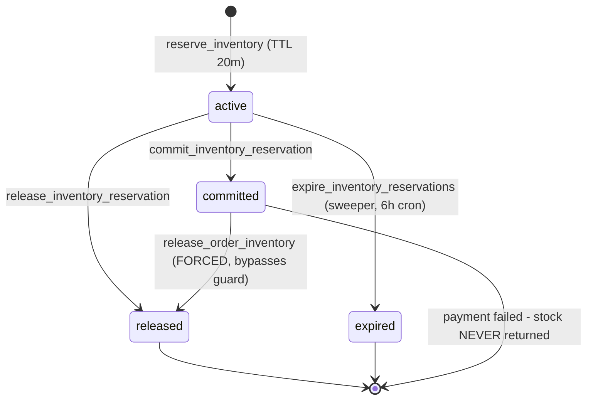
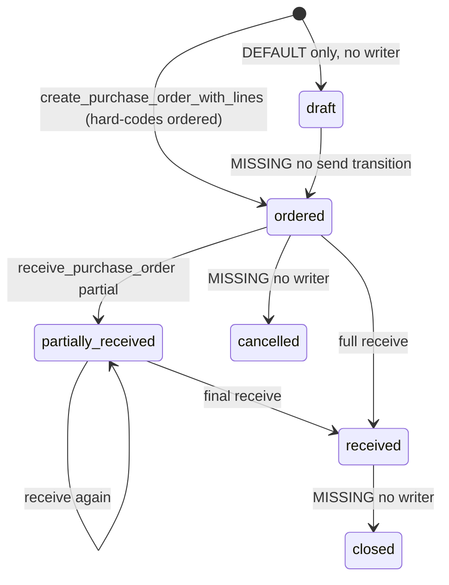
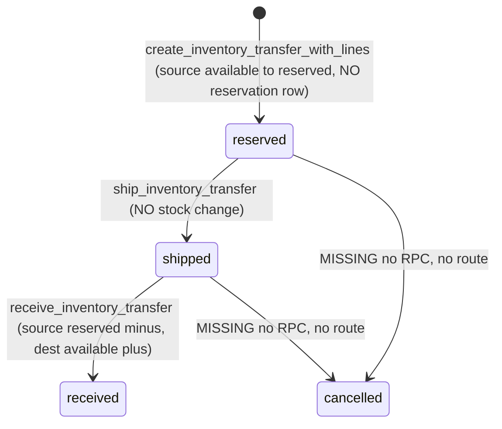

# 07 — INVENTORY, SUPPLIERS, PURCHASE ORDERS

| | |
|---|---|
| **Run ID** | `docs/merchant-system-discovery/2026-08-04T225330+0530-ee371182` |
| **Branch** | `stepup/main` |
| **Commit** | `ee371182` |
| **Run date** | 2026-08-04 (+0530) |
| **Scope** | Merchant inventory (levels, reservations, adjustments, transfers, locations), suppliers/vendors, purchase orders and receiving, and the **procurement-data reach** of input GST. Output-side GST (sales invoices, IRN/QR, TCS) belongs to document 14 and is not adjudicated here. |
| **Evidence basis** | Static source reading of `database/supabase/migrations/`, `services/api-gateway/src/`, `services/webhook-service/src/`, `services/queue-workers/src/`, `packages/commerce-core/src/`, `packages/typescript/api-client/src/`, `apps/merchant-control-plane/src/`, `apps/storefront-runtime/src/`, `apps/mobile/merchant-app/lib/`, `tests/`, plus the Constitution and governance documents. Source notes: `_agent-notes/D-inventory-purchase-orders-input-gst.md`. All load-bearing citations in this document were re-opened and re-verified against source during authoring. |
| **METHOD DISCLOSURE** | **Nothing in this document was runtime-verified.** No server was started, no database was contacted, no migration was applied, no test was executed, no build was run, no browser click-through was performed. Every status is therefore capped at `IMPLEMENTED_NOT_RUNTIME_VERIFIED` except explicit absences (which are provable from source) and defects whose failure mode is fully determined by the code as written. **Nothing in this document is `VERIFIED_E2E`.** |
| **Secrets/PII** | No secrets or PII appear in this document. |

**Correction to the source notes, re-verified from source.** The notes state "187 migrations" throughout. Re-verified: `ls database/supabase/migrations/*.sql | wc -l` returns **126** files, spanning `000_baseline.sql` through `197_letbuyy_core_first_class_theme.sql` (the numeric prefixes are sparse). Every exhaustive-grep claim in the notes was re-run against the actual 126 files and every one of them still holds — the absence findings are unchanged. Only the file count was wrong.

**Compliance disclaimer.** This document makes **no assertion of legal or tax compliance**, for India GST or any other regime. No evidence of any chartered-accountant or tax-professional review exists anywhere in this repository. Statements about tax are labelled `CODE_IMPLEMENTED`, `ACCOUNTING_POLICY_DEFINED`, `LEGALLY_VALIDATED`, or `INFERRED-FROM-PRACTICE-NOT-REPO`, and nothing labelled `INFERRED-FROM-PRACTICE-NOT-REPO` may be built to without a CA specification.

---

## 1. Recommendation / verdict

**Do not put a merchant with real stock on this system until MCP-DISC-230 is fixed.** Today, every failed or abandoned Razorpay payment permanently and silently destroys the stock that the order consumed. There is no recovery path, automatic or manual.

The inventory **schema** is genuinely well-built. There is a real reservation kernel with `SELECT … FOR UPDATE`, TTL, idempotency, a typed event journal, and a scheduled sweeper — and a real docker-postgres integration test that proves the kernel's concurrency arithmetic. That is more than most early-stage commerce platforms have.

The **runtime system built on top of it is not that kernel.** Five findings define this domain:

1. **Stock is destroyed before payment.** `create_order_with_inventory_reservations` calls `reserve_inventory` and then `commit_inventory_reservation` in the same transaction, before the shopper is redirected to the payment provider (`166_d6_checkout_handoff_inventory.sql:134-146` then `:221-227`). ART-14/R-11 names this exact pattern as a denial-of-inventory vector and forbids it.
2. **The payment-failure webhook is hard-coded not to give it back.** `releaseInventory: false` at `services/webhook-service/src/index.ts:410`, where the sibling refund path at `:459` computes the flag properly. The sweeper cannot recover these rows because it only sweeps `status IN ('active','hold')` and these are `committed`.
3. **There is not one inventory lifecycle — there are eight independent writers of `inventory_levels`**, two of which (transfers, absolute-set) are semantically incompatible with the reservation kernel. ART-15 explicitly forbids "Multiple inventory decrement paths."
4. **The storefront reads a different, stale stock number.** `products.stock` is mirrored only by the two manual-adjust RPCs; the sale path never touches it. A product with `stock IS NULL` is advertised to shoppers as **999** units (`apps/storefront-runtime/src/lib/product-service.ts:126`).
5. **Procurement is wired end-to-end but truncated, and the web receive action is unreachable.** The gateway returns raw DB rows (`quantity_ordered`, `quantity_received`, `subtotal`, `total`) while the typed contract and the UI read `quantity`, `received_quantity`, `total_cost`. `NaN > 0` is false, so the receive modal's `receivableLines` filter is always empty and every PO renders "All lines received."

**Input GST is `NOT_IMPLEMENTED`, not partial.** There is no supplier GSTIN column anywhere in the 126 migrations — `suppliers` (`000_baseline.sql:12460-12476`) has no `gstin` field at all, and `purchase_orders`, `purchase_order_lines`, and `purchase_order_receipts` carry **zero** tax columns. Word-boundary greps across every migration return zero hits for `reverse_charge`, `input_tax`, `input_credit`, `itc`, `cess`, `credit_note`, `debit_note`, `supplier_invoice`, `vendor_bill`, `landed_cost`, `valuation`, `fifo`, `weighted_average`, `cogs`, `reorder`. A merchant cannot record who they bought from in a tax-identifiable way, what tax they paid, or whether it is creditable. **Nothing about input-tax credit can be reported from repository data.** This is a scope decision plus a CA engagement, not a bug fix.

**Sequenced recommendation.**

| Order | Action | Gate |
|---|---|---|
| 1 | Fix the payment-failure release (MCP-DISC-230) and run a historical reconciliation sweep. | lead engineer, this week |
| 2 | Tighten the sweeper cadence (MCP-DISC-238) — it is a prerequisite for step 3. | lead engineer |
| 3 | Move the inventory commit from order creation to payment capture (MCP-DISC-231). | **ARB required** — changes the order/payment state machine |
| 4 | Fix the PO wire contract (MCP-DISC-234) — procurement is otherwise unusable on web. | lead engineer |
| 5 | Remove `cost_price` from the public storefront projection (MCP-DISC-236). | security + lead engineer |
| 6 | Consolidate onto one stock writer and one stock authority (MCP-DISC-233, MCP-DISC-232). | **ARB required** |
| 7 | Decide whether input GST / ITC is in scope. If yes, **engage a CA before any schema work** (MCP-DISC-237). | founder + CA |

---

## 2. Scope

**In scope.** `inventory_levels`, `inventory_locations`, `inventory_reservations`, `inventory_adjustments`, `inventory_events`, `inventory_transfers`/`_lines`/`_receipts`, `restock_events`, `suppliers`, `purchase_orders`/`_lines`/`_receipts`; the merchant pages under `apps/merchant-control-plane/src/app/[store]/products/{inventory,inventory-history,reservations,receipts,locations,transfers,purchase-orders,suppliers,operations-dashboard}`; the gateway router `services/api-gateway/src/routes/inventory.ts`; the reservation sweeper in `services/queue-workers`; the inventory consequences of the checkout and payment-webhook paths; the Flutter merchant app's inventory and PO screens.

**In scope, procurement-data only.** The input-GST **data model** — which fields exist on the purchase side and which do not. Whether any of it satisfies Indian GST law is explicitly **out of scope and undetermined**.

**Out of scope.** Output-side GST computation and invoicing (`144_executable_tax_gst_invoices.sql`, `services/api-gateway/src/routes/tax.ts`) — document 14. Product CRUD — document on products. Order lifecycle and refunds — orders/payments documents. Tenancy mechanism in general — tenancy document; findings here are flagged and cross-referenced, not re-derived.

---

## 3. Current merchant user journeys — what a merchant can actually do today

All journey statuses are `IMPLEMENTED_NOT_RUNTIME_VERIFIED` at best. "Works" below means "the code path is complete and consistent as written," not "was observed working."

| # | Journey | Reality today |
|---|---|---|
| J1 | **See stock levels per product/location** | Works. `products/inventory` → `/inventory/levels`. But the "On hand" column is overstated by exactly the reserved quantity (MCP-DISC-241), and if the store has no `inventory_levels` rows the gateway silently falls back to the stale `products.stock` column with a fabricated `reserved: 0` (MCP-DISC-232). |
| J2 | **Adjust stock manually (+/−)** | Works, but the web UI hard-codes `reason: 'correction'` and a fixed note (`inventory/page.tsx:164-165`). Damage, theft, shrinkage, and recount are indistinguishable in the audit ledger. The Flutter app passes a real reason; web and mobile therefore write structurally different audit data for the same action (MCP-DISC-248). |
| J3 | **Set an absolute stock number from the product form** | Works, and is dangerous. Typing a stock value on the product edit form calls `set_inventory_level_available` (`product-execution.adapter.ts:203-204`), an **absolute overwrite** with no version check. A sale landing between form load and save is silently erased (part of MCP-DISC-233). |
| J4 | **Create a vendor/supplier** | Works (create + list only). A supplier can never be edited, deactivated, or deleted through any UI (MCP-DISC-251). |
| J5 | **Create a purchase order** | Works. Server-authoritative subtotal, in-RPC idempotency replay, `incoming` incremented, event journalled. The PO is always created as `'ordered'` — a draft can never exist. |
| J6 | **Send a PO to the supplier** | **Does not exist.** No route, no RPC, no email template, no UI action. `outbox_events 'purchase_order.ordered'` is emitted (`000_baseline.sql:3728-3739`) and has no consumer. |
| J7 | **Receive a PO (full or partial)** | **Broken on web.** The receive modal always renders "All lines received" because the UI reads field names the API never returns (MCP-DISC-234). The gateway, RPC, and DB layers underneath are correct. Mobile can do **full receive only** (`purchase_orders_screen.dart:281-289`). |
| J8 | **Cancel or close a PO** | **Does not exist.** The status CHECK permits `cancelled` and `closed` and `cancelled_at` is a real column, but no writer exists for either. A mistaken PO pins `inventory_levels.incoming` forever. |
| J9 | **Record a supplier bill / accounts payable** | **Does not exist.** No table, no column, no route. |
| J10 | **Transfer stock between locations** | Partially works. Create moves `available → reserved` **directly on `inventory_levels` with no reservation row**; ship changes no stock at all; receive moves it to the destination. There is no cancel, no TTL, no sweeper coverage, and in-transit stock is invisible on the Reservations page. An abandoned transfer pins source stock permanently (MCP-DISC-239). |
| J11 | **See what is reserved right now** | Works for sales reservations only. Transfer holds can never appear (`GET /inventory/reservations` reads `inventory_reservations`, `inventory.ts:951`; transfers create no such row). |
| J12 | **Set a reorder point or safety stock** | **Does not exist.** No `reorder*` column anywhere; `safety_stock_quantity` exists and is never written. "Low stock" is hard-coded to `available <= 10` in three places. |
| J13 | **Run a physical stock count / cycle count** | **Does not exist as a feature.** A variance-reconciliation library and a 20-case unit test exist with no route, no table, and no UI (MCP-DISC-252). |
| J14 | **Know what the stock is worth / what a sale cost** | **Does not exist.** No valuation method, no cost layers, no COGS, no landed cost. PO receipt never updates product cost. |
| J15 | **Produce anything for input-tax credit** | **Does not exist at any layer.** No supplier GSTIN, no supplier invoice number or date, no place of supply, no per-line HSN snapshot, no taxable value, no CGST/SGST/IGST split, no reverse-charge flag, no ITC eligibility flag, no purchase credit/debit note. |
| J16 | **Reserve/commit/release stock via the public API** | **Appears dead.** All three RPCs require a transaction GUC `app.site_id` that the gateway never sets (MCP-DISC-235). Final confirmation is `BLOCKED_EXTERNAL` — a Supabase-side `db_pre_request` hook or `ALTER ROLE … SET` configured outside the repo would change this. None exists in `database/`. |

---

## 4. Feature matrix

| # | Capability | Status | Evidence (path:line) | Gap ID |
|---|---|---|---|---|
| 1 | Reservation kernel: reserve with TTL, row-locked | `IMPLEMENTED_NOT_RUNTIME_VERIFIED` (proven in docker integration test, not in production) | `141_executable_inventory_reservations.sql:114-140`; `tests/executable/inventory-postgres.test.mjs:203-236` | — |
| 2 | Reservation kernel: commit | `IMPLEMENTED_NOT_RUNTIME_VERIFIED` | `141:207-225` | — |
| 3 | Reservation kernel: release | `IMPLEMENTED_NOT_RUNTIME_VERIFIED` | `141:240-302` | — |
| 4 | Stale-reservation sweeper (RPC + worker + cron) | `IMPLEMENTED_NOT_RUNTIME_VERIFIED`, cadence inadequate | `141:304-348`; `services/queue-workers/src/inventory-reservations.ts:21-40`; `services/queue-workers/src/index.ts:620-635`; `wrangler.toml:17,35` | MCP-DISC-238 |
| 5 | Checkout uses reserve-with-TTL (not pre-payment decrement) | `BROKEN` vs governance — commits in the same transaction | `166_d6_checkout_handoff_inventory.sql:134-146`, `:221-227`; `LETBUYY_CONSTITUTION.md:234-235,406` | MCP-DISC-231 |
| 6 | Inventory returned on payment failure | `BROKEN` — hard-coded `false` | `services/webhook-service/src/index.ts:410` vs `:459`; `000_baseline.sql:5881-5882` | MCP-DISC-230 |
| 7 | Inventory returned on refund | `IMPLEMENTED_NOT_RUNTIME_VERIFIED` | `services/webhook-service/src/index.ts:459` | — |
| 8 | Inventory returned on merchant cancel | `IMPLEMENTED_NOT_RUNTIME_VERIFIED` | `services/api-gateway/src/execution/order-execution.adapter.ts:450,529-530` | — |
| 9 | Single stock-mutation path (ART-15) | `BROKEN` — eight independent writers | census in §6.3 | MCP-DISC-233 |
| 10 | Single stock authority | `BROKEN` — `products.stock` is a stale second authority the storefront reads | `000_baseline.sql:152-161`, `:7605-7615`; `apps/storefront-runtime/src/lib/product-service.ts:112,126` | MCP-DISC-232 |
| 11 | Optimistic concurrency on `inventory_levels` | `NOT_IMPLEMENTED` — `version` column read by nothing | `141:9,48-51`; zero readers repo-wide | MCP-DISC-250 |
| 12 | Storage-level guard against negative stock | `NOT_IMPLEMENTED` — no CHECK constraint | `000_baseline.sql:9561-9577` (no CHECK clauses) | MCP-DISC-240 |
| 13 | Merchant "On hand" figure correct | `BROKEN` — double-counts reserved | `packages/commerce-core/src/index.ts:1125` | MCP-DISC-241 |
| 14 | Manual adjust with reason codes (DB) | `IMPLEMENTED_NOT_RUNTIME_VERIFIED` — 8 codes | `000_baseline.sql:9502` | — |
| 15 | Manual adjust reason selectable in web UI | `UI_ONLY` gap — hard-coded `'correction'` | `apps/merchant-control-plane/src/app/[store]/products/inventory/page.tsx:164-165` | MCP-DISC-248 |
| 16 | Manual adjust reason selectable on mobile | `IMPLEMENTED_NOT_RUNTIME_VERIFIED` | `apps/mobile/merchant-app/lib/services/inventory_service.dart:569-586` | — |
| 17 | Inventory event journal | `IMPLEMENTED_NOT_RUNTIME_VERIFIED` — 11 event types | `000_baseline.sql:9510` | — |
| 18 | Inventory history page | `IMPLEMENTED_NOT_RUNTIME_VERIFIED` | `[store]/products/inventory-history/page.tsx:150,170` | — |
| 19 | Locations CRUD | `PARTIAL` — GET + POST only | `services/api-gateway/src/routes/inventory.ts:222,261` | — |
| 20 | Supplier create + list | `IMPLEMENTED_NOT_RUNTIME_VERIFIED` | `inventory.ts:300,334` | — |
| 21 | Supplier edit / deactivate / delete | `NOT_IMPLEMENTED` | no PATCH/DELETE in `inventory.ts`; no `[id]` proxy dir | MCP-DISC-251 |
| 22 | Supplier GSTIN | `NOT_IMPLEMENTED` | `000_baseline.sql:12460-12476` — no such column | MCP-DISC-237 |
| 23 | PO create (server-authoritative subtotal, idempotent) | `IMPLEMENTED_NOT_RUNTIME_VERIFIED` | `inventory.ts:396`; `000_baseline.sql:3616,3660-3668,3720-3726` | — |
| 24 | PO draft state | `NOT_IMPLEMENTED` — RPC hard-codes `'ordered'` | `000_baseline.sql:3665` vs default `'draft'` `:5133` | MCP-DISC-246 |
| 25 | PO send-to-supplier | `NOT_IMPLEMENTED` | no route/RPC/email; `outbox_events` has no consumer | MCP-DISC-246 |
| 26 | PO cancel / close | `NOT_IMPLEMENTED` | CHECK permits both (`:5152`); no writer | MCP-DISC-246 |
| 27 | PO receive — backend | `IMPLEMENTED_NOT_RUNTIME_VERIFIED` | `inventory.ts:442`; `000_baseline.sql:5012,5159-5215` | — |
| 28 | PO receive — web UI reachable | `BROKEN` | `page.tsx:374,384-386` vs `inventory.ts:383` | MCP-DISC-234 |
| 29 | PO receive — partial, mobile | `PARTIAL` — full receive only | `purchase_orders_screen.dart:281-289` | MCP-DISC-234 |
| 30 | PO receive idempotent inside the RPC | `PARTIAL` — app-tier only | `000_baseline.sql:5036-5038,5168-5182,5190,5214`; `inventory.ts:457-465` | MCP-DISC-242 |
| 31 | Supplier bill / AP ledger | `NOT_IMPLEMENTED` | no table, no column, no route | MCP-DISC-246 |
| 32 | Cost capture on receipt | `NOT_IMPLEMENTED` | `000_baseline.sql:5159-5215` writes quantity only | MCP-DISC-247 |
| 33 | Landed cost (freight/duty/insurance) | `NOT_IMPLEMENTED` | zero columns; grep `landed_cost` = 0 | MCP-DISC-247 |
| 34 | Inventory valuation (FIFO/WAC/standard) | `NOT_IMPLEMENTED` | grep `valuation`/`fifo`/`weighted_average` = 0 | MCP-DISC-247 |
| 35 | COGS / margin reporting | `NOT_IMPLEMENTED` | grep `cogs` = 0 | MCP-DISC-247 |
| 36 | Transfers create/ship/receive | `PARTIAL` | `inventory.ts:486,514,558,583`; `000_baseline.sql:2214,7658,4800` | MCP-DISC-239 |
| 37 | Transfer cancel | `NOT_IMPLEMENTED` | no RPC, no route, no proxy | MCP-DISC-239 |
| 38 | In-transit stock visibility | `NOT_IMPLEMENTED` | `ship_inventory_transfer` changes no stock (`:7658-7695`) | MCP-DISC-239 |
| 39 | Reorder points / reorder quantity / lead time | `NOT_IMPLEMENTED` | grep `reorder` = 0 across all migrations | MCP-DISC-249 |
| 40 | Safety stock | `NOT_IMPLEMENTED` — column exists, never written | `000_baseline.sql:9576` | MCP-DISC-249 |
| 41 | Low-stock alerting | `PARTIAL` — global hard-coded threshold of 10 | `inventory.ts:801,1134`; `inventory/page.tsx:255-256` | MCP-DISC-249 |
| 42 | `low_stock_count` analytics correctness | `BROKEN` — returns page length, not the requested exact count | `inventory.ts:1130-1138` | MCP-DISC-249 |
| 43 | Stock count / cycle count | `DORMANT_FLAGGED` — library + unit test, no route/table/UI | `services/api-gateway/src/lib/inventory-audit-variance.ts` | MCP-DISC-252 |
| 44 | `POST /inventory/reserve\|commit\|release` usable | `BROKEN` (static) / `BLOCKED_EXTERNAL` (final confirmation) | `141:53-63,87,190,256`; `inventory.ts:627,677,715`; zero callers of `withResolvedTenantTx` | MCP-DISC-235 |
| 45 | `inventory_adjustments` tenant RLS | `PARTIAL` — no tenant column, no FORCE, no GUC policy | `000_baseline.sql:9491-9503`; `164_d4_tenant_role_guc.sql:39-51` | MCP-DISC-244 |
| 46 | `REVOKE`/`GRANT EXECUTE` on inventory RPCs | `NOT_IMPLEMENTED` | only `195_contact_requests.sql:327-328` has grants | MCP-DISC-245 |
| 47 | Merchant purchase cost kept private | `BROKEN` — served to unauthenticated shoppers | `services/api-gateway/src/routes/storefront/public-routes.ts:31-32,843-845` | MCP-DISC-236 |
| 48 | **Input GST / ITC — any layer** | **`NOT_IMPLEMENTED`** | §8 field-by-field table | MCP-DISC-237 |
| 49 | Balance-column consistency (`*_quantity` family) | `PARTIAL` / `CONTRADICTORY_EVIDENCE` | `000_baseline.sql:9569-9576`; `141:211-217`; `000_baseline.sql:7046-7050` | MCP-DISC-243 |
| 50 | Documentation accuracy for this domain | `CONTRADICTORY_EVIDENCE` | `PRODUCTION_READINESS_GAP_REPORT.md:233`; `LETBUYY_FOUNDATION_ROADMAP.md:488`; `docs/v1-execution/phase-5/02-inventory-ledger.md:6` | MCP-DISC-253 |

---

## 5. UI / route inventory

### 5.1 Merchant web pages (all nine nav targets resolve to real files — no dead links)

| Page | File | Backing endpoint |
|---|---|---|
| Inventory (levels + adjust) | `apps/merchant-control-plane/src/app/[store]/products/inventory/page.tsx` | `/inventory/levels`, `/inventory/adjust` |
| Inventory history | `…/products/inventory-history/page.tsx:150,170` | `/inventory/analytics`, `/inventory/history` |
| Reservations | `…/products/reservations/page.tsx:124` | `/inventory/reservations` |
| Receipts | `…/products/receipts/page.tsx:89` | `/inventory/receipts` |
| Locations | `…/products/locations/page.tsx:92,232` | `/inventory-locations` |
| Transfers | `…/products/transfers/page.tsx:192,606` | `/transfers` |
| Purchase orders | `…/products/purchase-orders/page.tsx:523` | `/purchase-orders` |
| Suppliers (labelled "Vendors" in nav) | `…/products/suppliers/page.tsx:94,230` | `/suppliers` |
| Operations dashboard | `…/products/operations-dashboard/page.tsx:118` | `/commerce-analytics/*` |

Navigation: `apps/merchant-control-plane/src/components/merchantNavigation.ts:89` (Inventory group), `:102` (Purchasing group), `:106` (Transfers), `:108` (Vendors).

### 5.2 App proxy routes (Next.js → gateway). Verified by directory listing.

```
api/stores/[store]/inventory/levels/route.ts
api/stores/[store]/inventory/adjust/route.ts
api/stores/[store]/inventory/reservations/route.ts
api/stores/[store]/inventory/receipts/route.ts
api/stores/[store]/inventory/history/route.ts
api/stores/[store]/inventory/analytics/route.ts
api/stores/[store]/inventory-locations/route.ts
api/stores/[store]/suppliers/route.ts                      ← no [id]/  (MCP-DISC-251)
api/stores/[store]/purchase-orders/route.ts
api/stores/[store]/purchase-orders/[id]/receive/route.ts   ← no [id]/route.ts  (MCP-DISC-246)
api/stores/[store]/transfers/route.ts
api/stores/[store]/transfers/[id]/ship/route.ts
api/stores/[store]/transfers/[id]/receive/route.ts         ← no [id]/route.ts  (MCP-DISC-239)
```

**No proxy exists for `/inventory/reserve`, `/inventory/commit`, `/inventory/release`, or `/inventory/bulk-adjust`.** Those gateway routes have no merchant-facing caller in this repo — a separate observation from MCP-DISC-235, and consistent with it.

**Every proxy route uses `createMerchantApiClient()`; none imports a Supabase client.** The "apps must not write the DB directly" rule holds for this domain.

### 5.3 Gateway route surface — `services/api-gateway/src/routes/inventory.ts`

| Line | Method + path | Merchant UI caller |
|---|---|---|
| 222 | `GET /locations` | Locations page |
| 261 | `POST /locations` | Locations page |
| 300 | `GET /suppliers` | Suppliers page |
| 334 | `POST /suppliers` | Suppliers page |
| 366 | `GET /purchase-orders` | PO page |
| 396 | `POST /purchase-orders` | PO page |
| 442 | `POST /purchase-orders/:id/receive` | PO page (**unreachable — MCP-DISC-234**) |
| 486 | `GET /transfers` | Transfers page |
| 514 | `POST /transfers` | Transfers page |
| 558 | `POST /transfers/:id/ship` | Transfers page |
| 583 | `POST /transfers/:id/receive` | Transfers page |
| 627 | `POST /reserve` | **none** (MCP-DISC-235) |
| 677 | `POST /commit` | **none** (MCP-DISC-235) |
| 715 | `POST /release` | **none** (MCP-DISC-235) |
| 754 | `GET /levels` | Inventory page |
| 842 | `POST /adjust` | Inventory page |
| 897 | `POST /bulk-adjust` | **none** |
| 951 | `GET /reservations` | Reservations page |
| 1002 | `GET /receipts` | Receipts page |
| 1100 | `GET /analytics` | Inventory history page |
| 1194 | `GET /history` | Inventory history page |

**There is no PATCH and no DELETE anywhere in this router.** That single fact explains J4/J8/J10's missing edit, cancel, and close operations.

### 5.4 Flutter merchant app

- `apps/mobile/merchant-app/lib/screens/inventory/purchase_orders_screen.dart:281-289` — `_receive` sends **no `lines` array**, so mobile can only do a full receive.
- `apps/mobile/merchant-app/lib/services/inventory_service.dart:569-586` (and the barcode variant `:598-620`) — passes a **caller-supplied reason**, unlike web.

---

## 6. Backend / API / RPC / database mapping

### 6.1 Tables

| Table | Defined at | Tenant column | Purpose |
|---|---|---|---|
| `inventory_levels` | `000_baseline.sql:9561` (+ `141:5-9` adds `store_id`, `created_at`, `deleted_at`, `version`) | `store_id` (added by 141) | balance row |
| `inventory_locations` | `000_baseline.sql:9584` | `store_id` | warehouse/location |
| `inventory_reservations` | `000_baseline.sql:9603` | `store_id` | TTL reservation, 7 statuses |
| `inventory_adjustments` | `000_baseline.sql:9491` | **NONE** | manual-adjustment audit, 8 reason codes |
| `inventory_events` | `000_baseline.sql:9510` | `site_id` | typed journal, 11 event types |
| `inventory_level_duplicate_snapshots` | `000_baseline.sql:9546` | none | reconciliation snapshot |
| `inventory_transfers` / `_lines` / `_receipts` | `000_baseline.sql:4918` / `:4891` / `:9630` | `site_id` | location→location transfer |
| `purchase_orders` / `_lines` / `_receipts` | `000_baseline.sql:5128` / `:5100` / `:10949` | `site_id` | procurement |
| `suppliers` | `000_baseline.sql:12460` | `site_id` | vendor master |
| `restock_events` | `000_baseline.sql:11244` | `site_id` | return → stock restock |

### 6.2 `inventory_levels` carries two competing balance-column families

`000_baseline.sql:9565-9577`:

```
available integer NOT NULL DEFAULT 0,  reserved integer NOT NULL DEFAULT 0,  incoming integer NOT NULL DEFAULT 0,
on_hand_quantity integer,  available_quantity integer,  committed_quantity integer NOT NULL DEFAULT 0,
unavailable_quantity integer NOT NULL DEFAULT 0,  incoming_quantity integer,  reserved_quantity integer,
safety_stock_quantity integer NOT NULL DEFAULT 0
```

**Only the legacy triple is ever read.** The single gateway read path selects exactly `available, reserved, incoming` (`inventory.ts:784-796`). The `*_quantity` family is written inconsistently and surfaced nowhere:

- `commit_inventory_reservation` decrements `available`/`reserved`/`available_quantity`/`reserved_quantity` and increments `committed_quantity`, but **never touches `on_hand_quantity`** (`141:211-217`) — so `on_hand_quantity` never decreases on a sale.
- `receive_purchase_order_line` **does** increment `on_hand_quantity` (`000_baseline.sql:5175-5182`).
- `release_order_inventory` increments only `available` and touches none of the `*_quantity` columns (`000_baseline.sql:7046-7050`) — so `committed_quantity` stays inflated forever after a cancel and grows monotonically per SKU.
- `safety_stock_quantity` and `unavailable_quantity` are **never written by any RPC**.

Also note: `inventory_levels` (`000_baseline.sql:9561-9577`) carries **no CHECK constraints at all**. Nothing at the storage layer prevents negative stock (MCP-DISC-240).

### 6.3 The stock-mutation census — every path that changes `inventory_levels`

ART-15 (`GOVERNANCE_REWRITE_2026_06_10/LETBUYY_CONSTITUTION.md:239-242`) mandates *one* reserve→commit lifecycle and **"Forbids. Multiple inventory decrement paths."** There are **eight independent writers**, and they do not converge.

| # | Mutator | Location | Locking | Writes | Through the kernel? | Mirrors `products.stock`? |
|---|---|---|---|---|---|---|
| 1 | `reserve_inventory` | `141:65-173` | `SELECT … INTO … FOR UPDATE` (`141:114-121`) | `reserved +` | **is** the kernel | no |
| 2 | `commit_inventory_reservation` | `141:175-238` | `FOR UPDATE` (`141:197`) | `available −`, `reserved −`, `committed_quantity +` | **is** the kernel | **no** |
| 3 | `release_inventory_reservation` | `141:240-302` | `FOR UPDATE` (`141:263`) | `reserved −` | **is** the kernel | no |
| 4 | `expire_inventory_reservations` (sweeper) | `141:304-348` | `FOR UPDATE SKIP LOCKED` (`141:325`) | `reserved −` | **is** the kernel | no |
| 5 | `adjust_inventory_level` | `000_baseline.sql:38-175` | `FOR UPDATE` (`:82`) | `available = available + Δ` | **NO — side door** | **yes** (`:152-161`) |
| 6 | `set_inventory_level_available` (+ batch `088:4`) | `000_baseline.sql:7484-7650` | `FOR UPDATE` (`:7541`) | `available = <absolute>` | **NO — absolute overwrite** | **yes** (`:7607-7616`) |
| 7 | `receive_purchase_order_line` | `000_baseline.sql:5159-5215` | bare `UPDATE` | `available +`, `incoming −`, `on_hand_quantity +` | **NO — side door** | **no** |
| 8a | `create_inventory_transfer_with_lines` | `000_baseline.sql:2214-2325` | `IF NOT EXISTS(SELECT 1 … FOR UPDATE)` (`:2281-2287`) | `available −`, `reserved +` **with no `inventory_reservations` row** | **NO — parallel reservation concept** | no |
| 8b | `receive_inventory_transfer_line` | `000_baseline.sql:4945-5008` | bare `UPDATE` | source `reserved −`, dest `available +` | **NO** | no |
| 9 | `release_order_inventory` (+ `_with_ledger` `:7120`) | `000_baseline.sql:6995-7108` | `FOR UPDATE OF il` (`:7044`) | `available +`, forces `inventory_reservations.status='released'` from `committed` (`:7075-7081`) | **NO — bypasses the state machine** | **no** |
| 10 | `create_order_return_and_refund` (restock branch) | `000_baseline.sql:2678`, restock ~`:2865` | not audited line-by-line | `available +`, `available_quantity +`, `on_hand_quantity +` | **NO — side door** | **no** |

Additionally `create_purchase_order_with_lines` writes `incoming +` (`000_baseline.sql:3697-3701`).

**Three concrete constitutional breaks inside that table:**

**(a) `release_order_inventory` violates the reservation state machine.** `release_inventory_reservation` explicitly refuses a non-`active`/`hold` reservation (`141:273-275`). Because checkout commits immediately (§6.5), an order's reservations are `committed`. `release_order_inventory` sidesteps this with a blanket `UPDATE inventory_reservations SET status='released' … WHERE order_id = p_order_id` (`000_baseline.sql:7075-7081`) plus a direct `available = available + qty` (`:7046-7050`), and never decrements `committed_quantity`.

**(b) `create_inventory_transfer_with_lines` invents a second reservation concept.** It moves `available → reserved` directly (`000_baseline.sql:2289-2295`) with **no `inventory_reservations` row**. Provable consequences: the sweeper reads only `inventory_reservations` (`141:319`) so transfer holds have **no TTL and no sweeper**; `GET /inventory/reservations` reads only `inventory_reservations` (`inventory.ts:951`) so transfer holds can never be displayed; and there is **no cancel-transfer RPC** — the only transfer status writers are `ship_inventory_transfer` (`:7658`) and `receive_inventory_transfer` (`:4800`). An abandoned transfer pins source stock permanently.

**(c) `set_inventory_level_available` is an absolute overwrite reachable from the product edit form.** `services/api-gateway/src/execution/product-execution.adapter.ts:203-204` calls `setInventoryAvailable(productId, null, updates.stock, …)` when a merchant types a stock number on the product form. The only guard is `p_available < reserved` (`000_baseline.sql:7566-7568`). There is **no version check**, despite `inventory_levels.version` and its auto-increment trigger existing (`141:9,48-51`).

### 6.4 `products.stock` — the stale second stock authority the storefront reads

`products.stock integer DEFAULT 0` and `products.track_inventory boolean DEFAULT true` (`000_baseline.sql:10596-10597`); `product_variants.inventory_qty` likewise.

**Only mutators 5 and 6 mirror to `products.stock`** (`000_baseline.sql:152-161`, `:7607-7616`). The canonical sale path does not — grepping `141_executable_inventory_reservations.sql` for any write to `products` or `product_variants` returns **zero hits**. Neither does PO receive, transfer receive, release, restock, or the sweeper.

The storefront reads `products.stock`:
- `services/api-gateway/src/routes/storefront/public-routes.ts:843-845` — `select(productVariantRelationalReadsEnabled(c.env) ? PRODUCT_SELECT_FULL_RELATIONAL : '*')`. The `'*'` branch returns `stock`; the flagged branch returns `inventory_quantity`. Both branches return **`cost_price`** (`:31-32`).
- `apps/storefront-runtime/src/lib/product-service.ts:112` — `const stockValue = data.stock ?? data.stock_quantity ?? data.quantity;`
- `apps/storefront-runtime/src/lib/product-service.ts:126` — `stock: stockValue === undefined || stockValue === null ? 999 : Number(stockValue)`
- `apps/storefront-runtime/src/lib/theme-engine/composition-engine.tsx:254` — `available: product.stock > 0 && …`
- `apps/storefront-runtime/src/app/store/[subdomain]/collections/[slug]/page.tsx:84` — `stock: … : 999`

**Net effect:** sell 10 units through checkout → `inventory_levels.available` drops 10, `products.stock` does not move → the storefront keeps advertising the old quantity. A product with `stock IS NULL` advertises **999**. The shopper only learns the truth when `reserve_inventory` raises `INSUFFICIENT_INVENTORY` at order creation.

The gateway also **falls back** to `products.stock` for the merchant view when `inventory_levels` returns zero rows (`inventory.ts:814-836` → `listProductStockInventoryRows` `:94-145` → `mapProductStockInventoryRecord`, `packages/commerce-core/src/index.ts:1084-1105`, which hard-codes `reserved: 0` and `incoming: 0`). A store in that state shows an always-zero reserved column.

### 6.5 The sale path — reserve and commit in one transaction

`create_checkout_order` (latest definition `170_v1_shipping_rates_gst.sql:31`) delegates to `create_order_with_inventory_reservations` (`170:161`), latest definition `166_d6_checkout_handoff_inventory.sql:8`:

1. `reserve_inventory(…, 1200, 'checkout.reserve:…')` per line — `166:135-146`
2. insert the order with `payment_status = 'pending'` and `status = CASE WHEN p_payment_method='cod' THEN 'confirmed' ELSE 'pending' END` — `166:219-220`
3. **immediately** `commit_inventory_reservation(…)` per line — `166:221-227`

All in one transaction, **before any payment is captured**. The reservation row exists for microseconds and is `committed` before the shopper is redirected to the provider.

`166:63-66` also does this:
```sql
IF public.current_site_id() IS NULL THEN
  PERFORM set_config('app.site_id', p_store_id::text, true);
END IF;
PERFORM public.require_inventory_site_guc(p_store_id);
```
The tenant guard sets the value it then checks — it is **tautological on the only live caller** and provides zero tenant protection on the checkout inventory path.

### 6.6 Reservation TTL and the sweeper

- TTL default: `inventory_reservations.expires_at timestamptz NOT NULL DEFAULT (now() + '00:20:00'::interval)` — `000_baseline.sql:9615`.
- Caller TTL clamped to 60s…86400s: `make_interval(secs => LEAST(GREATEST(COALESCE(p_ttl_seconds,1200),60),86400))` — `141:131`.
- Idempotency key required, min length 8 — `141:93-95`; replay returns the existing reservation — `141:97-112`.
- Sweeper RPC `expire_inventory_reservations(p_limit, p_request_id)` — `141:304-348`, sweeping `status IN ('active','hold') AND expires_at <= now()` with `FOR UPDATE SKIP LOCKED`, limit clamped to ≤1000 (`141:320-325`).
- Worker: `services/queue-workers/src/inventory-reservations.ts:21-40`.
- Scheduled handler: `services/queue-workers/src/index.ts:620-635` (inside `async scheduled`).
- Cron: `services/queue-workers/wrangler.toml` — `crons = ["17 */6 * * *"]` at lines 17, 123, 237 (default, staging, production).
- Limit: `INVENTORY_RESERVATION_SWEEPER_LIMIT = "250"` at lines 35, 141, 255.

**The sweeper is wired.** Multiple governance documents still say it is dead — see MCP-DISC-253. But the cadence is **every 6 hours against a 20-minute TTL**, capped at 250 rows per run: worst case a stale reservation pins stock for ~6h20m, and sweep capacity is 1,000 reservations/day per environment.

### 6.7 Procurement RPCs

| RPC | Location | Notes |
|---|---|---|
| `create_purchase_order_with_lines` | `000_baseline.sql:3616` | in-RPC idempotency replay on `(site_id, idempotency_key)` (`:3637-3645`); status hard-coded `'ordered'` (`:3665`); server-authoritative `v_subtotal := Σ(unit_cost × quantity)` (`:3720-3726`); `incoming +` (`:3697-3701`); `inventory_events 'po_ordered'`; `outbox_events 'purchase_order.ordered'` (`:3728-3739`, **no consumer**) |
| `receive_purchase_order` | `000_baseline.sql:5012` | terminal-status guard only (`:5036-5038`); over-receipt beyond ordered blocked (`:5057-5059`); header status roll-up (`:5077-5087`); **takes only a PO id — no tenant proof** |
| `receive_purchase_order_line` | `000_baseline.sql:5159` | `quantity_received +`, `available +`, `incoming −`, `on_hand_quantity +`; receipt + event inserts both `ON CONFLICT (site_id, idempotency_key) DO NOTHING` keyed on `p_idempotency_key \|\| ':line:' \|\| line_id` (`:5192`, `:5214`) |
| `create_inventory_transfer_with_lines` | `000_baseline.sql:2214` | see §6.3(b) |
| `ship_inventory_transfer` | `000_baseline.sql:7658-7695` | **changes no stock** — only flips line and header status to `'shipped'` |
| `receive_inventory_transfer` / `_line` | `000_baseline.sql:4800` / `:4945` | source `reserved −`, dest `available +` |

**Suppliers are persisted by a direct table insert, not an RPC** — `inventory.ts:347-359`, `db.from('suppliers').insert({…})`. Acceptable: `suppliers` is not a money or stock-balance table, and the canonical-ledger rule is not engaged.

### 6.8 The PO wire-contract break, in full

The gateway returns rows **unshaped** (`services/api-gateway/src/routes/inventory.ts:382-387`):

```ts
.from('purchase_orders')
.select('*, supplier:suppliers(name), lines:purchase_order_lines(*)')
```

So the wire shape **is** the DB shape (re-verified against `000_baseline.sql`):

| Wire actually carries | Declared/consumed by UI |
|---|---|
| `purchase_order_lines.quantity_ordered` (`:5106`) | `PurchaseOrderLine.quantity` (`packages/typescript/api-client/src/index.ts:2249`) |
| `purchase_order_lines.quantity_received` (`:5107`) | `PurchaseOrderLine.received_quantity` (`:2251`) |
| `purchase_orders.subtotal` / `.total` (`:5139-5140`) | `PurchaseOrder.total_cost` (`:2268`) |
| `status ∈ draft\|ordered\|partially_received\|received\|cancelled\|closed` (`:5152`) | `status: 'draft'\|'ordered'\|'partial'\|'received'\|'cancelled'` (`:2264`) |

Concrete consequences in `apps/merchant-control-plane/src/app/[store]/products/purchase-orders/page.tsx`:

- `totalPoLines()` = `lines.reduce((sum, l) => sum + l.quantity * l.unit_cost, 0)` (`:67-69`) → `l.quantity` is `undefined` → **`NaN`** → the "Total cost" column renders `formatInrCurrency(NaN)`.
- `ReceivePOModal` initialises `const remaining = l.quantity - (l.received_quantity ?? 0)` (`:374`) → **`NaN`**.
- `receivableLines = po.lines.filter((l) => l.quantity - (l.received_quantity ?? 0) > 0)` (`:384-386`) → `NaN > 0` is **false** → `receivableLines` is **always empty** → the modal always renders "All lines received" and the merchant cannot receive anything.
- `poStatusVariant` / `poStatusLabel` (`:47-65`) never match `'partially_received'` or `'closed'` — the badge falls through to `default` and prints the raw DB string.

There is **no response mapper** between the DB row and the typed contract, in contrast to `mapInventoryLevelRecord` which exists for levels (`packages/commerce-core/src/index.ts:1107`).

---

## 7. State machines

### 7.1 Reservation lifecycle — designed vs actual



Reading of the diagram:
- The `active → committed` edge is traversed **microseconds after** `active` is entered, inside the same checkout transaction (`166:135-227`) — the TTL never has effect on a real sale.
- The `committed → released` edge is a **forced** transition. `release_inventory_reservation` explicitly refuses it (`141:273-275`); `release_order_inventory` performs it anyway with a blanket UPDATE (`000_baseline.sql:7075-7081`), and never decrements `committed_quantity`.
- The bottom edge is MCP-DISC-230: a `committed` reservation on a failed payment is never released, and the sweeper cannot reach it (it sweeps only `active`/`hold`, `141:320`).

### 7.2 Purchase-order lifecycle — schema vs reachable



`purchase_orders.status` CHECK permits all six states (`000_baseline.sql:5152`) and the column defaults to `'draft'` (`:5133`), but `create_purchase_order_with_lines` inserts the literal `'ordered'` (`:3665`). **Three of six states are unreachable.** `cancelled_at` (`:5137`) is a column no code writes.

### 7.3 Transfer lifecycle



Between `reserved` and `received` the stock is invisible: it is in neither location's `available`, it sits in source `reserved` with no reservation row, it has no TTL, no sweeper covers it, and no page can display it.

---

## 8. Input-GST data model (procurement reach only)

**Statement up front: there is no supplier GSTIN column anywhere in the 126 migrations. Input-tax credit is `NOT_IMPLEMENTED`, not partial.**

Re-verified by exhaustive grep across `database/supabase/migrations/*.sql`. The only `gstin`-named columns in the entire schema are:

| Column | Location | Side |
|---|---|---|
| `customer_addresses.gstin` | `000_baseline.sql:8886` (+ format CHECK `:8888`) | output / CRM |
| `orders.customer_gstin` | `000_baseline.sql:10163` (+ format CHECK `:10167`) | output |
| `sites.gstin` | `000_baseline.sql:12017` (+ format CHECK `:12023`) | seller's own |
| `theme_purchase_receipts.buyer_gstin` / `.seller_gstin` | `091_theme_marketplace_stepup.sql:131-132` | platform marketplace |
| `draft_orders.customer_gstin` | `116_mobile_draft_orders.sql:10` | output |
| `tax_registrations.gstin` | `144_executable_tax_gst_invoices.sql:10` (+ CHECK `:23`) | seller's own |
| `checkout_sessions.buyer_gstin` | `146_executable_checkout_state_machine.sql:14` | output |
| `contact_requests.gstin` | `195_contact_requests.sql:59` | CRM |

**All output-side or CRM. None is a supplier.**

### 8.1 The purchase-side tables in full (verified column lists)

`suppliers` — `000_baseline.sql:12460-12476`:
`id, site_id, name, contact_name, email, phone, address jsonb, status, metadata jsonb, created_by, updated_by, created_at, updated_at, deleted_at`

`purchase_orders` — `000_baseline.sql:5128-5153`:
`id, site_id, supplier_id, location_id, po_number, status, ordered_at, expected_at, received_at, cancelled_at, currency, subtotal numeric(12,2), total numeric(12,2), notes, idempotency_key, request_id, metadata jsonb, created_by, updated_by, created_at, updated_at, deleted_at`

`purchase_order_lines` — `000_baseline.sql:5100-5121`:
`id, site_id, purchase_order_id, product_id, variant_id, location_id, quantity_ordered, quantity_received, unit_cost numeric(12,2), total_cost numeric(12,2), status, metadata jsonb, created_by, updated_by, created_at, updated_at, deleted_at`

`purchase_order_receipts` — `000_baseline.sql:10949-10968`:
`id, site_id, purchase_order_id, purchase_order_line_id, product_id, variant_id, location_id, quantity_received, idempotency_key, request_id, metadata jsonb, …`

**Not one tax column across any of them.**

### 8.2 Field-by-field ITC evidence checklist

The checklist itself is `INFERRED-FROM-PRACTICE-NOT-REPO` — a CA must confirm the actual required field set. The PRESENT/ABSENT verdicts are `CODE_IMPLEMENTED` facts about the repository.

| # | Field | Verdict | Evidence |
|---|---|---|---|
| 1 | **Supplier GSTIN** | **ABSENT** | `suppliers` has no `gstin` column (`000_baseline.sql:12460-12476`); table in §8 above lists every GSTIN column in the schema — all output-side/CRM |
| 2 | Supplier legal name + registration type | **ABSENT** | `suppliers.name` is a single trade name; no legal-name or registration-type field. Contrast the seller side: `tax_registrations.legal_name` / `registration_type` (`144:9,15`) |
| 3 | Supplier address with 2-digit state code | **PARTIAL/ABSENT** | `suppliers.address jsonb` free-form; the UI captures street/city/state/pincode as free text (`suppliers/page.tsx:184-203`). No `state_code`. Contrast `tax_registrations.state_code text CHECK (state_code ~ '^[0-9]{2}$')` (`144:12`). Place of supply is not derivable. |
| 4 | Supplier invoice number | **ABSENT** | no column on any purchase table; no supplier-bill table exists |
| 5 | Supplier invoice date | **ABSENT** | `ordered_at`/`expected_at`/`received_at` are PO milestones, not the supplier's invoice date |
| 6 | Place of supply | **ABSENT** on the purchase side | exists only on `gst_invoices.place_of_supply_state_code` (`144:86`) — the **sales** invoice |
| 7 | HSN/SAC per purchase line | **ABSENT** | `products.hsn_code` exists with a format CHECK (`000_baseline.sql:10627`+) and could be joined, but is never snapshotted onto the purchase line — a later HSN edit silently rewrites history |
| 8 | Taxable value per line | **ABSENT** | `unit_cost`/`total_cost` are undifferentiated cost with no statement of tax-inclusive vs exclusive |
| 9 | CGST / SGST / IGST split + rates | **ABSENT** | zero tax columns on any purchase table. Contrast the sales side: `gst_invoices.cgst_amount_minor/sgst_amount_minor/igst_amount_minor` + `gst_invoices_tax_split_check` (`144:88-91,110-111`) |
| 10 | Cess | **ABSENT** everywhere | word-boundary grep `\bcess\b` across all 126 migrations = **0 hits** |
| 11 | Reverse-charge flag | **ABSENT** everywhere | grep `reverse_charge` = **0 hits** |
| 12 | ITC eligibility flag / category | **ABSENT** everywhere | grep `itc`, `input_tax`, `input_credit` = **0 hits** |
| 13 | Purchase credit note / debit note | **ABSENT** | grep `credit_note`, `debit_note` = **0 hits**; and there is no cancel path on a PO at all (§7.2) |
| 14 | Supplier-bill payment status / AP ledger | **ABSENT** | no AP table, no supplier payment, no `paid_at` on any purchase table. `purchase_orders.currency` (default `'INR'`) is the only financial metadata beyond cost. |
| 15 | Supplier PAN / MSME / TDS section | **ABSENT** | recorded for completeness; not part of the ITC question |

### 8.3 What input-GST reporting is possible today — labelled per the required taxonomy

**`CODE_IMPLEMENTED`** — what the code actually does:
- **Nothing on the input side.** There is no input-GST computation, storage, aggregation, report, or export anywhere in the repository. `services/api-gateway/src/routes/tax.ts` and `144_executable_tax_gst_invoices.sql` are entirely output-side (sales invoices, IRN/QR, TCS). The only GST tests in the repo are `tests/gst/gst-invoice.test.mjs` and `tests/executable/tax-postgres.test.mjs` — both output-side.
- What **is** `CODE_IMPLEMENTED` on purchases: quantity ordered and received, per-line ordered unit cost, receipt evidence rows, PO status, supplier name/contact, and per-supplier PO count / on-time rate / average lead time (`services/api-gateway/src/routes/commerce-analytics.ts:48-172`). That is **operational procurement reporting, not tax reporting.**
- Therefore a merchant can produce, from repository data: *what did I order, from whom, when did it arrive, how late, at what stated unit cost.* They **cannot** produce anything that references a supplier's GSTIN, an invoice number, a tax amount, or an ITC claim.

**`ACCOUNTING_POLICY_DEFINED`** — a documented internal policy exists:
- **None found for input GST.** `docs/` (excluding `docs/archive/`) contains no purchasing-tax or ITC policy document. The only files matching "input GST" / "ITC" are competitor-research notes (`docs/research/shopify-product-intelligence/pages/purchase-orders.md`, `…/pages/create-purchase-order.md`) — **not LetBuyy policy**. ART-15 mentions GST only for output invoicing (`LETBUYY_CONSTITUTION.md:240`).

**`LEGALLY_VALIDATED`** — a CA or tax professional signed off:
- **None. No evidence of any CA or tax-professional review exists anywhere in this repository**, for either the output or the input side. This document asserts nothing about legal or tax compliance.

**`INFERRED-FROM-PRACTICE-NOT-REPO`** — general-practice statements, routed to a CA, not acted on:
- ITC claims are typically substantiated by supplier GSTIN, tax-invoice number and date, place of supply, per-line HSN and taxable value, and the CGST/SGST/IGST split — which is why fields 1–14 were chosen as the checklist. **A CA must confirm the actual required field set and retention rules for LetBuyy's merchant profile before anything is built.**
- Reconciliation against supplier-filed returns is normally required before an ITC claim. Nothing in this repo models that, and this document takes no position on whether LetBuyy must provide it.

**Verdict: INPUT GST = `NOT_IMPLEMENTED` at schema, service, and UI layers.** Evidence: `DB_SCHEMA` (absence, verified by exhaustive grep across all 126 migrations) + `SERVICE_CODE` + `DOC_CLAIM` (absence).

### 8.4 Landed cost and valuation (the adjacent procurement-finance gap)

| Capability | Verdict | Evidence |
|---|---|---|
| Per-line purchase unit cost | PRESENT | `purchase_order_lines.unit_cost`/`total_cost numeric(12,2)` (`000_baseline.sql:5108-5109`); computed in-RPC (`:3693`) |
| Freight / duty / insurance / other landed-cost components | **ABSENT** | grep `landed_cost` = 0 hits |
| Landed-cost allocation | **NOT_IMPLEMENTED** | no code |
| Valuation method (FIFO / weighted average / standard) | **NOT_IMPLEMENTED** | word-boundary grep `\bvaluation\b`, `fifo`, `weighted_average` = 0 hits; no cost-layer table |
| Cost update on receipt | **MISSING** | `receive_purchase_order_line` (`000_baseline.sql:5159-5215`) writes quantity only |
| Product cost fields | PRESENT but manual-only, and duplicated | `products.cost_price numeric(10,2)` (`:10604`) **and** `products.cost_per_item numeric(10,2)` (`:10617`) — two competing columns; only `cost_per_item` is written, from the product form (`[store]/products/new/page.tsx:602`, read at `:234` with a `?? cost_price` fallback) |
| COGS / margin reporting | **NOT_IMPLEMENTED** | grep `cogs` = 0 hits |
| Inventory value on hand | **NOT_IMPLEMENTED** | `/inventory/analytics` returns only `low_stock_count`, `total_skus`, `po_by_status`, `transfer_by_status` (`inventory.ts:1119,1122-1126`) |

**Money-unit deviation (procurement scope).** `purchase_orders.subtotal`/`.total` and `purchase_order_lines.unit_cost`/`.total_cost` are `numeric(12,2)` rupees, not paise `bigint` as R-5 requires. The sales side does use minor units (`gst_invoices.*_minor bigint`, `144:87-93`). Procurement cost is merchant-internal, not platform ledger money, so this is a **consistency deviation, not a canonical-ledger breach** — but it will become one the moment a supplier bill enters any ledger.

---

## 9. End-to-end traces

Format: entry point → page/route → app proxy → typed client → `/v1` gateway route → auth issuer + authz + ownership → validation / server-authoritative computation → RPC/tables + RLS → webhook/queue/provider → downstream consequence → tests → runtime observation.

### T1 — Supplier create

| Link | Evidence | Status |
|---|---|---|
| Merchant entry | nav "Purchasing → Vendors" (`merchantNavigation.ts:108`) | present |
| Page | `[store]/products/suppliers/page.tsx` (fields `:147,157,163,172,184,191,197,203`) | present |
| App proxy | `api/stores/[store]/suppliers/route.ts` (GET + POST) | present |
| Typed client | `packages/typescript/api-client/src/index.ts:2277-2295` (`CreateSupplierInput`, `Supplier`) | present |
| Gateway | `GET /v1/inventory/suppliers` `inventory.ts:300`; `POST` `:334` | present |
| Auth issuer + authz | merchant ES256 → `resolveCustomUser` + `verifySiteOwnership` + `assertStaffPermission('products:write')` — `inventory.ts:340-345` | present |
| Server-authoritative computation | n/a (no computed values) | n/a |
| Persistence | `db.from('suppliers').insert({…})` — `inventory.ts:347-359` | present |
| RLS | `suppliers` ENABLE (`000_baseline.sql:27499`) + FORCE via the `164` sweep (has `site_id`) — but the GUC is never set for gateway traffic (§10) | **degraded** |
| **Supplier GSTIN captured** | — | **MISSING** (MCP-DISC-237) |
| **Edit / deactivate / delete** | no PATCH/DELETE route; no `[id]` proxy dir | **MISSING** (MCP-DISC-251) |
| Downstream | supplier appears in the PO create dropdown | present |
| Tests | none | **MISSING** |
| Runtime observation | none | **MISSING** |

### T2 — Purchase-order create

| Link | Evidence | Status |
|---|---|---|
| Merchant entry | nav "Purchasing" (`merchantNavigation.ts:102`) | present |
| Page + modal | `[store]/products/purchase-orders/page.tsx:96-352` (`CreatePOModal`: supplier, destination, expected date, notes, N lines of product/variant/qty/unit-cost) | present |
| Idempotency key | client-generated `po-${Date.now()}-${random}` (`page.tsx:71-73`), sent at `:185` | present |
| App proxy | `api/stores/[store]/purchase-orders/route.ts` | present |
| Typed client | `packages/typescript/api-client/src/index.ts:2228-2236`, `:4857` | present |
| Gateway | `POST /v1/inventory/purchase-orders` — `inventory.ts:396` | present |
| Auth + authz | `verifySiteOwnership` + `assertStaffPermission('products:write')` — `inventory.ts:403-407` | present |
| Idempotency | `IdempotencyExecutionAdapter.begin({scope:'inventory.purchase_orders.create'})` (`inventory.ts:409-417`) **and** in-RPC replay on `(site_id, idempotency_key)` (`000_baseline.sql:3637-3645`) | present |
| Server-authoritative totals | `v_subtotal := Σ(unit_cost × quantity)` computed in-RPC (`:3720`), written `:3724-3726` | present |
| RPC + tables | `create_purchase_order_with_lines` (`:3616`) → `purchase_orders`, `purchase_order_lines`, `inventory_levels.incoming +` (`:3697-3701`), `inventory_events 'po_ordered'` (`:3703-3718`) | present |
| Queue / webhook | `outbox_events 'purchase_order.ordered'` emitted (`:3728-3739`) | present |
| **Consumer of that event** | grep finds none | **MISSING** |
| **Draft state** | RPC hard-codes `'ordered'` (`:3665`) though the column defaults `'draft'` (`:5133`) | **MISSING** (MCP-DISC-246) |
| **Send-to-supplier** | no route, no RPC, no email template, no UI action | **MISSING** (MCP-DISC-246) |
| **Cancel / close** | CHECK permits both (`:5152`), `cancelled_at` exists (`:5137`), no writer, no `[id]/route.ts` | **MISSING** (MCP-DISC-246) |
| **Purchase tax fields** | none exist | **MISSING** (MCP-DISC-237) |
| Console consequence | PO list — **renders `formatInrCurrency(NaN)` in the Total cost column** (`page.tsx:67-69`) | **BROKEN** (MCP-DISC-234) |
| Tests | none anywhere reference `create_purchase_order_with_lines` | **MISSING** |
| Runtime observation | none | **MISSING** |

### T3 — Purchase-order receive (full and partial)

| Link | Evidence | Status |
|---|---|---|
| Merchant entry | `ReceivePOModal` — `page.tsx:364-499`; per-line quantity input clamped to remaining (`:479-490`) | present in code |
| **UI reachability** | `receivableLines` filter is `NaN > 0` → always empty → modal always shows "All lines received" | **BROKEN** (MCP-DISC-234) |
| App proxy | `api/stores/[store]/purchase-orders/[id]/receive/route.ts` | present |
| Typed client | `ReceivePurchaseOrderInput` (`api-client/src/index.ts:2243-2246`) | present |
| Gateway | `POST /v1/inventory/purchase-orders/:id/receive` — `inventory.ts:442` | present |
| Auth + authz | `loadPurchaseOrderSiteId` → `verifySiteOwnership` → `assertStaffPermission` — `inventory.ts:450-455` | present |
| Idempotency | app-tier `IdempotencyExecutionAdapter` claim (`inventory.ts:457-465`) | **PARTIAL** — not enforced inside the RPC (MCP-DISC-242) |
| RPC + tables | `receive_purchase_order` (`000_baseline.sql:5012`) → `receive_purchase_order_line` (`:5159`); `available +`, `incoming −`, `on_hand_quantity +` (`:5175-5182`); `purchase_order_receipts` insert (`:5184-5192`); `inventory_events 'po_received'` (`:5194-5214`); line + header status roll-up (`:5168-5171`, `:5077-5087`) | present |
| **Tenant proof inside the RPC** | `receive_purchase_order(p_purchase_order_id, …)` takes only an entity id | **MISSING** — TS-tier only (MCP-DISC-245) |
| **`products.stock` mirror** | receive never updates it | **MISSING** (MCP-DISC-232) |
| **Cost capture on receipt** | `unit_cost` frozen at order time; no received-cost, no price variance, no `products.cost_per_item` update | **MISSING** (MCP-DISC-247) |
| **Supplier bill / invoice** | no table, no column, no route | **MISSING** (MCP-DISC-246 / MCP-DISC-237) |
| Mobile parity | Flutter `_receive` sends no `lines` (`purchase_orders_screen.dart:281-289`) → full receive only | **PARTIAL** |
| Storefront consequence | none — new stock does not reach `products.stock`, so the storefront's advertised number does not change | **BROKEN** (MCP-DISC-232) |
| Tests | none anywhere reference `receive_purchase_order` | **MISSING** |
| Runtime observation | none | **MISSING** |

### T4 — Manual stock adjust

| Link | Evidence | Status |
|---|---|---|
| Merchant entry | `[store]/products/inventory/page.tsx` adjust modal | present |
| Request body | hard-codes `reason: 'correction'`, `notes: 'Adjusted from admin inventory screen'` (`:164-165`) | **PARTIAL** (MCP-DISC-248) |
| App proxy | `api/stores/[store]/inventory/adjust/route.ts` | present |
| Gateway | `POST /v1/inventory/adjust` — `inventory.ts:842` | present |
| Validation | `AdjustInventorySchema.reason` accepts 10 aliases (`packages/commerce-core/src/index.ts:291-302`); `mapInventoryAdjustmentReason` (`:1070-1082`) **collapses `received` and `correction` into `adjustment`** | **PARTIAL** — a manual receipt is indistinguishable from a correction |
| RPC + tables | `adjust_inventory_level` (`000_baseline.sql:38-175`) — `FOR UPDATE` (`:82`), `available = available + Δ`, `inventory_adjustments` insert, **`products.stock` mirror** (`:152-161`), `outbox_events` | present |
| RLS | `inventory_adjustments` has **no tenant column, no FORCE RLS, no GUC policy** | **DEVIATION** (MCP-DISC-244) |
| Storefront consequence | this is one of only two paths that *does* update `products.stock` — so a manual adjust is the only way to move the storefront's number | present, and diagnostic of MCP-DISC-232 |
| Tests | none for the adjust path | **MISSING** |
| Runtime observation | none | **MISSING** |

### T5 — Sale-path stock consumption (checkout → payment)

| Link | Evidence | Status |
|---|---|---|
| Shopper entry | storefront checkout | out of scope here |
| Gateway | `create_checkout_order` (`170_v1_shipping_rates_gst.sql:31`) → `create_order_with_inventory_reservations` (`166:8`) | present |
| Tenant guard | `166:63-66` sets `app.site_id` then checks it — **tautological** | **BROKEN as a guard** (MCP-DISC-235) |
| Reserve | `reserve_inventory(…, 1200, 'checkout.reserve:…')` per line (`166:135-146`), row-locked (`141:114-121`), gated on `available - reserved` (`141:127`) | present |
| Order insert | `payment_status='pending'`, `status='pending'` unless COD (`166:219-220`) | present |
| **Commit** | `commit_inventory_reservation` per line **in the same transaction** (`166:221-227`) | **VIOLATES ART-14/R-11** (MCP-DISC-231) |
| Provider | shopper redirected to Razorpay | out of scope |
| **Payment success** | grep across migrations finds no `commit_inventory_reservation` call in `confirm_order_payment_with_ledger` — commit already happened | **MISSING commit-on-capture** |
| **Payment failure** | `markOrderFailed` → `releaseInventory: false` (`services/webhook-service/src/index.ts:410`); release is conditional on that flag (`000_baseline.sql:5881-5882`) | **BROKEN** (MCP-DISC-230) |
| Refund | `releaseInventory: Boolean(order.inventory_reserved_at && !order.inventory_released_at)` (`webhook-service/src/index.ts:459`) | present |
| Merchant cancel | `order-execution.adapter.ts:450` → `returnInventory` `:529-530` → `release_order_inventory_with_ledger` | present |
| Sweeper recovery of the failed-payment case | sweeps only `status IN ('active','hold')` (`141:320`); these rows are `committed` | **IMPOSSIBLE** |
| Storefront consequence | `products.stock` untouched → the storefront keeps advertising the pre-sale number | **BROKEN** (MCP-DISC-232) |
| Merchant console consequence | `committed_quantity` inflates monotonically; `on_hand_quantity` never decreases | **BROKEN** (MCP-DISC-243) |
| Tests | `tests/executable/inventory-postgres.test.mjs` covers the **kernel only** — it applies migrations 139 + 141 and never exercises checkout | **MISSING for this path** |
| Runtime observation | none | **MISSING** |

### T6 — Input-GST / ITC report

Every link is MISSING. Recorded in full because the absence is the finding.

| Link | Status |
|---|---|
| Merchant entry point | **MISSING** — no page, no nav item |
| Page/route | **MISSING** |
| App proxy | **MISSING** |
| Typed client | **MISSING** |
| `/v1` gateway route | **MISSING** — `services/api-gateway/src/routes/tax.ts` is output-side only |
| Auth / ownership | n/a |
| Server-authoritative computation | **MISSING** — no input-tax computation exists |
| RPC / tables | **MISSING** — no purchase-tax table, no supplier GSTIN, no supplier bill |
| Export / reporting consequence | **MISSING** |
| Tests | **MISSING** — the only GST tests are output-side |
| Runtime observation | **MISSING** |

---

## 10. Auth / tenant / invariant analysis

### 10.1 Route-level authorization — holds

Every inventory and procurement route calls `verifySiteOwnership`: `inventory.ts:314, 341, 377, 403, 451, 635, 685, 723, 773, 855, 906` and onward. Write routes additionally call `assertStaffPermission(…, 'products:write')`. Auth issuer is the merchant **ES256** identity token — the customer HS256 issuer is not accepted on these routes. The two-issuer invariant is not crossed anywhere in this domain.

### 10.2 Database-level tenancy — degraded to app-tier only

| Table | RLS ENABLE | RLS FORCE | Tenant GUC policy |
|---|---|---|---|
| `inventory_levels` | yes (`141:356`) | **yes** (`141:357`) | `store_id = current_site_id()` (`141:362-367`) |
| `inventory_locations` | yes | **yes** (`141:357`) | `141:369-374` |
| `inventory_reservations` | yes | **yes** (`141:357`) | `141:376-381` |
| `purchase_orders` / `_lines` / `_receipts` | yes (`000_baseline.sql:25949,25971,25993`) | **yes via the `164` sweep** (has `site_id`) | `app_tenant_guc_*` from `164:63-73`; baseline also has `*_owner_read` and `*_service_all` |
| `suppliers` | yes (`:27499`) | **yes via `164`** | `164` sweep |
| `inventory_events`, `inventory_transfers*`, `restock_events` | yes | **yes via `164`** | `164` sweep |
| **`inventory_adjustments`** | yes (`:24896`) | **NO** | **NONE** |

`inventory_adjustments` (`000_baseline.sql:9491-9503`) has **neither `site_id` nor `store_id`**, so `164_d4_tenant_role_guc.sql:39-51` — which enrols tables `WHERE columns.column_name IN ('site_id','store_id')` — skips it entirely. Its only guards are `store_owners_view_adjustments` (SELECT, `authenticated`, via a `products` subquery — `:27296`) and `service_all_inventory_adjustments … USING (true) WITH CHECK (true)` TO `service_role` (`:26547`). ART-08 / R-1..R-4 require ENABLE + FORCE + per-transaction GUC. This table satisfies neither FORCE nor GUC. **MCP-DISC-244.**

### 10.3 The tenant GUC is never set by the gateway — verified

`reserve_inventory`, `commit_inventory_reservation`, and `release_inventory_reservation` all begin with `PERFORM public.require_inventory_site_guc(p_store_id)` (`141:87`, `:190`, `:256`), which raises unless `current_site_id() = p_store_id`:

```sql
CREATE OR REPLACE FUNCTION public.require_inventory_site_guc(p_store_id uuid)
…
  IF public.current_site_id() IS NULL OR public.current_site_id() <> p_store_id THEN
    RAISE EXCEPTION 'tenant GUC site_id is required for inventory mutation';
```
`141:53-63`

`current_site_id()` reads a transaction GUC and nothing else — `SELECT NULLIF(current_setting('app.site_id', true), '')::uuid;` (`139_executable_foundation_ledger_core.sql:8-14`).

The gateway routes `POST /inventory/reserve|commit|release` (`inventory.ts:627,677,715`) call these RPCs through `getSupabaseAdmin(c)`, a PostgREST service-role client. **Nothing sets `app.site_id` on that connection.** Re-verified during authoring:

```
$ grep -rn "withResolvedTenantTx|withTenantTx" services apps packages --include=*.ts --include=*.tsx
services/api-gateway/src/__tests__/tenant-load-bearing-d4.test.ts:42:    assert.match(tenantContext, /withResolvedTenantTx/);
services/api-gateway/src/lib/tenant-transaction.ts:15:export async function withTenantTx<T>(
services/api-gateway/src/lib/tenant-context.ts:16:import { withTenantTx, type TenantTxCallback } from './tenant-transaction';
services/api-gateway/src/lib/tenant-context.ts:67:export function withResolvedTenantTx<T>(
services/api-gateway/src/lib/tenant-context.ts:72:    return withTenantTx(c.env, tenant, callback);

$ grep -rn "db_pre_request" database/
(no matches)
```

The only non-definition reference is a **source-regex test** that asserts the string appears in a file. There are **zero production callers**. There is no `db_pre_request` hook in `database/`.

**Two consequences.** (a) The standalone reserve/commit/release API is `BROKEN` — those routes should always raise and map to a generic 400 (`inventory.ts:699`, `:738`) or `INVENTORY_MUTATION_FAILED` (`:169-173`, `:653-656`). (b) On the one path that works, the guard is a **no-op**: `166:63-66` sets the value it then checks, giving zero tenant protection for the whole checkout inventory path. **MCP-DISC-235.**

Because the GUC is never set for gateway traffic, **every `app_tenant` GUC policy written by `164` is dormant** for gateway traffic. The gateway reaches these tables as `service_role` through the `*_service_all` / `USING(true)` policies, with `verifySiteOwnership` in TypeScript as the only real tenant boundary. That boundary does hold on every route in this domain (§10.1) — but it holds in the app tier, not the database, which inverts ART-08's intent. Full adjudication belongs to the tenancy document.

### 10.4 No `REVOKE` on any inventory or procurement `SECURITY DEFINER` RPC

Across all 126 migrations the only function-level grant statements are `195_contact_requests.sql:327-328` (`REVOKE ALL ON FUNCTION … FROM PUBLIC; GRANT EXECUTE … TO service_role`). PostgreSQL grants `EXECUTE` to `PUBLIC` by default, so `adjust_inventory_level`, `set_inventory_level_available`, `set_inventory_levels_available_batch`, `receive_purchase_order`, `create_purchase_order_with_lines`, and `release_order_inventory` — all `SECURITY DEFINER`, several taking **no tenant proof at all** (`receive_purchase_order` takes only a PO id; `release_order_inventory` takes only an order id) — are callable by `anon`/`authenticated` if either PostgREST role key is ever obtainable.

**Mitigating fact:** no browser-side Supabase client was found; `SUPABASE_ANON_KEY` appears only as a Worker env binding (`services/api-gateway/src/index.ts:103`). This is a defence-in-depth gap today, not an open door. **MCP-DISC-245.**

### 10.5 Money-invariant check

The canonical-ledger rule (money mutates only via `SECURITY DEFINER` RPCs; never `.from(money_table).insert/update` in TypeScript) is **not violated** in this domain. The only `.insert()` calls in `inventory.ts` are `/locations` (`:278`) and `/suppliers` (`:349`) — neither is a money or stock-balance table. Every `inventory_levels` mutation goes through an RPC.

**No remediation in this document recommends a direct money-table write.** Where stock or money must be corrected, the recommendation is always to route through the existing or an extended `SECURITY DEFINER` RPC.

---

## 11. Runtime and test evidence

### 11.1 What was NOT verified — the honest list

- **No server was started.** No gateway, no Next.js app, no worker.
- **No database was contacted.** No migration was applied; no RPC was executed.
- **No test was run.** The docker-postgres integration test exists and is described below, but was **not executed** in this run.
- **No build was run.** No `pnpm --filter <app> build` result exists for this dossier.
- **No browser click-through.** MCP-DISC-234 (PO receive unusable) is statically airtight but **runtime-unconfirmed**; MCP-DISC-235 (reserve/commit/release dead) likewise.
- **No production or staging observation.** No log, no metric, no incident record informs any statement here.

**Therefore nothing in this document is `VERIFIED_E2E`.**

### 11.2 Tests that actually cover this domain

| Test | Kind | What it proves |
|---|---|---|
| `tests/executable/inventory-postgres.test.mjs` | **INTEGRATION_TEST** against a docker postgres (`:28-33`, `docker exec … psql -U postgres`) | Two concurrent reserves for the last unit → exactly one fulfilled, one rejected with `INSUFFICIENT_INVENTORY` (`:203-212`); row lands at `available:reserved:version = 1:1:2` (`:214-217`); idempotent replay (`:224-226`); commit arithmetic → `0:0` (`:227-236`); release (`:238-252`); the sweeper expires a past-TTL reservation (`:254-259`); rollback drops the RPCs (`:261-264`). **The only real behavioural coverage in this domain.** It applies migrations 139 + 141 **only** — it does not exercise checkout, POs, transfers, adjustments, or the `products.stock` mirror. |
| `services/api-gateway/src/__tests__/inventory-reservations.test.ts` | **source-regex only** | `assert.match(migrationSource, /CREATE OR REPLACE FUNCTION public\.reserve_inventory/)` etc. (`:12-42`). Proves text exists in a file. Proves **no behaviour**. |
| `services/api-gateway/src/__tests__/checkout-d6.test.ts:90` | source-regex | asserts the string `expire_inventory_reservations` appears |
| `services/api-gateway/src/__tests__/inventory-audit-variance.test.ts` | **UNIT_TEST** | 20 cases over pure functions that have **no production caller** (MCP-DISC-252) |
| `services/api-gateway/src/__tests__/tenant-load-bearing-d4.test.ts:42` | source-regex | asserts `withResolvedTenantTx` appears in a file — it does not assert anything **calls** it |

### 11.3 Test coverage that does not exist

| Area | Coverage |
|---|---|
| Purchase orders (create, receive, partial receive) | **NONE** — no test anywhere references `create_purchase_order_with_lines` or `receive_purchase_order` |
| Suppliers | **NONE** |
| Transfers (create, ship, receive, concurrency) | **NONE** |
| Manual adjustments | **NONE** |
| Oversell across the seven **non-kernel** side doors | **NONE** |
| `products.stock` ↔ `inventory_levels` divergence | **NONE** |
| Payment-failure → stock-release behaviour | **NONE** |
| PO wire-contract shape | **NONE** |
| Input GST | **NONE** (nothing exists to test) |

**No `E2E_TEST`, no `BUILD_RESULT`, no `RUNTIME_OBSERVATION` for any capability in this domain.**

---

## 12. Implemented vs missing

### 12.1 Genuinely implemented (code complete and internally consistent, runtime-unverified)

- Reservation kernel with row-level locking, TTL clamping, idempotency, and replay semantics (`141`).
- Sweeper RPC, worker, and scheduled cron wiring (`141:304-348`; `queue-workers/src/index.ts:620-635`; `wrangler.toml`).
- Typed inventory event journal with 11 event types (`000_baseline.sql:9510`).
- Purchase-order create with server-authoritative subtotal and dual-layer idempotency (`000_baseline.sql:3616`).
- Purchase-order receive backend, including partial receive, receipt evidence rows, and status roll-up.
- Transfers create / ship / receive backend.
- Nine merchant pages, all resolving, all proxying to the gateway, none touching the DB directly.
- Route-level ownership and staff-permission enforcement on every route in the domain.
- Inventory reason codes on the **mobile** adjust path.
- A docker-postgres integration test that genuinely proves the kernel's concurrency arithmetic.

### 12.2 Implemented but wrong

| Thing | Why it is wrong |
|---|---|
| Checkout inventory handling | reserves and commits pre-payment (MCP-DISC-231) |
| Payment-failure webhook | never returns stock (MCP-DISC-230) |
| `products.stock` | a stale second authority the storefront reads (MCP-DISC-232) |
| PO list/receive wire shape | field names the API never returns (MCP-DISC-234) |
| Merchant "On hand" | double-counts reserved (MCP-DISC-241) |
| Public product projection | leaks `cost_price` (MCP-DISC-236) |
| `/inventory/reserve\|commit\|release` | require a GUC nothing sets (MCP-DISC-235) |
| Transfers | second reservation concept, no TTL, no sweeper, no cancel (MCP-DISC-239) |
| Web adjust reason | hard-coded (MCP-DISC-248) |
| `low_stock_count` | returns page length, not the requested exact count (MCP-DISC-249) |
| `*_quantity` column family | written inconsistently, read by nothing, `committed_quantity` inflates forever (MCP-DISC-243) |
| `inventory_adjustments` RLS | no tenant column, no FORCE, no GUC (MCP-DISC-244) |

### 12.3 Missing entirely

PO draft state · PO send-to-supplier · PO cancel · PO close · supplier bill / AP ledger · supplier edit/deactivate/delete · supplier GSTIN and every other ITC evidence field · purchase tax columns of any kind · purchase credit/debit notes · reverse-charge flag · ITC eligibility flag · place of supply on purchases · HSN snapshot on purchase lines · landed cost · inventory valuation · COGS/margin · cost update on receipt · reorder points · reorder quantity · lead time · supplier-per-product · safety stock (column exists, never written) · transfer cancel · in-transit visibility · stock count / cycle count feature (library exists, nothing else) · optimistic version checking · `CHECK (available >= 0)` · `REVOKE`/`GRANT EXECUTE` on inventory RPCs · commit-on-payment-capture.

---

## 13. Gap IDs

Allocated from block **MCP-DISC-230 … MCP-DISC-259**. Lowest number = most severe. Provisional-ID mapping is §17.

---

### MCP-DISC-230 — Failed payments permanently destroy stock (webhook hard-codes `releaseInventory: false`)

- **Domain:** inventory ↔ payments
- **Status:** `BROKEN`
- **User / business impact:** every failed or abandoned non-COD payment silently and permanently decrements sellable stock. The merchant's catalogue drifts down with no signal and no recovery path; goods that were never sold become unsellable. The merchant will not know why their stock is wrong.
- **Evidence:**
  - `services/webhook-service/src/index.ts:410` — `releaseInventory: false,` inside `markOrderFailed` (declared `:389`).
  - Contrast the refund sibling: `services/webhook-service/src/index.ts:459` — `releaseInventory: Boolean(order.inventory_reserved_at && !order.inventory_released_at),`.
  - Release is conditional on that flag: `database/supabase/migrations/000_baseline.sql:5881-5882` — `IF p_release_inventory THEN PERFORM release_order_inventory(…)`.
  - The stock was already committed at order create: `166_d6_checkout_handoff_inventory.sql:221-227`.
  - The sweeper cannot recover it: it sweeps only `status IN ('active','hold')` — `141_executable_inventory_reservations.sql:320`.
  - Merchant-driven cancel does pass the flag: `services/api-gateway/src/execution/order-execution.adapter.ts:450,529-530`.
- **Expected behavior:** a payment-failed webhook on an order whose inventory was committed must return that inventory.
- **Root cause:** a literal `false` where the refund sibling computes the condition from the order row.
- **Blast radius:** every store, every non-COD order that does not complete payment.
- **Invariant:** **[HIGH-STAKES] [IRREVERSIBLE]** — once orders are purged the lost stock cannot be reconstructed.
- **Severity:** P0 · **Likelihood:** HIGH · **Confidence:** HIGH
- **Dependencies:** interacts with MCP-DISC-231 — if checkout stopped committing pre-payment this leak mostly disappears.
- **Remediation approach:** make the payment-failed transition compute the release condition exactly as the refund transition already does, and add a reconciliation sweep for orders that are `cancelled` with `inventory_reserved_at IS NOT NULL` and `inventory_released_at IS NULL`. **Route the correction through the existing release RPC — never write `inventory_levels` from TypeScript.**
- **Acceptance criteria:** a `payment.failed` webhook on a committed order restores `inventory_levels.available` to its pre-checkout value and sets `orders.inventory_released_at`; replaying the same webhook is a no-op.
- **Required tests:** `INTEGRATION_TEST` (checkout → commit → `payment.failed` webhook → assert stock restored; replay → assert idempotent); a reconciliation test for the historical-leak sweep.
- **Required owner:** lead engineer + payments-provider reviewer
- **Reversibility:** the code change is reversible; the data damage already done is not.

---

### MCP-DISC-231 — Checkout performs a pre-payment hard decrement (ART-14 / R-11 violation)

- **Domain:** inventory ↔ checkout
- **Status:** `IMPLEMENTED_NOT_RUNTIME_VERIFIED` — implemented, but implemented against the Constitution
- **User / business impact:** the reserve-with-TTL design is bypassed entirely. Stock is destroyed at order creation before any money is captured — the denial-of-inventory vector ART-14 names. Combined with MCP-DISC-230 the loss is permanent.
- **Evidence:**
  - `database/supabase/migrations/166_d6_checkout_handoff_inventory.sql:135-146` — `reserve_inventory(…, 1200, 'checkout.reserve:…')` per line.
  - `166:219-220` — order inserted with `payment_status='pending'` and `status='pending'` unless COD.
  - `166:221-227` — `commit_inventory_reservation` per line, **same transaction**.
  - `170_v1_shipping_rates_gst.sql:161` — `create_checkout_order` delegates here.
  - Governance: `GOVERNANCE_REWRITE_2026_06_10/LETBUYY_CONSTITUTION.md:234-235` ("Inventory uses reserve-with-TTL, not pre-payment hard-decrement") and `:406` ("pre-payment hard-decrement is a denial-of-inventory vector").
- **Expected behavior:** reserve with TTL at order creation; commit only on payment capture (immediately for COD).
- **Missing link:** **no commit-on-capture step exists.** A grep across all migrations finds no `commit_inventory_reservation` call inside `confirm_order_payment_with_ledger`.
- **Blast radius:** every non-COD order on every store.
- **Invariant:** **[HIGH-STAKES]**
- **Severity:** P1 · **Likelihood:** HIGH · **Confidence:** HIGH
- **Dependencies:** MCP-DISC-230; MCP-DISC-238 must be fixed **first** or abandoned checkouts will pin stock for up to ~6h20m.
- **Remediation approach:** move the commit out of order creation into the payment-capture path, keyed on the reservation ids already carried on the checkout session (`checkout_sessions.inventory_reservation_ids`, read at `services/api-gateway/src/routes/checkout.ts:393-403`). Keep COD committing at creation.
- **Acceptance criteria:** a Razorpay order created but never paid holds `status='active'` reservations that the sweeper expires; `inventory_levels.available` is unchanged until capture; a paid order commits exactly once.
- **Required tests:** `INTEGRATION_TEST` for reserve→expire (no capture) and reserve→capture→commit; an oversell test proving TTL reservations still block concurrent buyers.
- **Required owner:** **ARB** + lead engineer (changes the order/payment state machine)
- **Reversibility:** reversible with care.

---

### MCP-DISC-232 — `products.stock` is a stale second stock authority that the public storefront reads

- **Domain:** inventory ↔ storefront
- **Status:** `BROKEN` (duplicate authority)
- **User / business impact:** shoppers are shown stock levels that do not decrease when items sell. Products with `stock IS NULL` are advertised as **999** available. Merchants see one number in admin and shoppers see another. The shopper discovers the truth only when order creation raises `INSUFFICIENT_INVENTORY` — after they have entered checkout.
- **Evidence:**
  - Mirror written only by `adjust_inventory_level` (`000_baseline.sql:152-161`) and `set_inventory_level_available` (`:7607-7616`).
  - **Not** written by `commit_inventory_reservation` — grepping `141_executable_inventory_reservations.sql` for any write to `products`/`product_variants` returns **zero hits**. Nor by `receive_purchase_order_line` (`000_baseline.sql:5159-5215`), `receive_inventory_transfer_line`, `release_order_inventory`, the restock branch, or the sweeper.
  - Storefront reads: `services/api-gateway/src/routes/storefront/public-routes.ts:843-845` (`select(… ? PRODUCT_SELECT_FULL_RELATIONAL : '*')`); `apps/storefront-runtime/src/lib/product-service.ts:112` and `:126` (`: 999` default); `apps/storefront-runtime/src/lib/theme-engine/composition-engine.tsx:254`; `apps/storefront-runtime/src/app/store/[subdomain]/collections/[slug]/page.tsx:84`.
  - Merchant-side fallback to the same stale column: `services/api-gateway/src/routes/inventory.ts:814-836` → `listProductStockInventoryRows` `:94-145` → `mapProductStockInventoryRecord` (`packages/commerce-core/src/index.ts:1084-1105`), which hard-codes `reserved: 0` and `incoming: 0`.
- **Expected behavior:** one stock authority; the storefront reads a sellable quantity derived from `inventory_levels`.
- **Root cause:** a denormalised mirror that only two of eight mutators maintain.
- **Blast radius:** every storefront product page and collection grid, on every store.
- **Invariant:** **[HIGH-STAKES]** — directly drives oversell.
- **Severity:** P1 · **Likelihood:** HIGH · **Confidence:** HIGH
- **Dependencies:** MCP-DISC-233.
- **Remediation approach:** make the storefront read a derived sellable quantity from the ledger (a view or a maintained projection), and either retire `products.stock` or demote it to a projection updated by the single stock funnel. Also remove the merchant-side silent fallback so a store with no `inventory_levels` rows shows an explicit "inventory not initialised" state rather than a silently different number.
- **Acceptance criteria:** selling the last unit makes the storefront show out-of-stock on the next cached-page refresh; a product with no ledger row does **not** advertise 999.
- **Required tests:** `INTEGRATION_TEST` (sell → assert storefront payload); a repository validator forbidding new reads of `products.stock` for availability.
- **Required owner:** lead engineer + **ARB** (touches the storefront read path)
- **Reversibility:** reversible.

---

### MCP-DISC-233 — Eight independent stock mutators; the kernel is not the single path (ART-15 violation)

- **Domain:** inventory
- **Status:** `CONTRADICTORY_EVIDENCE` — the schema declares one lifecycle; the code runs eight. Treat as a **constitutional violation**.
- **User / business impact:** oversell and phantom stock are reachable by design. No single place enforces the invariant, so every future feature must remember all eight paths. The absolute-set path reachable from the product edit form silently erases concurrent sales.
- **Evidence:** the census table in §6.3 — `141:65/175/240/304` (kernel); `000_baseline.sql:38` (`adjust_inventory_level`), `:7484` (`set_inventory_level_available`), `088_…:4` (batch), `:5159` (`receive_purchase_order_line`), `:2289-2295` (transfer reserve), `:4964-4976` (transfer receive), `:7046-7050` (`release_order_inventory`), `:2678`+ (`create_order_return_and_refund` restock). Governance: `LETBUYY_CONSTITUTION.md:239-242` — "Forbids. Multiple inventory decrement paths."
- **Specific breakages:**
  - `release_order_inventory` forces `inventory_reservations.status` from `committed` to `released` (`000_baseline.sql:7075-7081`), a transition `release_inventory_reservation` explicitly refuses (`141:273-275`), and never decrements `committed_quantity`.
  - `set_inventory_level_available` is an absolute overwrite with no version check, reachable from the product form via `services/api-gateway/src/execution/product-execution.adapter.ts:203-204`; its only guard is `p_available < reserved` (`000_baseline.sql:7566-7568`).
- **Expected behavior:** one funnel writes `inventory_levels`.
- **Blast radius:** all stock correctness, everywhere.
- **Invariant:** **[HIGH-STAKES]**
- **Severity:** P1 · **Likelihood:** HIGH · **Confidence:** HIGH
- **Dependencies:** gates MCP-DISC-232 and MCP-DISC-239.
- **Remediation approach:** designate the kernel as the sole writer; re-express receive / transfer / restock / adjust as kernel operations (or as explicitly typed, audited, non-sale movements that still pass through one funnel). Add a validator to the existing gate that fails any new `UPDATE public.inventory_levels` outside the approved function set.
- **Acceptance criteria:** exactly one SQL location mutates `inventory_levels` balances; a repository validator enforces it and fails CI on a new writer.
- **Required tests:** `INTEGRATION_TEST` oversell suite across every entry point; a governance validator with a negative fixture.
- **Required owner:** **ARB** + lead engineer
- **Reversibility:** reversible but large.

---

### MCP-DISC-234 — Purchase-order UI/API contract mismatch makes "Receive" unreachable and totals `NaN`

- **Domain:** procurement
- **Status:** `BROKEN` (static proof; runtime confirmation required)
- **User / business impact:** the merchant **cannot receive stock from a purchase order through the web admin**, and the PO list renders a broken currency value. Procurement is effectively write-only on web. Mobile can do a full receive but not a partial one.
- **Evidence:**
  - Gateway returns raw DB rows: `services/api-gateway/src/routes/inventory.ts:382-387` — `.select('*, supplier:suppliers(name), lines:purchase_order_lines(*)')`, returned via `c.json(success(data || []))` at `:392`.
  - DB shape: `purchase_order_lines.quantity_ordered` (`000_baseline.sql:5106`), `.quantity_received` (`:5107`); `purchase_orders.subtotal`/`.total` (`:5139-5140`); `status ∈ draft|ordered|partially_received|received|cancelled|closed` (`:5152`).
  - Declared contract: `PurchaseOrderLine { quantity; received_quantity }` (`packages/typescript/api-client/src/index.ts:2249,2251`); `PurchaseOrder { status:'draft'|'ordered'|'partial'|'received'|'cancelled'; total_cost }` (`:2264,2268`).
  - UI consumes the contract names: `totalPoLines` `apps/merchant-control-plane/src/app/[store]/products/purchase-orders/page.tsx:67-69`; `remaining` `:374`; `receivableLines` filter `:384-386`; status helpers `:47-65`.
  - `NaN > 0` is false ⇒ `receivableLines` is always `[]` ⇒ the modal always renders "All lines received."
- **Expected behavior:** one agreed wire shape, enforced by types on both sides.
- **Missing link:** **no response mapper** between the DB row and the typed contract, in contrast to `mapInventoryLevelRecord` which exists for levels (`packages/commerce-core/src/index.ts:1107`).
- **Blast radius:** every merchant using purchase orders on web.
- **Invariant:** none
- **Severity:** P1 · **Likelihood:** HIGH · **Confidence:** HIGH (static; a runtime click-through would confirm — recorded as a required check)
- **Remediation approach:** add an explicit PO / PO-line response mapper in the gateway (or alongside the existing inventory mappers in `commerce-core`), and align the declared status union with the DB CHECK — including `partially_received` and `closed`.
- **Acceptance criteria:** the receive modal lists open lines with correct remaining quantities; a partial receive succeeds and the header status becomes `partially_received`; the Total cost column renders rupees.
- **Required tests:** a contract test asserting the gateway response satisfies `PurchaseOrder`; `E2E_TEST` for create → partial receive → full receive.
- **Required owner:** lead engineer
- **Reversibility:** fully reversible.

---

### MCP-DISC-235 — `POST /v1/inventory/reserve|commit|release` appear dead: the tenant GUC they require is never set

- **Domain:** inventory ↔ tenancy
- **Status:** `BROKEN` (static proof) / `BLOCKED_EXTERNAL` for final confirmation
- **User / business impact:** the only governance-blessed reservation API is unusable, and — worse — the tenant guard is a **no-op** on the single path that does work, so the checkout inventory path has zero database-level tenant protection.
- **Evidence:**
  - `require_inventory_site_guc` raises unless `current_site_id() = p_store_id` — `141:53-63`; called first in all three RPCs (`141:87`, `:190`, `:256`).
  - `current_site_id()` reads only `current_setting('app.site_id', true)` — `139_executable_foundation_ledger_core.sql:8-14`.
  - Routes call the RPCs via the PostgREST service-role client — `services/api-gateway/src/routes/inventory.ts:627,677,715` (handlers) using `getSupabaseAdmin(c)`.
  - The only GUC-setting helper has **zero production callers** — `services/api-gateway/src/lib/tenant-transaction.ts:15`, `services/api-gateway/src/lib/tenant-context.ts:67-72`; the only other reference is a source-regex assertion at `services/api-gateway/src/__tests__/tenant-load-bearing-d4.test.ts:42`.
  - No `db_pre_request` hook in `database/` (grep: no matches).
  - Checkout works only because it sets the GUC itself — `166_d6_checkout_handoff_inventory.sql:63-66` — which makes the guard tautological there.
  - Failure surfaces as a generic 400 (`inventory.ts:699`, `:738`) or `INVENTORY_MUTATION_FAILED` (`:169-173`, `:653-656`).
- **Expected behavior:** either the gateway sets the tenant GUC per request, or the RPCs accept a proven tenant argument instead of a GUC. A guard the only live caller satisfies by setting the value itself is not a guard.
- **Blast radius:** the reservation API surface; the credibility of the tenant guard on the checkout path; by extension every `164`-written GUC policy on inventory and procurement tables.
- **Invariant:** **[HIGH-STAKES]** (tenancy)
- **Severity:** P1 · **Likelihood:** HIGH · **Confidence:** MEDIUM-HIGH — see open question OQ-2
- **Dependencies:** MCP-DISC-244 (a GUC policy is inert until the GUC is set).
- **Remediation approach:** decide the tenancy mechanism for RPC traffic — pooled SQL with `SET LOCAL`, a `db_pre_request` hook, or dropping the GUC guard in favour of an explicit verified-tenant argument — and apply it consistently across the domain.
- **Acceptance criteria:** `POST /inventory/reserve` on an owned store returns success; on a non-owned store returns 403; and no guard anywhere is self-satisfied.
- **Required tests:** `INTEGRATION_TEST` through the real gateway against a real database; a cross-tenant negative test.
- **Required owner:** **security + ARB** + lead engineer
- **Reversibility:** reversible.

---

### MCP-DISC-236 — Merchant purchase cost is served to unauthenticated storefront visitors

- **Domain:** procurement ↔ storefront (cross-domain; the products document may co-own)
- **Status:** `BROKEN`
- **User / business impact:** competitors and shoppers can read the merchant's buying price and therefore their margin, from a public unauthenticated endpoint.
- **Evidence:**
  - `services/api-gateway/src/routes/storefront/public-routes.ts:843-845` — the public product-detail route selects `productVariantRelationalReadsEnabled(c.env) ? PRODUCT_SELECT_FULL_RELATIONAL : '*'`.
  - `PRODUCT_SELECT_FULL` explicitly names **`cost_price`** — `public-routes.ts:31-32`; `PRODUCT_SELECT_FULL_RELATIONAL` is that string with `,variants` removed (`:33`), so it also carries `cost_price`.
  - The `'*'` branch additionally returns `products.cost_per_item` (`000_baseline.sql:10617`) and `products.stock`.
- **Expected behavior:** an explicit public projection with an allow-list of columns; never `select('*')` on a public route.
- **Blast radius:** every storefront product-detail request on every store.
- **Invariant:** none constitutional, but a merchant-confidentiality breach.
- **Severity:** P1 · **Likelihood:** HIGH · **Confidence:** HIGH
- **Remediation approach:** define an explicit public product projection containing only shopper-facing fields; make both branches use it; add a validator forbidding `select('*')` on any `storefront/public-routes` handler.
- **Acceptance criteria:** the public product payload contains no `cost_price`, `cost_per_item`, or other internal field.
- **Required tests:** a contract test asserting the public product response has no cost or internal fields; a validator for `select('*')` on public routes.
- **Required owner:** security + lead engineer
- **Reversibility:** fully reversible.

---

### MCP-DISC-237 — INPUT GST is not implemented: no supplier GSTIN, no purchase-tax fields, no ITC evidence [HIGH-STAKES]

- **Domain:** procurement ↔ tax
- **Status:** `NOT_IMPLEMENTED` — at schema, service, and UI layers. **Not partial.**
- **User / business impact:** no input-tax-credit reporting of any kind is possible from repository data. A GST-registered merchant cannot record who they bought from in a tax-identifiable way, what tax they paid, or whether it is creditable. If input-GST support is expected by the target merchant, this is business-blocking.
- **Evidence:**
  - Field-by-field table in §8.2. `suppliers` has **no `gstin` column** — full column list at `000_baseline.sql:12460-12476`.
  - `purchase_orders` (`:5128-5153`), `purchase_order_lines` (`:5100-5121`), `purchase_order_receipts` (`:10949-10968`) carry **zero** tax columns.
  - Word-boundary greps across all 126 migrations return **0 hits** for `reverse_charge`, `input_tax`, `input_credit`, `itc`, `\bcess\b`, `credit_note`, `debit_note`, `supplier_invoice`, `vendor_bill`.
  - Every `gstin` column in the schema is output-side or CRM — enumerated in §8.
  - All GST machinery is output-side: `144_executable_tax_gst_invoices.sql` (`tax_registrations`, `hsn_rates`, `tax_overrides`, `gst_invoices`) and `services/api-gateway/src/routes/tax.ts`.
  - No policy document: `docs/` (excluding archive) contains no purchasing-tax or ITC policy. The only "ITC"/"input GST" matches are competitor-research notes under `docs/research/shopify-product-intelligence/`.
- **Expected behavior:** **UNKNOWN until a CA/tax professional defines the required evidence set.** Do not build to the inference in §8.2.
- **Missing link / root cause:** the purchase side was modelled as an operations feature (quantities and costs), never as a tax-evidence feature. No supplier-bill entity exists to hang tax data on.
- **Blast radius:** every GST-registered merchant.
- **Invariant:** **[HIGH-STAKES]** (tax)
- **Severity:** P1 (business-blocking for registered merchants) · **Likelihood:** HIGH · **Confidence:** HIGH
- **Dependencies:** requires a written accounting policy **before** any schema work; requires the supplier-bill entity from MCP-DISC-246.
- **Remediation approach:** **first** obtain a CA/tax-professional specification of the required field set, retention, and reconciliation expectations; **then** design a supplier-bill entity and a purchase-tax line model. Nothing may be built from general practice. **No claim of tax compliance may be made by engineering.**
- **Acceptance criteria:** defined by the CA specification, not by engineering.
- **Required tests:** to be defined with the CA specification.
- **Required owner:** **CA/tax reviewer first**, then founder (scope decision), then lead engineer
- **Reversibility:** additive, reversible.

---

### MCP-DISC-238 — Stale-reservation sweeper runs every 6 hours against a 20-minute TTL, capped at 250 rows

- **Domain:** inventory
- **Status:** `IMPLEMENTED_NOT_RUNTIME_VERIFIED` — wired, cadence inadequate
- **User / business impact:** an expired reservation can pin sellable stock for up to ~6h20m. Sweep throughput is 250 × 4 = **1,000 reservations/day per environment**, so a busy store's expiry backlog grows without bound. Today the impact is muted because checkout commits immediately (MCP-DISC-231) so few reservations ever sit `active` — **the moment MCP-DISC-231 is fixed this becomes the dominant stock-availability defect.**
- **Evidence:** TTL default `now() + '00:20:00'` (`000_baseline.sql:9615`); clamp `141:131`; sweeper RPC `141:304-348` with limit clamped ≤1000 (`141:325`); worker `services/queue-workers/src/inventory-reservations.ts:21-40`; scheduled handler `services/queue-workers/src/index.ts:620-635`; cron `crons = ["17 */6 * * *"]` at `services/queue-workers/wrangler.toml:17,123,237`; limit `INVENTORY_RESERVATION_SWEEPER_LIMIT = "250"` at `:35,141,255`.
- **Expected behavior:** sweep cadence ≤ the TTL, with capacity proportional to reservation volume.
- **Invariant:** none directly, but it gates the MCP-DISC-231 fix.
- **Severity:** P2 today, **P1 the moment MCP-DISC-231 lands** · **Likelihood:** HIGH · **Confidence:** HIGH
- **Dependencies:** must precede MCP-DISC-231.
- **Remediation approach:** add a dedicated short-interval trigger for the sweeper, separate from the 6-hourly maintenance cron, and loop until drained within the invocation budget.
- **Acceptance criteria:** a reservation that expires at T is released by T + cadence; a 10,000-reservation backlog drains.
- **Required tests:** `INTEGRATION_TEST` asserting drain-to-zero; `PROVIDER_OR_CONFIG_EVIDENCE` for the new trigger.
- **Required owner:** lead engineer
- **Reversibility:** fully reversible.

---

### MCP-DISC-239 — Transfers hold stock with no reservation row, no TTL, no sweeper, and no cancel

- **Domain:** inventory
- **Status:** `PARTIAL` — `BROKEN` on abandonment
- **User / business impact:** an abandoned or mistaken transfer pins source stock **permanently**, with no automatic and no manual recovery. In-transit stock is invisible at both locations and can never appear on the Reservations page.
- **Evidence:**
  - `create_inventory_transfer_with_lines` moves `available → reserved` directly on `inventory_levels` (`000_baseline.sql:2289-2295`) with **no** `inventory_reservations` insert.
  - The sweeper reads only `inventory_reservations` — `141:319`.
  - `GET /inventory/reservations` reads only `inventory_reservations` — `services/api-gateway/src/routes/inventory.ts:951`.
  - `ship_inventory_transfer` (`000_baseline.sql:7658-7695`) changes **no stock at all** — it only flips line and header status to `'shipped'`.
  - No cancel RPC (grep for `cancel_inventory_transfer` or any writer of an `inventory_transfers` `'cancelled'` status returns nothing; the only status writers are `:7658` and `:4800`); no `[id]/route.ts` proxy under `api/stores/[store]/transfers/`; no PATCH/DELETE in the gateway router.
- **Expected behavior:** transfers use the same reservation entity, TTL, and sweeper as sales, or have an explicit cancel path.
- **Blast radius:** any multi-location merchant.
- **Invariant:** **[HIGH-STAKES]** (permanently stuck stock)
- **Severity:** P2 · **Likelihood:** MEDIUM (multi-location adoption unknown — see OQ-4) · **Confidence:** HIGH
- **Dependencies:** MCP-DISC-233.
- **Remediation approach:** express the transfer hold as an `inventory_reservations` row with a transfer-scoped reason, and add a cancel transition that releases through the kernel.
- **Acceptance criteria:** cancelling a transfer restores source `available`; an abandoned transfer is visible on the Reservations page and is swept or explicitly flagged.
- **Required tests:** `INTEGRATION_TEST` for create → cancel → stock restored; a concurrency test for the source decrement.
- **Required owner:** lead engineer
- **Reversibility:** reversible.

---

### MCP-DISC-240 — No `CHECK (available >= 0)` on `inventory_levels`; the transfer path uses a materially weaker locking idiom

- **Domain:** inventory
- **Status:** `PARTIAL` / `UNVERIFIED_RUNTIME`
- **User / business impact:** nothing at the storage layer prevents negative stock. The kernel is safe under concurrency (proven by test), but the seven non-kernel writers are not covered by that proof, and one uses an idiom that does not serialise the way the kernel's does.
- **Evidence:**
  - `inventory_levels` definition carries **no CHECK constraints at all** — `000_baseline.sql:9561-9577`.
  - `commit_inventory_reservation` clamps with `GREATEST(available - qty, 0)` (`141:212`) — an oversell is silently absorbed to zero rather than raised.
  - Transfers use `IF NOT EXISTS (SELECT 1 FROM inventory_levels WHERE id=… AND available >= qty FOR UPDATE)` (`000_baseline.sql:2281-2287`) followed by a **separate** `UPDATE … SET available = available - qty` (`:2289-2295`). This is not the `SELECT … INTO … FOR UPDATE` pattern the kernel uses (`141:114-121`), and there is **no concurrency test for transfers anywhere in `tests/`**.
  - `receive_purchase_order_line` (`:5175-5182`) and `receive_inventory_transfer_line` (`:4964-4976`) use bare single-statement `UPDATE … SET x = x + n` — atomic per statement and safe for **increments** only.
- **Expected behavior:** a storage-level invariant that balances cannot go negative, and one locking idiom across all writers.
- **Missing link:** UNKNOWN whether the clamping was deliberate (absorb) or accidental (mask). Needs an owner statement.
- **Blast radius:** all stock correctness on the non-kernel paths.
- **Invariant:** **[HIGH-STAKES]**
- **Severity:** P2 · **Likelihood:** MEDIUM · **Confidence:** HIGH for the absence of the CHECK; MEDIUM for the practical exploitability of the transfer race (unproven — this document will not claim it is broken without a proof test)
- **Dependencies:** MCP-DISC-233 (a single funnel makes the constraint enforceable in one place).
- **Remediation approach:** add `CHECK (available >= 0 AND reserved >= 0)` as a migration after a data audit for existing negatives; replace clamping with an explicit raise inside the kernel; unify the transfer path onto the kernel's locking idiom.
- **Acceptance criteria:** an attempt to drive a balance negative raises rather than clamps; a concurrency test for every non-kernel decrement path passes.
- **Required tests:** `INTEGRATION_TEST` concurrency suite per non-kernel writer; a migration test that the CHECK is present and violated inserts fail.
- **Required owner:** lead engineer + **ARB** (schema constraint on a hot table)
- **Reversibility:** reversible; the CHECK addition needs a data audit first.

---

### MCP-DISC-241 — Merchant "On hand" double-counts reserved stock

- **Domain:** inventory
- **Status:** `BROKEN`
- **User / business impact:** the merchant's On-hand figure is overstated by exactly the reserved quantity, so every physical count and every audit disagrees with the screen. Merchants will conclude their stock system is untrustworthy.
- **Evidence:**
  - `on_hand: available + reserved` — `packages/commerce-core/src/index.ts:1125`; `sellable: Math.max(0, available - reserved)` — `:1126`.
  - The kernel treats `available` as **on-hand inclusive of reserved**: `reserve_inventory` gates on `(available - reserved) < quantity` (`141:127`) then increments only `reserved` (`141:134`); `commit_inventory_reservation` decrements **both** (`141:212-213`).
  - The integration test pins the arithmetic: after reserving the last unit the row is `available:reserved:version = 1:1:2` (`tests/executable/inventory-postgres.test.mjs:214-217`), after commit `0:0` (`:227-236`).
  - Rendered at `apps/merchant-control-plane/src/app/[store]/products/inventory/page.tsx:246-249`.
- **Expected behavior:** `on_hand === available`; `sellable === available - reserved`.
- **Root cause:** the mapper assumes `available` excludes reserved; the kernel says it includes it.
- **Blast radius:** every merchant viewing the Inventory page.
- **Invariant:** none
- **Severity:** P2 · **Likelihood:** HIGH · **Confidence:** HIGH
- **Remediation approach:** fix the mapper and add a unit test pinning the three-way relationship; consider renaming the ledger column so the semantics are self-evident.
- **Acceptance criteria:** reserving 1 of 5 shows On hand 5, Reserved 1, Sellable 4.
- **Required tests:** `UNIT_TEST` on the mapper; an `INTEGRATION_TEST` asserting screen values match SQL.
- **Required owner:** lead engineer
- **Reversibility:** fully reversible.

---

### MCP-DISC-242 — PO partial-receive is not idempotent inside the RPC; a replay silently loses the receipt row

- **Domain:** procurement
- **Status:** `PARTIAL`
- **User / business impact:** a retried partial receive inflates stock while the `purchase_order_receipts` ledger under-reports it, permanently desynchronising `inventory_levels` from the receipt evidence.
- **Evidence:**
  - `receive_purchase_order` guards only against terminal statuses — `000_baseline.sql:5036-5038` (`IF v_po.status IN ('received','cancelled','closed') THEN RAISE`). A **partial** replay is therefore allowed.
  - The per-line worker increments `quantity_received` and `inventory_levels.available` unconditionally — `:5168-5182`.
  - The receipt and event inserts are silently dropped by `ON CONFLICT (site_id, idempotency_key) DO NOTHING` — `:5192`, `:5214` — keyed on `p_idempotency_key || ':line:' || line_id`.
  - Over-receipt beyond ordered is blocked by `v_receive_qty > (quantity_ordered - quantity_received)` (`:5057-5059`), so the damage is **bounded** by the ordered quantity — but stock can be inflated up to it with no matching receipt row.
  - The only protection today is the app-tier `IdempotencyExecutionAdapter` claim — `services/api-gateway/src/routes/inventory.ts:457-465`. Idempotency lives in the app tier, not in the stock RPC — the inverse of the pattern the Constitution requires for money RPCs.
- **Expected behavior:** the RPC is idempotent on `(purchase_order_id, idempotency_key)` the way the money RPCs are.
- **Blast radius:** any merchant receiving POs, on any retry or double-click.
- **Invariant:** none (stock, not money) — but the same discipline applies.
- **Severity:** P2 · **Likelihood:** MEDIUM · **Confidence:** HIGH
- **Remediation approach:** claim the idempotency key **inside** the RPC before any mutation and short-circuit on replay.
- **Acceptance criteria:** calling receive twice with the same key produces exactly one receipt row and one stock increment.
- **Required tests:** `INTEGRATION_TEST` for replay of a partial receive.
- **Required owner:** lead engineer
- **Reversibility:** fully reversible.

---

### MCP-DISC-243 — Dual balance-column families: `committed_quantity` inflates forever; `safety_stock_quantity` and `unavailable_quantity` are never written

- **Domain:** inventory
- **Status:** `PARTIAL` / `CONTRADICTORY_EVIDENCE`
- **User / business impact:** the ledger carries two competing balance representations. One is authoritative and read; the other is written by some RPCs, skipped by others, and read by nothing. `committed_quantity` grows monotonically per SKU because no cancel path ever decrements it, so any future feature that trusts it will be wrong from day one.
- **Evidence:**
  - Both families defined on the same table — `000_baseline.sql:9565-9577`.
  - Only the legacy triple is read: the single gateway read path selects exactly `available, reserved, incoming` — `services/api-gateway/src/routes/inventory.ts:784-796`.
  - `commit_inventory_reservation` increments `committed_quantity` (`141:216`) and **never touches `on_hand_quantity`** (`141:211-217`), so `on_hand_quantity` never decreases on a sale.
  - `receive_purchase_order_line` **does** increment `on_hand_quantity` — `000_baseline.sql:5179`.
  - `release_order_inventory` increments only `available` and touches none of the `*_quantity` columns — `:7046-7050` — so `committed_quantity` is never decremented on a cancel.
  - `safety_stock_quantity` (`:9576`) and `unavailable_quantity` (`:9572`) are **never written by any RPC** — grep across all migrations returns only the column definitions and read-through `COALESCE(…,0)` in event inserts.
- **Expected behavior:** UNKNOWN — see OQ-3. Either the `*_quantity` family is the migration target (in which case the cutover is unfinished) or it is abandoned (in which case it should be dropped).
- **Missing link / root cause:** UNKNOWN. Needs an owner statement before any change.
- **Blast radius:** any future feature or report that reads the `*_quantity` family; the inventory event journal, which snapshots these values on every event.
- **Invariant:** none directly
- **Severity:** P2 · **Likelihood:** HIGH (the divergence is certain; the *harm* depends on future readers) · **Confidence:** HIGH
- **Dependencies:** MCP-DISC-233 — a single funnel makes one representation enforceable.
- **Remediation approach:** get an owner decision on which family is canonical; then either complete the cutover with a backfill and make every writer consistent, or drop the unused columns under the normal deletion law. Do not leave a half-written family that a future report will silently trust.
- **Acceptance criteria:** exactly one balance representation exists, every writer maintains it, and a reconciliation query returns zero divergences.
- **Required tests:** `INTEGRATION_TEST` asserting the invariant after each of sale / cancel / receive / transfer / restock.
- **Required owner:** **ARB** (which family is canonical) + lead engineer
- **Reversibility:** reversible; a backfill is required either way.

---

### MCP-DISC-244 — `inventory_adjustments` has no tenant column, no FORCE RLS, and no tenant-GUC policy

- **Domain:** tenancy
- **Status:** `PARTIAL` — ART-08 / R-1..R-4 deviation
- **User / business impact:** the merchant's stock-audit ledger sits outside the repository's own tenant-RLS sweep. Its only database-level guards are a SELECT policy via a `products` subquery and a blanket service-role `USING (true)`.
- **Evidence:**
  - Table definition has **neither `site_id` nor `store_id`** — `000_baseline.sql:9491-9503`.
  - `164_d4_tenant_role_guc.sql:39-51` enrols only tables `WHERE columns.column_name IN ('site_id','store_id')`, so this table is skipped entirely.
  - Baseline gives it `ENABLE ROW LEVEL SECURITY` only (`:24896`), `store_owners_view_adjustments` (SELECT, `authenticated`, via a `products` subquery — `:27296`), and `service_all_inventory_adjustments … USING (true) WITH CHECK (true)` TO `service_role` (`:26547`).
  - Contrast `inventory_levels`, which gets explicit FORCE + GUC at `141:356-367`.
  - The docs claim otherwise: `docs/v1-execution/phase-5/02-inventory-ledger.md:6` says the inventory tables are "all RLS/FORCE-RLS."
- **Expected behavior:** ART-08 / R-1..R-4 — tenant tables carry ENABLE + FORCE + a per-transaction tenant GUC policy.
- **Blast radius:** the stock-audit ledger for every store.
- **Invariant:** **[HIGH-STAKES]** (tenancy)
- **Severity:** P2 · **Likelihood:** MEDIUM · **Confidence:** HIGH
- **Dependencies:** MCP-DISC-235 — a GUC policy is inert until the GUC is actually set.
- **Remediation approach:** add a tenant column to `inventory_adjustments`, backfill from `products`, then let the standard `164` enrolment apply FORCE + the GUC policy.
- **Acceptance criteria:** the table appears in the tenant-RLS enrolment with FORCE on; an unset GUC yields zero rows; a wrong tenant yields zero rows.
- **Required tests:** `RLS_POLICY` test (unset GUC ⇒ 0 rows; wrong tenant ⇒ 0 rows).
- **Required owner:** security + lead engineer
- **Reversibility:** additive migration.

---

### MCP-DISC-245 — No `REVOKE` on any inventory or procurement `SECURITY DEFINER` RPC (default PUBLIC EXECUTE)

- **Domain:** security (defence in depth)
- **Status:** `PARTIAL`
- **User / business impact:** if either PostgREST role key is ever exposed, arbitrary cross-tenant stock manipulation is one HTTP call away — including receiving a purchase order or releasing an order's inventory on a store the caller does not own.
- **Evidence:**
  - Across all 126 migrations the only function-level grant statements are `195_contact_requests.sql:327-328` (`REVOKE ALL ON FUNCTION … FROM PUBLIC; GRANT EXECUTE … TO service_role`).
  - No `REVOKE`/`GRANT EXECUTE` appears in `141`, `088`, `166`, or `000_baseline.sql` for any inventory RPC. PostgreSQL grants `EXECUTE` to `PUBLIC` by default.
  - Several take **no tenant proof at all** — `receive_purchase_order(p_purchase_order_id, …)` (`000_baseline.sql:5012`) and `release_order_inventory(p_order_id, …)` (`:6995`) accept only an entity id.
  - **Mitigating:** no browser-side Supabase client was found; `SUPABASE_ANON_KEY` appears only as a Worker env binding (`services/api-gateway/src/index.ts:103`).
- **Expected behavior:** follow the `195_contact_requests.sql` precedent for every money and stock RPC.
- **Blast radius:** the entire inventory and procurement RPC surface, conditional on key exposure.
- **Invariant:** **[HIGH-STAKES]**
- **Severity:** P2 · **Likelihood:** LOW (given no client-side key today) · **Confidence:** HIGH
- **Dependencies:** none.
- **Remediation approach:** `REVOKE ALL ON FUNCTION … FROM PUBLIC` and `GRANT EXECUTE … TO service_role` for every inventory and procurement RPC, in one migration, following the existing precedent.
- **Acceptance criteria:** a catalogue query shows no `PUBLIC` EXECUTE grant on any inventory or procurement function.
- **Required tests:** a migration/catalogue assertion test; a negative test attempting the RPC as `anon`.
- **Required owner:** security
- **Reversibility:** fully reversible.

---

### MCP-DISC-246 — Purchase-order lifecycle is truncated: no draft, no send, no cancel, no close, no supplier bill

- **Domain:** procurement
- **Status:** `PARTIAL`
- **User / business impact:** a PO can never be drafted, never be sent to the supplier, and never be cancelled or closed. A mistaken PO pins `inventory_levels.incoming` **forever** with no correction path. There is no supplier bill, so accounts payable is invisible and there is nowhere to hang tax data (which is why MCP-DISC-237 depends on this).
- **Evidence:**
  - RPC hard-codes `'ordered'` on insert — `000_baseline.sql:3665` — although the column defaults to `'draft'` (`:5133`).
  - The status CHECK permits `draft|ordered|partially_received|received|cancelled|closed` (`:5152`) but **no writer exists** for `draft`, `cancelled`, or `closed`.
  - `cancelled_at` column unused (`:5137`).
  - No `[id]/route.ts` under `apps/merchant-control-plane/src/app/api/stores/[store]/purchase-orders/` — only `route.ts` and `[id]/receive/route.ts` (verified by directory listing).
  - No PATCH and no DELETE anywhere in `services/api-gateway/src/routes/inventory.ts`.
  - No supplier-bill table anywhere in the schema.
  - `outbox_events 'purchase_order.ordered'` (`:3728-3739`) has **no consumer**.
- **Expected behavior:** the full lifecycle draft → sent → partially received → received → closed/cancelled.
- **Blast radius:** every merchant using procurement.
- **Invariant:** none (but the `incoming` drift is a stock-accuracy issue)
- **Severity:** P2 · **Likelihood:** HIGH · **Confidence:** HIGH
- **Dependencies:** blocks MCP-DISC-237 (the supplier bill is where tax data must live).
- **Remediation approach:** add draft creation, a send transition (with a supplier-email side effect gated on supplier email consent), and cancel/close transitions that unwind `incoming` — all as RPC state transitions with the same idempotency discipline as receive.
- **Acceptance criteria:** a cancelled PO returns `inventory_levels.incoming` to its prior value and cannot subsequently be received; a draft PO does not affect `incoming` at all.
- **Required tests:** `INTEGRATION_TEST` per transition; a state-machine test rejecting illegal transitions.
- **Required owner:** founder (scope) + lead engineer
- **Reversibility:** additive.

---

### MCP-DISC-247 — No inventory valuation, no landed cost, no COGS; PO receipt never updates product cost

- **Domain:** procurement ↔ finance
- **Status:** `NOT_IMPLEMENTED`
- **User / business impact:** a merchant cannot answer "what is my stock worth" or "what did this sale cost me." Purchase cost captured on a PO never reaches the product record, so margin is unknowable from platform data.
- **Evidence:**
  - `purchase_order_lines` carries only `unit_cost`/`total_cost` — `000_baseline.sql:5108-5109`. No freight, duty, insurance, or landed-cost columns; grep `landed_cost` = 0 hits.
  - No cost-layer table anywhere; word-boundary grep `\bvaluation\b`, `fifo`, `weighted_average` = 0 hits across all migrations and `services/`/`apps/` source.
  - `receive_purchase_order_line` (`:5159-5215`) never touches `products.cost_per_item` or `products.cost_price`.
  - Two competing product cost columns: `products.cost_price` (`:10604`) and `products.cost_per_item` (`:10617`); only `cost_per_item` is written, manually, from the product form (`apps/merchant-control-plane/src/app/[store]/products/new/page.tsx:602`, read at `:234` with a `?? cost_price` fallback).
  - grep `cogs` = 0 hits; `commerce-analytics.ts` contains no cost aggregation.
  - `/inventory/analytics` returns no value figure — `services/api-gateway/src/routes/inventory.ts:1119,1122-1126`.
  - Procurement money is `numeric(12,2)` rupees, not paise `bigint` (R-5 deviation) — `:5108-5109`, `:5139-5140`.
- **Expected behavior:** **UNKNOWN** — a valuation policy must be chosen, and if it is to appear in books it must be reviewed by a CA.
- **Blast radius:** all financial reporting for merchants who care about margin.
- **Invariant:** none technically; touches financial reporting.
- **Severity:** P2 · **Likelihood:** MEDIUM · **Confidence:** HIGH
- **Dependencies:** MCP-DISC-237 — input GST and landed cost share the supplier-bill entity; MCP-DISC-246 for that entity.
- **Remediation approach:** decide the valuation method with the founder and a CA **before** any schema work; then make PO receipt the cost-of-record event and retire one of the two product cost columns. If procurement cost ever enters a ledger, convert to paise `bigint` at that point.
- **Acceptance criteria:** defined once the policy exists.
- **Required tests:** to be defined with the policy.
- **Required owner:** founder + **CA/tax reviewer**, then lead engineer
- **Reversibility:** additive.

---

### MCP-DISC-248 — Merchant web adjustments carry no reason code (hard-coded `'correction'`)

- **Domain:** inventory
- **Status:** `PARTIAL` / `UI_ONLY` gap
- **User / business impact:** shrinkage, damage, theft, and recount are indistinguishable in the audit ledger. Web and mobile produce structurally different audit data for the same action, so a merchant using both gets an incoherent history.
- **Evidence:**
  - UI hard-codes `reason: 'correction'` and `notes: 'Adjusted from admin inventory screen'` — `apps/merchant-control-plane/src/app/[store]/products/inventory/page.tsx:164-165`. There is no reason selector and no note field on the adjust modal.
  - `mapInventoryAdjustmentReason` collapses `received` and `correction` into `adjustment` — `packages/commerce-core/src/index.ts:1070-1082` (schema accepts 10 aliases at `:291-302`).
  - The DB supports 8 reason codes — `000_baseline.sql:9502` (`CHECK (reason IN ('sale','return','adjustment','recount','transfer','damaged','reserved','unreserved'))`).
  - The Flutter app **does** pass a real caller-supplied reason — `apps/mobile/merchant-app/lib/services/inventory_service.dart:569-586` and the barcode variant `:598-620`.
- **Expected behavior:** the web adjust modal offers the supported reason codes and a note field; `received` is not collapsed into `adjustment`.
- **Blast radius:** all merchants using the web admin.
- **Invariant:** none
- **Severity:** P2 · **Likelihood:** HIGH · **Confidence:** HIGH
- **Remediation approach:** surface a reason select and a note input on the adjust modal; stop collapsing `received` into `adjustment` in the mapper.
- **Acceptance criteria:** an adjustment made as "damaged" is stored with `reason='damaged'` and displays as such in Inventory history.
- **Required tests:** a UI test for the modal; a history contract test asserting the stored reason round-trips.
- **Required owner:** lead engineer
- **Reversibility:** fully reversible.

---

### MCP-DISC-249 — No reorder points or safety stock; low-stock threshold hard-coded to 10 in three places; `low_stock_count` returns the wrong number

- **Domain:** inventory
- **Status:** `PARTIAL` (low stock) / `NOT_IMPLEMENTED` (reorder points, safety stock) / `BROKEN` (the count)
- **User / business impact:** a merchant cannot express "reorder this SKU at 3 and that one at 300." Every product is judged against a single global threshold of 10. The low-stock count on the analytics surface is capped by the PostgREST row limit and is therefore silently wrong on any store with more than a page of low-stock SKUs.
- **Evidence:**
  - Threshold hard-coded to 10 in three places: `services/api-gateway/src/routes/inventory.ts:801` (`query.lte('available', 10)`), `:1134` (analytics), and the UI badge at `apps/merchant-control-plane/src/app/[store]/products/inventory/page.tsx:255-256`. A fourth copy exists in the products fallback path (`inventory.ts:118`).
  - `inventory_levels.safety_stock_quantity` exists (`000_baseline.sql:9576`) and is **never written**.
  - No reorder point, reorder quantity, lead time, or supplier-per-product column anywhere — grep `reorder` across all migrations returns **0 hits**.
  - `low_stock_count` reads `(levelData || []).length` after requesting `{ count: 'exact' }` — `services/api-gateway/src/routes/inventory.ts:1130-1138` — so it returns the **page** length, not the count.
- **Expected behavior:** per-product (or per-level) reorder point and safety stock, with the global 10 as a default; `low_stock_count` uses the returned `count`.
- **Blast radius:** every merchant relying on low-stock signals.
- **Invariant:** none
- **Severity:** P3 for the threshold and the count bug; **P2** for reorder points as a product gap · **Likelihood:** HIGH · **Confidence:** HIGH
- **Remediation approach:** add per-product/per-level reorder point and safety stock with the global 10 as a default; centralise the threshold in one place; use the returned `count` for `low_stock_count`.
- **Acceptance criteria:** a SKU with reorder point 50 is flagged at 49 and not at 51; `low_stock_count` matches a direct SQL count on a store with 500 low-stock SKUs.
- **Required tests:** `UNIT_TEST` for the threshold resolution; `INTEGRATION_TEST` for the count against a seeded dataset.
- **Required owner:** founder (product scope) + lead engineer
- **Reversibility:** fully reversible.

---

### MCP-DISC-250 — "Optimistic concurrency" (ART-15) is not implemented: `inventory_levels.version` is decorative

- **Domain:** inventory ↔ governance
- **Status:** `CONTRADICTORY_EVIDENCE` — the column and trigger exist; nothing uses them
- **User / business impact:** the product edit form's absolute stock overwrite has no way to detect that stock changed between form load and save, so it silently erases concurrent sales. More broadly, the Constitution's stated concurrency mechanism does not exist.
- **Evidence:**
  - `inventory_levels.version` column added at `141:9`; auto-increment trigger at `141:48-51`.
  - The integration test asserts the counter ticks — `tests/executable/inventory-postgres.test.mjs:216`.
  - **No RPC parameter, no route, and no client ever supplies an expected version.** A grep across `services/`, `apps/`, and `packages/` for a version or `If-Match` precondition on inventory returns nothing.
  - What ships is **pessimistic row locking in one RPC** (`141:114-121`) and nothing anywhere else.
  - Governance wording: `LETBUYY_CONSTITUTION.md:239-242`.
- **Expected behavior:** **UNKNOWN as a governance reading** — whether ART-15's "optimistic concurrency" is satisfied by pessimistic row locking in the kernel is an ARB question, not an engineering one. What is *not* in question: the non-kernel paths (especially the absolute overwrite) have neither mechanism.
- **Blast radius:** the product edit form's stock field; any future concurrent-edit surface.
- **Invariant:** none directly; feeds MCP-DISC-233 and MCP-DISC-240.
- **Severity:** P3 · **Likelihood:** MEDIUM · **Confidence:** HIGH
- **Dependencies:** MCP-DISC-233.
- **Remediation approach:** get an ARB reading on whether row locking satisfies ART-15. Independently, add a version precondition to the absolute-set path so a stale product form fails loudly instead of erasing a sale — or drop `version` if the answer is that locking is sufficient. Do not leave a column that implies a guarantee nothing provides.
- **Acceptance criteria:** either every mutation path carries a concurrency mechanism the Constitution names, or the `version` column is removed and the Constitution is amended.
- **Required tests:** `INTEGRATION_TEST` — load form, sell concurrently, save form, assert the save is rejected rather than silently overwriting.
- **Required owner:** **ARB** (governance reading), then lead engineer
- **Reversibility:** reversible.

---

### MCP-DISC-251 — Suppliers cannot be edited, deactivated, or deleted

- **Domain:** procurement
- **Status:** `PARTIAL`
- **User / business impact:** a typo in a supplier name is permanent, and a dead vendor stays in the PO dropdown forever.
- **Evidence:** the gateway exposes only `GET /inventory/suppliers` (`services/api-gateway/src/routes/inventory.ts:300`) and `POST` (`:334`); there is **no `[id]` proxy directory** under `apps/merchant-control-plane/src/app/api/stores/[store]/suppliers/` (verified by directory listing); `suppliers.status` supports `active|inactive` (`000_baseline.sql:12475`) and `deleted_at` exists (`:12474`), but nothing writes either.
- **Expected behavior:** edit, deactivate, and soft-delete, all behind `products:write`.
- **Blast radius:** every merchant using vendors.
- **Invariant:** none
- **Severity:** P3 · **Likelihood:** HIGH · **Confidence:** HIGH
- **Remediation approach:** add PATCH (edit + status) and a soft-delete route, both behind `products:write`, with the matching app proxy.
- **Acceptance criteria:** a supplier can be renamed and deactivated; a deactivated supplier no longer appears in the PO create dropdown but historical POs still resolve its name.
- **Required tests:** contract tests for PATCH and soft-delete; a test that historical POs still render a deactivated supplier's name.
- **Required owner:** lead engineer
- **Reversibility:** additive.

---

### MCP-DISC-252 — Stock-count / cycle-count engine is dead code

- **Domain:** inventory
- **Status:** `DORMANT_FLAGGED`
- **User / business impact:** a physical-count workflow appears to exist to anyone reading the codebase — including future AI agents and new engineers — but delivers nothing. It is misleading half-evidence.
- **Evidence:** `services/api-gateway/src/lib/inventory-audit-variance.ts` exports `computeVariance`, `reconcileSessionLines`, and `summarizeSession`, exercised only by `services/api-gateway/src/__tests__/inventory-audit-variance.test.ts` (20 cases). A repo-wide grep finds no other importer. There is no `inventory_audit`, `stock_count`, or `cycle_count` table in any migration; no route; no UI.
- **Expected behavior:** either a complete feature or no code.
- **Blast radius:** developer and agent comprehension only.
- **Invariant:** none
- **Severity:** P3 · **Likelihood:** LOW · **Confidence:** HIGH
- **Remediation approach:** either finish it (table + route + UI) or delete it and its test under the normal deletion law.
- **Acceptance criteria:** the symbols either have a production caller or do not exist.
- **Required tests:** if finished, `INTEGRATION_TEST` for a count session → variance → adjustment through the single stock funnel.
- **Required owner:** lead engineer
- **Reversibility:** fully reversible.

---

### MCP-DISC-253 — Governance documents assert the sweeper is dead and the inventory ledger is fully FORCE-RLS'd; both are wrong

- **Domain:** governance / documentation drift
- **Status:** `CONTRADICTORY_EVIDENCE`
- **User / business impact:** planning documents send engineers to fix an already-fixed thing and to trust a tenancy guarantee that does not hold. Agents reading these documents will produce wrong plans.
- **Evidence:**
  - Sweeper claimed dead in a **non-archive** document — `STRATEGIC_CANONICALIZATION_2026_06_10/PRODUCTION_READINESS_GAP_REPORT.md:233` ("DDL-real, wiring-dead (zero callers)").
  - Still listed as an open roadmap item — `GOVERNANCE_REWRITE_2026_06_10/LETBUYY_FOUNDATION_ROADMAP.md:488` ("schedule `expire_inventory_reservations`").
  - It is in fact wired — `services/queue-workers/src/index.ts:620-635` + `services/queue-workers/wrangler.toml:17,123,237`.
  - `docs/v1-execution/phase-5/02-inventory-ledger.md:6` claims the inventory tables are "all RLS/FORCE-RLS" — `inventory_adjustments` is not (MCP-DISC-244). The same document calls the ledger "built and canonical" with "No new schema" needed, which §6.3 contradicts.
  - Archive copies (historical record, correctly left alone): `docs/archive/root-governance-2026-06-10/directories/FOUNDATION_AUTOPSY/CHECKOUT_AUTOPSY_REPORT.md:30`; `docs/archive/…/FORENSIC_MASTER_2026_06_10/ARCHITECTURE_COMPLIANCE_AUDIT.md:134`; `docs/archive/…/PERFORMANCE_AUDIT.md:115,259`.
  - Separately: root `AGENTS.md` still claims max migration 161 while `database/supabase/migrations/` holds 126 files numbered up to `197`.
- **Expected behavior:** non-archive governance documents reflect the code.
- **Blast radius:** every human and agent planning work in this domain.
- **Invariant:** none
- **Severity:** P3 · **Likelihood:** HIGH · **Confidence:** HIGH
- **Remediation approach:** correct the non-archive documents; leave `docs/archive/**` as the historical record.
- **Acceptance criteria:** no non-archive document claims the sweeper is unwired or that the inventory ledger is fully FORCE-RLS'd.
- **Required tests:** none (documentation); optionally a validator asserting the roadmap does not list a wired item as outstanding.
- **Required owner:** lead engineer / documentation owner
- **Reversibility:** fully reversible.

---

## 14. Completion contract and acceptance criteria

This is what "inventory and procurement are done" means for this domain. Each row is objectively checkable.

| # | Contract clause | Acceptance criterion | Gaps closed |
|---|---|---|---|
| C1 | Stock is never destroyed before money is captured | A non-COD order created and never paid leaves `inventory_levels.available` unchanged; the reservation expires and is swept. | 231, 238 |
| C2 | Stock always comes back on a terminal non-sale outcome | Payment failed, order cancelled, and order refunded each restore `available` and set `orders.inventory_released_at`; each is idempotent on replay. | 230 |
| C3 | Exactly one place writes `inventory_levels` balances | A repository validator fails CI on any new `UPDATE public.inventory_levels` outside the approved function set. | 233, 240, 243 |
| C4 | Exactly one stock authority is readable | The storefront's advertised availability is derived from `inventory_levels`; a product with no ledger row does not advertise a fabricated number. | 232 |
| C5 | Balances cannot go negative at the storage layer | `CHECK (available >= 0 AND reserved >= 0)` exists and a violating write raises. | 240 |
| C6 | The merchant's numbers are arithmetically correct | Reserving 1 of 5 shows On hand 5, Reserved 1, Sellable 4; `low_stock_count` matches a direct SQL count. | 241, 249 |
| C7 | The tenant boundary is enforced in the database, not only in TypeScript | An unset tenant GUC yields zero rows on every inventory and procurement table, including `inventory_adjustments`; no guard is self-satisfied. | 235, 244 |
| C8 | Stock RPCs are not publicly executable | No `PUBLIC` EXECUTE grant remains on any inventory or procurement function. | 245 |
| C9 | Merchant cost never leaves the merchant boundary | The public product payload contains no cost field. | 236 |
| C10 | Procurement is usable end to end on web | Create → partial receive → full receive succeeds in the browser; the Total cost column renders rupees; the status badge matches the DB state. | 234 |
| C11 | The PO lifecycle is complete | Draft, send, cancel, and close all exist as RPC transitions; cancel unwinds `incoming`; a cancelled PO cannot be received. | 246 |
| C12 | Receiving is idempotent in the database | Two receives with the same key produce one receipt row and one stock increment. | 242 |
| C13 | Transfers use the one reservation entity | A transfer hold appears on the Reservations page; cancelling a transfer restores source `available`. | 239 |
| C14 | The audit ledger records what actually happened | An adjustment made as "damaged" is stored as `reason='damaged'`; web and mobile produce the same shape. | 248 |
| C15 | Suppliers are maintainable | A supplier can be renamed and deactivated; historical POs still resolve the name. | 251 |
| C16 | No half-features | Either the cycle-count engine ships complete or it is deleted. | 252 |
| C17 | Governance documents match the code | No non-archive document contradicts the wiring or the RLS state. | 253 |
| C18 | **Input GST — contract deferred** | **A CA specification exists** naming the required field set, retention, and reconciliation. Only then may acceptance criteria be written. **Engineering does not define this contract.** | 237, 247 |

---

## 15. Risks

| # | Risk | Likelihood | Severity | Mitigation |
|---|---|---|---|---|
| R1 | A merchant onboards with real stock, takes failed payments, and silently loses inventory that cannot be reconstructed | HIGH | P0 | Fix MCP-DISC-230 before any merchant onboards; run a reconciliation sweep for any existing data |
| R2 | Oversell reaches a shopper: the storefront advertises stock that no longer exists, checkout fails at the last step | HIGH | P1 | MCP-DISC-232; interim mitigation is to keep `track_inventory` honest and accept that manual adjust is currently the only way to move the storefront number |
| R3 | Fixing MCP-DISC-231 without first fixing MCP-DISC-238 makes availability *worse* — abandoned checkouts would pin stock for up to ~6h20m instead of consuming it | HIGH if sequenced wrong | P1 | Hard sequencing: 238 before 231; state the dependency in the ARB submission |
| R4 | A competitor scrapes merchant buying prices from the public product endpoint | HIGH | P1 | MCP-DISC-236; this is a one-line projection change and should not wait for the larger work |
| R5 | The single-writer consolidation (MCP-DISC-233) is attempted incrementally and leaves the system in a half-migrated state worse than today | MEDIUM | P1 | Do it as one ARB-approved change with the validator landing in the same PR; do not merge partial consolidation |
| R6 | A merchant relies on input-GST support that does not exist and files an incorrect return | MEDIUM (depends on merchant profile) | P1 | Say plainly in product surfaces that input GST is not supported. **Do not** ship a partial ITC feature built from engineering inference — MCP-DISC-237 |
| R7 | Adding `CHECK (available >= 0)` fails on existing negative rows in production | MEDIUM | P2 | Audit for negatives first; the clamping in `commit_inventory_reservation` may have masked them |
| R8 | A future report or feature trusts `committed_quantity` or `on_hand_quantity` and is wrong from day one | MEDIUM | P2 | MCP-DISC-243; get the owner decision before anyone reads those columns |
| R9 | The tenancy fix (MCP-DISC-235) is deferred because the app-tier boundary "works," and a future route forgets `verifySiteOwnership` | MEDIUM | P1 if it happens | Either fix the mechanism or add a validator asserting every route in this router calls `verifySiteOwnership` |
| R10 | The static conclusions in MCP-DISC-234 and MCP-DISC-235 are wrong because of deploy-time state not in the repo | LOW (234) / MEDIUM (235) | — | Both are recorded with a required runtime check; 235 additionally depends on OQ-2 |

---

## 16. Tradeoffs

| Decision | Option A | Option B | Assessment |
|---|---|---|---|
| **Where to commit inventory** | Commit at order creation (today): simple, no sweeper pressure, guaranteed no oversell between order and payment | Commit at payment capture (ART-14): correct, but abandoned checkouts hold stock for the TTL and the sweeper must keep up | B is mandated by the Constitution and is the right answer, but it **transfers load onto the sweeper**. The 6-hourly cron cannot carry it. Sequencing is not optional. |
| **`products.stock`** | Retire it and derive availability from `inventory_levels` on every storefront read | Keep it as a projection maintained by the single stock funnel | Deriving is correct but adds a join to the hottest public read path, which is cached. A maintained projection preserves read performance but reintroduces the class of bug that exists today unless the single-funnel work (MCP-DISC-233) lands first. **Do not attempt B before 233.** |
| **PO wire contract** | Change the gateway to emit the declared contract names | Change the contract and the UI to the DB names | A is less churn (one mapper, one file) and keeps the typed contract as the boundary. B leaks schema naming into the client forever. Prefer A. |
| **Tenancy mechanism** | Set `app.site_id` per request via a pooled SQL path or `db_pre_request` | Drop the GUC guard and pass an explicitly verified tenant argument | A honours ART-08's intent but requires a connection-management decision that affects every route, not just inventory. B is simpler and honest but weakens the defence-in-depth story. **This is an ARB decision, not an engineering preference.** |
| **Input GST** | Build a minimal supplier-GSTIN + tax-split model now | Wait for a CA specification | **B, unconditionally.** A partial ITC feature built from inference is worse than none: it creates the appearance of compliance support without the substance, and a merchant may rely on it. |
| **`*_quantity` columns** | Complete the cutover with a backfill | Drop them | Either is defensible; leaving them half-written is not. This needs an owner statement (OQ-3) before work, not after. |
| **Cycle-count engine** | Finish it | Delete it | Deleting is cheaper and reversible via git. Finishing it should be a deliberate product decision, not an accident of existing code. |

---

## 17. Open questions and human approvals needed

### 17.1 Open questions

| # | Question | Why it matters | Who answers |
|---|---|---|---|
| OQ-1 | Is input GST / input-tax credit in scope for LetBuyy at all, or do merchants handle purchases in external accounting software? | Determines whether MCP-DISC-237 and MCP-DISC-247 are P1 gaps or explicitly out of scope | founder |
| OQ-2 | Is `app.site_id` set anywhere outside the repository — a Supabase `pgrst.db_pre_request` function, an `ALTER ROLE … SET app.site_id`, or a connection-level setting in the dashboard? | Would invalidate MCP-DISC-235. None exists in `database/`, but dashboard state is not in the repo. **`BLOCKED_EXTERNAL`** | operator with read-only database access |
| OQ-3 | Which balance-column family is canonical — the legacy triple or the `*_quantity` family? Was the `*_quantity` set an abandoned migration target or an in-progress cutover? | Determines whether MCP-DISC-243 is a backfill or a deletion | original schema owner / ARB |
| OQ-4 | How many merchants use multiple inventory locations, transfers, or purchase orders? | Likelihoods for MCP-DISC-239 and MCP-DISC-249 are judgement calls, not measurements | founder |
| OQ-5 | Which of `products.cost_price` and `products.cost_per_item` is canonical? | Blocks MCP-DISC-247 | product owner |
| OQ-6 | Does ART-15's "optimistic concurrency" wording mean the `version` column must be used, or is the kernel's pessimistic row locking sufficient? | Determines whether MCP-DISC-250 is a defect or a documentation correction | **ARB** |
| OQ-7 | Do the `SECURITY DEFINER` inventory RPCs bypass FORCE RLS in the deployed database? FORCE applies to the table owner but not to roles with `BYPASSRLS`. This matters for `expire_inventory_reservations`, which runs with no tenant GUC and must update FORCE-RLS'd rows across all tenants (`141:327-341`). The docker test runs as `-U postgres`, which does not settle it. | Determines whether the sweeper actually works in production | operator with read-only database access — **`BLOCKED_EXTERNAL`** |
| OQ-8 | Was the `GREATEST(x, 0)` clamping in `commit_inventory_reservation` deliberate (absorb an oversell) or accidental (mask one)? | Determines the remediation shape for MCP-DISC-240 | original author / ARB |

### 17.2 Human approvals required before work starts

| Approval | Required for | Why |
|---|---|---|
| **CA / tax professional** | MCP-DISC-237, MCP-DISC-247 | These cannot be specified, let alone built, from engineering judgement. **This document asserts no tax or legal compliance.** |
| **ARB** | MCP-DISC-231 (moving the commit to payment capture — changes the order/payment state machine), MCP-DISC-233 (single-writer consolidation), MCP-DISC-232 (storefront read-path change), MCP-DISC-235 (tenancy mechanism), MCP-DISC-240 (schema constraint on a hot table), MCP-DISC-243 (which column family is canonical), MCP-DISC-250 (governance reading) | Each changes a load-bearing invariant or a governance interpretation |
| **Security** | MCP-DISC-235, MCP-DISC-244, MCP-DISC-245, MCP-DISC-236 | Tenancy mechanism, RLS enrolment, function grants, and a public data-exposure fix |
| **Operator with read-only DB access** | OQ-2, OQ-7 | Deploy-time facts unreadable from the repository |
| **Founder scope decision** | MCP-DISC-246 (PO lifecycle + supplier bills), MCP-DISC-247 (valuation method), MCP-DISC-249 (reorder points), OQ-1 | These are product scope, not defects |
| **Payments-provider reviewer** | MCP-DISC-230 | The fix touches the payment-failure webhook path |

---

## 18. Confidence and the main uncertainty

**Confidence: HIGH for absences, HIGH for the code-determined defects, MEDIUM-HIGH for the two "appears dead" conclusions.**

- **HIGH — absences.** Input GST, reorder points, valuation, landed cost, COGS, supplier edit, PO cancel/close/draft/send, transfer cancel, `CHECK` constraints, and function grants are all provable by exhaustive grep across all 126 migration files and the service/app trees. These re-verified during authoring. An absence proved this way does not become present at runtime.
- **HIGH — code-determined defects.** MCP-DISC-230 (`releaseInventory: false`), MCP-DISC-231 (reserve then commit in one transaction), MCP-DISC-232 (`products.stock` unwritten by the sale path), MCP-DISC-241 (`on_hand: available + reserved`), MCP-DISC-236 (`cost_price` in the public select list), MCP-DISC-243 (`committed_quantity` never decremented on cancel) — each is a single literal or a single arithmetic expression whose behaviour is fully determined by the code as written. Runtime observation would confirm, not change, them.
- **MEDIUM-HIGH — MCP-DISC-234** (PO receive unreachable). The chain is airtight: the gateway returns `select('*')` rows, the UI reads contract names that are not in the DB shape, and `NaN > 0` is false. The residual uncertainty is whether some intermediary reshapes the payload; a full read of the proxy route and the client would close it, and a single browser click-through would settle it definitively.
- **MEDIUM-HIGH — MCP-DISC-235** (reserve/commit/release dead). Statically airtight within the repository: the RPC requires a GUC, the only helper that sets it has zero production callers, and no `db_pre_request` hook exists in `database/`. The uncertainty is entirely OQ-2 — deploy-time Supabase state that cannot be read from here.

**The main uncertainty is the total absence of runtime evidence.** Nothing in this domain was executed. The reservation kernel has a genuine docker-postgres integration test, and it was **not run** in this dossier. Every other capability — purchase orders, suppliers, transfers, adjustments, the payment-failure path, the storefront stock read — has **no behavioural test at all**. Consequently:

1. The *shape* of the system is well established; its *behaviour under load* is entirely unmeasured. MCP-DISC-240's transfer-race concern is real but unproven, and this document deliberately declines to call it broken.
2. Deploy-time facts (OQ-2, OQ-7) could change two conclusions. Both are recorded as `BLOCKED_EXTERNAL` and neither is treated as settled.
3. Adoption is unknown (OQ-4), so the likelihood ratings for the transfer and reorder-point gaps are judgement, not measurement.

**One correction to the source notes** is recorded in the header: the notes say "187 migrations"; the actual count is **126** `.sql` files numbered to `197`. Every absence claim was re-run against the real file set and every one still holds.

---

## 19. Provisional-ID → MCP-DISC-NNN mapping table

| Provisional ID | MCP-DISC ID | Title |
|---|---|---|
| G-D-01 | MCP-DISC-230 | Failed payments permanently destroy stock (webhook hard-codes `releaseInventory: false`) |
| G-D-02 | MCP-DISC-231 | Checkout performs a pre-payment hard decrement (ART-14 / R-11 violation) |
| G-D-05 | MCP-DISC-232 | `products.stock` is a stale second stock authority that the public storefront reads |
| G-D-04 | MCP-DISC-233 | Eight independent stock mutators; the kernel is not the single path (ART-15 violation) |
| G-D-06 | MCP-DISC-234 | Purchase-order UI/API contract mismatch makes "Receive" unreachable and totals `NaN` |
| G-D-11 | MCP-DISC-235 | `POST /v1/inventory/reserve\|commit\|release` appear dead: the tenant GUC they require is never set |
| G-D-20 | MCP-DISC-236 | Merchant purchase cost is served to unauthenticated storefront visitors |
| G-D-07 | MCP-DISC-237 | INPUT GST is not implemented: no supplier GSTIN, no purchase-tax fields, no ITC evidence |
| G-D-03 | MCP-DISC-238 | Stale-reservation sweeper runs every 6 hours against a 20-minute TTL, capped at 250 rows |
| G-D-09 | MCP-DISC-239 | Transfers hold stock with no reservation row, no TTL, no sweeper, and no cancel |
| notes §4.2 (no provisional ID) | MCP-DISC-240 | No `CHECK (available >= 0)` on `inventory_levels`; the transfer path uses a weaker locking idiom |
| G-D-14 | MCP-DISC-241 | Merchant "On hand" double-counts reserved stock |
| G-D-15 | MCP-DISC-242 | PO partial-receive is not idempotent inside the RPC; a replay silently loses the receipt row |
| notes §1.1 + §2.1(a) + C-2 (no provisional ID) | MCP-DISC-243 | Dual balance-column families: `committed_quantity` inflates forever; `safety_stock_quantity`/`unavailable_quantity` never written |
| G-D-12 | MCP-DISC-244 | `inventory_adjustments` has no tenant column, no FORCE RLS, and no tenant-GUC policy |
| G-D-19 | MCP-DISC-245 | No `REVOKE` on any inventory or procurement `SECURITY DEFINER` RPC (default PUBLIC EXECUTE) |
| G-D-08 | MCP-DISC-246 | Purchase-order lifecycle is truncated: no draft, no send, no cancel, no close, no supplier bill |
| G-D-13 | MCP-DISC-247 | No inventory valuation, no landed cost, no COGS; PO receipt never updates product cost |
| G-D-10 | MCP-DISC-248 | Merchant web adjustments carry no reason code (hard-coded `'correction'`) |
| G-D-16 | MCP-DISC-249 | No reorder points or safety stock; low-stock threshold hard-coded to 10; `low_stock_count` wrong |
| C-1 (contradiction, no provisional gap ID) | MCP-DISC-250 | "Optimistic concurrency" (ART-15) is not implemented: `inventory_levels.version` is decorative |
| G-D-18 | MCP-DISC-251 | Suppliers cannot be edited, deactivated, or deleted |
| G-D-17 | MCP-DISC-252 | Stock-count / cycle-count engine is dead code |
| G-D-21 | MCP-DISC-253 | Governance documents assert the sweeper is dead and the ledger fully FORCE-RLS'd; both are wrong |

**Block usage:** MCP-DISC-230 … MCP-DISC-253 allocated (24 gaps). MCP-DISC-254 … MCP-DISC-259 unused.

**Provisional IDs from the notes with no MCP-DISC allocation:** none — all of G-D-01 … G-D-21 are mapped above. Contradictions C-3 (`cost_price` vs `cost_per_item`) and C-4 (`receive_purchase_order` tenancy) were folded into MCP-DISC-247 and MCP-DISC-245 respectively and are also recorded as open questions OQ-5 and (via MCP-DISC-235/245) the ARB tenancy question.
