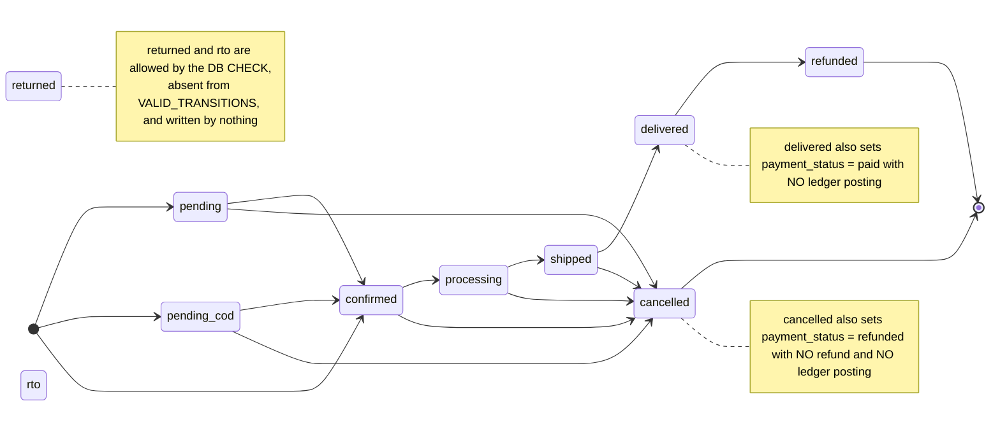
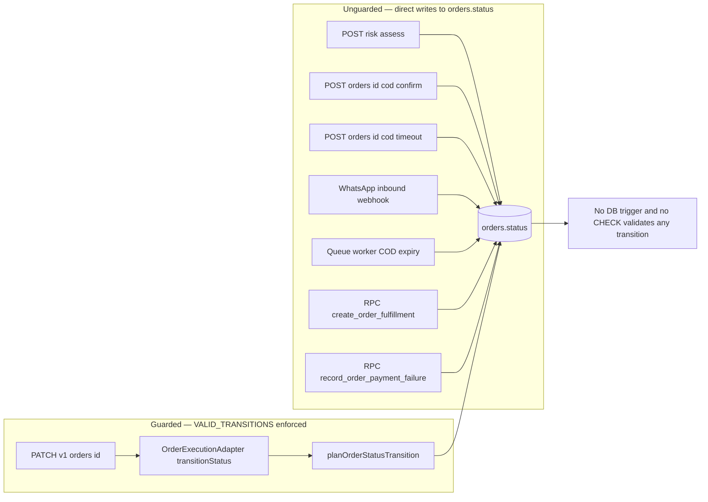
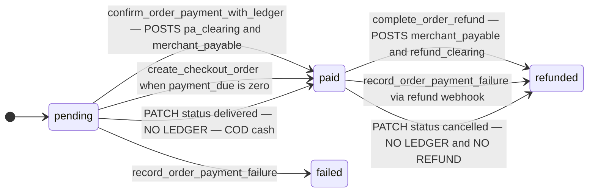
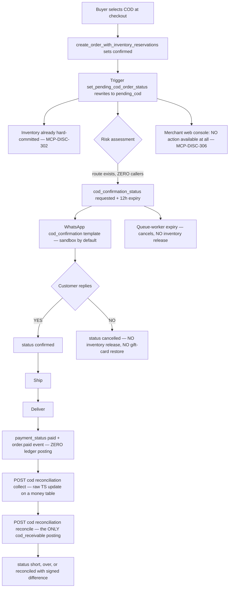

# 08 — ORDERS, FULFILLMENT, SHIPPING, COD, RETURNS

| Field | Value |
|---|---|
| Run ID | `docs/merchant-system-discovery/2026-08-04T225330+0530-bf35062e` |
| Branch | `stepup/main` |
| Commit | `bf35062e` |
| Run date | 2026-08-04 (+0530) |
| Scope | The merchant order lifecycle end to end: order creation, status transitions, fulfilment, shipping rates/serviceability/carriers/labels/tracking, COD (placement → confirmation → delivery → collection → remittance → reconciliation), cancellations, returns and refunds — across `apps/merchant-control-plane`, `apps/mobile/merchant-app`, `apps/storefront-runtime` (order-create path only), `services/api-gateway`, `services/webhook-service`, `services/queue-workers`, `packages/checkout-core`, `packages/infrastructure/logistics-adapter`, and `database/supabase/migrations`. |
| Evidence basis | Static source reading of gateway routes, app proxies, UI, adapters and SQL migrations, re-verified against the working tree while authoring this document. Evidence types used: `UI_CODE`, `PROXY_CODE`, `API_CLIENT_CODE`, `GATEWAY_CODE`, `SERVICE_CODE`, `DB_SCHEMA`, `RPC_FUNCTION`, `RLS_POLICY`, `WEBHOOK_OR_JOB`, `UNIT_TEST`, `PROVIDER_OR_CONFIG_EVIDENCE`, `DOC_CLAIM`, and exactly one `RUNTIME_OBSERVATION`. |
| **METHOD DISCLOSURE** | **Almost nothing in this document was runtime-verified. Exactly one item carries a `RUNTIME_OBSERVATION`: the tenant-guard rejection (MCP-DISC-300), reproduced locally by executing the real `tenant-scoped.ts` guard against the repo's real `@supabase/postgrest-js@2.95.3` builder with the network stubbed — no database, no deployed environment, no writes. Every other status in this document is therefore capped at `IMPLEMENTED_NOT_RUNTIME_VERIFIED` or below. No staging or production request was made; no build was run; no test suite was executed.** |
| Secrets / PII | No secrets or PII appear in this document. |

> Working-tree caveat: the repository carries ~6800 uncommitted user modifications. `tenant-scoped.ts`, `tenant-context.ts`, `orders.ts` and others are among them. All findings are against the **working-tree state**, which is what was assigned for audit. Divergence between this tree and any deployed artifact is an explicit unknown (§16).

---

## 1. Recommendation / verdict

**Do not launch orders in their current state. The order domain is not merchant-operable, and four of its money behaviours are actively false.**

Three verdicts, in order of consequence:

1. **The order lifecycle appears to be broken at the entry gate, not merely incomplete.** `resolveTenantContextForOrder` — the function that every order-mutation route calls first — issues a query the platform's own tenant-guard proxy rejects. Reproduced locally against the real guard and the real PostgREST builder: `THREW: Tenant table orders requires a tenant/owner predicate before execution`. If this manifests in the deployed gateway, a merchant cannot confirm, process, ship, deliver, cancel, fulfil, refund, edit, print, or COD-confirm a single order, and cannot open the order detail page. **This must be settled by one authenticated `PATCH /v1/orders/:id` against staging before anything else in this document is scheduled.** It is the single highest-value hour of work in the dossier.

2. **Four order paths assert money facts that never happened.** Cancelling an order writes `payment_status='refunded'` with no refund, no `refunds` row, no provider call and no ledger entry (MCP-DISC-303). Marking a COD order `delivered` writes `payment_status='paid'` and emits `order.paid` with zero canonical ledger posting; `cod_receivable` is credited **nowhere in the schema** (MCP-DISC-304). The COD "collect" step is a raw TypeScript `.update()` on a money table (MCP-DISC-304), and the canonical-ledger validator's file-level evidence check lets it through green (MCP-DISC-322). Return refunds are computed as `unit_price × qty`, ignoring discount, GST and shipping — over-refunding discounted lines and under-refunding taxed ones (MCP-DISC-308). These are not roadmap gaps; they are reporting lies that will surface as reconciliation breaks and buyer disputes.

3. **The India-first differentiators are built and unwired.** The cart-bound HMAC checkout handoff is genuinely well-engineered and has **zero consumers** — the live storefront uses an unsigned public order-create route (MCP-DISC-301, ART-14/R-11). COD risk assessment and COD-confirm-over-WhatsApp are fully implemented and have **zero callers** (MCP-DISC-317). `pending_cod` — the status COD orders actually land in — does not exist in the merchant web console's status union, so **COD orders display no actions at all** (MCP-DISC-306). Pincode/COD serviceability reads from a table **no code ever writes**, so it always returns a hardcoded "yes" (MCP-DISC-314). And the storefront asks for shipping rates with the literal pincode `'000000'`, so **every shipping zone and rate a merchant configures is ignored at checkout** (MCP-DISC-313).

There is a real asset underneath: idempotency keys with request-hash comparison and lock reclaim, `FOR UPDATE` locking in every money RPC, a same-transaction outbox, a correct capture/refund ledger posting in migration 168, a correct COD remittance ledger posting in migration 165, and a genuinely honest sandbox gate in `shipping-labels.ts`. The failure is wiring and enforcement, not architecture.

**Recommended sequence.** (a) Settle MCP-DISC-300 against staging. (b) Stop the money lies: MCP-DISC-303, 304, 305, 308. (c) Stop the stock destruction: MCP-DISC-302 + 307. (d) Close the unsigned order-create path: MCP-DISC-301 (ARB decision required). (e) Make COD operable: MCP-DISC-306 + 317. (f) Make shipping true: MCP-DISC-312, 313, 314, 315.

---

## 2. Scope

**In scope.** `orders`, `order_items`, `draft_orders`, `fulfillment_orders`, `shipments`, `returns`, `refunds`, `inventory_reservations` (as consumed by the order path), `cod_confirmation_requests`, `cod_reconciliation_entries`, `order_risk_assessments`, `shipping_zones`, `shipping_rates`, `shipping_serviceability_rules`. Gateway routers `orders.ts`, `order-risk.ts`, `returns.ts`, `shipping.ts`, `shipping-labels.ts`, `shipping-tax.ts`, `cod-reconciliation.ts`, `checkout.ts`, `storefront/checkout-payment-routes.ts`, `storefront/cart-routes.ts`. Merchant surfaces in `apps/merchant-control-plane` and `apps/mobile/merchant-app`. Order-affecting webhook and queue consumers.

**Adjacent, referenced but owned elsewhere.** Canonical ledger mechanics and payout settlement (Agent G). GST computation, invoice immutability and credit notes (Agent H). Platform-wide tenancy/RLS posture (Agent D). Inventory as a standalone merchant capability (Agent C). This document records the order-path consequences and hands the cross-cutting call to the owning document.

**Explicitly out of scope.** Subscriptions (not implemented anywhere in the repo). Marketplace/theme/developer-portal surfaces (frozen). Exchanges (do not exist — recorded as a gap, not analysed).

---

## 3. Current merchant user journeys — what a merchant can actually do today

Read this section as "what the code permits if MCP-DISC-300 does not manifest". If it does manifest, every row marked *mutation* fails with a 500 before doing any work.

### 3.1 Web console (`apps/merchant-control-plane`) — the primary merchant product

| Journey | Can they? | Where | Evidence |
|---|---|---|---|
| See a list of orders, filter by status/payment, search, sort, paginate | **Yes** | `/[store]/orders` | `apps/merchant-control-plane/src/app/[store]/orders/page.tsx:62-70` (filters), proxy `apps/merchant-control-plane/src/app/api/stores/[store]/orders/route.ts:1-43` |
| Confirm a `pending` order | Yes *(mutation)* | list row action | `page.tsx:746` |
| Move `confirmed` → `processing` | Yes *(mutation)* | list row action | `page.tsx:751` |
| Ship (enter tracking number, optional label) | Yes *(mutation)* | list row action | `page.tsx:756`, `page.tsx:308` |
| Mark `shipped` → `delivered` | Yes *(mutation)* | list row action | `page.tsx:761` |
| Cancel `pending`/`confirmed`/`processing` | Yes *(mutation)* | list row action | `page.tsx:766` |
| Refund a paid order (with step-up) | Yes *(mutation)* | list row action → step-up modal | `page.tsx:772`, proxy `apps/merchant-control-plane/src/app/api/stores/[store]/orders/[orderId]/refund/route.ts:45-52` |
| Open an order and see its details | Read-only | `/[store]/orders/[orderId]` | `apps/merchant-control-plane/src/app/[store]/orders/[orderId]/page.tsx` — the only network call is the `GET` at `:579` |
| **Act on an order from its detail page** | **No** | — | `[orderId]/page.tsx:686-693` renders five read-only cards; there are no action handlers |
| **Do anything at all with a COD order** | **No** | — | `pending_cod` is absent from the status union (`page.tsx:57`), the filter list (`:62-70`), every row action (`:746`, `:751`, `:756`, `:761`, `:766`) and every bulk action (`:449`, `:453`, `:457`). Verified: `grep -rn "pending_cod" apps/merchant-control-plane/src apps/mobile/merchant-app/lib` returns **nothing**. |
| View or download the GST invoice | **No** | — | `[orderId]/page.tsx:276-278` renders `gst_invoice_number` as plain text. `GET /v1/tax/invoice/:orderId` exists (`services/api-gateway/src/routes/tax.ts:118`) and **no app calls it**. |
| Print a packing slip | **No** | — | `GET /v1/orders/:id/packing-slip` exists (`services/api-gateway/src/routes/orders.ts:876`); consumed only by the Flutter app |
| Create or convert a draft order | **No** | — | `POST /v1/orders/drafts` (`orders.ts:689`), `/drafts/:id/convert` (`:776`) — mobile-only |
| Edit order line items | **No** | — | `PATCH /v1/orders/:id/line-items` (`orders.ts:984`) — mobile-only |
| Buy a shipping label | **No** | — | `services/api-gateway/src/routes/shipping-labels.ts` — mobile-only |
| Handle a return | **No** | — | A complete `/v1/returns` API exists (`services/api-gateway/src/routes/returns.ts`); there is **no returns page in the web console** |
| Reconcile COD cash | **No** | — | `services/api-gateway/src/routes/cod-reconciliation.ts` — mobile-only |
| Configure shipping zones and rates | **Yes** | `/[store]/settings/shipping` | `apps/merchant-control-plane/src/app/[store]/settings/shipping/page.tsx` (620 lines, zones + rates CRUD) — **but see MCP-DISC-313: these never reach checkout** |
| Configure pincode / COD serviceability | **No** | — | `shipping_serviceability_rules` has no writer anywhere (MCP-DISC-314) |
| Configure a carrier | **No** | — | No carrier configuration surface; no real carrier exists (MCP-DISC-315) |
| See an order timeline, add a note, see fulfilment/refund history | **No** | — | No such surface, despite `audit_activity_events` rows being written at order creation (`database/supabase/migrations/166_d6_checkout_handoff_inventory.sql:304-327`) |

### 3.2 Flutter merchant app (`apps/mobile/merchant-app`) — materially richer, and that is a problem

`apps/mobile/merchant-app/lib/services/order_service.dart` exposes list, get, draft list, draft create, draft convert, status update, cancel, fulfil, **line-item edit**, **packing slip**, **shipping-label rates**, **buy shipping label**, **refund**, **complete refund**, export (`order_service.dart:38,105,131,158,187,217,247,267,308,335,339,359,386,409`).

This is a **surface-parity contradiction**: the mobile app can do things the flagship web console cannot, and neither surface handles `pending_cod`. Two products exist for one role. `EVIDENCE: UI_CODE`.

### 3.3 The honest summary

A merchant on the web console today can run **prepaid orders only**, through the list page only, with no invoice, no packing slip, no returns, no timeline — and, if MCP-DISC-300 manifests, cannot run them at all.

---

## 4. Feature matrix

Status ceiling is `IMPLEMENTED_NOT_RUNTIME_VERIFIED` throughout unless a runtime observation is cited.

| # | Capability | Status | Evidence (path:line) | Gap ID |
|---|---|---|---|---|
| 1 | Order list (filter/search/sort/paginate) | IMPLEMENTED_NOT_RUNTIME_VERIFIED | `orders/page.tsx:62-70`; `services/api-gateway/src/routes/orders.ts:542` | — |
| 2 | Order detail read | CONTRADICTORY_EVIDENCE (leaning BROKEN) | `orders.ts:944` handler; unscoped query at `orders.ts:954-962` | MCP-DISC-300 |
| 3 | Order status transition (confirm/process/ship/deliver/cancel) | CONTRADICTORY_EVIDENCE (leaning BROKEN) | `orders.ts:1142` → `resolveTenantContextForOrder` (`services/api-gateway/src/lib/tenant-context.ts:244-258`) | MCP-DISC-300 |
| 4 | Transition legality enforcement | PARTIAL | `packages/checkout-core/src/index.ts:1426-1435` (table), `:1445-1468` (planner); enforced only via `services/api-gateway/src/execution/order-execution.adapter.ts:414-463` | MCP-DISC-311 |
| 5 | Order creation — storefront (live path) | IMPLEMENTED_NOT_RUNTIME_VERIFIED (unsigned) | `services/api-gateway/src/index.ts:723` (mount, pre-auth) vs `:750` (auth); handler `services/api-gateway/src/routes/storefront/checkout-payment-routes.ts:251` | MCP-DISC-301 |
| 6 | Order creation — signed cart-bound handoff | DORMANT_FLAGGED | verifier `services/api-gateway/src/routes/checkout.ts:221-297`; issuer `services/api-gateway/src/routes/storefront/cart-routes.ts:528-597`; **zero consumers** | MCP-DISC-301 |
| 7 | Server-authoritative line prices | IMPLEMENTED_NOT_RUNTIME_VERIFIED | `database/supabase/migrations/166_d6_checkout_handoff_inventory.sql:97-162` (`FOR UPDATE`, price read from DB) | — |
| 8 | Server-authoritative shipping amount | IMPLEMENTED_NOT_RUNTIME_VERIFIED | `database/supabase/migrations/170_v1_shipping_rates_gst.sql:112-133` (site-scoped join + explicit `RAISE`) | — (unreached: MCP-DISC-313) |
| 9 | Server-authoritative tax | PARTIAL | `p_tax_amount` accepted and written unvalidated (`170:46,157,291`); computed in the gateway (`checkout-payment-routes.ts:291-357`) | — (latent; see §6.4) |
| 10 | Inventory reserve-with-TTL | BROKEN | reserve `166:134-145` then commit **in the same transaction** `166:215-227`, plus `-qty` adjustment `166:229-248` | MCP-DISC-302 |
| 11 | Cancellation releases inventory (PATCH path) | IMPLEMENTED_NOT_RUNTIME_VERIFIED | `order-execution.adapter.ts:449-451` → `release_order_inventory_with_ledger` | — |
| 12 | Cancellation releases inventory (WhatsApp / worker paths) | BROKEN | absent in `services/api-gateway/src/routes/whatsapp.ts:398-479`; absent in `services/queue-workers/src/platform-queue-consumer.ts:1120-1133` | MCP-DISC-309 |
| 13 | Cancellation restores gift card | PARTIAL (best-effort, PATCH path only) | `orders.ts:1195-1211` (try/catch, "never blocks") | MCP-DISC-309 |
| 14 | Cancellation money truth | BROKEN | `packages/checkout-core/src/index.ts:1456-1459` sets `payment_status='refunded'` with no refund | MCP-DISC-303 |
| 15 | Fulfilment (create shipment, tracking) | IMPLEMENTED_NOT_RUNTIME_VERIFIED | RPC `create_order_fulfillment` `database/supabase/migrations/000_baseline.sql:2353`; route `orders.ts:1292` | — |
| 16 | Shipping label — honest sandbox/live gate | IMPLEMENTED_NOT_RUNTIME_VERIFIED | `services/api-gateway/src/routes/shipping-labels.ts:113-141`, `:331` (`test_mode` persisted) | — |
| 17 | Shipping label via fulfil route | BROKEN (ANTI-R9) | `services/api-gateway/src/routes/orders.ts:513` hardcodes `{ mode: 'sandbox' }`; `toFulfillmentTrackingFields` drops `testMode` (`packages/infrastructure/logistics-adapter/index.ts:257-263`) | MCP-DISC-312 |
| 18 | Real carrier integration | NOT_IMPLEMENTED / BLOCKED_EXTERNAL | all three providers are one scaffold (`logistics-adapter/index.ts:229-239`); `liveLogisticsProviderAvailable(){return false}` (`shipping-labels.ts:113-115`) | MCP-DISC-315 |
| 19 | Carrier tracking progression / webhook ingestion | NOT_IMPLEMENTED | `shipment_events` written only by `create_order_fulfillment` (`000_baseline.sql:2588-2606`); sandbox tracking returns one static event (`logistics-adapter/index.ts:208-225`) | MCP-DISC-315 |
| 20 | Pincode + COD serviceability | STUB_OR_MOCK | `shipping.ts:53-66` fabricated defaults; `:77-88` falls back on empty **and** on DB error; table has no writer | MCP-DISC-314 |
| 21 | Merchant shipping rates applied at checkout | BROKEN | `apps/storefront-runtime/src/app/store/[subdomain]/checkout/checkout-client.tsx:222` sends `pincode: '000000'` | MCP-DISC-313 |
| 22 | Shipping zones/rates CRUD | IMPLEMENTED_NOT_RUNTIME_VERIFIED | `settings/shipping/page.tsx`; `services/api-gateway/src/routes/shipping-tax.ts` | — |
| 23 | COD order placement (`pending_cod`) | IMPLEMENTED_NOT_RUNTIME_VERIFIED | `166:199` + trigger `database/supabase/migrations/074_cod_pending_status.sql:26-47` | — |
| 24 | COD merchant actions in web console | NOT_IMPLEMENTED | `orders/page.tsx:57,62-70,746,766` | MCP-DISC-306 |
| 25 | COD risk assessment | DORMANT_FLAGGED | `services/api-gateway/src/routes/order-risk.ts:153` — zero callers | MCP-DISC-317 |
| 26 | COD confirm / timeout routes | DORMANT_FLAGGED | `order-risk.ts:315`, `:419` — zero callers | MCP-DISC-317 |
| 27 | COD confirm over WhatsApp | STUB_OR_MOCK / BLOCKED_EXTERNAL | provider defaults to `letbuyy_sandbox` (`packages/infrastructure/whatsapp-commerce-adapter/index.ts:145-148`); `HR-WHATSAPP-LIVE` at `order-risk.ts:130-132` | MCP-DISC-317 |
| 28 | COD receivable posted at confirm/delivery | NOT_IMPLEMENTED | `cod_receivable` appears in the account list (`139_executable_foundation_ledger_core.sql:84`) and in exactly one posting — the **debit** at remittance (`165_d5_canonical_money_paths.sql:362`) | MCP-DISC-304 |
| 29 | COD cash collection | BACKEND_ONLY + un-ledgered | direct `.from('cod_reconciliation_entries').update(...)` at `services/api-gateway/src/routes/cod-reconciliation.ts:332-349` | MCP-DISC-304, MCP-DISC-322 |
| 30 | COD remittance + reconciliation | IMPLEMENTED_NOT_RUNTIME_VERIFIED | `reconcile_cod_remittance_with_ledger` (`165:267`), posting at `165:352-378` | — |
| 31 | Returns API (create/list/update/refund-complete) | BACKEND_ONLY | `services/api-gateway/src/routes/returns.ts:131,170,186,214,259` — no web UI | MCP-DISC-325 |
| 32 | Return refund arithmetic | BROKEN | `000_baseline.sql:2801` and `:2970` — `ROUND(unit_price * qty, 2)` only | MCP-DISC-308 |
| 33 | Refund ledger posting (complete) | IMPLEMENTED_NOT_RUNTIME_VERIFIED | `complete_order_refund` posts `merchant_payable`/`refund_clearing` (`168_b1_b2_capture_refund_ledgering.sql:314`) | — |
| 34 | Step-up on refund routes | PARTIAL | present only at `payments.ts:497`, `payouts.ts:576`, `security.ts:317`; **absent** at `orders.ts:1427`, `orders.ts:1342`, `returns.ts:259` | MCP-DISC-305 |
| 35 | Refund idempotency (gateway) | IMPLEMENTED_NOT_RUNTIME_VERIFIED | `services/api-gateway/src/execution/idempotency-execution.adapter.ts:59-143` | — |
| 36 | Refund idempotency (UI key stability) | BROKEN | `orders/page.tsx:394` mints a new UUID per submit | MCP-DISC-320 |
| 37 | Order edit (line items) | PARTIAL | `orders.ts:984-1141` — no inventory, no GST recompute, no status guard, no staff permission, no `orders.items` sync, no transaction | MCP-DISC-316 |
| 38 | Order immutability after checkout | DORMANT_FLAGGED | trigger `147_executable_order_state_risk.sql:125-153` requires `order_source='checkout'` + `order_locked_at IS NOT NULL`; neither is ever written | MCP-DISC-318 |
| 39 | Payment-failure handling | BROKEN | `services/webhook-service/src/index.ts:410` `releaseInventory: false` | MCP-DISC-307 |
| 40 | Refund-webhook handling | IMPLEMENTED_NOT_RUNTIME_VERIFIED | `services/webhook-service/src/index.ts:459` passes the release flag correctly | — |
| 41 | Shipped/delivered customer email | NOT_IMPLEMENTED | `enqueueOrderLifecycleEmail` supports only `cancelled`/`refunded` (`services/api-gateway/src/lib/order-confirmation-email.ts:215`) | MCP-DISC-325 |
| 42 | Exchanges | NOT_IMPLEMENTED | no implementation anywhere in the repo | MCP-DISC-325 |
| 43 | `returned` / `rto` statuses | NOT_IMPLEMENTED | allowed by DB CHECK (`147:34-44`), absent from `VALID_TRANSITIONS` (`checkout-core:1426-1435`), no writer | MCP-DISC-325 |
| 44 | Order money in minor units | PARTIAL | `numeric(12,2)` rupees throughout (`000_baseline.sql:10129-10136`; `109_orders_money_width.sql:11-17`) | MCP-DISC-321 |
| 45 | Order-domain RLS enforcement | PARTIAL | `service_role_orders FOR ALL USING(true)` (`163_d2_live_data_leak_rls.sql:10-21`); `withTenantTx` not imported by any order router | MCP-DISC-323 |
| 46 | Behavioural order tests in CI | PARTIAL | `services/api-gateway/src/__tests__/orders-v1.test.ts:1-38` is `assert.match(source, /regex/)`; `tests/executable/order-postgres.test.mjs:17-24` needs an external docker container | MCP-DISC-324 |

---

## 5. UI / route inventory

### 5.1 Merchant web console — pages

| Route | File | Lines | Function | Notes |
|---|---|---|---|---|
| `/[store]/orders` | `apps/merchant-control-plane/src/app/[store]/orders/page.tsx` | 923 | Order list + all row actions + bulk actions + step-up refund modal | The **only** operational order surface in the web product |
| `/[store]/orders/[orderId]` | `apps/merchant-control-plane/src/app/[store]/orders/[orderId]/page.tsx` | 699 | Order detail | **Read-only.** Five cards; single `GET` at `:579`. MCP-DISC-319 |
| `/[store]/settings/shipping` | `apps/merchant-control-plane/src/app/[store]/settings/shipping/page.tsx` | 620 | Shipping zones + rates CRUD | Rates never reach checkout (MCP-DISC-313) |
| — | — | — | Returns / draft orders / order edit / packing slip / label purchase / invoice view / timeline / COD reconciliation / COD confirm / risk review / RTO / exchanges / carrier config / serviceability config | **All absent** |

### 5.2 Merchant web console — app proxies (`PROXY_CODE`)

| Proxy route | File | Target |
|---|---|---|
| `GET /api/stores/:store/orders` | `apps/merchant-control-plane/src/app/api/stores/[store]/orders/route.ts` (43 lines) | `GET /v1/orders` |
| `GET/PATCH /api/stores/:store/orders/:orderId` | `.../orders/[orderId]/route.ts` (47 lines) | `GET /v1/orders/:id`, `PATCH /v1/orders/:id` |
| `POST /api/stores/:store/orders/:orderId/refund` | `.../orders/[orderId]/refund/route.ts` (65 lines) | resolves `payment_id`, then `POST /v1/payments/:paymentId/refund` **with `X-Step-Up-Token`** (`:45-52`) |
| `/api/stores/:store/shipping/{zones,rates}/**` | — | `/v1/shipping-tax/*` |

All proxies are gateway pass-throughs — no local DB writes. Consistent with route-ownership lockstep.

### 5.3 Gateway routers (`GATEWAY_CODE`)

| File | Lines | Routes (verified line numbers) |
|---|---|---|
| `services/api-gateway/src/routes/orders.ts` | 1467 | `GET /` `:542` · `GET /drafts` `:638` · `POST /drafts` `:689` · `POST /drafts/:id/convert` `:776` · `GET /:id/packing-slip` `:876` · `GET /:id` `:944` · `PATCH /:id/line-items` `:984` · `PATCH /:id` `:1142` · `POST /` `:1232` · `POST /:id/fulfill` `:1292` · `POST /:id/refund/complete` `:1342` · `POST /:id/refund` `:1427` |
| `services/api-gateway/src/routes/order-risk.ts` | 510 | `POST /risk/assess` `:153` · `POST /orders/:id/cod/confirm` `:315` · `POST /orders/:id/cod/timeout` `:419` |
| `services/api-gateway/src/routes/returns.ts` | 295 | `GET /` `:131` · `GET /:id` `:170` · `POST /` `:186` · `PATCH /:id` `:214` · `POST /:id/refund/complete` `:259` |
| `services/api-gateway/src/routes/checkout.ts` | 816 | Hosted checkout `contact` / `delivery` / `payment-intent` / `confirm` (`:598`) / `GET /:id` — **all gated by the cart-bound HMAC handoff** |
| `services/api-gateway/src/routes/shipping.ts` | 175 | `GET /serviceability/:pincode` `:90` · `POST /rates` · `GET /track/:trackingNumber` `:163` |
| `services/api-gateway/src/routes/shipping-labels.ts` | 427 | label rate / buy / list — honest sandbox/live mode, `test_mode` persisted `:331` |
| `services/api-gateway/src/routes/shipping-tax.ts` | 473 | zones / rates / taxes CRUD |
| `services/api-gateway/src/routes/cod-reconciliation.ts` | 382 | `GET /reconciliation` · `POST /reconciliation` (collect) `:311` · `POST /reconciliation/:id/reconcile` |
| `services/api-gateway/src/routes/storefront/checkout-payment-routes.ts` | — | `POST /storefront/:subdomain/orders` `:251` (**public order create**) + razorpay order/verify |
| `services/api-gateway/src/routes/storefront/cart-routes.ts` | — | `GET /storefront/:subdomain/cart/:cartToken/checkout-url` `:528-597` (**issues the signed handoff — no consumers**) |

### 5.4 Mount order — the auth boundary (verified in `services/api-gateway/src/index.ts`)

```
:723  api.route('/storefront', storefrontRouter);        <-- PUBLIC (order create lives here)
:724  api.route('/checkout',   checkoutRouter);          <-- PUBLIC but HMAC-gated
:729  api.route('/whatsapp/inbound', whatsappInboundRouter);  <-- PUBLIC (see MCP-DISC-310)
:750  api.use('/*', authMiddleware);                     <-- THE AUTH BOUNDARY
:751  api.use('/*', csrfProtection);
:752  api.use('/*', protectedMutationIdempotency);
:769  api.route('/orders',          ordersRouter);
:770  api.route('/orders',          orderCodRouter);
:771  api.route('/risk',            orderRiskRouter);
:772  api.route('/returns',         returnsRouter);
:773  api.route('/shipping/labels', shippingLabelsRouter);
:774  api.route('/shipping',        shippingRouter);
:782  api.route('/cod',             codReconciliationRouter);
```

`EVIDENCE: GATEWAY_CODE`. The storefront order-create route is mounted 27 lines **before** the auth middleware. That is the ART-14 violation in one line of evidence.

---

## 6. Backend / API / RPC / database mapping

### 6.1 Tables

`orders`, `order_items`, `order_line_adjustments`, `order_shipping_lines`, `order_tax_lines`, `fulfillment_orders`, `fulfillment_order_lines`, `shipments`, `shipment_events`, `returns`, `return_lines`, `refunds`, `refund_lines`, `refund_transactions`, `restock_events`, `inventory_reservations`, `inventory_levels`, `inventory_events`, `inventory_adjustments`, `draft_orders`, `draft_order_lines`, `checkout_sessions`, `carts`, `order_risk_assessments`, `cod_confirmation_requests`, `cod_reconciliation_entries`, `shipping_zones`, `shipping_rates`, `shipping_serviceability_rules`, `outbox_events`. `EVIDENCE: DB_SCHEMA`.

### 6.2 RPCs (all `SECURITY DEFINER`, `SET search_path TO 'public'`)

| RPC | Latest definition | Role on the order path |
|---|---|---|
| `create_checkout_order` | `database/supabase/migrations/170_v1_shipping_rates_gst.sql:31` | The single order-creation entry; resolves shipping rate, promotion, gift card; requires `idempotency_key` (`170:76-78`) |
| `create_order_with_inventory_reservations` | `166_d6_checkout_handoff_inventory.sql:8` | Inserts `orders` + `order_items` + outbox; **reserves and commits inventory in one transaction** |
| `create_order_fulfillment` | `000_baseline.sql:2353` | Creates `fulfillment_orders`, `shipments`, `shipment_events`; **forces** `orders.status` |
| `create_order_return_and_refund` | `000_baseline.sql:2678` | Creates `returns` + `refunds` (`status='pending'`), optional restock |
| `complete_order_refund` | `168_b1_b2_capture_refund_ledgering.sql:314` | Posts `merchant_payable` / `refund_clearing` to the canonical ledger |
| `confirm_order_payment_with_ledger` | `168_b1_b2_capture_refund_ledgering.sql:133` | Posts `pa_clearing` / `merchant_payable` (`168:232-259`) |
| `record_order_payment_failure(_with_ledger)` | `000_baseline.sql:5803` / `:5948` | Sets `status` + `payment_status` directly; conditional inventory release (`:5879-5881`) |
| `release_order_inventory(_with_ledger)` | `000_baseline.sql:6995` / `:7120` | Idempotent-by-state release (`:7015-7022`) |
| `reconcile_cod_remittance_with_ledger` | `165_d5_canonical_money_paths.sql:267` | The **only** `cod_receivable` posting in the schema (`165:352-378`) |
| `restore_gift_card_on_refund` | migration 174 | Called from `orders.ts:1195`, `orders.ts:1392`, `order-risk.ts:304` — **not** from the returns path |

### 6.3 Idempotency and locking — proven from SQL (`RPC_FUNCTION`)

| RPC | Key required | Replay guard | Row lock |
|---|---|---|---|
| `create_checkout_order` | YES (`170:76-78`) | `checkout_sessions(site_id, idempotency_key)` returns the existing order (`170:84-102`) | `orders … FOR UPDATE` (`170:169-172`); gift card `FOR UPDATE` (`170:208`) |
| `create_order_with_inventory_reservations` | **NO key parameter** (`166:8-20`) | none — relies entirely on the caller | `products … FOR UPDATE` (`166:87`) |
| `create_order_fulfillment` | YES (`baseline:2369-2371`) | `fulfillment_orders(site_id, idempotency_key)` → `idempotent_replay: true` (`:2389-2401`) | `orders` `:2378`, `order_items` `:2447` |
| `create_order_return_and_refund` | YES (`baseline:2701-2703`) | `returns(site_id, idempotency_key)` (`:2724-2737`) | `orders` `:2708`, `order_items` `:2785`, `inventory_levels … FOR UPDATE OF il` `:2853` |
| `release_order_inventory` | no key; idempotent by state (`baseline:7015-7022`) | "any released reservation exists" — **not per-reservation** | `orders … FOR UPDATE` (`:7009`) |
| `reconcile_cod_remittance_with_ledger` | YES (`165:291-293`) | `reconciliation_idempotency_key` (`165:296-304`) | `cod_reconciliation_entries … FOR UPDATE` (`165:306-312`) |

Gateway-level idempotency (`services/api-gateway/src/execution/idempotency-execution.adapter.ts:59-143`) is sound — unique-constraint insert, request-hash comparison with `ConflictError` on body mismatch, completed-replay return, 120 s lock, reclaim after expiry. Applied to `PATCH /:id` (`orders.ts:1152`), `POST /` (`:1237`), `POST /:id/fulfill` (`:1301`), `POST /:id/refund` (`:1436`), `POST /:id/refund/complete` (`:1351`), `PATCH /:id/line-items` (`:990`), drafts, risk assess, COD confirm/timeout, storefront order create (`checkout-payment-routes.ts:264`).

**Not idempotency-protected at the gateway:** `POST /v1/returns` (`returns.ts:186` — forwards `body.idempotency_key` to the RPC but takes no gateway claim), `PATCH /v1/returns/:id` (`returns.ts:214` — no key at all), `POST /v1/cod/reconciliation` (`cod-reconciliation.ts:311` — hand-rolled lookup, no lock).

**Residual retry hazards:** (a) the merchant refund UI mints a new key per submit — MCP-DISC-320; (b) `release_order_inventory`'s guard short-circuits after any partial prior release; (c) the `order_shipping_lines` INSERT inside `create_checkout_order` (`170:339-357`) has no `ON CONFLICT` — safe only because the whole RPC is one transaction behind the `checkout_sessions` replay check.

### 6.4 Server-authoritative amounts — what is and is not

**Genuinely server-authoritative.** Line prices are read from `products.price` / `product_variants.price` under `FOR UPDATE` and multiplied server-side (`166:97-162`); the client sends only `product_id`, `variant_id`, `quantity` (`checkout.ts:163-169`, `checkout-payment-routes.ts:372-376`). Shipping is resolved from `shipping_rates ⋈ shipping_zones` scoped to `sz.site_id = p_store_id` with an explicit `RAISE EXCEPTION 'shipping rate not found or does not belong to this store'` (`170:112-133`). Discounts come from `evaluate_checkout_promotion(...)` (`170:184-191`). Gift-card balance is derived from `gift_card_ledger_entries` and capped by `LEAST(balance, grand_total)` (`170:214-229`).

**Latent weakness — `p_tax_amount`.** `create_checkout_order` accepts `p_tax_amount numeric(12,2)` and writes it straight to `orders.tax` (`170:46`, `170:157`, `170:291`) with **no validation against the lines**. Today the value originates in the gateway (`checkout-payment-routes.ts:291-357`, computed from `tax_registrations` + `tax_rates` + DB prices), so it is not attacker-controlled — but the DB is not the tax authority, the gateway is, and `POST /v1/orders` (admin) flows through the same adapter (`order-execution.adapter.ts:175`). Recorded as a **latent** server-authority weakness, not a live exploit. Handed to Agent H.

**GST degrades silently to zero.** `checkout-payment-routes.ts:355-357` is `catch { computedTaxAmount = null; }` — any failure in the tax lookup yields a **₹0 tax order with no signal**. The same shape exists in `OrderExecutionAdapter.generateAndPersistGstInvoice`, which `return null`s on a missing supplier state code (`order-execution.adapter.ts:259`) or missing recipient state (`:268`). Handed to Agent H.

### 6.5 Order-create paths and the ART-14 / R-11 test

ART-14 / R-11 forbid *an unsigned public order-create path* and require the HMAC to bind *a hash of sorted line items + coupons + subtotal*.

| # | Entry point | Auth | Signed cart-bound handoff | Verdict |
|---|---|---|---|---|
| 1 | `POST /v1/storefront/:subdomain/orders` (`checkout-payment-routes.ts:251`) | **PUBLIC** — mounted `index.ts:723`, auth at `:750`; only per-IP `authRateLimit` (`storefront/public-routes.ts:737-741`) | **NONE** — nothing in the handler reads a signature, digest, cart token or expiry | **VIOLATION. This is the live storefront path.** |
| 2 | `POST /v1/checkout/:cartId/confirm` (`checkout.ts:598`) | Public but HMAC-gated | **YES** — `verifyCheckoutHandoff` (`checkout.ts:221-297`) requires `site_id`, `cart_token`, `expires_at`, `cart_digest`, `signature`; recomputes `sha256Hex(canonicalCheckoutCartBinding(...))` from the **live cart row** and `timingSafeEqualHex`-compares; then HMAC-SHA256 over `canonicalCheckoutHandoffPayload` (`checkout.ts:276-287`) | Correct design — **DORMANT, zero consumers** |
| 3 | `POST /v1/orders` (admin, `orders.ts:1232`) | Merchant session + `resolveTenantContextForOwnedSite` | N/A (merchant-authored) | Acceptable |
| 4 | `POST /v1/orders/drafts/:id/convert` (`orders.ts:776`) | Merchant session | N/A | Acceptable |

Only two `INSERT INTO orders` statements exist in the schema — `000_baseline.sql:3413` (superseded) and `166_d6_checkout_handoff_inventory.sql:165` (live). All four entry points funnel through `create_checkout_order` → `create_order_with_inventory_reservations`.

**Proof the signed handoff is dead.** The signature is issued by `GET /v1/storefront/:subdomain/cart/:cartToken/checkout-url` (`cart-routes.ts:528-597`), which builds a URL on `CHECKOUT_ORIGIN` (`services/api-gateway/wrangler.toml:286` → the hosted checkout origin). A repo-wide search for consumers of `checkout-url` across `apps/**` and `packages/typescript/api-client/src` returns **no callers**. There is no `apps/checkout` runtime in the canonical topology, and `apps/checkout` is on the deprecated-alias list in `CLAUDE.md`. The hosted origin was never built (`[HUMAN-REQUIRED] HR-DNS-CHECKOUT`, `checkout.ts:176-178`).

**Proof the live path is #1.** `apps/storefront-runtime/src/app/store/[subdomain]/checkout/checkout-client.tsx:414` → `fetch('/api/orders')` → `apps/storefront-runtime/src/app/api/orders/route.ts:48` → `packages/typescript/api-client/src/index.ts:5429` (`storefront.createOrder`) → `POST /v1/storefront/:subdomain/orders`.

**Binding content (path 2 only).** `canonicalCheckoutCartBinding` (`packages/checkout-core/src/index.ts:510-547`) hashes version, `site_id`, `cart_id`, `cart_token`, channel, `expires_at`, de-duplicated + sorted uppercase coupon codes, and lines sorted by `product_id`/`variant_id`/`quantity` with `unit_price_minor` and `line_total_minor`. There is **no explicit subtotal field** — the per-line totals make it implicit but not stated. Against the literal ART-14 wording this is `PARTIAL`.

**Secret fallback.** `checkoutSigningSecret` (`checkout.ts:87-92`) returns a hardcoded sandbox string whenever `ENVIRONMENT`/`APP_ENV` is not `production` and no real secret is configured. Production fails closed (`return null` → 503 `CHECKOUT_SETUP_REQUIRED`) — correct. **Staging is forgeable.**

---

## 7. State machines

### 7.1 Order status — the guarded machine

Values are constrained by a DB `CHECK` (`147_executable_order_state_risk.sql:34-44`): `pending`, `pending_cod`, `confirmed`, `processing`, `shipped`, `delivered`, `cancelled`, `refunded`, `returned`, `rto`.

Transitions are constrained **only in TypeScript** (`packages/checkout-core/src/index.ts:1426-1435`, verified verbatim):

```ts
export const VALID_TRANSITIONS: Record<string, string[]> = {
  pending:     ['confirmed', 'cancelled'],
  pending_cod: ['confirmed', 'cancelled'],
  confirmed:   ['processing', 'cancelled'],
  processing:  ['shipped', 'cancelled'],
  shipped:     ['delivered', 'cancelled'],
  delivered:   ['refunded'],
  cancelled:   [],
  refunded:    [],
};
```

`returned` and `rto` are **absent from the table entirely** — allowed by the database, unreachable by design, written by nothing.

**There is no database-level transition guard.** No trigger, no `(old,new)` CHECK. The sole enforcement point is `planOrderStatusTransition()` (`checkout-core:1445-1468`), reached only through `OrderExecutionAdapter.transitionStatus()` (`order-execution.adapter.ts:414-463`), reached only from `PATCH /v1/orders/:id` (`orders.ts:1142`).



### 7.2 Order status — the writers that bypass the guard entirely

Six writers set `orders.status` without consulting `VALID_TRANSITIONS`. Two apply **no current-status filter at all**, so backwards and illegal transitions are reachable from a merchant session.

| Writer | Evidence | Status filter? | Consequence |
|---|---|---|---|
| `POST /v1/orders/:id/cod/confirm` | `order-risk.ts:362-368` | **NO** — updates by `id` + `store_id` only | A `delivered` order can be pushed back to `confirmed` |
| `POST /v1/risk/assess` | `order-risk.ts:210-232` | **NO** | `status='pending_cod'` can be set on any order, including a delivered one |
| `POST /v1/orders/:id/cod/timeout` | `order-risk.ts:450-465` | yes (`pending_cod`/`pending`) | — |
| WhatsApp inbound webhook | `whatsapp.ts:452-468` | **NO** | Any status can be overwritten by an inbound message |
| Queue-worker COD expiry | `platform-queue-consumer.ts:1120-1133` | yes | — |
| `create_order_fulfillment` RPC | `000_baseline.sql:2610` | forces `shipped`/`processing` | — |
| `record_order_payment_failure` RPC | `000_baseline.sql:5874` | none | Sets `cancelled` or `refunded` directly |



`EVIDENCE: GATEWAY_CODE, SERVICE_CODE, RPC_FUNCTION, WEBHOOK_OR_JOB`. Gap: MCP-DISC-311.

### 7.3 Payment status

DB `CHECK` (`000_baseline.sql:10168`): `pending | paid | failed | refunded`. There is **no `partially_refunded`, no `authorized`, no `voided`** — despite `refund_status` carrying `partially_refunded` (`:10170`).



The two `NO LEDGER` arrows are MCP-DISC-303 (cancel) and MCP-DISC-304 (COD delivery). Evidence: `checkout-core:1453-1455` and `:1456-1459`; ledger postings at `168:133` and `168:314`.

### 7.4 Fulfilment — two parallel fields, one dead

| Field | Constraint | Written by | Read by |
|---|---|---|---|
| `orders.fulfillment_status` | **No CHECK on `orders`** (the CHECK at `000_baseline.sql:10043` is on `order_items`) | `create_order_fulfillment` (`baseline:2610`) → `fulfilled` \| `partial` | the merchant UI |
| `orders.fulfillment_state` | CHECK: `unfulfilled\|hold\|partial\|fulfilled\|delivered\|returned\|rto\|cancelled` (`147:53-54`) | only `order-risk.ts:223,353,359,455`, `whatsapp.ts:460,465`, `platform-queue-consumer.ts:1125` — **never by the fulfilment RPC** | nothing operational |
| `orders.financial_state` | CHECK with 7 values (`147:51-52`) | **nothing** | **nothing** |

In each pair the constrained field is dead and the unconstrained field is live. Gap: MCP-DISC-318.

### 7.5 COD lifecycle



The governance target (root `AGENTS.md:246`, PAY-R2) is *"COD → `cod_receivable` at confirm, relieved at remittance with signed breaks."* Verified repo-wide: `cod_receivable` appears in exactly two places in the entire migration set — the account declaration (`139_executable_foundation_ledger_core.sql:84`) and the **debit** at remittance (`165_d5_canonical_money_paths.sql:362`). **There is no credit leg anywhere.** The two-legged model is not implemented; there is one leg, fired manually by the merchant, long after the cash event. Gap: MCP-DISC-304.

---

## 8. Auth / tenant / invariant analysis

### 8.1 The tenant guard rejects the order-lifecycle resolver — the single most consequential finding

`getSupabaseAdmin` returns a **Proxy-guarded** client: `services/api-gateway/src/lib/supabase.ts:13-19` wraps `createSupabaseServiceClient(env)` in `createTenantGuardedSupabaseClient` (`services/api-gateway/src/tenant/tenant-scoped.ts:112-124`). The guard rejects the awaited query unless a scope predicate was observed (`tenant-scoped.ts:78-110`). The scope columns registered for `orders` are exactly `["site_id","store_id"]` (`services/api-gateway/src/tenant/tenant-tables.registry.ts:1466-1471`). `markScopeFromCall` (`tenant-scoped.ts:52-77`) marks scope only for `eq | in | filter | match | or | insert | upsert` — **not for `select`, and not for `is`**.

`resolveTenantContextForOrder` (`services/api-gateway/src/lib/tenant-context.ts:244-258`, re-read verbatim while authoring this document):

```ts
export async function resolveTenantContextForOrder(c: AppContext, orderId: string): Promise<TenantContext> {
    const db = getSupabaseAdmin(c);
    const { data: order } = await db
        .from('orders')
        .select('id, store_id')   // 'select' does not mark scope
        .eq('id', orderId)        // 'id' is not a scope column
        .is('deleted_at', null)   // 'is' is not handled by markScopeFromCall
        .maybeSingle();
    ...
}
```

**`RUNTIME_OBSERVATION`** (the only one in this document). The real `tenant-scoped.ts` module was executed against the repo's real `@supabase/postgrest-js@2.95.3` builder, network stubbed, no database, no writes:

```
A  resolveTenantContextForOrder-shape (REAL builder): THREW: Tenant table orders requires a tenant/owner predicate before execution
B  store_id-scoped                    (REAL builder): RESOLVED {"error":null,"data":null,...}
```

The guard rejects the **promise**, so `await` throws — it does not surface as `{ error }`, which means the `isMissingColumnError(error, 'deleted_at')` fallbacks downstream never execute.

**Blast radius — routes that call `resolveTenantContextForOrder` before doing any work:**

| Route | Call site |
|---|---|
| `PATCH /v1/orders/:id` | `orders.ts:1146` |
| `PATCH /v1/orders/:id/line-items` | `orders.ts:988` |
| `POST /v1/orders/:id/fulfill` | `orders.ts:1296` |
| `POST /v1/orders/:id/refund` | `orders.ts:1431` |
| `POST /v1/orders/:id/refund/complete` | `orders.ts:1346` |
| `GET /v1/orders/:id/packing-slip` | `orders.ts:879` |
| `POST /v1/orders/:id/cod/confirm` | `order-risk.ts:319` |
| `POST /v1/orders/:id/cod/timeout` | `order-risk.ts:423` |
| `POST /v1/returns` | `returns.ts:189` |
| Shipping-label load-owned-order | `shipping-labels.ts:188` |

Two further unscoped `orders` reads fail the same way independently: `GET /v1/orders/:id` (`orders.ts:954-962` — this is what the **merchant order detail page** calls) and `GET /v1/tax/invoice/:orderId` (`services/api-gateway/src/routes/tax.ts:125-129`).

Scoped and therefore unaffected: `orders.ts:503,570,882,1086,1102,1115`, `order-execution.adapter.ts:235,338,386,421,454`, `order-risk.ts:175,228,363,451`, `whatsapp.ts:454`, `cod-reconciliation.ts:143,170`, `shipping-labels.ts:193`. Note `applyLogisticsLabel` at `orders.ts:502-507` **is** correctly scoped (`.eq('id', …).eq('store_id', …)`) — the failure is upstream of it.

**Status: `CONTRADICTORY_EVIDENCE`, leaning BROKEN.** The guard module, the registry entry and the calling query shape are all in this working tree, and the reproduction used the real modules. But no deployed gateway was probed (forbidden), and all three files carry uncommitted modifications. One authenticated `PATCH /v1/orders/:id` against staging settles it. Gap: MCP-DISC-300.

### 8.2 Auth issuer and authorization per route

| Route group | Issuer | Ownership check | Staff permission | Step-up |
|---|---|---|---|---|
| `POST /v1/storefront/:subdomain/orders` | **NONE — public** | tenant derived from subdomain via `loadPublishedStore` | — | — |
| `POST /v1/checkout/:cartId/*` | **NONE — public**, but HMAC cart-bound handoff | `site_id` inside the signed payload | — | — |
| `PATCH /v1/orders/:id` | merchant ES256 session (`authMiddleware`, `index.ts:750`) | `resolveTenantContextForOrder` → `resolveTenantContextForOwnedSite` | `assertStaffPermission` (`orders.ts:1148`) | — |
| `POST /v1/orders/:id/fulfill` | merchant | same | yes (`orders.ts:1299`) | — |
| `POST /v1/orders/:id/refund` | merchant | same | yes (`orders.ts:1434`) | **MISSING** |
| `POST /v1/orders/:id/refund/complete` | merchant | same | yes (`orders.ts:1349`) | **MISSING** |
| `POST /v1/returns/:id/refund/complete` | merchant | site-scoped | **MISSING** | **MISSING** |
| `PATCH /v1/orders/:id/line-items` | merchant | `resolveTenantContextForOrder` | **MISSING** | — |
| `POST /v1/orders` (create), `/drafts*` | merchant | `resolveTenantContextForOwnedSite` | **MISSING** | — |
| all `order-risk.ts` routes | merchant | `resolveTenantContextForOrder` | **MISSING** | — |
| all `returns.ts` routes | merchant | site-scoped | **MISSING** | — |
| `POST /v1/whatsapp/inbound` | **NONE off-production** | tenant taken from a **client-supplied `store_id`** | — | — |

`EVIDENCE: GATEWAY_CODE`.

### 8.3 Step-up (R-10) — exhaustive call-site enumeration

`verifySensitiveActionStepUp` is genuine HMAC-SHA256 (`services/api-gateway/src/lib/security-controls.ts:160-244`; `step_up_crypto: 'hmac-sha256'` at `:31,233`). A repo-wide grep across `services/api-gateway/src` excluding tests returns exactly three call sites:

```
services/api-gateway/src/routes/security.ts:317
services/api-gateway/src/routes/payouts.ts:576
services/api-gateway/src/routes/payments.ts:497
```

It is **absent** from all three order/return refund routes — `orders.ts:1427`, `orders.ts:1342`, `returns.ts:259` — every one of which moves money and every one of which is reachable with only a merchant session cookie. The web UI happens to route refunds through the *payments* endpoint (which is protected, `refund/route.ts:45-52`), so the exposure is in the **API surface**, not today's click-path. The API is the security boundary. `[HIGH-STAKES]` P0. Gap: MCP-DISC-305.

### 8.4 Tenancy posture — RLS is bypassed for the whole order domain

`orders` carries `service_role_orders FOR ALL TO service_role USING(true) WITH CHECK(true)` (`database/supabase/migrations/163_d2_live_data_leak_rls.sql:10-21`), and every gateway order read/write uses the service client. The tenant GUC policy `orders_tenant_site_guc` is `TO authenticated` and therefore never applies to gateway traffic. Isolation rests entirely on TypeScript `.eq('store_id', …)` filters plus the guard Proxy. `withTenantTx` (`services/api-gateway/src/lib/tenant-context.ts:67-73`), which would set the per-transaction GUC, is **not imported** by `orders.ts`, `order-risk.ts`, `returns.ts`, `shipping.ts` or `cod-reconciliation.ts`. A stale baseline policy `store_owner_orders` (`000_baseline.sql:27118-27121`) has no `TO` clause and was never dropped — benign today (its subquery yields nothing for `anon`) but dead surface. `EVIDENCE: RLS_POLICY, GATEWAY_CODE`. Gap: MCP-DISC-323; cross-cutting call belongs to Agent D.

Two further tenancy observations:

- `GET /v1/shipping/track/:trackingNumber` (`shipping.ts:163-173`) takes a bare tracking number with **no store scoping and no ownership check** — any authenticated merchant can query any tracking number.
- `findOrderByPaymentCandidates` (`services/webhook-service/src/index.ts:331-352`) resolves orders by `payment_id` **across all tenants** via a raw REST `or(...)` filter, then acts on `order.store_id` without cross-checking the webhook's own site. Provider event ids are globally unique so the practical risk is low, but it is an unscoped cross-tenant read.

### 8.5 Invariant scorecard for this domain

| Invariant | Verdict | Evidence |
|---|---|---|
| **Canonical ledger only** (money mutates only via `SECURITY DEFINER` RPCs) | **VIOLATED** | `cod-reconciliation.ts:332-349` is a raw `.update()` on `cod_reconciliation_entries`, a declared money table (`scripts/validators/canonical-ledger-only-validator.mjs:19`) |
| **Every money movement posts to the ledger idempotently** (R-5) | **VIOLATED** | cancel (`checkout-core:1456`), COD delivery (`checkout-core:1453`), COD collect (`cod-reconciliation.ts:332`) |
| **Server-authoritative amounts** | **HOLDS** for lines/shipping/discount/gift card; **LATENT WEAKNESS** on `p_tax_amount` | `166:97-162`, `170:112-133`, `170:184-229`; vs `170:46,157,291` |
| **Razorpay signature verified server-side** | Out of scope here (Agent G); the order path consumes the verified result | `168:133` |
| **Idempotency + locks on every money RPC** | **HOLDS at the RPC layer**; `create_order_with_inventory_reservations` has no key of its own but is only reachable behind `create_checkout_order`'s replay guard | §6.3 |
| **Step-up gates refunds** (R-10) | **VIOLATED on 3 of 4 refund routes** | §8.3 |
| **No pre-payment inventory decrement** (ART-14) | **VIOLATED** | `166:134-145` then `166:215-227` in one transaction |
| **No unsigned public order-create path** (ART-14 / R-11) | **VIOLATED** | `index.ts:723` vs `:750` |
| **One real carrier** (ART-15) | **NOT IMPLEMENTED**, honestly declared | `logistics-adapter/index.ts:229-239`; `SKIPPED_HUMAN_DECISIONS.md:59` |
| **No mock output may read as a real provider fact** (ANTI-R9) | **VIOLATED on the fulfil path**; honoured on the labels path | `orders.ts:513` vs `shipping-labels.ts:113-141,331` |
| **Single inventory mutation path** (ART-15) | **VIOLATED** | `create_order_return_and_refund` writes `inventory_levels` directly (`000_baseline.sql:2853-2872`, `:3013-3032`), bypassing the reserve→commit RPCs |
| **RLS forced on tenant tables; no blanket service_role for tenant data** (ART-08 / R-3) | **VIOLATED** for the order domain | `163_d2_live_data_leak_rls.sql:10-21` |
| **Money in `bigint` minor units** (R-8 / ART-13) | **VIOLATED** | `numeric(12,2)` rupees; `109_orders_money_width.sql:11-17` says so in its own header |
| **A green gate means conformance** (R-18) | **VIOLATED** | file-level evidence check launders the COD write (`canonical-ledger-only-validator.mjs:131`) |

### 8.6 End-to-end traces for material capabilities

Format: entry point → page/route → app proxy → typed client → `/v1` gateway route → auth issuer + authz + ownership → validation / server-authoritative computation → RPC/tables + RLS → webhook/queue/provider → downstream consequence → tests → runtime observation. Every missing link is marked **MISSING**.

#### Trace 1 — Buyer places a prepaid order (the live production path)

```
storefront checkout form (checkout-client.tsx:414)
 -> POST /api/orders                            apps/storefront-runtime/src/app/api/orders/route.ts:48
 -> typed client storefront.createOrder         packages/typescript/api-client/src/index.ts:5429
 -> POST /v1/storefront/:subdomain/orders       mounted index.ts:723 (BEFORE authMiddleware at :750)
      auth issuer                               MISSING  <-- ART-14 / R-11 violation (MCP-DISC-301)
      signed cart-bound handoff                 MISSING  <-- verifier exists at checkout.ts:221, unused
      ownership check                           tenant derived from subdomain (loadPublishedStore)
      rate limit                                per-IP authRateLimit only (public-routes.ts:737-741)
 -> handler                                     checkout-payment-routes.ts:251
      shipping rate resolution                  resolveShippingRate(db, store.id, body.shippingRateId)
                                                -> null in practice (MCP-DISC-313)
      GST                                       computed in TS (:291-357); silent zero on any throw
 -> OrderExecutionAdapter.createOrder           order-execution.adapter.ts:146 (assertOrderQuota)
 -> RPC create_checkout_order                   170_v1_shipping_rates_gst.sql:31
      idempotency                               checkout_sessions(site_id, idempotency_key)  OK
   -> RPC create_order_with_inventory_reservations  166:8
        reserve_inventory TTL 1200               166:134-145
        commit_inventory_reservation SAME TX     166:215-227   <-- MCP-DISC-302
        inventory_adjustments -qty               166:229-248
        INSERT orders / order_items              166:165 / 166:250
        INSERT outbox_events order.created       166:276  (ON CONFLICT DO NOTHING)
      shipping/tax/discount/gift-card applied, UPDATE orders totals  170:288-300
 -> generateAndPersistGstInvoice                 order-execution.adapter.ts:337  (plain .update on orders)
 -> Razorpay order -> buyer pays -> verify       storefront payment routes
 -> RPC confirm_order_payment_with_ledger        168:133  POSTS pa_clearing / merchant_payable   OK
 -> enqueueOrderConfirmationEmail                payment-route-support.ts:336 (signed queue envelope)
 -> queue-workers                                analytics rollups + notification side effects
 -> merchant order LIST                          GET /v1/orders  (scoped query — works)
 -> merchant order DETAIL                        GET /v1/orders/:id  -> UNSCOPED  <-- MCP-DISC-300
 -> tests                                        MISSING (regex-only, MCP-DISC-324)
 -> runtime observation                          MISSING
```

#### Trace 2 — Merchant ships an order

```
orders/page.tsx:756 "Ship" -> handleFulfill (page.tsx:308)
 -> PATCH /api/stores/:store/orders/:id  {status:'shipped', tracking_number}
 -> merchant proxy                        apps/merchant-control-plane/src/app/api/stores/[store]/orders/[orderId]/route.ts
 -> PATCH /v1/orders/:id                  orders.ts:1142
      auth issuer                         merchant ES256 session
      resolveTenantContextForOrder        orders.ts:1146  <-- MCP-DISC-300, guard rejects
      assertStaffPermission 'orders:write' orders.ts:1148 (never reached if the above throws)
      idempotency key                     admin-order-<id>-shipped-<uuid>  (new every click)
 -> planOrderStatusTransition             checkout-core:1445; delegatesToFulfillment when 'shipped'
 -> OrderExecutionAdapter.fulfillOrder    -> applyLogisticsLabel (orders.ts:494)
      createLogisticsProvider(..., { mode: 'sandbox' })   orders.ts:513  <-- MCP-DISC-312, hardcoded
      toFulfillmentTrackingFields drops testMode          logistics-adapter/index.ts:257-263
 -> RPC create_order_fulfillment          000_baseline.sql:2353
      forces orders.status / fulfillment_status / tracking_number / carrier   :2610-2617
      does NOT write fulfillment_state
      INSERT shipments + shipment_events + outbox 'fulfillment.shipped'
 -> emitOrderEvent 'order.fulfilled'      orders.ts:435-441
 -> customer "shipped" email              MISSING  (order-confirmation-email.ts:215 supports only cancelled/refunded)
 -> storefront buyer order page           shows a tracking number fabricated even in production
 -> carrier tracking progression          MISSING (no tracking webhook anywhere)
 -> tests                                 regex-only (orders-v1.test.ts)
 -> runtime observation                   MISSING
```

#### Trace 3 — Merchant refunds

```
orders/page.tsx:772 "Refund" -> step-up modal -> page.tsx:388
 -> POST /api/stores/:store/orders/:id/refund     merchant proxy
      proxy resolves payment_id via GET /v1/orders/:id   <-- UNSCOPED, MCP-DISC-300 throws first
 -> POST /v1/payments/:paymentId/refund with X-Step-Up-Token
      step-up ENFORCED                              payments.ts:497   OK
      idempotency_key = refund-<orderId>-<uuid>     page.tsx:394  <-- new per click, MCP-DISC-320
 -> ledger posting                                  complete_order_refund (168:314)  OK

ALTERNATIVE API SURFACE — reachable with only a session, no UI, NO STEP-UP:
 POST /v1/orders/:id/refund            -> create_order_return_and_refund   orders.ts:1427   MISSING step-up
 POST /v1/orders/:id/refund/complete   -> complete_order_refund            orders.ts:1342   MISSING step-up
 POST /v1/returns/:id/refund/complete  -> complete_order_refund            returns.ts:259   MISSING step-up + MISSING staff permission
 refund arithmetic                     -> ROUND(unit_price * qty, 2)       baseline:2801, :2970  <-- MCP-DISC-308
 gift-card restore on the returns path -> MISSING
 tests / runtime observation           -> MISSING
```

#### Trace 4 — COD order, placement to cash

```
buyer selects COD -> create_order_with_inventory_reservations (166:199) -> status 'confirmed'
 -> trigger set_pending_cod_order_status (074_cod_pending_status.sql:26-47) -> 'pending_cod'
 -> inventory already hard-committed                                   MCP-DISC-302
 -> risk assessment POST /v1/risk/assess (order-risk.ts:153)           MISSING — zero callers (MCP-DISC-317)
 -> WhatsApp cod_confirmation send                                     MISSING trigger; sandbox provider by default
 -> customer YES/NO -> whatsapp.ts:398-479                             no status filter; reject leaks inventory + gift card (MCP-DISC-309, 310, 311)
 -> merchant web console action                                        MISSING ENTIRELY (MCP-DISC-306)
 -> deliver -> PATCH /v1/orders/:id status=delivered
      payment_status='paid' + order.paid event                         checkout-core:1453; orders.ts:436
      canonical ledger posting                                         MISSING (MCP-DISC-304)
      cod_receivable credit                                            MISSING — does not exist in the schema
 -> collect POST /v1/cod/reconciliation                                raw .update() on a money table (MCP-DISC-304)
      validator catches it                                             MISSING — file-level evidence launders it (MCP-DISC-322)
 -> remit POST /v1/cod/reconciliation/:id/reconcile
      reconcile_cod_remittance_with_ledger (165:267)                   POSTS debit cod_receivable / credit merchant_payable  OK
      break detection short/over/reconciled (165:326-330)              OK
 -> merchant web console for collect/remit/reconcile                   MISSING (mobile only)
 -> tests / runtime observation                                        MISSING
```

#### Trace 5 — Buyer chooses shipping at checkout

```
checkout-client.tsx mount
 -> POST /api/shipping/rates  { store_id, pincode: '000000', subtotal_minor }   checkout-client.tsx:216-223
 -> proxy                                     apps/storefront-runtime/src/app/api/shipping/rates/route.ts:25
 -> POST /v1/shipping/rates
      planShippingServiceability('000000')    fails /^[1-9][0-9]{5}$/
      early return { serviceability, rates: [] }   shipping.ts:123-125
 -> client sets storeRates = null              checkout-client.tsx:236
 -> client falls back to hardcoded standard ₹0 / express ₹99   checkout-client.tsx:249
 -> buyer types a real pincode                 checkout-client.tsx:808
 -> rates re-fetched with it                   MISSING  <-- MCP-DISC-313
 -> shipping_rate_id passed to create_checkout_order   MISSING
 -> server-side rate resolution (170:112-133)  CORRECT BUT NEVER REACHED
 -> merchant's configured zones and rates      IGNORED ON EVERY ORDER
 -> tests / runtime observation                MISSING
```

---

## 9. Runtime and test evidence — and what was NOT verified

### 9.1 What was actually executed

**One thing.** The `tenant-scoped.ts` guard module was executed locally against the repo's real `@supabase/postgrest-js@2.95.3` builder with the network stubbed, producing the observation in §8.1. No database, no deployed environment, no writes outside the notes file.

### 9.2 What was NOT verified — the explicit list

| Not verified | Consequence |
|---|---|
| No request was made to staging or production | **Nothing in this domain can rise above `IMPLEMENTED_NOT_RUNTIME_VERIFIED`.** In particular MCP-DISC-300 remains `CONTRADICTORY_EVIDENCE` |
| No `pnpm --filter <app> build` was run | Compile-level breakage in any surface named here is unproven either way |
| No test suite was executed | Including `pnpm test` and the wave suites |
| No Postgres container was started | Every RPC behaviour in §6.3 is read from SQL, not observed |
| No validator run (`pnpm validate:governance` is forbidden in this run — it deletes `node_modules`/`dist`/`.next`) | The claim in MCP-DISC-322 that the gate reports green on `cod-reconciliation.ts` is derived from reading the validator source, not from running it |
| No provider call (Razorpay, Shiprocket, Twilio/WhatsApp, Resend) | Carrier and WhatsApp behaviour is read from adapter source only |
| No production data queried | Whether any real order has been fulfilled through the fabricated-label path is unknown |

### 9.3 Existing test coverage — and why it did not catch any of this

| Test | What it actually asserts | Verdict |
|---|---|---|
| `services/api-gateway/src/__tests__/orders-v1.test.ts:1-38` | `assert.match(source, /regex/)` against route **file text** and migration text | `UNIT_TEST`, but source-regex only. It passes today **alongside** MCP-DISC-300, and would pass unchanged while every gap in this document exists. At `:58,69` it asserts the existence of `order_source` / `order_locked_at` / `immutable_snapshot` — columns that nothing ever writes (MCP-DISC-318), so the test certifies a guarantee the system does not have. |
| `tests/executable/order-postgres.test.mjs:17-24` | Real behavioural Postgres assertions | Requires an **externally provisioned docker container** (`docker exec <container> psql`); skipped/failed without one. Not runnable in this run. |
| `package.json:107` (`pnpm test` runs `tests/*/*.test.mjs`), `package.json:115` (wave7 runs the regex test) | — | The CI order coverage is therefore effectively the regex file |

**There are no integration tests that exercise an order route through the real tenant guard, no transition-matrix test, no inventory reserve/commit/release test, no refund-arithmetic test, and no COD lifecycle test.** Gap: MCP-DISC-324.

### 9.4 Honest status ceiling per capability class

| Class | Ceiling reached | Why |
|---|---|---|
| Anything read from SQL migrations | `IMPLEMENTED_NOT_RUNTIME_VERIFIED` | No DB was run |
| Anything read from gateway/app source | `IMPLEMENTED_NOT_RUNTIME_VERIFIED` | No request was made |
| The tenant-guard rejection | `CONTRADICTORY_EVIDENCE` | Local reproduction vs unprobed deployment |
| Carriers, WhatsApp live | `BLOCKED_EXTERNAL` | Credentials are deploy-time and absent from the repo by design |
| Anything with zero callers | `DORMANT_FLAGGED` | Proven by repo-wide search, not by runtime |

---

## 10. Implemented vs missing

### 10.1 Genuinely implemented and structurally sound

- **Idempotency at the gateway.** Unique-constraint claim, request-hash comparison, completed-replay return, 120 s lock with reclaim (`idempotency-execution.adapter.ts:59-143`). Applied to every order mutation route.
- **`FOR UPDATE` locking in every money RPC** and replay guards keyed on `(site_id, idempotency_key)` (§6.3).
- **Same-transaction outbox.** `order.created` (`166:276-302`), `fulfillment.shipped` (`baseline:2612-2652`), `refund.requested` (`baseline:3222-3252`), all with `ON CONFLICT … DO NOTHING`. ART-19 prefers exactly this, so the fact that the DB outbox path is not HMAC-signed is by design, not a gap. The `NOTIFICATION_QUEUE` sends that *do* leave the database are signed via `signQueueTenantEnvelope` (`services/api-gateway/src/lib/queue-tenant-envelope.ts:34`).
- **Capture and refund ledger postings.** `confirm_order_payment_with_ledger` posts `pa_clearing`/`merchant_payable` (`168:232-259`); `complete_order_refund` posts `merchant_payable`/`refund_clearing` (`168:314`).
- **COD remittance ledger posting** with signed break detection (`165:267-378`).
- **The cart-bound HMAC handoff design** (`checkout.ts:221-297`, `checkout-core:510-547`) — genuinely good cryptography, correct `timingSafeEqualHex`, correct production fail-closed. It simply has no consumers.
- **`shipping-labels.ts` sandbox honesty.** Mode derived from `LOGISTICS_MODE`, live blocked (`:117-119`), `test_mode` and `provider_mode` persisted (`:331`, `:246-247`). This is the model the fulfil path should follow.
- **Refund-webhook out-of-order guard.** `markOrderRefunded` returns early if `order.payment_status !== "paid"` (`services/webhook-service/src/index.ts:441-450`) and passes the inventory-release flag correctly (`:459`).
- **Shipping zones/rates CRUD** and the server-side, site-scoped rate resolution in `create_checkout_order` (`170:112-133`) — correct, and never reached.

### 10.2 Shipping and carriers — the detail

**Carriers (ART-15 "one real carrier, others mocked behind the adapter").** `packages/infrastructure/logistics-adapter/index.ts` is 263 lines and contains **no HTTP client and no carrier API call of any kind**. Verified verbatim:

```ts
export function createShiprocketLogisticsProvider(...) { return createScaffoldLogisticsProvider('shiprocket', options); }  // :229-231
export function createDelhiveryLogisticsProvider(...)  { return createScaffoldLogisticsProvider('delhivery',  options); }  // :233-235
export function createPickrrLogisticsProvider(...)     { return createScaffoldLogisticsProvider('pickrr',     options); }  // :237-239
```

`createScaffoldLogisticsProvider` fabricates a tracking number from a provider prefix plus the order number and idempotency key (`:165-168`), builds a **real-looking public carrier tracking URL** (`:171-174`), and a label URL on a sandbox host (`:176-178`). `assertSandboxMode` (`:143-146`) throws `LogisticsLiveProviderUnavailableError` in live mode, so live **fails closed** — that part is correct. `liveLogisticsProviderAvailable()` is hardcoded `return false` (`shipping-labels.ts:113-115`), registered as `SKIP-CAP-LOGISTICS-LIVE-PROVIDER` (`SKIPPED_HUMAN_DECISIONS.md:59`). **Status: `NOT_IMPLEMENTED`, honestly declared, `BLOCKED_EXTERNAL` on credentials.** Gap: MCP-DISC-315.

**The ANTI-R9 breach.** `applyLogisticsLabel` (`orders.ts:494-539`, re-read verbatim) constructs the provider with a **literal** `{ mode: 'sandbox' }` at `orders.ts:513`. It ignores `LOGISTICS_MODE` and `shouldBlockLiveLogistics` entirely, so it produces a fabricated label **in production**. `toFulfillmentTrackingFields` (`logistics-adapter/index.ts:257-263`) returns only `{carrier, tracking_number, tracking_url}` — **`testMode` is discarded**. `create_order_fulfillment` then persists those values into `orders.carrier`, `orders.tracking_number` and a `shipments` row (`baseline:2558-2612`) with **no sandbox marker**. The merchant clicks "Ship", the system stores a carrier name and a public tracking link that resolves to nothing, and communicates it as real. The `ProviderModeBadge` in the UI (`orders/page.tsx:781`) is fed from `/shipping/zones` `provider_mode`, not from the label, so it cannot warn. Gap: MCP-DISC-312.

**Serviceability.** `loadRules` (`shipping.ts:77-88`, verified verbatim) returns `defaultRules(pincode)` when the query **errors** and when it returns **zero rows**. `defaultRules` (`shipping.ts:53-66`) declares any well-formed 6-digit pincode `serviceable: true`, `cod_available: true`, with a ₹1–₹2,00,000 COD band, a 1 g–50 kg weight band, a 3–7 day ETA and provider `'shiprocket'`. A repo-wide search for `shipping_serviceability_rules` finds the table definition + RLS (`145_executable_shipping_serviceability.sql:45`), the tenant registry, two source-regex tests, and **exactly one runtime reference — the read at `shipping.ts:79`**. There is no API, no UI, no seed and no import that writes a row. The table is permanently empty, so serviceability and COD availability are **always** the hardcoded fiction, and a DB error produces the same optimistic "yes". Additionally, `GET /v1/shipping/serviceability/:pincode` sits behind `authMiddleware` and calls `assertStoreAccess` (`shipping.ts:107-109`), so a **buyer can never check serviceability** — there is no public storefront endpoint. Merchants cannot restrict COD by pincode, which is the single most important Indian COD fraud/RTO control. Gap: MCP-DISC-314.

**Rates at checkout.** Verified verbatim at `apps/storefront-runtime/src/app/store/[subdomain]/checkout/checkout-client.tsx:222`:

```ts
pincode: '000000', // placeholder — real pincode available at form-fill
```

`'000000'` fails `/^[1-9][0-9]{5}$/`, so `POST /v1/shipping/rates` short-circuits to `{ serviceability, rates: [] }` (`shipping.ts:123-125`), the client sets `storeRates = null` (`:236`) and falls back to hardcoded `standard = ₹0` / `express = ₹99` (`:249`). The pincode the buyer actually types (`:808`) never triggers a re-fetch. **Every zone and rate a merchant configures is ignored on every order, and the merchant under-charges shipping every time.** Separately, when rates *are* returned, `shipping.ts:149-159` substitutes a fabricated `{id:'sandbox-standard', amount_minor: 6000}` row when the store has none, in the same shape as a real rate with no sandbox flag (the current client filters it by id at `checkout-client.tsx:229`; any other consumer would not). Gap: MCP-DISC-313.

**Tracking.** `GET /v1/shipping/track/:trackingNumber` (`shipping.ts:163-173`) is unscoped (§8.4) and in sandbox always returns a single `label_created` event (`logistics-adapter/index.ts:208-225`) — tracking never progresses. There is **no carrier tracking webhook ingestion anywhere**; `shipment_events` is written only by `create_order_fulfillment` (`baseline:2588-2606`).

### 10.3 Cancel, return and refund — what actually happens

**Cancel** (`PATCH /v1/orders/:id` with `status:'cancelled'`):

| Step | Evidence | Result |
|---|---|---|
| Transition allowed from `pending`/`pending_cod`/`confirmed`/`processing`/`shipped` | `checkout-core:1426-1432` | OK |
| Sets `payment_status='refunded'` + `notes` | `checkout-core:1456-1459` | **Lies about money.** No `refunds` row, no `refund_transactions` row, no provider refund, no ledger entry. A cancelled paid order reports `refunded` while the buyer's money is still with the merchant's PSP. `[HIGH-STAKES]` MCP-DISC-303 |
| Releases inventory | `order-execution.adapter.ts:449-451` → `release_order_inventory_with_ledger` | Works |
| Restores gift card | `orders.ts:1195-1211`, wrapped in try/catch that "never blocks" | Works but **best-effort** — a failure is only `console.warn`-ed and the cancel still succeeds, silently losing gift-card value |
| Customer email | `orders.ts:1177-1192` → `enqueueOrderLifecycleEmail(kind:'cancelled')` | Works (best-effort) |

**Return + refund** (`POST /v1/orders/:id/refund` → `create_order_return_and_refund`):

| Question | Answer + evidence |
|---|---|
| Does it restock? | Yes when `p_restock=true` — `baseline:2853-2872` / `:3013-3032` directly `UPDATE inventory_levels SET available = available + …`, plus `restock_events` and `inventory_events` with `ON CONFLICT (site_id, idempotency_key) DO NOTHING`. **But it bypasses the reserve→commit RPC lifecycle entirely — a second inventory-mutation door, which ART-15 forbids.** |
| Is the amount correct? | **No.** Verified: `v_refund_amount := ROUND(COALESCE(v_item.unit_price, 0) * v_quantity, 2)` at `000_baseline.sql:2801` and `:2970`. It ignores `order_items.discount_amount`, `tax_amount`, `cgst_amount`, `sgst_amount`, `igst_amount` (all present at `000_baseline.sql:10028-10041`) and any shipping apportionment. **A discounted line over-refunds; a GST line under-refunds.** `[HIGH-STAKES]` MCP-DISC-308 |
| Does it restore a gift card? | **No.** `restore_gift_card_on_refund` is called only from `orders.ts:1195`, `orders.ts:1392` and `order-risk.ts:304` — never from `create_order_return_and_refund` and never from `POST /v1/returns` |
| Does it post to the ledger? | No — it creates `refunds`/`refund_transactions` with `status='pending'`. The posting happens later in `complete_order_refund` (`168:314`) |
| Step-up? | **No** (§8.3) |
| Status guard? | Only `IF v_order.status IN ('cancelled','refunded') THEN RAISE` (`baseline:2718-2721`). **A `pending`, never-paid order can be "returned and refunded".** |

### 10.4 Order edit — `PATCH /v1/orders/:id/line-items` (`orders.ts:984-1141`)

| Concern | Finding |
|---|---|
| Status guard | **None.** A `delivered`, `shipped`, `cancelled` or `refunded` order can have its lines rewritten |
| Staff permission | **None** (contrast `orders.ts:1148`) |
| Inventory | **No effect at all.** Quantity change `:1009-1032`, removal `:1035-1043`, addition `:1044-1073` touch only `order_items`. No `reserve_inventory`, no `commit_inventory_reservation`, no `release_order_inventory`. Inventory silently desyncs |
| Prices | Correct — existing lines keep their persisted `unit_price` (`:1029`); added lines read `products.sale_price ?? products.price` scoped to `store_id` (`:1049-1056`) |
| Totals | Recomputed in TypeScript floats and written to `orders.subtotal`/`orders.total` (`:1099-1112`) |
| GST | **Not recomputed.** `orders.tax` is read and re-used verbatim (`:1085-1097`). `orders.gst_invoice` / `gst_invoice_number` are neither regenerated nor voided — the "immutable tax invoice" now disagrees with the order it describes. Per-line `cgst`/`sgst`/`igst`/`taxable_amount` are stale |
| `orders.items` jsonb | **Not updated.** The creation RPC writes both `orders.items` (`166:192`) and relational `order_items` (`166:250-273`); the edit updates only the relational rows. With `ORDER_ITEMS_RELATIONAL_READS=off` (`orders.ts:239-241`, default `on`) reads fall back to the stale jsonb |
| `order_line_adjustments` / `order_tax_lines` / `order_shipping_lines` | Untouched |
| Atomicity | 5+ separate Supabase round-trips, no transaction; a mid-sequence failure leaves lines edited and totals stale, and `idempotency.fail()` rolls nothing back |
| Web UI | Not exposed — Flutter only (`order_service.dart:308`) |

### 10.5 Dead columns and the immutability trigger that can never fire

Migration `147_executable_order_state_risk.sql:7-21` adds `order_source` (default `'admin'`), `checkout_session_id`, `channel`, `financial_state`, `order_locked_at`, `immutable_snapshot`. Repo-wide search across `services`, `apps`, `packages`, `database`, `tests` (excluding `dist/`, `node_modules`, worktrees):

- `financial_state` — appears only in 147 and its rollback. **Zero writers, zero readers.**
- `order_source` / `order_locked_at` / `immutable_snapshot` — appear only in 147, its rollback, and the source-regex test (`orders-v1.test.ts:58,69`). **No code ever sets them.**
- `checkout_session_id` — never populated; `create_checkout_order` inserts into `checkout_sessions` with `order_id` but never back-fills the reverse pointer.

The trigger function begins (verified verbatim, `147:129-131`):

```sql
IF OLD.order_source = 'checkout'
   AND OLD.order_locked_at IS NOT NULL
   AND ( ... items, subtotal, shipping_cost, tax, discount, total, currency, addresses ... ) THEN
  RAISE EXCEPTION 'checkout order commercial fields are immutable';
```

Because `order_source` always holds its default `'admin'` and `order_locked_at` is always NULL, `trg_orders_checkout_immutable` (`147:151-153`) **can never raise**. Order commercial fields are freely mutable — and §10.4 exercises exactly that. Gap: MCP-DISC-318.

### 10.6 Events, webhooks and queue consumers

`orderEventsForStatus` (`orders.ts:435-441`):

```
delivered -> ['order.delivered', 'order.paid']   <-- emits a money event with no money posting
shipped   -> ['order.fulfilled']
cancelled -> ['order.cancelled']
refunded  -> ['order.returned', 'order.refunded']
```

Consumers in `services/queue-workers/src/platform-queue-consumer.ts`: `order.created` → `incrementOrderItemRollups` (`:569-570`, `:584-608`, upserted `onConflict: 'event_id'`); notification-contracted events → `processNotificationSideEffect` (`:607-624`), which also runs `expireDueCodConfirmations` (`:1110`); `aggregateType === 'order'` → `applyOrderSearchIndex` (`:1281-1283`).

Payment webhooks acting on orders (`services/webhook-service/src/index.ts`):

- `markOrderPaid` (`:353-385`) → `confirmGatewayOrderPayment` with a provider-event-scoped idempotency key. Correct.
- `markOrderFailed` (`:388-422`) → `recordGatewayOrderPaymentFailure({ orderStatus: 'cancelled', releaseInventory: false })`. **Verified: `releaseInventory: false` at `services/webhook-service/src/index.ts:410`.** Because creation hard-commits stock (MCP-DISC-302), a failed payment cancels the order and **destroys the stock permanently** — `record_order_payment_failure` releases only when the flag is true (`baseline:5879-5881`). Gap: MCP-DISC-307.
- `markOrderRefunded` (`:425-470`) — correct out-of-order guard and correct release flag (`:459`).

WhatsApp inbound (`services/api-gateway/src/routes/whatsapp.ts:398-479`): flips `orders.status` to `confirmed`/`cancelled` (`:452-468`) with **no current-status filter**, and on the reject branch calls **neither** `release_order_inventory_with_ledger` **nor** `restore_gift_card_on_refund` — contrast the gateway COD paths which do (`order-risk.ts:287-313`, invoked at `:401` and `:495`). The queue-worker expiry (`platform-queue-consumer.ts:1120-1133`) has the same omission; the file's only RPC calls are the platform-queue job lifecycle RPCs and `increment_analytics_rollup`. Gap: MCP-DISC-309.

Inbound webhook authentication (`packages/infrastructure/whatsapp-commerce-adapter/index.ts:324-337`):

```ts
if (mode === 'sandbox') {
  const expected = credentials.webhookSecret;
  if (!isConfigured(expected)) return !isProductionRuntime(credentials);  // returns TRUE off-production
  return input.headers['x-letbuyy-whatsapp-webhook-secret'] === expected;  // plain compare, not timing-safe
}
```

`normalizeMode` defaults to `'sandbox'` whenever `ENVIRONMENT`/`APP_ENV`/`NODE_ENV` is not exactly `production` (`:145-148`). So on staging and local, with no secret set, an **unauthenticated public POST** to `/v1/whatsapp/inbound` (mounted `index.ts:729`, before auth) can flip order status — for an attacker-chosen `store_id`, since `parseInboundWebhook` takes `storeId` from the request body (`:352`) and `resolveInboundCustomer` treats it as authoritative (`whatsapp.ts:526-541`). Production is fail-closed (live mode requires a Twilio signature via `timingSafeEqual`, `:331-336`). Gap: MCP-DISC-310.

### 10.7 Invoices from the order page (hand-off to Agent H)

- The detail page renders `gst_invoice_number` as plain text only (`[orderId]/page.tsx:276-278`) — no view, no download, no PDF, no link.
- `GET /v1/tax/invoice/:orderId` exists (`tax.ts:118-180`) and **no app calls it**. It is also one of the unscoped `orders` reads from §8.1, so it likely throws.
- **Two invoice authorities.** `gst_invoices` has real UPDATE/DELETE-reject triggers (`144_executable_tax_gst_invoices.sql:131-146`) but **nothing in the order path ever inserts into it** — a repo-wide search finds it only at `tax.ts:48,83,144` (reads) and in the tenant registry. The invoice actually produced is `orders.gst_invoice` jsonb + `orders.gst_invoice_number`, written by `OrderExecutionAdapter.generateAndPersistGstInvoice` (`order-execution.adapter.ts:337-350`) via a **plain `.update()` on `orders`** with no immutability protection; `tax.ts:159-166` explicitly falls back to `source: 'orders.gst_invoice'`. **The merchant's tax invoice is a mutable JSON column, and order edit silently invalidates it.**
- Packing slip: `GET /v1/orders/:id/packing-slip` returns HTML + text + base64 PDF (`orders.ts:876-942`), consumed only by Flutter (`order_service.dart:335-337`, `orders_screen.dart:626`).

### 10.8 Missing outright

Returns UI in the web console · draft orders in the web console · order edit in the web console · packing slip in the web console · shipping-label purchase in the web console · invoice view/download anywhere in the web console · order timeline / activity / notes · COD reconciliation in the web console · COD confirm/reject UI anywhere · risk review UI · RTO handling · **exchanges (do not exist anywhere in the repo)** · `returned` and `rto` order statuses (allowed by the DB, absent from `VALID_TRANSITIONS`, no writer) · "your order has shipped" and "delivered" customer emails (`order-confirmation-email.ts:215` supports only `cancelled` and `refunded`) · carrier configuration · pincode/serviceability configuration · carrier tracking webhook ingestion · a public storefront serviceability endpoint · `partially_refunded` / `authorized` / `voided` payment states.

---

## 11. Gap IDs

27 gaps, `MCP-DISC-300` … `MCP-DISC-326`, allocated from the assigned block `MCP-DISC-300-339`, numbered most-severe first. Remediation entries describe an **approach only** — no code is written, and no direct money-table write is ever proposed: money mutates exclusively through `SECURITY DEFINER` RPCs.

### P0

---

#### MCP-DISC-300 — Tenant-guard proxy rejects the order-lifecycle tenant resolver

| Field | Value |
|---|---|
| Domain | Orders / platform tenancy |
| Status | `CONTRADICTORY_EVIDENCE` (leaning BROKEN) |
| Invariant | none directly — but it blocks every `[HIGH-STAKES]` order path |
| Severity | **P0** · Likelihood **HIGH** · Confidence **high** on mechanism, **medium** that it is live in the deployed artifact |

**User / business impact.** Every merchant order mutation — confirm, process, ship, deliver, cancel, fulfil, refund, refund-complete, line-item edit, packing slip, COD confirm/timeout, create return, buy shipping label — and the order **detail** read appear to fail with a 500 before doing any work. The merchant cannot operate a single order.

**Evidence.** Guard `services/api-gateway/src/tenant/tenant-scoped.ts:52-124`; scope columns `services/api-gateway/src/tenant/tenant-tables.registry.ts:1466-1471`; offending queries `services/api-gateway/src/lib/tenant-context.ts:244-258`, `services/api-gateway/src/routes/orders.ts:954-962`, `services/api-gateway/src/routes/tax.ts:125-129`; client construction `services/api-gateway/src/lib/supabase.ts:13-19`. `RUNTIME_OBSERVATION`: local execution of the real guard against real `@supabase/postgrest-js@2.95.3` → `THREW: Tenant table orders requires a tenant/owner predicate before execution`.

**Expected behavior.** The tenant resolver's own bootstrap read is either exempted from the guard or performed with an explicitly scoped query or a dedicated resolver RPC.

**Root cause.** The resolver must read the order *in order to discover* its tenant — an inherently pre-tenant operation — and the guard has no exemption for that bootstrap. `markScopeFromCall` also does not treat `select` or `is` as scope-marking.

**Blast radius.** 10 gateway routes (§8.1) plus two independent unscoped reads; both merchant surfaces; the entire order lifecycle.

**Dependencies.** None (it is the root dependency for MCP-DISC-319 and gates verification of most other order gaps).

**Remediation approach.** Confirm against staging with one authenticated `PATCH /v1/orders/:id` **before designing anything**. Then give the tenant bootstrap a narrow, audited escape hatch — a named `SECURITY DEFINER` resolver that returns only `(order_id, site_id)`, or a registry-level bootstrap allowance for `orders.id` — and apply the same to `GET /v1/orders/:id` and `GET /v1/tax/invoice/:orderId`. Do **not** relax the guard globally.

**Acceptance criteria.** `PATCH /v1/orders/:id` succeeds on staging; a cross-tenant order id still returns 403/404; the guard still rejects a genuinely unscoped list query.

**Required tests.** Integration tests exercising each of the 10 routes through the real guard against a real or emulated PostgREST builder; a tenant red-team case for cross-tenant order ids.

**Owner.** Lead engineer + security. **Reversibility.** Reversible.

---

#### MCP-DISC-301 — Unsigned public order-create path is the live checkout `[HIGH-STAKES]`

| Field | Value |
|---|---|
| Domain | Checkout / orders |
| Status | `IMPLEMENTED_NOT_RUNTIME_VERIFIED` (the violation is implemented and live-wired) |
| Invariant | `[HIGH-STAKES]` — ART-14 / R-11 |
| Severity | **P0** · Likelihood **HIGH** · Confidence **high** |

**User / business impact.** `POST /v1/storefront/:subdomain/orders` accepts an order from any unauthenticated caller with only a per-IP rate limit. The cart-bound HMAC handoff ART-14 requires exists, is well-built, and has **zero consumers**, so the guarantee is in force nowhere. Combined with MCP-DISC-302, an unauthenticated caller can create orders that permanently decrement a merchant's stock.

**Evidence.** Public mount `services/api-gateway/src/index.ts:723` vs auth at `:750`; handler `services/api-gateway/src/routes/storefront/checkout-payment-routes.ts:251` (no signature, digest, cart token or expiry read anywhere); rate limit only `services/api-gateway/src/routes/storefront/public-routes.ts:737-741`; live client path `apps/storefront-runtime/src/app/store/[subdomain]/checkout/checkout-client.tsx:414` → `apps/storefront-runtime/src/app/api/orders/route.ts:48` → `packages/typescript/api-client/src/index.ts:5429`; the unused signed path `services/api-gateway/src/routes/storefront/cart-routes.ts:528-597` and its verifier `services/api-gateway/src/routes/checkout.ts:221-297`; hosted origin configured at `services/api-gateway/wrangler.toml:286` with no corresponding runtime in the canonical topology.

**Expected behavior.** Orders are created only behind a cart-bound signed handoff; no unsigned public order-create path exists; the binding includes an explicit subtotal field.

**Root cause.** The hosted checkout origin was never built (`[HUMAN-REQUIRED] HR-DNS-CHECKOUT`, `checkout.ts:176-178`), so the legacy unsigned route remained the production path.

**Blast radius.** All storefront orders; inventory; coupon and gift-card redemption; GST invoices.

**Dependencies.** MCP-DISC-302 (inventory), MCP-DISC-313 (rates). ARB decision required on which of the two remediation shapes to take.

**Remediation approach.** Choose the strategic path — build the hosted origin, or move handoff verification in front of the existing storefront route. Either way the handoff must be **required** before the order-create RPC runs, and `canonicalCheckoutCartBinding` should state the subtotal explicitly rather than leaving it implicit in per-line totals. Do not weaken the existing verifier. Replace the non-production hardcoded signing-secret fallback (`checkout.ts:87-92`) with a configured secret in staging too.

**Acceptance criteria.** An unsigned `POST /v1/storefront/:subdomain/orders` returns 401; a replay against a mutated cart returns 401; the happy path still creates an order; staging no longer accepts a forgeable signature.

**Required tests.** Contract tests for missing signature, expired handoff, mutated cart line, mutated coupon, mutated quantity, and cross-site `site_id`.

**Owner.** Founder + ARB + lead engineer. **Reversibility.** Reversible.

---

#### MCP-DISC-302 — Inventory is hard-decremented before payment `[HIGH-STAKES]`

| Field | Value |
|---|---|
| Domain | Orders / inventory |
| Status | `IMPLEMENTED_NOT_RUNTIME_VERIFIED` |
| Invariant | `[HIGH-STAKES]` — ART-14 ("reserve-with-TTL, not pre-payment hard-decrement") |
| Severity | **P0** · Likelihood **HIGH** · Confidence **high** |

**User / business impact.** `reserve_inventory(..., 1200)` is immediately followed by `commit_inventory_reservation` and a `-quantity` `inventory_adjustments` row **inside the same transaction as the order insert**, for both prepaid and COD. Reserve-with-TTL is nominal only. An attacker — or simply an abandoned checkout — can zero a merchant's stock without paying. Combined with MCP-DISC-307, a failed payment destroys the stock permanently.

**Evidence.** `database/supabase/migrations/166_d6_checkout_handoff_inventory.sql:134-145` (reserve), `:215-227` (commit, same transaction), `:229-248` (`inventory_adjustments` with `-v_quantity`), `:182` (`inventory_reserved_at = now()`). The migration's own header claims it binds inventory writes to the reserve→commit lifecycle; the body collapses both calls.

**Expected behavior.** Reserve at order creation; commit only on `confirm_order_payment_with_ledger` (prepaid) or on COD confirmation; a TTL sweeper releases expired reservations.

**Root cause.** The D6 migration wired the reserve→commit API but collapsed both calls into order creation.

**Blast radius.** Every order; oversell and denial-of-inventory; merchant trust.

**Dependencies.** Requires a stale-reservation sweeper in `queue-workers` (ART-15) before commit can be deferred. Interacts with MCP-DISC-307 and MCP-DISC-309.

**Remediation approach.** Split the lifecycle inside the existing RPCs — reserve at creation, commit at payment confirmation or COD confirmation — and wire the TTL sweeper. Never add a second decrement door (note that `create_order_return_and_refund` already is one; see MCP-DISC-308).

**Acceptance criteria.** After order creation the stock is *reserved*, not decremented; an unpaid order that expires returns the stock; a paid order commits exactly once; concurrent checkouts cannot oversell.

**Required tests.** Postgres behavioural tests for reserve→expire→release, reserve→pay→commit, double-commit idempotency, and concurrent oversell.

**Owner.** Lead engineer + ARB. **Reversibility.** Reversible with care — in-flight orders need explicit backfill reasoning.

---

#### MCP-DISC-303 — Cancelling an order marks it `payment_status='refunded'` with no refund `[HIGH-STAKES]` `[IRREVERSIBLE reporting]`

| Field | Value |
|---|---|
| Domain | Orders / money |
| Status | `IMPLEMENTED_NOT_RUNTIME_VERIFIED` |
| Invariant | `[HIGH-STAKES]` `[IRREVERSIBLE]` (historical rows cannot be un-asserted) — R-5 |
| Severity | **P0** · Likelihood **HIGH** (Cancel is on the primary merchant screen) · Confidence **high** |

**User / business impact.** A merchant cancelling a **paid** order produces an order row claiming the buyer was refunded. There is no `refunds` row, no `refund_transactions` row, no provider refund, and no canonical ledger entry. Reporting, reconciliation and buyer support all read a falsehood while the money is still with the merchant's PSP.

**Evidence.** `packages/checkout-core/src/index.ts:1456-1459` (`updates.payment_status = 'refunded'`, verified verbatim); applied by `services/api-gateway/src/execution/order-execution.adapter.ts:453-462`; reached from `services/api-gateway/src/routes/orders.ts:1142`; contrast the real refund posting `database/supabase/migrations/168_b1_b2_capture_refund_ledgering.sql:314`.

**Expected behavior.** Every refund posts to the canonical ledger idempotently; a status column may never assert a money fact that did not occur.

**Root cause.** A convenience assignment inside the transition planner.

**Blast radius.** Order reporting, GMV and refund analytics, settlements, merchant payouts, buyer disputes.

**Dependencies.** None. Interacts with MCP-DISC-305 (a real refund must be step-up gated).

**Remediation approach.** Cancellation must not write `payment_status`. A paid order should require an explicit refund — which posts the ledger through `complete_order_refund` — before or alongside cancellation; an unpaid order should move to a `voided`/`failed` payment state (which requires extending the `payment_status` CHECK, `000_baseline.sql:10168`). Never write a money-fact column outside a money RPC. Historical rows need a data-truth review before any backfill.

**Acceptance criteria.** Cancelling a paid order either refuses with "refund first" or triggers the real refund RPC; `payment_status='refunded'` only ever coexists with a completed `refunds` row carrying a `canonical_ledger_transaction_id`.

**Required tests.** A reconciliation assertion that `count(orders WHERE payment_status='refunded') == count(orders with a completed refund)`; a cancel-a-paid-order behavioural test.

**Owner.** Founder + payments-provider + ARB. **Reversibility.** Forward-fixable; historical rows are not automatically correctable.

---

#### MCP-DISC-304 — COD cash has no canonical ledger event; `cod_receivable` is never credited `[HIGH-STAKES]`

| Field | Value |
|---|---|
| Domain | COD / money |
| Status | `PARTIAL` |
| Invariant | `[HIGH-STAKES]` — R-5, PAY-R2, canonical-ledger-only |
| Severity | **P0** · Likelihood **HIGH** · Confidence **high** |

**User / business impact.** Marking a COD order `delivered` sets `payment_status='paid'` and emits an `order.paid` domain event with **zero** ledger posting. The separate "collect" step is a raw TypeScript `.update()` on a declared money table with no posting either. The only COD ledger entry in the system is a manual remittance debit. PAY-R2's "`cod_receivable` at confirm, relieved at remittance" is one-legged, and the two COD surfaces (order status vs `cod_reconciliation_entries`) are never linked. COD revenue truth, settlement and tax reporting are all unsupported by the ledger.

**Evidence.** `packages/checkout-core/src/index.ts:1453-1455`; event emission `services/api-gateway/src/routes/orders.ts:436`; un-ledgered collect `services/api-gateway/src/routes/cod-reconciliation.ts:332-349` (verified verbatim — a direct `.from('cod_reconciliation_entries').update({status:'collected', …})`); the sole `cod_receivable` posting `database/supabase/migrations/165_d5_canonical_money_paths.sql:352-378`, with the account declared at `139_executable_foundation_ledger_core.sql:84` — **repo-wide grep confirms these are the only two occurrences in the entire migration set**; requirement `AGENTS.md:246`; over-broad entry seeding `services/api-gateway/src/routes/cod-reconciliation.ts:166-205`, which lazily creates a `pending` entry for **every non-cancelled COD order** including unconfirmed `pending_cod` orders, deriving `expected_amount_minor` from `orders.total` at read time and thereby over-stating expected cash.

**Expected behavior.** Every COD tender posts to the canonical ledger idempotently: a receivable leg when the cash obligation is created, relieved at remittance, with signed breaks.

**Root cause.** COD reconciliation was built as a standalone mobile feature rather than as the COD leg of the order lifecycle.

**Blast radius.** COD revenue truth, settlement, merchant payouts, GST/tax reporting, the dominant Indian tender.

**Dependencies.** MCP-DISC-306 (no COD UI in the web console at all), MCP-DISC-322 (the validator that should have caught the raw write).

**Remediation approach.** Define the two COD legs explicitly (receivable created at delivery/collection, relieved at remittance) and implement both inside `SECURITY DEFINER` RPCs with required idempotency keys and `FOR UPDATE` locks, following the shape of `reconcile_cod_remittance_with_ledger`. Make the order lifecycle call the first RPC instead of writing `payment_status` directly. Move the "collect" write out of TypeScript into an RPC. Seed reconciliation entries only from delivered/collected COD orders. **Under no circumstances add another direct money-table write.**

**Acceptance criteria.** A COD order that is delivered and remitted produces exactly two balanced ledger transactions; `cod_receivable` nets to zero for fully remitted orders; no COD money mutation exists outside an RPC; `expected_amount_minor` reflects only orders that have actually reached the cash stage.

**Required tests.** A Postgres money-certification scenario covering place → confirm → deliver → collect → remit → reconcile with a zero-break assertion, plus a replay test on each RPC.

**Owner.** Founder + payments-provider + CA-tax + ARB. **Reversibility.** Forward-fixable.

---

#### MCP-DISC-305 — Three refund routes require no step-up `[HIGH-STAKES]`

| Field | Value |
|---|---|
| Domain | Orders / returns / security |
| Status | `PARTIAL` |
| Invariant | `[HIGH-STAKES]` — R-10 / ART-11 |
| Severity | **P0** · Likelihood **MEDIUM** (requires a session, but the routes are documented and reachable) · Confidence **high** |

**User / business impact.** `POST /v1/orders/:id/refund`, `POST /v1/orders/:id/refund/complete` and `POST /v1/returns/:id/refund/complete` all move money with nothing but a merchant session cookie. A stolen or XSS-obtained session can drain refunds without any second factor. `POST /v1/returns/:id/refund/complete` additionally lacks `assertStaffPermission`, so any staff member with a session can complete a refund.

**Evidence.** Exhaustive grep of `verifySensitiveActionStepUp` across `services/api-gateway/src` (tests excluded) returns exactly `services/api-gateway/src/routes/security.ts:317`, `services/api-gateway/src/routes/payouts.ts:576`, `services/api-gateway/src/routes/payments.ts:497`. The three unprotected handlers are `services/api-gateway/src/routes/orders.ts:1427`, `services/api-gateway/src/routes/orders.ts:1342`, `services/api-gateway/src/routes/returns.ts:259`. The HMAC implementation itself is genuine (`services/api-gateway/src/lib/security-controls.ts:160-244`, `step_up_crypto: 'hmac-sha256'` at `:31,233`). Staff-permission coverage: present at `orders.ts:1148,1299,1349,1434`; absent from `orders.ts:984` (line-items), `orders.ts:1232` (create), the drafts routes, all of `returns.ts`, and all of `order-risk.ts`.

**Expected behavior.** The second factor on refund is real cryptography and is enforced on **every** refund path.

**Root cause.** Step-up was retrofitted onto the payments route only; the order and return refund routes predate it.

**Blast radius.** All refunds; merchant funds.

**Dependencies.** None. Interacts with MCP-DISC-303 (which should route cancellations into a real refund) and MCP-DISC-320.

**Remediation approach.** Apply the same `verifySensitiveActionStepUp` + `stepUpErrorBody` (428) gate to all three routes, add `assertStaffPermission` where missing, and add a deterministic validator that fails the build if any route invoking `complete_order_refund` or `create_order_return_and_refund` lacks the gate.

**Acceptance criteria.** All three routes return 428 without a valid step-up token; forged, expired and replayed tokens are rejected; the payments route behaviour is unchanged; the new validator fails on a deliberately regressed route.

**Required tests.** Per-route contract tests for missing, forged, expired and replayed tokens; a staff-permission denial test.

**Owner.** Security + lead engineer. **Reversibility.** Reversible.

---

#### MCP-DISC-306 — COD orders have no actions in the merchant web console `[HIGH-STAKES]` (business)

| Field | Value |
|---|---|
| Domain | COD / merchant UX |
| Status | `NOT_IMPLEMENTED` |
| Invariant | `[HIGH-STAKES]` on the business, not on money mechanics |
| Severity | **P0** · Likelihood **HIGH** · Confidence **high** |

**User / business impact.** `pending_cod` — the status every COD order actually lands in — is missing from the merchant order list's status union, filter list, row actions and bulk actions. A COD order therefore shows **no Confirm, no Process, no Ship, no Cancel** button and cannot even be filtered for. COD is the dominant Indian tender; the merchant cannot fulfil a COD order from the web console at all. This is a launch blocker on its own.

**Evidence.** `apps/merchant-control-plane/src/app/[store]/orders/page.tsx:57` (the `OrderStatus` union, verified verbatim — `pending_cod` absent), `:62-70` (the `statuses` filter list — absent), `:746` (Confirm gated on `'pending'`), `:751`, `:756`, `:761`, `:766` (Cancel gated on `['pending','confirmed','processing']`), `:449,453,457` (bulk actions). The status is produced by `database/supabase/migrations/074_cod_pending_status.sql:26-47` and supported everywhere else — `packages/checkout-core/src/index.ts:1428`, `packages/shared-types/src/index.ts:630`, `services/api-gateway/src/routes/stores.ts:192`, `apps/storefront-runtime/.../orders-client.tsx:20` (the *buyer* view handles it). Verified by grep: **neither `apps/merchant-control-plane/src` nor `apps/mobile/merchant-app/lib` contains the string `pending_cod`.**

**Expected behavior.** COD orders progress through the same lifecycle as prepaid orders, with the COD-confirm step surfaced.

**Root cause.** `pending_cod` was added at the DB and API layers (migrations 074, 147) and never propagated to either merchant UI.

**Blast radius.** Every COD merchant; the majority of Indian order volume.

**Dependencies.** MCP-DISC-317 (the confirm flow this UI should surface), MCP-DISC-300 (mutations must work at all).

**Remediation approach.** Add `pending_cod` to the status model, filters, status badge, row actions (including Confirm COD / Reject COD wired to `/v1/orders/:id/cod/confirm`) and bulk eligibility in the web console, and mirror it in the Flutter app.

**Acceptance criteria.** A COD order is filterable and fully actionable end to end from the web console: placed → confirmed → shipped → delivered.

**Required tests.** An e2e merchant journey covering a COD order through the full lifecycle; a UI test asserting the action set rendered for `pending_cod`.

**Owner.** Founder + lead engineer. **Reversibility.** Reversible.

---

#### MCP-DISC-307 — Payment failure cancels the order without releasing inventory `[HIGH-STAKES]`

| Field | Value |
|---|---|
| Domain | Orders / inventory |
| Status | `BROKEN` |
| Invariant | `[HIGH-STAKES]` (stock destruction is merchant financial loss) |
| Severity | **P0** · Likelihood **HIGH** · Confidence **high** |

**User / business impact.** Because stock is hard-committed at order creation (MCP-DISC-302), a failed payment webhook cancels the order and leaves the decrement permanent. Repeated failed checkouts — accidental or deliberate — silently zero a merchant's inventory with no compensating event.

**Evidence.** `services/webhook-service/src/index.ts:410` — `releaseInventory: false`, verified verbatim inside `markOrderFailed` (`:388-422`). The release is conditional inside the RPC (`database/supabase/migrations/000_baseline.sql:5879-5881`). Contrast the refund branch, which passes the flag correctly: `services/webhook-service/src/index.ts:459` — `releaseInventory: Boolean(order.inventory_reserved_at && !order.inventory_released_at)`.

**Expected behavior.** Any terminal failure that cancels an order returns the reserved or committed stock exactly once.

**Root cause.** The flag was left `false`, plausibly safe under a reserve-only model that was never actually implemented.

**Blast radius.** All prepaid orders with failed payments.

**Dependencies.** MCP-DISC-302.

**Remediation approach.** Pass `releaseInventory` derived from `inventory_reserved_at && !inventory_released_at`, mirroring the refund branch — and fix MCP-DISC-302 so that the release becomes a reservation expiry rather than a stock correction.

**Acceptance criteria.** A failed-payment webhook restores available stock exactly once; a replayed webhook does not double-restore; stock after N failed checkouts equals stock before.

**Required tests.** A webhook replay test asserting single restoration; an oversell test after N failed checkouts.

**Owner.** Lead engineer. **Reversibility.** Reversible.

### P1

---

#### MCP-DISC-308 — Return refund amount ignores discount, GST and shipping; no gift-card restore `[HIGH-STAKES]`

**Domain** returns / money · **Status** `PARTIAL` · **Invariant** `[HIGH-STAKES]` · **Severity P1** · **Likelihood HIGH** · **Confidence high**

**Impact.** `create_order_return_and_refund` computes the refund as `unit_price × quantity` only. A discounted line **over-refunds** — the merchant returns more than the buyer paid. A GST line **under-refunds** — the tax is not returned to the buyer and no credit note is produced. Shipping is never apportioned. The RPC also never restores a gift card, so a gift-card-funded order refunded through `POST /v1/returns` loses that balance permanently. The same RPC writes `inventory_levels` directly, opening a second inventory-mutation door that ART-15 forbids.

**Evidence.** `database/supabase/migrations/000_baseline.sql:2801` and `:2970` — `v_refund_amount := ROUND(COALESCE(v_item.unit_price, 0) * v_quantity, 2)` (verified by grep). Unused per-line economics at `000_baseline.sql:10028-10041` (`discount_amount`, `tax_amount`, `cgst_amount`, `sgst_amount`, `igst_amount`). Direct inventory writes at `:2853-2872` and `:3013-3032`. Gift-card restore call sites are only `services/api-gateway/src/routes/orders.ts:1195`, `orders.ts:1392`, `services/api-gateway/src/routes/order-risk.ts:304`. Weak status guard at `:2718-2721` — a `pending`, never-paid order can be "returned and refunded".

**Expected.** A refund returns exactly what the buyer paid for the returned lines — tax included, discount netted, shipping apportioned by a defined policy — split across the original tenders including gift card, with a GST credit note.

**Root cause.** The RPC was written against `unit_price` before per-line discount and tax columns were populated.

**Blast radius.** Every return; merchant margin; GST credit notes; gift-card liability. **Dependencies.** Agent G (money mechanics), Agent H (GST credit notes), MCP-DISC-302 (single inventory path).

**Remediation approach.** Compute the refundable amount inside the RPC from the persisted line economics (taxable + tax − line discount, plus an explicit shipping policy); split the refund across the original tenders and call `restore_gift_card_on_refund` for the gift-card portion; emit a GST credit note; route the restock through the canonical inventory RPCs instead of writing `inventory_levels` directly; tighten the status guard so an unpaid order cannot be refunded.

**Acceptance.** Refunding a discounted, taxed line returns exactly the amount that line contributed to `orders.total`; `sum(refunds) ≤ order total` always; a gift-card-funded order restores the gift-card portion; an unpaid order is refused.

**Tests.** Postgres matrix over discount × tax × partial-quantity × gift-card × shipping, asserting exact amounts and the `sum(refunds) ≤ total` invariant.

**Owner.** Founder + payments-provider + CA-tax. **Reversibility.** Forward-fixable; historical refunds need review.

---

#### MCP-DISC-309 — WhatsApp COD rejection and worker expiry leak inventory and gift-card value

**Domain** COD / inventory / gift cards · **Status** `BROKEN` · **Invariant** `[HIGH-STAKES]` (gift-card liability) · **Severity P1** · **Likelihood MEDIUM-HIGH** (the worker expiry path is live) · **Confidence high**

**Impact.** Of the cancellation paths, only the (dormant) gateway COD routes and the `PATCH` cancel perform compensations. The WhatsApp reject branch and the queue-worker COD expiry cancel the order **without releasing inventory and without restoring redeemed gift-card balance**. Stock and gift-card value leak on every such cancellation. Additionally, the `PATCH` cancel's gift-card restore is best-effort inside a try/catch that "never blocks", so a failure is only logged and the cancel still succeeds.

**Evidence.** Correct path `services/api-gateway/src/routes/order-risk.ts:287-313`, invoked at `:401` and `:495`. **Missing** in `services/api-gateway/src/routes/whatsapp.ts:398-479` (`closeCodSessionFromReply` — no `release_order_inventory_with_ledger`, no `restore_gift_card_on_refund`; order write at `:452-468`). **Missing** in `services/queue-workers/src/platform-queue-consumer.ts:1120-1133` — the file's only RPC calls are the platform-queue job lifecycle RPCs and `increment_analytics_rollup`. Best-effort restore at `services/api-gateway/src/routes/orders.ts:1195-1211`.

**Expected.** Every path that cancels an order performs identical compensations exactly once.

**Root cause.** Compensation logic was written per call site instead of once.

**Blast radius.** Inventory accuracy; gift-card liability; merchant trust. **Dependencies.** MCP-DISC-302.

**Remediation approach.** Extract the compensation into one shared routine — better, into the cancellation RPC itself — so no cancellation path can omit it, and make gift-card restoration failure a hard error rather than a warning.

**Acceptance.** All five cancellation entry points (PATCH cancel, COD confirm-reject, COD timeout, WhatsApp reject, worker expiry) release inventory and restore gift cards exactly once; a restore failure fails the cancellation.

**Tests.** A parametrised test over every cancellation entry point asserting stock and gift-card balance restoration, plus idempotency on replay.

**Owner.** Lead engineer. **Reversibility.** Reversible.

---

#### MCP-DISC-310 — WhatsApp inbound webhook is unauthenticated off-production and trusts a client-supplied `store_id`

**Domain** COD / webhooks / security · **Status** `PARTIAL` · **Invariant** `[HIGH-STAKES]` (tenancy) · **Severity P1** · **Likelihood MEDIUM** · **Confidence high**

**Impact.** In any runtime where `ENVIRONMENT`/`APP_ENV`/`NODE_ENV` is not exactly `production` and no webhook secret is configured, `verifyInboundWebhook` returns `true` unconditionally. An unauthenticated public POST to `/v1/whatsapp/inbound` can then flip an order to `confirmed` or `cancelled` for an **attacker-chosen `store_id`**. The sandbox secret comparison is a plain `===` rather than a timing-safe compare.

**Evidence.** `packages/infrastructure/whatsapp-commerce-adapter/index.ts:324-337` (`return !isProductionRuntime(credentials)`), `:145-148` (mode defaults to sandbox off-production), `:352` (`storeId: form.store_id`); trust of that value at `services/api-gateway/src/routes/whatsapp.ts:526-541`; public mount `services/api-gateway/src/index.ts:729`; order write `whatsapp.ts:452-468`. Production is fail-closed — live mode requires a Twilio signature verified with `timingSafeEqual` (`:331-336`).

**Expected.** A webhook that mutates order state is authenticated in every environment; the tenant is derived server-side, never from the request body.

**Root cause.** A developer-convenience bypass keyed on runtime rather than on configuration.

**Blast radius.** Staging data integrity; any environment misconfigured as non-production. **Dependencies.** None.

**Remediation approach.** Require a configured shared secret in every environment and fail closed when it is absent; use a timing-safe comparison; resolve the tenant from the `wa_sessions` row or the prior outbound message rather than from the request body; add a current-status filter to the order write (see MCP-DISC-311).

**Acceptance.** An unsigned inbound webhook is rejected in staging and local; a forged `store_id` cannot address another tenant's order.

**Tests.** Webhook auth tests for missing and wrong secret in each mode; a cross-tenant `store_id` rejection test.

**Owner.** Security + lead engineer. **Reversibility.** Reversible.

---

#### MCP-DISC-311 — Seven writers bypass the order state machine entirely

**Domain** Orders · **Status** `PARTIAL` · **Invariant** none · **Severity P1** · **Likelihood MEDIUM-HIGH** · **Confidence high**

**Impact.** `VALID_TRANSITIONS` is enforced only inside `OrderExecutionAdapter.transitionStatus`. Seven other writers set `orders.status` directly, **two with no current-status filter at all**, so backwards and illegal transitions are reachable from a merchant session — for example `delivered → confirmed` via COD confirm, or `delivered → pending_cod` via risk assess. Order integrity, analytics, reporting and buyer communications all degrade.

**Evidence.** Guarded writer `services/api-gateway/src/execution/order-execution.adapter.ts:433-462`. Unguarded: `services/api-gateway/src/routes/order-risk.ts:362-368` (COD confirm — **no status filter**), `order-risk.ts:210-232` (risk assess — **no status filter**), `order-risk.ts:450-465` (COD timeout — filtered), `services/api-gateway/src/routes/whatsapp.ts:452-468` (**no filter**), `services/queue-workers/src/platform-queue-consumer.ts:1120-1133` (filtered), `database/supabase/migrations/000_baseline.sql:2610` (`create_order_fulfillment` forces `shipped`/`processing`), `database/supabase/migrations/000_baseline.sql:5874` (`record_order_payment_failure` sets `cancelled` or `refunded`). **No DB trigger or CHECK validates transitions anywhere.**

**Expected.** One enforcement point for order status transitions, ideally in the database so no writer can bypass it.

**Root cause.** Transition validation was implemented in the TypeScript adapter layer, which later writers did not route through.

**Blast radius.** Order integrity, analytics, reporting, buyer communications. **Dependencies.** MCP-DISC-318 (which state model is authoritative).

**Remediation approach.** Move transition validation into a trigger on `orders`, with an explicit, narrow override list for the settlement and webhook paths that legitimately force a state; add a deterministic validator forbidding raw `status` writes to `orders` outside the sanctioned RPCs.

**Acceptance.** An illegal transition raises at the database regardless of which route attempted it; a red-team test proves `delivered → confirmed` is refused.

**Tests.** A Postgres transition-matrix test covering every `(from, to)` pair, including the override paths.

**Owner.** Lead engineer + ARB. **Reversibility.** Reversible.

---

#### MCP-DISC-312 — Merchant fulfil path fabricates carrier facts in production (ANTI-R9)

**Domain** Shipping · **Status** `BROKEN` · **Invariant** none (ANTI-R9 honesty rule) · **Severity P1** (P0 if any real merchant has shipped with it) · **Likelihood MEDIUM** (requires `create_shipping_label=true`; the web UI does not set it, the mobile app does) · **Confidence high**

**Impact.** `applyLogisticsLabel` hardcodes `{ mode: 'sandbox' }`, so even in production it produces a fabricated tracking number and a real-looking public carrier tracking URL, discards the `testMode` flag, and persists both into `orders.tracking_number`, `orders.carrier` and a `shipments` row with **no sandbox marker**. Merchant and buyer both see a dead tracking link presented as real.

**Evidence.** `services/api-gateway/src/routes/orders.ts:513` (verified verbatim: `createLogisticsProvider(input.logistics_provider as LogisticsProviderName, { mode: 'sandbox' })`); `:531-538` uses `toFulfillmentTrackingFields`, which returns only `{carrier, tracking_number, tracking_url}` and **drops `testMode`** (`packages/infrastructure/logistics-adapter/index.ts:257-263`, verified verbatim); fabrication at `logistics-adapter/index.ts:165-178`; persistence `database/supabase/migrations/000_baseline.sql:2558-2617`; the honest counterpart `services/api-gateway/src/routes/shipping-labels.ts:110-141` and `:331`. The UI's `ProviderModeBadge` (`orders/page.tsx:781`) is fed from `/shipping/zones` `provider_mode`, not from the label, so it cannot warn.

**Expected.** No mock output may read as a real provider fact; live mode must fail closed exactly as `shipping-labels.ts` does.

**Root cause.** The fulfil route bypasses the `LOGISTICS_MODE` / `shouldBlockLiveLogistics` gate that the labels route implements — two implementations of the same concern with opposite integrity properties.

**Blast radius.** Every fulfilment with `create_shipping_label=true`; buyer trust; support load. **Dependencies.** MCP-DISC-315.

**Remediation approach.** Route `applyLogisticsLabel` through the same mode resolution and `shouldBlockLiveLogistics` guard, and persist `test_mode` alongside the tracking fields so every consumer can render "sandbox".

**Acceptance.** With `LOGISTICS_MODE=live` and no provider client, the fulfil route returns `CARRIER_SETUP_REQUIRED` instead of a fake label; in sandbox the persisted record is explicitly marked test.

**Tests.** A validator asserting no route constructs a logistics provider with a literal mode; an assertion that `test_mode` survives to the database.

**Owner.** Lead engineer. **Reversibility.** Reversible.

---

#### MCP-DISC-313 — Merchant-configured shipping rates never apply at checkout

**Domain** Shipping / checkout · **Status** `BROKEN` · **Invariant** none (merchant revenue) · **Severity P1** · **Likelihood HIGH** · **Confidence high**

**Impact.** The storefront requests rates with the literal placeholder pincode `'000000'`, which fails the serviceability regex, so the API returns `rates: []` and the client silently falls back to hardcoded `standard = ₹0` / `express = ₹99`. **Every zone and rate the merchant configures in Settings → Shipping is ignored, and the merchant under-charges shipping on every order.** The correct server-side rate resolution in `create_checkout_order` is never reached with a real `shipping_rate_id`.

**Evidence.** `apps/storefront-runtime/src/app/store/[subdomain]/checkout/checkout-client.tsx:222` (verified verbatim: `pincode: '000000', // placeholder — real pincode available at form-fill`), `:229-237` (fallback), `:249` (hardcoded prices), `:808` (the real pincode the buyer types, never used to re-fetch); proxy `apps/storefront-runtime/src/app/api/shipping/rates/route.ts:25`; early return `services/api-gateway/src/routes/shipping.ts:123-125`; the correct but unreached resolution `database/supabase/migrations/170_v1_shipping_rates_gst.sql:112-133`. Separately, `shipping.ts:149-159` substitutes a fabricated `{id:'sandbox-standard', amount_minor: 6000}` row in the same shape as a real rate with no sandbox flag.

**Expected.** Rates are fetched with the buyer's real pincode and the selected `shipping_rate_id` is passed to `create_checkout_order`.

**Root cause.** The rate fetch fires once on mount, before the address form is filled, and is never re-run.

**Blast radius.** Every storefront order; merchant shipping margin. **Dependencies.** MCP-DISC-314.

**Remediation approach.** Re-fetch rates when the pincode reaches six valid digits; block rate selection until a valid pincode exists; pass the selected rate id through to the order-create RPC; remove the fabricated `sandbox-standard` fallback from the API response, or mark it explicitly as sandbox.

**Acceptance.** A merchant-configured rate appears at checkout for a serviceable pincode and is the exact amount persisted on the order.

**Tests.** An e2e customer journey asserting the merchant's configured rate — not ₹0/₹99 — lands on the order; an API test asserting no fabricated rate is ever returned unflagged.

**Owner.** Lead engineer. **Reversibility.** Reversible.

---

#### MCP-DISC-314 — Pincode and COD serviceability are a hardcoded fiction with no writer

**Domain** Shipping / COD · **Status** `STUB_OR_MOCK` · **Invariant** none directly (COD fraud/RTO control) · **Severity P1** · **Likelihood HIGH** · **Confidence high**

**Impact.** `shipping_serviceability_rules` is written by **no code path anywhere**, so `loadRules` always returns `defaultRules`, which declares any well-formed 6-digit pincode serviceable and COD-available with a ₹1–₹2,00,000 band and a 3–7 day ETA. A DB error produces the same optimistic answer. Merchants cannot restrict COD by pincode — the single most important Indian COD fraud/RTO control. Buyers cannot check serviceability at all, because the endpoint is merchant-auth-only.

**Evidence.** `services/api-gateway/src/routes/shipping.ts:53-66` (fabricated rules, verified verbatim), `:77-88` (fallback on both empty results **and** error, verified verbatim); the only non-migration, non-registry, non-test reference to the table is that read; table defined at `database/supabase/migrations/145_executable_shipping_serviceability.sql:45`; merchant-only gate at `shipping.ts:107-109`.

**Expected (ART-15).** Pincode and COD serviceability ship as a real, merchant-configurable capability, with a public storefront endpoint and explicit failure when unconfigured.

**Root cause.** The table and RLS were migrated without a writer, a UI, a seed or a carrier sync.

**Blast radius.** COD fraud and RTO exposure; buyer experience; shipping cost accuracy. **Dependencies.** MCP-DISC-315 (a real carrier would supply the rules).

**Remediation approach.** Add merchant CRUD (or a carrier-fed sync) for serviceability rules; expose a **public** storefront serviceability endpoint; make an empty ruleset fail explicitly rather than defaulting to "yes"; never treat a DB error as serviceable.

**Acceptance.** A merchant can block COD for a pincode and the storefront honours it; with no rules configured the storefront states the limitation rather than guessing; a DB error surfaces as an error.

**Tests.** Serviceability contract tests for configured, unconfigured and DB-error cases; an e2e test that a COD-blocked pincode cannot select COD at checkout.

**Owner.** Founder + lead engineer. **Reversibility.** Reversible.

---

#### MCP-DISC-315 — No real carrier exists (ART-15)

**Domain** Shipping · **Status** `NOT_IMPLEMENTED` (honestly declared) / `BLOCKED_EXTERNAL` · **Invariant** none · **Severity P1** (P0 for launch) · **Likelihood HIGH** · **Confidence high**

**Impact.** Label creation, AWB, rate lookup and tracking are all scaffolds. Merchants cannot actually ship. Tracking never progresses beyond a single synthetic `label_created` event, and there is no carrier webhook ingestion.

**Evidence.** `packages/infrastructure/logistics-adapter/index.ts:229-239` — all three providers delegate to one `createScaffoldLogisticsProvider` (verified verbatim); no HTTP client and no carrier API call anywhere in the file's 263 lines; `assertSandboxMode` throws in live mode (`:143-146`) so live fails closed; `services/api-gateway/src/routes/shipping-labels.ts:113-115` — `liveLogisticsProviderAvailable(){ return false }`; sandbox tracking returns one static event (`logistics-adapter/index.ts:208-225`); `shipment_events` written only by `create_order_fulfillment` (`000_baseline.sql:2588-2606`); registered as `SKIP-CAP-LOGISTICS-LIVE-PROVIDER` in `SKIPPED_HUMAN_DECISIONS.md:59`.

**Expected (ART-15).** One real carrier (Shiprocket), others mocked behind the adapter.

**Root cause.** External credentials and commercial setup were never obtained — this is honestly declared, not hidden.

**Blast radius.** Fulfilment, ETA, COD serviceability, RTO. **Dependencies.** `BLOCKED_EXTERNAL` on carrier credentials, pickup and legal setup.

**Remediation approach.** Implement the Shiprocket client behind the existing adapter interface (create label, AWB, rate, tracking, cancel), keep the other two as declared mocks, and add a carrier tracking webhook so `shipment_events` progresses.

**Acceptance.** A live label + AWB + tracking round-trip with stored provider evidence; live mode no longer fails closed for the real carrier; tracking events arrive by webhook.

**Tests.** Adapter contract tests against a recorded provider fixture; a webhook ingestion test asserting `shipment_events` progression.

**Owner.** Founder + platform operations + lead engineer. **Reversibility.** N/A (additive).

---

#### MCP-DISC-316 — Order edit desyncs inventory, GST and the items snapshot

**Domain** Orders · **Status** `PARTIAL` · **Invariant** none directly; corrupts the tax invoice · **Severity P1** · **Likelihood MEDIUM** (mobile-only surface today) · **Confidence high**

**Impact.** `PATCH /v1/orders/:id/line-items` changes quantities, removes lines and adds products with **no inventory effect, no GST recomputation, no invoice invalidation, no `orders.items` jsonb sync, no order-status guard, no staff-permission check and no transaction**. Editing a delivered order is permitted. The persisted GST invoice silently stops matching the order it describes.

**Evidence.** `services/api-gateway/src/routes/orders.ts:984-1141` — quantity patch `:1009-1032`, removal `:1035-1043`, addition `:1044-1073`, totals `:1075-1112`, tax carried over verbatim `:1085-1097`; no inventory RPC anywhere in the handler; no `assertStaffPermission` (contrast `:1148`); the jsonb snapshot written at creation `database/supabase/migrations/166_d6_checkout_handoff_inventory.sql:192`; the reads that use it `orders.ts:239-241` (`ORDER_ITEMS_RELATIONAL_READS`, default `on`).

**Expected.** An order edit adjusts inventory through the single canonical inventory path, recomputes GST, voids and reissues the invoice, keeps both item representations consistent, and is atomic.

**Root cause.** The edit was implemented as a sequence of table updates in the route layer rather than as an RPC.

**Blast radius.** Inventory accuracy, GST correctness, invoice integrity, downstream refunds. **Dependencies.** MCP-DISC-302, MCP-DISC-318, Agent H (GST).

**Remediation approach.** Move the whole edit into a single `SECURITY DEFINER` RPC that recomputes lines, inventory deltas, tax lines and totals atomically; guard on order status; require `orders:write`; void and reissue the tax invoice rather than mutating it.

**Acceptance.** After an edit, stock, `order_items`, `orders.items`, `order_tax_lines` and the invoice all agree; editing a shipped, delivered, cancelled or refunded order is refused.

**Tests.** A Postgres behavioural test for add/remove/change with inventory and tax assertions; an "edit a delivered order" refusal test.

**Owner.** Lead engineer + CA-tax. **Reversibility.** Reversible.

---

#### MCP-DISC-317 — Risk assessment and COD confirmation are dormant (zero callers)

**Domain** COD / risk · **Status** `DORMANT_FLAGGED` · **Invariant** none · **Severity P1** · **Likelihood HIGH** · **Confidence high**

**Impact.** `POST /v1/risk/assess`, `POST /v1/orders/:id/cod/confirm` and `POST /v1/orders/:id/cod/timeout` are fully implemented and mounted but **nothing calls them** — not the storefront, not either merchant app, not a queue worker, not a test. No order ever automatically enters `cod_confirmation_status='requested'`, so the COD-confirm-over-WhatsApp fraud lever — the stated India differentiator — never fires. `order_risk_assessments` and `cod_confirmation_requests` stay empty except when the worker's expiry sweeps rows that were never created. The merchant order detail page reads `risk_level` that nothing ever populates.

**Evidence.** Routes `services/api-gateway/src/routes/order-risk.ts:153`, `:315`, `:419`; mounts `services/api-gateway/src/index.ts:770-771`; repo-wide search for `risk/assess`, `cod/confirm`, `cod/timeout` across `services`, `apps`, `packages`, `tests` returns only the definitions and source-regex assertions (`services/api-gateway/src/__tests__/orders-v1.test.ts:14-38`); dead read at `apps/merchant-control-plane/src/app/[store]/orders/[orderId]/page.tsx:249-251`; WhatsApp provider defaults to sandbox (`packages/infrastructure/whatsapp-commerce-adapter/index.ts:145-148,274-280`) with `[HUMAN-REQUIRED] HR-WHATSAPP-LIVE` recorded at `order-risk.ts:130-132`.

**Expected (ART-16).** Scoped WhatsApp commerce = order-lifecycle utility messages + COD-confirm, actually invoked by the order flow.

**Root cause.** The capability was built without an invocation point in the checkout or fulfilment flow.

**Blast radius.** COD fraud and RTO rate; the India-first differentiator. **Dependencies.** MCP-DISC-306 (UI), `BLOCKED_EXTERNAL` on WABA/BSP credentials and approved templates.

**Remediation approach.** Invoke risk assessment server-side at COD order creation (inside or immediately after the order RPC); surface the resulting hold/confirm state in both merchant surfaces; schedule the timeout through the existing worker rather than through an externally reachable route.

**Acceptance.** A high-risk COD order is created in `pending_cod` with `cod_confirmation_status='requested'` and a `cod_confirmation_requests` row, and confirms or expires without any manual API call.

**Tests.** An integration test placing a high-risk COD order and asserting the request row plus the emitted event; an expiry test.

**Owner.** Founder + lead engineer. **Reversibility.** Reversible.

---

#### MCP-DISC-318 — Dead order-state columns make the immutability trigger unreachable

**Domain** Orders · **Status** `DORMANT_FLAGGED` · **Invariant** none, but it is a **false guarantee** the tests assert · **Severity P1** · **Likelihood HIGH** · **Confidence high**

**Impact.** `financial_state`, `order_source`, `order_locked_at`, `immutable_snapshot` and `checkout_session_id` are created by migration 147 and written by nothing. Because `order_source` always holds its default `'admin'` and `order_locked_at` is always NULL, `trg_orders_checkout_immutable` **can never raise** — checkout order commercial fields are freely mutable. The second, constrained financial state machine is inert while the unconstrained `payment_status` remains live. A source-regex test asserts these columns exist, certifying a guarantee the system does not have.

**Evidence.** `database/supabase/migrations/147_executable_order_state_risk.sql:7-21` (columns), `:125-153` (trigger and its `OLD.order_source='checkout' AND OLD.order_locked_at IS NOT NULL` precondition, verified verbatim); repo-wide search finds these identifiers only in 147, its rollback, and `services/api-gateway/src/__tests__/orders-v1.test.ts:58,69`.

**Expected.** Either the columns are populated and the trigger enforces immutability, or migration 147's claim is retracted.

**Root cause.** The state model was migrated without wiring the writers.

**Blast radius.** Order integrity guarantees the codebase and its tests currently assert but do not possess. **Dependencies.** MCP-DISC-316, MCP-DISC-311.

**Remediation approach.** ARB decides whether the 147 state model is the target. If yes: set `order_source='checkout'`, `checkout_session_id` and `order_locked_at` inside `create_checkout_order`, and migrate readers/writers from `payment_status` to `financial_state`. If no: remove the dead columns and the trigger rather than leaving a false guarantee in place.

**Acceptance.** Mutating a locked checkout order's totals raises at the database — or the columns and the trigger no longer exist.

**Tests.** A Postgres test that the trigger actually fires (today's test only asserts migration text).

**Owner.** ARB + lead engineer. **Reversibility.** Reversible.

---

#### MCP-DISC-319 — Merchant order detail page is read-only; no invoice, no packing slip, no timeline

**Domain** Merchant UX · **Status** `UI_ONLY` · **Invariant** none · **Severity P1** · **Likelihood HIGH** · **Confidence high**

**Impact.** The natural order workspace offers zero actions. `gst_invoice_number` is shown as plain text with no view or download despite `GET /v1/tax/invoice/:orderId` existing. There is no packing slip despite `GET /v1/orders/:id/packing-slip` existing. No order timeline or activity, no notes, no fulfilment history, no refund history, no COD state, no returns. Merchants must operate everything from the list page — and cannot operate COD at all.

**Evidence.** `apps/merchant-control-plane/src/app/[store]/orders/[orderId]/page.tsx` — the only network call is the `GET` at `:579`; the render tree at `:686-693` is five read-only cards; invoice number at `:276-278`. Unused endpoints `services/api-gateway/src/routes/tax.ts:118`, `services/api-gateway/src/routes/orders.ts:876`. The Flutter app consumes both (`apps/mobile/merchant-app/lib/services/order_service.dart:335`, `apps/mobile/merchant-app/lib/screens/orders/orders_screen.dart:626`). Audit rows exist and are unread (`166_d6_checkout_handoff_inventory.sql:304-327`).

**Expected.** The order detail page is the operational surface for the order.

**Root cause.** The detail page was built as a read view; actions were added to the list instead, and never migrated.

**Blast radius.** Daily merchant operations; support load. **Dependencies.** MCP-DISC-300 (the page's own read likely throws), MCP-DISC-306.

**Remediation approach.** Move the list's row actions onto the detail page and add invoice view/download, packing slip, fulfilment/refund/return history, and an activity timeline sourced from `audit_activity_events` and `outbox_events`.

**Acceptance.** A merchant can complete the full order lifecycle — including COD and returns — from the detail page without returning to the list.

**Tests.** An e2e merchant journey driven entirely from the detail page.

**Owner.** Founder + lead engineer. **Reversibility.** Reversible.

### P2 / P3

---

#### MCP-DISC-320 — Refund idempotency key is regenerated on every click `[HIGH-STAKES]`

**Domain** Orders / money · **Status** `BROKEN` · **Invariant** `[HIGH-STAKES]` · **Severity P2** (would be P1 but requires a double-submit) · **Likelihood MEDIUM** · **Confidence high**

**Impact.** The merchant refund UI mints a fresh UUID per submit, so a double-click or a retry after a slow response produces two distinct idempotency keys and therefore **two independent refunds** for the same order. The gateway idempotency layer is correct — it simply never sees a repeated key.

**Evidence.** `apps/merchant-control-plane/src/app/[store]/orders/page.tsx:394` — `idempotency_key: \`refund-${refundingOrderId}-${crypto.randomUUID()}\``; the same anti-pattern for status changes at `:266` and bulk actions at `:344` (less harmful there because the state machine rejects the second attempt). Correct gateway layer at `services/api-gateway/src/execution/idempotency-execution.adapter.ts:59-143`. A correct counter-example already exists in the codebase: `checkout-client.tsx:257-262` uses a stable `idempotencyKeysRef`.

**Expected.** The idempotency key is derived from the user's *intent* (order + amount + reason), stable across retries, and regenerated only for an explicitly new refund.

**Root cause.** Key generation at submit time instead of at intent time.

**Blast radius.** Merchant funds. **Dependencies.** MCP-DISC-305.

**Remediation approach.** Generate the key once when the refund form is opened and reuse it for every retry of that form; disable the submit control while a request is in flight.

**Acceptance.** A double-submit produces exactly one refund; a genuinely new refund produces a new key.

**Tests.** A UI test double-clicking Refund and asserting a single `refunds` row.

**Owner.** Lead engineer. **Reversibility.** Reversible.

---

#### MCP-DISC-321 — Order money is `numeric(12,2)` rupees, not `bigint` paise `[HIGH-STAKES]`

**Domain** Orders / money representation · **Status** `PARTIAL` · **Invariant** `[HIGH-STAKES]` — R-8 / ART-13 · **Severity P2** (P1 in aggregate with Agent G's findings) · **Likelihood HIGH** · **Confidence high**

**Impact.** `orders.subtotal`, `shipping_cost`, `tax`, `discount`, `total`, `coupon_discount` and all of `order_items`, `order_tax_lines`, `order_line_adjustments`, `order_shipping_lines`, `returns`/`refunds` amounts are decimal rupees. Conversion to minor units happens ad hoc in TypeScript and SQL, creating rounding-drift surface at scale and in reconciliation against the minor-unit ledger.

**Evidence.** `database/supabase/migrations/000_baseline.sql:10129-10136` and `:10028-10041`; `database/supabase/migrations/109_orders_money_width.sql:11-17`, whose own header states that storefront order money remains `numeric(_,2)`. Ad-hoc conversions at `services/api-gateway/src/execution/order-execution.adapter.ts:110-112`, `services/api-gateway/src/routes/order-risk.ts:52-59`, `services/api-gateway/src/routes/cod-reconciliation.ts:82-84`, `services/api-gateway/src/routes/shipping.ts:140`, and `round(COALESCE(v_order.total,0)*100)::bigint` at `168_b1_b2_capture_refund_ledgering.sql:178`.

**Expected (R-8).** `bigint` paise everywhere; all amounts derived from minor units.

**Root cause.** The order schema predates the minor-unit rule and was widened rather than converted.

**Blast radius.** Every money computation on the order path. **Dependencies.** Agent G owns the ledger cutover and sequencing.

**Remediation approach.** Expand/contract migration adding `*_minor bigint` columns with a verified zero-loss backfill, then switch all readers and writers, then contract. Sequence behind Agent G.

**Acceptance.** No money value on the order path is stored or computed as a decimal rupee; a reconciliation harness proves zero drift against the ledger.

**Tests.** A backfill-verification harness plus a drift assertion across all order money columns.

**Owner.** ARB + payments-provider + lead engineer. **Reversibility.** Reversible with backfill verification.

---

#### MCP-DISC-322 — Canonical-ledger validator evidence check is file-level, so the un-ledgered COD write passes

**Domain** Governance / validators · **Status** `PARTIAL` · **Invariant** R-18 ("a green gate means conformance") · **Severity P2** · **Likelihood HIGH** · **Confidence high** (derived from reading the validator source; the validator was **not run** in this session — see §9.2)

**Impact.** The validator flags any `.from(<moneyTable>).update|insert|upsert|delete` **unless the file contains a canonical-ledger token anywhere in it**. `cod-reconciliation.ts` contains `canonical_ledger_transaction_id` only in a type declaration and a serializer, and that is enough to whitelist the genuinely un-ledgered `.update()`. The gate therefore reports green on a real violation, and would do so for any money-table mutation in any file that mentions the ledger anywhere.

**Evidence.** `scripts/validators/canonical-ledger-only-validator.mjs:19` (`cod_reconciliation_entries` listed as a money table), `:44-47` (mutation pattern), `:49-51` (`canonicalLedgerEvidence` regex), `:131` (`canonicalLedgerEvidence.test(entry.text)` — evaluated against the **whole file**); the offending write `services/api-gateway/src/routes/cod-reconciliation.ts:332-349`; the tokens that satisfy the check `cod-reconciliation.ts:65,102`.

**Expected.** No validator certifies a forbidden capability; evidence must be local to the mutation.

**Root cause.** A whole-file regex used as a proxy for per-mutation evidence.

**Blast radius.** Every money-table mutation across the repository in a file that mentions the ledger. **Dependencies.** MCP-DISC-304.

**Remediation approach.** Scope the evidence window to the matched mutation — a bounded character window around the match, or an AST-level check — so a token elsewhere in the file cannot launder an unrelated write.

**Acceptance.** The validator fails on `cod-reconciliation.ts:332` as it stands today, and passes once that write moves into an RPC.

**Tests.** A validator self-test with a fixture containing a laundered write.

**Owner.** ARB + lead engineer. **Reversibility.** Reversible.

---

#### MCP-DISC-323 — Gateway operates on `orders` as `service_role`, so RLS is bypassed for the whole domain `[HIGH-STAKES]`

**Domain** Tenancy · **Status** `PARTIAL` (cross-cutting call belongs to Agent D) · **Invariant** `[HIGH-STAKES]` — ART-08 / R-3 · **Severity P2 for this document** · **Likelihood HIGH** · **Confidence high**

**Impact.** `orders` carries a blanket `service_role` policy and every gateway order read/write uses the service client, so the tenant GUC policy never applies to gateway traffic. Isolation rests entirely on TypeScript `.eq()` filters plus the guard Proxy — a single missing filter is a cross-tenant read. A stale, never-dropped baseline policy adds dead surface.

**Evidence.** `database/supabase/migrations/163_d2_live_data_leak_rls.sql:10-21` (`service_role_orders FOR ALL TO service_role USING(true) WITH CHECK(true)`); client `services/api-gateway/src/lib/supabase.ts:13-19`; `withTenantTx` (`services/api-gateway/src/lib/tenant-context.ts:67-73`) is **not imported** by `orders.ts`, `order-risk.ts`, `returns.ts`, `shipping.ts` or `cod-reconciliation.ts`; stale policy `store_owner_orders` at `database/supabase/migrations/000_baseline.sql:27118-27121` (no `TO` clause, benign today). Related unscoped reads: `services/api-gateway/src/routes/shipping.ts:163-173` (tracking lookup), `services/webhook-service/src/index.ts:331-352` (cross-tenant payment-candidate lookup).

**Expected.** Tenant data is read under a per-transaction tenant GUC; an unset GUC yields zero rows.

**Blast radius.** All order tenancy. **Dependencies.** MCP-DISC-300 (the guard is currently the only thing standing in for RLS, and it is rejecting legitimate traffic).

**Remediation approach.** Route order reads and writes through `withTenantTx` so the GUC is set per transaction, keeping the guard Proxy as defence in depth; scope the tracking lookup to the caller's site; drop the stale `store_owner_orders` policy.

**Acceptance.** With the GUC unset, an order query returns zero rows; cross-tenant order and tracking reads are refused at the database.

**Tests.** A tenant red-team suite over the order routes; a policy test asserting zero rows without the GUC.

**Owner.** Security + ARB (Agent D owns the platform-level decision). **Reversibility.** Reversible.

---

#### MCP-DISC-324 — Order tests assert source text, not behaviour

**Domain** Testing · **Status** `PARTIAL` · **Invariant** none · **Severity P2** · **Likelihood HIGH** · **Confidence high**

**Impact.** `orders-v1.test.ts` is a set of `assert.match(source, /regex/)` checks against route and migration **file text**. It would pass unchanged while every gap in this document exists — and it does pass today alongside MCP-DISC-300 and MCP-DISC-318. The behavioural coverage lives in a Postgres suite that requires an externally provisioned docker container and therefore does not run by default. Every finding in this document went undetected by CI.

**Evidence.** `services/api-gateway/src/__tests__/orders-v1.test.ts:1-38` (and `:58,69`, which assert the dead columns of MCP-DISC-318); `tests/executable/order-postgres.test.mjs:17-24` (docker requirement); `package.json:107` (`pnpm test` runs `tests/*/*.test.mjs`), `package.json:115` (wave7 runs the regex test).

**Expected.** The order state machine, idempotency, inventory compensation, refund arithmetic and COD lifecycle have executable behavioural tests in CI.

**Remediation approach.** Add an ephemeral-Postgres order suite (the repo already has `scripts/governance/foundation-ephemeral-postgres.mjs`, used by the money waves) covering the transition matrix, inventory reserve/commit/release, refund arithmetic and the COD lifecycle; add gateway integration tests that exercise the routes through the real tenant guard.

**Acceptance.** A deliberately regressed transition, refund amount or compensation fails CI.

**Owner.** Lead engineer. **Reversibility.** N/A (additive).

---

#### MCP-DISC-325 — Missing lifecycle communications and capabilities

**Domain** Orders / notifications / returns · **Status** `NOT_IMPLEMENTED` · **Invariant** none · **Severity P2** · **Likelihood HIGH** · **Confidence high**

**Impact.** (a) There is **no "your order has shipped" or "delivered" customer email** — `enqueueOrderLifecycleEmail` supports only `cancelled` and `refunded`, and `enqueueOrderConfirmationEmail` fires only on payment. (b) **Exchanges do not exist anywhere** in the repository. (c) There is **no returns UI in the merchant web console at all** despite a complete `/v1/returns` API. (d) `orders.status` values `returned` and `rto` are allowed by the DB but have no writer and are absent from `VALID_TRANSITIONS`. (e) There is **no order timeline, activity or notes surface** even though `audit_activity_events` rows are written at order creation. Buyers are left uninformed at exactly the moments that generate support contacts.

**Evidence.** `services/api-gateway/src/lib/order-confirmation-email.ts:215`; `services/api-gateway/src/lib/payment-route-support.ts:336`, `services/api-gateway/src/routes/storefront.ts:326`; repo-wide search for exchanges returns only policy copy and an app-marketplace category seed; `services/api-gateway/src/routes/returns.ts` with no consuming web page; DB CHECK `147_executable_order_state_risk.sql:34-44` vs `packages/checkout-core/src/index.ts:1426-1435`; audit rows at `166_d6_checkout_handoff_inventory.sql:304-327`.

**Remediation approach.** Add shipped/delivered/out-for-delivery lifecycle emails behind the existing signed queue envelope; build the returns workspace in the web console over the existing API; decide (ARB) whether `returned`/`rto` are real states and either wire them into `VALID_TRANSITIONS` with writers or remove them from the CHECK; add an order timeline over `audit_activity_events` + `outbox_events`; scope exchanges as a separate capability decision.

**Acceptance.** A buyer receives a shipped and a delivered notification; a merchant can process a return end to end in the web console; no order status value exists without a writer.

**Owner.** Founder + lead engineer. **Reversibility.** Reversible.

---

#### MCP-DISC-326 — Documentation drift in the governance rulebook

**Domain** Governance docs · **Status** `CONTRADICTORY_EVIDENCE` · **Invariant** none · **Severity P3** · **Likelihood HIGH** · **Confidence high**

**Impact.** Root `AGENTS.md:246` (PAY-R2) states that the legacy `confirm_order_payment_with_ledger` posts **zero** ledger entries despite its name. The SQL was opened and re-read: the latest definition (`database/supabase/migrations/168_b1_b2_capture_refund_ledgering.sql:133-303`) **does** call `post_settlement_ledger_transaction` with a `pa_clearing` debit and a `merchant_payable` credit at `:232-259`, and the canonical-ledger validator asserts exactly that (`scripts/validators/canonical-ledger-only-validator.mjs:146-153`). **The doc claim is stale.** The *second* half of PAY-R2 — `cod_receivable` at confirm — remains genuinely unimplemented (MCP-DISC-304). Separately, `AGENTS.md` still claims a maximum migration number that the `database/supabase/migrations/` directory has long exceeded. Stale governance text of this kind causes engineers to distrust the rulebook or to "fix" something that is already correct.

**Remediation approach.** Correct the PAY-R2 text to state precisely what is implemented (capture and refund ledgering: yes; COD receivable: no) and refresh the migration-count claim. No code change.

**Acceptance.** `AGENTS.md` PAY-R2 matches migration 168 and migration 165 as they stand.

**Owner.** ARB. **Reversibility.** Reversible.

---

## 12. Completion contract and acceptance criteria

"Done" for this domain means a merchant can run a real order — prepaid and COD — from placement to cash, from the web console, without any money statement being false. Concretely:

### 12.1 Gate 0 — settle the blocker (hours, not days)

| Requirement | Acceptance |
|---|---|
| Determine whether MCP-DISC-300 manifests in the deployed gateway | One authenticated `PATCH /v1/orders/:id` against staging, recorded with its response. Outcome documented either way. |

Nothing else in this plan should be scheduled before this result exists, because it re-orders everything.

### 12.2 Gate 1 — money must never lie `[HIGH-STAKES]`

| Requirement | Acceptance | Gap |
|---|---|---|
| Cancellation never asserts a refund that did not occur | `payment_status='refunded'` exists only alongside a completed `refunds` row carrying a canonical ledger transaction id; a reconciliation query returns zero mismatches | MCP-DISC-303 |
| COD posts a real two-leg ledger record | Place → confirm → deliver → collect → remit → reconcile produces exactly two balanced ledger transactions; `cod_receivable` nets to zero for fully remitted orders | MCP-DISC-304 |
| No money-table mutation outside a `SECURITY DEFINER` RPC | The COD "collect" write lives in an RPC; the validator fails on a re-introduced raw write | MCP-DISC-304, MCP-DISC-322 |
| Refund amounts are exact | Refunding a discounted, taxed, partially-returned line returns exactly that line's contribution to `orders.total`; gift-card portions are restored; `sum(refunds) ≤ order total` always | MCP-DISC-308 |
| Every refund path is step-up gated | All three unprotected routes return 428 without a valid token; forged/expired/replayed tokens rejected | MCP-DISC-305 |
| A double-submit cannot double-refund | Double-clicking Refund produces exactly one `refunds` row | MCP-DISC-320 |

### 12.3 Gate 2 — stock must not be destroyed

| Requirement | Acceptance | Gap |
|---|---|---|
| No pre-payment hard decrement | After order creation stock is *reserved*; an expiring unpaid order returns it; a paid order commits exactly once | MCP-DISC-302 |
| Failed payments restore stock | Stock after N failed checkouts equals stock before; a replayed webhook does not double-restore | MCP-DISC-307 |
| Every cancellation path compensates identically | All five entry points release inventory and restore gift cards exactly once | MCP-DISC-309 |
| One inventory mutation door | The return/restock path goes through the canonical inventory RPCs | MCP-DISC-308 |

### 12.4 Gate 3 — the merchant can actually operate

| Requirement | Acceptance | Gap |
|---|---|---|
| COD is fully operable in the web console | A COD order is filterable and actionable placed → confirmed → shipped → delivered, plus reject | MCP-DISC-306 |
| The order detail page is the workspace | Full lifecycle, invoice view/download, packing slip, fulfilment/refund/return history, timeline — without returning to the list | MCP-DISC-319 |
| Returns exist in the web console | A merchant processes a return end to end | MCP-DISC-325 |
| Merchant shipping rates apply | A configured rate appears at checkout for a serviceable pincode and is the amount persisted on the order | MCP-DISC-313 |
| Serviceability is real and configurable | A merchant can block COD for a pincode and the storefront honours it; unconfigured states the limitation rather than guessing | MCP-DISC-314 |
| Buyers are informed | Shipped and delivered notifications are sent | MCP-DISC-325 |

### 12.5 Gate 4 — integrity and honesty

| Requirement | Acceptance | Gap |
|---|---|---|
| No unsigned public order-create path | Unsigned create returns 401; mutated-cart replay returns 401 | MCP-DISC-301 |
| No mock reads as a real provider fact | Live mode returns `CARRIER_SETUP_REQUIRED`; sandbox records are explicitly marked test | MCP-DISC-312 |
| One transition enforcement point | An illegal transition raises at the database regardless of the route; `delivered → confirmed` is refused | MCP-DISC-311 |
| Order edit is atomic and consistent | Stock, both item representations, tax lines and the invoice agree after an edit; editing a delivered order is refused | MCP-DISC-316 |
| Order state guarantees are real or removed | The immutability trigger fires — or the columns and trigger are gone | MCP-DISC-318 |
| Webhooks that mutate orders are authenticated everywhere | Unsigned inbound is rejected in staging and local; a forged `store_id` cannot address another tenant | MCP-DISC-310 |
| CI catches regressions | A deliberately regressed transition, refund amount or compensation fails CI | MCP-DISC-324 |

### 12.6 Deferred by external dependency

| Item | Blocked on | Gap |
|---|---|---|
| Real carrier (label/AWB/rate/tracking/webhook) | Carrier credentials, pickup and commercial setup (`SKIP-CAP-LOGISTICS-LIVE-PROVIDER`) | MCP-DISC-315 |
| Live WhatsApp COD confirmation | WABA/BSP credentials and approved templates (`HR-WHATSAPP-LIVE`) | MCP-DISC-317 |
| Hosted checkout origin (one of two options for the handoff) | DNS, certificates, signing secret (`HR-DNS-CHECKOUT`) | MCP-DISC-301 |
| Minor-unit money cutover | Agent G's ledger sequencing | MCP-DISC-321 |

---

## 13. Risks

| # | Risk | Likelihood | Severity | Mitigation |
|---|---|---|---|---|
| R1 | MCP-DISC-300 is live in production and merchants cannot operate any order today | MEDIUM-HIGH | **Critical** | Settle with one authenticated staging request before anything else; if confirmed, it becomes the sole P0 |
| R2 | The reverse: MCP-DISC-300 does **not** manifest deployed, and the team spends effort on a non-issue while real money bugs wait | MEDIUM | High | The same single staging request resolves this in either direction; do not design remediation before the result |
| R3 | Cancelled-paid orders already exist in production carrying a false `refunded` status | MEDIUM | **Critical** | Before any code change, run a read-only reconciliation of `orders` with `payment_status='refunded'` against completed `refunds`; treat mismatches as a support and finance workstream, not a migration |
| R4 | COD cash has been collected with no ledger record, so merchant payouts are already unsupported by the ledger | MEDIUM-HIGH | **Critical** | Reconcile `cod_reconciliation_entries` against delivered COD orders read-only before designing the two-leg model; involve CA-tax early |
| R5 | Fixing the pre-payment decrement (MCP-DISC-302) without a TTL sweeper leaves reservations that never expire, silently blocking stock | HIGH if sequenced wrong | High | Ship the sweeper first, then defer the commit; never both in one change |
| R6 | A real merchant has shipped with a fabricated tracking number and a buyer has already followed a dead link | UNKNOWN | High (trust) | Query production for `shipments` created via the fulfil path; if any exist, treat as a customer-communication incident, not just a code fix |
| R7 | Closing the unsigned order-create path breaks the live storefront checkout | MEDIUM | **Critical** | Whichever option ARB chooses, ship verification behind a flag with the unsigned path still accepted, verify signature presence in logs, then flip |
| R8 | Adding a DB transition trigger (MCP-DISC-311) breaks the settlement and webhook paths that legitimately force states | MEDIUM | High | Enumerate the override list from §7.2 *before* writing the trigger; test the override paths first |
| R9 | Enforcing shipping rates (MCP-DISC-313) changes prices buyers currently see (₹0 standard) | HIGH | Medium | Product and merchant communication decision — this is a pricing change, not only a bug fix |
| R10 | Staging's forgeable checkout signing secret and unauthenticated WhatsApp webhook are used to corrupt staging data used for demos or decisions | MEDIUM | Medium | Configure real secrets in staging as part of MCP-DISC-301 and MCP-DISC-310 |
| R11 | The working tree diverges from the deployed artifact, so some findings do not apply as written | MEDIUM | Medium | Re-verify each P0 against the deployed commit before scheduling |
| R12 | Remediation is attempted without behavioural tests, so fixes regress silently | HIGH | High | Land MCP-DISC-324's ephemeral-Postgres suite alongside the first money fix, not after |

---

## 14. Tradeoffs

| Decision | Option A | Option B | Observation |
|---|---|---|---|
| Closing the unsigned order-create path (MCP-DISC-301) | Build the hosted checkout origin and use the existing verifier untouched | Move handoff verification in front of the existing storefront route | A is the designed architecture and unlocks the code already written, but is `BLOCKED_EXTERNAL` on DNS/certs/secret and is a larger change. B is faster and unblocks immediately, but leaves the hosted-origin code dormant and needs the signature issued by a path the storefront actually calls. **ARB decision.** |
| Transition enforcement (MCP-DISC-311) | DB trigger with an override list | Single sanctioned RPC that all writers must use | A cannot be bypassed but requires cataloguing every legitimate force-write and risks breaking webhooks. B is more surgical but relies on discipline plus a validator. |
| The 147 state model (MCP-DISC-318) | Populate the columns and adopt `financial_state` | Delete the columns and the trigger | A gives real immutability and a constrained financial machine, but is a schema-plus-migration project touching every reader. B is cheap and honest. Leaving it as-is is the only unacceptable option, because tests currently certify a guarantee that does not exist. |
| Inventory model (MCP-DISC-302) | True reserve-with-TTL, commit at payment | Keep the hard decrement but always compensate on failure | A satisfies ART-14 and prevents denial-of-inventory but needs a sweeper and careful in-flight handling. B is a smaller change that stops the bleeding (paired with MCP-DISC-307) but remains a stated invariant violation. |
| Cancellation semantics (MCP-DISC-303) | Refuse to cancel a paid order until it is refunded | Cancel triggers the real refund RPC inline | A is safer and simpler but changes merchant workflow. B preserves the one-click experience but makes Cancel a money action, which then also requires step-up. |
| Refund arithmetic (MCP-DISC-308) | Compute inside the RPC from persisted line economics | Compute in the gateway and pass a validated amount | A keeps the database authoritative, consistent with the rest of the money path. B is easier to iterate but repeats the `p_tax_amount` weakness (§6.4). **A is strongly preferred.** |
| Web/mobile parity | Bring the web console up to the Flutter app's capability | Narrow the Flutter app to match the web console | Today two products exist for one role. Whichever direction is chosen, the divergence should be closed deliberately rather than left to drift. |
| Sequencing money fixes vs the tenant guard | Fix money first | Fix MCP-DISC-300 first | If MCP-DISC-300 manifests, no merchant can trigger the money bugs, which lowers their urgency but raises the guard's. This is exactly why Gate 0 comes first. |

---

## 15. Open questions / human approvals needed

### 15.1 Questions only a runtime or production query can answer

1. **Does MCP-DISC-300 manifest in the deployed gateway?** Reproduced locally against the real guard and real builder; no deployment was probed. This single answer re-orders the entire report.
2. **Do production orders exist with `payment_status='refunded'` and no completed refund?** (MCP-DISC-303.) Read-only reconciliation query required.
3. **Has any real order been fulfilled through `applyLogisticsLabel` with `create_shipping_label=true`,** i.e. is there a live buyer holding a fabricated tracking number? (MCP-DISC-312.)
4. **Are there production COD orders sitting in `pending_cod` with no way to progress?** (MCP-DISC-306.)
5. **How much COD cash has been collected with no ledger record?** (MCP-DISC-304.)
6. **Is `ORDER_ITEMS_RELATIONAL_READS` ever set to `off` in a deployed environment?** Not present in `services/api-gateway/wrangler.toml`; default `on`. If flipped, MCP-DISC-316's stale `orders.items` jsonb becomes a live correctness bug.
7. **Which environments have a WhatsApp webhook secret configured?** Only variable *names* are visible in the repo; presence is deploy-time. (MCP-DISC-310.)
8. **Does the queue-worker COD expiry actually run?** It is reached only via `processNotificationSideEffect` for notification-contracted events; the event contract was not enumerated to prove the reachability chain.
9. **Is `shipping_serviceability_rules` populated out of band** by manual SQL or a seed outside the repository? No in-repo writer exists. (MCP-DISC-314.)
10. **Do the working-tree modifications to `tenant-scoped.ts`, `tenant-context.ts` and `orders.ts` match what is deployed?** All three are modified in `git status`.

### 15.2 Approvals required

| Decision | Owner |
|---|---|
| Which remediation shape for the unsigned order-create path (build the hosted origin vs move verification in front of the storefront route) | **ARB + founder** |
| Whether the migration-147 state model is the target, or is to be deleted | **ARB** |
| The COD two-leg accounting model (when the receivable is created, how breaks are treated) and its tax treatment | **Founder + CA-tax + payments-provider** |
| Cancellation semantics for a paid order (refuse vs auto-refund) | **Founder + payments-provider** |
| Refund policy: shipping apportionment on partial returns; refund tender split including gift card | **Founder + CA-tax** |
| Treatment of historical orders carrying a false `refunded` status and un-ledgered COD cash | **Founder + payments-provider + CA-tax** |
| Carrier selection, credentials and commercial setup | **Founder + platform operations** |
| WhatsApp WABA/BSP credentials and template approval | **Founder** |
| Whether shipping prices visible to buyers may change when merchant rates start applying | **Founder** |
| Web/mobile capability parity direction | **Founder** |
| Minor-unit money cutover sequencing | **ARB + Agent G's owner** |

### 15.3 Contradictions found in the evidence

| # | Contradiction | Resolution |
|---|---|---|
| 1 | `AGENTS.md:246` (PAY-R2) says `confirm_order_payment_with_ledger` posts zero ledger entries; migration `168:232-259` posts a balanced two-leg transaction | Doc is stale — MCP-DISC-326 |
| 2 | Migration 147's header claims "immutable order state" and installs a trigger; nothing sets the two columns the trigger requires | Trigger is unreachable — MCP-DISC-318 |
| 3 | Migration 166's header says it binds inventory to the reserve→commit lifecycle; the body reserves and commits in one transaction | It is a hard decrement — MCP-DISC-302 |
| 4 | The Flutter merchant app has drafts, line-item edit, packing slips, labels and refund completion; the web console has none | Two products for one role — §3.2 |
| 5 | A well-built cart-bound HMAC exists and no client uses it, while an unsigned route serves production | MCP-DISC-301 |
| 6 | `shipping-labels.ts` is scrupulously honest about sandbox mode; `orders.ts` hardcodes it | MCP-DISC-312 |
| 7 | Two GST invoice authorities — the immutable `gst_invoices` table is never written; the mutable `orders.gst_invoice` column is | §10.7, handed to Agent H |
| 8 | Two fulfilment fields and two financial fields; in each pair the constrained one is dead and the unconstrained one is live | §7.4, MCP-DISC-318 |
| 9 | `orders-v1.test.ts` passes and asserts the routes are mounted and sandbox-gated, while those routes appear to throw at runtime and the COD flow it describes has no callers | MCP-DISC-324 |

### 15.4 Blockers encountered during discovery

1. **No runtime environment.** Staging and production could not be called, so nothing in this domain rises above `IMPLEMENTED_NOT_RUNTIME_VERIFIED`.
2. **`BLOCKED_EXTERNAL`** — carrier credentials (`SKIP-CAP-LOGISTICS-LIVE-PROVIDER`, `SKIPPED_HUMAN_DECISIONS.md:59`).
3. **`BLOCKED_EXTERNAL`** — WhatsApp WABA/BSP credentials and approved templates (`HR-WHATSAPP-LIVE`, `order-risk.ts:130-132`).
4. **`BLOCKED_EXTERNAL`** — hosted checkout origin DNS, certificates and signing secret (`HR-DNS-CHECKOUT`, `checkout.ts:176-178`).
5. **Behavioural Postgres tests require an externally provisioned container**, which was not permitted to start.
6. **Governance validation could not be run** — the orchestrator deletes `node_modules`/`dist`/`.next` before validating and would destroy the working environment (proven finding G-L-01).

---

## 16. Confidence and the main uncertainty

**Overall confidence: high on the mechanisms, low on the runtime.**

| Claim class | Confidence | Why |
|---|---|---|
| Code-shape findings (what a file does, what is missing, what has no callers) | **High** | Every load-bearing citation in this document was re-opened and read verbatim while authoring it, including `VALID_TRANSITIONS`, `resolveTenantContextForOrder`, `applyLogisticsLabel`, `toFulfillmentTrackingFields`, the `releaseInventory: false` flag, the `pincode: '000000'` placeholder, `defaultRules`/`loadRules`, the 147 trigger precondition, the refund-amount expression, the COD collect write, the step-up call-site enumeration, the gateway mount order, and the absence of `pending_cod` from both merchant surfaces |
| SQL/RPC behaviour | **High on shape, medium on runtime** | Read from migrations; no database was executed |
| Zero-caller claims (MCP-DISC-317, MCP-DISC-301's dormant handoff, MCP-DISC-314's absent writer) | **High** | Repo-wide searches; the risk is a caller reached through dynamic dispatch, which is unlikely in these routes |
| MCP-DISC-300 manifesting in the deployed gateway | **Medium** | Local reproduction against real modules is strong evidence of the mechanism; the deployed artifact was not probed and all three relevant files carry uncommitted modifications |
| Severity ordering | **Medium** | It is contingent on the answer to MCP-DISC-300 |
| Production impact (how many orders, how much money, whether any buyer holds a fake tracking link) | **Low** | No production data was queried |

**The main uncertainty, stated plainly.** Whether `resolveTenantContextForOrder` actually throws in the deployed gateway. If it does, the merchant order lifecycle is entirely non-functional today, every other order gap is currently unreachable in practice, and MCP-DISC-300 is the only thing that matters this week. If it does not, the money-truth gaps (MCP-DISC-303, 304, 305, 308) are live and are the top of the list. **One authenticated staging request resolves it.** Every reader of this document should treat that request as the next action.

A secondary uncertainty worth naming: this audit was conducted against a working tree with roughly 6,800 uncommitted modifications. Findings should be re-verified against the deployed commit before remediation is scheduled.

---

## 17. Provisional-ID → MCP-DISC-NNN mapping table

| Provisional ID (agent notes) | Final ID | Title | Severity |
|---|---|---|---|
| G-E-01 | **MCP-DISC-300** | Tenant-guard proxy rejects the order-lifecycle tenant resolver | P0 |
| G-E-02 | **MCP-DISC-301** | Unsigned public order-create path is the live checkout `[HIGH-STAKES]` | P0 |
| G-E-03 | **MCP-DISC-302** | Inventory is hard-decremented before payment `[HIGH-STAKES]` | P0 |
| G-E-04 | **MCP-DISC-303** | Cancelling an order marks it `payment_status='refunded'` with no refund `[HIGH-STAKES]` | P0 |
| G-E-05 | **MCP-DISC-304** | COD cash has no canonical ledger event; `cod_receivable` is never credited `[HIGH-STAKES]` | P0 |
| G-E-06 | **MCP-DISC-305** | Three refund routes require no step-up `[HIGH-STAKES]` | P0 |
| G-E-07 | **MCP-DISC-306** | COD orders have no actions in the merchant web console `[HIGH-STAKES]` | P0 |
| G-E-08 | **MCP-DISC-307** | Payment failure cancels the order without releasing inventory `[HIGH-STAKES]` | P0 |
| G-E-16 | **MCP-DISC-308** | Return refund amount ignores discount, GST and shipping; no gift-card restore `[HIGH-STAKES]` | P1 |
| G-E-15 | **MCP-DISC-309** | WhatsApp COD rejection and worker expiry leak inventory and gift-card value | P1 |
| G-E-20 | **MCP-DISC-310** | WhatsApp inbound webhook is unauthenticated off-production and trusts a client-supplied `store_id` | P1 |
| G-E-19 | **MCP-DISC-311** | Seven writers bypass the order state machine entirely | P1 |
| G-E-09 | **MCP-DISC-312** | Merchant fulfil path fabricates carrier facts in production (ANTI-R9) | P1 |
| G-E-12 | **MCP-DISC-313** | Merchant-configured shipping rates never apply at checkout | P1 |
| G-E-11 | **MCP-DISC-314** | Pincode and COD serviceability are a hardcoded fiction with no writer | P1 |
| G-E-10 | **MCP-DISC-315** | No real carrier exists (ART-15) | P1 |
| G-E-13 | **MCP-DISC-316** | Order edit desyncs inventory, GST and the items snapshot | P1 |
| G-E-14 | **MCP-DISC-317** | Risk assessment and COD confirmation are dormant (zero callers) | P1 |
| G-E-18 | **MCP-DISC-318** | Dead order-state columns make the immutability trigger unreachable | P1 |
| G-E-17 | **MCP-DISC-319** | Merchant order detail page is read-only; no invoice, no packing slip, no timeline | P1 |
| G-E-22 | **MCP-DISC-320** | Refund idempotency key is regenerated on every click `[HIGH-STAKES]` | P2 |
| G-E-21 | **MCP-DISC-321** | Order money is `numeric(12,2)` rupees, not `bigint` paise `[HIGH-STAKES]` | P2 |
| G-E-23 | **MCP-DISC-322** | Canonical-ledger validator evidence check is file-level, so the un-ledgered COD write passes | P2 |
| G-E-24 | **MCP-DISC-323** | Gateway operates on `orders` as `service_role`, so RLS is bypassed for the whole domain `[HIGH-STAKES]` | P2 |
| G-E-25 | **MCP-DISC-324** | Order tests assert source text, not behaviour | P2 |
| G-E-26 | **MCP-DISC-325** | Missing lifecycle communications and capabilities | P2 |
| G-E-27 | **MCP-DISC-326** | Documentation drift in the governance rulebook | P3 |

Allocated block: `MCP-DISC-300` … `MCP-DISC-339`. Used: `MCP-DISC-300` … `MCP-DISC-326` (27 IDs). Unused and available for later allocation in this domain: `MCP-DISC-327` … `MCP-DISC-339`.


