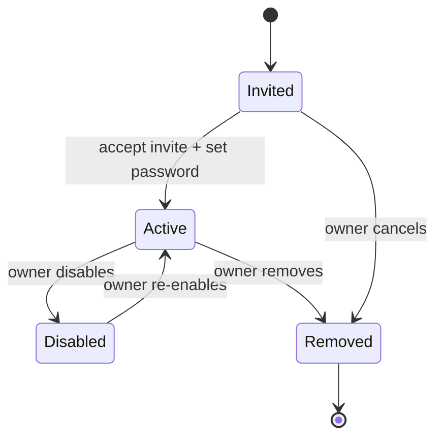
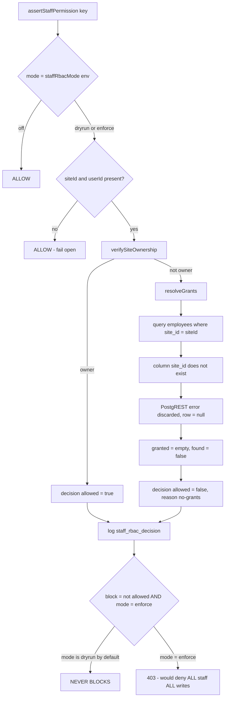
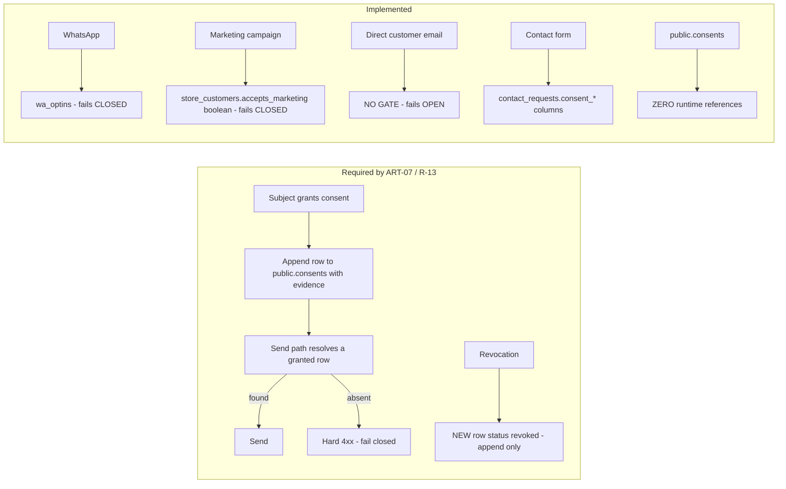

# 09 — CUSTOMERS, STAFF, RBAC, PRIVACY

| | |
|---|---|
| **Run ID** | `docs/merchant-system-discovery/2026-08-04T225330+0530-ee371182` |
| **Branch** | `stepup/main` |
| **Commit** | `ee371182` |
| **Run date** | 2026-08-04 (+0530) |
| **Scope** | Merchant-facing customer records, customer privacy/DPDP/DSR, merchant staff lifecycle, staff RBAC, step-up as it applies to customer + staff + refund-completion routes, merchant audit logging, PII-in-logs. |
| **Evidence basis** | Agent F notes (`_agent-notes/F-customers-staff-rbac.md`, read in full) + independent re-verification of the 12 highest-stakes claims directly from source in this session. |
| **METHOD DISCLOSURE** | **Nothing in this document was runtime-verified.** No gateway was started, no database was connected, no request was issued, no test was executed. Every verdict is derived from static reading of code, SQL migrations, and configuration. The ceiling for any claim here is `IMPLEMENTED_NOT_RUNTIME_VERIFIED`; items marked `BROKEN` are marked so only where a *deterministic* code/schema contradiction (a query filtering on a column that does not exist, a payload field the producer never emits, middleware ordering that must reject) makes the runtime outcome provable by inspection. |

**No secrets or PII appear in this document.** Environment variable *names* appear; no values. No customer email, phone, address, order id, payment id or credential appears.

---

## 1. Recommendation / verdict

**Do not ship merchant staff accounts. Ship the customer surfaces only after two one-line payload fixes. Treat two items as launch-blocking security work before any merchant handles real money or real customer data.**

Four statements, in order of importance:

1. **`POST /v1/orders/:id/refund/complete` is a step-up bypass and a cross-tenant money mutation.** `[HIGH-STAKES]` `[IRREVERSIBLE]` It calls the canonical `SECURITY DEFINER` money RPC `complete_order_refund` with a caller-supplied `refund_id` that is never validated against the resolved tenant, against an RPC whose signature has **no site parameter** and which looks the refund up globally by id. The route's own `store_id !== tenant.siteId` check runs *after* the RPC has already committed and posted a settlement ledger transaction. The sibling route for the same business action, `POST /v1/payments/:id/refund`, *does* require step-up. Verified this session at `services/api-gateway/src/routes/orders.ts:1341-1349`, `services/api-gateway/src/execution/order-execution.adapter.ts:504-520`, `database/supabase/migrations/168_b1_b2_capture_refund_ledgering.sql:314-345` and `:400-404`. **MCP-DISC-340. P0.**

2. **The DPDP consent ledger does not exist at runtime, and one send path fails OPEN.** `[HIGH-STAKES]` `public.consents` is created by migration 153 with the full DPDP shape (append-only intent, `evidence jsonb`, RLS + FORCE, site policy) and has **zero** `.from('consents')` reads or writes anywhere in `services/`, `apps/` or `packages/` — verified this session; the only three references are a generated tenant-registry row, a name map, and a test that asserts the *migration text* contains `CREATE TABLE`. Meanwhile `POST /v1/customers/:email/email` sends free-text merchant→customer email through Resend with **no consent record, no `accepts_marketing` check, no suppression list, no unsubscribe, no audit row** — verified at `services/api-gateway/src/routes/customers.ts:949-993`. R-13 / ART-07 forbid a consent gate that fails open. **MCP-DISC-341 (P0), MCP-DISC-342 (P1).**

3. **The prior "customer detail page is missing" claim is STALE — correct the record.** A real detail page exists at `apps/merchant-control-plane/src/app/[store]/customers/[email]/page.tsx` (27 KB, verified present this session), backed by a real proxy `apps/merchant-control-plane/src/app/api/stores/[store]/customers/[email]/route.ts` and a real gateway route `GET /v1/customers/:email` at `services/api-gateway/src/routes/customers.ts:1134`. Order history and addresses are joined **site-scoped**, and a guest-checkout buyer with no `store_customers` row still gets a synthesised detail page. Status: `IMPLEMENTED_NOT_RUNTIME_VERIFIED`, not missing. **The real customer defects are elsewhere:** the *list* page and the *CSV export* both read field names the gateway never emits — the gateway emits `display_name` / `order_count`, the UI reads `full_name` / `total_orders` — so every customer renders as literal `'Anonymous'` with 0 orders, the "Has orders" saved view can never match, and every exported CSV row has a blank email, name and phone. Both are single-file mapper fixes. **MCP-DISC-356, MCP-DISC-357. P1 each, deterministic.**

4. **The merchant staff feature does not function end-to-end, and the RBAC that would protect it is dry-run with the flag set nowhere.** There is no reachable invite-acceptance path (the endpoint sits behind `authMiddleware`, so an invitee with no token gets 401 before the handler runs), the "Add staff" button calls a route that mints no token and sends no email, the permissions the UI sends are silently dropped on insert, role-change and removal both violate the tenant guard and 500, the invite email points at a URL with no page behind it, and every store-resolution route is owner-only so a staff member could not load a merchant page even with a session. Separately, `MERCHANT_STAFF_RBAC_MODE` is **absent from every non-documentation file in the repository** — verified this session by repo-wide grep: it appears only in `staff-permission.ts` itself, one unit test, and 15 `docs/v1-execution/**` files, and is **not** in `services/api-gateway/wrangler.toml` or `config/env/*`. The default is `dryrun`, so all 30 guards are behaviour-neutral. And the grant lookup filters `employees.site_id` — **a column that does not exist** (`employees` has `store_id`; verified against `database/supabase/migrations/000_baseline.sql:9172-9194`, and no migration adds it) — so every non-owner would resolve to zero grants even after the flip. **MCP-DISC-344, MCP-DISC-345, MCP-DISC-351 through MCP-DISC-355.**

**Important framing, stated once and not repeated as alarm:** because staff cannot authenticate into the merchant control plane at all today, the missing server-side permission checks are **not presently exploitable by a staff member**. They become an immediate privilege-escalation surface the moment staff access is made to work. The honest description is *"the RBAC design is UI-shaped and server-absent, and the feature it protects is non-functional"* — not *"staff can escalate today"*.

**What is genuinely clean, and should not be re-litigated:** step-up is real cryptography (HMAC-SHA256 over a structured payload binding action + actor + site, constant-time compare, TOTP-gated issuance, fail-closed on an unset secret) for the three routes that call it; no customer or staff route is missing a tenant-ownership check; no PII value is written to any log; no password hash is returned by any merchant-facing read; the runtime tenant guard is a real, tested default-deny control and is the reason several defective routes 500 instead of leaking.

**Recommended sequencing:**

| Order | Work | Gate |
|---|---|---|
| 1 | MCP-DISC-340 — step-up on every refund-completing route + `p_site_id` on `complete_order_refund` + validate `refund_id` against the order before the RPC | ARB + payments-provider + security. Blocks live money. |
| 2 | MCP-DISC-341 / 342 — canonical consent ledger wired, `/customers/:email/email` fails closed | Founder + CA/compliance + ARB. Blocks DPDP exposure. |
| 3 | MCP-DISC-356 / 357 — customer list + CSV field mapping | Lead engineer. Cheap; unblocks the customer surface. |
| 4 | MCP-DISC-343 / 346 / 347 / 348 — step-up replay binding, DSR-export gating, PII-access audit, redaction gating | Security. |
| 5 | **Decide whether staff ships at all.** If yes, MCP-DISC-344/345/351-355 as one coherent workstream. If no, hide the Users & permissions page. | Founder scope decision, then ARB on which RBAC authority wins. |

---

## 2. Scope

**In scope.** Merchant control-plane customer surfaces (list, detail, segments, export page); all 20 `/v1/customers/*` gateway routes; `/v1/employees/*`; `/v1/security/step-up/*` and `/v1/security/dsr/*`; the staff role/permission catalogue and its enforcement; `public.consents`, `wa_optins`, `store_customers.accepts_marketing`, `contact_requests.consent_*`; `audit_logs` as it covers merchant-domain actions; PII in logs; the customer identity model (`store_customers`, `customer_credentials`).

**Explicitly out of scope, deferred to the named agent.** The full payments/refunds/payouts money path (agent G) — MCP-DISC-340 is recorded here because it is the *step-up + RBAC* failure of a customer/staff-adjacent route, and must be cross-referenced by the payments document. Identity issuance architecture (agent — identity); recorded here as MCP-DISC-349 because the staff RBAC boundary depends on it. The marketing and WhatsApp merchant UI (another agent); consent findings here are gateway-side only. Storefront customer-facing account pages. GST invoice immutability (agent H) — flagged as a CA-tax open question inside MCP-DISC-348.

---

## 3. Current merchant user journeys — what a merchant can actually do today

Ordered by whether the journey completes.

### 3.1 Journeys that complete (subject to no runtime verification)

| # | Journey | Verdict |
|---|---|---|
| J1 | Open **Customers**, see a paginated table of every buyer, search by email | `PARTIAL` — the table loads and rows are clickable, but **every name is `'Anonymous'` and every order count is `0`** (MCP-DISC-356). Capped at 100 rows by the page even though the gateway reads up to 5000 and supports cursors. |
| J2 | Click a customer, see **profile + order history + addresses + notes** | `IMPLEMENTED_NOT_RUNTIME_VERIFIED` — the historically-claimed gap is closed. Joins are site-scoped. Guest-checkout buyers are synthesised from orders. |
| J3 | Add a **note** to a customer | `IMPLEMENTED_NOT_RUNTIME_VERIFIED` — works, but has no `customers:write` guard (contrast `PATCH /:email`, which does), and the text is duplicated into `store_customers.notes` and never reconciled (MCP-DISC-365). |
| J4 | **Create** a customer segment, preview it, list segments | `IMPLEMENTED_NOT_RUNTIME_VERIFIED`. |
| J5 | Open **Users and permissions**, pick a role from six, click "Add staff" | `UI_ONLY` — a row appears in `employees` with `status:'invited'` and empty permissions. Nothing else happens: no token, no email, no way for that person to ever sign in. |

### 3.2 Journeys that do not complete

| # | Journey | Verdict | Gap |
|---|---|---|---|
| J6 | **Export customers to CSV** from the Export page | `BROKEN` — file downloads with the right row count but blank email/name/phone; silently truncated at 100 rows | MCP-DISC-357 |
| J7 | **Edit** a customer segment | `BROKEN` — 500 on every attempt (tenant-guard contract violation) | MCP-DISC-360 |
| J8 | **Delete** a segment | `NOT_IMPLEMENTED` — no gateway route, no UI affordance. Segments accumulate forever | MCP-DISC-360 |
| J9 | **Change a staff member's role** | `BROKEN` — 500 (tenant-guard violation on `employees`) | MCP-DISC-351 |
| J10 | **Remove / revoke** a staff member | `BROKEN` — 500, same cause. *Revocation failing is a security-relevant availability defect* | MCP-DISC-351 |
| J11 | A staff member **accepts an invite and signs in** | `BROKEN` end-to-end (five independent breaks) | MCP-DISC-352/353/354/355, MCP-DISC-362 |

### 3.3 Capabilities that exist only as gateway routes with no merchant UI

Edit a customer profile · edit tags · merge two customers · delete/redact a customer · send a customer an email · manage a customer's addresses · export one customer's DPDP data · raise a DSR export · raise a DSR erasure · enable/disable a customer account (not implemented anywhere). Ten backend capabilities, zero merchant affordances.

---

## 4. Feature matrix

| # | Capability | Status | Evidence (path:line) | Gap |
|---|---|---|---|---|
| 1 | Customer list — load + search | `PARTIAL` | `apps/merchant-control-plane/src/app/[store]/customers/page.tsx:160,181`; `services/api-gateway/src/routes/customers.ts:423` | MCP-DISC-356 |
| 2 | Customer list — name + order count render | `BROKEN` | payload `customers.ts:290-318` vs mapper `customers/page.tsx:142-158`, fallback `:266` | MCP-DISC-356 |
| 3 | Customer list — pagination beyond 100 | `NOT_IMPLEMENTED` (UI) | page hardcodes `limit=100` `customers/page.tsx:178`; gateway reads to 5000 `customers.ts:141,169` | MCP-DISC-356 |
| 4 | Customer detail page | `IMPLEMENTED_NOT_RUNTIME_VERIFIED` | `[store]/customers/[email]/page.tsx:504`; `customers.ts:1134` | — (prior claim STALE) |
| 5 | Customer detail — site-scoped order + address join | `IMPLEMENTED_NOT_RUNTIME_VERIFIED` | `customers.ts:1151-1162` | — |
| 6 | Guest-buyer synthesis on detail | `IMPLEMENTED_NOT_RUNTIME_VERIFIED` | `customers.ts:1181-1204` | — |
| 7 | Customer notes read/write | `IMPLEMENTED_NOT_RUNTIME_VERIFIED` | `customers.ts:833,863`; `[email]/page.tsx:393` | MCP-DISC-365 |
| 8 | Customer edit (`PATCH`) | `BACKEND_ONLY` | `customers.ts:748` — has `customers:write` at `:765`; no UI | — |
| 9 | Customer tags edit | `BACKEND_ONLY` | `customers.ts:917` | — |
| 10 | Customer merge | `BACKEND_ONLY` | `customers.ts:995` | — |
| 11 | Customer enable/disable | `NOT_IMPLEMENTED` | `UpdateCustomerSchema` has no `status` — `packages/commerce-core/src/index.ts:134-141`; UI renders a Status badge `customers/page.tsx:302-311` | MCP-DISC-363 |
| 12 | Customer addresses read | `BACKEND_ONLY` | `customers.ts:1342,1370` | — |
| 13 | Customer address update/delete | `BROKEN` + `BACKEND_ONLY` | `customers.ts:1424-1429,1454-1459,1487` | MCP-DISC-364 |
| 14 | Customer delete / redaction | `BACKEND_ONLY`, ungated, unaudited | `customers.ts:1207-1340` | MCP-DISC-348 |
| 15 | Segments — create / list / preview | `IMPLEMENTED_NOT_RUNTIME_VERIFIED` | `customers.ts:497,532,607` | — |
| 16 | Segments — edit | `BROKEN` | `customers.ts:568-573`; guard `tenant/tenant-scoped.ts:87-92` | MCP-DISC-360 |
| 17 | Segments — delete | `NOT_IMPLEMENTED` | no route in `customers.ts` | MCP-DISC-360 |
| 18 | CSV export from Export page | `BROKEN` | `[store]/export/page.tsx:232,246-253` | MCP-DISC-357 |
| 19 | Job-based customer export (R2 + signed token) | `BACKEND_ONLY` | `services/api-gateway/src/routes/export.ts:727`, `:656-683` — UI never calls it | MCP-DISC-357 |
| 20 | Per-customer DPDP data export | `BACKEND_ONLY` | `customers.ts:661` — returns raw JSON, persists nothing | MCP-DISC-346 |
| 21 | DSR export (persisted, encrypted) | `BACKEND_ONLY`, no step-up | `services/api-gateway/src/routes/security.ts:252-308`, `:124-157` | MCP-DISC-346 |
| 22 | DSR erasure | `BACKEND_ONLY`, step-up present | `security.ts:310-379`, step-up `:317-325` | — (no UI) |
| 23 | Canonical consent ledger `public.consents` | `NOT_IMPLEMENTED` | migration `153_executable_identity_security.sql:6-30`; zero runtime refs | MCP-DISC-341 |
| 24 | Consent gate on WhatsApp send | `IMPLEMENTED_NOT_RUNTIME_VERIFIED`, fails CLOSED, non-canonical | `services/api-gateway/src/routes/whatsapp.ts:250-289`, enforced `:692-701` | MCP-DISC-341 |
| 25 | Consent gate on marketing campaigns | `PARTIAL`, fails CLOSED, non-canonical (mutable boolean) | `services/api-gateway/src/routes/marketing.ts:240,279-281` | MCP-DISC-341 |
| 26 | Consent gate on direct customer email | `BROKEN` — fails OPEN | `customers.ts:949-993` (verified: no consent lookup between `:955` ownership and `:979` send) | MCP-DISC-342 |
| 27 | Step-up cryptography | `IMPLEMENTED_NOT_RUNTIME_VERIFIED` — genuine HMAC-SHA256, constant-time, fail-closed | `services/api-gateway/src/lib/security-controls.ts:47-52,79-98,127-140,165-190,203` | — |
| 28 | Step-up enforced — payment refund | `IMPLEMENTED_NOT_RUNTIME_VERIFIED` | `services/api-gateway/src/routes/payments.ts:497-506` | — |
| 29 | Step-up enforced — payout release | `IMPLEMENTED_NOT_RUNTIME_VERIFIED` | `services/api-gateway/src/routes/payouts.ts:576-586` | — |
| 30 | Step-up enforced — DSR erase | `IMPLEMENTED_NOT_RUNTIME_VERIFIED` | `security.ts:317-325` | — |
| 31 | Step-up on `POST /orders/:id/refund/complete` | **`BROKEN` (absent)** | `orders.ts:1341-1349`; grep for `verifySensitiveActionStepUp` in `routes/orders.ts` → **no match** (re-verified this session) | **MCP-DISC-340** |
| 32 | Step-up single-use / replay binding | `NOT_IMPLEMENTED` | `security-controls.ts:160-243` — verification is stateless; `challenge_id`/`jti` never looked up | MCP-DISC-343 |
| 33 | Staff role catalogue (6 roles, 12 permissions) | `UI_ONLY` | `apps/merchant-control-plane/src/lib/staff/roles.ts:25-38,47-92` | MCP-DISC-345 |
| 34 | Staff RBAC enforcement mode | `DORMANT_FLAGGED` | default `dryrun` `services/api-gateway/src/middleware/staff-permission.ts:45-52`; `MERCHANT_STAFF_RBAC_MODE` absent from all non-doc files (re-verified) | MCP-DISC-345 |
| 35 | Staff grant resolution | `BROKEN` | `staff-permission.ts:89-95` filters `employees.site_id`; column absent per `000_baseline.sql:9172-9194` (re-verified) | MCP-DISC-344 |
| 36 | Staff permissions persisted on create | `BROKEN` | `packages/auth-core/src/index.ts:1482-1507` never reads `body.permissions`; UI sends it `settings/users/page.tsx:199` | MCP-DISC-354 |
| 37 | Staff invite email + token | `BROKEN` (never invoked) | `employee.ts:413-474`; api-client exposes only `{list,limits,create,update,remove}` — `packages/typescript/api-client/src/index.ts:4697-4708` (re-verified: no `invite`) | MCP-DISC-353 |
| 38 | Staff invite acceptance | `BROKEN` (unreachable) | `index.ts:750` mounts `authMiddleware` on `/*`, `/employees` at `:789` (re-verified) | MCP-DISC-352 |
| 39 | Staff invite email URL target | `BROKEN` | `lib/transactional-email.ts:66-67` → `/employees/auth/accept-invite`; actual page `/accept-invite` (re-verified: no `app/employees/**` dir) | MCP-DISC-362 |
| 40 | Staff role change / removal | `BROKEN` | `employee.ts:556,586`, `verifyEmployeeOwnership` `:610-638` | MCP-DISC-351 |
| 41 | Staff store access after login | `BROKEN` (owner-only resolution) | `services/api-gateway/src/routes/stores.ts:567-568`; `lib/tenant-context.ts:193-196` | MCP-DISC-355 |
| 42 | Staff seat limits | `IMPLEMENTED_NOT_RUNTIME_VERIFIED` — server-authoritative | `employee.ts:37-105`, enforced `:328`, `:434` | — |
| 43 | Employee portal tickets / analytics | `BROKEN` (fails closed; cross-tenant *intent*) | `employee.ts:481-522`, `:525-553` | MCP-DISC-359 |
| 44 | Staff-lifecycle audit trail | `BROKEN` | `employee.ts:189` writes `actor_type:'merchant'`; CHECK allows `user|employee|super_admin|system` — `000_baseline.sql:8454` (re-verified) | MCP-DISC-350 |
| 45 | Merchant-action audit trail (refunds, PII access, exports, price/tax/theme changes) | `NOT_IMPLEMENTED` | no `audit_logs` writer in any merchant route except `employee.ts` | MCP-DISC-347 |
| 46 | Parallel RBAC model (`site_memberships`/`site_roles`/`site_role_permissions`) | `NOT_IMPLEMENTED` (dead schema + dead read path) | `000_baseline.sql:11896,11922,11941`; read `lib/tenant-context.ts:156-182`; no insert anywhere | MCP-DISC-361 |
| 47 | `sensitive_action_approvals` maker-checker | `NOT_IMPLEMENTED` | `migrations/153_...sql:120-141`; zero runtime refs | MCP-DISC-341 (grouped) |
| 48 | PII in logs | **CLEAN** | §9 — ids and event names only | — |
| 49 | Password hash exposure on merchant reads | **CLEAN** | `customers.ts:377`, `:696`; `security.ts:107` — explicit column lists exclude it | — |
| 50 | Automated tests over this domain | `NOT_IMPLEMENTED` | only `staff-permission.test.ts` (pure decision fn), `customer-pagination.test.ts`, storefront tests | MCP-DISC-358 |

---

## 5. UI / route inventory

### 5.1 Merchant control-plane pages

| Page | Path | Status |
|---|---|---|
| Customer list | `apps/merchant-control-plane/src/app/[store]/customers/page.tsx` | `PARTIAL` |
| Customer detail | `apps/merchant-control-plane/src/app/[store]/customers/[email]/page.tsx` | `IMPLEMENTED_NOT_RUNTIME_VERIFIED` |
| Segments | `apps/merchant-control-plane/src/app/[store]/customers/segments/page.tsx` | `PARTIAL` (edit broken) |
| Export | `apps/merchant-control-plane/src/app/[store]/export/page.tsx` | `BROKEN` for customers |
| Users and permissions | `apps/merchant-control-plane/src/app/[store]/settings/users/page.tsx` | `UI_ONLY` |
| Accept invite | `apps/merchant-control-plane/src/app/accept-invite/page.tsx` | `BROKEN` (unreachable backend, wrong URL in email) |

**No merchant UI exists** for: customer create, customer edit, tag edit, merge, delete/redact, per-customer email, address CRUD, per-customer DPDP export, DSR export, DSR erase, account enable/disable, merchant audit trail.

**There is no `apps/merchant-control-plane/middleware.ts`,** and exhaustive grep of `apps/merchant-control-plane/src` finds **no role-conditional rendering, no disabled-by-role state, and no route guard** anywhere. `lib/staff/roles.ts` is imported by exactly one file — `settings/users/page.tsx` — and only to compose the permission payload for an invite that is never sent.

### 5.2 App proxy routes

| Proxy | Path | Methods |
|---|---|---|
| customers list | `.../api/stores/[store]/customers/route.ts` | GET |
| customer detail | `.../api/stores/[store]/customers/[email]/route.ts` | GET |
| customer notes | `.../api/stores/[store]/customers/[email]/notes/route.ts` | GET, POST |
| segments | `.../api/stores/[store]/customers/segments/route.ts` | GET, POST |
| segment update | `.../api/stores/[store]/customers/segments/[id]/route.ts` | PATCH |
| segment preview | `.../api/stores/[store]/customers/segments/preview/route.ts` | POST |
| staff | `.../api/stores/[store]/users/route.ts` | (create at `:41`) |
| accept invite | `.../api/employees/accept-invite/route.ts` | POST (`:21`) |

Every store-scoped proxy resolves the store through `resolveOwnedStoreId` (`apps/merchant-control-plane/src/lib/stores/resolve-owned-store.ts` → `GET /v1/stores/handle/:handle`), which is **owner-only** — the structural reason staff can never reach any merchant page (MCP-DISC-355).

### 5.3 Gateway customer routes — `services/api-gateway/src/routes/customers.ts` (mounted `services/api-gateway/src/index.ts:792`)

| # | Route | Line | Ownership gate | Staff permission | Step-up | Reached by UI? |
|---|---|---|---|---|---|---|
| 1 | `GET /` (list) | 423 | `hasOwnedStoreScope` :433 | **none** | n/a | yes |
| 2 | `POST /` | 457 | :462 | `customers:write` :469 | n/a | no |
| 3 | `GET /segments` | 497 | :501 | **none** | n/a | yes |
| 4 | `POST /segments` | 532 | :537 | **none** | n/a | yes |
| 5 | `PATCH /segments/:id` | 562 | :578 (after unscoped read :568) | **none** | n/a | yes — **BROKEN** |
| 6 | `POST /segments/preview` | 607 | :611 | **none** | n/a | yes |
| 7 | `GET /segments/:id/customers` | 629 | :638 | **none** | n/a | no |
| 8 | `GET /:email/data-export` | 661 | :671 | **none** | **none** | no |
| 9 | `PATCH /:email` | 748 | :759 | `customers:write` :765 | n/a | no |
| 10 | `GET /:email/notes` | 833 | :843 | **none** | n/a | yes |
| 11 | `POST /:email/notes` | 863 | :869 | **none** | n/a | yes |
| 12 | `PUT /:email/tags` | 917 | :923 | **none** | n/a | no |
| 13 | `POST /:email/email` | 949 | :955 | **none** | n/a | no |
| 14 | `POST /:email/merge` | 995 | :1006 | **none** | n/a | no |
| 15 | `GET /:email` (detail) | 1134 | :1145 | **none** | n/a | yes |
| 16 | `DELETE /:email` (redact) | 1207 | :1217 | **none** | **none** | no |
| 17 | `GET /:email/addresses` | 1342 | :1352 | **none** | n/a | no |
| 18 | `POST /:email/addresses` | 1370 | :1376 | **none** | n/a | no |
| 19 | `PATCH /:email/addresses/:id` | 1416 | :1432 (after unscoped read :1424) | **none** | n/a | no — **BROKEN** |
| 20 | `DELETE /:email/addresses/:id` | 1468 | :1483 (after unscoped read :1475) | **none** | n/a | no — **BROKEN** |

**Every one of the 20 routes carries a tenant-ownership gate. No customer route is missing an ownership check.** Two carry a staff permission; eighteen carry none.

### 5.4 Gateway staff routes — `services/api-gateway/src/routes/employee.ts` (mounted `index.ts:789`, **after** `api.use('/*', authMiddleware)` at `index.ts:750` — re-verified this session)

| Route | Line | Gate | Reachability verdict |
|---|---|---|---|
| `POST /auth/login` | 135 | Supabase `signInWithPassword` | **UNREACHABLE** — behind `authMiddleware`; unauthenticated caller gets 401 first. Also returns a raw Supabase session, not a LetBuyy merchant session. |
| `POST /auth/accept-invite` | 208 | invite token | **UNREACHABLE** — same cause |
| `GET /` | 269 | `verifySiteOwnership` :280 | owner only |
| `POST /` | 313 | `verifySiteOwnership` :324 + seat limit :328 | owner only |
| `GET /me` | 369 | `employees.user_id = auth.user.id` | any employee |
| `GET /limits` | 388 | `verifySiteOwnership` :397 | owner only |
| `POST /invite` | 413 | `verifySiteOwnership` :430, sends email :456 | **never called by any client** |
| `GET /tickets` | 481 | employee row only | **BROKEN** — unscoped `support_tickets` |
| `GET /analytics` | 525 | employee row only | **BROKEN** — unscoped `sites`/`orders` |
| `PATCH /:id` | 556 | `verifyEmployeeOwnership` :562 | **BROKEN** — unscoped `employees` read |
| `DELETE /:id` | 586 | `verifyEmployeeOwnership` :591 | **BROKEN** — same |

### 5.5 Gateway privacy / step-up routes — `services/api-gateway/src/routes/security.ts` (mounted `index.ts:780`)

| Route | Line | Ownership | Step-up | Staff perm | Merchant UI |
|---|---|---|---|---|---|
| `POST /security/step-up/challenges` | 159 | `resolveTenantContextForOwnedSite` :163 | issues token | none | yes (`components/security/StepUpDialog.tsx`) |
| `POST /security/dsr/export` | 252 | :256 | **none** — despite `customer.dsr.export` being a declared step-up action (`security.ts:26`) | none | **no UI** |
| `POST /security/dsr/erase` | 310 | :314 | `verifySensitiveActionStepUp` :317 | none | **no UI** |

---

## 6. Backend / API / RPC / database mapping

### 6.1 Customer identity model

- **Customers are strictly per-site.** `public.store_customers` is keyed by `store_id` + `email` (`database/supabase/migrations/000_baseline.sql:12186-12207`). `public.customer_credentials` is unique on `(store_id, email_or_phone)` (`000_baseline.sql:8898-8907`; confirmed by the `ON CONFLICT (store_id, email_or_phone)` in `migrations/111_customer_credentials_source_of_truth.sql:31`). There is **no cross-store customer identity, no global customer id and no shared login** — so there is no cross-store customer graph to leak.
- `customer_credentials` columns: `id, store_id, email_or_phone, password_hash, last_login_at, login_count, created_at, updated_at`, plus `customer_id` (migration 111) and `encrypted_identifier` / `pii_encryption_key_id` (`153_executable_identity_security.sql:152-154`).
- `store_customers.password_hash` is **legacy and drained** — migration 111 moved values into `customer_credentials` and nulled the column (`111_...sql:35-38`). One route still touches it: `customers.ts:1243` sets it to `null` during redaction. Harmless, but it re-references a column the migration declared dead.
- Passwords are bcrypt cost 10 (`services/api-gateway/src/routes/storefront/customer-registration.ts:79`), and the "first password only when no credential row exists" precondition (`:62-77`) prevents account takeover.
- Customer sessions are **HS256** off `CUSTOMER_SESSION_SECRET` (`customer-registration.ts:141-143`; verified at `services/api-gateway/src/middleware/customer-session.ts:58`) — the ART-05 deviation, see §8.4 and MCP-DISC-349.

### 6.2 Tables touched by this domain

| Table | Registered tenant table? | Scope columns | Notes |
|---|---|---|---|
| `store_customers` | yes | `store_id` | primary customer record |
| `customer_credentials` | yes | `store_id` | bcrypt hashes; never selected on merchant reads |
| `customer_addresses` | yes | `store_id` | unscoped pre-reads in 3 routes → 500 |
| `customer_notes` | yes | `store_id` | plus a denormalised copy in `store_customers.notes` |
| `customer_segments` | yes | `store_id` | unscoped pre-read on PATCH → 500 |
| `employees` | yes | `store_id`, `user_id` | **no `site_id` column** — the RBAC lookup bug |
| `employee_invites` | yes | — | only written by the never-called `POST /employees/invite` |
| `consents` | yes (registry `:594`) | `site_id` | **zero runtime reads/writes** |
| `sensitive_action_approvals` | yes | `site_id` | zero runtime references |
| `step_up_challenges` | yes | `site_id` | written at issuance; **never read back at verification** |
| `data_subject_requests` | yes | `site_id` | written only by `/security/dsr/*` |
| `customer_dsr_exports` | yes | `site_id` | KMS-encrypted payload |
| `wa_optins` | yes | `site_id` | parallel consent store (`migrations/150_executable_whatsapp_scoped.sql:60-73`) |
| `contact_requests` | yes | — | 4th consent store (`migrations/195_contact_requests.sql:87-88`) |
| `site_memberships` / `site_roles` / `site_role_permissions` | first two yes; `site_role_permissions` **not registered** | — | dead schema, dead read path, no writer |
| `audit_logs` | **not registered** | — | no `site_id`/`store_id` column at all |
| `refunds` / `refund_transactions` / ledger tables | yes | `site_id` | reached only through `SECURITY DEFINER` RPCs |

### 6.3 RPCs in scope

| RPC | Called from | Site parameter? | Verdict |
|---|---|---|---|
| `complete_order_refund` | `execution/order-execution.adapter.ts:504-513` | **NO** (`migrations/168_...sql:314-321`) — looks the refund up by id alone at `:340-345`, posts `post_settlement_ledger_transaction(v_refund.site_id, ...)` at `:400-404` | **MCP-DISC-340** |
| `create_order_return_and_refund` | `routes/orders.ts:1427`, `routes/returns.ts:185` | (not re-derived here — payments agent) | no step-up on either caller |
| `restore_gift_card_on_refund` | `routes/orders.ts:1397` | takes `p_store_id` | in the blast radius of MCP-DISC-340 |
| `post_settlement_ledger_transaction` | inside `complete_order_refund` | takes site from `v_refund.site_id`, i.e. from the attacker-chosen refund | in the blast radius of MCP-DISC-340 |

### 6.4 END-TO-END TRACE — Customer LIST (material capability)

```
Merchant entry point   Left nav → "Customers"
page/route             apps/merchant-control-plane/src/app/[store]/customers/page.tsx:160
                       fetch `/api/stores/{store}/customers?limit=100[&search=]`   (page.tsx:181)
app proxy              apps/merchant-control-plane/src/app/api/stores/[store]/customers/route.ts:6
                       resolveOwnedStoreId(store) -> GET /v1/stores/handle/:handle  (OWNER ONLY)
typed client           packages/typescript/api-client/src/index.ts  (customers.list)
/v1 gateway route      GET /v1/customers?store_id=…   services/api-gateway/src/routes/customers.ts:423
auth issuer            authMiddleware (index.ts:750) — Supabase bearer OR internal-SSO HMAC
                       OR internal session-token HMAC. NO ES256 / identity-platform JWKS on this path.
authz + ownership      hasOwnedStoreScope :433 -> resolveOwnedStoreScope -> verifySiteOwnership
                       (lib/auth-user.ts:39). OWNER ONLY.
staff permission       MISSING — `customers:read` has ZERO enforcement sites in the whole gateway
server-authoritative   n/a (read path)
RPC/tables + RLS       store_customers (customers.ts:131-157) + orders (:159-181), both
                       .eq('store_id', storeId). RLS BYPASSED (service_role); the effective control
                       is the runtime tenant-guard proxy (tenant/tenant-scoped.ts:112-123).
                       merged by buildCustomerSummaries (packages/commerce-core/src/index.ts:983)
                       serialized by customerSummaryPayload (customers.ts:290-318)
response contract      id, store_id, email, phone, first_name, last_name, display_name, status,
                       accepts_marketing, tags, order_count, total_spent, last_order_at, created_at
UI mapper              mapCustomer (page.tsx:142-158) reads
                         full_name || customer_name   -> MISSING -> renders literal 'Anonymous' (:266)
                         total_orders                 -> MISSING -> 0
                         first_order_at, last_order_id-> MISSING -> null
webhook/queue/provider n/a
consequence            The primary customer surface is unusable; the "Has orders" saved view
                       (page.tsx:88) can never match; name/order sorting is meaningless.
tests                  MISSING — no test covers this route or this page
runtime observation    MISSING — NOT PERFORMED
```

The page's own type alias already points at the correct field (`page.tsx:14`: `total_orders: SharedCustomer['order_count']`), which is conclusive that the mapper — not the gateway — is wrong.

### 6.5 END-TO-END TRACE — Customer DETAIL (the historical gap, now closed)

```
Merchant entry point   Row click -> router.push(`/{store}/customers/{encodeURIComponent(email)}`)
                       (customers/page.tsx:402)
page/route             [store]/customers/[email]/page.tsx:504
                       + GET /api/stores/{store}/customers/{email}        (:523)
                       + GET /api/stores/{store}/customers/{email}/notes  (:557)
app proxy              api/stores/[store]/customers/[email]/route.ts:7 -> resolveOwnedStoreId
typed client           customers.getByEmail({ query: { store_id } })
/v1 gateway route      GET /v1/customers/:email   customers.ts:1134
auth + ownership       hasOwnedStoreScope :1145 (owner only)
staff permission       MISSING — no `customers:read` guard
tables + RLS           store_customers .eq(store_id).eq(email)  (loadCustomerProfileRow :370-383)
                       orders            .eq('store_id').eq('customer_email')   (:1151-1156)  ← site-scoped
                       customer_addresses.eq('store_id').eq('customer_email')   (:1157-1162)  ← site-scoped
                       404 when neither a profile row nor any order exists (:1171)
                       synthesises a customer from orders when no store_customers row exists (:1181-1204)
UI                     mapCustomerDetail (page.tsx:151-182) reads display_name / order_count /
                       total_spent → MATCHES the payload. Renders ProfileCard, OrderHistoryCard,
                       AddressesCard, NotesCard.
consequence            A merchant CAN view a customer, their order history and their addresses today.
tests                  MISSING
runtime observation    MISSING — NOT PERFORMED
audit                  MISSING — viewing customer PII writes no audit_logs row (MCP-DISC-347)
```

**Verdict on the prior "customer detail is missing" claim: `CONTRADICTORY_EVIDENCE` — the doc is STALE.** The page, the proxy and the endpoint all exist and the order-history join is correctly site-scoped. What is genuinely absent from the detail page is *editing and privacy actions*: edit profile, edit tags, enable/disable, delete/redact, per-customer data export, merge, address management, per-customer email — all of which exist as gateway routes with no UI.

### 6.6 END-TO-END TRACE — Refund completion `[HIGH-STAKES]` `[IRREVERSIBLE]`

```
Merchant entry point   (no merchant UI in this document's scope — API/other-surface caller)
/v1 gateway route      POST /v1/orders/:id/refund/complete   services/api-gateway/src/routes/orders.ts:1341
auth issuer            authMiddleware (Supabase bearer / internal HMAC)
tenant resolution      resolveTenantContextForOrder(c, orderId)   orders.ts:1345
                       -> tenant is derived from the ORDER ID IN THE PATH
staff permission        assertStaffPermission(..., 'orders:write')  orders.ts:1348   ← DRY-RUN, never blocks
step-up                MISSING — grep for `verifySensitiveActionStepUp` in routes/orders.ts returns
                       NO MATCH (re-verified this session). Contrast payments.ts:497-506.
validation             MISSING — body.refund_id is validated for SHAPE by CompleteRefundSchema but is
                       NEVER checked to belong to the resolved order or the resolved site
idempotency            IdempotencyExecutionAdapter.begin  orders.ts:1352-1358
                       scope `orders.refund.complete:{orderId}:{body.refund_id}` — note the scope keys on
                       the attacker-supplied refund_id, so a cross-tenant call is not deduplicated away
RPC                    execution/order-execution.adapter.ts:504-513
                         db.rpc('complete_order_refund', { p_refund_id: input.refund_id, ... })
                       migrations/168_b1_b2_capture_refund_ledgering.sql:314-321 — NO p_site_id parameter
                       :340-345  SELECT * FROM refunds WHERE id = p_refund_id AND deleted_at IS NULL FOR UPDATE
                       :400-404  post_settlement_ledger_transaction(v_refund.site_id, 'refund', ...)
tenant check           order-execution.adapter.ts:517-520  order.store_id !== tenant.siteId -> Forbidden
                       ***THIS RUNS AFTER THE RPC HAS COMMITTED***
consequence            A merchant who owns ANY order can cause a refund belonging to a DIFFERENT site to be
                       marked succeeded and posted to that site's settlement ledger. Ledger entries are
                       append-only: a wrong posting can only be compensated, never deleted.
downstream             emitOrderEvent 'order.refunded' (orders.ts:1369); refund email
                       (enqueueOrderLifecycleEmail :1379); restore_gift_card_on_refund (:1397)
tests                  MISSING
runtime observation    MISSING — NOT PERFORMED. Exploitation was NOT attempted.
```

### 6.7 END-TO-END TRACE — Staff invite → activation (`BROKEN` at five independent points)

```
Owner clicks "Add staff"   [store]/settings/users/page.tsx:181
  body { email, full_name, role, permissions: permissionsForRole(role), status:'invited' } (:194-201)
app proxy                  api/stores/[store]/users/route.ts:30 -> employees.create({...body, store_id})
typed client               packages/typescript/api-client/src/index.ts:4697-4708
                           exposes ONLY {list, limits, create, update, remove} — NO `invite` (re-verified)
/v1 gateway route          POST /v1/employees   employee.ts:313
auth + ownership           verifySiteOwnership :324 ; seat limit :328   (both correct)
insert planning            planEmployeeStaffCreate  packages/auth-core/src/index.ts:1482-1507
                           returns ONLY { store_id, email, full_name, role, status:'invited',
                                          is_active, created_by }
                           BREAK 1 — `permissions` sent by the UI is SILENTLY DROPPED  [MCP-DISC-354]
                           BREAK 2 — no token minted, no employee_invites row, no email sent
                                     (the only route that does is POST /v1/employees/invite,
                                      employee.ts:413-474, which NO client calls)   [MCP-DISC-353]
audit                      writeEmployeeAudit(..., 'employee.created')
                           BREAK 3 — inserts actor_type:'merchant'; audit_logs_actor_type_check allows only
                                     ('user','employee','super_admin','system') (000_baseline.sql:8454).
                                     The insert raises; the error is swallowed at employee.ts:198-205.
                                     NO persisted trail of who added staff.            [MCP-DISC-350]
invite email (if sent)     lib/transactional-email.ts:66-67 builds
                             `${platformBaseUrl}/employees/auth/accept-invite?token=…`
                           BREAK 4 — no `app/employees/**` route exists in the merchant control plane;
                                     the real page is `/accept-invite`.                 [MCP-DISC-362]
invitee accepts            apps/.../accept-invite/page.tsx:40 -> POST /api/employees/accept-invite
                           api/employees/accept-invite/route.ts:21 -> merchantApiFetch('/employees/auth/accept-invite')
                           lib/api/client.ts:57-78 attaches auth headers ONLY when the merchant session
                           cookie exists — the invitee has none.
                           BREAK 5 — /v1/employees/* is mounted at index.ts:789, AFTER
                                     api.use('/*', authMiddleware) at index.ts:750 (re-verified).
                                     authMiddleware exhausts all three verifiers and returns 401
                                     (middleware/auth.ts:264-272).                       [MCP-DISC-352]
even if all five were fixed
                           BREAK 6 — every merchant page resolves the store through resolveOwnedStoreId →
                                     GET /v1/stores/handle/:handle (stores.ts:553), whose query requires
                                     `custom_user_id.eq.{caller} OR user_id.eq.{caller}` (:567-568).
                                     Staff are not in `sites` ⇒ 404 "Store not found" on every page.
                                     Same for resolveOwnedStoreScope (lib/tenant-context.ts:193-196),
                                     which asserts ownership BEFORE any membership/role resolution.
                                                                                          [MCP-DISC-355]
tests                      MISSING
runtime observation        MISSING — NOT PERFORMED
```

**Conclusion: there is no path by which a merchant staff member can activate an account or reach a merchant page.** `BROKEN`.

---

## 7. State machines

### 7.1 Staff member lifecycle — intended vs actual



Actual reachability of each transition:

| Transition | DB supports it | Route exists | Reachable today | Gap |
|---|---|---|---|---|
| `[*] -> Invited` | yes (`employees_status_check` allows `invited`) | `POST /v1/employees` | **yes** — but with no token, no email, no permissions | MCP-DISC-353, MCP-DISC-354 |
| `Invited -> Active` | yes | `POST /v1/employees/auth/accept-invite` | **no** — 401 before the handler | MCP-DISC-352 |
| `Active -> Disabled` | yes | `PATCH /v1/employees/:id` | **no** — 500 | MCP-DISC-351 |
| `Disabled -> Active` | yes | `PATCH /v1/employees/:id` | **no** — 500 | MCP-DISC-351 |
| `Active -> Removed` | yes | `DELETE /v1/employees/:id` | **no** — 500 | MCP-DISC-351 |

Only the first transition fires, and it fires incompletely. **Every state after `Invited` is unreachable.**

### 7.2 Staff RBAC decision path (as implemented)



Every path in this diagram is verified: mode default `dryrun` at `staff-permission.ts:45-52`; fail-open on missing context at `:137`; fail-open on exception at `:154-163`; the `site_id` filter at `:92`; the discarded error at `:89` (`const { data } = await ...` — the `error` field is never destructured); `no-grants` at `:66-68`; the `block` computation at `:153`.

### 7.3 Consent (as the Constitution requires vs as implemented)



---

## 8. Auth / tenant / invariant analysis

### 8.1 What the real tenant control is

**RLS is not the enforcing control on this path.** `getSupabaseAdmin` (`services/api-gateway/src/lib/supabase.ts:17`) wraps the **service-role** client in `createTenantGuardedSupabaseClient` (`services/api-gateway/src/tenant/tenant-scoped.ts:112-123`), which rejects any query against a registered tenant table that never applied a scope predicate (`:78-92`). 261 tables are registered, and `tests/governance/foundation-wave2-tenant.test.ts:58-75` asserts the reject/allow behaviour across the registry.

This is a genuinely strong default-deny control and it is the reason several defective routes in this domain **fail closed (500) rather than leaking**: `PATCH /segments/:id`, the three address routes, `PATCH`/`DELETE /employees/:id`, and both employee-portal routes.

Two constitutional caveats, recorded for the tenancy document rather than re-derived here: the gateway still connects as blanket `service_role`, so RLS/FORCE on tenant tables is bypassed and the guard proxy is the *sole* enforcement (ART-08); and **`db.rpc(...)` calls are not proxied at all** — which is precisely why MCP-DISC-340 escapes the guard.

### 8.2 Ownership coverage

| Surface | Ownership gate present | Missing |
|---|---|---|
| All 20 `/v1/customers/*` routes | **yes, all 20** | none |
| Owner-scoped `/v1/employees/*` | **yes** (`verifySiteOwnership`) | none |
| `GET /v1/employees/tickets` | **no site predicate** — "is an active employee of *any* store" (`employee.ts:490-499`) | site scoping; the *intent* was a platform-wide read |
| `GET /v1/employees/analytics` | **no site predicate** (`employee.ts:530-539`) | same; `user_profiles` is unregistered and would have returned a platform-wide user count had the first two queries not rejected |
| `POST /v1/orders/:id/refund/complete` → RPC | tenant resolved from the order id; **`refund_id` unvalidated** | pre-RPC ownership check on the refund; `p_site_id` on the RPC |

### 8.3 Staff permission enforcement matrix — operation → UI gate → server gate → verdict

**(a) UI gate is `NO` for every single row.** Exhaustive grep of `apps/merchant-control-plane/src` for role/permission-conditional rendering returns only `settings/users/page.tsx` (which *composes* a permission payload for an invite) and `lib/staff/roles.ts` itself. There is no conditional rendering, no disabled state, no route guard, and no `middleware.ts` in the app.

**(b) Server gate**, where present, is `assertStaffPermission` — **which is dry-run by default and therefore behaviour-neutral** (§7.2). "Dry-run" below means the call site exists but cannot block in any environment the repository configures.

| # | Sensitive operation | Gateway route (path:line) | (a) UI gate | (b) Server staff gate | Step-up | Audit | Verdict |
|---|---|---|---|---|---|---|---|
| 1 | Refund a payment | `routes/payments.ts:467` | NO | **NONE** | **YES** `:497-506` | none | Protected by step-up only |
| 2 | **Complete an order refund (canonical money RPC)** | `routes/orders.ts:1342` | NO | `orders:write` `:1348` (dry-run) | **NONE** | none | **UNPROTECTED — MCP-DISC-340** |
| 3 | Create an order refund / return | `routes/orders.ts:1427` · `routes/returns.ts:185` | NO | `orders:write` `:1434` / **none** in `returns.ts` | **NONE** | none | Unprotected |
| 4 | Release a payout | `routes/payouts.ts:553` | NO | **NONE** | **YES** `:576-586` | none | Protected by step-up only |
| 5 | Delete a product | `routes/products.ts:1188` | NO | `products:write` `:1198` (dry-run) | n/a | none | Effectively unprotected |
| 6 | Edit a product price | `routes/products.ts:1130` | NO | `products:write` `:1141` (dry-run) | n/a | none | Effectively unprotected |
| 7 | **View customer PII (list + detail)** | `routes/customers.ts:423`, `:1134` | NO | **NONE** — `customers:read` has 0 enforcement sites | n/a | none | Unprotected + unaudited |
| 8 | **Export customer data** | `routes/export.ts:727` · `customers.ts:661` · `security.ts:252` | NO | **NONE** on all three | **NONE** on all three | only `security.ts` writes a DSR row | Unprotected — MCP-DISC-346/347 |
| 9 | Change payment settings | `routes/stores.ts:353` | NO | **NONE** | n/a | none | Unprotected |
| 10 | Invite / create staff | `routes/employee.ts:313`, `:413` | NO | **NONE** (owner-only) | n/a | attempted — **fails** | Owner-only; unaudited |
| 11 | Change a staff role | `routes/employee.ts:556` | NO | **NONE** (owner-only) | n/a | attempted — fails | Owner-only; unaudited; also 500s |
| 12 | Change GST / tax settings | `routes/shipping-tax.ts:383`, `:414`, `:451` | NO | **NONE** — only *shipping rates* carry `shipping:write` (`:251,296,340`) | n/a | none | Unprotected |
| 13 | Publish a theme | `routes/themes.ts:673` | NO | **NONE** | n/a | none | Unprotected |
| 14 | Issue a gift card | `routes/gift-cards.ts:62` | NO | **NONE** (ownership only `:70`) | n/a | none | Unprotected |
| 15 | Cancel an order | `routes/orders.ts:1142` | NO | `orders:write` `:1148` (dry-run) | n/a | none | Effectively unprotected |
| 16 | **Delete / redact a customer** | `routes/customers.ts:1207` | NO | **NONE** | **NONE** | none | Unprotected + irreversible — MCP-DISC-348 |
| 17 | Change notification prefs / webhooks | `routes/notifications.ts:225`, `:462` | NO | **NONE** | n/a | none | Unprotected |
| 18 | Delete the store | `routes/stores.ts:816` | NO | **NONE** | n/a | none | Unprotected |

**12 of 18 sensitive operations have no staff gate at any layer.** The 6 that do have one are all in dry-run.

**Permission-key enforcement census** (grep of `services/api-gateway/src`, excluding tests and `staff-permission.ts` itself):

| Key | Enforcement sites | Note |
|---|---|---|
| `products:write` | 23 | |
| `orders:write` | 9 | |
| `marketing:write` | 3 | all in `coupons.ts` |
| `shipping:write` | 3 | all in `shipping-tax.ts`, **shipping rates only** — not tax |
| `customers:write` | 2 | `customers.ts:469`, `:765` |
| `customers:read` | **0** | |
| `returns:write` | **0** | |
| `content:write` | **0** | |
| `reports:read` | **0** | and it is **not even a valid gateway key** — `StaffPermissionKey` (`staff-permission.ts:30-41`) lists 11 keys and omits it. The `viewer` and `marketing` roles both grant it. |
| `settings:write` | **0** as a staff key | the 3 hits are `middleware/permission.ts`, the **billing-plan entitlement** guard, not RBAC |
| `products:read` / `orders:read` | **0** as staff keys | same — plan-tier lists in `middleware/permission.ts:31-72` |

**5 of the 12 declared permissions have zero enforcement anywhere.** A `viewer` (products:read, orders:read, reports:read) maps to **nothing the gateway can express**.

**Role catalogue drift.** The UI declares 6 roles (`apps/merchant-control-plane/src/lib/staff/roles.ts:47-92`; default `editor` at `:96`). The DB CHECK allows 10 (`000_baseline.sql:9192`: `support|sales|marketing|operations|manager|admin|editor|viewer|fulfillment|staff`) — `sales`, `operations`, `admin` and `staff` have no UI definition. The gateway's key union omits `reports:read`. Three authorities, three different vocabularies.

### 8.4 Invariant analysis

| Invariant | Rule | Verdict |
|---|---|---|
| Money mutates only via `SECURITY DEFINER` RPC | canonical-ledger-only | **HELD** — no `.from(money_table).insert/update` in this domain |
| Step-up on sensitive money actions | ART-11 / R-10 / PAY-R7 | **VIOLATED** for `POST /orders/:id/refund/complete` and both refund-creation routes (MCP-DISC-340); **HELD** for `payments.ts`, `payouts.ts`, `security.ts` erase |
| Step-up is cryptographic, not a flag or a length check | PAY-R7 | **HELD** — HMAC-SHA256, structured payload, constant-time compare, TOTP-gated issuance, fail-closed on unset secret (`lib/security-controls.ts:47-52,79-98,127-140,165-190`). There is no string-length check and no boolean flag anywhere in this path. |
| Step-up is single-use | (implied by "per-sensitive-action second factor") | **VIOLATED** — verification is stateless; `challenge_id`/`jti` never re-read (MCP-DISC-343) |
| Tenant isolation on customer reads | ART-08 | **HELD** — all 20 routes gated; the guard proxy backstops |
| Tenant isolation on money RPC | ART-08 | **VIOLATED** — `complete_order_refund` has no site parameter and `db.rpc` is not guard-proxied (MCP-DISC-340) |
| Consent gate fails closed | ART-07 / R-13 | **VIOLATED** for `POST /customers/:email/email` (MCP-DISC-342); the canonical ledger does not exist (MCP-DISC-341); the three implemented gates are non-canonical (WIN-R7 duplicate authority) |
| Append-only audit for security-relevant actions | audit invariant | **VIOLATED** — the only merchant-domain writer fails a CHECK constraint (MCP-DISC-350); merchant actions are otherwise unaudited (MCP-DISC-347) |
| `audit_logs` is append-only | policy | **CONVENTION ONLY** — INSERT-only RLS policies (`000_baseline.sql:24380`), super-admin-only SELECT (`:24393`, `:27490`), **no `FORCE ROW LEVEL SECURITY`**, and the writer connects as service-role which bypasses RLS. No hash chain, no signature, no external sink. There is also **no `site_id`/`store_id` column** (`000_baseline.sql:8440-8455`) — `store_id` is stuffed into `metadata` (`employee.ts:362`, `:468`) — so the merchant audit trail is not tenant-scoped and `audit_logs` is not in the tenant registry. |
| Single asymmetric identity issuer | ART-05 / IDN-R1 | **VIOLATED** — three credential shapes accepted by `authMiddleware` (`middleware/auth.ts:188-204`); staff credentials minted by Supabase Auth (`employee.ts:143`, `:236-241`); customer sessions HS256 (`customer-registration.ts:141-143`). No ES256 / `LETBUYY_IDENTITY_PUBLIC_JWKS` verification on this path (MCP-DISC-349). |
| One RBAC authority | WIN-R7 | **VIOLATED** — `employees.permissions` (partially wired, broken) vs `site_memberships`/`site_roles`/`site_role_permissions` (completely dormant) (MCP-DISC-361) |
| One erasure implementation | WIN-R7 | **VIOLATED** — `customers.ts:1207` (no step-up, no DSR record) vs `security.ts:310` (step-up + DSR record) |
| One export implementation | WIN-R7 | **VIOLATED** — four (§9.3 of the notes); only the broken client-side CSV is UI-wired |
| No PII in logs | SEC | **HELD** — see §9.3 |
| No credential in a merchant-facing read | SEC | **HELD** — `customers.ts:377`, `:696`, `security.ts:107` all enumerate columns explicitly and exclude `password_hash` |

---

## 9. Runtime and test evidence

### 9.1 What was NOT verified — state plainly

**Nothing in this domain was executed.** No gateway process, no database, no seeded tenant, no HTTP request, no test run, no build. Specifically **not verified at runtime**:

- That the customer list actually renders `'Anonymous'` (inferred from a missing payload key — deterministic, but not observed).
- That `PATCH /v1/customers/segments/:id` actually returns 500 (inferred from the tenant-guard contract + the registry entry + the asserted guard test).
- That `resolveGrants` actually errors on `employees.site_id` (inferred from the baseline column list + the absence of any `ALTER TABLE ... employees ADD COLUMN site_id`, re-verified by grep this session).
- That `POST /v1/employees/auth/accept-invite` actually 401s (inferred from mount ordering in `index.ts`, re-verified this session).
- That the cross-tenant refund in MCP-DISC-340 actually commits. **Exploitation was not attempted and must not be attempted against any live environment.**
- Whether `MERCHANT_STAFF_RBAC_MODE`, `STEP_UP_SIGNING_SECRET` or `TOTP_ENCRYPTION_KEY` have been set out-of-band as Cloudflare Worker secrets. `BLOCKED_EXTERNAL` — the repository state is knowable, the deployed state is not.

### 9.2 Test coverage in this domain

| Test | Covers | Does NOT cover |
|---|---|---|
| `services/api-gateway/src/__tests__/staff-permission.test.ts` | the **pure** `evaluateStaffPermission` decision function (9 cases) | `resolveGrants` — **which is exactly where MCP-DISC-344 lives**. The bug is invisible to the only RBAC test that exists. |
| `services/api-gateway/src/__tests__/customer-pagination.test.ts` | cursor helpers | the list route, the payload contract |
| `services/api-gateway/src/__tests__/customer-engagement.security.test.ts` | storefront customer engagement | merchant surfaces |
| `services/api-gateway/src/__tests__/security-v1.test.ts:64,83` | that migration 153's **text** contains `CREATE TABLE public.consents` / `DROP TABLE` | any consent **behaviour**. This is a string-match on a file, not a test of the ledger. |
| `tests/governance/foundation-wave2-tenant.test.ts:58-75` | tenant-guard reject/allow across the registry | the specific broken routes |
| `tests/e2e/customer-journey.spec.ts` | storefront buyer journey — and it `test.skip`s unless staging is reachable (`:6-10`) | every merchant customer/staff surface |

**Nothing covers:** the merchant customers list or detail, notes, segments, staff invite/accept, role change, removal, any of the tenant-guard-broken routes, or the cross-tenant refund path. MCP-DISC-358.

### 9.3 PII-in-logs audit (method: grep of every `console.*` in the gateway, queue-workers, webhook-service, merchant control plane and identity-platform for `email|phone|address|customer|card|password|token|gstin|pan`)

**Result: no PII value is written to any log.**

| Pattern | File:line | Assessment |
|---|---|---|
| Structured JSON, ids only | `services/api-gateway/src/lib/order-confirmation-email.ts:133-141` | `order_id`, `store_id`, `request_id`, `environment` — **no recipient address**. Safe. |
| Same | `services/api-gateway/src/lib/gift-card-email.ts:101-107` | `store_id`, `request_id`. Safe. |
| Same | `services/api-gateway/src/lib/transactional-email.ts:70-82`, `:97-102` | `job_type`, `site_id`, `request_id`. The invite recipient address is passed to `enqueueEmployeeInviteEmail` but is **not** logged. Safe. |
| Staff RBAC decision log | `services/api-gateway/src/middleware/staff-permission.ts:111-121` | `site_id`, `user_id` (UUIDs) + permission key. Identifiers, not PII content. Acceptable. **Note:** it is `console.warn` even for `level:'info'` decisions, so every *allowed* staff request emits a warn-level line — log-noise, not a leak. |
| Generic error strings | `apps/identity-platform/src/app/api/auth/{reset,set}-password/route.ts:123,117`; `apps/identity-platform/src/lib/email/resend.ts:36,42` | logs the raw provider/DB error object. **Unstructured** — if Supabase or Resend ever embeds an address in an error message it would be logged transitively. Low likelihood; worth tightening. |
| Gateway error handler | `services/api-gateway/src/index.ts:847-855` | `err.message` only; responses sanitised to `INTERNAL_ERROR`. Safe. |
| Audit rows | `employee.ts:187-197` | writes `actor_email` into `audit_logs` — intentional and appropriate for an audit trail (and currently failing anyway). |

**No secret, token, password or hash is logged anywhere inspected. No `.env` content is read into a log.**

---

## 10. Implemented vs missing

### 10.1 Implemented and believed sound (static)

- Customer detail page + site-scoped order/address join + guest-buyer synthesis.
- Customer list/search/segments create-list-preview plumbing.
- Customer notes.
- Step-up cryptography: HMAC-SHA256, structured payload binding `action`/`actor_id`/`site_id`/`challenge_id`/`jti`/`verified_at`/`exp`, constant-time compare, 10-minute window with 60 s future-skew cap, TOTP-gated issuance, fail-closed when the secret is absent or a placeholder.
- Step-up enforced at the gateway (not the UI) on `refund.approve`, `payout.release`, `customer.dsr.erase`.
- Tenant ownership on all 20 customer routes and all owner-scoped employee routes.
- Server-authoritative staff seat limits, plan-driven, enforced on both create and invite — the UI cap cannot be bypassed.
- The runtime tenant guard as a tested default-deny control.
- Per-site customer isolation with no cross-store identity.
- bcrypt cost-10 password hashing with an anti-takeover precondition; no credential ever returned or logged.
- WhatsApp and marketing sends both fail CLOSED on their (non-canonical) consent signals.

### 10.2 Implemented but broken

Customer list rendering · customer CSV export · segment edit · segment delete (absent) · address update/delete · staff role change · staff removal · staff invite email dispatch · staff invite acceptance · staff invite URL · staff permission persistence · staff grant resolution · staff-lifecycle audit writes · employee tickets/analytics routes.

### 10.3 Backend-only (route exists, no merchant UI)

Customer create · customer edit · tag edit · merge · delete/redact · per-customer email · address CRUD · per-customer DPDP export · DSR export · DSR erase · job-based customer export.

### 10.4 Not implemented at all

Canonical DPDP consent ledger usage · `sensitive_action_approvals` maker-checker · step-up replay binding · customer account enable/disable · merchant audit trail for any action other than staff lifecycle · merchant-readable audit UI · `customers:read` / `returns:write` / `content:write` / `reports:read` enforcement · `site_memberships` writers · any test over the merchant customer/staff surface.

---

## 11. Gap IDs

Allocated from block **MCP-DISC-340 – MCP-DISC-369**. Ordered lowest number = most severe.

---

### MCP-DISC-340 — `POST /v1/orders/:id/refund/complete` bypasses step-up and can complete another tenant's refund `[HIGH-STAKES]` `[IRREVERSIBLE]`

- **Domain:** payments / RBAC / tenancy
- **Status:** `IMPLEMENTED_NOT_RUNTIME_VERIFIED` (the defect is static-provable; exploitation was not executed)
- **User / business impact:** the second factor that ART-11 / R-10 / PAY-R7 mandate on refunds can be skipped entirely; and a merchant who owns *any* order can cause a refund belonging to a *different* site to be marked succeeded and posted to that site's settlement ledger. Money leaves the wrong merchant's balance.
- **Evidence:**
  - `services/api-gateway/src/routes/orders.ts:1341-1349` — route definition; the only guard is `assertStaffPermission(..., 'orders:write')` at `:1348`, which is dry-run. `grep verifySensitiveActionStepUp services/api-gateway/src/routes/orders.ts` → **no match** (re-verified this session).
  - `services/api-gateway/src/routes/orders.ts:1345` — `resolveTenantContextForOrder(c, orderId)`: the tenant is derived from the **order id in the path**, not from the refund.
  - `services/api-gateway/src/routes/orders.ts:1366` → `service.completeRefund(orderId, tenant, body)`.
  - `services/api-gateway/src/execution/order-execution.adapter.ts:504-513` — `db.rpc('complete_order_refund', { p_refund_id: input.refund_id, ... })`; `refund_id` comes straight from the request body and is never checked against `tenant.siteId`.
  - `database/supabase/migrations/168_b1_b2_capture_refund_ledgering.sql:314-321` — RPC signature has **no site parameter**; `:340-345` — `SELECT * FROM refunds WHERE id = p_refund_id AND deleted_at IS NULL FOR UPDATE` (global lookup); `:400-404` — `post_settlement_ledger_transaction(v_refund.site_id, 'refund', ...)`.
  - `services/api-gateway/src/execution/order-execution.adapter.ts:517-520` — the `order.store_id !== tenant.siteId` check runs **after** the RPC returns, i.e. after its transaction has committed.
  - `services/api-gateway/src/routes/orders.ts:1355` — the idempotency scope keys on the attacker-supplied `refund_id`, so a cross-tenant call is not incidentally deduplicated.
  - Contrast: `services/api-gateway/src/routes/payments.ts:497-506` verifies step-up for the same business action.
- **Expected behavior:** every route that reaches a canonical money RPC verifies a cryptographic step-up token bound to `action`, `actor_id` and `site_id`; every money RPC takes and enforces `p_site_id`; the `refund_id` is proven to belong to the resolved order before the RPC is called.
- **Missing link / root cause:** two independent refund entry points were built against different security models, and the RPC trusts the caller for tenancy. `db.rpc(...)` is not covered by the runtime tenant-guard proxy, so the guard that backstops table access does not apply here.
- **Blast radius:** `refunds`, `refund_transactions`, all `ledger_*` tables via `post_settlement_ledger_transaction`, `orders`, gift-card ledger via `restore_gift_card_on_refund` (`orders.ts:1397`), `order.refunded` events, customer refund emails, merchant payout balances, settlement reconciliation.
- **Invariant tag:** `[HIGH-STAKES]` `[IRREVERSIBLE]`
- **Severity:** **P0** · **Likelihood:** MEDIUM (requires an authenticated merchant plus knowledge of a foreign `refunds.id` UUID)
- **Dependencies:** step-up secret provisioning (`SKIP-CAP-STEPUP-CRYPTO`, `SKIPPED_HUMAN_DECISIONS.md:43`); coordination with the payments document (agent G).
- **Recommended remediation APPROACH (no code):** (1) add step-up verification to every refund-completing and refund-creating route, matching the `payments.ts` pattern; (2) add a `p_site_id` parameter to `complete_order_refund` and make the RPC `RAISE` when `v_refund.site_id <> p_site_id`, shipped with a rollback migration; (3) validate that `refund_id` belongs to the resolved order **before** the RPC call. **Do not remediate by writing money tables from TypeScript** — money mutates only through `SECURITY DEFINER` RPCs.
- **Acceptance criteria:** a request carrying a valid order id and a foreign `refund_id` returns 403/404 with **zero** rows written to `refunds`, `refund_transactions` and any ledger table; a request with no step-up token returns 428; a request with an expired token returns 428; a replayed idempotency key returns the original response without a second ledger posting.
- **Required tests:** integration against ephemeral Postgres — cross-tenant `refund_id` rejected before the RPC; step-up-absent rejected; step-up-expired rejected; idempotent replay; a DB-level test that the RPC itself raises on a site mismatch (defence in depth independent of the route).
- **Required owner:** security + payments-provider + ARB
- **Reversibility:** **NOT reversible** — ledger entries are append-only; a wrong posting can only be compensated, never deleted.
- **Confidence:** HIGH on the code path (re-verified from source this session). MEDIUM on real-world exploitability — it depends on whether any endpoint, webhook payload, export or error message discloses `refunds.id` across tenants, which was not audited (see §15, UNKNOWN-4).

---

### MCP-DISC-341 — The canonical DPDP consent ledger is schema-only and gates nothing `[HIGH-STAKES]`

- **Domain:** privacy / compliance
- **Status:** `NOT_IMPLEMENTED`
- **User / business impact:** the legally-required consent record does not exist for any send. LetBuyy cannot produce, for any customer, an auditable answer to "when and how did this person consent, and what is the evidence". Under DPDP that is a regulator-facing exposure independent of any individual send.
- **Evidence:**
  - `database/supabase/migrations/153_executable_identity_security.sql:6-30` — `public.consents` with `site_id`, `subject_type`, `consent_type ∈ {dpdp_account, dpdp_marketing, whatsapp_optin, billing_mandate}`, `status ∈ {granted, revoked, expired}`, `evidence jsonb`, `idempotency_key`, `UNIQUE (site_id, idempotency_key)`; RLS ENABLE + FORCE and a `site_id = current_site_id()` policy at `:224-231`. (Table definition re-read this session.)
  - Exhaustive grep for runtime references across `services/`, `apps/`, `packages/` returns **only** `services/api-gateway/src/tenant/tenant-tables.registry.ts:594` (generated registry row), `services/api-gateway/src/identity-foundation/repository-boundary.ts:32` (a name map: `consent: ['consents']`), and `services/api-gateway/src/__tests__/security-v1.test.ts:64,83` (asserts the *migration file text* contains `CREATE TABLE` / `DROP TABLE`). **There is not one `.from('consents')` read or write anywhere.** Re-verified this session.
  - Parallel non-canonical stores: `wa_optins` (`migrations/150_executable_whatsapp_scoped.sql:60-73`), `store_customers.accepts_marketing` (a mutable boolean, not an append-only ledger with evidence), `contact_requests.consent_privacy/consent_marketing` (`migrations/195_contact_requests.sql:87-88`).
  - `sensitive_action_approvals` (maker-checker, `migrations/153_...sql:120-141`) is likewise dead schema — zero runtime references outside the registry and a migration-text test.
  - `POST /v1/whatsapp/optins` (`services/api-gateway/src/routes/whatsapp.ts:618`) lets the **merchant** self-assert `consent_status:'opted_in'` with `consent_source:'manual'` and no evidence payload — a merchant-attested consent record with no proof artefact.
- **Expected behavior:** ART-07 / R-13 / IDN-R6 make `public.consents` the canonical, append-only, fail-closed gate for WhatsApp, marketing and analytics sends. Revocation is a **new row**, never an UPDATE.
- **Missing link / root cause:** the schema was landed as part of an identity-security migration; the runtime wiring in `identity-platform` was never built, and three parallel consent signals grew beside it (WIN-R7 duplicate authority).
- **Blast radius:** every merchant→customer communication channel; DPDP accountability; the WhatsApp and marketing consent stores that would need migrating in as evidence rows; `identity-platform` ownership boundary.
- **Invariant tag:** `[HIGH-STAKES]`
- **Severity:** **P0** (regulatory) · **Likelihood:** HIGH (certain — the code does not exist)
- **Dependencies:** MCP-DISC-342 depends on this; MCP-DISC-349 (identity issuer ownership) determines where the ledger lives.
- **Recommended remediation APPROACH:** complete the canonical ledger in `identity-platform` per IDN-R1 / IDN-R6 and make it the single gate that all send paths consult. Migrate `wa_optins` rows and `store_customers.accepts_marketing` values in as evidence rows with an explicit `consent_source` recording that they are backfilled attestations, not fresh subject grants. Retire the parallel stores once every reader is on the ledger. Add a `consents` write to every point where a subject actually grants consent (checkout opt-in, account creation, WhatsApp opt-in, contact form).
- **Acceptance criteria:** every consent-gated send resolves a `consents` row and hard-stops with a 4xx when absent; the ledger is provably append-only (no UPDATE path; revocation inserts a row with `status='revoked'`); each row carries a non-empty `evidence` object; a merchant self-assertion is distinguishable from a subject-originated grant.
- **Required tests:** integration — send blocked when no row; send allowed when granted; send blocked after a revocation row is appended; idempotency on `(site_id, idempotency_key)`; RLS/FORCE isolation between sites.
- **Required owner:** founder (scope) + CA/compliance (legal sufficiency) + ARB (which runtime owns it)
- **Reversibility:** fully reversible (additive)
- **Confidence:** HIGH

---

### MCP-DISC-342 — `POST /v1/customers/:email/email` sends to a customer with no consent check at all — fails OPEN `[HIGH-STAKES]`

- **Domain:** privacy / compliance
- **Status:** `BACKEND_ONLY` + fail-open
- **User / business impact:** an arbitrary free-text email (subject + up to 5000 characters) can be sent to any customer of the store through LetBuyy's Resend sender with no consent record, no suppression check, no unsubscribe mechanism and no audit trail. It is the one send path in the platform that fails open. Because it sends from a LetBuyy-controlled `from` address, abuse damages platform-wide deliverability, not just the offending merchant's.
- **Evidence:**
  - `services/api-gateway/src/routes/customers.ts:949-993` (re-read in full this session). Sequence: ownership `:955` → customer-exists `:959-971` → provider-configured `:973` → `sendResendEmail(...)` `:979-986`. **There is no `consents` lookup, no `accepts_marketing` check, no suppression list, no unsubscribe footer, and no audit row between the ownership check and the send.**
  - Subject and body are free text — `packages/commerce-core/src/index.ts:153-157` (`SendCustomerEmailSchema`), up to 5000 chars.
  - Contrast, both of which fail CLOSED: WhatsApp — `services/api-gateway/src/routes/whatsapp.ts:250-289`, enforced `:692-701` (403 `WA_CONSENT_REQUIRED`); marketing campaigns — `services/api-gateway/src/routes/marketing.ts:240`, `:279-281` (recipient filtered out).
- **Expected behavior:** ART-07 explicitly forbids a consent gate that fails open. R-13 and SEC-R1 require the send to be gated and recorded.
- **Missing link / root cause:** the route was built as a merchant convenience ("email this customer") and was never classified as a consent-gated send.
- **Blast radius:** customer inboxes; platform sender reputation; DPDP exposure; the shared Resend `from` identity.
- **Invariant tag:** `[HIGH-STAKES]`
- **Severity:** **P1** · **Likelihood:** MEDIUM (no merchant UI reaches it today — it is API-only, and merchant API credentials are the only route in)
- **Dependencies:** MCP-DISC-341 for the canonical gate.
- **Recommended remediation APPROACH:** gate on the canonical consent ledger once it exists. Until then, classify each send as transactional or non-transactional and gate the non-transactional case on `accepts_marketing`, add an unsubscribe affordance, and record every send with actor, recipient reference and timestamp. Consider requiring a template rather than free text.
- **Acceptance criteria:** a send to a customer with no granted consent returns a 4xx and dispatches nothing; every successful send writes a record identifying the actor; a non-transactional send carries an unsubscribe path.
- **Required tests:** integration — send blocked without consent; send allowed with consent; send blocked after revocation; audit row written on success.
- **Required owner:** security + CA/compliance
- **Reversibility:** fully reversible
- **Confidence:** HIGH

---

### MCP-DISC-343 — Step-up tokens are replayable inside the 10-minute window `[HIGH-STAKES]`

- **Domain:** payments / security
- **Status:** `IMPLEMENTED_NOT_RUNTIME_VERIFIED`
- **User / business impact:** one TOTP entry authorises an **unlimited** number of refunds (or payouts) of that action type for that actor and site for ten minutes. This defeats the "second factor per sensitive action" intent of ART-11 and converts a per-action control into a per-session one.
- **Evidence:** `services/api-gateway/src/lib/security-controls.ts:160-243` — verification is entirely stateless. The `challenge_id` and `jti` are carried in the token (`:127-140`) and echoed into metadata (`:238-239`) but are **never** looked up in `step_up_challenges`, and nothing transitions a challenge to a consumed state. `services/api-gateway/src/routes/security.ts:199-217` writes `status:'verified'` at issuance and never writes `used`.
- **Expected behavior:** a step-up token authorises exactly one sensitive action.
- **Missing link / root cause:** the persistence layer for challenges exists and is written at issuance, but the verification path was implemented as pure token validation and never closes the loop.
- **Blast radius:** every step-up-protected action — payment refunds, payout releases, DSR erasures.
- **Invariant tag:** `[HIGH-STAKES]`
- **Severity:** P1 · **Likelihood:** MEDIUM
- **Dependencies:** none blocking; should land with MCP-DISC-340.
- **Recommended remediation APPROACH:** bind verification to a single-use `step_up_challenges` row — compare the hashed token, require `status='verified'`, and atomically transition to `used` in the same statement so concurrent replays cannot both win. Alternatively (or additionally) bind `jti` to the specific resource id being acted on.
- **Acceptance criteria:** replaying an already-consumed token returns 428; two concurrent requests with the same token result in exactly one success; a token issued for resource A cannot authorise an action on resource B.
- **Required tests:** integration — replay rejected; concurrent replay yields one success; cross-resource reuse rejected.
- **Required owner:** security + ARB
- **Reversibility:** ledger postings already made are not reversible; the fix itself is reversible.
- **Confidence:** HIGH (the absence of the lookup is unambiguous)

---

### MCP-DISC-344 — Staff RBAC grant lookup queries a non-existent column; every staff member resolves to zero grants `[HIGH-STAKES]`

- **Domain:** RBAC / authz
- **Status:** `BROKEN`
- **User / business impact:** two compounding effects. (a) In the current `dryrun` mode the decision log reports `allowed:false / employee_found:false` for **every** staff request, which is indistinguishable from a correctly-denying viewer — so the documented rollout plan ("verify the dry-run logs, then flip to enforce") would be validating a column error and would produce a false green. (b) The moment `enforce` is set, **all** staff are denied **all** guarded writes regardless of role.
- **Evidence:**
  - `services/api-gateway/src/middleware/staff-permission.ts:89-95` (re-read this session) — `db.from('employees').select('permissions, status, role').eq('site_id', siteId).eq('user_id', userId).eq('status','active').maybeSingle()`.
  - `public.employees` columns (`database/supabase/migrations/000_baseline.sql:9172-9194`, re-read this session): `id, user_id, email, full_name, phone, avatar_url, role, permissions, is_active, last_login_at, created_by, created_at, updated_at, role_id, department, login_count, **store_id**, status, deleted_at`. **No `site_id`.** `grep "ALTER TABLE.*employees"` over all migrations returns only baseline constraint/RLS statements — **no migration adds `site_id`** (re-verified this session).
  - The query still *executes* (the tenant guard is satisfied by `.eq('user_id', ...)`, a declared scope column), but PostgREST returns an error; `const { data } = await ...` at `:89` destructures only `data` and **discards the error**, so `row` is `null` and the function returns `{ found:false, granted: [] }` at `:98`.
  - `evaluateStaffPermission` then returns `{ allowed:false, reason:'no-grants' }` (`:66-68`).
  - The rollout plan this invalidates: `docs/v1-execution/phase-5-complete/11-live-stack-prep.md:22`.
- **Expected behavior:** a `manager`-role employee resolves `granted` containing `products:write`; a `viewer` does not.
- **Missing link / root cause:** `site_id` vs `store_id` naming drift between the `sites` tenancy vocabulary and the older `employees` table, plus an error-discarding destructure that hides the failure.
- **Blast radius:** all 30 staff guards; the entire RBAC rollout decision.
- **Invariant tag:** `[HIGH-STAKES]` (authz)
- **Severity:** P1 · **Likelihood:** HIGH (deterministic)
- **Dependencies:** MCP-DISC-354 (permissions are not persisted, so even a correct lookup would find `'{}'`); MCP-DISC-345 (the flag).
- **Recommended remediation APPROACH:** filter on `store_id`. Surface the lookup error rather than discarding it. Make the error path **deny** rather than fail open once staff access actually works — a lookup failure must not become an implicit grant.
- **Acceptance criteria:** a manager-role employee resolves the manager grant set; a viewer resolves the viewer set; a lookup error produces a denial and a distinct log event, not a silent allow.
- **Required tests:** integration against a real `employees` row — the existing `staff-permission.test.ts` covers only the pure decision function and never touches this query, which is why the bug survived.
- **Required owner:** security
- **Reversibility:** fully reversible
- **Confidence:** HIGH

---

### MCP-DISC-345 — Staff RBAC is dry-run by default, `MERCHANT_STAFF_RBAC_MODE` is set nowhere, and the UI enforces nothing

- **Domain:** RBAC
- **Status:** `UI_ONLY` for the role concept; `DORMANT_FLAGGED` for enforcement
- **User / business impact:** the roles a merchant selects in "Users and permissions" are decorative. Nothing in the product behaves differently for a `viewer` than for a `manager`. This becomes privilege escalation by direct API call the moment staff can authenticate (MCP-DISC-352/355).
- **Evidence:**
  - **(a) No UI enforcement.** Exhaustive grep of `apps/merchant-control-plane/src` finds no role-conditional rendering, no disabled-by-role state and no route guard. `apps/merchant-control-plane/src/lib/staff/roles.ts` is imported by exactly one file, `settings/users/page.tsx`, solely to compose an invite payload. **There is no `apps/merchant-control-plane/middleware.ts`.**
  - **(b) The flag is set nowhere.** `services/api-gateway/src/middleware/staff-permission.ts:45-52` defaults to `dryrun`. Repo-wide grep this session for `MERCHANT_STAFF_RBAC_MODE` across `*.ts`, `*.toml`, `*.json`, `*.example`, `*.yml`, `*.md` returns: the middleware itself (`:46`), one unit test (`services/api-gateway/src/__tests__/staff-permission.test.ts:9`), and 15 `docs/v1-execution/**` files. It is **absent from `services/api-gateway/wrangler.toml`** and **absent from `config/env/*`**. `docs/v1-execution/phase-5-lock/04-known-gaps.md:13` states this outright.
  - **(c) Fail-open in two places.** `staff-permission.ts:137` returns `{block:false}` when `siteId` or `userId` is missing; `:154-163` returns `{block:false}` on **any** exception.
  - **(d) Five of twelve declared permissions have zero enforcement sites** (`customers:read`, `returns:write`, `content:write`, `reports:read`, and `settings:write` as a staff key) — and `reports:read` is not even a member of `StaffPermissionKey` (`staff-permission.ts:30-41`), so the `viewer` and `marketing` roles both grant a key the gateway cannot express. The 18-operation matrix in §8.3 shows **12 of 18 sensitive operations with no staff gate at any layer**.
- **Expected behavior:** a default-deny server-side authorization layer on every merchant mutation, with the UI reflecting (not substituting for) it.
- **Missing link / root cause:** RBAC was landed as 30 hand-placed in-handler assertions behind a rollout flag; the flag was never configured, the UI half was never built, and the read side was never covered.
- **Blast radius:** every merchant mutation route; the entire staff feature.
- **Invariant tag:** none directly, but it is the control that would contain MCP-DISC-347 and MCP-DISC-348.
- **Severity:** P1 · **Likelihood:** HIGH
- **Dependencies:** MCP-DISC-344 and MCP-DISC-354 must be fixed **before** the flag is flipped, or the flip denies everything. MCP-DISC-361 must be resolved first (which RBAC authority wins).
- **Recommended remediation APPROACH:** (1) ARB decides one RBAC authority — `employees.permissions` or `site_memberships`. (2) Convert enforcement to a **default-deny middleware** over merchant mutation routes rather than 30 opt-in in-handler calls, so a new route is protected by construction. (3) Fix MCP-DISC-344 and MCP-DISC-354 first. (4) Add the missing read-side guards, especially `customers:read`. (5) Only then set the mode explicitly in the worker configuration — and set it explicitly to `dryrun` in the interim so the operating mode is declared rather than defaulted. (6) Add UI affordances that mirror the server decision.
- **Acceptance criteria:** with the mode enforcing, a viewer receives 403 on every write and 200 on permitted reads; a manager receives 200 on permitted writes; the owner always passes; a route added without a guard fails a governance test rather than silently allowing.
- **Required tests:** integration per role across a representative set of routes; a governance test that every merchant mutation route carries a permission declaration.
- **Required owner:** security + ARB
- **Reversibility:** fully reversible (the flag is the rollback)
- **Confidence:** HIGH

---

### MCP-DISC-346 — DSR export is a declared step-up action but is not step-up gated `[HIGH-STAKES]`

- **Domain:** privacy
- **Status:** `PARTIAL`
- **User / business impact:** a full PII dump — the customer row, up to 250 orders, up to 100 addresses, and credential metadata — is retrievable with a merchant session alone, with no second factor. The parallel `GET /v1/customers/:email/data-export` is worse: it returns raw JSON in the HTTP response and persists no evidence that the export ever happened.
- **Evidence:** `customer.dsr.export` is declared as a step-up action in three places — the action enum at `services/api-gateway/src/routes/security.ts:26`, `SensitiveSecurityAction` at `services/api-gateway/src/lib/security-controls.ts:1`, and the DB CHECK at `database/supabase/migrations/153_executable_identity_security.sql:115`. But `POST /security/dsr/export` (`security.ts:252-308`) never calls `verifySensitiveActionStepUp` — compare `dsr/erase` at `:317-325`, which does. Payload contents: `security.ts:102-122`. The parallel route: `services/api-gateway/src/routes/customers.ts:661-746`.
- **Expected behavior:** an action declared as step-up-requiring in the enum and the DB CHECK is verified at every route that performs it.
- **Missing link / root cause:** the declaration and the enforcement were not kept in lockstep; there is no test asserting that every declared action has a verifying call site.
- **Blast radius:** customer PII disclosure; DPDP accountability.
- **Invariant tag:** `[HIGH-STAKES]`
- **Severity:** P1 · **Likelihood:** MEDIUM
- **Dependencies:** step-up secret provisioning.
- **Recommended remediation APPROACH:** verify step-up on `POST /security/dsr/export`. Decide whether `GET /v1/customers/:email/data-export` should exist at all given the DSR route supersedes it (WIN-R7) — if it stays, it must gate and persist identically. Add a governance test asserting that every member of `SensitiveSecurityAction` has at least one `verifySensitiveActionStepUp` call site.
- **Acceptance criteria:** an export request with no step-up token returns 428; every successful export leaves a `data_subject_requests` row; the duplicate route is either removed or brought to parity.
- **Required tests:** integration — export blocked without step-up; export recorded on success; governance test over the action enum.
- **Required owner:** security + CA/compliance
- **Reversibility:** fully reversible
- **Confidence:** HIGH

---

### MCP-DISC-347 — Reading and exporting customer PII requires no permission and leaves no audit trail `[HIGH-STAKES]`

- **Domain:** privacy / RBAC / audit
- **Status:** `PARTIAL`
- **User / business impact:** there is no record anywhere of *who accessed which customer's personal data, when*. This is a DPDP accountability gap that is independent of the consent gap, and it cannot be reconstructed after the fact. If a merchant's account is compromised, there is no way to determine what customer data was viewed or exported.
- **Evidence:**
  - `customers:read` has **zero** enforcement sites anywhere in `services/api-gateway/src`.
  - `GET /v1/customers` (`services/api-gateway/src/routes/customers.ts:423`), `GET /v1/customers/:email` (`:1134`), `GET /v1/customers/:email/data-export` (`:661`), `GET /v1/export/customers` (`services/api-gateway/src/routes/export.ts:727`) and `POST /v1/security/dsr/export` (`services/api-gateway/src/routes/security.ts:252`) all carry ownership only.
  - **None of the five writes an `audit_logs` row.** The only merchant-domain `audit_logs` writer in the repository is `services/api-gateway/src/routes/employee.ts` — and its writes fail (MCP-DISC-350).
  - `audit_logs` has **no `site_id`/`store_id` column** (`database/supabase/migrations/000_baseline.sql:8440-8455`) and is not in the tenant registry, so even if merchant writes existed the trail would not be tenant-scoped.
  - Merchants can never read their own audit trail: SELECT is `is_super_admin()` only (`000_baseline.sql:24393`, `:27490`). There is no merchant audit UI.
  - Append-only is convention, not enforcement: INSERT-only policies (`:24380`), **no `FORCE ROW LEVEL SECURITY`** on `audit_logs`, and the writer connects as service-role, which bypasses RLS. No hash chain, no signature, no external sink.
  - Also unaudited: refunds, payouts, gift-card issuance/status, customer redaction, customer merge, price changes, payment-config changes, tax changes, theme publish.
- **Expected behavior:** every read and export of customer personal data is permission-gated and produces a tamper-evident, tenant-scoped, merchant-visible record.
- **Missing link / root cause:** `audit_logs` was designed for platform-operator actions (which *are* audited) and was never extended to the merchant tenancy — no tenant column, no merchant read policy, no merchant writers.
- **Blast radius:** all customer PII surfaces; incident response capability; DPDP defensibility.
- **Invariant tag:** `[HIGH-STAKES]` (audit)
- **Severity:** P1 · **Likelihood:** HIGH (certain)
- **Dependencies:** MCP-DISC-345 (the permission layer); MCP-DISC-350 (the audit writer must work at all).
- **Recommended remediation APPROACH:** add a tenant column to the merchant audit trail (migration + rollback), register it as a tenant table, add a merchant-scoped SELECT policy plus a merchant-facing audit view, add `customers:read` guards to the read routes, and write an audit row from every PII read and export. For tamper evidence, either add `FORCE ROW LEVEL SECURITY` with a non-service-role writer path or ship to an append-only external sink; a hash chain is the stronger option.
- **Acceptance criteria:** listing, viewing or exporting customer data produces a row identifying actor, site, resource and timestamp; a merchant can read their own trail and no other site's; no code path can update or delete an audit row.
- **Required tests:** integration — each PII route writes exactly one audit row; cross-tenant read of the trail is denied; update/delete attempts fail.
- **Required owner:** security + CA/compliance
- **Reversibility:** fully reversible (additive)
- **Confidence:** HIGH

---

### MCP-DISC-348 — Customer deletion/redaction is irreversible, ungated and unaudited `[HIGH-STAKES]` `[IRREVERSIBLE]`

- **Domain:** privacy / customers
- **Status:** `BACKEND_ONLY`
- **User / business impact:** a single authenticated request permanently destroys a customer's addresses, credentials and wishlists, and **rewrites the contact fields on their historical orders** — with no second factor, no permission check, no DSR record and no audit entry. There is no undo. A compromised merchant session, or a mistaken automation, can silently destroy customer records and mutate order history.
- **Evidence:** `services/api-gateway/src/routes/customers.ts:1207-1340`. Ownership only at `:1217`. It hard-`delete()`s `customer_addresses` (`:1259`), `customer_credentials` (`:1269`), `wishlists` (`:1293`), `customer_wishlists` (`:1303`), and **rewrites `orders.customer_email` / `customer_name` / `customer_phone`** (`:1279-1287`). No step-up, no `customers:write` guard, no `data_subject_requests` row, no `audit_logs` entry. The app-compliance webhook is dispatched with `failClosed: false` (`:1313-1324`), so a webhook failure does not stop or flag the destruction.
- **Contrast (duplicate authority):** the near-identical `POST /security/dsr/erase` (`services/api-gateway/src/routes/security.ts:310-379`) **does** require step-up (`:317-325`) and **does** record a DSR request. Two erasure implementations with different security postures — WIN-R7.
- **Expected behavior:** an irreversible PII destruction requires a second factor, a permission grant, a persisted request record and an audit entry, and the compliance webhook should be part of the transaction boundary.
- **Missing link / root cause:** the redaction route predates the DSR implementation and was never reconciled with it.
- **Blast radius:** `store_customers`, `customer_addresses`, `customer_credentials`, `wishlists`, `customer_wishlists`, **`orders`** (contact fields), app-compliance webhook consumers, and downstream anything that reads order contact data — including GST invoices.
- **Open legal question (CA-tax):** rewriting `orders.customer_email/name/phone` mutates records that feed GST invoices and the order ledger. **Whether this is permissible under Indian invoice-immutability rules is not answerable from code** and must be resolved by a CA before the route is exposed. The same concern applies to `security.ts:356`.
- **Invariant tag:** `[HIGH-STAKES]` `[IRREVERSIBLE]`
- **Severity:** P1 · **Likelihood:** LOW today (no merchant UI reaches it; API-only)
- **Dependencies:** MCP-DISC-345 (permission layer); the CA-tax determination above.
- **Recommended remediation APPROACH:** ARB picks **one** erasure implementation and deletes the other. The survivor must require step-up, require a permission grant, create a `data_subject_requests` record, write an audit row, and treat the compliance webhook as fail-closed or at minimum record its failure as a compliance exception. Resolve the order-contact-rewriting question with a CA before the route is exposed to any UI; if immutability forbids it, redact through a separate projection rather than mutating `orders`.
- **Acceptance criteria:** erasure without step-up returns 428; erasure without the permission returns 403; every erasure leaves a DSR row and an audit row; the chosen implementation is the only one in the codebase.
- **Required tests:** integration — step-up required; permission required; DSR + audit rows written; the deleted-alternative route returns 404.
- **Required owner:** ARB + CA-tax + security
- **Reversibility:** **NOT reversible** — hard deletes and order rewrites cannot be undone.
- **Confidence:** HIGH on the code; UNKNOWN on the tax-law consequence.

---

### MCP-DISC-349 — Staff and customer identity are minted outside `identity-platform` (three issuers) — ART-05 / IDN-R1 deviation `[HIGH-STAKES]`

- **Domain:** identity
- **Status:** `CONTRADICTORY_EVIDENCE` (code contradicts the Constitution)
- **User / business impact:** identity issuance is not centralised, so the staff RBAC boundary has no single authority to bind to, and the "one asymmetric issuer, everyone else verify-only" invariant does not hold. Any fix to staff login has to first answer *which issuer mints a staff session* — which is why this blocks MCP-DISC-352.
- **Evidence:**
  - `services/api-gateway/src/middleware/auth.ts:188-204` — `authMiddleware` accepts exactly three credential shapes: a **Supabase** bearer JWT (`:157-186`), an internal SSO **HMAC** header set (`:77-109`), and an internal **session-token HMAC** (`:111-156`). **No ES256 / `LETBUYY_IDENTITY_PUBLIC_JWKS` verification appears on this path.**
  - Staff credentials are minted by **Supabase Auth** — `services/api-gateway/src/routes/employee.ts:143` (`signInWithPassword`), `:236-241` (`auth.admin.createUser`).
  - Customer sessions are **HS256** off `CUSTOMER_SESSION_SECRET` — `services/api-gateway/src/routes/storefront/customer-registration.ts:141-143`; `services/api-gateway/src/routes/storefront/customer-engagement-routes.ts:610,770`; verified at `services/api-gateway/src/middleware/customer-session.ts:58`.
  - Governance: ART-05 / IDN-R1 — identity-platform is the sole asymmetric issuer, everyone else verify-only, and the shared-secret HS256 design is declared dead.
- **Expected behavior:** one issuer (identity-platform, ES256), all consumers verify-only against published JWKS.
- **Missing link / root cause:** the gateway auth path predates the identity-platform decision and was never migrated.
- **Blast radius:** every authenticated route in the gateway; the staff feature; the storefront customer session.
- **Invariant tag:** `[HIGH-STAKES]`
- **Severity:** P1 · **Likelihood:** n/a (architectural)
- **Dependencies:** blocks a correct fix for MCP-DISC-352.
- **Recommended remediation APPROACH:** ARB decides the migration path to a single issuer and its sequencing relative to the staff feature. Do not fix staff login by adding a fourth credential shape.
- **Acceptance criteria:** owned by the identity document; at minimum, the staff-session decision is recorded before MCP-DISC-352 is implemented.
- **Required tests:** owned by the identity document.
- **Required owner:** ARB + security
- **Reversibility:** architectural; high cost either way
- **Confidence:** HIGH on the code paths. **Note:** `services/api-gateway/src/identity-foundation/auth-verifier-registry.ts` is imported at `middleware/auth.ts:16-19` and re-exported at `:34`, but `authMiddleware` itself iterates `legacyGatewayAuthVerifiers`. Whether the registry is consumed on some other path (e.g. a v2 middleware) was **not traced** — see §15, UNKNOWN-3. This is squarely the identity document's domain; it is recorded here because the staff RBAC boundary depends on it.

---

### MCP-DISC-350 — Every staff-lifecycle audit write fails a CHECK constraint and is silently swallowed

- **Domain:** audit / staff
- **Status:** `BROKEN`
- **User / business impact:** there is **no persisted trail of who added, re-roled, invited or removed staff**. The one merchant-domain action that was deliberately audited produces nothing.
- **Evidence:** `services/api-gateway/src/routes/employee.ts:189` inserts `actor_type: 'merchant'` (re-read this session). `audit_logs_actor_type_check` allows only `('user','employee','super_admin','system')` — `database/supabase/migrations/000_baseline.sql:8454` (re-read this session); no migration widens it. The insert raises a check violation, which is caught at `employee.ts:198-205` and only logged. Call sites: `:361` (`employee.created`), `:467` (`employee.invited`), `:580` (`employee.updated`), `:605` (`employee.removed`). Every other `audit_logs` writer in the repository uses a legal value — `employee.ts` is the only offender.
- **Expected behavior:** staff lifecycle changes are durably recorded.
- **Missing link / root cause:** a literal that was never validated against the constraint, plus a `catch` that swallows failures for a security-relevant write.
- **Blast radius:** the staff audit trail; incident response.
- **Invariant tag:** audit
- **Severity:** P1 · **Likelihood:** HIGH (deterministic)
- **Dependencies:** none.
- **Recommended remediation APPROACH:** use a legal `actor_type`, or widen the constraint through a migration shipped with its rollback. Stop swallowing audit failures for security-relevant actions — surface them as an error or at minimum a distinct alertable log event.
- **Acceptance criteria:** each of the four staff lifecycle actions writes exactly one `audit_logs` row; an audit-write failure is not silent.
- **Required tests:** integration — a row exists after each lifecycle action; a forced audit failure surfaces.
- **Required owner:** security
- **Reversibility:** fully reversible
- **Confidence:** HIGH

---

### MCP-DISC-351 — Staff role-change and staff-removal always 500 (tenant-guard violation on `employees`)

- **Domain:** staff / tenancy
- **Status:** `BROKEN`
- **User / business impact:** an owner **cannot change a staff member's role and cannot revoke staff access**. Revocation failing is a security-relevant availability defect — there is no way to cut off a departing employee through the product.
- **Evidence:** `verifyEmployeeOwnership` (`services/api-gateway/src/routes/employee.ts:610-638`) reads `employees` with `.eq('id', employeeId)` only (`:618-622`); `employees` scope columns in the registry are `['store_id','user_id']`; the runtime guard rejects a query that never applied a scope predicate (`services/api-gateway/src/tenant/tenant-scoped.ts:78-92`, behaviour asserted by `tests/governance/foundation-wave2-tenant.test.ts:58-75`). The update at `:571-574` is likewise `.eq('id', employeeId)` only. Reached by `PATCH /employees/:id` (`:556`) and `DELETE /employees/:id` (`:586`), which are the Users & permissions page's role-change (`apps/merchant-control-plane/src/app/[store]/settings/users/page.tsx:227-231`) and remove (`:249`) actions. The throw escapes to `app.onError` (`services/api-gateway/src/index.ts:838`) → HTTP 500.
- **Expected behavior:** an owner can re-role and remove their own staff; the lookup is store-scoped.
- **Missing link / root cause:** the ownership helper resolves the store *from* the employee row, so it reads before it can scope — the same shape as MCP-DISC-360 and MCP-DISC-364.
- **Blast radius:** staff lifecycle; access revocation.
- **Invariant tag:** none directly (fails closed), but access revocation is security-relevant.
- **Severity:** P1 · **Likelihood:** HIGH (deterministic)
- **Dependencies:** part of the staff workstream.
- **Recommended remediation APPROACH:** resolve the store from the request (as `GET /v1/customers/segments/:id/customers` already does correctly at `customers.ts:642-648`) and apply `store_id` to both the pre-read and the mutation.
- **Acceptance criteria:** an owner can change a role and remove staff; an owner of a different store gets 403/404, not 500.
- **Required tests:** integration — role change succeeds; removal succeeds; cross-store attempt denied.
- **Required owner:** lead engineer
- **Reversibility:** fully reversible
- **Confidence:** HIGH

---

### MCP-DISC-352 — Staff invite acceptance and staff login are unreachable: both sit behind `authMiddleware`

- **Domain:** staff / auth
- **Status:** `BROKEN`
- **User / business impact:** no invited staff member can ever activate an account or sign in. The feature has no working entry point.
- **Evidence:** `services/api-gateway/src/index.ts:750` mounts `api.use('/*', authMiddleware)`; `/employees` is mounted at `:789`, **after** it (re-verified this session). `POST /employees/auth/accept-invite` is at `services/api-gateway/src/routes/employee.ts:208`; `POST /employees/auth/login` at `:135`. The public proxy `apps/merchant-control-plane/src/app/api/employees/accept-invite/route.ts:21` calls `merchantApiFetch` with no session, and `apps/merchant-control-plane/src/lib/api/client.ts:57-78` attaches auth headers only when the merchant session cookie is present. `services/api-gateway/src/middleware/auth.ts:264-272` returns 401 when every verifier declines. Even if reachable, `/auth/login` returns a raw **Supabase** session, not a LetBuyy merchant session cookie, so it would not authorise the control plane either.
- **Expected behavior:** invite acceptance and staff login are public endpoints that mint a merchant session.
- **Missing link / root cause:** two public endpoints were placed inside an authenticated router; and the session shape they return does not match what the control plane consumes.
- **Blast radius:** the whole staff feature.
- **Invariant tag:** none
- **Severity:** P1 · **Likelihood:** HIGH (deterministic)
- **Dependencies:** **MCP-DISC-349** — the fix must first decide *which issuer mints a staff session*. Do not fix this by adding a fourth credential shape to `authMiddleware`.
- **Recommended remediation APPROACH:** mount the public staff auth endpoints outside the authenticated router (or exempt them explicitly), and make them mint the same merchant session the control plane already consumes, from whichever issuer ARB names.
- **Acceptance criteria:** an unauthenticated request with a valid invite token sets a password and returns a usable merchant session; an invalid or expired token is rejected; no other `/employees/*` route becomes public.
- **Required tests:** integration — unauthenticated accept succeeds with a valid token; fails with an invalid/expired one; the resulting session authorises a merchant page.
- **Required owner:** lead engineer + security
- **Reversibility:** fully reversible
- **Confidence:** HIGH

---

### MCP-DISC-353 — The staff-invite email path is never invoked; "Add staff" creates a row with no token and sends nothing

- **Domain:** staff
- **Status:** `BROKEN`
- **User / business impact:** the invitee never receives a link, and no `employee_invites` row with a token is ever created — so the accept-invite page (which requires `?token=`) has nothing to accept, even if MCP-DISC-352 were fixed.
- **Evidence:** the UI calls `employees.create` (`apps/merchant-control-plane/src/app/api/stores/[store]/users/route.ts:41`) → `POST /v1/employees` (`services/api-gateway/src/routes/employee.ts:313`), which inserts an `employees` row only. The token-minting and email-sending route is `POST /v1/employees/invite` (`employee.ts:413-474`, `enqueueEmployeeInviteEmail` at `:456`). `packages/typescript/api-client/src/index.ts:4697-4708` exposes only `{list, limits, create, update, remove}` — **no `invite` method** (re-verified this session) — and no proxy or page references `/employees/invite`.
- **Expected behavior:** "Add staff" mints an invite token, persists it, and dispatches an email.
- **Missing link / root cause:** two creation routes were built (`POST /employees` and `POST /employees/invite`) and the UI was wired to the wrong one; the typed client never exposed the right one.
- **Blast radius:** the staff feature; `employee_invites` is effectively unused.
- **Invariant tag:** none
- **Severity:** P1 · **Likelihood:** HIGH (deterministic)
- **Dependencies:** part of the staff workstream; MCP-DISC-362 must land with it or the email is useless.
- **Recommended remediation APPROACH:** decide which creation route is canonical (WIN-R7 — probably `/invite`), expose it on the typed client, wire the UI to it, and retire the other.
- **Acceptance criteria:** clicking "Add staff" creates exactly one `employee_invites` row with a token and dispatches exactly one email carrying a working link.
- **Required tests:** integration — invite row created; email job enqueued; duplicate invite handled idempotently.
- **Required owner:** lead engineer
- **Reversibility:** fully reversible
- **Confidence:** HIGH

---

### MCP-DISC-354 — Staff permissions are dropped on create; only a later role change would persist them

- **Domain:** RBAC / staff
- **Status:** `BROKEN`
- **User / business impact:** `employees.permissions` stays at its `'{}'` default forever, so even a corrected grant lookup (MCP-DISC-344) would resolve to an empty grant set. This compounds MCP-DISC-344 into a guaranteed total denial.
- **Evidence:** the UI sends `permissions: permissionsForRole(newRole)` (`apps/merchant-control-plane/src/app/[store]/settings/users/page.tsx:199`); `planEmployeeStaffCreate` (`packages/auth-core/src/index.ts:1482-1507`) builds the insert payload and **never reads `body.permissions`** — it returns only `{ store_id, email, full_name, role, status:'invited', is_active, created_by }`. Only `planEmployeeUpdate` (`packages/auth-core/src/index.ts:1537-1542`) persists `permissions` — and that path is broken (MCP-DISC-351). Default `'{}'` at `database/supabase/migrations/000_baseline.sql:9180`.
- **Expected behavior:** the permission set implied by the chosen role is persisted at creation.
- **Missing link / root cause:** the create planner was written before permissions were part of the payload, and no contract test covers what it emits.
- **Blast radius:** every staff grant resolution.
- **Invariant tag:** authz
- **Severity:** P1 · **Likelihood:** HIGH (deterministic)
- **Dependencies:** must land before MCP-DISC-345's flag flip.
- **Recommended remediation APPROACH:** persist the role's permission set at creation, and decide whether `role` or `permissions` is the source of truth so the two cannot diverge — deriving grants from `role` at read time is the simpler invariant.
- **Acceptance criteria:** a newly created manager row resolves the manager grant set without any subsequent update.
- **Required tests:** unit on the create planner's output shape; integration on the resolved grant set after creation.
- **Required owner:** lead engineer
- **Reversibility:** fully reversible
- **Confidence:** HIGH

---

### MCP-DISC-355 — Staff can never reach a merchant page: every store resolution is owner-only

- **Domain:** staff / tenancy
- **Status:** `BROKEN` *(derived from agent F §2.8; no provisional ID was assigned by the agent)*
- **User / business impact:** even with a working invite, a working login and a valid session, a staff member would get "Store not found" on every merchant page. This is the deepest of the six staff breaks and the one that determines whether the feature is a bug fix or a design project.
- **Evidence:** every merchant page resolves the store through `resolveOwnedStoreId` (`apps/merchant-control-plane/src/lib/stores/resolve-owned-store.ts`) → `GET /v1/stores/handle/:handle` (`services/api-gateway/src/routes/stores.ts:553`), whose query is `.or('store_name.eq.{handle},subdomain.eq.{handle}')` **and** `.or('custom_user_id.eq.{caller},user_id.eq.{caller}')` (`stores.ts:567-568`) — i.e. the site row must be *owned by the caller*. Staff are not rows in `sites`. Same for `GET /v1/stores/:id` (`stores.ts:589`) and for `resolveOwnedStoreScope` (`services/api-gateway/src/lib/tenant-context.ts:184-215`), where ownership is asserted at `:193-196` **before** any membership or role resolution.
- **Expected behavior:** store resolution admits owners *and* authorised members, with the caller's role carried forward into authorization.
- **Missing link / root cause:** the tenancy model has only one relationship — ownership. Membership exists as schema (`site_memberships`) but is asserted after ownership and has no writer (MCP-DISC-361).
- **Blast radius:** every merchant page and every store-scoped proxy; the design of the RBAC authority.
- **Invariant tag:** none (fails closed)
- **Severity:** P1 · **Likelihood:** HIGH (deterministic)
- **Dependencies:** MCP-DISC-361 (which membership model wins) must be decided first; MCP-DISC-352 and MCP-DISC-353 are prerequisites for the journey.
- **Recommended remediation APPROACH:** ARB decides the membership model, then store resolution accepts owner-or-member and returns the caller's role so downstream authorization can use it. This is a tenancy-model change, not a route patch — do not special-case `employees` inside `stores.ts`.
- **Acceptance criteria:** an active staff member of store X can load store X's merchant pages and cannot load store Y's; the resolved context carries the caller's role.
- **Required tests:** integration — member resolves; non-member 404s; owner unchanged.
- **Required owner:** ARB + lead engineer
- **Reversibility:** fully reversible, but it is the largest of the staff fixes
- **Confidence:** HIGH

---

### MCP-DISC-356 — Customer list renders every customer as "Anonymous" with 0 orders (payload contract mismatch)

- **Domain:** customers
- **Status:** `BROKEN`
- **User / business impact:** the primary customer surface is unusable — no names, no order counts. The "Has orders" saved view can never match. Sorting by name or order count is meaningless. A merchant cannot identify a customer from this page.
- **Evidence:**
  - Gateway emits `display_name`, `order_count`, `total_spent`, `last_order_at` — `services/api-gateway/src/routes/customers.ts:290-318` (`customerSummaryPayload`, re-read this session).
  - The page reads `full_name || customer_name` and `total_orders` — `apps/merchant-control-plane/src/app/[store]/customers/page.tsx:147`, `:150` (re-read this session); it falls back to the literal string `'Anonymous'` at `:266`.
  - The page's own type alias already points at the correct field — `page.tsx:14`: `total_orders: SharedCustomer['order_count']` — which is conclusive that the mapper, not the gateway, is wrong.
  - `first_order_at` (`page.tsx:154`) and `last_order_id` (`:156`) are likewise never emitted by the gateway.
  - The saved view that can never match: `page.tsx:88`.
  - Secondary defect: the page hardcodes `limit=100` (`page.tsx:178`) while the gateway reads up to 5000 rows (`customers.ts:141`, `:169`) and supports cursors — a merchant with more than 100 customers silently sees only the first 100.
- **Expected behavior:** the list shows each customer's name and order count, and paginates beyond 100.
- **Missing link / root cause:** no shared response contract and no contract test between `customerSummaryPayload` and `mapCustomer`; the page maps by hand from an untyped `Record<string, unknown>`.
- **Blast radius:** the customers list page only.
- **Invariant tag:** none
- **Severity:** P1 · **Likelihood:** HIGH (deterministic)
- **Dependencies:** none.
- **Recommended remediation APPROACH:** map to the emitted field names — or better, make the gateway payload the typed `Customer` contract the page already imports and delete the ad-hoc mapper entirely. Wire the page to the gateway's existing cursor pagination.
- **Acceptance criteria:** a store with at least one named customer with at least one order shows the name and a non-zero count; the "Has orders" view filters correctly; a store with 250 customers can page past 100.
- **Required tests:** a contract test asserting the gateway payload key set; a component test on `mapCustomer`.
- **Required owner:** lead engineer
- **Reversibility:** fully reversible
- **Confidence:** HIGH

---

### MCP-DISC-357 — Customer CSV export produces a blank email, name and phone on every row

- **Domain:** customers / export
- **Status:** `BROKEN`
- **User / business impact:** the export appears to succeed — the toast reports the right row count — and delivers a file where the only populated column is `created_at`. A merchant migrating data or preparing a campaign gets a silently useless file.
- **Evidence:** `apps/merchant-control-plane/src/app/[store]/export/page.tsx:246-253` (re-read this session) writes `customer.customer_email`, `customer.customer_name`, `customer.customer_phone`; the proxy returns the `customerSummaryPayload` shape (`services/api-gateway/src/routes/customers.ts:290-318`), which has `email` / `display_name` / `phone`. Only `created_at` matches. Additionally the export is capped at `limit=100` (`export/page.tsx:232`) and built client-side, while a real job-based export exists at `GET /v1/export/customers` (`services/api-gateway/src/routes/export.ts:727`) with R2 storage and a signed download token (`export.ts:656-683`) — completely unused by the UI.
- **Expected behavior:** the export contains populated contact fields for every customer in the store.
- **Missing link / root cause:** same absent contract as MCP-DISC-356, plus a duplicate-authority problem — four export implementations exist and the only UI-wired one is the weakest.
- **Blast radius:** the Export page; data-migration and campaign workflows.
- **Invariant tag:** none. **Note:** the export is also unaudited and ungated — that is MCP-DISC-347.
- **Severity:** P1 · **Likelihood:** HIGH (deterministic)
- **Dependencies:** shares a fix with MCP-DISC-356.
- **Recommended remediation APPROACH:** fix the field names, and route the UI at the existing gateway export job so exports are not silently truncated at 100 rows. ARB should retire the redundant export implementations (WIN-R7).
- **Acceptance criteria:** a store with 250 customers exports 250 rows with populated email, name and phone.
- **Required tests:** contract test on the payload keys; an export test asserting row count and populated columns.
- **Required owner:** lead engineer
- **Reversibility:** fully reversible
- **Confidence:** HIGH

---

### MCP-DISC-358 — The merchant customer and staff surfaces have effectively zero automated test coverage

- **Domain:** testing
- **Status:** `NOT_IMPLEMENTED`
- **User / business impact:** every defect in this document is the kind a single test would have caught. Most damningly, the one RBAC test that exists covers the pure decision function and never touches `resolveGrants` — **which is exactly where MCP-DISC-344 lives**, so the test suite reports RBAC as 9/9 green while the lookup is broken.
- **Evidence:** the only tests touching this domain are `services/api-gateway/src/__tests__/staff-permission.test.ts` (pure decision function only), `services/api-gateway/src/__tests__/customer-pagination.test.ts` (cursor helpers), `services/api-gateway/src/__tests__/customer-engagement.security.test.ts` (storefront), `services/api-gateway/src/__tests__/security-v1.test.ts:64,83` (asserts migration *text*, not behaviour), and `tests/e2e/customer-journey.spec.ts` (storefront buyer journey, which `test.skip`s unless staging is reachable — `:6-10`). **Nothing covers** the merchant customers list or detail, notes, segments, staff invite/accept, role change, removal, the tenant-guard-broken routes, or the cross-tenant refund path.
- **Expected behavior:** contract tests on every gateway→UI payload boundary; integration tests on every tenant-scoped mutation; a governance test that every merchant mutation route declares a permission.
- **Missing link / root cause:** the domain was built without a test strategy for the gateway↔UI contract, which is where the majority of the defects sit.
- **Blast radius:** every gap in this document.
- **Invariant tag:** none
- **Severity:** P1 · **Likelihood:** HIGH
- **Dependencies:** none — this can start immediately and should precede the fixes so they are provably correct.
- **Recommended remediation APPROACH:** add contract tests at the payload boundary first (they would catch MCP-DISC-356 and MCP-DISC-357 for near-zero cost), then integration tests against ephemeral Postgres for the tenant-scoped mutations, then a governance test asserting permission declarations.
- **Acceptance criteria:** each gap in this register has at least one test that fails before its fix and passes after.
- **Required tests:** see above.
- **Required owner:** lead engineer
- **Reversibility:** fully reversible (additive)
- **Confidence:** HIGH

---

### MCP-DISC-359 — Employee portal routes were written to read across all tenants (they now 500 instead)

- **Domain:** staff / tenancy
- **Status:** `BROKEN` (fails closed)
- **User / business impact:** the *intended* behaviour of these two routes was cross-tenant disclosure to any store's staff. The runtime tenant guard converts that intent into a 500, so nothing leaks today — but the code encodes a P0-shaped design that must not be revived.
- **Evidence:** `GET /v1/employees/tickets` (`services/api-gateway/src/routes/employee.ts:481-522`) selects `support_tickets` (registry scope `site_id`) with only `.is('deleted_at', null)` + `.order` + `.range` (`:501-506`); authorisation is "is an active employee of *any* store" (`:490-499`). `GET /v1/employees/analytics` (`:525-553`) counts `sites`, `orders` and `user_profiles` with no predicate (`:542-546`); authorisation `:530-539`. **`user_profiles` is not in the tenant registry**, so had the first two queries not rejected, a platform-wide user count would have been returned.
- **Expected behavior:** the merchant gateway does not expose platform-wide reads. These belong to the platform-console boundary.
- **Missing link / root cause:** an internal-operator feature was built inside the merchant gateway.
- **Blast radius:** would have been cross-tenant support-ticket content and platform-wide counts.
- **Invariant tag:** tenancy (contained by the guard, not by the route)
- **Severity:** P2 (currently non-exploitable; a P0-shaped intent) · **Likelihood:** HIGH that the route errors; LOW that data leaks today
- **Dependencies:** none.
- **Recommended remediation APPROACH:** delete both routes — they belong to the platform-console boundary, not the merchant gateway. If a merchant-facing equivalent is wanted, build it site-scoped behind operator RBAC. Also register `user_profiles` in the tenant registry or confirm explicitly that it is not tenant data.
- **Acceptance criteria:** the routes return 404; no merchant-gateway route reads `sites` or `support_tickets` without a site predicate.
- **Required tests:** governance test asserting no unscoped read of a registered tenant table in `routes/employee.ts`.
- **Required owner:** ARB + security
- **Reversibility:** fully reversible
- **Confidence:** HIGH

---

### MCP-DISC-360 — `PATCH /v1/customers/segments/:id` always 500s, and segments can never be deleted

- **Domain:** customers
- **Status:** `BROKEN`
- **User / business impact:** a merchant can create a segment but can never edit it and can never delete it. Segments accumulate permanently.
- **Evidence:** `services/api-gateway/src/routes/customers.ts:568-573` queries `customer_segments` with `.eq('id', id).is('deleted_at', null)` and **no `store_id`**. `customer_segments` scope columns are `['store_id']` (`services/api-gateway/src/tenant/tenant-tables.registry.ts`). The runtime guard only marks a query scoped on `eq/in/filter/match/or/insert/upsert` against a scope column — `eq('id', ...)` and `is(...)` do not qualify — so the awaited builder rejects (`services/api-gateway/src/tenant/tenant-scoped.ts:78-108`, error text at `:87-92`), the throw escapes to `app.onError` (`services/api-gateway/src/index.ts:838`), and the response is 500 `INTERNAL_ERROR`. Reached from the UI at `apps/merchant-control-plane/src/app/[store]/customers/segments/page.tsx:609-610`. **There is no `DELETE /segments/:id` route in the gateway and no delete affordance in the UI.**
- **Expected behavior:** an owner can edit and delete their own segments.
- **Missing link / root cause:** the pre-read resolves the owning store *from* the row it is trying to read, so it reads before it can scope. Same shape as MCP-DISC-351 and MCP-DISC-364. The correct pattern already exists in the same file at `customers.ts:642-648`.
- **Blast radius:** the segments page.
- **Invariant tag:** none (fails closed)
- **Severity:** P2 · **Likelihood:** HIGH (deterministic)
- **Dependencies:** none.
- **Recommended remediation APPROACH:** add `.eq('store_id', ...)` to the pre-read, resolving the store from the request as `GET /segments/:id/customers` already does. Add a delete route and affordance, or state explicitly that segments are permanent.
- **Acceptance criteria:** editing a segment succeeds for its owner and returns 403/404 (not 500) for a non-owner; a segment can be removed.
- **Required tests:** integration — edit succeeds; cross-store edit denied; delete works.
- **Required owner:** lead engineer
- **Reversibility:** fully reversible
- **Confidence:** HIGH

---

### MCP-DISC-361 — Two competing RBAC data models; `site_memberships` / `site_roles` / `site_role_permissions` are dormant

- **Domain:** RBAC / architecture
- **Status:** `NOT_IMPLEMENTED` (dead schema plus a dead read path)
- **User / business impact:** no direct user impact today, but it blocks every staff decision: MCP-DISC-345 and MCP-DISC-355 both require ARB to name one authority before any implementation can be correct.
- **Evidence:** tables at `database/supabase/migrations/000_baseline.sql:11896`, `:11922`, `:11941`; read by `resolveTenantAccessProfile` (`services/api-gateway/src/lib/tenant-context.ts:88-154`, `:156-182`). But ownership is asserted **before** membership resolution (`tenant-context.ts:193-196`), so a membership can never grant access; **no route or migration ever inserts a `site_memberships`, `site_roles` or `site_role_permissions` row** (grep across `services/`, `apps/`, `packages/`, `database/supabase/migrations/`); and `site_role_permissions` is not even in the tenant-table registry. Governance: `AGENTS.md` WIN-R7 forbids exactly this shape — a second implementation beside the named winner.
- **Expected behavior:** one RBAC authority.
- **Missing link / root cause:** a membership model was schema'd and partially read but never written, while a second model (`employees.permissions`) was wired instead.
- **Blast radius:** the staff feature design; MCP-DISC-345 and MCP-DISC-355 both depend on the decision.
- **Invariant tag:** none
- **Severity:** P2 · **Likelihood:** n/a
- **Dependencies:** blocks MCP-DISC-345 and MCP-DISC-355.
- **Recommended remediation APPROACH:** ARB names the winner and the loser is removed with a migration + rollback pair. Do not leave both.
- **Acceptance criteria:** exactly one RBAC data model remains in schema and in code.
- **Required tests:** governance test asserting the retired tables have no readers.
- **Required owner:** ARB
- **Reversibility:** fully reversible
- **Confidence:** HIGH

---

### MCP-DISC-362 — The staff invite email points at a URL with no page behind it

- **Domain:** staff
- **Status:** `BROKEN`
- **User / business impact:** once MCP-DISC-353 is fixed and emails actually send, every invitee will land on a 404.
- **Evidence:** `services/api-gateway/src/lib/transactional-email.ts:66-67` (re-read this session) builds `${platformBaseUrl(env)}/employees/auth/accept-invite?token=…`. The only accept-invite page in the merchant control plane is `apps/merchant-control-plane/src/app/accept-invite/page.tsx` → route `/accept-invite`. **No `apps/merchant-control-plane/src/app/employees/**` directory exists** (re-verified this session).
- **Expected behavior:** the invite link resolves to the acceptance page.
- **Missing link / root cause:** the URL was written to match the gateway's API path rather than the app's page path.
- **Blast radius:** the invite journey.
- **Invariant tag:** none
- **Severity:** P2 (unreachable today because of MCP-DISC-353) · **Likelihood:** HIGH once MCP-DISC-353 lands
- **Dependencies:** must land with MCP-DISC-353.
- **Recommended remediation APPROACH:** point the link at the real page route, and add a test that asserts the generated URL matches a route that exists.
- **Acceptance criteria:** the generated link resolves to the acceptance page in every environment.
- **Required tests:** unit on the URL builder; a route-existence assertion.
- **Required owner:** lead engineer
- **Reversibility:** fully reversible
- **Confidence:** HIGH

---

### MCP-DISC-363 — There is no way to enable or disable a customer account

- **Domain:** customers
- **Status:** `NOT_IMPLEMENTED`
- **User / business impact:** the customer list renders a Status badge and offers an "Active" saved view, implying a control that does not exist. A merchant cannot block a fraudulent or abusive customer account.
- **Evidence:** `UpdateCustomerSchema` (`packages/commerce-core/src/index.ts:134-141`) has no `status` field. No gateway route sets `store_customers.status` except the redaction paths (`services/api-gateway/src/routes/customers.ts:1246`; `services/api-gateway/src/routes/security.ts:348`) and merge (`customers.ts:1096`). The UI renders the badge at `apps/merchant-control-plane/src/app/[store]/customers/page.tsx:302-311`.
- **Expected behavior:** either the capability exists, or the UI does not imply it.
- **Missing link / root cause:** the status column and its UI representation shipped without the mutation.
- **Blast radius:** the customers list; fraud response.
- **Invariant tag:** none
- **Severity:** P2 · **Likelihood:** n/a
- **Dependencies:** none.
- **Recommended remediation APPROACH:** founder decides whether this is in scope. If yes, add the field to the update contract and a UI affordance, gated by `customers:write`, and define what a disabled customer cannot do on the storefront. If no, remove the misleading badge and saved view.
- **Acceptance criteria:** the UI's implied capability and the actual capability match.
- **Required tests:** integration on the status transition and its storefront effect.
- **Required owner:** founder (scope decision)
- **Reversibility:** fully reversible
- **Confidence:** HIGH

---

### MCP-DISC-364 — Customer address update and delete always 500 (same tenant-guard violation)

- **Domain:** customers
- **Status:** `BROKEN` (and `BACKEND_ONLY` — no UI reaches it)
- **User / business impact:** none today because no merchant UI calls these routes; they would fail immediately if a UI were added.
- **Evidence:** `services/api-gateway/src/routes/customers.ts:1424-1429` (`select('store_id').eq('id', addressId).eq('customer_email', email)`), `:1454-1459` (update `.eq('id', addressId)` only), `:1487` (delete `.eq('id', addressId)` only). `customer_addresses` scope columns are `['store_id']`. The ownership logic itself is *correct in intent* — it resolves the owning store from the address row before checking ownership — but the lookup is unscoped, so it never executes.
- **Expected behavior:** an owner can manage their customers' addresses.
- **Missing link / root cause:** identical shape to MCP-DISC-351 and MCP-DISC-360.
- **Blast radius:** address management, if a UI is built.
- **Invariant tag:** none (fails closed)
- **Severity:** P3 · **Likelihood:** HIGH if called
- **Dependencies:** fix alongside MCP-DISC-351 and MCP-DISC-360 as one pattern correction.
- **Recommended remediation APPROACH:** resolve the store from the request and scope both the pre-read and the mutation.
- **Acceptance criteria:** address update and delete succeed for the owner and return 403/404 (not 500) otherwise.
- **Required tests:** integration on both routes.
- **Required owner:** lead engineer
- **Reversibility:** fully reversible
- **Confidence:** HIGH

---

### MCP-DISC-365 — Customer note text is duplicated into `store_customers.notes` and never reconciled

- **Domain:** customers
- **Status:** `PARTIAL`
- **User / business impact:** two divergent copies of the same merchant-authored text about a customer, both included in the DPDP data export. A note "deleted" from `customer_notes` remains readable in the profile field and in exports.
- **Evidence:** `services/api-gateway/src/routes/customers.ts:904-912` appends the new note to `store_customers.notes` after inserting the `customer_notes` row. Nothing removes it when a `customer_notes` row is soft-deleted, and `PATCH /:email` can overwrite `notes` wholesale (`:787`). Both copies are exported by the data-export path (`:729`).
- **Expected behavior:** one authority for note content; a deleted note is gone from every read and every export.
- **Missing link / root cause:** a denormalised convenience field that predates the `customer_notes` table.
- **Blast radius:** notes UI; DPDP data export completeness and correctness.
- **Invariant tag:** none (but it is DPDP-adjacent — a subject's erasure request would not remove the duplicate)
- **Severity:** P3 · **Likelihood:** MEDIUM
- **Dependencies:** none.
- **Recommended remediation APPROACH:** make `customer_notes` the single authority and stop writing the denormalised copy; backfill and retire the column with a migration + rollback pair.
- **Acceptance criteria:** deleting a note removes it from every read path and every export.
- **Required tests:** integration — note delete reflected in the profile read and the export payload.
- **Required owner:** lead engineer
- **Reversibility:** fully reversible
- **Confidence:** HIGH

---

### MCP-DISC-366 — Double URL-decoding of the customer email path parameter

- **Domain:** customers
- **Status:** `IMPLEMENTED_NOT_RUNTIME_VERIFIED`
- **User / business impact:** an email address containing a literal `%` would throw `URIError` and produce a 500 instead of a handled response.
- **Evidence:** `services/api-gateway/src/routes/customers.ts:192-194` (`normalizeCustomerEmail`) plus `:663`, `:1209`, `:1344`, `:1372`, `:1418`, `:1470` call `decodeURIComponent` on `c.req.param('email')`, which Hono has already decoded.
- **Expected behavior:** the parameter is decoded once, and a malformed value returns a 400.
- **Missing link / root cause:** defensive decoding added on top of framework decoding.
- **Blast radius:** all email-keyed customer routes.
- **Invariant tag:** none
- **Severity:** P3 · **Likelihood:** LOW
- **Dependencies:** none.
- **Recommended remediation APPROACH:** decode once and guard the decode so a malformed value returns a 400 rather than escaping to the error handler.
- **Acceptance criteria:** an email containing a literal `%` returns a handled response, not a 500.
- **Required tests:** unit on `normalizeCustomerEmail` with a `%`-bearing input.
- **Required owner:** lead engineer
- **Reversibility:** fully reversible
- **Confidence:** MEDIUM — Hono's decoding behaviour was **not** verified by execution.

---

## 12. Completion contract and acceptance criteria

This domain is "done" when all of the following hold. Each line is independently verifiable.

**Money and step-up**
1. No route reaches a canonical money RPC without verifying a step-up token bound to `action`, `actor_id` and `site_id`.
2. `complete_order_refund` takes and enforces `p_site_id`; a foreign `refund_id` writes zero rows anywhere.
3. A step-up token authorises exactly one sensitive action; a replay returns 428.

**Privacy**
4. `public.consents` is the single consent authority; every consent-gated send resolves a row and hard-stops with a 4xx when absent; revocation is an appended row.
5. `POST /v1/customers/:email/email` fails closed and records every send.
6. Every declared step-up action has a verifying call site, including `customer.dsr.export`.
7. Exactly one erasure implementation exists; it requires step-up, requires a permission, records a DSR row and writes an audit row.
8. Every read and export of customer PII is permission-gated and produces a tenant-scoped, merchant-visible audit record that cannot be updated or deleted.
9. The CA-tax question on rewriting `orders.customer_email/name/phone` is answered in writing before any erasure UI ships.

**Customers**
10. The list shows real names and order counts and pages past 100.
11. The CSV export contains populated contact fields for every customer in the store.
12. Segments can be edited and deleted; address routes work; no route in this domain returns 500 for a valid owner request.

**Staff and RBAC**
13. ARB has named one RBAC authority and the other is removed.
14. A staff member can be invited, receives a working link, accepts, signs in, and loads the merchant pages of their own store and no other.
15. An owner can change a staff role and revoke access.
16. Permissions are persisted at creation and resolved correctly for every role.
17. Enforcement is a default-deny middleware over merchant mutations; a route added without a permission declaration fails a governance test.
18. With enforcement on: a viewer is 403'd on every write, a manager is allowed on their grants, the owner always passes.
19. Every staff lifecycle action writes exactly one audit row.
20. The employee tickets/analytics routes are gone from the merchant gateway.

**Testing**
21. Every gap in the register has at least one test that fails before its fix and passes after.
22. At least one full staff journey and one full customer journey are exercised end-to-end against a real database, and the result is recorded as a `RUNTIME_OBSERVATION` — **which this document does not have for anything.**

---

## 13. Risks

| # | Risk | Likelihood | Severity | Mitigation |
|---|---|---|---|---|
| R1 | The cross-tenant refund (MCP-DISC-340) is exploited before it is fixed | MEDIUM — needs an authenticated merchant plus a foreign `refunds.id` UUID | **Critical** — irreversible ledger postings across tenants | Fix before any live money. Interim: audit whether any endpoint, webhook payload, export or error message discloses refund ids across tenants (UNKNOWN-4); if any does, treat likelihood as HIGH. |
| R2 | `MERCHANT_STAFF_RBAC_MODE=enforce` is flipped before MCP-DISC-344 and MCP-DISC-354 are fixed | MEDIUM — the documented rollout plan says to flip after inspecting dry-run logs, and those logs currently look *exactly like* correct denial | High — total staff denial across every guarded write | Sequence explicitly: 344 → 354 → 345. Add a smoke assertion that a manager resolves a non-empty grant set **before** the flip. |
| R3 | The dry-run logs are read as evidence that RBAC works | HIGH | High — false green on a security control | The logs currently report `employee_found:false` for every staff request. Do not accept them as rollout evidence until MCP-DISC-344 is fixed. |
| R4 | Staff ships without MCP-DISC-345, turning 12 unguarded sensitive operations into live privilege escalation | MEDIUM | **Critical** | Do not ship staff access before default-deny enforcement. This is the single most important sequencing constraint in this document. |
| R5 | DPDP exposure via the fail-open email route or the unaudited PII reads | MEDIUM | High — regulatory | MCP-DISC-341/342/347 as one compliance workstream with CA sign-off. |
| R6 | A customer redaction destroys data or mutates GST-relevant order fields impermissibly | LOW today (no UI) | High + irreversible | Do not build a UI for MCP-DISC-348 before the CA-tax answer. |
| R7 | The step-up signing secret is never provisioned, so refunds and payouts are impossible in every environment | MEDIUM | High — operational, not security | `STEP_UP_SIGNING_SECRET` and `TOTP_ENCRYPTION_KEY` are placeholders only (`config/env/{staging,production}.env.example:51,118`; `config/env/templates/worker.env.example:40,103`). `SKIPPED_HUMAN_DECISIONS.md:43` records provisioning and live smoke as human-owned. Without them, step-up-gated routes return 428 `STEP_UP_FACTOR_REQUIRED` or 503 `STEP_UP_SIGNING_SECRET_REQUIRED`. That is honest and fail-closed — and it must be scheduled. |
| R8 | The staff feature is partially fixed, producing a half-working journey that is worse than a hidden one | MEDIUM | Medium | Treat MCP-DISC-352/353/354/355/362 as one atomic workstream, or hide the Users & permissions page until they all land. |
| R9 | These static verdicts are wrong because nothing was executed | LOW for the deterministic ones; MEDIUM for the rest | Medium | Every verdict is traceable to a cited path:line. Run the acceptance tests in §12 before acting on any P0. |
| R10 | The tenant guard is treated as sufficient tenancy protection | MEDIUM | High | It does not cover `db.rpc(...)` — which is exactly the hole in MCP-DISC-340. |

---

## 14. Tradeoffs

1. **Fix staff, or hide it.** Staff has six independent breaks spanning routing, identity, tenancy, persistence and audit. Half-fixing it is worse than not shipping it: a working login into an unguarded control plane is a live privilege-escalation surface. If staff is not a launch requirement, hiding the Users & permissions page is a one-line change that removes the risk entirely and costs nothing.

2. **Default-deny middleware, or keep 30 hand-placed assertions.** The middleware is more work now and forces a permission decision for every route, but it makes a new unguarded route impossible by construction. The current pattern has already produced 12 of 18 sensitive operations with no gate at all — evidence that opt-in guarding does not hold under growth.

3. **`role` as the authority, or `permissions` as the authority.** Storing a permission array per employee is flexible and is what the schema does; deriving grants from `role` at read time is far harder to get wrong and would have made MCP-DISC-354 impossible. The flexibility is not currently used by any product surface.

4. **Complete the canonical consent ledger, or formalise the three parallel stores.** The ledger is the constitutional answer and the only one that gives an auditable evidence trail. Formalising `wa_optins` + `accepts_marketing` is faster but entrenches WIN-R7 duplicate authority and still cannot answer "what is the evidence for this consent". Given a DPDP regulator is the audience, the ledger is the right call even though it is slower.

5. **Step-up single-use, or resource-bound.** Marking a challenge consumed is simpler; binding `jti` to a specific resource id is stronger (it also prevents using a token issued for refund A on refund B). Doing both costs little more than doing one and is the recommendation.

6. **Audit everything, or audit PII access only.** A full merchant audit trail is a schema change (`audit_logs` has no tenant column), a policy change, a UI, and a write at every mutation. Auditing PII reads and exports only is a fraction of the work and closes the DPDP accountability gap. The broader trail can follow — but the tenant column should land once, at the start, so the later work is additive.

7. **Fix the mappers, or delete them.** MCP-DISC-356 and MCP-DISC-357 can be fixed in minutes by correcting field names. The better fix — making the gateway payload the typed contract the pages already import — takes longer but removes the entire class of defect. Given two instances of the same bug in two files, the class fix is warranted.

---

## 15. Open questions / human approvals needed

**Founder decisions**
- **Q1.** Does merchant staff ship at all in the first release? Everything from MCP-DISC-344 through MCP-DISC-355 and MCP-DISC-361 hangs on this. If no, hide the Users & permissions page.
- **Q2.** Is customer account enable/disable in scope (MCP-DISC-363)? If not, remove the Status badge and the "Active" saved view.

**ARB decisions**
- **Q3.** Which RBAC authority wins — `employees.permissions` or `site_memberships`/`site_roles`? Blocks MCP-DISC-345 and MCP-DISC-355.
- **Q4.** Which erasure implementation wins — `DELETE /v1/customers/:email` or `POST /v1/security/dsr/erase`?
- **Q5.** Which of the four customer-export implementations is canonical?
- **Q6.** Was `POST /orders/:id/refund/complete` *intended* to be step-up-free, or is `payments.ts` the intended model? Two refund security models exist in one service and code alone cannot say which is correct.
- **Q7.** Do `GET /v1/employees/tickets` and `/analytics` belong in the merchant gateway at all, or in platform-console?
- **Q8.** Sequencing of the identity-issuer migration (MCP-DISC-349) relative to the staff feature.

**CA / tax**
- **Q9.** Is rewriting `orders.customer_email` / `customer_name` / `customer_phone` during redaction permissible under Indian GST invoice-immutability rules (`customers.ts:1279-1287`, `security.ts:356`)? **Not answerable from code.** Blocks any erasure UI.

**Compliance / legal**
- **Q10.** Is `store_customers.accepts_marketing` — a mutable boolean with no evidence and no history — sufficient consent evidence under DPDP as an interim measure while the ledger is built?
- **Q11.** Is a merchant self-asserted WhatsApp opt-in with `consent_source:'manual'` and an empty evidence payload (`whatsapp.ts:618`) acceptable consent?

**Security / operations**
- **Q12.** Provision `STEP_UP_SIGNING_SECRET` and `TOTP_ENCRYPTION_KEY` and run the live smoke (`SKIPPED_HUMAN_DECISIONS.md:43`, `SKIP-CAP-STEPUP-CRYPTO`). Until then no step-up-gated action can complete in any environment.
- **Q13.** Confirm whether `MERCHANT_STAFF_RBAC_MODE` has been set out-of-band as a Cloudflare Worker variable. The repository does not set it; the deployed state is unknowable from here.

**Unresolved unknowns carried forward from discovery**
- **UNKNOWN-1 — Runtime behaviour.** `BLOCKED_EXTERNAL`. No running gateway, no database, no seeded tenant. Every `BROKEN` verdict rests on a static contradiction.
- **UNKNOWN-2 — Deployed environment variables.** `BLOCKED_EXTERNAL`. Repository absence confirmed; deployed presence unknowable.
- **UNKNOWN-3 — `AUTH_VERIFIER_REGISTRY`.** `services/api-gateway/src/identity-foundation/auth-verifier-registry.ts` is imported at `middleware/auth.ts:16-19` and re-exported at `:34`, but `authMiddleware` iterates `legacyGatewayAuthVerifiers`. Whether the registry is consumed on another path was not traced — so it cannot be stated that ES256 verification exists nowhere. Deferred to the identity document.
- **UNKNOWN-4 — Exploitability of MCP-DISC-340.** Whether any endpoint, webhook payload, export or error message discloses `refunds.id` across tenants was not audited. This determines whether the likelihood is MEDIUM or LOW.
- **UNKNOWN-5 — Legality of order-contact rewriting.** See Q9.
- **UNKNOWN-6 — `employees` RLS FORCE.** `ALTER TABLE public.employees ENABLE ROW LEVEL SECURITY` exists (`000_baseline.sql:24722`); whether FORCE and a tenant policy were later added was not enumerated. Migration 153's loop covers `store_customers`, `customer_addresses`, `customer_credentials`, `orders`, `wishlists`, `customer_wishlists` — **not** `employees`. Likely no FORCE on `employees`; not confirmed.
- **UNKNOWN-7 — WhatsApp / marketing merchant UI.** Not audited (another agent's scope). The consent findings here are gateway-side only.

**Documentation drift noted in passing** (for the governance document, not a gap in this domain): root `AGENTS.md` still states "current max 161" migrations; `database/supabase/migrations/` contains 187 files up to `195_contact_requests.sql`.

---

## 16. Confidence and the main uncertainty

| Claim class | Confidence | Basis |
|---|---|---|
| Missing column, missing payload field, mount ordering, missing route file, CHECK-constraint violation, absent grep result | **HIGH** | Deterministic. Twelve of these were re-verified directly from source in this session, including every P0 and every claim in the verdict. |
| Tenant-guard rejections producing 500 | **HIGH** | The guard contract is explicit (`tenant-scoped.ts:78-108`) and its behaviour is asserted by an existing governance test. |
| Step-up cryptographic soundness | **HIGH** | The algorithm, the constant-time compare, the payload binding and the fail-closed path are all directly readable. |
| MCP-DISC-340 code path | **HIGH** | Re-verified this session across four files including the SQL. |
| MCP-DISC-340 real-world exploitability | **MEDIUM** | Depends on whether foreign `refunds.id` values are discoverable — not audited (UNKNOWN-4). |
| MCP-DISC-366 (double decode) | **MEDIUM** | Hono's decoding behaviour was not verified by execution. |
| Everything, as runtime truth | **NOT VERIFIED** | Nothing was executed. |

**The main uncertainty is singular and worth stating plainly: this entire document is a static reading.** Not one request was issued, not one test was run, not one row was read. The deterministic findings (a query filtering a column the schema does not have; a UI reading a key the API does not emit; a public endpoint mounted inside an authenticated router; an insert whose literal violates a CHECK constraint) are as close to certain as static analysis gets — but "certain by inspection" is not the same as observed, and this dossier's own taxonomy says so. Before any P0 is acted on, run the acceptance tests in §12 and record an actual `RUNTIME_OBSERVATION`.

The second-order uncertainty is that **the deployed configuration is not knowable from the repository.** `MERCHANT_STAFF_RBAC_MODE` is absent from every file — but an operator may have set it as a Worker variable, in which case MCP-DISC-344 stops being a latent defect and becomes a live outage for every staff member the moment staff access works. The same applies to the step-up secrets. That gap between repository state and deployed state should be closed by a configuration inventory, not by inference.

---

## 17. Provisional-ID → MCP-DISC-NNN mapping table

| Provisional ID (agent F) | Final ID | Title | Severity |
|---|---|---|---|
| G-F-01 | **MCP-DISC-340** | `POST /v1/orders/:id/refund/complete` bypasses step-up and can complete another tenant's refund `[HIGH-STAKES]` `[IRREVERSIBLE]` | P0 |
| G-F-16 | **MCP-DISC-341** | The canonical DPDP consent ledger is schema-only and gates nothing `[HIGH-STAKES]` | P0 |
| G-F-17 | **MCP-DISC-342** | `POST /v1/customers/:email/email` sends with no consent check at all — fails OPEN `[HIGH-STAKES]` | P1 |
| G-F-04 | **MCP-DISC-343** | Step-up tokens are replayable inside the 10-minute window `[HIGH-STAKES]` | P1 |
| G-F-08 | **MCP-DISC-344** | Staff RBAC grant lookup queries a non-existent column; every staff member resolves to zero grants `[HIGH-STAKES]` | P1 |
| G-F-20 | **MCP-DISC-345** | Staff RBAC is dry-run by default, `MERCHANT_STAFF_RBAC_MODE` is set nowhere, and the UI enforces nothing | P1 |
| G-F-05 | **MCP-DISC-346** | DSR export is a declared step-up action but is not step-up gated `[HIGH-STAKES]` | P1 |
| G-F-19 | **MCP-DISC-347** | Reading and exporting customer PII requires no permission and leaves no audit trail `[HIGH-STAKES]` | P1 |
| G-F-18 | **MCP-DISC-348** | Customer deletion/redaction is irreversible, ungated and unaudited `[HIGH-STAKES]` `[IRREVERSIBLE]` | P1 |
| G-F-22 | **MCP-DISC-349** | Staff and customer identity minted outside `identity-platform` (three issuers) — ART-05 / IDN-R1 deviation `[HIGH-STAKES]` | P1 |
| G-F-14 | **MCP-DISC-350** | Every staff-lifecycle audit write fails a CHECK constraint and is silently swallowed | P1 |
| G-F-12 | **MCP-DISC-351** | Staff role-change and staff-removal always 500 (tenant-guard violation on `employees`) | P1 |
| G-F-09 | **MCP-DISC-352** | Staff invite acceptance and staff login are unreachable: both sit behind `authMiddleware` | P1 |
| G-F-10 | **MCP-DISC-353** | The staff-invite email path is never invoked; "Add staff" creates a row with no token and sends nothing | P1 |
| G-F-11 | **MCP-DISC-354** | Staff permissions are dropped on create; only a later role change would persist them | P1 |
| *(none — derived from agent F §2.8)* | **MCP-DISC-355** | Staff can never reach a merchant page: every store resolution is owner-only | P1 |
| G-F-02 | **MCP-DISC-356** | Customer list renders every customer as "Anonymous" with 0 orders (payload contract mismatch) | P1 |
| G-F-03 | **MCP-DISC-357** | Customer CSV export produces a blank email, name and phone on every row | P1 |
| G-F-25 | **MCP-DISC-358** | The merchant customer and staff surfaces have effectively zero automated test coverage | P1 |
| G-F-13 | **MCP-DISC-359** | Employee portal routes were written to read across all tenants (they now 500 instead) | P2 |
| G-F-06 | **MCP-DISC-360** | `PATCH /v1/customers/segments/:id` always 500s, and segments can never be deleted | P2 |
| G-F-21 | **MCP-DISC-361** | Two competing RBAC data models; `site_memberships`/`site_roles`/`site_role_permissions` are dormant | P2 |
| G-F-15 | **MCP-DISC-362** | The staff invite email points at a URL with no page behind it | P2 |
| G-F-23 | **MCP-DISC-363** | There is no way to enable or disable a customer account | P2 |
| G-F-07 | **MCP-DISC-364** | Customer address update and delete always 500 (same tenant-guard violation) | P3 |
| G-F-24 | **MCP-DISC-365** | Customer note text is duplicated into `store_customers.notes` and never reconciled | P3 |
| G-F-26 | **MCP-DISC-366** | Double URL-decoding of the customer email path parameter | P3 |

**Allocated range used:** MCP-DISC-340 – MCP-DISC-366 (27 IDs). **Unused in block:** MCP-DISC-367 – MCP-DISC-369.

**Note on MCP-DISC-355:** agent F documented this finding fully in §2.8 of the notes with evidence (`stores.ts:567-568`, `lib/tenant-context.ts:193-196`) but did not assign it a provisional `G-F-nn` ID. It is allocated a final ID here because it is an independent, severity-P1 break in the staff journey with its own root cause and its own remediation owner, and because MCP-DISC-345 and MCP-DISC-361 both reference it as a dependency. No evidence was added beyond what the notes record.
