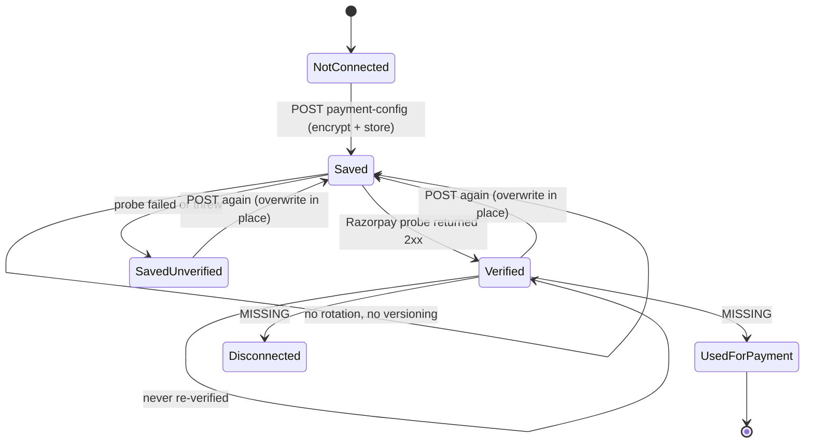

# 10 — PAYMENTS: MERCHANT-OWNED RAZORPAY (BYOG)

- **Run ID:** `docs/merchant-system-discovery/2026-08-04T225330+0530-ee371182`
- **Branch:** `stepup/main` · **Commit:** `ee371182` · **Run date:** 2026-08-04 (+0530)
- **Scope:** The merchant-owned / bring-your-own-gateway (BYOG) Razorpay architecture only — merchant credential capture, storage, encryption, verification, resolution, lifecycle, and the honesty surfaces built on it. The platform-managed money-in path, refunds, COD, settlements and payouts are documented in **11** and its siblings; they appear here only where they prove or disprove a BYOG claim.
- **Evidence basis:** Agent-G Phase-1 notes (`_agent-notes/G-payments-refunds-payouts.md`) read in full, plus first-hand re-verification of every source file cited below (gateway routes, gateway libs, tenant-core schemas, typed API client, merchant console UI, Flutter merchant app, migrations 142/160, storefront public payload selects). Where this document goes **beyond** the notes, it is marked *(enrichment — verified from source in this document)*.
- **METHOD DISCLOSURE:** **Nothing in this document was runtime-verified.** No gateway was started, no request was issued, no database was queried, no Razorpay sandbox call was made. Every status is static-source-derived and therefore capped at `IMPLEMENTED_NOT_RUNTIME_VERIFIED`; nothing here is `VERIFIED_E2E`.
- **No secrets or PII appear in this document.** Environment variable *names* appear; no value was read, printed, or inferred.

---

## 1. Recommendation / verdict

**BYOG does not exist as a money path. Stop describing it as one, in code, in the product, and in the Constitution, until an ARB decision resolves which model LetBuyy is actually shipping.**

Concretely:

1. A merchant can type their Razorpay key id and key secret into two different LetBuyy surfaces. The secret is AES-GCM-encrypted and written to `sites.payment_settings.razorpay.key_secret_ciphertext`. **There is no decrypt function anywhere in the repository, and no code path reads that ciphertext.** The key material is imported with usage `['encrypt']` only (`services/api-gateway/src/lib/store-payment-config.ts:34`) — decryption is not merely unimplemented, it is not permitted by the key handle that exists.
2. A second, disjoint credential store — `payment_credentials` (migration `142`) — has a reader (`services/api-gateway/src/lib/payment-route-support.ts:97-105`, a bare `select('id')`) and **no writer anywhere in the repository**. The live-mode guard that depends on it (`requireLivePaymentCredential`, `payment-route-support.ts:122-138`) can therefore never be satisfied, so `POST /v1/payments/sessions` in `live` mode returns `503 PAYMENT_SETUP_REQUIRED` permanently and by construction.
3. Every real Razorpay API call on the shopper money path uses the single platform-level worker secrets `RAZORPAY_KEY_ID` / `RAZORPAY_KEY_SECRET` (`services/api-gateway/src/routes/storefront/checkout-payment-routes.ts:464, 505-508, 544, 584, 635-638`). `site_id` never selects a credential.

**What that means in plain language: buyers pay into LetBuyy's Razorpay account, not the merchant's.** LetBuyy is the merchant-of-record and the collector of buyer funds for every store on the platform. That is a direct contradiction of **ART-11** (`GOVERNANCE_REWRITE_2026_06_10/LETBUYY_CONSTITUTION.md:213-214`: *"Money-in flows to the merchant's own Razorpay (merchant = merchant-of-record)"*), of Commerce Philosophy §4.2 (`:85`), and of **PAY-R4** (`AGENTS.md:248`).

**This is a regulatory posture question before it is an engineering gap.** Collecting buyer funds on behalf of third-party merchants is payment-aggregator activity with RBI PA-licensing implications. It cannot be resolved by a lead engineer, a refactor, or a validator. It requires an explicit, written decision by **ARB + the founder + payments counsel** on which of two models LetBuyy is actually operating:

- **(a) True BYOG** — per-site credential resolution on every provider call, real KMS-backed envelope encryption with a decrypt path, per-account webhook attribution, rotation and revocation. This restores ART-11 as written and is a substantial build, not a patch.
- **(b) Platform-collect + PA split** — LetBuyy openly collects into its own PA account and splits out via Route. This is what the code does today. It requires rewriting ART-11, licensing/counsel review, merchant contract changes, and a truthful product story.

**Shipping (b) by inaction — which is what is happening now — is the worst of the three outcomes**, because the platform is operating model (b) while the Constitution, the merchant console, and the Flutter app all tell merchants it is operating model (a).

Second verdict, subordinate but urgent: **the merchant-facing honesty surfaces are structurally dishonest, not merely imprecise.** The provider-mode badge is derived from a credential that is never used (`store-payment-config.ts:72-79`); the web console tells the merchant *"Connect the seller Razorpay account used by storefront checkout"* (`apps/merchant-control-plane/src/app/[store]/settings/payments/page.tsx:362`); the Flutter merchant app tells the merchant *"All payments will go directly to your account"* (`apps/mobile/merchant-app/lib/screens/subscription/connect_razorpay_screen.dart:137`) and hardcodes a green `Verified` tile (`:322`) — and paywalls this non-functional capability behind the Professional plan (`:182, :573`). Those are false factual statements to a paying customer, which puts them beyond an engineering-only fix as well.

Third verdict: **do not enable live mode on any surface, and do not set `RAZORPAY_ROUTE_PROVIDER_ENABLED=true`, until MCP-DISC-400 through MCP-DISC-403 are resolved.** The `/v1/payments/sessions` + `/v1/payments/:id/capture` pair — the only credential-aware path in the codebase — is a sandbox simulator whose capture endpoint nevertheless posts a real canonical ledger transaction crediting `merchant_payable` from a caller-supplied `provider_payment_id`, with no provider verification and no step-up (MCP-DISC-403).

---

## 2. Scope

**In scope for this document**

| Area | Included |
|---|---|
| Merchant credential capture (web console + Flutter app) | yes |
| App proxy → typed client → gateway route for `payment-config` | yes |
| Encryption at rest, key derivation, key handle, key lifecycle | yes |
| Credential verification against Razorpay | yes |
| Credential *resolution* at payment time (the decisive absence) | yes |
| `payment_credentials` (migration 142) as the second BYOG store | yes |
| BYOG-scoped honesty: provider-mode badge, "connected/verified" copy, mode semantics | yes |
| Rotation, disconnect, revocation, audit of merchant credentials | yes |
| Webhook-to-site attribution *as a BYOG blocker* | yes (design blocker only) |
| Secure BYOG target design + required approvals | yes (architecture and properties only, no code) |

**Explicitly out of scope here** (owned by sibling documents; cross-referenced but not re-adjudicated): the platform-managed money-in path and its capture-verification gap; the canonical ledger posting matrix; refunds and step-up coverage; COD; settlements; payouts and the single `RAZORPAY_ROUTE_ACCOUNT_ID` beneficiary; the general webhook replay-window and PostgREST filter-construction defects; Cashfree, Stripe and PayPal topology.

---

## 3. Current merchant user journeys (what a merchant can actually do today)

### Journey 1 — "Connect your own Razorpay" from the web console

1. Merchant opens `/{store}/settings/payments` (`apps/merchant-control-plane/src/app/[store]/settings/payments/page.tsx`).
2. Sees a card titled **"Razorpay account"** described as *"Connect the seller Razorpay account used by storefront checkout and Flutter builder flows."* (`:362`).
3. Enters a key id (placeholder `rzp_test_…` / `rzp_live_…`, `:411`) and a key secret (masked input, helper text *"The secret is submitted securely and never shown after saving"*, `:420-425`), and optionally leaves **"Use Razorpay sandbox mode"** checked (`:434-446`).
4. Presses **Connect Razorpay** / **Update Razorpay keys** (`:448`).
5. The secret is encrypted and stored; LetBuyy calls Razorpay once with the merchant's credentials to check they are live; the console shows a **Verified / Saved / Not connected** badge (`:321-325`) and a **sandbox|live** provider-mode badge (`:365`), plus an "Account mode: **Seller Razorpay account**" tile (`:468`).
6. On success the merchant is told: *"The seller Razorpay account is connected and verified."* (`:268`).

**What actually happened:** a jsonb blob was written to `sites.payment_settings`. No shopper payment, refund, webhook, payout or reconciliation anywhere in the platform will ever read it.

### Journey 2 — "Connect Own Razorpay" from the Flutter merchant app (Professional plan only)

1. Merchant on a **Professional** plan opens the Connect Razorpay screen (`apps/mobile/merchant-app/lib/screens/subscription/connect_razorpay_screen.dart:12`). Merchants on other plans see a paywall: *"Upgrade to Professional to connect your own Razorpay account and pay 0% commission."* (`:573`), gated at `:182`.
2. Info card: *"With your own Razorpay, you pay 0% commission to Letbuyy. Payments go directly to your bank."* (`:270`).
3. On save, `connectOwnRazorpay` (`apps/mobile/merchant-app/lib/services/subscription_service.dart:224-241`) calls the **same** `stores.paymentConfig.save` endpoint as the web console.
4. Success dialog: **"Connected!"** — *"Your Razorpay account is now connected. All payments will go directly to your account with 0% commission."* (`:137`).
5. The connected state renders **"Razorpay Connected"** (`:301`), **"Live Mode Active" / "Sandbox Mode Active"** (`:312`), and two status tiles: `Commission 0%` and `Status **Verified**` — the latter a **hardcoded literal**, not derived from the API's `verified` flag (`:322`).

**What actually happened:** identical to Journey 1. The claims in steps 2, 4 and 5 are false against the shipped money path.

### Journey 3 — Merchant tries to take a live payment through the "merchant-owned payment session" API

`POST /v1/payments/sessions` with `mode: 'live'` → `requireLivePaymentCredential` looks for an active `payment_credentials` row → no writer exists → always null → `HumanRequiredError` → `503 PAYMENT_SETUP_REQUIRED` (`services/api-gateway/src/routes/payments.ts:124-131`; `payment-route-support.ts:95, 122-138`; `packages/payments/src/index.ts:293-299`). **There is no action the merchant, an operator, or a human seam owner can take inside this repository that changes this outcome.**

### Journey 4 — A shopper actually pays at that merchant's store

Storefront checkout calls `POST /v1/storefront/:subdomain/payments/razorpay/order`. The route checks `c.env.RAZORPAY_KEY_ID` / `c.env.RAZORPAY_KEY_SECRET` (`checkout-payment-routes.ts:464`), constructs the provider with those platform secrets (`:505-508`), creates the Razorpay order **in LetBuyy's account**, and returns `keyId: c.env.RAZORPAY_KEY_ID` to the shopper's browser (`:544`). Verification re-reads the same platform secret (`:584, 635-638`). **The merchant's stored key id is never read; `site_id` never selects a credential.**

### Journeys that do not exist

| Journey | Status |
|---|---|
| Disconnect / remove my Razorpay account | `NOT_IMPLEMENTED` — no DELETE route, no UI control |
| Rotate my key secret with a versioned changeover | `NOT_IMPLEMENTED` — re-POST silently overwrites in place |
| See when my credentials were last verified / re-verify | `NOT_IMPLEMENTED` — `verified` is set once at save; `last_verified_at` exists only on the dead `payment_credentials` table (`migrations/142:15`) |
| See an audit trail of who changed payment credentials | `NOT_IMPLEMENTED` — `connected_at` is deliberately preserved across overwrites (`routes/stores.ts:448`), so the record reads as if nothing changed |
| Choose which gateways my storefront offers | `BROKEN` — written to `payment_settings.gateways` but never delivered to the storefront (see §6.4) |

---

## 4. Feature matrix

Status strings are from the fixed taxonomy. **Ceiling is `IMPLEMENTED_NOT_RUNTIME_VERIFIED` throughout** — no runtime observation exists.

| # | Capability | Status | Evidence (path:line) | Evidence type | Gap ID |
|---|---|---|---|---|---|
| 1 | Merchant enters own Razorpay key id + secret (web) | `IMPLEMENTED_NOT_RUNTIME_VERIFIED` | `apps/merchant-control-plane/src/app/[store]/settings/payments/page.tsx:220-281, 405-450` | UI_CODE | — |
| 2 | Merchant enters own Razorpay key id + secret (mobile) | `IMPLEMENTED_NOT_RUNTIME_VERIFIED` | `apps/mobile/merchant-app/lib/screens/subscription/connect_razorpay_screen.dart:72-108` | UI_CODE | MCP-DISC-407 |
| 3 | Same-origin app proxy | `IMPLEMENTED_NOT_RUNTIME_VERIFIED` | `apps/merchant-control-plane/src/app/api/stores/[store]/payment-config/route.ts:24-48` | PROXY_CODE | — |
| 4 | Typed API client method | `IMPLEMENTED_NOT_RUNTIME_VERIFIED` | `packages/typescript/api-client/src/index.ts:3854-3859` | API_CLIENT_CODE | — |
| 5 | Gateway route + ownership check | `IMPLEMENTED_NOT_RUNTIME_VERIFIED` | `services/api-gateway/src/routes/stores.ts:366-504`, ownership at `:393-401, :463` | GATEWAY_CODE | — |
| 6 | Input validation (`rzp_test_`/`rzp_live_` prefix) | `IMPLEMENTED_NOT_RUNTIME_VERIFIED` | `packages/tenant-core/src/index.ts:249-257` | GATEWAY_CODE | MCP-DISC-410 |
| 7 | Fail-closed when the encryption key is absent | `IMPLEMENTED_NOT_RUNTIME_VERIFIED` | `services/api-gateway/src/routes/stores.ts:381-391` (503 `PAYMENT_CONFIG_UNAVAILABLE`) | GATEWAY_CODE | — |
| 8 | Secret encrypted at rest (AES-GCM-256, random 12-byte IV) | `IMPLEMENTED_NOT_RUNTIME_VERIFIED` | `services/api-gateway/src/lib/store-payment-config.ts:37-47` | GATEWAY_CODE | MCP-DISC-405 |
| 9 | **Secret decryptable / usable** | `NOT_IMPLEMENTED` | no `decrypt` anywhere; key usage `['encrypt']` only at `store-payment-config.ts:34`; repo-wide search for `key_secret_ciphertext` returns 4 production hits, all write/mask/existence | GATEWAY_CODE | **MCP-DISC-401** |
| 10 | Secret masked on read; never returned | `IMPLEMENTED_NOT_RUNTIME_VERIFIED` | `store-payment-config.ts:26-30, 53-70` (`secret_configured` boolean only) | GATEWAY_CODE | — |
| 11 | Credential verified against Razorpay at save | `PARTIAL` | `store-payment-config.ts:49-51` → `packages/infrastructure/razorpay-adapter/index.ts:198-206` (`GET /v1/payments?count=1`) | SERVICE_CODE | MCP-DISC-409 |
| 12 | **Per-site credential resolution at payment time** | `NOT_IMPLEMENTED` | `checkout-payment-routes.ts:464, 505-508, 584, 635-638` use platform env unconditionally | GATEWAY_CODE | **MCP-DISC-400** |
| 13 | Merchant-owned payment session (`/v1/payments/sessions`) — live | `BROKEN` | `payments.ts:124-131`; `payment-route-support.ts:97-105, 122-138`; no writer for `payment_credentials` | GATEWAY_CODE + DB_SCHEMA | **MCP-DISC-402** |
| 14 | Merchant-owned payment session — sandbox | `STUB_OR_MOCK` | `payments.ts:148-153` → `packages/payments/src/index.ts:301-329` fabricates `providerOrderId`/`providerSessionId`; no provider call | GATEWAY_CODE | MCP-DISC-403 |
| 15 | Session capture posts canonical ledger from caller-supplied provider id | `IMPLEMENTED_NOT_RUNTIME_VERIFIED` (defect) | `payments.ts:257, 276, 294-314` — no provider fetch, no step-up | GATEWAY_CODE | **MCP-DISC-403** |
| 16 | Key rotation | `NOT_IMPLEMENTED` | no rotate route; re-POST overwrites (`stores.ts:439-451`) | GATEWAY_CODE | MCP-DISC-404 |
| 17 | Disconnect / revoke | `NOT_IMPLEMENTED` | only `GET` and `POST` exist on `/stores/:id/payment-config` (`stores.ts:100, 366`) | GATEWAY_CODE | MCP-DISC-404 |
| 18 | Credential-change audit trail | `NOT_IMPLEMENTED` | `connected_at` preserved across overwrite (`stores.ts:448`); no audit row written | GATEWAY_CODE | MCP-DISC-404 |
| 19 | KMS / envelope encryption / key versioning | `NOT_IMPLEMENTED` | single shared env key, SHA-256-derived (`store-payment-config.ts:32-35`); `payment_credentials.kms_key_ref DEFAULT 'sandbox-kms://letbuyy/payment-credentials'` (`migrations/142:13`) | GATEWAY_CODE + DB_SCHEMA | MCP-DISC-405 |
| 20 | Provider-mode badge honesty (web) | `CONTRADICTORY_EVIDENCE` | badge from unused ciphertext (`store-payment-config.ts:72-79`) + copy at `page.tsx:268, 362, 468` | UI_CODE | MCP-DISC-406 |
| 21 | Provider-mode / connection honesty (mobile) | `CONTRADICTORY_EVIDENCE` | `connect_razorpay_screen.dart:137, 270, 301, 312, 322` | UI_CODE | MCP-DISC-407 |
| 22 | Per-merchant webhook attribution (BYOG prerequisite) | `NOT_IMPLEMENTED` | one `RAZORPAY_WEBHOOK_SECRET` (`services/webhook-service/src/index.ts:38, 724, 730`); global unscoped order lookup (`:332-352`) | WEBHOOK_OR_JOB | MCP-DISC-408 |
| 23 | Plan entitlement for BYOG | `CONTRADICTORY_EVIDENCE` | mobile gates on Professional (`connect_razorpay_screen.dart:182`); gateway has no plan check (`stores.ts:366-504`) | UI_CODE + GATEWAY_CODE | MCP-DISC-411 |
| 24 | Merchant gateway selection reaches the storefront | `BROKEN` | `apps/storefront-runtime/src/lib/store-service.ts:689-690` reads `payment_settings`, which the public payload selects never include (`routes/storefront.ts:344-347`; `routes/storefront/public-routes.ts:23-29`) | GATEWAY_CODE + UI_CODE | MCP-DISC-413 |
| 25 | Credential ciphertext not exposed publicly | **holds** | `payment_settings` absent from both public site selects above; `mapPublicStorePayload` spreads only the selected columns (`packages/tenant-core/src/index.ts:495-522`) | GATEWAY_CODE | — |
| 26 | Behavioural test coverage of the credential path | `NOT_IMPLEMENTED` | only `tests/launch/lb-phase5-commerce.test.mjs:119-123` (file-exists + regex) | UNIT_TEST | MCP-DISC-415 |
| 27 | Governance seam accurately describes BYOG coverage | `CONTRADICTORY_EVIDENCE` | `SKIPPED_HUMAN_DECISIONS.md:57` claims live fails closed "without active merchant credentials"; true only for `/payments/sessions` | DOC_CLAIM | MCP-DISC-412 |

---

## 5. UI / route inventory

### 5.1 Merchant-facing surfaces

| Surface | Path | Renders | Notes |
|---|---|---|---|
| Payments settings (web) | `apps/merchant-control-plane/src/app/[store]/settings/payments/page.tsx` | key-id (masked), Verified/Saved/Not-connected badge (`:321-325`), `ProviderModeBadge` (`:365`), online-payment + COD switches, credential form, "Account mode" tile (`:468`) | 480 lines; no disconnect, no rotate, no history |
| Provider-mode badge component | `apps/merchant-control-plane/src/components/ProviderModeBadge.tsx` | `sandbox` (warning tone) / `live` (success tone) | Renders nothing when mode is null |
| Dashboard payment summary | `apps/merchant-control-plane/src/app/[store]/dashboard/page.tsx:178` | reads `config.payment_settings` | display only |
| Connect Own Razorpay (mobile) | `apps/mobile/merchant-app/lib/screens/subscription/connect_razorpay_screen.dart` | credential form, success dialog, connected card, Professional paywall | 598 lines; no disconnect |
| Operator onboarding view | `apps/platform-operations-portal/src/app/(dashboard)/operations/onboarding/page.tsx:463` | `if (payment.payment_settings?.razorpay?.verified) modes.push('verified Razorpay')` | operator sees the same false signal |

### 5.2 Routes

| Layer | Route | Verb(s) | File:line |
|---|---|---|---|
| App proxy | `/api/stores/[store]/payment-config` | GET, POST, PATCH | `apps/merchant-control-plane/src/app/api/stores/[store]/payment-config/route.ts:6, 24, 51` |
| Typed client | `stores.paymentConfig.get` / `.save` | — | `packages/typescript/api-client/src/index.ts:3855, 3857` |
| Gateway | `GET /v1/stores/:id/payment-config` | GET | `services/api-gateway/src/routes/stores.ts:100-162` |
| Gateway | `POST /v1/stores/:id/payment-config` | POST | `services/api-gateway/src/routes/stores.ts:366-504` |
| Gateway | `PATCH /v1/stores/:id` (COD / online toggles only) | PATCH | `services/api-gateway/src/routes/stores.ts:749-778` (allowlist `:762-771`) |
| Gateway | `POST /v1/payments/sessions` (credential-aware) | POST | `services/api-gateway/src/routes/payments.ts:108-250` |
| Gateway | `POST /v1/payments/:id/capture` | POST | `services/api-gateway/src/routes/payments.ts:257-…` |
| **Missing** | `DELETE /v1/stores/:id/payment-config` (disconnect) | — | **MISSING** |
| **Missing** | rotate / re-verify endpoint | — | **MISSING** |

---

## 6. Backend / API / RPC / database mapping

### 6.1 The write path (the only path that exists)

```
merchant browser / Flutter app
  → POST /api/stores/{store}/payment-config            proxy, resolves owned store id
  → stores.paymentConfig.save()                        typed client
  → POST /v1/stores/:id/payment-config                 gateway (auth: merchant ES256 session)
      · resolveCustomUser + ownedByCustomUserFilter     ownership (stores.ts:375-401)
      · 503 if !PAYMENT_CONFIG_ENCRYPTION_KEY           fail-closed (stores.ts:381-391)
      · encryptPaymentSecret(secret, envKey)            AES-GCM-256 (store-payment-config.ts:37-47)
      · verifyRazorpayCredentials(keyId, keySecret)     GET /v1/payments?count=1 (adapter:198-206)
      · UPDATE sites SET payment_settings = {…},        direct table write (stores.ts:453-466)
                        online_payment_enabled = true
  → response: masked settings + provider_mode           (stores.ts:494-503)
```

Stored shape (`services/api-gateway/src/lib/store-payment-config.ts:3-14`):

```
sites.payment_settings = {
  mode: 'ownAccount',                     // always set by POST (stores.ts:441)
  gateways: ['razorpay', …],
  razorpay: {
    key_id, key_secret_ciphertext,        // base64(iv):base64(ciphertext)
    test_mode, verified,
    connected_at, updated_at
  }
}
```

### 6.2 The read path — every consumer, exhaustively

Repo-wide search for `key_secret_ciphertext` / `encryptPaymentSecret` / `decryptPaymentSecret` / `PAYMENT_CONFIG_ENCRYPTION_KEY` across `services apps packages database scripts` (excluding `node_modules`, `.next`, `dist`, `.wrangler`) returns these production hits and no others:

| Hit | What it does |
|---|---|
| `store-payment-config.ts:8` | type declaration |
| `store-payment-config.ts:66` | `secret_configured: Boolean(razorpay.key_secret_ciphertext)` — existence check for the UI |
| `store-payment-config.ts:77` | provider-mode heuristic — existence check |
| `routes/stores.ts:425-428, 445` | the writer |
| `services/api-gateway/src/index.ts:140` | env binding declaration |
| `scripts/*`, `packages/lcis-core/*` | tooling / env-provisioning / graph metadata |

**There is no reader of the secret. There is no decrypt. The ciphertext is write-only storage.**

### 6.3 The second, disjoint credential store

| Element | Evidence | State |
|---|---|---|
| Table `payment_credentials` | `database/supabase/migrations/142_executable_payment_sessions.sql:7-23` — `(site_id, provider, mode, status, kms_key_ref, encrypted_credentials jsonb, last_verified_at, …)`, `UNIQUE (site_id, provider, mode)` | exists |
| `kms_key_ref` default | `migrations/142:13` → `'sandbox-kms://letbuyy/payment-credentials'` | placeholder scheme, no KMS integration |
| RLS | `migrations/142:181-182` ENABLE + FORCE; GUC policy `:193-195` | correct target design |
| Index | `migrations/142:128-129` on `(site_id, provider, status)` | exists |
| `payments.credential_id` FK | `migrations/142:56` | exists, always null in practice |
| Default mode hardened to sandbox | `migrations/160_foundation_money_ledger_authority.sql:16-17` | exists |
| **Reader** | `services/api-gateway/src/lib/payment-route-support.ts:97-105` — `select('id')`, and only when `mode === 'live'` (`:95`) | 1 |
| **Writer** | *(none in any runtime, migration seed, worker, or script)* | **0** |

Consequence chain, all statically certain:
`activeMerchantPaymentCredential` → always `null` → `livePaymentCredentialsAreRequired({mode:'live', merchantCredentialPresent:false})` → `true` (`packages/payments/src/index.ts:293-299`) → `HumanRequiredError` → `503 PAYMENT_SETUP_REQUIRED` (`routes/payments.ts:124-131`, `payment-route-support.ts:110-120`).

### 6.4 Where the two stores diverge and both die

`sites.payment_settings` (store A) is written and displayed. `payment_credentials` (store B) is read and never written. **Neither is consulted by any Razorpay call.** They also disagree structurally: A is a jsonb blob on the tenant row with one Razorpay slot; B is a normalised per-`(site, provider, mode)` row with KMS reference, status and verification timestamp. B is the better design and is the one with no capture UI.

Additional dead wire *(enrichment — verified from source)*: the merchant's `payment_settings.gateways` array is read by the storefront runtime at `apps/storefront-runtime/src/lib/store-service.ts:689-690`, but the two public storefront site payload column lists — `services/api-gateway/src/routes/storefront.ts:344-347` and `services/api-gateway/src/routes/storefront/public-routes.ts:23-29` — do not include `payment_settings`, so `asRecord(undefined)` yields `{}` and `gateways` always falls back to the literal `['razorpay']`. The same fact is a **positive security finding**: the ciphertext and key id are not exposed on the public storefront payload.

### 6.5 RPCs and money tables

**None.** The BYOG path touches no `SECURITY DEFINER` money RPC and no money table. The one adjacent money write is the V1 session/capture pair: `routes/payments.ts:162-184` inserts a `payments` row (a money table, written directly from TypeScript — recorded in the Phase-1 canonical-ledger-only audit) and `:294-314` posts a canonical capture transaction via `postPaymentLedger` / `buildPaymentCaptureLedgerPosting`, then updates `payments` at `:317`.

---

## 7. State machine

Credential lifecycle as implemented. Every transition that a competent BYOG design requires but this system lacks is drawn as an absent edge in the notes column, not in the graph, because the graph must only show what exists.



Notes on the graph:

- `UsedForPayment` is unreachable — no code path resolves the credential (MCP-DISC-400/401).
- `Disconnected` is unreachable — no delete/revoke route exists (MCP-DISC-404).
- `SavedUnverified` still force-sets `online_payment_enabled = true` (`stores.ts:458`), so a store whose credentials failed verification is still marked as accepting online payments — which is harmless only because the credential is unused (MCP-DISC-409).
- `connected_at` is carried forward across every overwrite (`stores.ts:448`), so the state graph is not observable from the stored data.

The `payment_credentials` (store B) machine has exactly one state, `absent`, with no ingress.

---

## 8. Auth / tenant / invariant analysis

### 8.1 Authentication and authorization on the credential routes

| Control | Evidence | Verdict |
|---|---|---|
| Issuer | merchant ES256 session via the gateway auth middleware; the route reads `c.get('auth')` (`stores.ts:367`) | correct issuer for a merchant surface |
| Identity resolution | `resolveCustomUser(db, auth.user)`, 403 if absent (`stores.ts:375-379`) | present |
| Ownership | `ownedByCustomUserFilter(customUser.id)` applied to both the SELECT (`:398`) and the UPDATE (`:463`) | ownership is enforced **on the mutation itself**, not post-hoc — correct pattern |
| Soft-delete respect | `.is('deleted_at', null)` with a compat fallback (`:400, 465`) | present |
| Step-up (second factor) | **absent** | see below |
| Staff-permission scope | **absent** — any session that owns the site may write payment credentials | see below |
| Plan entitlement | **absent at the gateway**; enforced only in the Flutter UI (`connect_razorpay_screen.dart:182`) | MCP-DISC-411 |
| Rate limiting | not observed on this route | not adjudicated (no runtime evidence) |

**Step-up analysis.** Writing a payment credential is, in a working BYOG system, the single most sensitive merchant action available — it determines which bank account receives every rupee the store takes. `verifySensitiveActionStepUp` exists and is real HMAC-SHA256 with constant-time comparison (`services/api-gateway/src/lib/security-controls.ts:126-227`, applied at `routes/payments.ts:497-507` for refunds and `routes/payouts.ts:576-586` for payout release). It is **not** applied to `POST /stores/:id/payment-config`. Today this is latent rather than exploitable — the credential is unused — but any BYOG remediation that makes the credential load-bearing **must** land step-up on this route in the same change, or it creates a session-hijack → redirect-all-revenue path. Recorded as an acceptance criterion on MCP-DISC-400 rather than as a separate gap, because writing this control against a dead credential would be theatre.

### 8.2 Tenancy

- The credential lives in `sites.payment_settings`, a jsonb column on the tenant row itself, so tenant scoping is inherited from `sites` and the ownership filter above. No cross-tenant read/write candidate was found on these two routes.
- `payment_credentials` has RLS ENABLE + FORCE and a `site_id = public.current_site_id()` GUC policy (`migrations/142:181-195`) — the correct design, on a table nothing writes.
- The gateway connects as `service_role` and therefore bypasses RLS in general (documented in the Phase-1 notes and owned by the tenancy documents); for the BYOG routes the application-level ownership filter is the load-bearing control.

### 8.3 Invariant / rule compliance

| Rule | Text (abridged) | Status | Evidence |
|---|---|---|---|
| **ART-11** | *"Money-in flows to the merchant's own Razorpay (merchant = merchant-of-record)… LetBuyy never custodies."* (`LETBUYY_CONSTITUTION.md:213-214`) | **VIOLATED** | `checkout-payment-routes.ts:464, 505-508, 584, 635-638` |
| **Commerce Philosophy §4.2** | *"Buyers pay into the merchant's own Razorpay account. LetBuyy never custodies money-in."* (`:85`) | **VIOLATED** | same |
| **Non-Goal §7.1** | *"Not a money custodian. It never holds merchant or buyer funds."* (`:120`) | **VIOLATED** in posture | same |
| **PAY-R4** | never custody; money-in to the merchant's own Razorpay (`AGENTS.md:248`) | **VIOLATED** | same |
| **PAY-R10 / UI-R6** | provider-mode honesty on every money surface; a stub must not read as success | **VIOLATED** | `store-payment-config.ts:72-79`; `page.tsx:268, 362`; `connect_razorpay_screen.dart:137, 322` |
| **ANTI-R9** | *"MUST NOT let a mock/sandbox path report success without an honesty badge"* (`AGENTS.md:322`) | **VIOLATED** | the badge exists but is derived from an unused artefact — worse than absent, because it is authoritative-looking and wrong |
| **R-22** | *"Every money/fulfillment surface MUST carry a truthful provider-mode honesty badge"* (`LETBUYY_CONSTITUTION.md:423`) | **VIOLATED** (truthfulness limb) | same |
| Secret handling | secrets never returned to the client | **HOLDS** | `store-payment-config.ts:53-70`; no public exposure (§6.4) |
| Fail-closed on missing crypto config | | **HOLDS** | `stores.ts:381-391` |
| Money mutation only via `SECURITY DEFINER` RPC | | not applicable to BYOG routes; the adjacent V1 session/capture pair does write `payments` directly from TS (`payments.ts:162, 317`) | GATEWAY_CODE |

---

## 9. Runtime and test evidence

**Runtime evidence: none. Zero requests were issued. Zero database rows were read. No Razorpay sandbox call was made. No `.env` was opened.** Every status in this document is derived from source text.

What this means for the reader:

- The **absence** claims (no decrypt function; no writer for `payment_credentials`; no disconnect route) are as strong as an exhaustive repository search can make them — they were re-run first-hand for this document across `services apps packages database scripts` with build artefacts excluded. They remain vulnerable to one thing only: a credential row seeded out-of-band directly into a production database (see §15, open question 4).
- The **behavioural** claims (that a live-mode session returns 503; that the badge shows `live` for a merchant whose money is actually flowing through the platform account) follow deterministically from the source but have not been observed.

**Test evidence:**

| Test | What it asserts | Value |
|---|---|---|
| `tests/launch/lb-phase5-commerce.test.mjs:119-123` | the proxy file exists and the page source matches `/payment-config/` | file-existence ratchet only |
| `services/api-gateway/src/__tests__/payments.test.ts:175, 186` | migration 142 text contains `CREATE TABLE … payment_credentials` and the rollback drops it | source-text regex |
| `packages/payments/test/payments.test.ts:105-107` | `livePaymentCredentialsAreRequired` truth table | genuine unit test of a pure function — the only real behavioural coverage in this domain |

There is **no** test that encrypts and then decrypts a secret (it is impossible — there is no decrypt), no test that a payment resolves a per-site credential, no test that the badge matches the credential in use, and no contract test on `POST /stores/:id/payment-config` at all.

---

## 10. Implemented vs missing

**Implemented and sound (keep):**

- Ownership-scoped credential write with soft-delete handling (`stores.ts:393-401, 453-466`).
- Fail-closed on absent `PAYMENT_CONFIG_ENCRYPTION_KEY` (`:381-391`).
- AES-GCM-256 with a random 12-byte IV per encryption (`store-payment-config.ts:37-47`) — the primitive choice and IV handling are correct even though the key management around them is not.
- Secret never echoed to any client; key id masked (`:26-30, 53-70`).
- A real provider probe at save time rather than an assumed success (`razorpay-adapter/index.ts:198-206`).
- `payment_credentials` schema shape, RLS ENABLE+FORCE and GUC policy (`migrations/142:7-23, 181-195`) — the right table, unused.
- Ciphertext and key id are absent from the public storefront payload (§6.4).

**Missing (the BYOG system, essentially in full):**

| Missing element | Consequence |
|---|---|
| Decrypt path (and a key handle permitted to decrypt) | the stored secret can never be used |
| Per-site credential resolver in the storefront and merchant payment routes | all money-in lands in the platform account |
| Any writer for `payment_credentials` | live payment sessions are permanently 503 |
| KMS-backed envelope encryption, per-site DEKs, key versioning | one shared platform key protects every merchant secret; rotation would orphan all of them |
| Rotation, disconnect, revocation, credential audit | no lifecycle at all |
| Per-account webhook secret + site-scoped attribution | inbound events could not be attributed under BYOG |
| Step-up on credential write | a session compromise would redirect all future revenue once BYOG is live |
| Truthful mode derivation from the credential actually used | the merchant is told the opposite of the truth |
| Any behavioural test of the credential lifecycle | regressions are invisible |

---

## 11. Gap IDs

Severity: **P0** = blocks launch / money-misrouting or money-loss class · **P1** = must fix before real merchants · **P2** = fix before scale · **P3** = hygiene.
Every gap below is `UNVERIFIED_RUNTIME` in the sense that no runtime observation supports or refutes it; the status field records the static verdict.

---

### MCP-DISC-400 — BYOG does not exist as a money path: every buyer pays into LetBuyy's Razorpay account [HIGH-STAKES] [IRREVERSIBLE]

- **Domain:** payments / never-custody / regulatory posture
- **Status:** `CONTRADICTORY_EVIDENCE` (code vs Constitution) — the BYOG credential subsystem itself is `STUB_OR_MOCK`
- **User / business impact:** Every rupee a shopper pays at any LetBuyy store is collected into LetBuyy's own Razorpay account. LetBuyy is the de facto merchant-of-record and the custodian of buyer funds for the whole platform, and any onward movement of that money to a merchant is a disbursement by LetBuyy. Merchants are told the opposite in both merchant apps. Refunds are funded from LetBuyy's balance. The 0 %-fee thesis, the never-custody thesis, and the licensing posture all rest on the merchant-of-record claim that the code contradicts.
- **Exact evidence:**
  - Money-in uses platform env, not a per-site credential: `services/api-gateway/src/routes/storefront/checkout-payment-routes.ts:464` (env presence gate), `:505-508` (`createRazorpayPaymentProvider({ keyId: c.env.RAZORPAY_KEY_ID, keySecret: c.env.RAZORPAY_KEY_SECRET })`), `:544` (platform `keyId` returned to the shopper's browser), `:584`, `:635-638` (verify re-reads the platform secret).
  - Merchant-context duplicates of the same platform-account path: `services/api-gateway/src/routes/payments.ts:1062, 1091, 1125, 1162, 1194`; refund provider construction at `:533-536` (per Phase-1 notes; not re-opened for this document).
  - `site_id` is never used to select a credential anywhere on these paths.
  - Product acknowledges a shared account in the same data model: `services/api-gateway/src/lib/store-payment-config.ts:57` (`mode: settings?.mode || 'shared'`); UI label `apps/merchant-control-plane/src/app/[store]/settings/payments/page.tsx:468` (*"Shared LetBuyy account"*).
  - Constitution: `GOVERNANCE_REWRITE_2026_06_10/LETBUYY_CONSTITUTION.md:85, 117, 213`; `AGENTS.md:248` (PAY-R4).
- **Expected behavior:** For a store whose merchant has connected their own Razorpay, the Razorpay order-create, verify and refund calls carry **that merchant's** key id and secret; the buyer's money settles in the merchant's account; LetBuyy never holds the funds.
- **Missing link / root cause:** The credential capture flow was built and the credential *resolution* flow never was. The two halves were never joined; see MCP-DISC-401 and MCP-DISC-402 for the two concrete missing joins.
- **Blast radius:** Every order, every merchant, every refund, all settlement and payout semantics, the regulatory posture of the company, merchant contracts, and the 0 %-fee product claim.
- **Invariant tag:** [HIGH-STAKES] [IRREVERSIBLE]
- **Severity:** **P0** · **Likelihood:** **HIGH** — this is the current shipped behaviour, not a possibility
- **Dependencies:** MCP-DISC-401, MCP-DISC-402, MCP-DISC-405, MCP-DISC-408; and (from sibling documents) the single-`RAZORPAY_ROUTE_ACCOUNT_ID` payout defect and the absence of provider capture verification.
- **Recommended remediation APPROACH (no code):** Do **not** start with engineering. (1) ARB + founder + payments counsel record a written decision between model (a) true BYOG and model (b) platform-collect + PA split — §1 states both. (2) If (a): commission the target design in §12 — per-site credential resolution as a single choke-point service used by every provider call, real KMS envelope encryption with a decrypt path, per-account webhook attribution, rotation/revocation, step-up on credential write — and add a validator forbidding `c.env.RAZORPAY_KEY_*` inside storefront and order payment routes. (3) If (b): amend ART-11, PAY-R4 and the Constitution's non-goals with counsel; change every merchant-facing claim (MCP-DISC-406, MCP-DISC-407); and treat licensing as a launch blocker. (4) Either way, until the decision lands, disable or truthfully re-label the "connect your own Razorpay" surfaces so no further merchants are onboarded on a false premise.
- **Acceptance criteria:**
  - Model (a): for two stores A and B with distinct connected credentials, the Razorpay order-create request for a purchase at store A carries store A's key id (provable in provider dashboards/logs); no code path reads `RAZORPAY_KEY_SECRET` for shopper money-in; a governance validator fails the build if it reappears.
  - Model (b): ART-11 and PAY-R4 are amended and ARB-signed; the merchant console and Flutter app state plainly that LetBuyy collects and remits; counsel has recorded a licensing position; the "seller Razorpay account" surfaces are removed or clearly marked as not yet available.
- **Required tests:** integration test proving per-site credential selection for at least two sites; a source-level validator over `routes/storefront/**` and `routes/payments.ts`; sandbox provider smoke per merchant recorded as evidence.
- **Required owner:** **ARB + founder + payments counsel** (decision), then lead engineer + payments-provider (execution). This is not a lead-engineer-only item.
- **Reversibility:** The architectural choice is reversible. **Funds already collected into the platform account, and the regulatory fact of having collected them, are not.**
- **Confidence:** HIGH.

---

### MCP-DISC-401 — The merchant's key secret is stored in a form nothing can decrypt; the key handle is created encrypt-only [HIGH-STAKES]

- **Domain:** payments / cryptography / BYOG
- **Status:** `NOT_IMPLEMENTED` (decrypt path) — the storage half is `IMPLEMENTED_NOT_RUNTIME_VERIFIED`
- **User / business impact:** The merchant hands LetBuyy a live payment credential — a bearer secret that can create orders, capture payments and issue refunds on their account — and LetBuyy stores it forever with no ability to use it and no ability to give it back or delete it. It is pure liability: all of the breach exposure of holding a PSP secret, none of the function.
- **Exact evidence:**
  - `services/api-gateway/src/lib/store-payment-config.ts:32-35` — `importPaymentEncryptionKey` derives `SHA-256(envSecret)` and calls `crypto.subtle.importKey('raw', digest, 'AES-GCM', false, ['encrypt'])`. The usage array contains **only** `'encrypt'`; the handle is `extractable: false`.
  - `store-payment-config.ts:37-47` — `encryptPaymentSecret` is the only crypto operation in the file.
  - Repo-wide search (`services apps packages database scripts`, build artefacts excluded) for `key_secret_ciphertext`, `decryptPaymentSecret`, `encryptPaymentSecret`, `PAYMENT_CONFIG_ENCRYPTION_KEY`: the only production consumers are the type (`:8`), the existence check (`:66`), the mode heuristic (`:77`), the writer (`routes/stores.ts:425-428, 445`) and the env binding declaration (`services/api-gateway/src/index.ts:140`). **No `crypto.subtle.decrypt` call exists anywhere in the repository.**
- **Expected behavior:** A server-side, tenant-scoped decrypt used at request time by the credential resolver, with the plaintext held only for the duration of the provider call and never logged, echoed, or persisted.
- **Missing link / root cause:** The consuming half of the feature was never built; the encrypt-only key usage is consistent with that (it is not an oversight in the crypto, it is the absence of the other half).
- **Blast radius:** The entire BYOG capability; every merchant who has already submitted credentials.
- **Invariant tag:** [HIGH-STAKES]
- **Severity:** **P0** · **Likelihood:** HIGH (certain — it is the shipped state) · **Dependencies:** MCP-DISC-400 (the model decision), MCP-DISC-405 (do not build decrypt on the current key design)
- **Recommended remediation APPROACH (no code):** Only after MCP-DISC-400 selects model (a). Then build decrypt as part of a single credential-resolution seam (§12) rather than as a loose utility: one module owns fetch → decrypt → use → discard, with structured audit of *which site's credential was used for which provider call*, and no other module may import the decrypt primitive. If model (b) is selected, **delete the stored ciphertext and the capture UI** rather than leaving dormant secrets at rest.
- **Acceptance criteria:** either (a) a credential-resolution seam is the sole holder of a decrypt-capable key handle and every provider call goes through it, with an architecture test asserting no other module imports it; or (b) `sites.payment_settings.razorpay.key_secret_ciphertext` is purged for all sites under an approved migration and the capture surfaces are removed.
- **Required tests:** round-trip encrypt/decrypt unit test with a rotating key version; architecture test on decrypt-import fan-out; (for (b)) a migration test proving no residual ciphertext.
- **Required owner:** security + lead engineer, gated on the ARB decision in MCP-DISC-400.
- **Reversibility:** yes.
- **Confidence:** HIGH.

---

### MCP-DISC-402 — `payment_credentials` has no writer anywhere, so live merchant payment sessions are permanently unreachable [HIGH-STAKES]

- **Domain:** payments / BYOG / executable-architecture V1
- **Status:** `BROKEN`
- **User / business impact:** The one code path that was designed to be credential-aware — `POST /v1/payments/sessions` — refuses live mode forever. No merchant action, no operator action, and no human-seam owner acting within this repository can create the row that would unblock it. The governance seam `SKIP-MERCHANT-PSP-LIVE-CREDENTIALS` describes a "credential capture flow" that does not write this table.
- **Exact evidence:**
  - Table definition, including the placeholder `kms_key_ref DEFAULT 'sandbox-kms://letbuyy/payment-credentials'` and `encrypted_credentials jsonb`: `database/supabase/migrations/142_executable_payment_sessions.sql:7-23`.
  - Only reader: `services/api-gateway/src/lib/payment-route-support.ts:97-105` (`.from('payment_credentials').select('id')`), reached only when `mode === 'live'` (`:95`).
  - Gate: `payment-route-support.ts:122-138` (`requireLivePaymentCredential` throws `HumanRequiredError`) → `services/api-gateway/src/routes/payments.ts:124-131` → `503 PAYMENT_SETUP_REQUIRED` (`payment-route-support.ts:110-120`).
  - Predicate: `packages/payments/src/index.ts:293-299` — `mode === 'live' && merchantCredentialPresent !== true`.
  - Writer search across `services apps packages database scripts`: the only other occurrences are the tenant-table registry (`services/api-gateway/src/tenant/tenant-tables.registry.ts:1592`), migration/rollback DDL, a source-regex test (`services/api-gateway/src/__tests__/payments.test.ts:175, 186`), the default hardening in `migrations/160:16-17`, and the broken zero-rake invariant `scripts/money-certification/invariants/i5-zero-rake.sql:44`. **No INSERT/UPSERT exists.**
- **Expected behavior:** A capture flow writes an encrypted, KMS-referenced, verified credential row per `(site, provider, mode)`; live mode succeeds for sites that have one and fails closed for sites that do not.
- **Missing link / root cause:** Two credential designs were started (the jsonb blob on `sites`, and this normalised table) and neither was completed; the UI was wired to the weaker one.
- **Blast radius:** All V1 merchant-owned payment sessions; the executable-architecture V1 payments claim; the `SKIP-MERCHANT-PSP-LIVE-CREDENTIALS` seam.
- **Invariant tag:** [HIGH-STAKES]
- **Severity:** **P0** · **Likelihood:** HIGH (certain) · **Dependencies:** MCP-DISC-400, MCP-DISC-401, MCP-DISC-405
- **Recommended remediation APPROACH (no code):** Choose **one** credential store as canonical — `payment_credentials` is the better shape (normalised, per-mode, KMS-referenced, RLS-scoped, verification timestamp) — and retire the jsonb blob to display-only or delete it. Then build the capture flow against the canonical store, with the KMS reference populated from a real key management service rather than the `sandbox-kms://` placeholder. Do not build a second capture path.
- **Acceptance criteria:** connecting credentials from the merchant console creates exactly one `payment_credentials` row for `(site, razorpay, mode)`; live mode returns 503 for a site without one and proceeds for a site with one; a test asserts no live path can proceed with `credential_id IS NULL`.
- **Required tests:** Postgres test on the unique constraint and RLS policy under the `app_tenant` role; gateway contract test for both the has-credential and no-credential cases.
- **Required owner:** lead engineer + security, gated on MCP-DISC-400.
- **Reversibility:** yes.
- **Confidence:** HIGH.

---

### MCP-DISC-403 — The credential-aware V1 session path is a simulator, yet its capture endpoint posts a real canonical ledger credit from a caller-supplied provider id, with no step-up [HIGH-STAKES] [IRREVERSIBLE]

*(Enrichment — not separately rated in the Phase-1 notes; verified from source in this document. The notes record the same posting in their ledger table but do not adjudicate the input-trust question on this route.)*

- **Domain:** payments / ledger integrity / BYOG
- **Status:** `STUB_OR_MOCK` (session creation) + `IMPLEMENTED_NOT_RUNTIME_VERIFIED` (capture defect)
- **User / business impact:** `POST /v1/payments/sessions` never contacts a payment provider in any mode — it fabricates `provider_order_id` and `provider_session_id` from a template. `POST /v1/payments/:id/capture` then accepts a `provider_payment_id` **from the request body**, performs no provider fetch and no signature verification, posts a canonical double-entry capture transaction crediting `merchant_payable`, and marks the payment captured. There is no step-up on this route. A merchant, acting only on their own site with their own valid session, can therefore mint canonical ledger credits to their own payable balance for money that never existed. `merchant_payable` is exactly the balance that `claim_payout_statement_release` checks for sufficiency before a Route transfer. Today this is contained only because live payout execution is gated off by `RAZORPAY_ROUTE_PROVIDER_ENABLED`; the day that flag flips, this is a self-serve path from fabricated revenue to a real outbound transfer.
- **Exact evidence:**
  - Session is simulated: `services/api-gateway/src/routes/payments.ts:148-153` → `packages/payments/src/index.ts:301-329`, specifically `:306` (`providerOrderId = \`${provider}_${mode}_${input.orderId}\``) and `:320` (`providerSessionId`). No `fetch` to any provider occurs on this path.
  - `credential_id` recorded as null in practice: `routes/payments.ts:176` (`credential_id: credential?.id || null`), with `credential` always null per MCP-DISC-402.
  - Capture trusts the body: `routes/payments.ts:257` (route), `:276` (`const providerPaymentId = body.provider_payment_id || payment.provider_payment_id || null`), `:294-314` (`postPaymentLedger(buildPaymentCaptureLedgerPosting({ … grossAmountMinor: payment.amount_minor … }))`), `:317` (`payments` row updated to `captured`).
  - No step-up on capture: `verifySensitiveActionStepUp` appears in `routes/payments.ts` only at `:497-507` (the refund route).
  - A provider-side capture check exists elsewhere in the same file and was not reused here (the subscription path, per the Phase-1 notes at `payments.ts:962-987`).
- **Expected behavior:** Either the session path talks to a real provider and the capture is proven server-side (`GET /v1/payments/:id`, `status = 'captured'`, `amount >= expected`, order binding), or the path posts nothing to the canonical ledger and is badged as a simulator end to end.
- **Missing link / root cause:** The V1 session subsystem was built as a sandbox scaffold, then given a real canonical-ledger posting when the ledger landed, without the provider-proof step that would make the posting meaningful.
- **Blast radius:** The canonical ledger, `merchant_payable` for every site that uses this API, payout sufficiency checks, and all financial reporting derived from the ledger. Ledger entries are append-only and there is no wired reversal path, so a bad posting is permanent by supported means.
- **Invariant tag:** [HIGH-STAKES] [IRREVERSIBLE]
- **Severity:** **P0** · **Likelihood:** MEDIUM (requires an authenticated merchant acting deliberately; contained today by the payout provider gate) · **Dependencies:** MCP-DISC-402; the ledger reversal-path gap and the payout-provider gate, both owned by sibling documents.
- **Recommended remediation APPROACH (no code):** Decide (ARB) whether the V1 session API is a live capability or scaffolding. If scaffolding: stop it from posting to the canonical ledger at all, and badge it. If live: require provider proof before any capture posting (reuse the existing subscription-path pattern), take the ledger amount from the **provider's** captured amount rather than the session row, require step-up on capture, and record `provider_mode` on the posting so sandbox captures are excludable. **Never** remediate by editing ledger rows — corrections are reversing entries only.
- **Acceptance criteria:** a capture request with a fabricated `provider_payment_id` is rejected and writes no ledger row; a sandbox-mode session cannot produce a posting that counts toward `merchant_payable` used for payout sufficiency.
- **Required tests:** gateway contract test with a fabricated provider id; adapter-stubbed test for authorized-not-captured and partial-amount cases; Postgres assertion that ledger row counts are unchanged on rejection.
- **Required owner:** security + lead engineer + ARB.
- **Reversibility:** the control is reversible; already-posted ledger entries are not (reversing entries only).
- **Confidence:** MEDIUM-HIGH — the route bodies and the absence of a provider fetch are certain from source; reachability and the exact rejection behaviour need runtime proof.

---

### MCP-DISC-404 — No rotation, disconnect, revocation, or credential audit; overwrite is silent and backdated [HIGH-STAKES]

- **Domain:** payments / credential lifecycle / merchant control
- **Status:** `NOT_IMPLEMENTED`
- **User / business impact:** A merchant who suspects their key is compromised, who leaves the platform, or who simply wants to stop LetBuyy holding a PSP secret has no way to remove it. A merchant rotating a key at Razorpay has no supported changeover — the new secret overwrites the old in place, and if the new one is wrong the old is gone. Nobody can tell from the stored data that a credential ever changed.
- **Exact evidence:**
  - Only two verbs exist on the gateway resource: `services/api-gateway/src/routes/stores.ts:100` (GET) and `:366` (POST). No DELETE, no rotate, no re-verify route.
  - Overwrite in place: `stores.ts:439-451` builds a fresh `razorpay` object each save.
  - Backdated provenance: `stores.ts:448` — `connected_at: existingSettings.razorpay?.connected_at || now`, so the timestamp shown to the merchant and to operators is the *first* connection, not the current credential's.
  - No audit row is written by the route; the only signal is `updated_at` inside the same blob (`:449`).
  - UI has no disconnect control: `apps/merchant-control-plane/src/app/[store]/settings/payments/page.tsx:448` offers only "Connect Razorpay" / "Update Razorpay keys"; the Flutter screen likewise has no disconnect action.
  - The dead-but-better table carries the fields this design needs (`status IN ('active','disabled','needs_verification')`, `last_verified_at`, `deleted_at`, `created_by`, `updated_by`) — `database/supabase/migrations/142_executable_payment_sessions.sql:12, 15, 19-21`.
- **Expected behavior:** Versioned credentials with an explicit active pointer; a disconnect that revokes and purges; re-verification on a schedule and on demand; an audit record (actor, time, action, old/new key id — never the secret) for every change.
- **Missing link / root cause:** Lifecycle was never designed; the feature stopped at "capture".
- **Blast radius:** Every merchant who has connected credentials; incident response (there is no revoke); data-minimisation and any deletion-request obligation.
- **Invariant tag:** [HIGH-STAKES]
- **Severity:** P1 · **Likelihood:** HIGH · **Dependencies:** MCP-DISC-400, MCP-DISC-402
- **Recommended remediation APPROACH (no code):** Model the credential as an immutable, versioned record with an active pointer rather than a mutable blob; add explicit connect / rotate / disconnect operations, each step-up-gated and audited; on disconnect, purge the ciphertext rather than soft-flagging it; surface last-verified and last-changed to the merchant.
- **Acceptance criteria:** a merchant can disconnect, after which no ciphertext for that site remains and the console shows "Not connected"; a rotation creates a new version and leaves an audit record naming the actor; re-POST without an explicit rotate intent is rejected rather than silently overwriting.
- **Required tests:** contract tests for connect/rotate/disconnect; audit-row assertions; a test proving purge leaves no residual ciphertext.
- **Required owner:** security + lead engineer.
- **Reversibility:** yes.
- **Confidence:** HIGH.

---

### MCP-DISC-405 — One shared, SHA-256-derived platform key protects every merchant's PSP secret; no KMS, no envelope encryption, no key version [HIGH-STAKES]

- **Domain:** payments / key management
- **Status:** `PARTIAL`
- **User / business impact:** Every merchant secret on the platform is protected by a single symmetric key derived from one worker env value. Compromise of that one value exposes every merchant's Razorpay secret at once. Because no key version or salt is stored alongside the ciphertext, rotating that env value would render every stored secret permanently unreadable with no migration path — the blast radius of a routine security operation is total. The schema's own KMS field is a placeholder string.
- **Exact evidence:**
  - `services/api-gateway/src/lib/store-payment-config.ts:32-35` — key = `SHA-256(PAYMENT_CONFIG_ENCRYPTION_KEY)`, imported for `AES-GCM`. A raw digest of a passphrase, with no KDF (no PBKDF2/HKDF/Argon2), no per-site salt, and no per-record derivation.
  - `:37-47` — ciphertext is stored as `base64(iv):base64(ct)` with **no key id, key version, or algorithm marker**, so no record can be attributed to the key that encrypted it.
  - Single env binding for all tenants: `services/api-gateway/src/index.ts:140`; provisioning scripts confirm one platform-wide value (`scripts/github/set-secrets.mjs:63`, `scripts/governance/foundation-production-safety-preflight.mjs:14`).
  - `database/supabase/migrations/142_executable_payment_sessions.sql:13` — `kms_key_ref text NOT NULL DEFAULT 'sandbox-kms://letbuyy/payment-credentials'` — a placeholder URI scheme; no KMS client exists in the repository.
- **Expected behavior:** Envelope encryption — a per-site (or per-record) data key wrapped by a managed KMS master key, with the key/version reference stored next to the ciphertext, and a documented rotation procedure that re-wraps rather than re-encrypts payloads.
- **Missing link / root cause:** The encryption was written as a local expedient (see the local-dev provisioning at `scripts/dev/setup-local-env.mjs:166`, `scripts/utilities/local-stack-up.mjs:69`) and never upgraded before the credential feature was exposed to merchants.
- **Blast radius:** Every stored merchant PSP secret; any future BYOG rollout; incident response and rotation capability.
- **Invariant tag:** [HIGH-STAKES]
- **Severity:** P1 (rises to **P0** the moment the credential becomes load-bearing under MCP-DISC-400 model (a)) · **Likelihood:** MEDIUM · **Dependencies:** MCP-DISC-400, MCP-DISC-401, MCP-DISC-402
- **Recommended remediation APPROACH (no code):** Adopt envelope encryption against a real managed KMS before any decrypt path is built. Store `kms_key_ref` and a key version with every record. Define and rehearse rotation as a re-wrap of data keys, not a re-encryption of secrets. Restrict the decrypt grant to the single credential-resolution seam identity (least privilege), and log every decrypt with site, provider and purpose.
- **Acceptance criteria:** no merchant secret is protected by a bare env-derived key; every stored credential carries a resolvable key reference and version; a documented rotation drill completes without re-reading any plaintext secret; the decrypt grant is held by exactly one workload identity.
- **Required tests:** key-version round trip across a simulated rotation; negative test proving a record encrypted under key v1 is unreadable by an identity granted only v2 access; provisioning preflight asserting the KMS reference is not the `sandbox-kms://` placeholder in production.
- **Required owner:** security + ARB (+ infrastructure/database operator for provisioning).
- **Reversibility:** yes, but only before merchant secrets accumulate under the current key.
- **Confidence:** HIGH.

---

### MCP-DISC-406 — Provider-mode badge and "connected and verified" copy are structurally dishonest (ANTI-R9 / R-22 / PAY-R10) [HIGH-STAKES]

- **Domain:** UI honesty / payments
- **Status:** `CONTRADICTORY_EVIDENCE`
- **User / business impact:** The merchant console tells a merchant that their own Razorpay account is connected, verified, and used by storefront checkout — and shows a `LIVE` badge — when the account is not used at all and the effective provider mode is whatever the platform's worker secret happens to be. The badge is worse than a missing badge: it is authoritative-looking, prominently placed on a money surface, and wrong. Operators see the same false signal on the onboarding console.
- **Exact evidence:**
  - Mode derivation from an unused artefact: `services/api-gateway/src/lib/store-payment-config.ts:72-79` — `paymentConfigProviderMode` returns `'sandbox'` when `!razorpay?.key_secret_ciphertext` (`:77`), else `razorpay.test_mode === false ? 'live' : 'sandbox'` (`:78`). Both inputs are the merchant's stored blob; neither is the credential actually used.
  - Badge render on the payments surface: `apps/merchant-control-plane/src/app/[store]/settings/payments/page.tsx:320` (`normalizeProviderMode(config?.provider_mode)`), `:365` (`<ProviderModeBadge mode={providerMode} />`); component at `apps/merchant-control-plane/src/components/ProviderModeBadge.tsx` (green "live" tone).
  - Status badge: `page.tsx:321-325` — `Verified` (success) when `razorpay.verified`, `Saved` (warning) when a ciphertext exists.
  - False capability claims: `page.tsx:362` — *"Connect the seller Razorpay account used by storefront checkout and Flutter builder flows"*; `:268` — *"The seller Razorpay account is connected and verified."*; `:468` — Account mode renders **"Seller Razorpay account"** whenever `mode === 'ownAccount'`, which `routes/stores.ts:441` sets on every save.
  - Operator surface repeats it: `apps/platform-operations-portal/src/app/(dashboard)/operations/onboarding/page.tsx:463`.
  - Rules: `AGENTS.md:322` (ANTI-R9), `GOVERNANCE_REWRITE_2026_06_10/LETBUYY_CONSTITUTION.md:423` (R-22), `AGENTS.md:254` (PAY-R10).
- **Expected behavior:** The badge and the connection status describe **the credential actually used to move that site's money**. If the platform account is in use, the surface must say so.
- **Missing link / root cause:** Mode is derived from stored configuration rather than from the effective provider selection at request time — a direct consequence of there being no credential resolution to derive it from.
- **Blast radius:** Merchant trust; operator decisions; any launch gate that reads these signals.
- **Invariant tag:** [HIGH-STAKES]
- **Severity:** P1 · **Likelihood:** HIGH · **Dependencies:** MCP-DISC-400 (the honest label depends on the model decision)
- **Recommended remediation APPROACH (no code):** Make the gateway return the *effective* provider identity and mode — derived from the credential the payment routes would actually use — and render that. Until MCP-DISC-400 is decided, the truthful rendering is "Payments are processed through the shared LetBuyy account", with the seller-account controls disabled or clearly marked unavailable. Treat "a badge derived from unused state" as a lint-able anti-pattern.
- **Acceptance criteria:** for a site with stored credentials that are not used, the console shows the shared-account state, not "Seller Razorpay account · Verified · LIVE"; a UI test asserts the badge value comes from an effective-mode field, not from `test_mode`.
- **Required tests:** UI test on badge derivation; contract test asserting `provider_mode` in the API response reflects the effective credential.
- **Required owner:** founder (product claim) + lead engineer.
- **Reversibility:** yes.
- **Confidence:** HIGH.

---

### MCP-DISC-407 — The Flutter merchant app states, in plain language, that payments go directly to the merchant's account, hardcodes a green "Verified" tile, and paywalls the capability behind the Professional plan [HIGH-STAKES]

*(Enrichment — the Phase-1 notes record the web console copy; the mobile surface and its plan gate are verified from source in this document.)*

- **Domain:** UI honesty / commercial claims / payments
- **Status:** `CONTRADICTORY_EVIDENCE`
- **User / business impact:** A merchant who upgrades to the Professional plan specifically to "connect their own Razorpay" is shown an unambiguous factual assertion that their money now flows to their own account. It does not. The status tile shows `Verified` as a hardcoded literal regardless of the API result. This is a misrepresentation attached to a paid upgrade, which makes it a commercial and consumer-protection exposure in addition to an engineering defect.
- **Exact evidence** (`apps/mobile/merchant-app/lib/screens/subscription/connect_razorpay_screen.dart`):
  - `:12` — screen is documented as "Connect Own Razorpay Screen (Professional Plan Only)".
  - `:182` — `if (_store?.subscriptionPlan != SubscriptionPlan.professional)` renders the paywall.
  - `:564, :573` — *"Professional Plan Required"* / *"Upgrade to Professional to connect your own Razorpay account and pay 0% commission."*
  - `:270` — *"With your own Razorpay, you pay 0% commission to Letbuyy. Payments go directly to your bank."*
  - `:137` — success dialog: *"Your Razorpay account is now connected. All payments will go directly to your account with 0% commission."*
  - `:301` — "Razorpay Connected"; `:312` — "Live Mode Active" / "Sandbox Mode Active" derived from `testMode`.
  - `:322` — `_buildStatusItem('Status', 'Verified', Colors.green)` — the string `'Verified'` is a literal, not read from `_paymentConfig`.
  - The write goes to the same dead endpoint: `apps/mobile/merchant-app/lib/services/subscription_service.dart:224-241` → `stores.paymentConfig.save`.
  - Contradicted by: `services/api-gateway/src/routes/storefront/checkout-payment-routes.ts:505-508` (platform credentials).
- **Expected behavior:** No merchant-facing surface asserts a money-routing outcome the platform does not implement; status values are derived from the API response; a paid plan does not gate a non-functional capability.
- **Missing link / root cause:** Marketing copy was written against the intended architecture and never reconciled with the shipped money path; the status tile was never wired.
- **Blast radius:** Every Professional-plan merchant; the subscription value proposition; any claim made in support of the 0 %-fee positioning.
- **Invariant tag:** [HIGH-STAKES]
- **Severity:** P1 · **Likelihood:** HIGH · **Dependencies:** MCP-DISC-400, MCP-DISC-406
- **Recommended remediation APPROACH (no code):** Founder decision on the product claim first. Immediately: remove or rewrite the money-routing assertions and derive the status tile from the API. Do not sell or plan-gate the capability until MCP-DISC-400 model (a) actually ships. Review whether any merchant has already upgraded on the strength of this claim and decide, with counsel, what remedy is owed.
- **Acceptance criteria:** no screen asserts that payments go to the merchant's account while the platform account is in use; the status tile reflects the API's `verified` value; the Professional gate either unlocks a working capability or is removed.
- **Required tests:** widget tests asserting copy and status derivation; a repo-level check for money-routing claims in merchant-facing strings.
- **Required owner:** founder + ARB (claim), lead engineer (implementation); counsel if merchants have already paid on this basis.
- **Reversibility:** the copy is reversible; statements already made to paying merchants are not.
- **Confidence:** HIGH.

---

### MCP-DISC-408 — Webhook ingestion cannot attribute events per merchant account, so BYOG cannot land without redesigning it [HIGH-STAKES]

- **Domain:** webhooks / tenancy / BYOG prerequisite
- **Status:** `PARTIAL` (as a BYOG blocker: `NOT_IMPLEMENTED`)
- **User / business impact:** The Razorpay webhook handler verifies signatures against a single `RAZORPAY_WEBHOOK_SECRET` and attributes events to a tenant by a **global, unscoped** lookup of `orders` by provider id. This works today only because exactly one Razorpay account exists. Under BYOG there would be N accounts, N webhook secrets and N id namespaces: one shared secret cannot verify N accounts' signatures, and a global id lookup cannot safely resolve a site. Any BYOG plan that does not include webhook redesign will produce silently unattributed or misattributed payment events.
- **Exact evidence:** `services/webhook-service/src/index.ts:38, 724, 730` (single secret); `:332-352` (`findOrderByPaymentCandidates` — `orders` lookup with no `site_id`/`store_id` predicate, `limit 1`); `:105-117` (event-id fallback derivation). Per the Phase-1 notes; not re-opened in depth for this document. The general replay-window and PostgREST filter-construction defects on this handler are owned by the webhook document and are **not** re-adjudicated here.
- **Expected behavior:** Each merchant account has its own webhook endpoint (or an endpoint-derived account identifier), its own verification secret, and tenant resolution derived from the verified receiving account — never from a global id search.
- **Missing link / root cause:** The handler was designed for the single-account model that the platform actually operates.
- **Blast radius:** All inbound payment events under a BYOG rollout; cross-tenant misattribution risk.
- **Invariant tag:** [HIGH-STAKES]
- **Severity:** P2 today · **rises to P0 on the day BYOG lands** · **Likelihood:** MEDIUM · **Dependencies:** MCP-DISC-400
- **Recommended remediation APPROACH (no code):** Treat per-account webhook attribution as a first-class deliverable of the BYOG design, not a follow-up: endpoint-per-account or account-id-in-path, secret resolved from the receiving account, site resolved from the verified account binding, and the order lookup scoped by that site.
- **Acceptance criteria:** a webhook signed by account A's secret cannot resolve an order belonging to site B; an event whose account cannot be resolved is recorded and rejected rather than guessed.
- **Required tests:** webhook contract tests for cross-account candidates and for unresolvable accounts.
- **Required owner:** security + lead engineer + payments-provider.
- **Reversibility:** yes.
- **Confidence:** HIGH (inherited from the Phase-1 notes; the BYOG-blocking inference is this document's).

---

### MCP-DISC-409 — Credential verification is a one-shot read probe; failure still saves the credential and force-enables online payments [HIGH-STAKES]

- **Domain:** payments / credential validation
- **Status:** `PARTIAL`
- **User / business impact:** "Verified" means only that the key could list payments once, at save time. It does not prove the key can create orders, capture, or refund; it does not check scopes; it is never re-checked; and it is never invalidated when the merchant rotates or disables the key at Razorpay. If the probe fails or throws, the credential is stored anyway with `verified: false` **and** `online_payment_enabled` is force-set to `true`, so the store is marked as accepting online payments on the strength of a credential that did not verify.
- **Exact evidence:**
  - Probe: `services/api-gateway/src/lib/store-payment-config.ts:49-51` → `packages/infrastructure/razorpay-adapter/index.ts:198-206` — `GET https://api.razorpay.com/v1/payments?count=1`, returns `response.ok`.
  - Failure swallowed: `services/api-gateway/src/routes/stores.ts:430-435` — `try { verified = await … } catch { verified = false }`, then the save proceeds unconditionally at `:453-466`.
  - Online payments force-enabled regardless: `stores.ts:458` — `online_payment_enabled: true`.
  - No re-verification anywhere: `verified` is written only at `stores.ts:447`; `last_verified_at` exists only on the unused table (`migrations/142:15`).
- **Expected behavior:** Verification exercises the capabilities the platform will actually use (order create at minimum), records when it was verified, is re-run on a schedule and before enabling live mode, and a failed verification does not silently enable online payments.
- **Missing link / root cause:** Verification was implemented as a liveness smoke test rather than a capability assertion, and the enablement side-effect was bundled into the same write.
- **Blast radius:** Merchant onboarding truthfulness; operator onboarding views; any future BYOG go-live decision.
- **Invariant tag:** [HIGH-STAKES]
- **Severity:** P2 · **Likelihood:** MEDIUM · **Dependencies:** MCP-DISC-400
- **Recommended remediation APPROACH (no code):** Separate "store the credential" from "enable online payments"; require a successful capability verification before enablement; record `last_verified_at` and re-verify on a schedule; surface an explicit "verification failed — payments not enabled" state to the merchant. Consider whether listing a merchant's payments (a read of their transaction history) is the right probe at all from a data-minimisation standpoint.
- **Acceptance criteria:** a save with credentials that fail verification does not set `online_payment_enabled = true` and the console shows a failed state; `last_verified_at` is present and refreshed.
- **Required tests:** contract tests for verification success/failure/throw; a scheduled re-verification job test.
- **Required owner:** lead engineer + security.
- **Reversibility:** yes.
- **Confidence:** HIGH.

---

### MCP-DISC-410 — `key_id` environment prefix is validated but never cross-checked against `test_mode` [HIGH-STAKES]

*(Enrichment — verified from source in this document.)*

- **Domain:** payments / validation / honesty
- **Status:** `PARTIAL`
- **User / business impact:** The schema enforces that a key id starts with `rzp_test_` or `rzp_live_` but accepts any combination with the `test_mode` flag. A merchant can store a `rzp_live_…` key with `test_mode: true` (badge shows `sandbox`) or a `rzp_test_…` key with `test_mode: false` (badge shows `live`). The provider-mode badge — the platform's honesty mechanism — is therefore derivable from a value that provably contradicts the credential next to it.
- **Exact evidence:** `packages/tenant-core/src/index.ts:249-257` — `key_id` regex `/^rzp_(test|live)_/` at `:254`, `test_mode: z.boolean().default(false)` at `:256`, with no refinement tying them together; consumed at `services/api-gateway/src/routes/stores.ts:366` and stored verbatim at `:444-446`; mode derived from `test_mode` alone at `store-payment-config.ts:78`.
- **Expected behavior:** Mode is derived from the credential itself (the key prefix, or the provider's own account mode), not from a client-supplied boolean; a mismatch is rejected at validation.
- **Missing link / root cause:** Two independent inputs for one fact.
- **Blast radius:** Provider-mode honesty across every surface that renders the badge.
- **Invariant tag:** [HIGH-STAKES]
- **Severity:** P2 · **Likelihood:** MEDIUM · **Dependencies:** MCP-DISC-406
- **Recommended remediation APPROACH (no code):** Derive mode from the key id prefix (and confirm against the provider), and either drop `test_mode` from the input contract or reject any submission where the two disagree.
- **Acceptance criteria:** submitting a `rzp_live_` key with `test_mode: true` is rejected with a typed validation error; the stored mode always matches the credential.
- **Required tests:** schema unit tests for all four prefix/flag combinations.
- **Required owner:** lead engineer.
- **Reversibility:** yes.
- **Confidence:** HIGH.

---

### MCP-DISC-411 — BYOG entitlement is enforced only in the Flutter client; the gateway has no plan check [HIGH-STAKES]

*(Enrichment — verified from source in this document.)*

- **Domain:** entitlements / payments
- **Status:** `CONTRADICTORY_EVIDENCE`
- **User / business impact:** The Flutter app gates "connect your own Razorpay" behind the Professional plan; the web console and the gateway impose no plan check whatsoever. The same capability is therefore paid-only on one surface and free on another. The entitlement is client-side, which means it is advisory, not enforced. (Today the capability does nothing, so the immediate loss is zero — but the entitlement model is wrong and will be wrong when the capability works.)
- **Exact evidence:** mobile gate at `apps/mobile/merchant-app/lib/screens/subscription/connect_razorpay_screen.dart:182` and the paywall at `:560-591`; gateway route `services/api-gateway/src/routes/stores.ts:366-504` contains no subscription/plan lookup; web console `apps/merchant-control-plane/src/app/[store]/settings/payments/page.tsx` renders the form unconditionally after load (`:405-450`).
- **Expected behavior:** Entitlement is enforced server-side at the gateway, once, and every client honours the same answer.
- **Missing link / root cause:** The plan gate was added to one client rather than to the capability.
- **Blast radius:** Subscription monetisation integrity for this capability and any capability that copies the pattern.
- **Invariant tag:** [HIGH-STAKES] (it gates a money capability)
- **Severity:** P2 · **Likelihood:** MEDIUM · **Dependencies:** MCP-DISC-400, MCP-DISC-407
- **Recommended remediation APPROACH (no code):** Decide (founder) whether BYOG is plan-gated at all; if yes, enforce it in the gateway route and let clients render from the server's answer.
- **Acceptance criteria:** a non-Professional merchant calling the gateway route directly receives a typed entitlement error if the capability is plan-gated; both clients derive their UI from the same server signal.
- **Required tests:** gateway contract test per plan tier.
- **Required owner:** founder (policy) + lead engineer.
- **Reversibility:** yes.
- **Confidence:** HIGH.

---

### MCP-DISC-412 — The `SKIP-MERCHANT-PSP-LIVE-CREDENTIALS` seam misdescribes what fails closed [HIGH-STAKES]

- **Domain:** governance honesty
- **Status:** `CONTRADICTORY_EVIDENCE`
- **User / business impact:** The governance register tells a reader that live merchant PSP credentials are a tracked external seam and that "live mode fails closed without active merchant credentials". That is true only of `POST /v1/payments/sessions`. The path that actually moves shopper money never consults merchant credentials at all, so the seam gives false assurance that the BYOG gap is a provisioning task awaiting a human, when it is a missing subsystem.
- **Exact evidence:** `SKIPPED_HUMAN_DECISIONS.md:57` (`SKIP-MERCHANT-PSP-LIVE-CREDENTIALS`), whose cited evidence is `services/api-gateway/src/routes/payments.ts:92` and `services/api-gateway/src/lib/payment-route-support.ts:101` — both on the session path — versus the real money path at `services/api-gateway/src/routes/storefront/checkout-payment-routes.ts:449-698`. Recorded as contradiction **C5** in the Phase-1 notes.
- **Expected behavior:** The seam states which routes it covers and explicitly records that the storefront money path is not credential-aware.
- **Missing link / root cause:** The seam was authored against the V1 session subsystem and never reconciled with the shipped storefront path.
- **Blast radius:** Every reader of the governance register, including launch-readiness assessments.
- **Invariant tag:** [HIGH-STAKES]
- **Severity:** P2 · **Likelihood:** HIGH · **Dependencies:** MCP-DISC-400
- **Recommended remediation APPROACH (no code):** Amend the seam entry to scope it to `/v1/payments/sessions`, and add an explicit, separate entry (or an ARB decision record) for the storefront money-in model. Do not close the seam by provisioning credentials — there is nothing to provision them into.
- **Acceptance criteria:** the register distinguishes the two paths; no document claims the shopper money path is credential-gated.
- **Required tests:** governance doc-drift assertion linking the seam to the routes it names.
- **Required owner:** ARB.
- **Reversibility:** yes.
- **Confidence:** HIGH.

---

### MCP-DISC-413 — The merchant's configured gateway list never reaches the storefront

*(Enrichment — verified from source in this document.)*

- **Domain:** payments configuration / storefront
- **Status:** `BROKEN`
- **User / business impact:** Merchants can influence `payment_settings.gateways` (the POST route merges `'razorpay'` into it), and the storefront runtime is written to read it — but the public storefront store payload never includes `payment_settings`, so the storefront always falls back to the literal `['razorpay']`. The merchant's gateway configuration is inert.
- **Exact evidence:** consumer `apps/storefront-runtime/src/lib/store-service.ts:689-690` (`const paymentSettings = asRecord(data.payment_settings); const gateways = (paymentSettings.gateways) || ['razorpay']`); payload column lists that exclude it — `services/api-gateway/src/routes/storefront.ts:344-347` (`STOREFRONT_SITE_SELECT` / `STOREFRONT_SITE_RELEASE_SELECT`) and `services/api-gateway/src/routes/storefront/public-routes.ts:23-29`; `mapPublicStorePayload` spreads only the selected columns (`packages/tenant-core/src/index.ts:495-522`); writer `services/api-gateway/src/routes/stores.ts:442`.
- **Expected behavior:** Either the storefront receives an explicit, sanitised list of enabled payment methods, or the client-side read is removed as dead code.
- **Missing link / root cause:** The consumer was written against a payload shape that the public selects deliberately (and correctly) do not expose.
- **Blast radius:** Storefront payment method presentation; misleading merchant configuration UI.
- **Invariant tag:** none
- **Severity:** P3 · **Likelihood:** HIGH · **Dependencies:** none
- **Recommended remediation APPROACH (no code):** Add an explicit, minimal, sanitised `payment_methods` field to the public storefront payload (never the credential blob), or delete the dead read. Do **not** widen the public select to include `payment_settings` — that would expose the key id and ciphertext.
- **Acceptance criteria:** the storefront renders methods derived from an explicit server field, or the dead read is gone; the public payload still contains no credential material.
- **Required tests:** payload contract test asserting `payment_settings` is absent from public responses.
- **Required owner:** lead engineer.
- **Reversibility:** yes.
- **Confidence:** HIGH.

---

### MCP-DISC-414 — Dart `StoreService.updatePaymentSettings` targets a field the gateway does not accept

*(Enrichment — verified from source in this document.)*

- **Domain:** client contract drift
- **Status:** `BROKEN` (fails closed)
- **User / business impact:** The Flutter client exposes a helper that sends `payment_settings` through `PATCH /v1/stores/:id`. Neither `UpdateStoreSchema` nor the gateway's allowlist accepts that field, so the call is rejected (`400 VALIDATION — No valid fields to update`) when no other field is present. The helper is dead, and it is hazardous: if `payment_settings` were ever added to the update contract, this path would write raw payment settings — potentially including a plaintext secret — bypassing encryption entirely.
- **Exact evidence:** `apps/mobile/merchant-app/lib/services/store_service.dart:324-329`; schema without the field `packages/tenant-core/src/index.ts:212-247`; gateway allowlist `services/api-gateway/src/routes/stores.ts:762-771` and the empty-update rejection at `:776-778`.
- **Expected behavior:** Payment settings are writable only through the dedicated, encrypting route.
- **Missing link / root cause:** Leftover client helper from an earlier shape.
- **Blast radius:** Latent — becomes a plaintext-secret write path only if the update contract is widened.
- **Invariant tag:** [HIGH-STAKES] (latent secret handling)
- **Severity:** P3 · **Likelihood:** LOW · **Dependencies:** none
- **Recommended remediation APPROACH (no code):** Delete the client helper and add a validator forbidding `payment_settings` in any generic store-update contract.
- **Acceptance criteria:** the helper is gone; a validator fails if `payment_settings` is added to `UpdateStoreSchema` or the allowlist.
- **Required tests:** validator self-test.
- **Required owner:** lead engineer.
- **Reversibility:** yes.
- **Confidence:** HIGH.

---

### MCP-DISC-415 — No behavioural test covers the credential path [HIGH-STAKES]

- **Domain:** test quality
- **Status:** `PARTIAL`
- **User / business impact:** The only automated coverage of the merchant credential subsystem is a file-existence + regex assertion and two migration-text assertions. Nothing exercises encryption, storage shape, masking, ownership enforcement, verification, or the (absent) resolution. The most sensitive merchant write in the product has no behavioural regression net, and the *absence* of the decrypt path would never be caught by any test — the suite cannot distinguish "not implemented" from "working".
- **Exact evidence:** `tests/launch/lb-phase5-commerce.test.mjs:119-123`; `services/api-gateway/src/__tests__/payments.test.ts:175, 186`; the single genuine unit test is `packages/payments/test/payments.test.ts:105-107` on a pure predicate.
- **Expected behavior:** Contract tests on `POST/GET /stores/:id/payment-config` covering ownership, masking, fail-closed behaviour, verification outcomes; and — once the model decision lands — an integration test asserting per-site credential selection.
- **Missing link / root cause:** The domain's test style is source-text assertion rather than behaviour (a platform-wide pattern recorded in the Phase-1 notes).
- **Blast radius:** Every future change to the credential subsystem.
- **Invariant tag:** [HIGH-STAKES]
- **Severity:** P3 (rises with MCP-DISC-400 remediation) · **Likelihood:** HIGH · **Dependencies:** MCP-DISC-400
- **Recommended remediation APPROACH (no code):** Keep the existing regex assertions as anti-deletion ratchets; add real contract tests against a running gateway with an ephemeral Postgres, including a negative test asserting that no code path reads the platform Razorpay secret for shopper money-in.
- **Acceptance criteria:** ownership, masking, fail-closed and verification behaviours are each covered by an executing test.
- **Required owner:** lead engineer.
- **Reversibility:** yes.
- **Confidence:** HIGH.

---

### MCP-DISC-416 — An archived compliance audit certifies BYOG as implemented, citing the exact lines that disprove it

*(Enrichment — verified from source in this document.)*

- **Domain:** governance / documentation drift
- **Status:** `CONTRADICTORY_EVIDENCE`
- **User / business impact:** The archived architecture-compliance audit records the merchant-of-record requirement as **APPROVED**, with the evidence *"storefront Razorpay order creation against merchant account with key id returned (`checkout-payment-routes.ts:507-516`)"*. Those very lines construct the provider from `c.env.RAZORPAY_KEY_ID` / `c.env.RAZORPAY_KEY_SECRET`. This is the most likely origin of institutional confidence that BYOG works, and explains why the gap survived multiple audits.
- **Exact evidence:** `docs/archive/root-governance-2026-06-10/directories/FORENSIC_MASTER_2026_06_10/ARCHITECTURE_COMPLIANCE_AUDIT.md:210` versus `services/api-gateway/src/routes/storefront/checkout-payment-routes.ts:505-508`. Note the same file also cites `payment_credentials` as "KMS-encrypted `142:13-14`" — the cited default is the `sandbox-kms://` placeholder.
- **Expected behavior:** Archived audits that are known to be wrong carry a correction marker, and no live decision cites them.
- **Missing link / root cause:** The audit asserted a conclusion from the presence of a credential *table* and a route, without tracing which credential the route used.
- **Blast radius:** Any decision or roadmap that inherited this conclusion.
- **Invariant tag:** none (the document is archived), but the consequence is [HIGH-STAKES]
- **Severity:** P3 · **Likelihood:** HIGH · **Dependencies:** MCP-DISC-400
- **Recommended remediation APPROACH (no code):** Add a correction note to the archived audit (or an index-level errata) referencing MCP-DISC-400, and adopt the rule that a compliance claim about a credential must cite the *call site that resolves the credential*, not the storage table.
- **Acceptance criteria:** the archived claim is marked corrected; no current governance document repeats it.
- **Required owner:** ARB.
- **Reversibility:** yes.
- **Confidence:** HIGH.

---

## 12. Completion contract and acceptance criteria

### 12.1 The gate before any engineering

**No BYOG engineering should start until ARB + founder + payments counsel record a written decision on MCP-DISC-400.** Every item below is conditional on model (a) being chosen. If model (b) is chosen instead, the completion contract is different and much smaller: delete the capture surfaces, purge stored ciphertext, rewrite ART-11/PAY-R4, and make every merchant-facing claim truthful.

### 12.2 Secure BYOG target design — required architectural properties (no implementation)

| # | Property | What "done" means | Why it is required |
|---|---|---|---|
| P1 | **Single credential-resolution seam** | Exactly one module resolves `(site_id, provider, mode) → live credential`. Every Razorpay call — order create, verify, refund, webhook verification — obtains its credential from it. No route reads `c.env.RAZORPAY_KEY_*` for shopper money. | Prevents a second platform-credential path from reappearing; makes the invariant validator-checkable |
| P2 | **Envelope encryption with a managed KMS** | Per-site (or per-record) data key wrapped by a KMS master key; `kms_key_ref` and key version stored with the ciphertext; rotation is a re-wrap, never a bulk re-encrypt | MCP-DISC-405; makes rotation survivable |
| P3 | **Decrypt as a least-privilege grant** | Only the resolution seam's workload identity holds a decrypt-capable handle; every decrypt is audited with site, provider, purpose and request id; plaintext is never logged, cached, or persisted | MCP-DISC-401 |
| P4 | **Fail-closed by default** | A site with no verified credential cannot take an online payment. There is **no** fallback to the platform account, ever — a missing credential is an error, not a silent downgrade | The current fallback is the entire defect |
| P5 | **Capability verification, not liveness** | Verification exercises order-create (at minimum) in the credential's own mode, records `last_verified_at`, re-runs on a schedule, and is a precondition for enabling online payments | MCP-DISC-409 |
| P6 | **Mode derived from the credential in use** | The provider mode surfaced to the merchant, stamped on ledger postings, and used for reporting all come from the credential actually resolved for that site | MCP-DISC-406, MCP-DISC-410 |
| P7 | **Webhook attribution per account** | Endpoint-per-account (or account id in the path), per-account verification secret, site resolved from the verified account binding, order lookups scoped by that site | MCP-DISC-408 |
| P8 | **Lifecycle: connect / rotate / disconnect** | Versioned credentials with an active pointer; rotation without downtime; disconnect purges ciphertext; every transition audited with actor and time | MCP-DISC-404 |
| P9 | **Step-up on credential write** | `verifySensitiveActionStepUp` (or successor) gates connect, rotate and disconnect — this is a money-routing change | §8.1 |
| P10 | **Tenant isolation at the database layer** | Credentials live in an RLS-forced, GUC-scoped table accessed under a non-bypassing role; blanket `service_role` access is not the isolation mechanism | `migrations/142:181-195` already models this |
| P11 | **Reconciliation identity** | Every captured payment records which credential (key id, not secret) and which account produced it, so settlement and reconciliation can prove whose account received the money | Required for any audit of never-custody |
| P12 | **Onboarding path to the merchant's own account** | A documented merchant journey — Razorpay account, KYC, webhook endpoint registration, verification — with a clear "not ready" state | Without it, BYOG is a form, not a capability |

### 12.3 Acceptance criteria for the BYOG completion contract (model (a))

1. For two published stores A and B with distinct connected credentials, a shopper payment at A creates the Razorpay order under A's account, and at B under B's account — provable from the provider dashboards, not from logs the platform writes about itself.
2. A repository-wide validator fails the build if `RAZORPAY_KEY_ID` or `RAZORPAY_KEY_SECRET` is referenced in any storefront or order payment route.
3. A store with no verified credential cannot take an online payment; the attempt returns a typed, merchant-legible error, and **no** payment is created under the platform account.
4. Every stored credential carries a resolvable KMS key reference and version; a rotation drill re-wraps all data keys with zero plaintext exposure and zero merchant impact.
5. A merchant can disconnect; afterwards no ciphertext for that site remains and the console reads "Not connected".
6. Connect / rotate / disconnect each require a valid step-up proof and each write an audit record naming the actor.
7. A webhook signed by account A cannot resolve an order belonging to site B; unresolvable events are recorded and rejected.
8. Every merchant-facing money surface renders a mode badge derived from the credential actually in use; a site on the shared account cannot render "Seller Razorpay account".
9. The canonical ledger records `provider_mode` (and the resolved credential's key id) on every capture posting so sandbox and live money are separable.
10. Contract and integration tests exist for each of 1–9 and run in CI.

### 12.4 Interim contract (what must be true this week, before any of the above)

- No new merchant is onboarded through a surface that claims their own Razorpay account is in use (MCP-DISC-406, MCP-DISC-407).
- `RAZORPAY_ROUTE_PROVIDER_ENABLED` stays off (MCP-DISC-403 and the sibling payout defects).
- The `SKIP-MERCHANT-PSP-LIVE-CREDENTIALS` seam is corrected so no readiness assessment inherits the false assurance (MCP-DISC-412).

---

## 13. Risks

| # | Risk | Likelihood | Severity | Mitigation |
|---|---|---|---|---|
| R1 | **Regulatory** — LetBuyy is operating as an unlicensed payment aggregator by collecting buyer funds for third-party merchants | HIGH (it is the current behaviour) | Existential | Immediate counsel review; ARB decision on MCP-DISC-400; do not scale merchant onboarding until resolved |
| R2 | **Merchant misrepresentation** — merchants (including paying Professional-plan merchants) have been told their own account receives the money | HIGH | Severe (commercial + legal) | Correct all copy now (MCP-DISC-406/407); founder + counsel decide remedy for merchants already onboarded |
| R3 | **Secret-at-rest liability** — live PSP secrets held under a single shared key, unusable and undeletable | MEDIUM | Severe | MCP-DISC-405 before any decrypt path; purge if model (b) is chosen |
| R4 | **Fabricated-revenue → real payout** — V1 capture posts ledger credits from an unverified provider id; payout release draws on that balance | MEDIUM (gated today) | Severe, irreversible | Keep the payout provider flag off; fix MCP-DISC-403 before it flips |
| R5 | **False remediation** — someone "fixes" BYOG by adding a decrypt on the current key design and wiring it into the storefront, without KMS, webhook attribution, rotation or step-up | MEDIUM | Severe | The completion contract in §12 is the gate; ARB sign-off required, not just code review |
| R6 | **Silent scope creep to model (b)** — the platform continues to collect, and the model becomes de facto permanent through accumulated transaction history | HIGH if no decision is made | Existential | Force the decision; time-box it |
| R7 | **Webhook misattribution at BYOG cutover** — per-account webhooks not designed in from the start | MEDIUM | High | MCP-DISC-408 is a design deliverable, not a follow-up |
| R8 | **Rotation lockout** — rotating `PAYMENT_CONFIG_ENCRYPTION_KEY` today would orphan every stored ciphertext with no recovery | LOW | High | Do not rotate that value before MCP-DISC-405 lands; treat it as a documented operational hazard now |
| R9 | **Confidence from stale audits** — decisions taken on the archived "APPROVED" compliance finding | MEDIUM | Moderate | MCP-DISC-416 correction note |

---

## 14. Tradeoffs

1. **True BYOG vs platform-collect.** BYOG preserves the never-custody thesis, the licensing-light posture and the 0 %-fee story, and is the only model consistent with the current Constitution — but it is a substantial build (credential resolution, KMS, per-account webhooks, per-merchant onboarding and support burden, per-merchant provider failure modes) and it makes every merchant's payment reliability their own problem. Platform-collect is far simpler operationally and is what exists, but it makes LetBuyy a collector of third-party funds with the licensing, float, refund-funding and chargeback-liability consequences that follow. **This is a business decision with an engineering consequence, not the reverse.**
2. **One credential store vs two.** `payment_credentials` is the better design (normalised, per-mode, KMS-referenced, RLS-scoped, verification timestamp) but has no capture flow; `sites.payment_settings` has the capture flow but is a jsonb blob with one slot and no lifecycle. Consolidating on the better one costs a migration and a UI rewire; keeping both guarantees the confusion continues.
3. **Fail-closed vs availability.** Property P4 (no fallback to the platform account, ever) means a merchant whose credential lapses stops taking payments. That is the correct behaviour for never-custody and the only way to keep the invariant checkable — but it converts a silent (and currently invisible) degradation into a visible merchant outage, and it demands the verification, monitoring and lifecycle work in P5/P8 as a precondition, not a follow-up.
4. **Correct the copy now vs wait for the architecture.** Fixing the merchant-facing claims before the model decision means telling merchants that a capability they may have paid for is not available. Not fixing it means continuing to make a false statement. The second is worse, and the first is reversible.
5. **Envelope encryption cost.** A managed KMS adds a per-request dependency and latency to the money path, plus provisioning and cost. The alternative — a shared env key — is what exists and cannot survive a rotation or a single-secret compromise.

---

## 15. Open questions / human approvals needed

**Approvals required (none of these can be resolved by an engineer):**

| # | Decision | Owner |
|---|---|---|
| A1 | Which money-in model is LetBuyy actually operating — true BYOG or platform-collect + PA split? | ARB + founder + payments counsel |
| A2 | If platform-collect: is LetBuyy's activity payment-aggregator activity requiring RBI authorisation, and what is the interim position? | payments counsel + founder |
| A3 | Who is the merchant-of-record in merchant contracts today, and does it match the code? | founder + counsel |
| A4 | What remedy, if any, is owed to Professional-plan merchants who upgraded for "connect your own Razorpay"? | founder + counsel |
| A5 | May the merchant-facing "seller Razorpay account" surfaces stay visible while the decision is pending? (Recommendation: no) | founder + ARB |
| A6 | Which credential store becomes canonical, and does the jsonb blob get purged? | ARB + lead engineer |
| A7 | Which KMS, and who owns key custody and the rotation runbook? | security + ARB + infrastructure |
| A8 | Under model (a): what is the Razorpay sub-merchant / linked-account relationship, who signs it, and how does KYC bind to it? | founder + payments-provider |
| A9 | Refund funding: under the current model, refunds are paid from LetBuyy's balance — is that a float/lending position that needs a policy? | founder + CA-tax |
| A10 | Chargeback and dispute liability under the current model | founder + counsel |

**Open questions (honest unknowns):**

1. **Do any `payment_credentials` rows exist in production?** There is no writer in this repository, but rows could have been seeded out-of-band. Not probed — no production access, by rule. If rows exist, MCP-DISC-402's "permanently 503" conclusion changes for those sites (and raises a separate provenance question).
2. **Have any merchants already submitted live (`rzp_live_…`) secrets?** Unknown without a database read. This determines the urgency of MCP-DISC-401/405 and whether a purge-and-notify is required.
3. **Is `PAYMENT_CONFIG_ENCRYPTION_KEY` actually provisioned in production?** If it is not, the route 503s and no credential was ever stored — which would be *better*. Not probed (env values were deliberately not inspected).
4. **Exact runtime behaviour of a live-mode `/v1/payments/sessions` call** — the 503 follows deterministically from source but was not observed.
5. **Whether the Flutter merchant app's Connect-Razorpay screen is reachable in the shipped build** (route registration was seen at `apps/mobile/merchant-app/lib/app/routes.dart`; navigation entry points were not exhaustively traced).
6. **Whether the merchant console's payments page is reachable without the Professional plan in production** — the code imposes no gate, but a server-side navigation or feature flag outside the files read could.
7. **Cashfree**: the same platform-env pattern was recorded in the Phase-1 notes but its BYOG story was not traced to the same depth here.

---

## 16. Confidence and the main uncertainty

**Confidence: HIGH** on the central claim — that BYOG does not exist as a money path and that all shopper money-in uses the single platform Razorpay account. That claim rests on three independent, first-hand-verified facts: (i) the storefront payment routes construct the provider from `c.env.RAZORPAY_KEY_*` with no site-based selection; (ii) an exhaustive repository search finds no decrypt of `key_secret_ciphertext` and no consumer of it; (iii) `payment_credentials` has one reader and zero writers. Any one of these alone would be strong; together they are conclusive from source.

**Confidence: HIGH** on the honesty findings (MCP-DISC-406/407) — the strings and their derivations were read directly.

**Confidence: MEDIUM-HIGH** on MCP-DISC-403 — the route bodies are certain, but the exploitation path (order → session → capture → payable balance → payout) crosses subsystems owned by other documents and was not executed.

**The main uncertainty is not technical, it is factual-about-production:** whether merchants have already entered live PSP secrets, and whether any `payment_credentials` rows were seeded out-of-band. Both require a production database read that this discovery run correctly did not perform. Neither changes the architectural verdict; both change the urgency and the remediation sequence — specifically whether MCP-DISC-401/405 need an immediate purge-and-notify rather than a design cycle.

A second, smaller uncertainty: **nothing here was runtime-verified.** Every "returns 503", "renders LIVE", "posts a ledger row" statement is a deterministic reading of source, not an observation. Before acting on the *interim* contract in §12.4 that is fine — the actions are all restrictive. Before declaring anything *fixed*, runtime evidence is mandatory.

---

## 17. Provisional-ID → MCP-DISC-NNN mapping table

| Provisional ID (Agent-G notes) | Final ID | One-line title |
|---|---|---|
| G-G-02 | **MCP-DISC-400** | BYOG does not exist as a money path: every buyer pays into LetBuyy's Razorpay account |
| G-G-02 (§2.1 "What does NOT exist" — no decrypt; `['encrypt']`-only key usage) | **MCP-DISC-401** | Merchant key secret is stored in a form nothing can decrypt; key handle is encrypt-only |
| G-G-02 (§2.1 "Second, disjoint, equally dead credential store") | **MCP-DISC-402** | `payment_credentials` has no writer; live merchant payment sessions permanently 503 |
| *(new in this document — enrichment, source-verified)* | **MCP-DISC-403** | V1 session path is a simulator, yet capture posts a canonical ledger credit from a caller-supplied provider id, with no step-up |
| G-G-02 (§2.1 "Key rotation / disconnect / permission boundary: NOT_IMPLEMENTED") | **MCP-DISC-404** | No rotation, disconnect, revocation, or credential audit; overwrite is silent and backdated |
| G-G-02 (§2.1 "Encryption at rest" row) | **MCP-DISC-405** | One shared SHA-256-derived platform key protects every merchant secret; no KMS, no envelope encryption, no key version |
| G-G-16 (BYOG portion) | **MCP-DISC-406** | Provider-mode badge and "connected and verified" copy are structurally dishonest (web console) |
| *(new in this document — enrichment, source-verified)* | **MCP-DISC-407** | Flutter app claims payments go directly to the merchant, hardcodes "Verified", and paywalls the dead capability |
| G-G-21 (BYOG-blocking facet only) | **MCP-DISC-408** | Webhook ingestion cannot attribute events per merchant account; BYOG cannot land without redesigning it |
| G-G-02 (§2.1 "Credential verification against provider" row) | **MCP-DISC-409** | Verification is a one-shot read probe; failure still saves and force-enables online payments |
| *(new in this document — enrichment, source-verified)* | **MCP-DISC-410** | `key_id` prefix validated but never cross-checked against `test_mode` |
| *(new in this document — enrichment, source-verified)* | **MCP-DISC-411** | BYOG entitlement enforced only in the Flutter client; gateway has no plan check |
| Notes §15 contradiction **C5** | **MCP-DISC-412** | `SKIP-MERCHANT-PSP-LIVE-CREDENTIALS` seam misdescribes what fails closed |
| *(new in this document — enrichment, source-verified)* | **MCP-DISC-413** | Merchant's configured gateway list never reaches the storefront |
| *(new in this document — enrichment, source-verified)* | **MCP-DISC-414** | Dart `StoreService.updatePaymentSettings` targets a field the gateway does not accept |
| G-G-02 (test-coverage observation) + notes §11 | **MCP-DISC-415** | No behavioural test covers the credential path |
| *(new in this document — enrichment, source-verified)* | **MCP-DISC-416** | Archived compliance audit certifies BYOG as implemented, citing the lines that disprove it |

**Allocated range used:** MCP-DISC-400 … MCP-DISC-416 (block MCP-DISC-400-429; 417-429 unused).

**Cross-references — provisional gaps touched by this document but NOT allocated an ID here** (they belong to sibling documents; the commander should take their final IDs from those documents to avoid duplicate registration):

| Provisional ID | Title | Owning document (expected) |
|---|---|---|
| G-G-03 | All merchant payouts transfer to a single `RAZORPAY_ROUTE_ACCOUNT_ID`; no per-merchant linked account | payouts / settlements |
| G-G-11 | Payment verification never proves the money was captured or how much | platform-managed payments (11) |
| G-G-16 (ledger `provider_mode` + missing Payouts badge portions) | Provider-mode honesty in the canonical ledger and on the Payouts page | platform-managed payments / payouts |
| G-G-21 (replay window + PostgREST filter construction) | Webhook replay window and unescaped filter construction | webhooks |
| G-G-05, G-G-06 | Step-up coverage on refund routes; step-up token replay | refunds / security |
| G-G-31 | Stripe is a live money-in path in an India-only platform | topology / payments |

---

*End of document 10. Exactly one file was written by this authoring pass: this file. No application code, configuration, or governance document was modified.*
