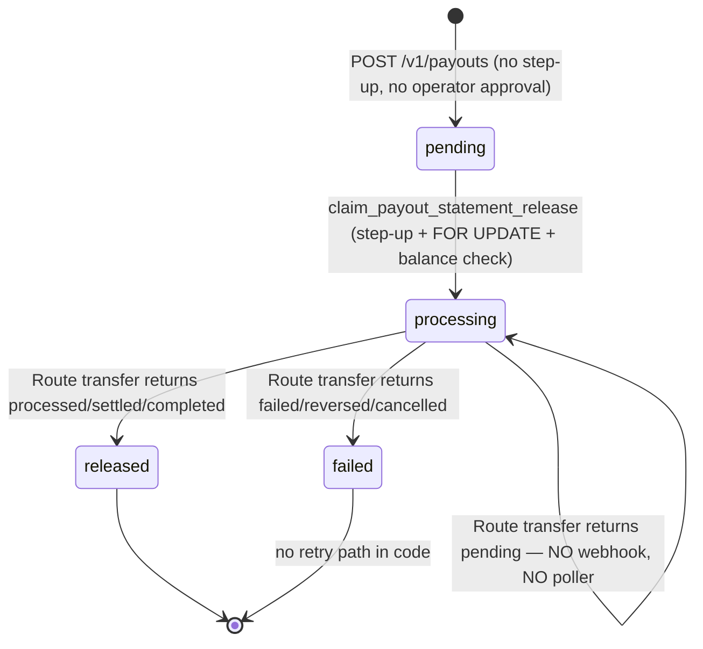

# 11 — PAYMENTS: LETBUYY-MANAGED PROVIDER, RAZORPAY ROUTE, SETTLEMENTS, PAYOUTS

**Run ID:** `docs/merchant-system-discovery/2026-08-04T225330+0530-ee371182`
**Branch:** `stepup/main` · **Commit:** `ee371182` · **Run date:** 2026-08-04 (+0530)
**Scope:** the platform-managed (LetBuyy-account) collection path, Razorpay Route linked accounts and transfers, merchant KYC as it relates to money-out, platform fees (`commission_bps`), settlement ingest, payout statement creation and release, refund and reconciliation operations, canonical-ledger and RPC ownership, step-up (second factor), and the platform-console operator surfaces. Storefront checkout UX, COD order lifecycle, and the merchant-owned-gateway (BYOG) credential *storage* UI are covered by companion documents; where they touch money-out they are cited here.
**Evidence basis:** Agent G notes (`_agent-notes/G-payments-refunds-payouts.md`, read in full) plus first-hand re-verification of ~25 source files, 6 migrations, 2 certification invariants, the payout transfer adapter, the KYC adapter, the reconciliation cron worker, and two governance documents. Every claim below carries a `path:line` citation.
**METHOD DISCLOSURE: nothing in this document was runtime-verified.** No money path was executed, no provider call was made, no database was queried, no test was run. Every status is derived from static source reading. The ceiling for this entire domain is `IMPLEMENTED_NOT_RUNTIME_VERIFIED`; nothing here is `VERIFIED_E2E`.
**No secrets or PII appear in this document.** Only environment variable *names* are referenced; no value was read, printed, or inferred.

---

## 1. Recommendation / verdict

**Do not enable live money-out. The payout subsystem is shipped code that, if switched on today, would transfer every merchant's money to one Razorpay linked account read from a single environment variable.**

There is no per-site linked account, no beneficiary record, no bank account, and no IFSC field anywhere in the 124-file migration set — I ran the search myself and it returns **zero** hits (`grep -rniE "linked_account|route_account|beneficiary|bank_account|ifsc|account_number" database/supabase/migrations/*.sql` → 0). The Route transfer body sends `account: accountId` where `accountId` comes from `RAZORPAY_ROUTE_ACCOUNT_ID` (`services/api-gateway/src/routes/payouts.ts:596-603`; `packages/infrastructure/payout-transfer-adapter/index.ts:192`). The site is passed only as an informational `notes.site_id` (`payout-transfer-adapter/index.ts:196`). The optional `beneficiaryName` field exists in the adapter interface (`:34`) and is set **only in a test file** (`services/api-gateway/src/__tests__/payout-provider-client.test.ts:22`), never by the production route.

This defect is **latent, not currently exploitable**: `payoutProviderConfigured` (`routes/payouts.ts:124-132`) requires `RAZORPAY_ROUTE_PROVIDER_ENABLED === 'true'` in addition to three credentials, and the settle route returns `503 PAYOUT_PROVIDER_UNAVAILABLE` otherwise (`:588-592`). The gate is honest and fails closed. But the flag is the *only* thing standing between the current code and irreversible misrouted transfers, and the flag will be flipped by a human during H8 onboarding — precisely the moment when no one will be re-reading the transfer body.

Second: **payout release is not gated on KYC in any form.** `grep -i kyc` over `routes/payouts.ts`, `routes/settlements.ts`, `payout-transfer-adapter/index.ts` and `packages/billing-core/src/index.ts` returns nothing. The `merchant_kyc_documents` subsystem exists and is honest about its own limits, but it is structurally disconnected from money-out. In sandbox mode it auto-marks a document `verified` from a merchant-typed 2–8 character string (`packages/infrastructure/kyc-verification-adapter/index.ts:52-67`; input schema `services/api-gateway/src/routes/kyc.ts:29-37`), and there is no operator review queue anywhere in `apps/platform-console` for `needs_review` documents.

Third: **money-in does not use merchant credentials at all.** Every shopper payment is created and verified against the platform's own `RAZORPAY_KEY_ID`/`RAZORPAY_KEY_SECRET` (`services/api-gateway/src/routes/storefront/checkout-payment-routes.ts:464, 505-508, 544`). LetBuyy is therefore the collecting entity for every store — a direct contradiction of PAY-R4 (`AGENTS.md:248`, "money-in flows to the **merchant's own** Razorpay (merchant = merchant-of-record)"). This is a licensing and merchant-of-record question for counsel, not an engineering ticket.

Fourth: **the ledger recognises merchant money twice.** Capture posts `Dr pa_clearing / Cr merchant_payable` (`database/supabase/migrations/168_b1_b2_capture_refund_ledgering.sql:243-256`). PA settlement ingest posts the *same direction again* (`packages/billing-core/src/index.ts:584-600`). Only payout release reverses it once (`:668-680`). The repo's own conservation invariant encodes the opposite model with no settlement term (`scripts/money-certification/invariants/i4-merchant-conservation.sql:22-56`). Two incompatible accounting models are shipped simultaneously. No engineer should "fix" this without a CA signing a posting matrix.

What is genuinely good, and should not be re-litigated: the canonical ledger itself. It is append-only by trigger **and** by `REVOKE UPDATE, DELETE` (`migrations/139_executable_foundation_ledger_core.sql:358-376`; `migrations/165_d5_canonical_money_paths.sql:463-464`), balance is derived and never a column (`migrations/160_foundation_money_ledger_authority.sql:173-196`), it has exactly one writer module enforced by CHECK (`139:113`), zero TypeScript files insert or update `ledger_entries`/`ledger_transactions`, and `claim_payout_statement_release` is a properly site-scoped, `FOR UPDATE`-locked, idempotency-claimed RPC with a real derived-balance sufficiency check (`160:373-404`). Step-up is real HMAC-SHA256 with constant-time comparison, not a string-length check (`services/api-gateway/src/lib/security-controls.ts:192-212`). The foundation is sound; the payout/settlement layer built on top of it is not.

**Verdict by capability:** money-out `BLOCKED_EXTERNAL` + `BROKEN` (latent). Settlement ingest `BROKEN` (merchant-writable ledger). Platform fee `IMPLEMENTED_NOT_RUNTIME_VERIFIED` at 0 by default but not pinned. Reconciliation `PARTIAL` and cannot converge. Operator surfaces `PARTIAL`. Nothing `VERIFIED_E2E`.

---

## 2. Scope

**In scope for this document**

| Area | Primary artefacts |
|---|---|
| Platform-managed collection (who the money lands with) | `routes/storefront/checkout-payment-routes.ts`, `routes/payments.ts` |
| Razorpay Route transfers / linked accounts | `routes/payouts.ts`, `packages/infrastructure/payout-transfer-adapter/` |
| Merchant KYC as a money-out precondition | `routes/kyc.ts`, `packages/infrastructure/kyc-verification-adapter/`, `migrations/120` |
| Platform fee / commission | `routes/payouts.ts`, `migrations/119`, `migrations/162`, `scripts/validators/commission-bps-zero-validator.mjs` |
| Settlement ingest + payout statement lifecycle | `routes/settlements.ts`, `routes/payouts.ts`, `packages/billing-core/src/index.ts` |
| Refund completion + reconciliation operations | `routes/payments.ts`, `routes/orders.ts`, `routes/returns.ts`, `routes/internal-console/money-reconciliation.ts` |
| Canonical ledger + money RPC ownership | `migrations/139`, `160`, `165`, `168` |
| Step-up second factor | `lib/security-controls.ts`, `routes/security.ts` |
| Operator surfaces | `apps/platform-console/src/app/(dashboard)/money-reconciliation/`, `services/queue-workers/src/money-ledger-reconciliation.ts` |
| External human seams | H2, H3, H4, H6, H7, H8, H9; CAP-C01..CAP-C04; `SKIPPED_HUMAN_DECISIONS.md` |

**Explicitly out of scope here** (owned by companion documents, cross-referenced only): storefront checkout UX and the public hosted-checkout confirm route; the COD order lifecycle and COD collection UI; gift-card tender mechanics; the merchant-owned-gateway credential capture screen as a *UI* artefact; identity/session issuance internals.

---

## 3. Current merchant user journeys (what a merchant can actually do today)

Stated as what the shipped code permits, assuming a deployed environment with credentials present. None of this was executed.

| # | Journey | Can the merchant do it? | Reality |
|---|---|---|---|
| J1 | Accept an online payment from a shopper | Yes | The money is collected into **LetBuyy's** Razorpay account, not the merchant's (`checkout-payment-routes.ts:464, 505-508`). The merchant sees the order marked paid. |
| J2 | Connect their own Razorpay account | The screen exists and saves | The encrypted secret is never decrypted or used by any code path; the UI nonetheless says the seller account is "connected and verified" (`apps/merchant-control-plane/src/app/[store]/settings/payments/page.tsx:262-268`). |
| J3 | Submit KYC documents | Yes | Merchant types a document's last 4 characters and/or pastes a URL (`settings/business/page.tsx:330-346`). In sandbox this is auto-marked `verified` (`kyc-verification-adapter/index.ts:52-58`). No file is uploaded or validated; no bank account is ever collected. |
| J4 | See a payout statement | Only if one exists | There is **no UI anywhere** that creates a payout statement. `POST /v1/payouts` is reachable only through the typed client (`packages/typescript/api-client/src/index.ts:4966-4977`) or a raw call. `BACKEND_ONLY`. |
| J5 | Release a payout | UI exists, blocked | `apps/merchant-control-plane/src/app/[store]/payouts/page.tsx:89-121` → step-up dialog → proxy → gateway. Returns `503 PAYOUT_PROVIDER_UNAVAILABLE` while `RAZORPAY_ROUTE_PROVIDER_ENABLED` is unset (`routes/payouts.ts:588-592`). |
| J6 | See their wallet / earnings balance | Practically no | `GET /v1/wallet` returns `409 LEDGER_RECONCILIATION_REQUIRED` unless the site's reconciliation row is `verified` with `variance_minor = 0` (`routes/wallet.ts:163-176`), which cannot happen once any online capture exists (see MCP-DISC-435 / MCP-DISC-438). |
| J7 | Ingest a settlement | Yes, and it should alarm you | `POST /v1/settlements/ingest` is merchant-authenticated and takes gross / fee / GST / net / reserve straight from the request body, then posts them to the append-only canonical ledger (`routes/settlements.ts:319-389`). No UI, no typed client method — but the route is live behind ordinary merchant auth. |
| J8 | Refund an order from the Orders page | No | The app proxy passes `orders.payment_id` (a Razorpay *order* id string) where the gateway expects a `payments.id` UUID (`apps/merchant-control-plane/src/app/api/stores/[store]/orders/[orderId]/refund/route.ts:36, 51` vs `services/api-gateway/src/lib/payment-route-support.ts:200-212`). `BROKEN`. |
| J9 | Export payouts / settlements / ledger | No | No money export exists in `routes/export.ts`. `NOT_IMPLEMENTED`. |
| J10 | See or contest a chargeback | No | The Razorpay webhook switch handles only `payment.captured`, `payment.failed`, `refund.created`, `payment.authorized` (`services/webhook-service/src/index.ts:781-896`). No `payment.dispute.*`. |

---

## 4. Feature matrix

| # | Capability | Status | Evidence (path:line) | Gap ID |
|---|---|---|---|---|
| F1 | Platform-managed Razorpay collection (one account, all tenants) | `IMPLEMENTED_NOT_RUNTIME_VERIFIED` — constitutional deviation | `routes/storefront/checkout-payment-routes.ts:464, 505-508, 544`; `routes/payments.ts:1062, 1091, 1125` | MCP-DISC-431 |
| F2 | Per-site provider credential selection | `NOT_IMPLEMENTED` | no `site_id`-keyed credential lookup in any payment route; `lib/store-payment-config.ts:34` imports the key with usage `['encrypt']` only | MCP-DISC-431 |
| F3 | Razorpay signature verification (HMAC-SHA256, timing-safe) | `IMPLEMENTED_NOT_RUNTIME_VERIFIED` — correct | `packages/infrastructure/razorpay-adapter/index.ts:325-345`, `:223-230` | — |
| F4 | Provider capture proof (amount + `captured` state) on the order path | `NOT_IMPLEMENTED` | `fetchRazorpayPayment` (`razorpay-adapter/index.ts:127-147`) called only at `routes/payments.ts:970` (subscriptions) | MCP-DISC-442 |
| F5 | Razorpay Route transfer execution | `IMPLEMENTED_NOT_RUNTIME_VERIFIED`, gated off | `routes/payouts.ts:594-626`; `payout-transfer-adapter/index.ts:168-228` | MCP-DISC-430 |
| F6 | Per-merchant Route linked account / beneficiary | `NOT_IMPLEMENTED` | zero schema hits for `linked_account|beneficiary|bank_account|ifsc`; `account: accountId` from env at `payout-transfer-adapter/index.ts:192` | MCP-DISC-430 |
| F7 | Payout gated on merchant KYC | `NOT_IMPLEMENTED` | no `kyc` reference in `routes/payouts.ts`, `routes/settlements.ts`, `payout-transfer-adapter/index.ts` | MCP-DISC-432 |
| F8 | Merchant KYC capture + verification | `PARTIAL` + `BLOCKED_EXTERNAL` | `routes/kyc.ts:17-23, 275-292`; `kyc-verification-adapter/index.ts:92-108` (live throws `KYC_LIVE_PROVIDER_UNAVAILABLE`) | MCP-DISC-432 |
| F9 | Payout statement creation from paid orders | `BACKEND_ONLY` | `routes/payouts.ts:412-530`; no UI | MCP-DISC-433 |
| F10 | Payout release claim (lock + idempotency + balance sufficiency) | `IMPLEMENTED_NOT_RUNTIME_VERIFIED` — correct | `migrations/160:357-421`, site-scoped `FOR UPDATE` at `:373-379`, sufficiency at `:398-404` | — |
| F11 | Payout release step-up | `IMPLEMENTED_NOT_RUNTIME_VERIFIED` — real HMAC | `routes/payouts.ts:576-586`; `lib/security-controls.ts:192-212` | MCP-DISC-440 |
| F12 | Payout provider live gate (fail-closed) | `IMPLEMENTED_NOT_RUNTIME_VERIFIED` — correct + honest | `routes/payouts.ts:124-132, 588-592` | — |
| F13 | Payout terminal-state reconciliation (`processing` → released/failed) | `NOT_IMPLEMENTED` | no `transfer.*`/`settlement.*` webhook case (`webhook-service/src/index.ts:781-896`); RPC rejects non-`pending` (`160:391-395`) | MCP-DISC-448 |
| F14 | Settlement ingest from a verified provider statement | `NOT_IMPLEMENTED` | `routes/settlements.ts:319-360` reads amounts from the request body | MCP-DISC-434 |
| F15 | Settlement ledger posting balances | `IMPLEMENTED_NOT_RUNTIME_VERIFIED` — balances, but wrong direction | `packages/billing-core/src/index.ts:626-640` asserts balance; `:584-600` posts capture-direction | MCP-DISC-435 |
| F16 | Reconciliation breaks without auto-plug (PAY-R9) | `IMPLEMENTED_NOT_RUNTIME_VERIFIED` — upheld | `routes/settlements.ts:402-417`; `billing-core:643-650`; operator path `internal-console/money-reconciliation.ts:240-262` | — |
| F17 | Reconciliation cron | `PARTIAL` | `services/queue-workers/src/money-ledger-reconciliation.ts:38-102`; cron `17 */6 * * *` (`services/queue-workers/wrangler.toml:17`) — result written to a log only (`queue-workers/src/index.ts:641-651`), no alert | MCP-DISC-438 |
| F18 | Merchant wallet / earnings read | `BROKEN` | `routes/wallet.ts:163-176` | MCP-DISC-438 |
| F19 | Platform fee = 0 | `IMPLEMENTED_NOT_RUNTIME_VERIFIED` by default only | default 0 (`migrations/119:81`, `migrations/162:3-7`), code default 0 (`routes/payouts.ts:376-389`), but CHECK allows 0–10000 (`119:95`) and fee + 18% GST arithmetic is live (`routes/payouts.ts:443-444`) | MCP-DISC-449 |
| F20 | Canonical ledger append-only (trigger AND REVOKE) | `IMPLEMENTED_NOT_RUNTIME_VERIFIED` — PAY-R6 satisfied | `migrations/139:358-376`; `migrations/165:463-464` | — |
| F21 | Derived balance, no mutable balance column | `IMPLEMENTED_NOT_RUNTIME_VERIFIED` — PAY-R1 satisfied | `migrations/160:173-196`; `migrations/139:75-97` | — |
| F22 | Ledger reversal / correction path | `NOT_IMPLEMENTED` | `packages/payments/src/index.ts:528-541` has zero production callers; `ledger_transactions.reversal_of` (`139:114`) never written | MCP-DISC-439 |
| F23 | Refund completion step-up on all routes | `PARTIAL` | present at `routes/payments.ts:497-507`; absent at `routes/orders.ts:1341-1400, 1427-1460` and `routes/returns.ts:259-292` | MCP-DISC-437 |
| F24 | Refund RPC tenant scoping | `BROKEN` | `migrations/168:340-345` selects the refund by primary key with no `site_id` predicate | MCP-DISC-436 |
| F25 | Operator money-reconciliation console | `PARTIAL` | route `internal-console/money-reconciliation.ts:184-270`; UI `apps/platform-console/src/app/(dashboard)/money-reconciliation/page.tsx` | MCP-DISC-451 |
| F26 | Operator payout / settlement approval surface | `NOT_IMPLEMENTED` | `apps/platform-console/src/app/(dashboard)/` has no payouts or settlements page; only `money-reconciliation` | MCP-DISC-451 |
| F27 | Money export (payouts / settlements / ledger CSV) | `NOT_IMPLEMENTED` | no money export in `routes/export.ts` | — (companion doc: reporting) |
| F28 | Dispute / chargeback handling | `NOT_IMPLEMENTED` | `webhook-service/src/index.ts:781-896` | MCP-DISC-454 |
| F29 | Self-custody rail (`razorpayx`) | `PARTIAL` — dead in code, alive in CHECK constraints | zero runtime occurrences; `migrations/000_baseline.sql:8293, 8295, 10263` | MCP-DISC-458 |
| F30 | Money certification invariants executable | `BROKEN` | `i5-zero-rake.sql:33-41` queries a non-existent column; `i7`, `i8`, `i4` likewise | MCP-DISC-441 |

---

## 5. UI / route inventory

### 5.1 Merchant-facing UI

| Surface | Path | Actions | Status |
|---|---|---|---|
| Payouts | `apps/merchant-control-plane/src/app/[store]/payouts/page.tsx:54-121` | list, release (with step-up dialog) | `UI_ONLY` behind a 503; **no create action, no provider-mode badge, no beneficiary/bank display** |
| Business settings (KYC) | `apps/merchant-control-plane/src/app/[store]/settings/business/page.tsx:325-360, 425-438` | submit doc (last4 and/or URL), refresh status | `PARTIAL`; sandbox banner is honest |
| Payments settings | `apps/merchant-control-plane/src/app/[store]/settings/payments/page.tsx:224-279, 365, 468` | save Razorpay key id/secret, test-mode toggle | `UI_ONLY` — writes a credential no code reads |
| Orders → Refund | `apps/merchant-control-plane/src/app/[store]/orders/page.tsx:379-423` | refund with step-up | `BROKEN` at the proxy (MCP-DISC-447) |
| Mobile money screen | `apps/mobile/merchant-app/lib/screens/money/money_screen.dart:615` | balance view, carries `ProviderModeBadge` | `UI_ONLY` |
| Settlement ingest | — | — | **no UI, no typed client method** (`BACKEND_ONLY`) |
| Payout statement creation | — | — | **no UI** (`BACKEND_ONLY`) |

### 5.2 App proxies (merchant-control-plane → gateway)

| Proxy | Path | Verdict |
|---|---|---|
| Payout list | `src/app/api/stores/[store]/payouts/route.ts` | present |
| Payout settle | `src/app/api/stores/[store]/payouts/[payoutId]/settle/route.ts:22-31` | correct — forwards `X-Step-Up-Token` / `X-Step-Up-Verified-At` as headers, body carries only `idempotency_key` |
| KYC overview / submit | `src/app/api/stores/[store]/kyc/route.ts` | present |
| KYC refresh | `src/app/api/stores/[store]/kyc/documents/[documentId]/refresh/route.ts` | present |
| Order refund | `src/app/api/stores/[store]/orders/[orderId]/refund/route.ts:36, 51` | **BROKEN** — passes a provider order id as a `payments.id` UUID |
| Settlement ingest | — | **MISSING** |

### 5.3 Gateway `/v1` routes (all behind `authMiddleware` at `services/api-gateway/src/index.ts:750` unless noted)

| Route | Mount | Auth / gate | Step-up |
|---|---|---|---|
| `GET/POST /v1/payouts`, `POST /v1/payouts/:id/settle` | `index.ts:775` | merchant session + `resolveTenantContextForOwnedSite` | settle only (`routes/payouts.ts:576-586`) |
| `GET /v1/wallet` | `index.ts:776` | merchant session | n/a |
| `/v1/commission/*` | `index.ts:777` | merchant session | none |
| `POST /v1/settlements/ingest` | `index.ts:778` | **merchant session only** (`routes/settlements.ts:329`) | **none** |
| `/v1/cod/*` | `index.ts:782` | merchant session | none |
| `/v1/kyc/*` | `index.ts:783` | merchant session | none |
| `/v1/payments/*` (sessions, capture, refund, razorpay order/verify, stripe) | `index.ts:785` | merchant session | refund only (`routes/payments.ts:497-507`) |
| `POST /v1/storefront/:subdomain/payments/razorpay/{order,verify}` | mounted pre-auth (`index.ts:722`) | public + published-store lookup | n/a (correct for a public route) |
| `/v1/internal/console/*` | `index.ts:742`, **before** `authMiddleware` | `internalPerimeter` — IP allowlist + shared internal credential (`middleware/internal-perimeter.ts:81-110`) | n/a |

### 5.4 Operator (platform-console)

| Surface | Path | Verdict |
|---|---|---|
| Money reconciliation | `apps/platform-console/src/app/(dashboard)/money-reconciliation/page.tsx` + `services/api-gateway/src/routes/internal-console/money-reconciliation.ts:184-270` | `PARTIAL` — reason required, no auto-plug, audit written; but `actor_id` and `secondary_approver_id` are read from the request body (`:202-206`) |
| Revenue / analytics / dashboard | `(dashboard)/revenue`, `(dashboard)/analytics`, `(dashboard)/dashboard` | read-only mentions of payouts |
| Payout approval / settlement review / KYC review | — | **none exist** |

---

## 6. Backend / API / RPC / database mapping

### 6.1 Money-out data model

| Table | Money columns | Type | Written by |
|---|---|---|---|
| `payout_statements` | `gross_amount_minor`, `platform_fee_minor`, `tax_minor`, `net_amount_minor` | **`integer`** (`migrations/119_mobile_money_ledgers.sql:16-19`) | TS: `routes/payouts.ts:452, 523, 637, 670`; `routes/settlements.ts:201, 213` |
| `payout_statements` shadow | `net_amount_minor_bigint` etc. | `bigint`, trigger-synced (`migrations/160:26-40`) | trigger, **after** the int4 write |
| `wallet_ledger_entries` | `amount_minor` | **`integer`** (`119:51`) | TS: `routes/payouts.ts:484, 674`; `routes/settlements.ts:243`; SQL `migrations/165:430` |
| `settlements` | `gross/platform_fee/gst/net/reserve_minor` | `bigint` (`migrations/151:57-62`) | TS: `routes/settlements.ts:347, 392` |
| `payouts` (instruction rows) | `amount_minor` | `bigint` (`151:121`) | TS: `routes/settlements.ts:429`; `routes/payouts.ts:237` |
| `payout_items` | `amount_minor` | `bigint` (`151:155`) | TS: `routes/settlements.ts:460` |
| `recon_breaks` | `amount_minor` | `bigint` (`151:177`) | TS: `routes/settlements.ts:403` |
| `commission_schedules` | `commission_bps`, `gst_bps` | `integer`, defaults 0 / 1800 (`119:81-82`) | none in TS (read-only at `routes/payouts.ts:376-389`) |
| `commission_reconciliation_entries` | `gross/commission/gst/net_payable_minor` | **`integer`** (`119:106-113`) | TS: `routes/commission.ts:316, 344` |
| `ledger_transactions` / `ledger_entries` | `amount_minor` | `bigint`, `CHECK (> 0)` (`139:132`) | **SQL only — zero TS mutations repo-wide** |
| `money_ledger_site_reconciliations` | `wallet_available_minor`, `ledger_merchant_payable_minor`, `variance_minor` | per `migrations/160:60-70` | RPC + operator metadata annotation (`internal-console/money-reconciliation.ts:248`) |
| `merchant_kyc_documents` | — (no money) | — | `routes/kyc.ts:140, 152, 217, 260, 270, 315` |

**No `linked_account_id`, `beneficiary_*`, `bank_account_*`, or `ifsc` column exists in any migration.** Verified by direct search returning 0 hits.

### 6.2 Money RPCs relevant to this document

| RPC | Definition | Idempotency | Lock | Tenant scoping |
|---|---|---|---|---|
| `post_ledger_transaction` | `migrations/139:223-342` | required; `ON CONFLICT (site_id, source_type, source_id, idempotency_key) DO NOTHING` then returns existing (`:281-292`) | n/a | requires the tenant GUC to equal `p_site_id` (`:250-253`) |
| `post_settlement_ledger_transaction` | `migrations/165:214-265` (hardened from `151:23`) | inherited | n/a | resolves the owning site from the **source row** and rejects a mismatched `p_site_id` (`:243-250`) — **correct** |
| `ledger_account_balance_minor` | `migrations/160:173-196` | n/a | n/a | `p_site_id` argument |
| `claim_payout_statement_release` | `migrations/160:357-421` | claim-by-key replay (`:385-388`) | `FOR UPDATE` (`:373-379`) | `WHERE id = p_statement_id AND site_id = p_site_id` — **correct** |
| `confirm_order_payment_with_ledger` | `migrations/168:133-312` | optional, falls back to the provider payment id (`:180`) | `FOR UPDATE` on orders (`:172`) | resolved from the order |
| `complete_order_refund` | `migrations/168:314-561` | **required** (`:336-338`) | `FOR UPDATE` on refunds (`:345`) and orders (`:356`) | **NONE — selects by primary key only (`:340-345`)** |
| `reconcile_cod_remittance_with_ledger` | `migrations/165:267-461` | required (`:291`) | `FOR UPDATE` (`:313`) | site-scoped |
| `refresh_money_ledger_site_reconciliation` | `migrations/160:200-250` | n/a | n/a | `p_site_id` |

### 6.3 Ledger posting matrix as actually shipped

| Event | Debit | Credit | Source |
|---|---|---|---|
| Online capture | `pa_clearing` | `merchant_payable` | `migrations/168:243-256` |
| V1 payment-session capture | `pa_clearing` | `merchant_payable` | `packages/payments/src/index.ts:446-497` |
| Refund | `merchant_payable` | `refund_clearing` | `migrations/168:406-419` |
| COD remittance | `cod_receivable` | `merchant_payable` | `migrations/165:359-380` |
| **PA settlement ingest** | `pa_clearing` | `merchant_payable` (+ `platform_revenue`, `gst_payable`, `reserve` when > 0) | `packages/billing-core/src/index.ts:584-621` |
| Payout fee assessment (skipped when fee = 0) | `merchant_payable` | `platform_revenue` (+ `gst_payable`) | `routes/payouts.ts:504-527` |
| Payout release | `merchant_payable` | `pa_clearing` | `packages/billing-core/src/index.ts:668-680` |

The settlement row is the defect: it recognises the same rupee a second time in the same direction as capture, instead of relieving `pa_clearing`. See MCP-DISC-435.

---

## 7. State machine — payout statement lifecycle

Reading of the diagram, with citations:

- `pending` is created by `POST /v1/payouts` (`routes/payouts.ts:412-530`) with **no step-up and no operator approval**. Statement amounts are computed in the Worker, not in an RPC.
- The `pending → processing` transition is the only well-guarded edge: `claim_payout_statement_release` (`migrations/160:357-421`) locks the row, replays by idempotency key, refuses any status other than `pending` (`:391-395`), and refuses to claim when `ledger_account_balance_minor(site,'merchant_payable') < net_amount_minor_bigint` (`:398-404`).
- The route admits both `pending` and `processing` statements to the claim (`routes/payouts.ts:571-573`), but the RPC raises for `processing`, so the route returns `409 PAYOUT_RELEASE_REJECTED` (`:611-618`). A statement that the provider left in `processing` is therefore **terminal-stuck**: no webhook case exists for `transfer.*` or `settlement.*` (`services/webhook-service/src/index.ts:781-896`), no queue worker polls transfer status, and the release ledger posting only happens on `released` (`routes/payouts.ts:655-657`). See MCP-DISC-448.
- `failed` has no retry edge in code; `syncSettlementPayoutInstruction` mirrors the failure to the `payouts` instruction row (`routes/payouts.ts:209-244, 688`) and stops.

### 7.1 Settlement ingest state (parallel, non-reconciling)

`POST /v1/settlements/ingest` (`routes/settlements.ts:319-515`) creates, in one request: a `settlements` row (`:347`), a canonical `settlement` ledger transaction (`:375-389`), a **second** `payout_statements` row in `pending` with `metadata.no_custody: true` hardcoded (`:212-241`, literal at `:233`), a `wallet_ledger_entries` pending credit (`:243`), a `payouts` instruction row (`:428-453`, literal at `:444`), `payout_items` (`:460`), and — when declared amounts do not sum to gross — an honest `recon_breaks` row with no auto-plug (`:402-417`).

That second statement carries no `metadata.source_order_ids`, so Pipeline A's dedupe (`routes/payouts.ts:335-354`) cannot see it. Both statements are independently releasable. See MCP-DISC-433.

---

## 8. Auth / tenant / invariant analysis

### 8.1 Authorization on money-out routes

| Route | Issuer | Ownership check | Second factor | Verdict |
|---|---|---|---|---|
| `POST /v1/payouts` | merchant ES256 session | `resolveTenantContextForOwnedSite(c, body.store_id)` (`routes/payouts.ts:415`) | none | creates a payable claim without a second factor |
| `POST /v1/payouts/:id/settle` | merchant ES256 session | statement loaded first, then `resolveTenantContextForOwnedSite(c, statement.site_id)` (`:570`) — ownership before any mutation | `payout.release` step-up (`:576-586`) | correct ordering |
| `POST /v1/settlements/ingest` | merchant ES256 session | `resolveTenantContextForOwnedSite(c, body.store_id)` (`:329`) | none | **a merchant writes the canonical ledger** |
| `POST /v1/payments/:id/refund` | merchant ES256 session | `loadOwnedPaymentSession` | `refund.approve` step-up (`routes/payments.ts:497-507`) | correct |
| `POST /v1/orders/:id/refund/complete` | merchant ES256 session | ownership checked **after** `db.rpc(...)` (`execution/order-execution.adapter.ts:505` then `:519-521`) | **none** | post-hoc guard on an already-mutated ledger |
| `POST /v1/returns/:id/refund/complete` | merchant ES256 session | validates the *return*, never the refund (`routes/returns.ts:103-128, 274-286`) | **none** | caller-supplied `refund_id` |
| `/v1/internal/console/reconciliation/:siteId/resolve` | none — IP allowlist + shared secret | site id from the path | dual control asserted from the **request body** (`internal-console/money-reconciliation.ts:202-206`) | control is asserted, not proven |

### 8.2 Step-up (PAY-R7 / R-10)

Real cryptography, verified first-hand:

- Token format `lb-stepup-v1.<b64url(payload)>.<b64url(HMAC-SHA256)>`; payload carries `action`, `actor_id`, `site_id`, `challenge_id`, `jti`, `verified_at`, `exp` (`lib/security-controls.ts:35-44`).
- The signing secret must be ≥ 32 chars and must not be a `SKIP_NEEDS_HUMAN_` or `replace-with` placeholder — fails closed (`:46-51`).
- Verification recomputes the HMAC and compares with `constantTimeEqual`, then binds `action`, `actor_id`, `site_id`, `verified_at` (`:192-206`).
- 10-minute window, 60-second future skew rejection, and `exp` (`:214-227`; `STEP_UP_WINDOW_MS` at `:29`).
- Issued only after an active TOTP factor check (`routes/security.ts:159-250`, factor required at `:177`).

**PAY-R7 is satisfied where the guard is applied.** Two structural weaknesses remain: the signed payload contains **no target resource id** (no statement id, no refund id), and the `jti` is generated but never consumed, so one proof authorises unlimited releases/refunds for that actor+site inside the 10-minute window (MCP-DISC-440). Only `refund.approve` and `payout.release` are declared sensitive actions alongside two DSR actions (`lib/security-controls.ts:1`); `settlements.ingest` and `payouts.create` are not in the enum at all.

### 8.3 Tenant isolation on money tables

`migrations/164_d4_tenant_role_guc.sql:33-75` establishes the correct target design — `ENABLE` + `FORCE` RLS on every table with `site_id`/`store_id`, plus a `NOBYPASSRLS` `app_tenant` role. `migrations/151:271-275` dropped the blanket `service_role USING(true)` policies on nine money tables.

Two blanket policies survive on money tables: `cod_reconciliation_entries_service_all` (`migrations/140_mobile_cod_reconciliation.sql:84-88`) and `money_ledger_site_reconciliations_service_all` (`migrations/160:72-76`). The gateway connects as `service_role` and self-documents that it bypasses RLS (`services/api-gateway/src/lib/supabase.ts:13-19`), substituting an application-level `createTenantGuardedSupabaseClient`. DB-layer tenancy is therefore **not load-bearing** for money reads and writes. See MCP-DISC-452 (this is a subset of a broader tenancy item owned by the governance/tenancy documents).

### 8.4 Canonical-ledger-only invariant (AUDIT A, re-stated)

The canonical tables are clean: **zero** TypeScript inserts/updates/deletes on `ledger_transactions`, `ledger_entries`, `refunds`, `refund_transactions`, `payment_transactions`, or any gift-card table. That is a genuine achievement and PAY-R6 holds (trigger at `139:358-376` **and** `REVOKE UPDATE, DELETE` at `165:463-464`).

The settlement/payout/COD/commission subsystem does not hold the line: 19 production sites write money-bearing tables directly from the Worker, with amounts computed in TypeScript. The ratchet does not catch them because `scripts/validators/canonical-ledger-only-validator.mjs:130-136` only requires that the **file** mention a canonical-ledger token (`:45-50`); `routes/payouts.ts` and `routes/settlements.ts` both mention `post_settlement_ledger_transaction`, so every direct write in those files passes unexamined. See MCP-DISC-444.

### 8.5 Money representation (PAY-R5)

`payout_statements`, `wallet_ledger_entries`, `cod_reconciliation_entries`, and `commission_reconciliation_entries` still store money as `integer` and are still the **written** columns; `_bigint` shadows are trigger-populated after the int4 write (`migrations/160:26-40`; `165:5-10, 26-78`). Worse, `migrations/165:335-339` silently caps COD amounts with `LEAST(x, 2147483647)::integer` rather than raising. Overflow ceiling ≈ ₹2,14,74,836.47. See MCP-DISC-443.

---

## 9. Runtime and test evidence — and what was NOT verified

### 9.1 What was NOT verified (the honest list)

- **No money path was executed.** No capture, no refund, no COD remittance, no settlement ingest, no payout claim, no Route transfer.
- **No provider call was made.** Razorpay signature verification, capture-status fetch, and transfer behaviour are asserted from source only.
- **No database was queried.** Every SQL claim — RPC bodies, CHECK constraints, RLS policies, column types — is read from migration source. Whether production/staging actually has those migrations applied is H4, unverified.
- **No environment variable value was inspected.** Whether `RAZORPAY_ROUTE_PROVIDER_ENABLED` is set anywhere is unknown; only the code's dependence on it is known.
- **The certification invariants were not run.** `scripts/money-certification/` requires `STAGING_DB_URL`; their defects were found by reading, not running.
- **`tests/executable/*.mjs` were not run.** They require a Docker Postgres container (`tests/executable/money-ledger-postgres.test.mjs:9`, `LETBUYY_EXECUTABLE_PG_CONTAINER`).

### 9.2 Test evidence that exists

| Test | What it actually asserts | Value |
|---|---|---|
| `services/api-gateway/src/__tests__/payments.test.ts:11-17, 25-32, 53-70` | `readFileSync` + `assert.match` over route source text | anti-deletion ratchet only; **no behaviour is executed** |
| `…/money.test.ts`, `…/money-d5-ledger.test.ts`, `…/settlements.test.ts` | same pattern | same |
| `…/payout-provider-client.test.ts:22, 84` | stubs the fetch and asserts the transfer body — the only place `beneficiaryName` is ever set | closest thing to a behavioural payout test; does not cover per-tenant account selection |
| `…/kyc.test.ts:27-39` | source + migration regexes | ratchet only |
| `tests/executable/*.mjs` | real Postgres behaviour | `BLOCKED_EXTERNAL` — not run |

A refactor that preserves the strings while breaking the logic passes the fast suite. The highest-stakes domain in the platform has effectively no behavioural regression coverage. See MCP-DISC-455.

### 9.3 Certification invariants — read, not run, and three of them cannot pass

| Invariant | Defect | Evidence |
|---|---|---|
| `i4-merchant-conservation.sql:22-56` | asserts `merchant_payable = captures − refunds − payouts` with **no settlement term**; fails on any site that ingested a settlement | contrast `billing-core:584-600` |
| `i5-zero-rake.sql:33-41` | queries `public.payment_credentials.commission_bps`; that column does not exist (`migrations/142:7-23`) — the check errors | verified first-hand |
| `i7-single-writer.sql:29-36` | expects zero `wallet_ledger_entries` with a null canonical ledger id; `routes/payouts.ts:484` and `routes/settlements.ts:243` create exactly those | fails by construction |
| `i8-cod-symmetry.sql:47-60` | queries `cod_reconciliation_entries.amount`, `status='remitted'`, and a metadata key that is actually a column | `migrations/140:20-51`; `migrations/165:6` |

Runner semantics: a pass requires exit 0 **and** zero rows (`scripts/money-certification/check-invariants.mjs:1-6`); a SQL error is a hard fail. See MCP-DISC-441.

---

## 10. Implemented vs missing

### 10.1 END-TO-END TRACE T-P1 — Merchant releases a payout

| Link | Evidence | Status |
|---|---|---|
| Merchant entry point | Payouts page "Release" → step-up dialog (`apps/merchant-control-plane/src/app/[store]/payouts/page.tsx:89-121`) | present |
| Page / route | `/[store]/payouts` | present |
| App proxy | `src/app/api/stores/[store]/payouts/[payoutId]/settle/route.ts:22-31` — forwards step-up headers | present |
| Typed client | `packages/typescript/api-client/src/index.ts:4966-4977` (`payouts.settle`) | present (the page uses `fetch` to the proxy, not the client) |
| `/v1` gateway route | `POST /v1/payouts/:id/settle` (`routes/payouts.ts:553`) | present |
| Auth issuer + authz + ownership | merchant ES256 session; `resolveTenantContextForOwnedSite(c, statement.site_id)` (`:570`) before any mutation | present, correct order |
| Second factor | `verifySensitiveActionStepUp({action:'payout.release'})` (`:576-586`) | present, real HMAC; **not bound to this statement id** (MCP-DISC-440) |
| Live gate | `payoutProviderConfigured` (`:124-132`) → 503 (`:588-592`) | present, fail-closed |
| **KYC precondition** | — | **MISSING** (MCP-DISC-432) |
| **Per-site beneficiary resolution** | — | **MISSING** — `accountId` is `c.env.RAZORPAY_ROUTE_ACCOUNT_ID` (`:596-603`) (MCP-DISC-430) |
| Server-authoritative amount | `claimedStatement.net_amount_minor` — computed by the Worker at statement creation, not by an RPC (`:443-446`) | weak: amounts originate in TypeScript |
| Lock + idempotency + sufficiency | `claim_payout_statement_release` (`migrations/160:357-421`) | present, correct |
| Provider call | `POST https://api.razorpay.com/v1/transfers` with `Idempotency-Key`, `account: accountId`, `notes.site_id` (`payout-transfer-adapter/index.ts:184-203`) | **single account for all tenants** |
| Ledger posting | `Dr merchant_payable / Cr pa_clearing` via `postCanonicalPayoutLedger` (`routes/payouts.ts:655-668`) | present, balanced |
| Projection write | direct `wallet_ledger_entries` insert (`:674`) | direct TS money-table write (MCP-DISC-444) |
| Instruction sync | `syncSettlementPayoutInstruction` (`:688`) | present |
| Storefront / console consequence | statement flips to `released`; merchant Payouts list refreshes | present |
| **Terminal reconciliation for `processing`** | — | **MISSING** (MCP-DISC-448) |
| Tests | `payout-provider-client.test.ts` (stubbed fetch, source-regex style) | weak |
| Runtime observation | — | **MISSING** — `UNVERIFIED_RUNTIME` |

### 10.2 END-TO-END TRACE T-P2 — Settlement ingest

| Link | Evidence | Status |
|---|---|---|
| Merchant entry point | — | **MISSING** — no UI |
| App proxy | — | **MISSING** |
| Typed client | — | **MISSING** — no `settlements` group in `packages/typescript/api-client/src/index.ts` |
| `/v1` gateway route | `POST /v1/settlements/ingest` (`routes/settlements.ts:319`) | present and live |
| Auth + ownership | merchant session + `resolveTenantContextForOwnedSite` (`:329`) | present |
| Second factor / operator approval | — | **MISSING** |
| Live-mode gate | `assertLiveSettlementReady` (`:57-70`) — **returns early when `provider_mode !== 'live'` (`:58`) or `provider === 'manual'` (`:59`)**; the schema defaults `provider_mode` to `'sandbox'` (`packages/billing-core/src/index.ts:145`) | **bypassable by omitting one field** |
| Provider statement verification | — | **MISSING** — amounts come from the request body (`billing-core:138-152`) |
| Server-authoritative computation | `planSettlementLedgerPosting(body)` (`:344`) — arithmetic over caller-supplied numbers | **not server-authoritative** |
| Ledger posting | `Dr pa_clearing / Cr merchant_payable` (+ fee/GST/reserve) (`billing-core:584-621`) | posts — **wrong direction** (MCP-DISC-435) |
| Downstream rows | second `payout_statements` (`:212-241`), wallet credit (`:243`), `payouts` instruction (`:428-453`), `payout_items` (`:460`), `recon_breaks` on mismatch (`:402-417`) | present |
| Idempotency | `loadExistingSettlement` by key / provider reference (`:332-343`) | present |
| Tests | `settlements.test.ts` (source regex) | weak |
| Runtime observation | — | **MISSING** |

### 10.3 END-TO-END TRACE T-P3 — Platform-managed shopper collection (money-in)

| Link | Evidence | Status |
|---|---|---|
| Shopper entry | storefront checkout (companion doc) | not traced here |
| `/v1` gateway route | `POST /v1/storefront/:subdomain/payments/razorpay/order` (`checkout-payment-routes.ts:449`), mounted pre-auth (`index.ts:722`) | present |
| Typed client | — | **MISSING** — no `storefront.payments.razorpay` method |
| Auth | `loadPublishedStore(c, subdomain)` (`:455`) only — correct for a public route | present |
| **Provider credential selection** | `c.env.RAZORPAY_KEY_ID` / `RAZORPAY_KEY_SECRET` (`:464, 505-508`), key id echoed to the browser (`:544`) | **MISSING per-tenant credential** (MCP-DISC-431) |
| Server-authoritative amount | `orderAmountMinorUnits(order)` from the DB; client amount rejected on mismatch (`:474, 483-489`) | present |
| Idempotency | `IdempotencyExecutionAdapter.begin` before the provider call (`:491-502`) | present |
| Provider binding | `attach_order_payment_reference_with_ledger` writes `orders.payment_id`, rejects re-binding (`migrations/000_baseline.sql:345-400`) | present |
| Signature verify | HMAC-SHA256 over `order_id|payment_id` + timing-safe compare (`razorpay-adapter/index.ts:325-345, 223-230`) | present, correct |
| **Capture proof (amount + status)** | `fetchRazorpayPayment` exists (`razorpay-adapter/index.ts:127-147`) and warns in its own doc comment that the HMAC does not prove money moved; called only from the subscription path (`routes/payments.ts:970`) | **MISSING** (MCP-DISC-442) |
| Ledger | `confirm_order_payment_with_ledger` (`migrations/168:133-312`) → `Dr pa_clearing / Cr merchant_payable`, amount `round(orders.total * 100)` (`:179`) | posts; amount derived from a `numeric(10,2)` rupee column, not from the provider |
| Provider mode in the ledger | — | **MISSING** — no `provider_mode` in the capture metadata (`168:257-265`), unlike `routes/payments.ts:305-312` (MCP-DISC-445) |
| Webhook | `services/webhook-service/src/index.ts:718-905`; one shared `RAZORPAY_WEBHOOK_SECRET` (`:38`); tenant attribution by a global unscoped `orders` lookup (`:332-352`) | present; works only because one account exists (MCP-DISC-453) |
| Runtime observation | — | **MISSING** |

### 10.4 END-TO-END TRACE T-P4 — Refund completion (the reconciliation-relevant half)

| Link | Evidence | Status |
|---|---|---|
| Merchant entry | Orders page refund (`orders/page.tsx:379-423`) | present |
| App proxy | `api/stores/[store]/orders/[orderId]/refund/route.ts:36, 51` — sends `orders.payment_id` (a provider order id) | **BROKEN** (MCP-DISC-447) |
| `/v1` routes | `payments.ts:467` (step-up ✔), `orders.ts:1341-1400` (no step-up), `returns.ts:259-292` (no step-up, no idempotency claim) | `PARTIAL` (MCP-DISC-437, MCP-DISC-459) |
| Ownership | `orders`: checked **after** the RPC (`order-execution.adapter.ts:505` then `:519-521`); `returns`: validates the return, not the refund (`returns.ts:103-128`) | **BROKEN** ordering |
| RPC | `complete_order_refund` (`migrations/168:314-561`) — idempotency required, `FOR UPDATE`, over-refund guard (`:376-378`), balanced posting (`:401-429`) | good **except** no tenant predicate (`:340-345`) (MCP-DISC-436) |
| Provider refund call | only the `payments.ts` route calls Razorpay (`:542-549`); the `orders`/`returns` routes accept a caller-supplied `provider_refund_id` and mark the refund succeeded with no provider call | **MISSING** provider verification on two routes |
| Reconciliation consequence | refund debit to `merchant_payable` feeds `refresh_money_ledger_site_reconciliation` | present |
| Runtime observation | — | **MISSING** |

---

## 11. Gap IDs

Severity: **P0** = blocks launch / money-loss or money-misrouting class · **P1** = must fix before real merchants · **P2** = fix before scale · **P3** = hygiene.

---

### MCP-DISC-430 — [HIGH-STAKES] [IRREVERSIBLE] Every merchant payout transfers to a single `RAZORPAY_ROUTE_ACCOUNT_ID`; no per-site linked account exists anywhere

- **Domain:** payouts / Razorpay Route
- **Status:** `BROKEN` (latent — live execution gated off)
- **User / business impact:** if `RAZORPAY_ROUTE_PROVIDER_ENABLED=true` were set today, every merchant's payout would be transferred to one Razorpay linked account. Money sent to the wrong beneficiary via a PA transfer is not recallable by the platform. The merchant would see their statement marked `released` with a real provider reference while the funds sat with someone else.
- **Evidence:**
  - `services/api-gateway/src/routes/payouts.ts:594-603` — `createPayoutTransferAdapter({ credentials: { keyId, keySecret, accountId: c.env.RAZORPAY_ROUTE_ACCOUNT_ID } })`.
  - `packages/infrastructure/payout-transfer-adapter/index.ts:192` — the `POST /v1/transfers` body sends `account: accountId`; the site appears only as `notes.site_id` (`:196`).
  - `packages/infrastructure/payout-transfer-adapter/index.ts:34` — `beneficiaryName` is an optional input field; the production settle route (`routes/payouts.ts:626-633`) never sets it. Its only occurrence is a test (`services/api-gateway/src/__tests__/payout-provider-client.test.ts:22`).
  - Schema search re-run first-hand: `grep -rniE "linked_account|route_account|beneficiary|bank_account|ifsc|account_number" database/supabase/migrations/*.sql` → **0 hits**. Same search over `services/*/src packages/*/src apps/*/src` → only the test file above.
  - The nearest bank artefact is a KYC document *type* `bank_proof` storing `document_number_last4` and a URL (`services/api-gateway/src/routes/kyc.ts:19-20`) — not a payable beneficiary.
- **Expected behavior:** each site has its own verified Route linked-account id (or equivalent beneficiary record), stored, bound to that site, and used as the `account` for that site's transfers; a transfer without one fails closed.
- **Missing link / root cause:** the Route integration was built to the *platform* account shape (one aggregator account) and the sub-merchant onboarding half — which is the entire point of Route — was never modelled. No column, no onboarding flow, no verification state.
- **Blast radius:** every payout, every merchant, all merchant trust, irreversible fund movement, plus the platform's own liability for misdirected funds.
- **Invariant tag:** [HIGH-STAKES] [IRREVERSIBLE]
- **Severity:** **P0** · **Likelihood:** HIGH the moment the flag is flipped; LOW today · **Dependencies:** H8 (Razorpay Route PA onboarding), MCP-DISC-432 (KYC), MCP-DISC-431 (who collects)
- **Recommended remediation APPROACH (no code):** (1) model a per-site payout beneficiary record with an explicit verification state and an audit trail of who set it; (2) make the transfer adapter require that record and throw a typed error when absent — remove the env fallback entirely rather than leaving it as a default; (3) keep `RAZORPAY_ROUTE_PROVIDER_ENABLED` off until a test proves site A cannot transfer to site B's account; (4) sequence this *after* the Route sub-merchant contract exists (H8), because the linked-account id is issued by Razorpay, not by us.
- **Acceptance criteria:** a payout for site A cannot be initiated unless site A has its own verified linked-account id; attempting it returns a typed error and mutates nothing; no code path reads `RAZORPAY_ROUTE_ACCOUNT_ID` for a merchant transfer; a two-site test proves distinct `account` values in the transfer body.
- **Required tests:** adapter unit test (no site beneficiary → throw, no fetch issued); integration test across two sites asserting distinct provider payloads; a validator forbidding `RAZORPAY_ROUTE_ACCOUNT_ID` in merchant payout code paths.
- **Required owner:** founder + payments-provider (Razorpay) + lead engineer; ARB sign-off on the data model
- **Reversibility:** the code change is reversible; **a completed transfer is not**
- **Confidence:** HIGH (searches re-run first-hand; the env read is unambiguous)

---

### MCP-DISC-431 — [HIGH-STAKES] [IRREVERSIBLE] All shopper money-in is collected into one platform Razorpay account; LetBuyy is the de facto collecting entity for every store

- **Domain:** payments / never-custody / merchant-of-record
- **Status:** `CONTRADICTORY_EVIDENCE` (code vs Constitution) + `IMPLEMENTED_NOT_RUNTIME_VERIFIED`
- **User / business impact:** buyers pay into LetBuyy's Razorpay account for every store. LetBuyy therefore collects and holds buyer funds on behalf of merchants — payment-aggregator activity with RBI licensing implications. Merchants are simultaneously told their own account is connected. Refunds are funded from LetBuyy's balance. Settling those funds to merchants requires LetBuyy to disburse — which is precisely the self-custody model the Constitution declares dead.
- **Evidence:**
  - `services/api-gateway/src/routes/storefront/checkout-payment-routes.ts:464` (env presence check), `:505-508` (`createRazorpayPaymentProvider({ keyId: c.env.RAZORPAY_KEY_ID, keySecret: c.env.RAZORPAY_KEY_SECRET })`), `:544` (platform key id echoed to the browser). Verified first-hand.
  - Verify path: `:584`, `:635-638` — same platform env pair.
  - Merchant-context duplicates: `services/api-gateway/src/routes/payments.ts:1062, 1091, 1125` and `:1162, 1194`; refund `:533-536`.
  - Cashfree identical: `checkout-payment-routes.ts:214-225`.
  - No `site_id` is used anywhere in these routes to select a credential.
  - The merchant's own encrypted secret is never read: `services/api-gateway/src/lib/store-payment-config.ts:32-47` imports the key with usage `['encrypt']` only; there is no decrypt function and no consumer of `key_secret_ciphertext`.
  - The product itself acknowledges the shared account: `lib/store-payment-config.ts:57` (`mode: settings?.mode || 'shared'`), UI label "Shared LetBuyy account" (`apps/merchant-control-plane/src/app/[store]/settings/payments/page.tsx:468`).
  - Rule contradicted: `AGENTS.md:248` (PAY-R4) — "money-in flows to the **merchant's own** Razorpay (merchant = merchant-of-record)".
- **Expected behavior:** either (a) per-site credentials are decrypted server-side and used for order create / verify / refund with per-account webhook routing, or (b) the platform-collect + Route-split model is formally adopted, licensed, and written into the Constitution.
- **Missing link / root cause:** the BYOG credential path was built as far as storage and stopped; the storefront was wired to platform env in the meantime and never revisited.
- **Blast radius:** every order, every merchant, every refund, all settlement and payout semantics, RBI/PA posture, the 0%-fee thesis, and the truthfulness of the merchant UI.
- **Invariant tag:** [HIGH-STAKES] [IRREVERSIBLE]
- **Severity:** **P0** · **Likelihood:** HIGH (this is the current shipped behaviour) · **Dependencies:** MCP-DISC-430, MCP-DISC-453, H8
- **Recommended remediation APPROACH (no code):** this is an ARB + counsel decision *before* it is an engineering task. Decide the money-in model explicitly. If (a): per-site credential resolution in every provider call behind a KMS-backed decrypt, per-merchant webhook endpoints and secrets, credential rotation/disconnect, and removal of the platform fallback. If (b): rewrite PAY-R4/ART-11 with payments counsel and accept the licensing consequences. **Do not ship (b) implicitly by leaving the code as it is** — that is what is happening today.
- **Acceptance criteria:** for a given `site_id`, the Razorpay order-create request provably carries that site's key id (provider dashboard evidence); no code path reads `RAZORPAY_KEY_SECRET` for shopper money-in; a validator forbids platform-env Razorpay credentials in `routes/storefront/**`. If (b) is chosen: a written, counsel-reviewed statement of the collecting entity, published to merchants, and the UI corrected.
- **Required tests:** integration test asserting per-site credential selection; source validator; sandbox provider smoke per merchant.
- **Required owner:** founder + payments counsel + ARB + payments-provider
- **Reversibility:** the design choice is reversible; **funds already collected into the platform account are not**
- **Confidence:** HIGH

---

### MCP-DISC-432 — [HIGH-STAKES] Payout release has no KYC precondition; sandbox KYC self-verifies from a merchant-typed string; no bank details are ever collected

- **Domain:** payouts / KYC / onboarding
- **Status:** `NOT_IMPLEMENTED` (the gate) + `PARTIAL` / `BLOCKED_EXTERNAL` (the KYC subsystem)
- **User / business impact:** money can be released to a merchant whose identity has never been verified by anyone. Under Route, the linked account carries its own KYC with the PA, which partially mitigates — but the platform's own eligibility decision is unconditioned, and the platform has no record binding a verified identity to a payable. In sandbox, a merchant marks their own documents `verified` by typing four characters. There is no operator queue to review a `needs_review` document.
- **Evidence:**
  - `grep -i kyc` over `services/api-gateway/src/routes/payouts.ts`, `services/api-gateway/src/routes/settlements.ts`, `packages/infrastructure/payout-transfer-adapter/index.ts`, `packages/billing-core/src/index.ts` → **zero matches** (re-run first-hand).
  - `packages/infrastructure/kyc-verification-adapter/index.ts:52-58` — sandbox: `status: hasEvidence ? 'verified' : 'needs_review'` where `hasEvidence = Boolean(input.fileUrl || input.documentNumberLast4)`.
  - `services/api-gateway/src/routes/kyc.ts:29-37` — evidence is a 2–8 character alphanumeric `document_number_last4` and/or a URL string; no file upload, no provider document check.
  - `apps/merchant-control-plane/src/app/[store]/settings/business/page.tsx:330-346` — the merchant types those values directly.
  - Live mode is honest and fails closed: `kyc-verification-adapter/index.ts:92-101` (live + `manual` → `needs_review`), `:103-108` (live + automated provider → throws `KYC_LIVE_PROVIDER_UNAVAILABLE`).
  - No operator KYC surface: `apps/platform-console/src/app/(dashboard)/` contains no KYC page; `grep -rl kyc apps/platform-console/src` → no matches.
  - No bank account or IFSC field exists anywhere (see MCP-DISC-430 evidence).
- **Expected behavior:** payout eligibility requires a verified merchant identity and a verified payout beneficiary; sandbox verification is clearly non-authoritative and cannot satisfy a live payout gate; `needs_review` documents land in an operator queue.
- **Missing link / root cause:** KYC was built as a standalone onboarding artefact (`migrations/120_mobile_kyc_documents.sql:5-47`) and never joined to the money-out decision; the live provider is an open external seam (`SKIP-CAP-KYC-LIVE-PROVIDER`).
- **Blast radius:** every payout; AML/KYC posture; the platform's ability to answer "who did we pay".
- **Invariant tag:** [HIGH-STAKES]
- **Severity:** **P0** · **Likelihood:** HIGH once payouts are enabled · **Dependencies:** MCP-DISC-430, `SKIP-CAP-KYC-LIVE-PROVIDER`, H8
- **Recommended remediation APPROACH (no code):** define, with counsel and the PA, the exact preconditions for a merchant to be payable (verified identity, verified beneficiary, PA linked-account state). Make the payout claim RPC — not the Worker — assert those preconditions, so the gate cannot be bypassed by a new route. Treat sandbox KYC as evidence of *nothing*: it must never satisfy a live gate. Add an operator review queue for `needs_review`.
- **Acceptance criteria:** a payout claim for a site without a verified identity + verified beneficiary raises inside the RPC and mutates nothing; a sandbox-verified document cannot satisfy a live payout; an operator can see and act on `needs_review` documents.
- **Required tests:** Postgres test asserting the claim RPC rejects an unverified site; contract test that a sandbox KYC state does not unlock a live payout.
- **Required owner:** founder + payments-provider + security; ARB on the eligibility policy
- **Reversibility:** yes
- **Confidence:** HIGH

---

### MCP-DISC-433 — [HIGH-STAKES] [IRREVERSIBLE] Two independent payout pipelines can pay the same orders twice

- **Domain:** payouts / settlements
- **Status:** `BROKEN` (latent — provider gated off)
- **User / business impact:** `POST /v1/payouts` builds a statement from `orders.payment_status='paid'` and dedupes only against `payout_statements.metadata.source_order_ids`. `POST /v1/settlements/ingest` builds a **second** `payout_statements` row for the same money with no `source_order_ids`, invisible to that dedupe. Both are independently releasable, each drawing down `merchant_payable`.
- **Evidence:** `services/api-gateway/src/routes/payouts.ts:335-354` (`loadExistingSourceOrderIds` reads only `metadata.source_order_ids`), `:427-430` (eligibility filter), `:452-471` (statement insert with `metadata.source_order_ids`); `services/api-gateway/src/routes/settlements.ts:212-241` (second statement whose metadata carries `source_settlement_id`, not order ids), `:428-453` (parallel `payouts` instruction row). All re-read first-hand.
- **Expected behavior:** exactly one payable-statement authority per rupee, with a single idempotent source registry enforced in SQL.
- **Missing link / root cause:** two pipelines authored independently with no shared "already paid out" registry; dedupe implemented as a JSON metadata scan in application code rather than a constraint.
- **Blast radius:** merchant over-payment, `merchant_payable` drawdown below truth, provider transfers that cannot be recalled.
- **Invariant tag:** [HIGH-STAKES] [IRREVERSIBLE]
- **Severity:** **P0** · **Likelihood:** MEDIUM · **Dependencies:** MCP-DISC-435 (posting matrix must be settled first)
- **Recommended remediation APPROACH (no code):** ARB decides one canonical payout authority. The recommendation from the evidence is that the PA settlement statement becomes the only source of truth and `POST /v1/payouts` becomes read-only or is removed — order-derived statements duplicate what the PA already computes. If both must survive, introduce a settled-source table with a DB unique constraint per `(site_id, source_order_id)`; application-level dedupe over a JSONB array is not an adequate control for irreversible money movement. Note that CAP-C03 already names this as a pre-requisite ("land the R-03 fix (DB-level order claim) so concurrent statement creation cannot double-include orders").
- **Acceptance criteria:** a source order can appear in at most one releasable statement, enforced by a database constraint, proven by a test that attempts both pipelines concurrently.
- **Required tests:** Postgres test attempting to include one order in both pipelines; concurrency test on statement creation.
- **Required owner:** founder + finance/CA + ARB
- **Reversibility:** no once released
- **Confidence:** HIGH

---

### MCP-DISC-434 — [HIGH-STAKES] [IRREVERSIBLE] `POST /v1/settlements/ingest` lets an ordinary merchant write arbitrary amounts into the append-only canonical ledger

- **Domain:** settlements / ledger integrity
- **Status:** `BROKEN`
- **User / business impact:** a merchant-authenticated request supplies `gross_amount_minor`, `platform_fee_minor`, `gst_minor`, `net_amount_minor`, and `reserve_minor`; the gateway posts them to the canonical ledger and creates a payable statement plus a payout instruction. There is no provider feed, no signature, no statement fetch, no step-up, and no operator approval. Because the ledger is append-only and no reversal path is wired (MCP-DISC-439), a fabricated settlement is permanently unfixable through supported means.
- **Evidence:**
  - `packages/billing-core/src/index.ts:137-152` — `SettlementIngestSchema`: the amounts are plain request fields; `provider_mode` **defaults to `'sandbox'`** (`:145`).
  - `services/api-gateway/src/routes/settlements.ts:319-329` — auth is `resolveTenantContextForOwnedSite` only; no step-up.
  - `:57-70` — `assertLiveSettlementReady` **returns early** when `provider_mode !== 'live'` (`:58`) or `provider === 'manual'` (`:59`). Omitting `provider_mode` therefore skips the only environmental gate on this route while still posting to the same canonical ledger.
  - `:344` (`planSettlementLedgerPosting(body)`), `:375-389` (canonical posting), `:420-474` (statement + instruction creation).
- **Expected behavior:** settlement data originates from a verified PA statement — an authenticated API fetch or a signed provider webhook — reconciled against captures. A merchant-declared settlement is at most an operator-reviewed suspense record, never a ledger posting.
- **Missing link / root cause:** no PA statement ingestion adapter exists; the route was built as the executor half of a pipeline whose provider half was never written, and it was left merchant-facing.
- **Blast radius:** canonical ledger truth, `merchant_payable`, payout eligibility and sufficiency checks, every financial report derived from the ledger.
- **Invariant tag:** [HIGH-STAKES] [IRREVERSIBLE]
- **Severity:** **P0** · **Likelihood:** MEDIUM (requires an authenticated merchant deliberately calling an undocumented route) · **Dependencies:** MCP-DISC-435, MCP-DISC-433, MCP-DISC-439
- **Recommended remediation APPROACH (no code):** move settlement ingest behind the internal perimeter or make it provider-webhook-only; add real PA statement verification (fetch the statement by id from the aggregator and compare); if any merchant-facing endpoint survives, it must be able to create only a `recon_breaks`/suspense record and never a ledger transaction. Any correction to already-posted rows must be a reversing entry through a `SECURITY DEFINER` RPC — **never** a direct money-table write.
- **Acceptance criteria:** a merchant token cannot cause a `settlement` ledger transaction under any `provider_mode`; ingest requires provider-side evidence or an internal credential; a contract test proves merchant auth is rejected.
- **Required tests:** contract test (merchant token → 403/404); adapter test for provider statement verification; a test that omitting `provider_mode` does not bypass any gate.
- **Required owner:** ARB + finance + payments-provider + security
- **Reversibility:** entries are append-only; corrections require MCP-DISC-439 first
- **Confidence:** HIGH

---

### MCP-DISC-435 — [HIGH-STAKES] The canonical ledger double-recognises merchant money: PA settlement posts the same direction as capture

- **Domain:** ledger / accounting
- **Status:** `CONTRADICTORY_EVIDENCE`
- **User / business impact:** after capture → PA settlement → payout release of the same rupee, `merchant_payable` retains a permanent `+gross` residue and `pa_clearing` a permanent `−gross`. Merchant balances, the payout sufficiency check, reconciliation, and any financial statement derived from this ledger are wrong. Total debits still equal credits, so the double-entry invariant passes while the per-account truth is wrong — the worst failure mode for an accounting system.
- **Evidence:**
  - Capture: `database/supabase/migrations/168_b1_b2_capture_refund_ledgering.sql:243-256` — `Dr pa_clearing / Cr merchant_payable`.
  - Settlement: `packages/billing-core/src/index.ts:584-600` — source account `pa_clearing` side `debit`, `merchant_payable` side `credit`. Verified first-hand.
  - Payout release: `packages/billing-core/src/index.ts:668-680` — `Dr merchant_payable / Cr pa_clearing` (reverses once).
  - The repo's own invariant encodes the other model with no settlement term: `scripts/money-certification/invariants/i4-merchant-conservation.sql:22-56`.
  - Dependent consumers that will read the wrong number: `claim_payout_statement_release` sufficiency check (`migrations/160:398-404`), `refresh_money_ledger_site_reconciliation` (`migrations/160:224`), `GET /v1/wallet` (`routes/wallet.ts:182`).
- **Expected behavior:** a documented chart of accounts and posting matrix in which each rupee is recognised once and relieved once. A PA settlement is the event where the aggregator *pays*, so it should relieve `pa_clearing` — not re-credit `merchant_payable`.
- **Missing link / root cause:** two independently authored money pipelines with no agreed posting matrix and no CA review.
- **Blast radius:** every merchant balance, every payout decision, all reconciliation, all financial reporting, GST treatment of the platform fee.
- **Invariant tag:** [HIGH-STAKES]
- **Severity:** **P0** · **Likelihood:** HIGH (deterministic arithmetic from the two builders) · **Dependencies:** MCP-DISC-438, MCP-DISC-433, MCP-DISC-441
- **Recommended remediation APPROACH (no code):** produce a written posting matrix — capture, settlement, payout, refund, COD, fee, GST, reserve, reversal — reviewed and signed by a chartered accountant. Only then align the SQL and TypeScript builders and rewrite `i4` to match. Any rows already posted under the wrong model must be corrected with **reversing entries only** (which requires MCP-DISC-439 to land first); never a mutation, never a direct money-table write.
- **Acceptance criteria:** for a synthetic full lifecycle (capture ₹X → settle ₹X → release ₹X), `ledger_account_balance_minor(site,'merchant_payable') = 0` and `pa_clearing = 0`; `i4` passes against the shipped schema.
- **Required tests:** Postgres lifecycle test asserting per-account balances return to zero; `i3`/`i4` green.
- **Required owner:** CA-tax / finance + founder + ARB
- **Reversibility:** entries are append-only; corrections are reversing entries
- **Confidence:** HIGH

---

### MCP-DISC-436 — [HIGH-STAKES] [IRREVERSIBLE] `complete_order_refund` locates the refund by primary key with no tenant predicate; two routes pass a caller-supplied refund id

- **Domain:** refunds / tenancy
- **Status:** `BROKEN` (defect unambiguous in source; exploitability needs runtime proof)
- **User / business impact:** an authenticated merchant of site A can submit a refund id belonging to site B. The RPC marks B's refund succeeded, posts a refund ledger transaction against B, flips B's order to `refunded`, and emits `refund.succeeded`. The TypeScript-side site check runs **after** the RPC and does not roll it back.
- **Evidence:**
  - `database/supabase/migrations/168_b1_b2_capture_refund_ledgering.sql:340-345` — `SELECT * INTO v_refund FROM refunds WHERE id = p_refund_id AND deleted_at IS NULL FOR UPDATE;` — no `site_id`.
  - `services/api-gateway/src/routes/returns.ts:274-286` — `refundId = body.refund_id || existing.refunds[0].id`, then `db.rpc('complete_order_refund', { p_refund_id: refundId, ... })`; `loadOwnedReturn` (`:103-128`) validates the return, never the refund.
  - `services/api-gateway/src/execution/order-execution.adapter.ts:505` (RPC call) vs `:519-521` (ownership check) — the guard is post-hoc.
  - `packages/checkout-core/src/index.ts:443-448` — `CompleteRefundSchema` accepts any UUID.
- **Expected behavior:** the refund is resolved with `site_id = <caller's site>` (and `order_id = :id`) inside the RPC, before any mutation.
- **Missing link / root cause:** the RPC signature never included a site parameter; the route-level guard was added afterwards in the wrong order.
- **Blast radius:** every tenant's refunds, orders, and canonical ledger entries.
- **Invariant tag:** [HIGH-STAKES] [IRREVERSIBLE] (ledger entries can only be reversed, and no reversal path is wired)
- **Severity:** **P0** · **Likelihood:** MEDIUM (requires a valid foreign refund UUID) · **Dependencies:** none
- **Recommended remediation APPROACH (no code):** add a site parameter to `complete_order_refund` and scope both the refund and order lookups by it, raising before any UPDATE or ledger post; pass the resolved tenant site from both routes; keep the TypeScript check as defence in depth and move it before the RPC call.
- **Acceptance criteria:** calling the RPC with a refund id from another site raises and mutates nothing — proven by a Postgres test asserting unchanged row counts and unchanged ledger counts.
- **Required tests:** `tests/executable` Postgres cross-tenant rejection test; gateway contract tests for both routes.
- **Required owner:** security + lead engineer
- **Reversibility:** no (ledger append-only)
- **Confidence:** HIGH

---

### MCP-DISC-437 — [HIGH-STAKES] Refund completion has no step-up on two of three routes; refund creation has none

- **Domain:** refunds / security
- **Status:** `PARTIAL`
- **User / business impact:** PAY-R7 requires a second factor on refund. A compromised merchant session, or a staff account holding `orders:write`, can complete refunds and post refund ledger entries with **no** second factor via `/v1/orders/:id/refund/complete` or `/v1/returns/:id/refund/complete`. Both routes also accept a caller-supplied `provider_refund_id` and mark the refund succeeded with no provider call — so the money may never actually be returned to the shopper while the ledger says it was.
- **Evidence:** step-up present only at `services/api-gateway/src/routes/payments.ts:497-507`. Absent at `routes/orders.ts:1341-1400` (complete), `routes/returns.ts:259-292` (complete), `routes/orders.ts:1427-1460` (create). The declared sensitive-action enum (`lib/security-controls.ts:1`) contains `refund.approve`, so the control exists and is simply not applied.
- **Expected behavior:** every route that creates a refund or transitions one to succeeded requires `verifySensitiveActionStepUp({action:'refund.approve'})`.
- **Missing link / root cause:** the control was added to the newest route only; there is no route-coverage enforcement.
- **Blast radius:** all refunds, canonical ledger, merchant funds, shopper trust.
- **Invariant tag:** [HIGH-STAKES]
- **Severity:** **P0** · **Likelihood:** HIGH · **Dependencies:** MCP-DISC-440, MCP-DISC-447
- **Recommended remediation APPROACH (no code):** apply the existing guard uniformly and centralise it as middleware keyed by route, so a new refund route cannot silently skip it; add a source-level validator that enumerates refund/payout routes and asserts the guard is present.
- **Acceptance criteria:** all four routes return `428 STEP_UP_REQUIRED` without a valid proof; the validator fails when a new refund route omits the guard.
- **Required tests:** contract tests per route; validator self-test with positive and negative fixtures.
- **Required owner:** security + lead engineer
- **Reversibility:** yes
- **Confidence:** HIGH

---

### MCP-DISC-438 — [HIGH-STAKES] Merchant balance is unreachable, and the reconciliation that gates it can neither converge nor alert

- **Domain:** merchant money reporting / reconciliation
- **Status:** `BROKEN`
- **User / business impact:** merchants cannot see their earnings. `GET /v1/wallet` returns `409 LEDGER_RECONCILIATION_REQUIRED` unless the site's reconciliation row is `verified` with `variance_minor = 0`. The reconciliation compares a canonical `merchant_payable` (credited by captures, settlements, COD) against a wallet projection that counts only **posted** `cod_remittance_credit` and `payout_debit` rows. Once any online capture exists the two quantities cannot match — captures never create a wallet row at all, and the payout credit is inserted as `pending` and therefore excluded.
- **Evidence:**
  - `services/api-gateway/src/routes/wallet.ts:163-176` (the 409 gate), `:182` (it then overrides `available_minor` with the canonical derived balance — the honest number is right there but unreachable).
  - `database/supabase/migrations/160_foundation_money_ledger_authority.sql:212-225` — the wallet side of the comparison counts only `status='posted'` rows.
  - `services/api-gateway/src/routes/payouts.ts:484-500` — the payout credit is inserted with `status: 'pending'`.
  - **Additional first-hand findings on the reconciliation cron:** `services/queue-workers/src/money-ledger-reconciliation.ts:38-102` runs `refresh_money_ledger_site_reconciliation` per site on the `17 */6 * * *` cron (`services/queue-workers/wrangler.toml:17`; wired at `services/queue-workers/src/index.ts:638-651`) — but (a) the result is written to a queue **log** only, with **no outbox event and no alert on `variance_minor != 0`**, which is exactly what CAP-C04 step 1 requires; and (b) the site scan is `.limit(batchLimit(...))` capped at **500** sites ordered by `created_at` ascending (`money-ledger-reconciliation.ts:26-30, 54-60`), so beyond 500 sites the same first 500 are reconciled forever and the rest never are.
- **Expected behavior:** the merchant sees a derived balance; reconciliation compares like with like; a non-zero variance raises an alert; every site is reconciled.
- **Missing link / root cause:** no wallet projection is written on capture; the reconciliation contract compares two different quantities; the alert path (R-04) was never wired; the cron scan was written with a fixed batch cap and no cursor.
- **Blast radius:** merchant trust, the mobile money screen, the merchant dashboard, every payout decision, and the CAP-C04 certification.
- **Invariant tag:** [HIGH-STAKES]
- **Severity:** **P1** · **Likelihood:** HIGH · **Dependencies:** MCP-DISC-435 (the posting matrix determines what "reconciled" means)
- **Recommended remediation APPROACH (no code):** ARB decides whether `wallet_ledger_entries` remains a projection at all. The evidence supports serving the merchant balance directly from `ledger_account_balance_minor` and demoting the wallet table to display history. Whatever is chosen, the reconciliation must compare a derivation of the canonical ledger with the canonical ledger. Separately: wire the mismatch alert (an outbox event on non-zero variance) and replace the 500-site cap with a cursor so coverage is complete.
- **Acceptance criteria:** after a capture, `GET /v1/wallet` returns 200 with `available_minor` equal to the derived `merchant_payable`; a deliberately induced mismatch fires an alert; a site beyond the 500th is reconciled within one cron window.
- **Required tests:** Postgres + gateway integration test across capture/refund/payout; cron test with > 500 sites; alert-fires test (CAP-C04 step 2).
- **Required owner:** founder + lead engineer + CA-tax
- **Reversibility:** yes
- **Confidence:** MEDIUM-HIGH for the 409 behaviour (needs runtime confirmation in a live DB); HIGH for the cron findings (read first-hand)

---

### MCP-DISC-439 — [HIGH-STAKES] No reversal path is wired; the canonical ledger cannot be corrected

- **Domain:** ledger
- **Status:** `NOT_IMPLEMENTED`
- **User / business impact:** the ledger is correctly append-only by trigger and by REVOKE, so corrections must be reversing entries — but nothing in production can create one. Every bad posting produced by MCP-DISC-434, MCP-DISC-435, or MCP-DISC-436 is permanently unfixable through supported means. This also means there is no legitimate remediation path for the double-recognition defect until this lands.
- **Evidence:** `packages/payments/src/index.ts:528-541` (`buildReversalLedgerPosting`) has zero production callers; `ledger_transactions.reversal_of` exists (`migrations/139:114`) and is never written by any RPC or route; the `source_type` CHECK includes `'reversal'` (`139:103-110`) with no writer.
- **Expected behavior:** an operator-only, dual-control, audited reversal path that posts a `reversal` transaction linked via `reversal_of`.
- **Missing link / root cause:** the reversal primitive was built and never wired to a route, an RPC, or a console surface.
- **Blast radius:** all money-correction capability.
- **Invariant tag:** [HIGH-STAKES]
- **Severity:** **P1** (blocking for MCP-DISC-435 remediation) · **Likelihood:** HIGH · **Dependencies:** MCP-DISC-435 (defines what a correct reversal looks like), MCP-DISC-451 (real operator identity)
- **Recommended remediation APPROACH (no code):** add an internal-console reversal path with genuine segregation of duty, mandatory reason capture, audit, and `reversal_of` linkage. Never permit a mutation or a direct money-table write as the correction mechanism.
- **Acceptance criteria:** an operator can reverse a named transaction; the original rows are untouched; per-account balances net correctly; the action is audited with two independently authenticated identities.
- **Required tests:** Postgres test on reversal balance behaviour; console contract test on dual control.
- **Required owner:** finance + ARB + lead engineer
- **Reversibility:** yes
- **Confidence:** HIGH

---

### MCP-DISC-440 — [HIGH-STAKES] Step-up proofs are replayable within their 10-minute window and are not bound to a target resource

- **Domain:** security / refunds / payouts
- **Status:** `PARTIAL`
- **User / business impact:** one TOTP-backed proof authorises unlimited refunds or payout releases for that actor and site for 10 minutes. The second factor degrades from per-action to per-session, which is the specific property PAY-R7 exists to prevent.
- **Evidence:** `services/api-gateway/src/lib/security-controls.ts:35-44` — the payload contains `jti` and `challenge_id` but **no target resource id**; `:126-163` issues the token; `:192-227` verifies it and never checks `jti` against storage. `services/api-gateway/src/routes/security.ts:183-232` writes `step_up_challenges` rows but nothing marks a challenge consumed at verify time. Re-read first-hand.
- **Expected behavior:** single-use proof, bound to a single action instance.
- **Missing link / root cause:** no consume/burn step on the verify path; the target resource was never included in the signed payload.
- **Blast radius:** refunds, payouts, and the DSR export/erase actions that share the enum (`:1`).
- **Invariant tag:** [HIGH-STAKES]
- **Severity:** **P1** · **Likelihood:** MEDIUM · **Dependencies:** none
- **Recommended remediation APPROACH (no code):** include the target resource id (statement id / refund id) in the signed payload and verify it against the route parameter; burn the `jti` in `step_up_challenges` on first successful verification. Both changes together, not either alone.
- **Acceptance criteria:** re-presenting the same token for a second refund or a different statement returns 428/403.
- **Required tests:** contract test replaying a token; contract test presenting a token for a different statement id; unit test on burn.
- **Required owner:** security
- **Reversibility:** yes
- **Confidence:** HIGH

---

### MCP-DISC-441 — [HIGH-STAKES] Money-certification invariants I4, I5, I7, I8 cannot pass against the shipped schema and code

- **Domain:** certification tooling
- **Status:** `BROKEN`
- **User / business impact:** the certification gate that would catch MCP-DISC-435, MCP-DISC-433, and MCP-DISC-443 is itself broken. A green run is unachievable and a red run is uninformative, so the launch decision loses its most important automated evidence.
- **Evidence:**
  - `scripts/money-certification/invariants/i5-zero-rake.sql:33-41` queries `public.payment_credentials.commission_bps`; that column does not exist (`database/supabase/migrations/142_executable_payment_sessions.sql:7-23`). Verified first-hand — the table has `id, site_id, provider, mode, status, kms_key_ref, encrypted_credentials, last_verified_at, metadata, timestamps, created_by, updated_by` and no commission column.
  - `…/i8-cod-symmetry.sql:47-60` queries `cod_reconciliation_entries.amount`, `status='remitted'`, and `metadata->'canonical_ledger_transaction_id'` — the columns are `expected/collected/deposited_amount_minor`, `'remitted'` is not in the status CHECK (`migrations/140:43-51`), and `canonical_ledger_transaction_id` is a column (`migrations/165:6`), not a metadata key.
  - `…/i7-single-writer.sql:29-36` expects zero `wallet_ledger_entries` with a null canonical ledger id; `routes/payouts.ts:484` and `routes/settlements.ts:243` create exactly those.
  - `…/i4-merchant-conservation.sql:22-56` omits the settlement term (MCP-DISC-435).
  - Runner semantics: pass requires exit 0 **and** zero rows (`scripts/money-certification/check-invariants.mjs:1-6`); a SQL error is a hard fail.
- **Expected behavior:** invariants that execute cleanly against the shipped schema and encode the agreed posting matrix.
- **Missing link / root cause:** the invariants were authored against an intended schema and never re-validated after migrations 160/165/168.
- **Blast radius:** every money launch gate that depends on certification, including CAP-C01..CAP-C04.
- **Invariant tag:** [HIGH-STAKES]
- **Severity:** **P1** · **Likelihood:** HIGH · **Dependencies:** MCP-DISC-435
- **Recommended remediation APPROACH (no code):** rewrite I4/I5/I7/I8 against the real schema **after** the posting matrix decision, and add a self-test that executes every invariant against a freshly migrated empty schema so column drift fails CI rather than the launch call.
- **Acceptance criteria:** all eight invariants execute without SQL error on a migrated database, and each one's failure mode is demonstrated by a deliberately seeded violation.
- **Required tests:** CI step running the invariants against the ephemeral Postgres container used by `tests/executable`.
- **Required owner:** finance + lead engineer
- **Reversibility:** yes
- **Confidence:** HIGH

---

### MCP-DISC-442 — [HIGH-STAKES] Payment verification never proves the money was captured, or how much

- **Domain:** payments / capture proof
- **Status:** `PARTIAL`
- **User / business impact:** the Razorpay HMAC proves only that someone knew the `order_id|payment_id` pair and the secret — not that money moved. The storefront and merchant verify routes mark the order paid and post a full-order-total capture to the canonical ledger without asking Razorpay whether the payment is `captured` and for what amount. Authorized-but-uncaptured or amount-mismatched payments are recorded as revenue and become payable.
- **Evidence:** the adapter's own warning at `packages/infrastructure/razorpay-adapter/index.ts:119-125`; `fetchRazorpayPayment` (`:127-147`) is called **only** at `services/api-gateway/src/routes/payments.ts:970` (the subscription path, where the correct pattern already exists at `:962-987`); the order paths `routes/storefront/checkout-payment-routes.ts:639-672` and `routes/payments.ts:1206-1237` never call it; the ledger amount is `round(orders.total * 100)` (`migrations/168:179`), never the provider's amount.
- **Expected behavior:** a server-side payment fetch confirming `status='captured'`, `amount >= expected`, and the order binding, **before** the order is confirmed; the ledger capture amount is the provider's captured amount.
- **Missing link / root cause:** the subscription-path guard was never back-ported to the order path.
- **Blast radius:** every order, `payment_transactions`, the canonical ledger, merchant revenue reporting, and every payout derived from it.
- **Invariant tag:** [HIGH-STAKES]
- **Severity:** **P1** · **Likelihood:** MEDIUM · **Dependencies:** MCP-DISC-431 (per-site credentials would be needed to make the fetch tenant-correct)
- **Recommended remediation APPROACH (no code):** reuse the existing subscription-path capture check in both order verify routes and record the provider's amount as the ledger capture amount rather than the order total.
- **Acceptance criteria:** a signature for an authorized-not-captured payment is rejected; a capture ledger entry equals the provider's captured amount; a partial capture is either rejected or posted at the captured amount with an explicit break.
- **Required tests:** adapter-stubbed integration tests for authorized / partial / captured cases (CAP-C01 covers the live half).
- **Required owner:** lead engineer + security
- **Reversibility:** yes
- **Confidence:** HIGH

---

### MCP-DISC-443 — [HIGH-STAKES] int32 money columns are still the written columns, and COD amounts are silently truncated

- **Domain:** money representation (PAY-R5)
- **Status:** `PARTIAL`, with a `BROKEN` clamp
- **User / business impact:** `payout_statements`, `wallet_ledger_entries`, `cod_reconciliation_entries`, and `commission_reconciliation_entries` store money as `integer`. Above ₹2,14,74,836.47 a payout statement insert overflows. Worse, COD amounts are **silently capped** rather than rejected, so a large remittance posts a smaller number with no error anywhere.
- **Evidence:** `migrations/119_mobile_money_ledgers.sql:16-19, 51, 106-113`; `migrations/140_mobile_cod_reconciliation.sql:26-29`; live writers `routes/payouts.ts:461-464, 491, 681`, `routes/settlements.ts:222-225, 250`, `routes/commission.ts:316, 344`; the clamp at `migrations/165_d5_canonical_money_paths.sql:335-339` (`LEAST(x, 2147483647)::integer`, `GREATEST(LEAST(...), -2147483648)::integer`). `_bigint` shadow columns exist (`160:26-40`; `165:5-10`) but are trigger-populated **after** the int4 write.
- **Expected behavior:** bigint minor units on every money path; no silent capping, ever.
- **Missing link / root cause:** the expand/contract cutover (Wave 5) expanded and never contracted; the clamp was added as an expedient to stop insert failures.
- **Blast radius:** high-GMV merchants, COD reconciliation accuracy, payout amounts.
- **Invariant tag:** [HIGH-STAKES]
- **Severity:** **P1** · **Likelihood:** LOW today, HIGH at scale · **Dependencies:** none
- **Recommended remediation APPROACH (no code):** complete the expand/contract — switch every writer to the `_bigint` columns, backfill, then drop the int4 columns in a paired forward/rollback migration. Until the contraction lands, replace every `LEAST(..., 2147483647)` clamp with an explicit `RAISE`: a failed insert is recoverable, a silently truncated payment is not.
- **Acceptance criteria:** no `integer` money column is written by any runtime; a validator rejects new int4 `*_minor` columns; no clamp expression remains in any migration.
- **Required tests:** migration test writing above int4 max and asserting success; validator over the migration set.
- **Required owner:** lead engineer + database operator
- **Reversibility:** yes (expand/contract)
- **Confidence:** HIGH

---

### MCP-DISC-444 — [HIGH-STAKES] The canonical-ledger-only validator checks file-level adjacency, so 19 direct money-table writes pass unexamined

- **Domain:** governance / money-write invariant
- **Status:** `PARTIAL`
- **User / business impact:** the ratchet meant to enforce "money mutates only via `SECURITY DEFINER` RPCs" only checks that the **file** contains one of a set of canonical-ledger tokens. `routes/payouts.ts` and `routes/settlements.ts` both mention `post_settlement_ledger_transaction`, so all of their direct `payout_statements` / `payouts` / `wallet_ledger_entries` / `settlements` / `recon_breaks` / `payout_items` writes pass. A new direct money write added to either file is invisible to the gate.
- **Evidence:** `scripts/validators/canonical-ledger-only-validator.mjs:45-50` (the evidence regex) and `:130-136` (`mutationMatches.length > 0 && !canonicalLedgerEvidence.test(entry.text)`); the direct writers enumerated in §6.1 and §8.4 above, including `routes/payouts.ts:452, 484, 523, 637, 670, 674` and `routes/settlements.ts:201, 213, 243, 347, 392, 403, 429, 460`.
- **Expected behavior:** per-mutation enforcement, or an explicit reviewed allowlist naming each permitted direct write behind a governance seam.
- **Missing link / root cause:** the validator was written as a coarse ratchet and never tightened.
- **Blast radius:** the entire money-write invariant, and therefore the credibility of the 107-validator gate for money.
- **Invariant tag:** [HIGH-STAKES]
- **Severity:** **P1** · **Likelihood:** HIGH · **Dependencies:** none
- **Recommended remediation APPROACH (no code):** tighten the validator to per-match adjacency (evidence within N lines of the mutation) and add an explicit, reviewed allowlist for the settlement/payout writes until those writes are moved into RPCs. Note that the correct long-term fix is to move the writes, not to enlarge the allowlist.
- **Acceptance criteria:** adding a new `.from('payouts').insert()` to a file that already mentions the ledger fails the gate.
- **Required tests:** validator self-test with positive and negative fixtures.
- **Required owner:** ARB + lead engineer
- **Reversibility:** yes
- **Confidence:** HIGH

---

### MCP-DISC-445 — [HIGH-STAKES] Provider-mode honesty is broken on the money surfaces: the ledger records no mode, the payout mode is a label, and Payouts shows no badge

- **Domain:** UI and data honesty (PAY-R10 / UI-R6)
- **Status:** `CONTRADICTORY_EVIDENCE`
- **User / business impact:** a sandbox capture and a live capture are indistinguishable in the canonical ledger, so sandbox money contaminates `merchant_payable` and any report derived from it, with no way to exclude it. On the payout side, `provider_mode` is written to `payout_statements` from an environment variable rather than from the credential actually used, and the Payouts page — a money surface — renders no mode badge at all.
- **Evidence:**
  - Capture ledger metadata carries no mode: `migrations/168:257-265`; contrast `routes/payments.ts:305-312`, which does include `provider_mode`.
  - Payout mode is env-derived: `routes/payouts.ts:116-118` (`payoutMode` reads `RAZORPAY_ROUTE_MODE`), written at `:456`. The transfer adapter carries `mode` but **the base URL is `https://api.razorpay.com/v1` regardless** (`packages/infrastructure/payout-transfer-adapter/index.ts:171`) and the credentials are the same env pair — so the label describes nothing the code enforces. Verified first-hand.
  - Merchant Payouts page: `grep -n "ProviderModeBadge|provider_mode"` over `apps/merchant-control-plane/src/app/[store]/payouts/page.tsx` → **0 hits**. Badges do exist elsewhere (`settings/payments/page.tsx:365`, `orders/page.tsx:784`, mobile `money_screen.dart:615`).
  - Settlement ingest accepts `provider_mode` from the caller (`packages/billing-core/src/index.ts:145`), so the mode stamped on a settlement is merchant-declared.
- **Expected behavior:** every money surface renders a truthful badge derived from the credential actually used; every canonical ledger posting records the provider mode so sandbox rows can be excluded from financial reporting.
- **Missing link / root cause:** mode is not propagated from the effective credential into either the UI or the ledger; it is inferred from configuration in three different places.
- **Blast radius:** merchant trust; sandbox/live commingling in the canonical ledger; any audit of the ledger.
- **Invariant tag:** [HIGH-STAKES]
- **Severity:** **P1** · **Likelihood:** HIGH · **Dependencies:** MCP-DISC-431
- **Recommended remediation APPROACH (no code):** derive the badge from the credential actually used at request time; add `provider_mode` to every canonical ledger posting (consider a column plus a partial index so sandbox rows can be excluded cheaply); add the badge to the Payouts page. Decide with the CA whether sandbox rows may share the production ledger at all.
- **Acceptance criteria:** a sandbox capture is queryable and excludable from `merchant_payable`; the Payouts page renders a truthful badge; the payout mode label reflects the credential in use.
- **Required tests:** UI test for badge presence; SQL test asserting `provider_mode` on every `payment_capture` posting.
- **Required owner:** founder + lead engineer; CA-tax on the sandbox-row question
- **Reversibility:** yes
- **Confidence:** HIGH

---

### MCP-DISC-446 — [HIGH-STAKES] `AGENTS.md` PAY-R2 is stale: `confirm_order_payment_with_ledger` does post the canonical ledger

- **Domain:** governance / payments
- **Status:** `CONTRADICTORY_EVIDENCE`
- **User / business impact:** the supreme operating rulebook mis-describes the single most important money RPC. `AGENTS.md:246` states it "posts **zero** ledger entries despite its name". Migration 168 changed that. Agents and engineers acting on PAY-R2 will either "fix" a non-problem or distrust correct code — and, worse, may distrust the parts of PAY-R2 that are still true.
- **Evidence:** `AGENTS.md:246` versus `database/supabase/migrations/168_b1_b2_capture_refund_ledgering.sql:237-267`, which posts `Dr pa_clearing / Cr merchant_payable` through `post_settlement_ledger_transaction`. The pre-168 definition (`migrations/000_baseline.sql:1590`) is the one PAY-R2 describes.
- **Expected behavior:** PAY-R2 reflects the post-168 reality and points the "legacy, posts zero" language at the baseline definition explicitly.
- **Missing link / root cause:** documentation not updated after migration 168.
- **Blast radius:** every agent and engineer reading PAY-R2, i.e. every money change.
- **Invariant tag:** [HIGH-STAKES]
- **Severity:** **P1** · **Likelihood:** HIGH · **Dependencies:** none
- **Recommended remediation APPROACH (no code):** amend PAY-R2 to state that migration 168 made the RPC a real ledgering path and re-point the legacy language at the baseline definition. While editing, correct the migration range in the same rule (`AGENTS.md:245` says "mig 139–161"; money-critical ledger changes live in 162, 165, 168, 170, and 174).
- **Acceptance criteria:** PAY-R2 cites 168 and the baseline separately; the governance validator is green (run by the owner in a safe environment — see §15 on the validator hazard).
- **Required tests:** a governance doc-drift assertion tying the rule text to the migration that owns the behaviour.
- **Required owner:** ARB + lead engineer
- **Reversibility:** yes
- **Confidence:** HIGH

---

### MCP-DISC-447 — [HIGH-STAKES] The merchant Orders-page refund is wired to the wrong identifier and cannot reach the refund logic

- **Domain:** refunds / merchant UX
- **Status:** `BROKEN`
- **User / business impact:** the merchant's primary refund action does not work. Given that two other refund routes lack step-up entirely (MCP-DISC-437), the practical consequence is that the *guarded* refund path is the broken one and the *unguarded* paths are the reachable ones.
- **Evidence:** proxy `apps/merchant-control-plane/src/app/api/stores/[store]/orders/[orderId]/refund/route.ts:36` (`const paymentId = orderPayload?.data?.payment_id`) and `:51` (`/payments/${paymentId}/refund`). `orders.payment_id` is set to the provider **order** id by `attach_order_payment_reference` (`migrations/000_baseline.sql:384-386`) and is compared against `razorpay_order_id` at `routes/payments.ts:1217`. The gateway resolves that value as a `payments.id` UUID (`services/api-gateway/src/lib/payment-route-support.ts:200-212`; column type `migrations/142:44`).
- **Expected behavior:** the refund entry point resolves the correct payment record for the order, or the gateway exposes an order-scoped refund that resolves it server-side.
- **Missing link / root cause:** no order → `payments.id` resolution exists; the V1 `payments` session row is not created by the storefront Razorpay path at all, so there may be no `payments` row to resolve.
- **Blast radius:** all merchant-initiated refunds from the web console.
- **Invariant tag:** [HIGH-STAKES]
- **Severity:** **P1** · **Likelihood:** HIGH · **Dependencies:** MCP-DISC-437 (pick the canonical refund route first)
- **Recommended remediation APPROACH (no code):** decide the single canonical refund entry point — the evidence favours an order-scoped gateway route that resolves the payment itself and carries step-up — then align the proxy and the typed client to it and delete the others.
- **Acceptance criteria:** the Orders-page refund completes end-to-end in a sandbox environment and produces exactly one refund ledger transaction.
- **Required tests:** e2e refund test through the app proxy; contract test on the canonical route.
- **Required owner:** lead engineer
- **Reversibility:** yes
- **Confidence:** MEDIUM-HIGH (the identifier mismatch is certain; the exact failure mode — uuid cast error versus 404 — needs a runtime call)

---

### MCP-DISC-448 — [HIGH-STAKES] A payout left `processing` by the provider has no terminal path: no transfer webhook, no poller, and the claim RPC refuses to re-drive it

- **Domain:** payouts / operations
- **Status:** `NOT_IMPLEMENTED`
- **User / business impact:** Razorpay transfers are not always immediately terminal — `normalizeProviderStatus` maps anything that is not processed/settled/completed/released or failed/reversed/cancelled to `processing` (`packages/infrastructure/payout-transfer-adapter/index.ts:138-143`). When that happens the statement is stuck: the release ledger posting only occurs on `released` (`routes/payouts.ts:655-657`), so `merchant_payable` is never relieved even though money may have left; the merchant sees "Processing" forever; and there is no supported way to resolve it. The reconciliation variance will grow and gate the merchant's wallet (MCP-DISC-438).
- **Evidence:**
  - `services/api-gateway/src/routes/payouts.ts:634` — `nextStatus` is `processing` when the transfer is neither released nor failed; `:655-657` gates the ledger posting on `released`.
  - `:571-573` admits `pending` **or** `processing` to the claim, but `claim_payout_statement_release` raises for any status other than `pending` (`migrations/160:391-395`), so the route returns `409 PAYOUT_RELEASE_REJECTED` (`:611-618`).
  - `services/webhook-service/src/index.ts:781-896` — the Razorpay event switch handles `payment.captured`, `payment.failed`, `refund.created`, `payment.authorized`, default → ignored. **No `transfer.*` or `settlement.*` case.** Verified first-hand.
  - No queue worker polls transfer status: `services/queue-workers/src/` contains no payout-status reconciler (`money-ledger-reconciliation.ts` only refreshes the site reconciliation).
- **Expected behavior:** a transfer that is not terminal at the API call is resolved by a provider webhook or by a status poller, with the ledger posting and the instruction row driven by the terminal state.
- **Missing link / root cause:** the release path assumed a synchronous terminal response.
- **Blast radius:** every payout that the provider does not settle synchronously; merchant balances; reconciliation variance.
- **Invariant tag:** [HIGH-STAKES]
- **Severity:** **P1** (rises to P0 when payouts go live, because it is guaranteed to occur) · **Likelihood:** HIGH once live · **Dependencies:** MCP-DISC-430, H8
- **Recommended remediation APPROACH (no code):** register the Route transfer webhook events with the webhook service and add an idempotent terminal-state handler that posts the release ledger transaction exactly once; add a reconciling poller as a backstop for missed webhooks; make the claim RPC able to accept an idempotent re-drive of a `processing` statement without creating a second transfer.
- **Acceptance criteria:** a transfer that returns `processing` is driven to `released` or `failed` by a webhook within the provider's SLA; the release ledger transaction is posted exactly once; a replayed webhook changes nothing.
- **Required tests:** webhook contract test for transfer terminal events including replay; test that a `processing` statement can be reconciled without double transfer.
- **Required owner:** lead engineer + payments-provider
- **Reversibility:** yes
- **Confidence:** HIGH (all four evidence points read first-hand)

---

### MCP-DISC-449 — [HIGH-STAKES] `commission_bps` is 0 only by default: no DB constraint pins it, the fee and 18% GST-on-fee arithmetic is live, and the schedule is per-merchant

- **Domain:** monetisation (PAY-R3)
- **Status:** `PARTIAL`
- **What I proved, precisely:**

| Layer | Finding | Evidence |
|---|---|---|
| Original DDL default | `commission_bps integer DEFAULT 0 NOT NULL` | `migrations/119_mobile_money_ledgers.sql:81` (schedules), `:108` (reconciliation entries) |
| Explicit zero migration | `ALTER COLUMN commission_bps SET DEFAULT 0` on both tables, plus a backfill `UPDATE ... SET commission_bps = 0` | `migrations/162_phase_a_commission_zero.sql:3-7`, `:9-21` |
| DB **constraint** | `CHECK (commission_bps >= 0 AND commission_bps <= 10000 AND gst_bps >= 0 AND gst_bps <= 2800)` — **0 is allowed, not required** | `migrations/119:95` (schedules), `:125` (reconciliation entries) |
| Code default | `loadCommissionBps` returns `?? 0` when no active schedule exists | `routes/payouts.ts:376-389` |
| Code behaviour if non-zero | `platformFeeMinor = Math.round(grossAmountMinor * commissionBps / 10000)`; `taxMinor = Math.round(platformFeeMinor * 1800 / 10000)`; `netAmountMinor = gross − fee − tax` | `routes/payouts.ts:443-446` |
| Per-merchant configurability | the schedule is looked up by `site_id` with `status='active'`, newest `effective_from` first — i.e. **a per-merchant fee is structurally supported**, which PAY-R3 forbids ("MUST NOT make the fee per-merchant-configurable", `AGENTS.md:247`) | `routes/payouts.ts:377-386`; table keyed on `site_id` (`migrations/119:77`) |
| Ledger consequence | the fee-assessment posting is skipped entirely when the fee is 0 (`feeAssessmentLines.length > 0`), so today no `platform_revenue` entry is created by payouts | `routes/payouts.ts:504-527` |
| Automated zero-rake check | `i5-zero-rake.sql:33-41` queries `payment_credentials.commission_bps`, a column that does not exist — **the DB half of the check errors** | see MCP-DISC-441 |
| Source ratchet | `scripts/validators/commission-bps-zero-validator.mjs` exists (source-level only) | — |

- **User / business impact:** the 0% promise is a default, not an invariant. A single row insert into `commission_schedules` for one site re-enables a GMV rake plus 18% GST-on-fee for that merchant, silently, with no code change and no review, and the automated check that should catch it cannot run.
- **Expected behavior:** the fee is 0 by constraint, not by default; the rake arithmetic is deleted from the payout path; the automated check executes.
- **Missing link / root cause:** migration 162 changed the default and backfilled but did not tighten the CHECK; the arithmetic was left in place as dead code that is one row away from being live.
- **Blast radius:** the platform's core promise to merchants, GST treatment, payout net amounts.
- **Invariant tag:** [HIGH-STAKES]
- **Severity:** **P2** (P1 if a founder-visible commitment is at stake) · **Likelihood:** LOW · **Dependencies:** MCP-DISC-441
- **Recommended remediation APPROACH (no code):** replace the range CHECK with an equality constraint pinning `commission_bps` to 0 in a paired forward/rollback migration; delete the fee and GST-on-fee arithmetic from the payout path rather than leaving it dormant; keep the source ratchet as defence in depth; fix `i5` so the DB half executes. If the founder ever intends a non-zero fee, that is an ARB + CA decision with its own invoicing and place-of-supply design — not a config change.
- **Acceptance criteria:** inserting a non-zero `commission_bps` fails at the database; no fee arithmetic remains in `routes/payouts.ts`; `i5` executes and passes.
- **Required tests:** migration test asserting the constraint rejects a non-zero value; `i5` execution in CI.
- **Required owner:** founder + ARB + database operator; CA-tax if a fee is ever contemplated
- **Reversibility:** yes
- **Confidence:** HIGH (every row of the table above re-verified first-hand)

---

### MCP-DISC-450 — [HIGH-STAKES] `no_custody: true` is hardcoded rather than derived from the rail (literal PAY-R4 violation)

- **Domain:** governance / settlements
- **Status:** `PARTIAL`
- **User / business impact:** currently benign — the rail is `pa_split` and the self-custody rail is dead in code — but the flag carries no evidentiary value. In an audit or a dispute, `no_custody: true` in the ledger metadata would be read as a factual assertion about how the money moved, when it is a constant.
- **Evidence:** `services/api-gateway/src/routes/settlements.ts:233` (payout statement metadata, re-read first-hand), `:386` (settlement ledger metadata), `:444` (payout instruction metadata). PAY-R4 (`AGENTS.md:248`): "MUST NOT stamp `no_custody:true` … derive `no_custody` from the rail."
- **Expected behavior:** `no_custody` is computed from the rail/provider at write time.
- **Missing link / root cause:** the literal was written when only one rail existed.
- **Blast radius:** the evidentiary value of settlement and payout metadata.
- **Invariant tag:** [HIGH-STAKES]
- **Severity:** P2 · **Likelihood:** LOW · **Dependencies:** none
- **Recommended remediation APPROACH (no code):** compute the flag from the rail and add a validator forbidding the literal in money code.
- **Acceptance criteria:** a non-split rail produces `no_custody: false`; the validator fails on a hardcoded literal.
- **Required tests:** unit test over the metadata builder; validator fixture.
- **Required owner:** lead engineer
- **Reversibility:** yes
- **Confidence:** HIGH

---

### MCP-DISC-451 — [HIGH-STAKES] Operator dual control on money reconciliation is client-asserted, and there is no operator surface for payouts, settlements, or KYC

- **Domain:** operator controls
- **Status:** `PARTIAL`
- **User / business impact:** the only operator money surface is money-reconciliation, and its "two-person rule" is two identifiers taken from the request body and compared to each other. Anyone past the perimeter can supply two different strings. Separately, there is no operator surface at all for payout approval, settlement review, or KYC review — so every money-out decision is made by the merchant, self-served.
- **Evidence:**
  - `services/api-gateway/src/routes/internal-console/money-reconciliation.ts:199-206` — `checkSegregationOfDuty({ actorId: parsed.data.actor_id, secondaryApproverId: parsed.data.secondary_approver_id, ... })`, both from the parsed request body.
  - Perimeter is IP allowlist + a shared internal credential (`services/api-gateway/src/middleware/internal-perimeter.ts:81-110`), mounted **before** `authMiddleware` (`services/api-gateway/src/index.ts:742` vs `:750`) — so there is no authenticated operator identity to derive from.
  - Mitigations that are present and good: a reason of at least 8 characters is required (`:188-196`); there is **no auto-plug** — the resolve path either annotates metadata or re-runs `refresh_money_ledger_site_reconciliation` (`:240-262`); an audit record is written (`:265+`). PAY-R9 is upheld.
  - `apps/platform-console/src/app/(dashboard)/` contains `money-reconciliation` and no payouts, settlements, or KYC surface (directory listing verified first-hand).
- **Expected behavior:** the primary actor is derived from an authenticated operator identity; the second approval is an independently authenticated action, not a self-declared identifier; high-value money-out has an operator review surface.
- **Missing link / root cause:** the internal console was built behind a network perimeter rather than an operator identity model.
- **Blast radius:** every operator money action, and the auditability of every reconciliation resolution.
- **Invariant tag:** [HIGH-STAKES]
- **Severity:** P2 · **Likelihood:** MEDIUM · **Dependencies:** MCP-DISC-439 (a reversal path will need real dual control)
- **Recommended remediation APPROACH (no code):** derive the actor from an authenticated operator session; require a second, independently authenticated approval recorded as its own event rather than a field. Decide separately whether payout release above a threshold requires operator approval — under the platform-collect model the platform bears the risk, which argues for yes.
- **Acceptance criteria:** a resolution cannot be recorded with a self-declared actor; the audit record names two independently authenticated identities.
- **Required tests:** console contract tests for identity derivation and dual control.
- **Required owner:** security; founder + ARB on the payout-approval policy
- **Reversibility:** yes
- **Confidence:** HIGH

---

### MCP-DISC-452 — [HIGH-STAKES] Two blanket `service_role USING(true)` policies survive on money tables

- **Domain:** tenancy / RLS
- **Status:** `PARTIAL`
- **User / business impact:** DB-layer tenancy is not load-bearing for `cod_reconciliation_entries` and `money_ledger_site_reconciliations`; isolation depends entirely on the application-level guard. A bug in that guard is a cross-tenant money read or write with no second line of defence.
- **Evidence:** `migrations/140_mobile_cod_reconciliation.sql:84-88` (`cod_reconciliation_entries_service_all`) and `migrations/160_foundation_money_ledger_authority.sql:72-76` (`money_ledger_site_reconciliations_service_all`). `migrations/151:273-275` dropped the equivalent policies for nine other money tables but not these two. The gateway connects as `service_role` and self-documents the bypass (`services/api-gateway/src/lib/supabase.ts:13-19`).
- **Expected behavior:** the `app_tenant` GUC policy created by `migrations/164:33-75` is the only path, with no blanket bypass on money tables.
- **Missing link / root cause:** an incomplete sweep in migration 151.
- **Blast radius:** COD reconciliation and money reconciliation rows across all tenants.
- **Invariant tag:** [HIGH-STAKES]
- **Severity:** P2 · **Likelihood:** MEDIUM · **Dependencies:** the broader "gateway off blanket service_role" work owned by the tenancy/governance documents
- **Recommended remediation APPROACH (no code):** drop both blanket policies in a paired migration and rely on the `app_tenant` GUC policy; sequence with the gateway connection-role change so nothing breaks in between.
- **Acceptance criteria:** no money table carries a `USING (true)` policy for `service_role`; a cross-tenant read fails at the database.
- **Required tests:** RLS test per table asserting a foreign-site read returns zero rows.
- **Required owner:** security + database operator
- **Reversibility:** yes
- **Confidence:** HIGH

---

### MCP-DISC-453 — [HIGH-STAKES] The payment webhook enforces no replay window and attributes tenants by a global unscoped order lookup with unescaped filter construction

- **Domain:** webhooks / tenancy
- **Status:** `PARTIAL`
- **User / business impact:** the handler explicitly declines to reject stale signed events, relying only on stored event ids. Tenant attribution is a global `orders` lookup with no site predicate — which works today only because exactly one Razorpay account exists, and becomes structurally impossible the moment per-merchant accounts land. The PostgREST `or=(...)` filter is built by string interpolation.
- **Evidence:** `services/webhook-service/src/index.ts:753-760` (age is logged, explicitly not rejected), `:332-352` (`findOrderByPaymentCandidates` — no `site_id`/`store_id` predicate, `payment_id.eq.${candidate}` interpolated), `:105-117` (event-id fallback derived partly from the signature), `:38, 724, 730` (one shared `RAZORPAY_WEBHOOK_SECRET`). Signature verification itself is correct: HMAC-SHA256 over the raw body with a timing-safe compare, verified twice (`:248-256`, `:721-734`).
- **Expected behavior:** a bounded acceptance window plus stored event ids; tenant resolution from a verified, site-scoped binding; parameterised or escaped filter values.
- **Missing link / root cause:** the single-account model made tenant scoping look unnecessary.
- **Blast radius:** all inbound payment webhooks; rises sharply under per-merchant accounts.
- **Invariant tag:** [HIGH-STAKES]
- **Severity:** P2 (P0 the moment MCP-DISC-431 resolves toward per-merchant accounts) · **Likelihood:** MEDIUM · **Dependencies:** MCP-DISC-431
- **Recommended remediation APPROACH (no code):** add a configurable acceptance window with an explicit, audited override for provider retries; scope the order lookup by the site derived from the receiving endpoint or account; escape or parameterise filter values.
- **Acceptance criteria:** a signed event outside the window is rejected and recorded; a webhook for account A cannot resolve an order belonging to site B.
- **Required tests:** webhook contract tests for a stale event and a cross-tenant candidate.
- **Required owner:** security + lead engineer
- **Reversibility:** yes
- **Confidence:** HIGH

---

### MCP-DISC-454 — [HIGH-STAKES] No dispute or chargeback capability anywhere on the money path

- **Domain:** payments lifecycle
- **Status:** `NOT_IMPLEMENTED`
- **User / business impact:** disputes are invisible to the platform and to the merchant. Disputed money is neither reserved nor reflected in `merchant_payable`, so a merchant can be paid out money that is subsequently clawed back — and under the platform-collect model (MCP-DISC-431) the clawback lands on LetBuyy.
- **Evidence:** the Razorpay webhook switch handles only `payment.captured`, `payment.failed`, `refund.created`, `payment.authorized` (`services/webhook-service/src/index.ts:781-896`) — verified first-hand; no `payment.dispute.*` case. `chargeback_events` (`migrations/124_internal_os_risk_detection.sql:212-235`) is an internal risk-scoring table with no merchant surface and no webhook writer. `payout_disputes` belongs to the frozen app-marketplace developer scope. A `reserve` ledger account exists (`billing-core:614-620`) with no policy that ever uses it for disputes.
- **Expected behavior:** dispute events are ingested, a reserve is posted against the disputed amount, and the merchant sees the dispute and its deadline.
- **Missing link / root cause:** the dispute lifecycle was never scoped.
- **Blast radius:** merchant payouts, platform liability, reserve policy.
- **Invariant tag:** [HIGH-STAKES]
- **Severity:** P2 · **Likelihood:** MEDIUM (disputes are certain at any volume) · **Dependencies:** MCP-DISC-431 (who bears the liability), MCP-DISC-435 (the reserve posting must fit the matrix)
- **Recommended remediation APPROACH (no code):** scope disputes explicitly in or out of V1 with the founder and the PA. If in: webhook handling, a reserve posting per the agreed matrix, a merchant surface, and a documented liability allocation in the merchant contract.
- **Acceptance criteria:** a dispute event creates a reserve posting and a merchant-visible record; releasing a payout cannot draw down reserved funds.
- **Required tests:** webhook contract test for dispute events; payout sufficiency test with a reserve in place.
- **Required owner:** founder + payments-provider + payments counsel
- **Reversibility:** yes
- **Confidence:** HIGH

---

### MCP-DISC-455 — [HIGH-STAKES] The money "tests" in the gateway are source-text regex assertions

- **Domain:** test quality
- **Status:** `PARTIAL`
- **User / business impact:** the highest-stakes subsystem has no behavioural regression coverage in the fast suite. A refactor that preserves the strings while breaking the logic passes. Every P0 in this document could be reintroduced after being fixed without any test failing.
- **Evidence:** `services/api-gateway/src/__tests__/payments.test.ts:11-17` (`readFileSync`), `:25-32, 53-70` (`assert.match(paymentsSource, /…/)`); the same pattern in `money.test.ts`, `money-d5-ledger.test.ts`, `settlements.test.ts`, `payout-provider-client.test.ts`, and `kyc.test.ts:27-39`. The real Postgres tests exist (`tests/executable/*.mjs`) but require a Docker container and were not run.
- **Expected behavior:** behavioural tests over capture, refund, COD, settlement, and payout using a stubbed provider and an ephemeral Postgres.
- **Missing link / root cause:** the regex tests were written as anti-deletion ratchets and then treated as coverage.
- **Blast radius:** every future money change.
- **Invariant tag:** [HIGH-STAKES]
- **Severity:** P2 · **Likelihood:** HIGH · **Dependencies:** none
- **Recommended remediation APPROACH (no code):** keep the regex tests as ratchets, clearly labelled as such, and add behavioural tests in CI against the ephemeral Postgres container already used by `tests/executable`.
- **Acceptance criteria:** a deliberately introduced logic defect in the capture, refund, or payout path fails CI without any string being changed.
- **Required tests:** the behavioural suite itself.
- **Required owner:** lead engineer
- **Reversibility:** yes
- **Confidence:** HIGH

---

### MCP-DISC-456 — Typed API-client drift on money routes

- **Domain:** route-ownership lockstep
- **Status:** `PARTIAL`
- **User / business impact:** typed callers receive 400s, and live money routes are called through raw fetch helpers, defeating the contract the client exists to enforce.
- **Evidence:** `packages/typescript/api-client/src/index.ts:4938-4939` — `orders.refund(id, { amount?, reason? })` sends no `idempotency_key`, but `RefundOrderSchema` requires one and has no `amount` field (`packages/checkout-core/src/index.ts:435-441`); **no `settlements` group exists** in the client while `POST /v1/settlements/ingest` is a live money route; no client methods for `/v1/payments/sessions`, `/v1/payments/:id/capture`, or `/v1/payments/:id/refund`; the storefront Razorpay routes have no client methods either.
- **Expected behavior:** the client mirrors the route schemas for every money route, enforced by lockstep.
- **Missing link / root cause:** the client was hand-maintained and money routes were added without it.
- **Blast radius:** every typed money caller, including the mobile app contract.
- **Invariant tag:** [HIGH-STAKES]
- **Severity:** P2 · **Likelihood:** MEDIUM · **Dependencies:** MCP-DISC-434 (settlements may cease to be merchant-facing, changing what the client should expose)
- **Recommended remediation APPROACH (no code):** regenerate or align the client from the route schemas and add a lockstep validator scoped specifically to money routes.
- **Acceptance criteria:** every money route has a typed client method whose payload type is derived from the route schema; the validator fails on drift.
- **Required tests:** lockstep validator with fixtures.
- **Required owner:** lead engineer
- **Reversibility:** yes
- **Confidence:** HIGH

---

### MCP-DISC-457 — [HIGH-STAKES] Stripe is a live money-in path in an India-only platform

- **Domain:** topology / payments
- **Status:** `CONTRADICTORY_EVIDENCE`
- **User / business impact:** an unscoped foreign payment path exists in a platform whose Constitution is India-only with Razorpay/Cashfree as the aggregator options. It carries its own secrets, its own webhook handler, and its own regulatory surface, and nobody owns it.
- **Evidence:** `services/api-gateway/src/routes/payments.ts:1250-1321` (`POST /v1/payments/stripe/checkout`, `STRIPE_SECRET_KEY`); Stripe webhook handling at `services/webhook-service/src/index.ts:907+`; `payment_transactions_gateway_check` allows `'stripe'` and `'paypal'` (`migrations/142:116-126`).
- **Expected behavior:** either a formal ARB decision that Stripe is in scope with an owner and a compliance position, or a deletion plan.
- **Missing link / root cause:** legacy path never scoped out.
- **Blast radius:** compliance surface, secret inventory, the CHECK constraint contract.
- **Invariant tag:** [HIGH-STAKES]
- **Severity:** P2 · **Likelihood:** LOW · **Dependencies:** none
- **Recommended remediation APPROACH (no code):** ARB decision to remove or formally scope Stripe/PayPal as out-of-scope legacy, with a paired migration to tighten the gateway CHECK once the code is gone.
- **Acceptance criteria:** either a recorded ARB decision with an owner, or the route, the webhook handler, and the enum values are gone.
- **Required tests:** validator forbidding non-India gateways in payment routes (if removal is chosen).
- **Required owner:** ARB + founder
- **Reversibility:** yes
- **Confidence:** HIGH

---

### MCP-DISC-458 — [HIGH-STAKES] Residual `razorpayx` values remain accepted by database CHECK constraints

- **Domain:** never-custody hygiene
- **Status:** `PARTIAL` (documented seam)
- **User / business impact:** the self-custody rail is dead in code — the payout adapter supports only `razorpay_route | upi | manual` and `manual` throws (`packages/infrastructure/payout-transfer-adapter/index.ts:1, 105-107`) — but the database contract still accepts the value, so a direct write or a future code path could reintroduce it without hitting a constraint.
- **Evidence:** `database/supabase/migrations/000_baseline.sql:8293, 8295, 10263` (CHECK enum values on `app_billing_charges.payout_rail`, `app_billing_charges.provider`, `partner_payout_ledger_entries.rail`); code is clean and ratcheted (`scripts/validators/no-self-custody-rail-validator.mjs:11-32`); tracked as `SKIP-RAZORPAYX-ENUM-PURGE` (`SKIPPED_HUMAN_DECISIONS.md:54`).
- **Expected behavior:** the constraint rejects the value.
- **Missing link / root cause:** the purge migration was deferred pending a probe for residual rows.
- **Blast radius:** the never-custody contract at the database layer.
- **Invariant tag:** [HIGH-STAKES]
- **Severity:** P3 · **Likelihood:** LOW · **Dependencies:** the row probe named in the seam
- **Recommended remediation APPROACH (no code):** probe for residual rows, then author the paired forward/rollback purge migration already scoped by the seam.
- **Acceptance criteria:** inserting `'razorpayx'` fails at the database on all three constraints.
- **Required tests:** migration test asserting rejection.
- **Required owner:** database operator + money engineering
- **Reversibility:** yes
- **Confidence:** HIGH

---

### MCP-DISC-459 — [HIGH-STAKES] `POST /v1/returns/:id/refund/complete` has no route-level idempotency claim

- **Domain:** refunds
- **Status:** `PARTIAL`
- **User / business impact:** inconsistent replay contract on a money route. The ledger posting is still protected — the RPC requires an idempotency key (`migrations/168:336`) and the outbox insert is `ON CONFLICT (idempotency_key) DO NOTHING` (`:552`) — so the practical exposure is duplicate side effects and inconsistent client behaviour rather than a double ledger posting.
- **Evidence:** `services/api-gateway/src/routes/returns.ts:259-292` has no `IdempotencyExecutionAdapter`, in contrast with `services/api-gateway/src/routes/orders.ts:1351-1362`.
- **Expected behavior:** every money route carries the same route-level idempotency claim.
- **Missing link / root cause:** route added without the shared adapter.
- **Blast radius:** the returns refund path.
- **Invariant tag:** [HIGH-STAKES]
- **Severity:** P3 · **Likelihood:** LOW · **Dependencies:** MCP-DISC-447 (the canonical refund route decision may delete this route)
- **Recommended remediation APPROACH (no code):** apply the shared idempotency adapter, or delete the route if the canonical refund entry point supersedes it.
- **Acceptance criteria:** a replayed request returns the original response and creates nothing new.
- **Required tests:** contract replay test.
- **Required owner:** lead engineer
- **Reversibility:** yes
- **Confidence:** HIGH

---

## 12. Completion contract and acceptance criteria

### 12.1 The external human seams that gate this domain

These are not engineering tasks. They are quoted verbatim from the source documents.

**From `docs/v1-execution/pre-launch-wave/10-infrastructure.md:16-24`** (the H-seam wall; the document's own framing at `:13` is "NOT certifiable from the repo"):

| Seam | Definition as written | Tier as written | Why this document depends on it |
|---|---|---|---|
| H2 | "~41 production secrets provisioned" | Launch-blocking | Every payment, payout, step-up, and webhook control in this document fails closed without them: `RAZORPAY_KEY_ID`, `RAZORPAY_KEY_SECRET`, `RAZORPAY_WEBHOOK_SECRET`, `RAZORPAY_ROUTE_ACCOUNT_ID`, `RAZORPAY_ROUTE_KEY_SECRET`, `RAZORPAY_ROUTE_MODE`, `RAZORPAY_ROUTE_PROVIDER_ENABLED`, `STEP_UP_SIGNING_SECRET`, `TOTP_ENCRYPTION_KEY`, `PAYMENT_CONFIG_ENCRYPTION_KEY`, `INTERNAL_API_SECRET`. |
| H3 | "DNS wildcard `*.letbuyy.com` + SSL" | Launch-blocking | The storefront host that initiates the payment and the webhook endpoint that confirms it are both subdomain-routed. |
| H4 | "Supabase production project + 186 migrations applied" | Launch-blocking | Every SQL claim in this document — the append-only triggers, the REVOKE, `claim_payout_statement_release`, the 168 ledger postings — is source-read. Until the migrations are applied and verified, none of it is known to exist in production. |
| H6 | "Resend live keys + SPF/DKIM/DMARC (platform-console login is hard-broken without it)" | Launch-blocking | The **operator** money-reconciliation surface (§5.4, MCP-DISC-451) is unreachable if platform-console login is broken; refund and payout notifications also depend on it. |
| H7 | "Turnstile live keys" | Days | Gates registration/login for the merchant sessions that authorise refunds and payout releases. |
| H8 | **"Razorpay Route PA onboarding (regulatory)"** | **"Launch-blocking, weeks"** | **The single hardest dependency in this document.** No merchant payout can be correct until Route sub-merchant (linked account) onboarding exists, because that is what issues the per-merchant account id that MCP-DISC-430 says is missing. It is also the forum in which the merchant-of-record question (MCP-DISC-431) becomes contractual. Weeks, regulatory, and not compressible by engineering effort. |
| H9 | "Legal ToS / Privacy / DPDP" | "Founder + legal" | The merchant agreement must state who collects, who holds, who bears chargeback liability, and on what schedule payouts are made — none of which is currently written down. |

**From `docs/v1-execution/phase-3-completion/12-live-money-certification.md`.** The document's own framing at `:3`: "These are **procedures**, not results. Each requires real Razorpay credentials + a staging Supabase + at least one real store — none performable in this engineering environment. Run on staging before any real-money launch. **Do not mark any CAP green without executing it on staging with real artifacts.**" Status line at `:25`: "**ALL FOUR — NOT STARTED (blocked on real Razorpay + staging + H8).**"

| CAP | Definition as written (abridged to its assertions) | This document's assessment |
|---|---|---|
| **CAP-C01** — live capture-ledger certification, *before the 1st paid order* (`:5-9`) | Provision real keys + register the webhook with its signing secret; place a real test order; "Assert: `confirm_order_payment_with_ledger` ran once (idempotent on the provider payment id); `orders.payment_status='paid'`; `ledger_account_balance_minor('merchant_payable')` increased by exactly `order.total_minor`; exactly one `ledger_transactions` row for the capture (4-tuple)"; re-deliver the same webhook → "assert no change (ON CONFLICT DO NOTHING)". | The idempotency and single-transaction assertions are supported by the code I read (`migrations/139:281-292`, `168:308`). The **balance** assertion will pass in isolation and then be invalidated by the first settlement ingest (MCP-DISC-435). CAP-C01 should be re-run *after* a settlement to expose that. It also cannot detect MCP-DISC-442, because it never asks the provider what was captured. |
| **CAP-C02** — live refund-ledger certification, *before the 1st refund* (`:11-14`) | Refund via `POST /payments/:id/refund` (step-up) **and** via `POST /orders/:id/refund` → `/refund/complete`; assert over-refund rejection, `merchant_payable` debited back, `orders.payment_status='refunded'`, refund email enqueued, gift-card restored; then run `refresh_money_ledger_site_reconciliation` → "`status='verified'`, `variance_minor=0`". | The second path named here is the one with **no step-up** (MCP-DISC-437) and the caller-supplied refund id (MCP-DISC-436) — CAP-C02 will exercise it without noticing either. The final reconciliation assertion **cannot pass** as the system is built (MCP-DISC-438). CAP-C02 should be extended with a cross-tenant refund attempt. |
| **CAP-C03** — live payout provider certification, *before the 1st payout* (`:16-19`) | "Complete Razorpay Route PA onboarding (H8); set `RAZORPAY_ROUTE_ACCOUNT_ID` + `RAZORPAY_ROUTE_PROVIDER_ENABLED=true`"; pre-req "land the R-03 fix (DB-level order claim) so concurrent statement creation cannot double-include orders"; create a statement, settle with step-up, "assert a real Razorpay transfer id is returned; ledger posts `merchant_payable Dr / pa_clearing Cr`; balance guard held". | **This procedure, executed as written, is the trigger for MCP-DISC-430.** Setting `RAZORPAY_ROUTE_ACCOUNT_ID` to a single account and flipping the flag is exactly the state in which every merchant's payout goes to one linked account. CAP-C03 must be amended to require a **per-merchant** linked account and a two-merchant test before it can be considered a safe procedure. Its named pre-req (R-03) is MCP-DISC-433 and is still open. |
| **CAP-C04** — live money reconciliation, *before 100 merchants* (`:21-23`) | "Wire the mismatch alert path (R-04) — the 6h `refresh_money_ledger_site_reconciliation` cron must emit an outbox/alert on `variance_minor != 0`"; run across all staging sites, assert `variance_minor=0` everywhere; force a mismatch and assert the alert fires. | **Step 1 is confirmed not done.** The cron exists and runs on `17 */6 * * *` (`services/queue-workers/wrangler.toml:17`; `services/queue-workers/src/index.ts:638-651`) but only writes a queue log — no outbox event, no alert (`services/queue-workers/src/money-ledger-reconciliation.ts:96-102`). "Across all staging sites" is also unachievable beyond 500 sites (`:26-30`). And "assert `variance_minor=0` everywhere" cannot succeed while MCP-DISC-435 and MCP-DISC-438 stand. |

**From `SKIPPED_HUMAN_DECISIONS.md`** (the money-out seams; line references are to that file): `SKIP-CAP-PAYOUT-PROVIDER-CLIENT` (`:40`), `SKIP-CAP-SETTLEMENT-EXECUTOR` (`:42`), `SKIP-D5-LIVE-MONEY-RECONCILIATION` (`:22`), `SKIP-CAP-RECONCILIATION-WIRING` (`:41`), `SKIP-CAP-STEPUP-CRYPTO` (`:43`), `SKIP-MERCHANT-PSP-LIVE-CREDENTIALS` (`:57`), `SKIP-CAP-KYC-LIVE-PROVIDER` (`:55`), `SKIP-RAZORPAYX-ENUM-PURGE` (`:54`), `SKIP-B3-PARTNER-PAYOUT-LEDGER-BOUNDARY` (`:10`).

One of these deserves a correction: `SKIP-MERCHANT-PSP-LIVE-CREDENTIALS` (`:57`) describes live merchant PSP sessions as failing "closed without active merchant credentials". That is true of `POST /v1/payments/sessions`, which cannot be satisfied because nothing writes `payment_credentials`. It is **not** true of the real shopper money path, which never consults merchant credentials at all (MCP-DISC-431). The seam gives false comfort.

### 12.2 Completion contract for this domain

Money-out may be considered complete when **all** of the following hold. This is a gate list, not a wish list.

1. H8 is complete and a per-merchant Route linked account exists for every payable merchant, stored, verified, and used (MCP-DISC-430).
2. Payout eligibility is asserted **inside** the claim RPC and includes verified identity and verified beneficiary (MCP-DISC-432).
3. Exactly one payout authority exists per rupee, enforced by a database constraint (MCP-DISC-433).
4. Settlement data originates from a verified provider statement; no merchant token can write the canonical ledger (MCP-DISC-434).
5. A CA has signed a posting matrix and the SQL, the TypeScript builders, and `i4` all implement it (MCP-DISC-435).
6. `complete_order_refund` is tenant-scoped and every refund route carries step-up (MCP-DISC-436, MCP-DISC-437).
7. A merchant can see a truthful balance, and the reconciliation converges and alerts (MCP-DISC-438).
8. An audited, dual-controlled reversal path exists (MCP-DISC-439).
9. Step-up proofs are single-use and resource-bound (MCP-DISC-440).
10. All eight certification invariants execute cleanly and CAP-C01..CAP-C04 have been run on staging with real artifacts and their evidence recorded — with CAP-C03 amended per §12.1 (MCP-DISC-441).
11. Capture is proven against the provider, and the ledger amount is the provider's amount (MCP-DISC-442).
12. No `integer` money column is written and no clamp remains (MCP-DISC-443).
13. Behavioural money tests exist and fail on a seeded logic defect (MCP-DISC-455).

Items 1–5 are the ones that cannot be compressed. Items 1 and 5 are calendar-bound (regulatory onboarding; professional review) and should start now.

---

## 13. Risks

| # | Risk | Likelihood | Severity | Mitigation |
|---|---|---|---|---|
| R1 | H8 completes, an engineer sets `RAZORPAY_ROUTE_ACCOUNT_ID` and flips `RAZORPAY_ROUTE_PROVIDER_ENABLED=true` per CAP-C03 as written, and payouts route to one account | MEDIUM (the procedure literally instructs it) | **CRITICAL / irreversible** | Amend CAP-C03 to require a per-merchant linked account and a two-merchant test before the flag; treat the flag as an ARB-gated change, not a deploy config |
| R2 | Live traffic starts on the platform-collect model without a counsel position on merchant-of-record | MEDIUM | **CRITICAL** — regulatory | Get the counsel position before any real-money traffic; it is a prerequisite, not a follow-up |
| R3 | A merchant discovers `POST /v1/settlements/ingest` and inflates their payable | LOW-MEDIUM | HIGH, irreversible without MCP-DISC-439 | Move the route behind the internal perimeter now; it has no UI and no client method, so nothing merchant-facing breaks |
| R4 | Financial statements are produced from a ledger that double-recognises revenue | HIGH if anyone reports from it | HIGH | Freeze all financial reporting off this ledger until the posting matrix is signed |
| R5 | A cross-tenant refund is executed via the unscoped RPC | MEDIUM | HIGH, irreversible | Fix the RPC scoping; it is a contained change |
| R6 | A payout returns `processing` and is never resolved, silently inflating variance | HIGH once live | MEDIUM-HIGH | Wire the transfer webhook before the first live payout |
| R7 | Someone "fixes" the settlement posting direction without CA review and makes it worse | MEDIUM | HIGH | The posting matrix is a prerequisite; make it a required artefact for any ledger PR |
| R8 | A green-looking certification run is taken as evidence when three invariants error out | MEDIUM | MEDIUM-HIGH | Fix the invariants before running any certification; treat a SQL error as a hard fail (the runner already does) |
| R9 | High-GMV merchant overflows an int32 money column, or a COD amount is silently capped | LOW today, HIGH at scale | HIGH | Complete expand/contract; replace clamps with raises immediately |
| R10 | A refactor silently breaks a money path because the tests only assert strings | HIGH | HIGH | Behavioural tests before any money refactor |

---

## 14. Tradeoffs

1. **Platform-collect vs true BYOG.** Platform-collect is simpler, gives LetBuyy control over reconciliation, and is what is shipped — but it makes LetBuyy the collecting entity with the licensing and float consequences that follow, and it makes the "0% fee, merchant is merchant-of-record" positioning untrue. True BYOG preserves the positioning but requires per-merchant webhook endpoints and secrets, per-merchant credential rotation, and a much harder support story. **This is a business decision with an engineering consequence, not the reverse.** The one option not available is leaving it undecided, because the code has already chosen.

2. **PA statement as the single payout authority vs order-derived statements.** Making the PA statement authoritative removes an entire class of double-payment risk (MCP-DISC-433) and matches how the money actually moves — but it means merchants cannot be paid until the PA settles, which is slower and less controllable. Order-derived statements are faster and more product-friendly, and are the reason the double-payment risk exists.

3. **Wallet as a projection vs deriving the balance from the ledger.** Keeping `wallet_ledger_entries` gives a cheap history view and a familiar shape; deriving from `ledger_account_balance_minor` is correct by construction and eliminates the reconciliation that currently blocks the merchant's balance entirely. The cost of deriving is query performance at scale, which is a solvable problem; the cost of the projection is that merchants cannot see their money today.

4. **Fixing the ledger direction now vs after CA sign-off.** Fixing now would unblock reconciliation faster, but a wrong correction posted into an append-only ledger with no reversal path is unrecoverable. The evidence supports waiting for the matrix and building the reversal path first, in that order.

5. **Tightening the canonical-ledger validator vs moving the writes into RPCs.** Tightening the validator is cheap and stops the bleeding; moving 19 writes into `SECURITY DEFINER` RPCs is the correct end state and is weeks of work. Doing the first without committing to the second converts a real invariant into an allowlist.

6. **Sandbox rows in the production ledger.** Allowing them keeps the code simple; segregating them costs a column and a migration. Every hour that passes adds rows that will have to be untangled at audit time.

---

## 15. Open questions / human approvals needed

**Legal, accounting, and contract questions — these block launch and cannot be answered by engineering.**

1. **Who is the merchant-of-record, and who is the collecting entity?** Money-in currently lands in LetBuyy's Razorpay account for every store (MCP-DISC-431). This is aggregator activity with RBI PA-licensing implications. Required **before** any live traffic. — *founder + payments counsel*
2. **What is the Razorpay Route contract, and who owns the sub-merchant relationship?** Route requires a linked account per merchant with its own KYC. Who signs, who is liable, what are the settlement terms and timelines, who can create and modify linked accounts? This is H8 and it is measured in weeks. — *founder + payments-provider (Razorpay)*
3. **Chart of accounts sign-off.** Two incompatible posting models are shipped simultaneously (MCP-DISC-435). A chartered accountant must sign a single posting matrix — capture, settlement, payout, refund, COD, platform fee, GST, reserve, reversal — before any financial statement is derived from this ledger. — *CA-tax*
4. **GST on the platform fee.** `taxMinor = platformFeeMinor * 1800 / 10000` is hardcoded (`routes/payouts.ts:444`) and `gst_bps` defaults to 1800 (`migrations/119:82, 111`). With a 0% fee this is moot today, but place of supply, invoicing to the merchant, and ITC must be settled before any fee exists. — *CA-tax*
5. **Is the 0% fee a constraint or a default?** Today it is a default that one row can change per merchant (MCP-DISC-449). If it is a promise, it should be a database constraint. If a fee is ever contemplated, PAY-R3's prohibition on per-merchant configurability must be revisited explicitly. — *founder + ARB*
6. **Payout eligibility policy.** What must be true before a merchant is payable — verified identity, verified beneficiary, minimum age, holdback period, reserve? None of this exists (MCP-DISC-432). — *founder + payments counsel + finance*
7. **Refund funding source.** Under the platform-collect model, refunds are paid from LetBuyy's Razorpay balance. If the merchant has already been paid out, that is a receivable or a float — which is a lending question. — *founder + CA-tax*
8. **Chargeback and dispute liability.** Who bears a chargeback under the platform-collect model, and what reserve policy applies (MCP-DISC-454)? The `reserve` account exists with no policy. — *founder + payments counsel + payments-provider*
9. **COD custody.** Who holds COD cash between courier collection and merchant remittance, and does LetBuyy ever touch it? This determines whether COD is a custody path. — *founder + payments counsel*
10. **Sandbox rows in the production ledger.** May they share the canonical ledger at all, and how are they segregated or purged before an audit (MCP-DISC-445)? — *CA-tax + ARB*
11. **Reserve / rolling reserve policy.** `reserves` and `recon_breaks` exist with a `'reserve'` suspense account, no hold rule, and no release schedule. — *finance + payments-provider*
12. **Is Stripe in scope?** (MCP-DISC-457) — *ARB + founder*

**Engineering-side unknowns that need a runtime answer**

13. Whether `RAZORPAY_ROUTE_PROVIDER_ENABLED` is set in any environment today. Not inspected, by rule.
14. Whether any `payment_credentials` rows exist in production. There is no writer in this repo, but rows could have been seeded out of band.
15. Whether `GET /v1/wallet` actually returns 409 in a live database (MCP-DISC-438 confidence is MEDIUM-HIGH pending this).
16. Whether the Orders-page refund fails with a uuid cast error or a 404 (MCP-DISC-447).
17. Whether `orders.payment_status` is ever set to `'paid'` for COD by a path not read here (a trigger, the mobile BFF, or a queue worker). None was found.
18. Whether production has migrations through 174 applied (H4).

**Procedural note for whoever acts on this document:** do **not** run `pnpm validate:governance` or `pnpm run validate:*` in this worktree. The orchestrator deletes `node_modules`, `dist`, and `.next` before validating and would destroy the working environment (proven finding G-L-01 in this run). Run governance validation in a clean checkout.

---

## 16. Confidence and the main uncertainty

**Overall confidence: HIGH on structure, ZERO on runtime.**

Every claim in this document is a static-source claim, and I re-verified the load-bearing ones myself rather than relying on the notes alone: the transfer body and its `account` source, the absence of any beneficiary column across all migrations (a search that returns literally zero), the absence of any KYC reference in the payout path, the sandbox KYC auto-verify logic, the `commission_bps` constraint versus default, the `i5` reference to a column that does not exist, the settlement live-gate early return, the reconciliation cron's log-only output and 500-site cap, and the absence of any `transfer.*` webhook case. Where I differ from or extend the notes, I have said so.

**The main uncertainty is not in this document — it is between this document and production.** Every SQL behaviour asserted here is read from migration files. Whether the production database actually has migrations 139, 160, 162, 165, and 168 applied is H4 and is unverified. If it does not, the ledger described here does not exist and the conclusions change materially — most of them for the worse, because the pre-168 `confirm_order_payment_with_ledger` posts nothing at all.

The secondary uncertainty is exploitability. Several defects are unambiguous as code (MCP-DISC-436's missing tenant predicate, MCP-DISC-430's env-sourced account) but their reachability in a deployed environment was not tested. That distinction matters for prioritisation, not for whether they are defects.

A note on tone: the canonical ledger core in this repository is better than most systems of this age — genuinely append-only, genuinely derived-balance, genuinely single-writer, with a properly locked and idempotent payout claim RPC. The problems documented here are almost entirely in the layer built *on top* of that core, where amounts are computed in a Worker and written directly to money tables. That is a fixable architectural inconsistency, not a rotten foundation.

---

## 17. Provisional-ID → MCP-DISC-NNN mapping (mandatory, last)

| Provisional ID (Agent G notes) | Final ID | One-line title |
|---|---|---|
| G-G-03 | MCP-DISC-430 | Every merchant payout transfers to a single `RAZORPAY_ROUTE_ACCOUNT_ID`; no per-site linked account exists |
| G-G-02 | MCP-DISC-431 | All shopper money-in is collected into one platform Razorpay account; LetBuyy is the de facto collecting entity |
| G-G-03 (split — new, verified first-hand) | MCP-DISC-432 | Payout release has no KYC precondition; sandbox KYC self-verifies; no bank details are ever collected |
| G-G-09 | MCP-DISC-433 | Two independent payout pipelines can pay the same orders twice |
| G-G-10 | MCP-DISC-434 | `POST /v1/settlements/ingest` lets an ordinary merchant write arbitrary amounts into the canonical ledger |
| G-G-07 | MCP-DISC-435 | Canonical ledger double-recognises merchant money: settlement posts the same direction as capture |
| G-G-04 | MCP-DISC-436 | `complete_order_refund` selects the refund by primary key with no tenant predicate |
| G-G-05 | MCP-DISC-437 | Refund completion has no step-up on two of three routes; refund creation has none |
| G-G-08 | MCP-DISC-438 | Merchant balance unreachable; reconciliation cannot converge, does not alert, and caps at 500 sites |
| G-G-13 | MCP-DISC-439 | No reversal path is wired; the canonical ledger cannot be corrected |
| G-G-06 | MCP-DISC-440 | Step-up proofs are replayable in a 10-minute window and not bound to a target resource |
| G-G-17 | MCP-DISC-441 | Money-certification invariants I4, I5, I7, I8 cannot pass against the shipped schema |
| G-G-11 | MCP-DISC-442 | Payment verification never proves the money was captured, or how much |
| G-G-14 | MCP-DISC-443 | int32 money columns are still the written columns; COD amounts are silently truncated |
| G-G-15 | MCP-DISC-444 | `canonical-ledger-only-validator` is file-level adjacency; 19 direct money-table writes pass |
| G-G-16 | MCP-DISC-445 | Provider-mode honesty broken: no mode in the ledger, payout mode is a label, Payouts has no badge |
| G-G-01 | MCP-DISC-446 | `AGENTS.md` PAY-R2 is stale: `confirm_order_payment_with_ledger` does post the canonical ledger |
| G-G-18 | MCP-DISC-447 | Merchant Orders-page refund is wired to the wrong identifier and cannot reach the refund logic |
| (new — found and verified in this document) | MCP-DISC-448 | A payout left `processing` has no terminal path: no transfer webhook, no poller, claim RPC refuses re-drive |
| G-G-23 | MCP-DISC-449 | `commission_bps` is 0 only by default: no DB constraint, live fee + 18% GST arithmetic, per-merchant schedule |
| G-G-22 | MCP-DISC-450 | `no_custody: true` is hardcoded rather than derived from the rail (literal PAY-R4 violation) |
| G-G-27 | MCP-DISC-451 | Operator dual control is client-asserted; no operator surface for payouts, settlements, or KYC |
| G-G-24 | MCP-DISC-452 | Two blanket `service_role USING(true)` policies survive on money tables |
| G-G-21 | MCP-DISC-453 | Webhook has no replay window; tenant attribution is a global unscoped lookup with unescaped filters |
| G-G-28 | MCP-DISC-454 | No dispute or chargeback capability anywhere on the money path |
| G-G-25 | MCP-DISC-455 | Money "tests" in the gateway are source-text regex assertions |
| G-G-26 | MCP-DISC-456 | Typed API-client drift on money routes |
| G-G-31 | MCP-DISC-457 | Stripe is a live money-in path in an India-only platform |
| G-G-29 | MCP-DISC-458 | Residual `razorpayx` values remain accepted by database CHECK constraints |
| G-G-30 | MCP-DISC-459 | `POST /v1/returns/:id/refund/complete` has no route-level idempotency claim |

**Provisional IDs deliberately NOT allocated in this document** (they fall in a companion document's scope; the commander should expect them under a different block):

| Provisional ID | Title | Belongs to |
|---|---|---|
| G-G-12 | Public hosted-checkout confirm posts a capture ledger entry from an unverified `provider_payment_id` | checkout / storefront document |
| G-G-19 | COD receivable never recognised at confirm; COD revenue never reaches a payout statement | orders / COD document |
| G-G-20 | Merchant-declared COD collection amount unbounded; COD receivables seeded by a GET | orders / COD document |
| G-G-32 | Migration-count documentation drift in `AGENTS.md` | governance document (partially corrected inside MCP-DISC-446) |

*End of document 11. One file was written; nothing else in the repository was modified.*
