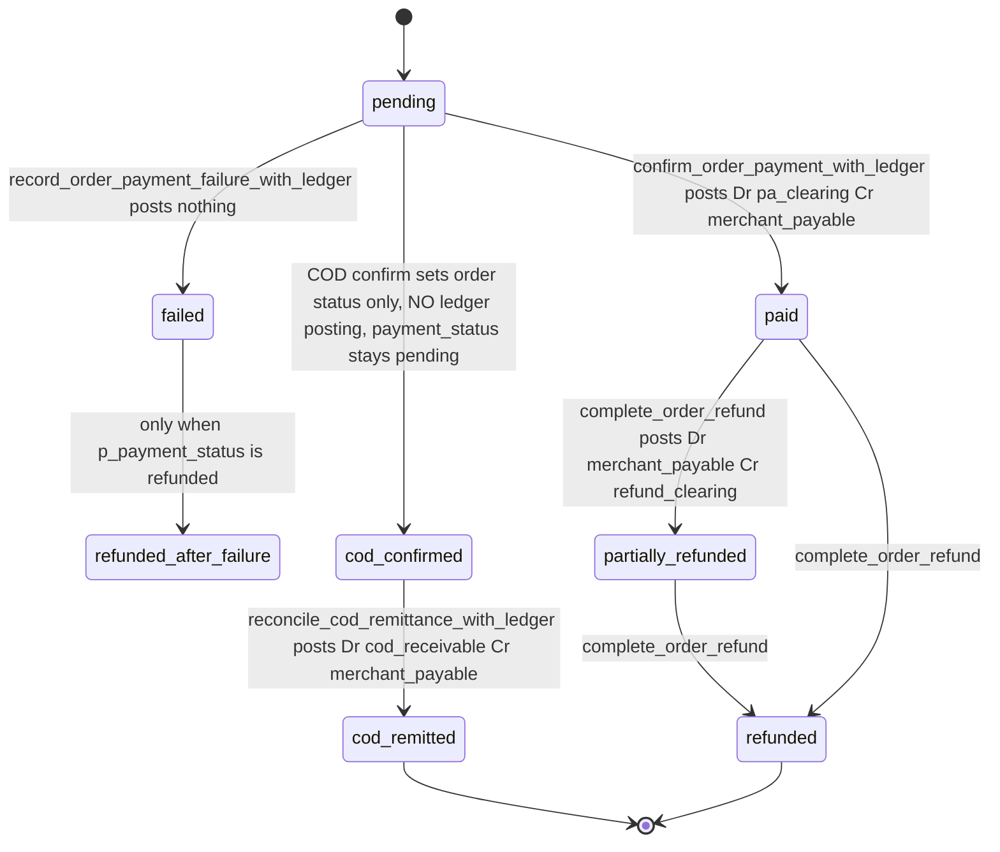
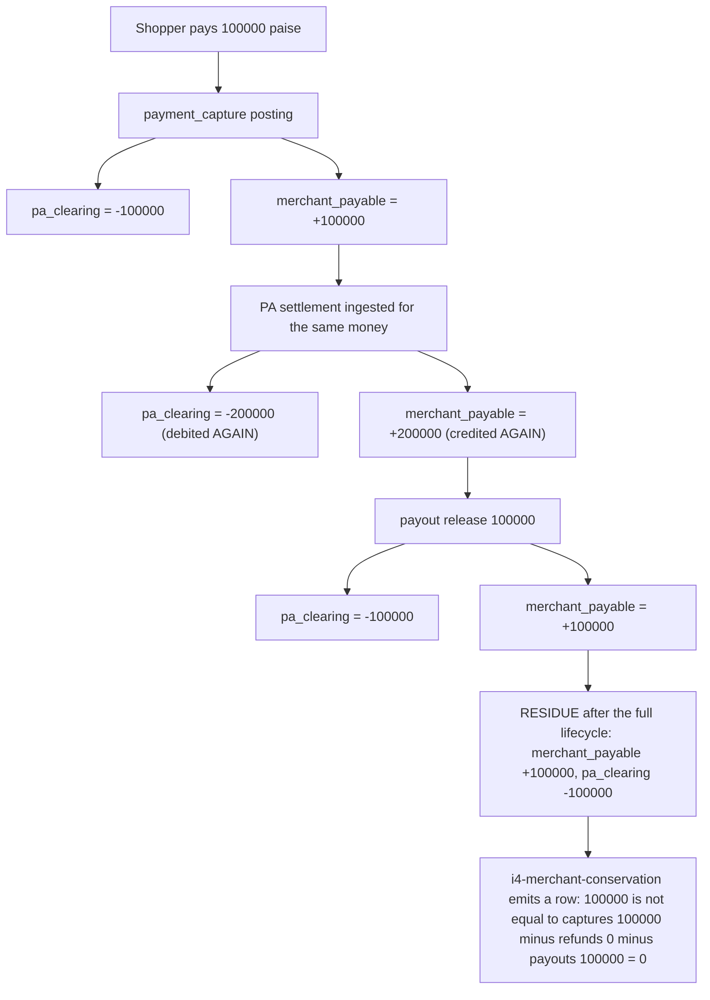
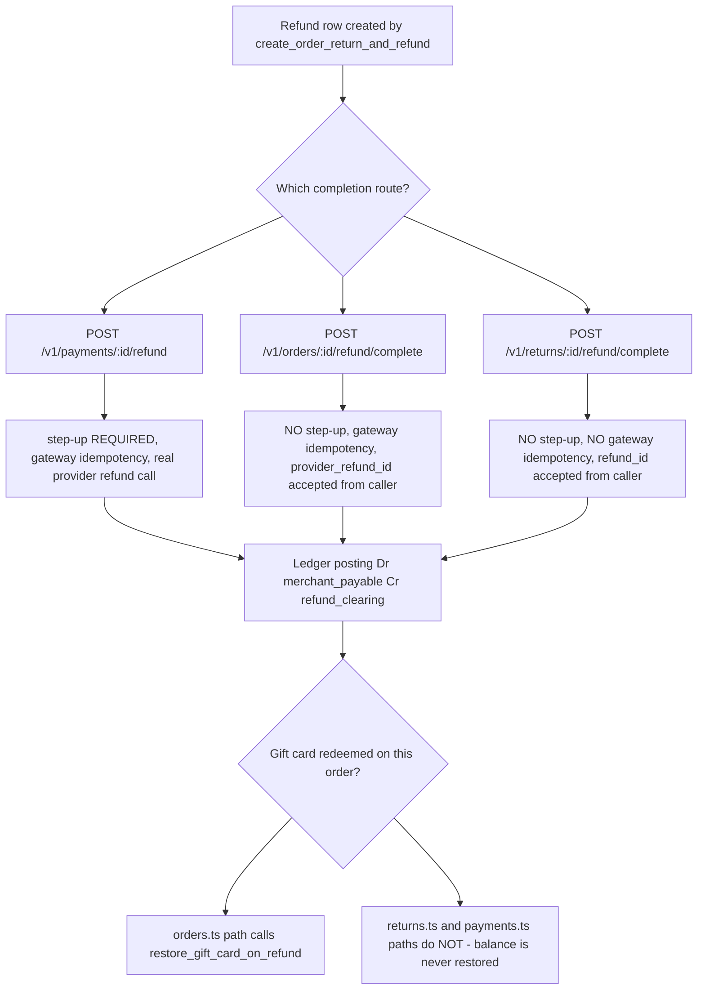

# 12 — MONEY, LEDGER, REFUNDS, RECONCILIATION

| Field | Value |
|---|---|
| Run ID | `docs/merchant-system-discovery/2026-08-04T225330+0530-bf35062e` |
| Branch | `stepup/main` |
| Commit | `bf35062e` |
| Run date | 2026-08-04 (+0530) |
| Scope | The canonical append-only double-entry ledger; every money RPC and its idempotency/locking/constraint properties; the money state machines; the direct-money-write (canonical-ledger-only) audit; refund, gift-card and COD intersections; step-up cryptography as it gates money; money representation (paise vs rupee) |
| Evidence basis | Agent G notes (`_agent-notes/G-payments-refunds-payouts.md`, read in full) plus **independent re-verification from source** of every load-bearing claim reproduced here — migrations 000/119/139/140/160/165/168/170/174, `packages/billing-core`, `packages/payments`, `services/api-gateway` money routes, `scripts/money-certification`, `scripts/validators/canonical-ledger-only-validator.mjs`, root `AGENTS.md` |
| **METHOD DISCLOSURE** | **Nothing in this document was runtime-verified. No database was queried, no RPC executed, no HTTP request issued, no test run. Every status is derived from static source reading. The ceiling for this domain is `IMPLEMENTED_NOT_RUNTIME_VERIFIED`; nothing here is `VERIFIED_E2E`.** |
| Secrets | No secrets or PII appear in this document. Environment variable **names** appear; no values were read, printed, or inferred. |

One correction to the source notes, re-verified from source and stated explicitly (per protocol): agent G cited `orders.total numeric(10,2)` at `database/supabase/migrations/000_baseline.sql:10156` and `orders.subtotal` at `:10152`. The actual lines are **`:10135`** (`total numeric(10,2) NOT NULL`) and **`:10131`** (`subtotal numeric(10,2) NOT NULL`); the table starts at `:10121`. The substance of the finding (numeric-rupee money columns on `orders`) is unchanged.

---

## 1. Recommendation / verdict

**The canonical ledger primitive is sound. The accounting model posted into it is not. Do not launch money on it until a signed posting matrix exists and the double-recognition defect is closed.**

Three things are simultaneously true, and the dossier must not blur them:

1. **The ledger engine is genuinely well built.** `post_ledger_transaction` (`database/supabase/migrations/139_executable_foundation_ledger_core.sql:223–342`) is a real append-only double-entry writer: tenant GUC required, ≥2 lines, per-transaction debit=credit assertion, a `DEFERRABLE INITIALLY DEFERRED` constraint trigger re-checking balance, `bigint` amounts with `CHECK (amount_minor > 0)`, a single-writer CHECK (`writer_module = 'settlement'`, `:113`), idempotency by `UNIQUE (site_id, source_type, source_id, idempotency_key)` with `ON CONFLICT DO NOTHING` returning the existing id (`:281–292`), BEFORE UPDATE/DELETE triggers raising `ledger is append-only; use reversing entries` (`:358–376`), **and** `REVOKE UPDATE, DELETE ... FROM PUBLIC, anon, authenticated, service_role, app_tenant` (`migrations/165_d5_canonical_money_paths.sql:463–464`). Balance is derived, never stored (`ledger_account_balance_minor`, `migrations/160_foundation_money_ledger_authority.sql:173–196`; no balance column on `ledger_accounts`, `139:75–97`). PAY-R1 and PAY-R6 are satisfied at the primitive level. The canonical ledger tables have **zero** TypeScript mutations anywhere in the repository.

2. **The documentation describing that engine is wrong in the most damaging possible place.** Root `AGENTS.md:246` (PAY-R2) still states that `confirm_order_payment_with_ledger` "posts **zero** ledger entries despite its name". **That is stale.** As of `migrations/168_b1_b2_capture_refund_ledgering.sql:237–267` it posts a balanced `pa_clearing` Dr / `merchant_payable` Cr transaction, under `FOR UPDATE` on the order, with an idempotency key and `ON CONFLICT DO NOTHING` semantics inherited from the writer. The repository's own ratchet **requires** that posting to exist (`scripts/validators/canonical-ledger-only-validator.mjs:146–153`). Two independent investigators refuted PAY-R2 from SQL. See §11 → **MCP-DISC-475**.

3. **The accounting posted through that engine double-counts merchant money, and the repository knows it.** Capture credits `merchant_payable`; PA settlement ingest credits `merchant_payable` **again in the same direction** instead of relieving it; only payout release debits it. The repository's own conservation invariant `scripts/money-certification/invariants/i4-merchant-conservation.sql:50–56` encodes `payable = captures − refunds − payouts`, with **no settlement term** — so I4 must emit a row (i.e. fail) for **any site that has ever ingested a settlement**. Downstream, the merchant wallet/earnings surface is fail-closed behind a reconciliation that structurally cannot reach variance zero. See §11 → **MCP-DISC-460**, **MCP-DISC-464**.

Concrete consequences a founder should act on:

- **Merchants cannot see their balance today.** `GET /v1/wallet` returns 409 `LEDGER_RECONCILIATION_REQUIRED` unless the reconciliation row is `verified` with `variance_minor = 0` (`services/api-gateway/src/routes/wallet.ts:163–176`). The reconciliation compares canonical `merchant_payable` against the sum of **posted** `wallet_ledger_entries` (`migrations/160:212–225`). Captures write **no** wallet row at all, and the payout credit is written with `status: 'pending'` (`services/api-gateway/src/routes/payouts.ts:484–491`), which the reconciliation excludes. After the first online capture the two quantities diverge by construction and never re-converge.
- **The payout sufficiency guard is over-permissive, not under-permissive.** `claim_payout_statement_release` gates release on `ledger_account_balance_minor(site,'merchant_payable') >= net_amount_minor` (`migrations/160:398–404`). Because settlement inflates `merchant_payable`, that guard passes on money that has already been recognised once. It is the last structural brake before an irreversible transfer.
- **A wrong posting cannot be corrected.** Reversal is the only supported correction mechanism (PAY-R6) and **there is no production caller for it** — `buildReversalLedgerPosting` (`packages/payments/src/index.ts:528–541`) is referenced only by tests, and `ledger_transactions.reversal_of` (`139:114`) is never written.
- **Refund completion is not uniformly gated and is not tenant-bound.** `complete_order_refund` locates the refund by primary key with **no `site_id` predicate** (`migrations/168:340–345`), and two of the three refund-completion routes carry no step-up.

**Verdict: BLOCKED for live money.** The engineering primitive is launch-grade; the ledger *semantics*, the correction path, and the refund authorization surface are not. The gating work is a CA-signed posting matrix (§12), not more code.

---

## 2. Scope

**In scope for this document**

| Area | Included |
|---|---|
| Canonical ledger | `ledger_accounts` / `ledger_transactions` / `ledger_entries`, the writer RPC, append-only enforcement, derived balance, the 8-account chart |
| Money RPCs | `confirm_order_payment_with_ledger`, `complete_order_refund`, `record_order_payment_failure_with_ledger`, `reconcile_cod_remittance_with_ledger`, `post_settlement_ledger_transaction`, `post_ledger_transaction`, `claim_payout_statement_release`, `create_checkout_order` (money aspects), `restore_gift_card_on_refund` |
| Postings | The posting matrix as actually implemented across SQL and TypeScript builders, and its internal contradictions |
| Refunds | All three completion routes + the creation route; provider-side vs ledger-side; idempotency, locking, over-refund guard, tenant binding, step-up |
| COD | Receivable recognition, collection, remittance, the ledger consequences, the payout-eligibility consequence |
| Gift cards | Only where they intersect money truth: tender at checkout, restore-on-refund, and ledger visibility |
| Reconciliation | `money_ledger_site_reconciliations`, `refresh_money_ledger_site_reconciliation`, the wallet gate, the operator console resolve path, `scripts/money-certification` |
| Invariant audits | Direct-money-write (canonical-ledger-only) audit and the validator that is supposed to enforce it; money representation (R-8); step-up cryptography (R-10) as it gates money |

**Out of scope here (owned by the payments/payouts document, cross-referenced in §11.4)**: which Razorpay account collects buyer money (BYOG vs platform), the single-`RAZORPAY_ROUTE_ACCOUNT_ID` payout beneficiary defect, the two competing payout pipelines, provider capture verification, hosted-checkout confirm, provider-mode badge honesty, webhook replay/tenant attribution, `commission_bps` constraint, Stripe/PayPal presence, `razorpayx` enum residue, and typed-client drift. Those gaps are named by their provisional IDs in §11.4 so the commander can confirm they are allocated elsewhere and not lost.

---

## 3. Current merchant money journeys — what a merchant can actually do today

| # | Journey | What actually happens | Status |
|---|---|---|---|
| J1 | A shopper pays online and the merchant sees the order as paid | Provider signature verified → `confirm_order_payment_with_ledger` → order `payment_status='paid'`, `payment_transactions` row `captured`, canonical posting Dr `pa_clearing` / Cr `merchant_payable` for `round(orders.total * 100)` | `IMPLEMENTED_NOT_RUNTIME_VERIFIED` |
| J2 | The merchant opens Earnings / Wallet to see their balance | `GET /v1/wallet` returns **409 `LEDGER_RECONCILIATION_REQUIRED`** as soon as any capture exists, because the reconciliation variance cannot be zero | `BROKEN` (MCP-DISC-464) |
| J3 | The merchant refunds an order from the Orders page | The app proxy sends `orders.payment_id` (a **provider order id** such as `order_ABC...`) to `/v1/payments/:paymentId/refund`, which looks it up as a `payments.id` **uuid** | `BROKEN` (MCP-DISC-474) |
| J4 | The merchant completes a refund through the order/return flow | `POST /v1/orders/:id/refund/complete` or `POST /v1/returns/:id/refund/complete` → `complete_order_refund` → refund marked succeeded, order flipped, Dr `merchant_payable` / Cr `refund_clearing`. **No step-up. No provider call. `provider_refund_id` is accepted from the caller.** | `PARTIAL` (MCP-DISC-462, MCP-DISC-461) |
| J5 | The merchant refunds through the V1 payment session route | `POST /v1/payments/:id/refund` — step-up enforced, gateway idempotency claimed, real Razorpay refund call, then `buildPaymentRefundLedgerPosting` → canonical posting | `IMPLEMENTED_NOT_RUNTIME_VERIFIED` — but the storefront money path never creates the `payments` session row this route needs |
| J6 | The merchant reconciles COD | Opening the COD list **inserts receivable rows as a side effect of a GET**; collection accepts an unbounded merchant-declared amount; remittance posts Dr `cod_receivable` / Cr `merchant_payable` — an account nothing ever credited | `PARTIAL` (MCP-DISC-471, MCP-DISC-476) |
| J7 | The merchant is paid out | `POST /v1/payouts` builds a statement from orders with `payment_status='paid'` (`routes/payouts.ts:364`) — which **structurally excludes every COD order**; release requires step-up + a provider gate that is off | `BLOCKED_EXTERNAL` / payouts document |
| J8 | A shopper pays partly with a gift card and is later refunded | `orders.total` is already **net of** the gift card (`migrations/170:288, 295`), so the provider refund bound is correct — but the gift-card tender never appears in the canonical ledger, and the balance is restored only on two of the four refund paths | `PARTIAL` (MCP-DISC-467, MCP-DISC-468) |
| J9 | Someone corrects a wrong posting | Impossible through supported means — no reversal caller exists | `NOT_IMPLEMENTED` (MCP-DISC-465) |

---

## 4. Feature matrix

| Capability | Status | Evidence (path:line) | Gap |
|---|---|---|---|
| Append-only double-entry ledger tables | `IMPLEMENTED_NOT_RUNTIME_VERIFIED` | `migrations/139:75–160` | — |
| Single ledger writer (`writer_module` CHECK) | `IMPLEMENTED_NOT_RUNTIME_VERIFIED` | `139:113` | — |
| Append-only by trigger **and** REVOKE | `IMPLEMENTED_NOT_RUNTIME_VERIFIED` | `139:358–376`; `165:463–464` | — |
| Balance derived, never stored | `IMPLEMENTED_NOT_RUNTIME_VERIFIED` | `160:173–196`; no balance column at `139:75–97` | — |
| Per-transaction debit=credit assertion | `IMPLEMENTED_NOT_RUNTIME_VERIFIED` | `139:336–338` + constraint trigger `139:378–382` | — |
| Ledger idempotency (unique key + ON CONFLICT) | `IMPLEMENTED_NOT_RUNTIME_VERIFIED` | `139:122`, `139:281–292` | — |
| Capture posts to the ledger | `IMPLEMENTED_NOT_RUNTIME_VERIFIED` | `migrations/168:237–267` | MCP-DISC-475 (doc drift) |
| Capture amount sourced from the provider | `NOT_IMPLEMENTED` | amount is `round(orders.total*100)`, `168:179` | MCP-DISC-466 |
| `provider_mode` recorded on canonical postings | `NOT_IMPLEMENTED` | metadata at `168:257–265` has no mode; contrast `routes/payments.ts:305–312` which does | MCP-DISC-466 |
| Refund posts to the ledger | `IMPLEMENTED_NOT_RUNTIME_VERIFIED` | `168:401–429`; `packages/payments/src/index.ts:499–526` | — |
| Refund RPC requires idempotency | `IMPLEMENTED_NOT_RUNTIME_VERIFIED` | `168:336–338` | — |
| Refund RPC locks rows | `IMPLEMENTED_NOT_RUNTIME_VERIFIED` | `168:345` (refunds), `168:356` (orders) | — |
| Refund RPC over-refund guard | `IMPLEMENTED_NOT_RUNTIME_VERIFIED` | `168:364–378` | — |
| Refund RPC tenant-bound | **`BROKEN`** | `168:340–345` — `WHERE id = p_refund_id`, no `site_id` | MCP-DISC-461 |
| Step-up on refund (`/payments/:id/refund`) | `IMPLEMENTED_NOT_RUNTIME_VERIFIED` | `routes/payments.ts:497–507` | — |
| Step-up on refund (orders / returns / create) | `NOT_IMPLEMENTED` | `routes/orders.ts:1341–1400`, `routes/returns.ts:259–292`, `routes/orders.ts:1427–1460` | MCP-DISC-462 |
| Step-up is real HMAC-SHA256 + constant-time compare | `IMPLEMENTED_NOT_RUNTIME_VERIFIED` | `lib/security-controls.ts:81–97, 193–201` | — |
| Step-up single-use | `NOT_IMPLEMENTED` | `jti` minted `:145`, returned `:240`, never consumed | MCP-DISC-469 |
| COD receivable recognised at confirm | `NOT_IMPLEMENTED` | `routes/order-risk.ts:348–369` — no `rpc(`, no ledger, no `payment_status` | MCP-DISC-471 |
| COD remittance posts to the ledger | `IMPLEMENTED_NOT_RUNTIME_VERIFIED` | `migrations/165:353–396` | MCP-DISC-471 (wrong direction) |
| COD amounts server-bounded | `NOT_IMPLEMENTED` | `routes/cod-reconciliation.ts:330` | MCP-DISC-476 |
| COD amounts stored as bigint | **`BROKEN`** | int4 columns `migrations/140:26–29`; silent clamp `165:335–339` | MCP-DISC-470 |
| Settlement posting relieves `pa_clearing` | **`BROKEN`** — it re-credits `merchant_payable` | `packages/billing-core/src/index.ts:584–600` | MCP-DISC-460 |
| Settlement ingest restricted to provider/operator | `NOT_IMPLEMENTED` | `routes/settlements.ts:319–329` merchant auth only | MCP-DISC-463 |
| Reversal / correction path | `NOT_IMPLEMENTED` | `packages/payments/src/index.ts:528–541` — tests only | MCP-DISC-465 |
| Reconciliation without auto-plug | `IMPLEMENTED_NOT_RUNTIME_VERIFIED` | `routes/internal-console/money-reconciliation.ts:242–262` | — |
| Reconciliation converges | **`BROKEN`** | `migrations/160:212–225` vs `routes/payouts.ts:484–491` | MCP-DISC-464 |
| Merchant wallet/earnings readable | **`BROKEN`** | `routes/wallet.ts:163–176` | MCP-DISC-464 |
| Gift-card tender in the canonical ledger | `NOT_IMPLEMENTED` | no gift-card account code in `139:79–88`; zero gift-card references in migrations 139/160/165 | MCP-DISC-467 |
| Gift-card restore on every refund path | `PARTIAL` | called at `routes/orders.ts:1198, 1396` and `routes/order-risk.ts:304`; **absent** from `routes/returns.ts:279` and the `routes/payments.ts` refund route | MCP-DISC-468 |
| Canonical-ledger-only enforced per mutation | `PARTIAL` | `scripts/validators/canonical-ledger-only-validator.mjs:133` tests the whole file | MCP-DISC-472 |
| Money-certification invariants executable | **`BROKEN`** | `i5:41`, `i7:29–31`, `i8:52–56`, `i4:50–56` | MCP-DISC-473 |
| Behavioural money tests | `STUB_OR_MOCK` | `services/api-gateway/src/__tests__/payments.test.ts` regex-over-source | MCP-DISC-479 |

---

## 5. UI / route inventory

### 5.1 Merchant-facing money surfaces

| Surface | Path | Reaches money how | Status |
|---|---|---|---|
| Orders → Refund | `apps/merchant-control-plane/src/app/[store]/orders/page.tsx:379–423` → proxy `src/app/api/stores/[store]/orders/[orderId]/refund/route.ts:36, 51` | Sends `orders.payment_id` to `/v1/payments/:paymentId/refund` | `BROKEN` (MCP-DISC-474) |
| Payouts list / release | `apps/merchant-control-plane/src/app/[store]/payouts/page.tsx:60–121` | `/v1/payouts`, `/v1/payouts/:id/settle` | `IMPLEMENTED_NOT_RUNTIME_VERIFIED`; provider gated off |
| Wallet / Earnings | `services/api-gateway/src/routes/wallet.ts:147–186`; mobile `apps/mobile/merchant-app/lib/screens/money/money_screen.dart:615` | `GET /v1/wallet` | `BROKEN` — 409 in practice (MCP-DISC-464) |
| COD reconciliation | `services/api-gateway/src/routes/cod-reconciliation.ts:304, 311, 355` | GET seeds rows; POST collects; POST reconcile → RPC | `PARTIAL` |
| Create payout statement | **no UI** — reachable only via the typed client (`packages/typescript/api-client/src/index.ts:4974`) | `POST /v1/payouts` | `BACKEND_ONLY` |
| Settlement ingest | **no UI, no typed client method** | `POST /v1/settlements/ingest` | `BACKEND_ONLY` (MCP-DISC-463) |
| Money export (payout/ledger CSV) | none found in `services/api-gateway/src/routes/export.ts` | — | `NOT_IMPLEMENTED` |
| Reversal / correction | none | — | `NOT_IMPLEMENTED` (MCP-DISC-465) |

### 5.2 Operator-facing

| Surface | Path | Status |
|---|---|---|
| Money reconciliation console | `apps/platform-console/src/app/(dashboard)/money-reconciliation/page.tsx`; gateway `services/api-gateway/src/routes/internal-console/money-reconciliation.ts:183–270` | `IMPLEMENTED_NOT_RUNTIME_VERIFIED`; dual control is client-asserted (MCP-DISC-478) |

### 5.3 Gateway money routes touching the canonical ledger

| Route | Ledger effect | Step-up | Route idempotency |
|---|---|---|---|
| `POST /v1/storefront/:subdomain/payments/razorpay/verify` | capture posting via RPC | n/a (public shopper) | yes (`checkout-payment-routes.ts:601`) |
| `POST /v1/checkout/:cartId/confirm` (public) | capture posting via RPC | n/a | see payments document |
| `POST /v1/payments/:id/capture` | capture posting via `postPaymentLedger` (`routes/payments.ts:294`) | no | yes (`:281`) |
| `POST /v1/payments/:id/refund` | refund posting (`routes/payments.ts:563`) | **yes** (`:497`) | yes (`:509`) |
| `POST /v1/orders/:id/refund/complete` | refund posting via RPC | **no** | yes (`routes/orders.ts:1351`) |
| `POST /v1/returns/:id/refund/complete` | refund posting via RPC | **no** | **no** (`routes/returns.ts:259–292`) |
| `POST /v1/cod/reconciliation/:id/reconcile` | COD remittance posting via RPC | no | RPC-level key |
| `POST /v1/settlements/ingest` | **settlement posting, amounts from the request body** | **no** | RPC/ledger key only |
| `POST /v1/payouts` | fee-assessment posting *only if fee > 0* (`routes/payouts.ts:504–527`) | **no** | no |
| `POST /v1/payouts/:id/settle` | payout release posting (`routes/payouts.ts:658`) | **yes** (`:576`) | RPC claim (`160:385–388`) |

---

## 6. Backend / API / RPC / database mapping

### 6.1 The chart of accounts (8 accounts, enforced by CHECK)

`database/supabase/migrations/139_executable_foundation_ledger_core.sql:79–88`:

`pa_clearing` · `merchant_payable` · `platform_revenue` · `gst_payable` · `cod_receivable` · `reserve` · `vendor_payable` · `refund_clearing`

`ledger_transactions.source_type` CHECK (`139:103–110`): `payment_capture` · `refund` · `settlement` · `cod_remittance` · `payout` · `reversal`. Of these, **`reversal` has no writer anywhere in the repository** (MCP-DISC-465).

Currency is pinned to INR at both the account (`139:78`) and the writer (`139:257–259`).

### 6.2 The posting matrix as actually implemented

| Event | Posting | Where the lines are built | Notes |
|---|---|---|---|
| Online capture (order path) | Dr `pa_clearing` / Cr `merchant_payable`, amount = `round(orders.total*100)` | SQL, `migrations/168:243–256` | gross; no fee/GST split; no `provider_mode` |
| V1 capture (payment-session path) | Dr `pa_clearing` gross / Cr `merchant_payable` **net of fee and GST**, plus `platform_revenue` and `gst_payable` when > 0 | TS, `packages/payments/src/index.ts:446–496` | a **second, different** capture model; coincides with the SQL model only because the fee is 0 |
| Refund | Dr `merchant_payable` / Cr `refund_clearing` | SQL `168:401–429`; TS `packages/payments/src/index.ts:499–526` | posted regardless of refund tender (see MCP-DISC-467) |
| Failed payment marked refunded | Dr `merchant_payable` / Cr `refund_clearing` | SQL `168:662–690` | only when `p_payment_status = 'refunded'` — correct |
| COD remittance | Dr `cod_receivable` / Cr `merchant_payable` | SQL `165:353–396` | nothing ever credits `cod_receivable` |
| PA settlement ingest | Dr `pa_clearing` (or `cod_receivable` when `rail='cod_remittance'`) / Cr `merchant_payable` net, `platform_revenue`, `gst_payable`, `reserve` | TS, `packages/billing-core/src/index.ts:584–624` | **same direction as capture — this is the double-count** |
| Payout fee assessment | Dr `merchant_payable` / Cr `platform_revenue` (+ `gst_payable`) | `routes/payouts.ts:256–289` | skipped entirely when fee = 0 |
| Payout release | Dr `merchant_payable` / Cr `pa_clearing` | TS, `packages/billing-core/src/index.ts:658–681` | the only debit of `merchant_payable` in the normal flow |
| Gift-card redemption (tender) | **none** | — | MCP-DISC-467 |
| Gift-card / store-credit refund | Dr `merchant_payable` / Cr `refund_clearing` — identical to a cash refund | `168:401–429` (unconditional on `v_amount_minor > 0`) | MCP-DISC-467 |
| Reversal | **none** | — | MCP-DISC-465 |

**Three capture models coexist** (SQL gross, TS net-of-fee, TS settlement re-credit). There is no single authored document in the repository that states which is correct. That absence is the root cause of MCP-DISC-460.

### 6.3 Money RPC properties (AUDIT C — idempotency, locking, constraints)

| RPC | Definition | Idempotency required | Conflict handling | Row locks | Amount/domain constraints |
|---|---|---|---|---|---|
| `post_ledger_transaction` | `139:223–342` | **yes** (parameter) | `ON CONFLICT (site_id, source_type, source_id, idempotency_key) DO NOTHING` then returns the existing id (`:281–292`) | n/a (insert-only) | `amount_minor > 0` (`139:132`); ≥ 2 lines (`:259–261`); debits = credits (`:336–338`); deferred constraint trigger (`:378–382`); tenant GUC must equal `p_site_id` (`:250–253`) |
| `post_settlement_ledger_transaction` | `165:214–265` | inherited | inherited | n/a | resolves the owning site from the **source row** and raises on `p_site_id <> v_source_site_id` (`:243–245`); raises on a conflicting pre-existing GUC (`:247–250`) |
| `confirm_order_payment_with_ledger` | `168:133–312` | **no** — optional, falls back to `p_provider_payment_id` (`:180`) | ledger unique key; `payment_attempts ... ON CONFLICT DO NOTHING` (`:308`) | `FOR UPDATE` on `orders` (`:172`) | requires non-empty `p_provider_payment_id` (`:154–156`); posts only when `v_amount_minor > 0` (`:237`) |
| `complete_order_refund` | `168:314–561` | **yes** — raises when blank (`:336–338`) | outbox `ON CONFLICT (idempotency_key) DO NOTHING` (`:552`); `refund_attempts ... ON CONFLICT DO NOTHING` (`:482`) | `FOR UPDATE` on `refunds` (`:345`) and `orders` (`:356`) | over-refund guard against `orders.total` (`:364–378`) | 
| `record_order_payment_failure_with_ledger` | `168:563–737` | no (optional) | `payment_attempts ... ON CONFLICT DO NOTHING` (`:733`) | `FOR UPDATE` on `orders` (`:603`) | posts only for `p_payment_status='refunded'` (`:662`) |
| `reconcile_cod_remittance_with_ledger` | `165:267–461` | **yes** (`:291`) | replay-by-key lookup (`:295–305`); wallet `ON CONFLICT (site_id, idempotency_key)` (`:450`) | `FOR UPDATE` (`:313`) | `deposited_amount_minor >= 0` (`:323`); **silently clamps to int4 on write** (`:335–339`) |
| `claim_payout_statement_release` | `160:357–421` | **yes** | claim-by-key replay (`:385–388`) | `FOR UPDATE` (`:379`) | derived-balance sufficiency `>= net_amount_minor` (`:398–404`) |
| `create_checkout_order` | `migrations/170:*` | **yes** — raises if blank (`:77–78`) | `ON CONFLICT (site_id, idempotency_key)` ×6 | `FOR UPDATE` (`:181`, `:209`) | gift-card debit bounded by `LEAST(balance, grand_total)` (`:231`); `orders.total` set to `grand_total − gift_card_amount` (`:288, 295`) |
| `restore_gift_card_on_refund` | `migrations/174_v1_gift_card_refund_restore.sql:18+` | idempotent by design (per header comment `:8`) | — | — | restores committed redemptions for the order |

**The single most important omission in this table**: `complete_order_refund` takes no site parameter at all. Tenant scope is *derived from the refund row the caller named*, which means the tenant check and the attack surface are the same value.

### 6.4 AUDIT A — the direct-money-write audit and its result

Agent G ran a repository-wide regex over production TypeScript (`services/`, `packages/`, `apps/`; `node_modules`, `.next`, `dist`, `.wrangler`, tests excluded) for `.from('<money table>')…​.insert|update|upsert|delete` across 22 money-bearing tables. **46 matches; 19 adjudicated as real direct money-table writes.** The result is genuinely two-sided:

**Clean — RPC-only, exactly as the Constitution requires:**

| Table group | Result |
|---|---|
| `ledger_transactions`, `ledger_entries` | **zero** TS mutations anywhere. The canonical ledger has exactly one writer, and it is SQL. |
| `refunds`, `refund_transactions`, `payment_transactions` | **zero** TS mutations (selects only) |
| `gift_card_accounts`, `gift_card_ledger_entries`, `gift_card_redemptions` | **zero** TS mutations |

**Not clean — 19 production sites write money-bearing tables directly from a Worker, with amounts computed in TypeScript rather than in a `SECURITY DEFINER` RPC:**

| Table | Sites | Representative evidence |
|---|---|---|
| `payments` | 4 | `routes/payments.ts:164` (insert), `:317` (capture update), `:407` (void), `:585` (refunded amount) |
| `payout_statements` | 5 | `routes/payouts.ts:452`, `:523`, `:637`, `:670`; `routes/settlements.ts:201/213` |
| `wallet_ledger_entries` | 3 | `routes/payouts.ts:484` (**`status:'pending'`, no `canonical_ledger_transaction_id`**), `:674`; `routes/settlements.ts:243` |
| `settlements` | 2 | `routes/settlements.ts:347`, `:392` |
| `payouts` / `payout_items` | 3 | `routes/payouts.ts:237`; `routes/settlements.ts:429`, `:460` |
| `cod_reconciliation_entries` | 2 | `routes/cod-reconciliation.ts:203` (**seeded by a GET**), `:333` (merchant-declared amount) |
| `commission_reconciliation_entries` | 2 | `routes/commission.ts:316`, `:344` |
| `recon_breaks` | 1 | `routes/settlements.ts:403` — acceptable: a break record, no auto-plug |
| `money_ledger_site_reconciliations` | 1 | `routes/internal-console/money-reconciliation.ts:248` — acceptable: metadata annotation only, no amount mutation |
| `partner_payout_ledger_entries` | 7 | ring-fenced by the documented seam `SKIP-B3-PARTNER-PAYOUT-LEDGER-BOUNDARY`, enforced at `scripts/validators/canonical-ledger-only-validator.mjs:122–129` — not a new violation |
| `orders` | 13 | inspected: status / fulfilment / risk / notes columns, **not money columns** (spot-verified at `routes/order-risk.ts:348–369` and `execution/payment-execution.adapter.ts:148–156`) |

**Why the ratchet does not catch the 19.** `scripts/validators/canonical-ledger-only-validator.mjs:133` reads:

```js
if (mutationMatches.length > 0 && !canonicalLedgerEvidence.test(entry.text) && !partnerPayoutBoundaryFiles.has(entry.path)) {
```

`entry.text` is the **entire file**. `canonicalLedgerEvidence` (`:50`) matches any of `ledger_transactions|ledger_entries|post_settlement_ledger_transaction|postPaymentLedger|…|canonical_ledger_transaction_id`. `routes/payouts.ts` and `routes/settlements.ts` both mention `postCanonicalPayoutLedger` / `canonical_ledger_transaction_id`, so **every** direct money write in those files passes unexamined. The check is file-level adjacency, not per-mutation enforcement (MCP-DISC-472).

The same validator is, however, strong evidence for headline (a): `:146–153` asserts that the **latest** definition of `confirm_order_payment_with_ledger` contains `public.post_settlement_ledger_transaction(`, `payment_capture`, `pa_clearing`, `merchant_payable`. The repository's own gate *requires* the posting that `AGENTS.md:246` says does not exist.

### 6.5 AUDIT F — money representation (Constitution R-8 / PAY-R5)

**Compliant `bigint` minor units:** `ledger_entries.amount_minor` (`139:132`), `payments.amount_minor` (`142:50`), `settlements.*_minor` (`151:57–62`), `payouts.amount_minor` (`151:121`), `payout_items.amount_minor` (`151:155`), `reserves.amount_minor` (`151:95`), `recon_breaks.amount_minor` (`151:177`), `payments.refunded_amount_minor` (`160:11`).

**Non-compliant `integer` (int32) money columns that are still the columns actually written:**

| Column(s) | Definition | Live writer |
|---|---|---|
| `payout_statements.gross/platform_fee/tax/net_amount_minor` | `migrations/119_mobile_money_ledgers.sql:16–19` | `routes/payouts.ts:461–464`; `routes/settlements.ts:222–225` |
| `wallet_ledger_entries.amount_minor` | `119:51` | `routes/payouts.ts:491, 681`; `routes/settlements.ts:250`; `migrations/165:430` |
| `cod_reconciliation_entries.expected/collected/deposited/difference_amount_minor` | `migrations/140:26–29` | `routes/cod-reconciliation.ts:187–190, 336`; `migrations/165:335–339` |
| `commission_reconciliation_entries.gross/commission/gst/net_payable_minor` | `119:106–113` | `routes/commission.ts:316, 344` |

`_bigint` shadow columns and sync triggers were added (`160:26–40, 96–145`; `165:5–10, 26–78`), but the int4 columns remain the inserted/updated columns, so an overflow occurs **at the int4 write, before the trigger copies**. Worse, migration `165:335–339` does not fail on overflow, it silently caps:

```sql
collected_amount_minor  = LEAST(v_collected_amount_minor, 2147483647)::integer,
deposited_amount_minor  = LEAST(v_deposited_amount_minor, 2147483647)::integer,
difference_amount_minor = GREATEST(LEAST(v_deposited_amount_minor - v_expected_amount_minor, 2147483647), -2147483648)::integer,
```

Any COD amount above ₹2,14,74,836.47 is silently truncated in the compatibility column while the `_bigint` column keeps the true value — two different truths in one row (MCP-DISC-470).

**Numeric-rupee money is still authoritative on the capture path.** `orders.total numeric(10,2)` (`000_baseline.sql:10135`) and `orders.subtotal numeric(10,2)` (`:10131`); `payment_transactions.amount` written from `v_order.total` (`168:225`); `refunds.amount` numeric (`168:363`); `v_gift_card_balance NUMERIC(12,2)` (`170:64`). The canonical capture amount is a `round(numeric * 100)::bigint` conversion at the ledger boundary (`168:179`). `numeric(10,2)` also caps an order at ₹99,999,999.99 — a hard product limit nobody has written down.

**No float money columns were found.** That part of R-8 holds.

---

## 7. State machines

### 7.1 Order money state and the postings it triggers



Two structural facts are visible in this diagram and both are defects:

- `cod_confirmed` produces **no posting at all**, so the `cod_receivable` that the remittance later debits was never created (MCP-DISC-471).
- `cod_confirmed` never reaches `paid`, and `POST /v1/payouts` selects on `payment_status = 'paid'` (`routes/payouts.ts:364`), so COD revenue can never enter a payout statement.

### 7.2 The rupee's journey — where the double-count happens

Worked example, one ₹1,000 order, fee 0, GST 0, reserve 0. Balances are credit-positive, per `ledger_account_balance_minor` (`160:173–196`).



Total debits still equal total credits at every step, so the balance assertion at `139:336–338` and the deferred constraint trigger never fire. **Double-entry integrity is intact; the accounting meaning is wrong.** The defect is invisible to every mechanical check the repository has except I4, and I4 is authored to the opposite model.

### 7.3 Refund lifecycle and the three entry points



---

## 8. Auth / tenant / invariant analysis

### 8.1 Step-up (Constitution R-10 / PAY-R7) — real cryptography, replayable token

`services/api-gateway/src/lib/security-controls.ts`:

- Token shape `lb-stepup-v1.<base64url(payload)>.<base64url(HMAC-SHA256)>`, issued at `:126–163`.
- The signing secret must be ≥ 32 characters and not a placeholder (`:46–51`) — **fails closed**.
- Verify recomputes the HMAC (`:193`) and compares with `constantTimeEqual` (`:196`, XOR-accumulate implementation at `:93–97`), then binds `action`, `actor_id`, `site_id`, `verified_at` (`:197–201`).
- A 10-minute window plus future-skew rejection plus `exp` (`:214–215`; `STEP_UP_WINDOW_MS` at `:29`).
- Issued only after an active TOTP factor check (`routes/security.ts:177`), with a `step_up_challenges` row recorded (`:183`).

**PAY-R7 is satisfied where the guard is applied: this is not a string-length check.** State that plainly — it is one of the few money controls in this repository that is exactly what the rulebook demands.

**The defect is replay.** A `jti` is minted at `:145` and echoed back in the success metadata at `:240`, but the verify path (`:186–243`) never looks it up, never writes it, and never marks the `step_up_challenges` row consumed. Within the 10-minute window, one TOTP-backed proof authorises an unbounded number of distinct refunds and payout releases for that actor and site. The second factor degrades from per-action to per-session (MCP-DISC-469).

**Coverage** (the control exists; it is not applied uniformly):

| Money action | Step-up | Evidence |
|---|---|---|
| `refund.approve` on `/payments/:id/refund` | **yes** | `routes/payments.ts:497–507` |
| `payout.release` on `/payouts/:id/settle` | **yes** | `routes/payouts.ts:576–586` |
| `/orders/:id/refund/complete` | **no** | `routes/orders.ts:1341–1400` |
| `/returns/:id/refund/complete` | **no** | `routes/returns.ts:259–292` |
| `/orders/:id/refund` (create) | **no** | `routes/orders.ts:1427–1460` |
| `/settlements/ingest` (writes the ledger) | **no** | `routes/settlements.ts:319` |
| `POST /payouts` (creates the payable statement) | **no** | `routes/payouts.ts:412` |

### 8.2 Tenant binding on the refund path — the cross-tenant candidate

```sql
-- database/supabase/migrations/168_b1_b2_capture_refund_ledgering.sql:340–345
SELECT *
  INTO v_refund
  FROM refunds
 WHERE id = p_refund_id
   AND deleted_at IS NULL
 FOR UPDATE;
```

There is no `site_id` predicate. The caller supplies `p_refund_id`:

- `services/api-gateway/src/routes/returns.ts:274–286` — `refundId = body.refund_id || existing.refunds[0].id`, passed straight into `db.rpc('complete_order_refund', { p_refund_id: refundId, … })` at `:279`. `loadOwnedReturn` (`:103–128`) validates the **return** via `verifySiteOwnership`; it never validates that the refund belongs to that return or that site.
- `services/api-gateway/src/execution/order-execution.adapter.ts:504–521` — the RPC is called at `:505`; the ownership check `if (order?.store_id && order.store_id !== tenant.siteId) throw new ForbiddenError(...)` is at `:519–520`, i.e. **after** the RPC has already mutated rows and posted to the append-only ledger. Throwing afterwards does not roll it back: the RPC is its own transaction.
- The request schema permits it: `CompleteRefundSchema` (`packages/checkout-core/src/index.ts:443–448`) accepts any UUID.

**The settlement writer does not save you here — it does the opposite.** `post_settlement_ledger_transaction` resolves the owning site from the **source row** (`165:219–223` → `resolve_money_ledger_source_site_id`, which for `source_type='refund'` reads `refunds.site_id`, `168:59–65`) and raises only on `p_site_id <> v_source_site_id` (`165:243–245`). Since `complete_order_refund` passes `v_refund.site_id` (`168:402`), attacker and source agree perfectly, and the posting lands **in the victim's ledger**. The GUC guard at `165:247–250` only bites if a previous statement in the same transaction already set `app.site_id` to a different tenant, which the stateless gateway does not do.

Net effect: a merchant (or staff member with `orders:write`) holding a refund UUID from another site can, with no step-up on two of the routes, mark that refund succeeded, flip that order, and write an **irreversible** entry into another tenant's canonical ledger (MCP-DISC-461).

### 8.3 RLS on money tables

| Table group | ENABLE | FORCE | Blanket `service_role USING(true)` still present |
|---|---|---|---|
| `ledger_accounts` / `ledger_transactions` / `ledger_entries`, `compensation_actions`, `outbox_consumptions` | yes (`139:396`) | yes (`139:397`) | no — GUC policy only (`139:399–403`) |
| `payout_statements`, `wallet_ledger_entries`, `commission_*`, `settlements`, `reserves`, `payouts`, `payout_items`, `recon_breaks` | yes (`151:271`) | yes (`151:272`) | dropped at `151:273–275` |
| `payments`, `payment_attempts`, `payment_transactions`, `payment_credentials`, `payment_tokens` | yes (`142:181–188`) | yes | GUC policies (`142:190–222`) |
| `cod_reconciliation_entries` | yes (`140:82`) | via the generic loop (`164:64`) | **YES — `140:84–88`, never dropped** |
| `money_ledger_site_reconciliations` | yes (`160:70`) | via `164:64` | **YES — `160:72–76`** |

The gateway connects as `service_role` (`services/api-gateway/src/lib/supabase.ts:13–19`, whose own comment says it bypasses RLS), wrapped in an application-level `createTenantGuardedSupabaseClient`. For those two money tables, database-layer tenancy is therefore not load-bearing at all (MCP-DISC-477). Migration `164:33–75` builds the correct target design (`app_tenant`, `NOBYPASSRLS`, GUC policy on every `site_id`/`store_id` table); the cutover has not happened.

### 8.4 Rule-by-rule scorecard for this domain

| Rule | Verdict | Evidence |
|---|---|---|
| PAY-R1 — one append-only double-entry ledger, derived balance | **SATISFIED** for the canonical ledger | `139:75–160`; `160:173–196` |
| PAY-R2 — every capture/refund/COD/tender posts idempotently | **PARTIAL** — capture and refund post; **COD confirm does not**; **gift-card tender does not**; the rule text itself is stale | `168:237–267`, `168:401–429`, `routes/order-risk.ts:348–369`, `AGENTS.md:246` |
| PAY-R5 / R-8 — bigint paise on every path | **VIOLATED** — four int4 money column groups still written; capture amount derived from `numeric(10,2)` | `119:16–19, 51, 106–113`; `140:26–29`; `165:335–339`; `168:179` |
| PAY-R6 / R-6 — append-only by trigger AND REVOKE; corrections are reversing entries | **SATISFIED for enforcement, VIOLATED for capability** — no reversal writer exists | `139:358–376`; `165:463–464`; `packages/payments/src/index.ts:528–541` (tests only) |
| PAY-R7 / R-10 — real cryptographic second factor on refund/payout | **SATISFIED where applied; NOT APPLIED on 5 money routes; token replayable** | `lib/security-controls.ts:81–97, 193–215`; §8.1 table |
| PAY-R8 — server-authoritative amounts, idempotency on every money mutation | **PARTIAL** — capture amount is server-side, but settlement amounts come from the request body; `/returns/:id/refund/complete` has no route-level idempotency | `packages/billing-core/src/index.ts:138–152`; `routes/returns.ts:259–292` |
| PAY-R9 — reconcile to zero-break-or-explained-suspense, never auto-plug | **SATISFIED in mechanism, UNREACHABLE in practice** — no auto-plug (`money-reconciliation.ts:242–262`), but the reconciliation cannot converge | `migrations/160:212–225` vs `routes/payouts.ts:484–491` |

---

## 9. Runtime and test evidence — and what was NOT verified

**Runtime observations performed in this domain: zero.** No database was reachable (correct, per the run's safety rules), no provider credentials were available, and Docker was unavailable. Every claim above is static.

Specifically **not** verified:

| Claim | Why it is unverified | What would verify it |
|---|---|---|
| That `GET /v1/wallet` actually returns 409 in a live store | Requires a database with a capture posted | One gateway call against a seeded staging store |
| That the cross-tenant refund actually mutates the victim's rows | Requires two sites and a foreign refund UUID | A Postgres test asserting row and ledger counts unchanged |
| That the Orders-page refund fails with a uuid cast error rather than a 404 | The identifier mismatch is certain from types; the exact error is not | One proxied request |
| That I4 fails on a settled site | The arithmetic is deterministic from two builders; the run is not | `psql -f i4-merchant-conservation.sql` against a migrated DB |
| That the int4 clamp ever triggers | Needs an amount above ₹2.14 crore | A migration test writing above int4 max |

**Test evidence quality is poor precisely where stakes are highest.** `services/api-gateway/src/__tests__/payments.test.ts`, `money.test.ts`, `money-d5-ledger.test.ts`, `settlements.test.ts`, `payout-provider-client.test.ts` are `readFileSync` + `assert.match` regex assertions over source text (e.g. `payments.test.ts:11–17, 25–32, 53–70`). They prove a string exists in a file. A refactor that preserves the strings and breaks the arithmetic passes (MCP-DISC-479).

Real Postgres tests exist (`tests/executable/money-ledger-postgres.test.mjs` and siblings) but require a container named by `LETBUYY_EXECUTABLE_PG_CONTAINER` (`:9`) — `BLOCKED_EXTERNAL`, not executed.

**The certification suite that is supposed to catch exactly the defects in this document is itself broken** (MCP-DISC-473). The runner (`scripts/money-certification/check-invariants.mjs:1–6`) requires exit 0 **and** zero rows, so a SQL error is a hard fail:

| Invariant | Defect | Evidence |
|---|---|---|
| I4 merchant conservation | encodes `payable = captures − refunds − payouts` with no settlement term → fails on any settled site | `i4-merchant-conservation.sql:50–56` |
| I5 zero rake | queries `public.payment_credentials.commission_bps` — that column does not exist | `i5-zero-rake.sql:41–45` vs `migrations/142:7–23` |
| I7 single writer | expects zero `wallet_ledger_entries` with `canonical_ledger_transaction_id IS NULL` after 2026-01-01 — `routes/payouts.ts:484` creates exactly those | `i7-single-writer.sql:25–31` |
| I8 COD symmetry | queries `cod_reconciliation_entries.amount`, `status='remitted'`, and `metadata->'canonical_ledger_transaction_id'` — the columns are `expected/collected/deposited_amount_minor`, `'remitted'` is not in the status CHECK (`140:44–51`), and the canonical id is a **column** (`165:6`), not a metadata key | `i8-cod-symmetry.sql:47–59` |

**Also not run, deliberately:** `pnpm validate:governance` and any `pnpm run validate:*`. The orchestrator deletes `node_modules`, `dist` and `.next` before validating, which would destroy the user's environment (proven finding G-L-01). This is a documented refusal, not an omission.

---

## 10. Implemented vs missing

### 10.1 Implemented and structurally sound

- Append-only double-entry ledger with derived balances, tenant-scoped writer, deferred balance constraint trigger, trigger **and** REVOKE enforcement, single-writer CHECK, per-transaction idempotency key.
- Tenant hardening of the settlement writer: `post_settlement_ledger_transaction` was originally a GUC bypass using the caller-supplied `p_site_id` (`migrations/151:23`); `165:214–265` replaced it with source-row-derived ownership plus a GUC conflict check. That is a real fix and should be recorded as such.
- Idempotency and `FOR UPDATE` on every money RPC that mutates order or refund state.
- Over-refund guard bounded by `orders.total`, which — because `create_checkout_order` sets `orders.total = grand_total − gift_card_amount` (`170:288, 295`) — correctly bounds refunds to what the provider actually captured.
- Reconciliation honesty: the operator resolve path writes metadata and an audit record, or triggers a recheck RPC; it **cannot** plug a variance (`money-reconciliation.ts:242–262`). PAY-R9's core promise is kept.
- Real HMAC-SHA256 step-up with constant-time comparison, fail-closed on a weak secret, gated behind an active TOTP factor.
- Gift-card, refund, payment-transaction and canonical-ledger tables are RPC-only from TypeScript.

### 10.2 Missing, wrong, or unreachable

| # | Missing link | Consequence |
|---|---|---|
| 1 | A written, CA-signed posting matrix | Three capture models coexist; settlement double-recognises; I4 contradicts the code |
| 2 | Settlement relief semantics (`pa_clearing` relieved against `merchant_payable`) | Permanent per-rupee residue in both accounts |
| 3 | Any production reversal writer | No supported way to correct a bad posting — the append-only guarantee becomes a trap |
| 4 | `p_site_id` on `complete_order_refund` | Cross-tenant refund + irreversible foreign ledger write |
| 5 | Uniform step-up across refund routes | Two of three completion routes and the creation route need no second factor |
| 6 | `jti` consumption on step-up verify | The second factor is per-session, not per-action |
| 7 | COD receivable recognition at confirm | `cod_receivable` only ever accumulates debits; COD never becomes payable |
| 8 | Server-side bound on merchant-declared COD collection | Merchant-declared amounts flow into `merchant_payable` |
| 9 | Gift-card tender postings, and tender-awareness in the refund posting | Gift-card liability and store-credit refunds are invisible to / misrepresented in the canonical ledger |
| 10 | `restore_gift_card_on_refund` on the returns and payments refund routes | Customers lose gift-card balance on two of four refund paths |
| 11 | Provider-sourced capture amount and `provider_mode` on canonical postings | Sandbox and live money are indistinguishable in the ledger; partial captures invisible |
| 12 | The int4 → bigint contraction (Wave 5) | Silent truncation of COD money; overflow risk on payout statements |
| 13 | Per-mutation enforcement in the canonical-ledger-only validator | 19 direct money writes pass the gate |
| 14 | Invariants that match the shipped schema | The money-certification gate cannot produce a meaningful result |
| 15 | An order→`payments.id` resolution for the merchant refund UI | The primary merchant refund action is unreachable |
| 16 | Provider/operator restriction on settlement ingest | A merchant can write arbitrary amounts into the append-only ledger |

---

## 11. Gap IDs

Severity: **P0** = blocks launch, money-loss or money-misstatement class · **P1** = must fix before real merchants · **P2** = fix before scale · **P3** = hygiene.
Every gap below is `[HIGH-STAKES]` unless stated otherwise, because every one touches money, refunds, tenancy, or the ledger.
**No remediation in this document proposes a direct money-table write. Money mutates only via `SECURITY DEFINER` RPCs, and posted ledger rows are corrected only by reversing entries.**

---

### MCP-DISC-460 — The canonical ledger double-recognises merchant money: PA settlement posts the same direction as capture

- **Domain:** ledger / accounting · **Provisional:** G-G-07
- **Status:** `CONTRADICTORY_EVIDENCE`
- **User / business impact:** after capture → settlement → payout of the same rupee, `merchant_payable` retains a permanent `+gross` residue and `pa_clearing` a permanent `−gross`. Every merchant balance, every payout sufficiency decision, every reconciliation, and any financial statement derived from this ledger is wrong by the cumulative settled volume. The repository's own conservation invariant encodes the opposite model, so the system cannot even self-diagnose consistently.
- **Evidence:**
  - capture — `database/supabase/migrations/168_b1_b2_capture_refund_ledgering.sql:243–256`: Dr `pa_clearing`, Cr `merchant_payable`
  - settlement ingest — `packages/billing-core/src/index.ts:584–600`: `sourceAccount = input.rail === 'cod_remittance' ? 'cod_receivable' : 'pa_clearing'` posted as `debit`, and `merchant_payable` posted as `credit` — **identical direction to capture**
  - payout release — `packages/billing-core/src/index.ts:658–681`: Dr `merchant_payable`, Cr `pa_clearing` (the only normal debit)
  - contradicting invariant — `scripts/money-certification/invariants/i4-merchant-conservation.sql:50–56`: `HAVING ledger_account_balance_minor(site,'merchant_payable') IS DISTINCT FROM (captures − refunds − payouts)`; **no settlement term**
  - dependent consumers — `database/supabase/migrations/160_foundation_money_ledger_authority.sql:398–404` (payout sufficiency check), `160:224` (reconciliation refresh)
- **Expected behavior:** each rupee is recognised once and relieved once. The PA settlement is the event where the aggregator actually pays; it should **relieve** `pa_clearing` against `merchant_payable` (or against a bank/cash account), not re-credit `merchant_payable`.
- **Root cause:** two independently authored money pipelines — the SQL capture path (migrations 165/168) and the TypeScript settlement path (`packages/billing-core`) — with no agreed posting matrix and no document that states which account means what.
- **Blast radius:** every merchant balance, every payout decision, `claim_payout_statement_release`'s sufficiency guard, all reconciliation, GST on platform fee, any investor- or auditor-facing financial figure.
- **Invariant tag:** [HIGH-STAKES]
- **Severity:** **P0** · **Likelihood:** HIGH (deterministic — it happens on every settled rupee) · **Dependencies:** MCP-DISC-464, MCP-DISC-465, MCP-DISC-473; payouts-document gap G-G-09
- **Remediation APPROACH (no code):** (1) produce a written posting matrix — capture, settlement, payout, refund, COD, gift-card tender, fee, GST, reserve, reversal — reviewed and signed by a CA; (2) align the SQL RPCs, the TypeScript builders, and I4 to that one matrix; (3) correct any already-posted rows **exclusively with reversing entries** through the reversal path that MCP-DISC-465 must first build — never a mutation, never a direct money-table write.
- **Acceptance criteria:** for a synthetic full lifecycle on one site (capture ₹X → settle ₹X → release ₹X), `ledger_account_balance_minor(site,'merchant_payable') = 0` **and** `ledger_account_balance_minor(site,'pa_clearing') = 0`; I4 returns zero rows; the posting matrix document is referenced by both the SQL and TS builders.
- **Required tests:** Postgres lifecycle test asserting per-account balances return to zero; I3/I4 green in CI against an ephemeral Postgres.
- **Required owner:** CA-tax / finance + founder + ARB
- **Reversibility:** entries are append-only; corrections are reversing entries only
- **Confidence:** HIGH — the arithmetic is deterministic from two builders I read directly.

---

### MCP-DISC-461 — `complete_order_refund` resolves the refund by primary key with no tenant predicate; two routes pass a caller-supplied refund id

- **Domain:** refunds / tenancy · **Provisional:** G-G-04
- **Status:** `IMPLEMENTED_NOT_RUNTIME_VERIFIED` (the defect is unambiguous in source; exploitability needs runtime proof)
- **User / business impact:** an authenticated merchant or staff member of site A can submit a refund UUID belonging to site B. The RPC marks B's refund succeeded, updates B's `refund_transactions`, flips B's order to refunded/partially refunded, posts an **append-only, unreversible** refund transaction against B's ledger, and enqueues B's `refund.succeeded` outbox event. Site A learns nothing; site B's balance drops.
- **Evidence:**
  - `database/supabase/migrations/168_b1_b2_capture_refund_ledgering.sql:340–345` — `SELECT * INTO v_refund FROM refunds WHERE id = p_refund_id AND deleted_at IS NULL FOR UPDATE;` (no `site_id`)
  - `services/api-gateway/src/routes/returns.ts:274–279` — `refundId = body.refund_id || …` passed to `db.rpc('complete_order_refund', { p_refund_id: refundId, … })`; `loadOwnedReturn` (`:103–128`) validates the return, never the refund
  - `services/api-gateway/src/execution/order-execution.adapter.ts:505` (RPC) vs `:519–520` (`throw new ForbiddenError('Not authorized to complete this refund')`) — **the check runs after the mutation**
  - `packages/checkout-core/src/index.ts:443–448` — `CompleteRefundSchema` accepts any UUID
  - the settlement writer does not block it: `database/supabase/migrations/165_d5_canonical_money_paths.sql:219–245` resolves ownership from the **source row**, and `168:402` passes `v_refund.site_id`, so source and site always agree
- **Expected behavior:** the refund must be resolved with `site_id = <the caller's resolved tenant>` (and ideally `order_id = :id`) **inside** the RPC, raising before any UPDATE or ledger post.
- **Missing link / root cause:** the RPC signature never took a site parameter; the TypeScript guard is post-hoc and cannot roll back a committed RPC.
- **Blast radius:** every tenant's refunds, orders, outbox events, and canonical ledger.
- **Invariant tag:** [HIGH-STAKES] [IRREVERSIBLE]
- **Severity:** **P0** · **Likelihood:** MEDIUM (requires knowing a foreign refund UUID) · **Dependencies:** MCP-DISC-465 (there is currently no way to undo the damage)
- **Remediation APPROACH:** add a required `p_site_id` parameter to `complete_order_refund`, scope both the refund and order lookups by it, and raise on mismatch before any mutation; pass the gateway-resolved tenant site from both routes; retain the TypeScript check as defence in depth; consider making `refund_id` order-scoped in the route contract so a foreign id cannot even be expressed.
- **Acceptance criteria:** calling the RPC with a refund id from another site raises and mutates nothing — verified by a Postgres test that asserts `refunds`, `orders`, `ledger_transactions` and `ledger_entries` row counts are unchanged.
- **Required tests:** `tests/executable` Postgres cross-tenant rejection test; gateway contract tests for `/orders/:id/refund/complete` and `/returns/:id/refund/complete`.
- **Required owner:** security + lead engineer
- **Reversibility:** no — ledger entries are append-only and no reversal path exists
- **Confidence:** HIGH on the defect; MEDIUM on live exploitability (no runtime proof).

---

### MCP-DISC-462 — Refund completion has no step-up on two of three routes, and refund creation has none

- **Domain:** refunds / security · **Provisional:** G-G-05
- **Status:** `PARTIAL`
- **User / business impact:** PAY-R7 and Constitution R-10 require a real second factor on refunds. A compromised merchant session — or any staff account holding `orders:write` — can complete refunds and post irreversible refund ledger entries with **no** second factor via `/orders/:id/refund/complete` or `/returns/:id/refund/complete`, and can create refunds via `/orders/:id/refund`. The control exists and is good; it is simply not applied.
- **Evidence:** present at `services/api-gateway/src/routes/payments.ts:497–507`. Absent at `services/api-gateway/src/routes/orders.ts:1341–1400`, `services/api-gateway/src/routes/returns.ts:259–292`, `services/api-gateway/src/routes/orders.ts:1427–1460`. Also absent on the two ledger-writing money routes `routes/settlements.ts:319` and `routes/payouts.ts:412`.
- **Expected behavior:** every route that creates a refund or transitions one to succeeded requires `verifySensitiveActionStepUp({ action: 'refund.approve', … })` and returns 428 without a valid proof.
- **Missing link / root cause:** the control was added to the newest route only; there is no enumeration forcing new money routes to adopt it.
- **Blast radius:** all refunds, the canonical ledger, merchant funds.
- **Invariant tag:** [HIGH-STAKES]
- **Severity:** **P0** · **Likelihood:** HIGH (any staff-account compromise) · **Dependencies:** MCP-DISC-469 (a replayable proof weakens the fix)
- **Remediation APPROACH:** apply the existing guard uniformly; centralise it as middleware keyed by a route→sensitive-action registry so a new refund or payout route cannot ship without it; add a source-level validator that enumerates money routes and asserts guard presence.
- **Acceptance criteria:** all four refund routes return 428 `STEP_UP_REQUIRED` without a valid proof; the validator fails when a new money route omits the guard.
- **Required tests:** contract test per route (missing proof, tampered proof, expired proof); validator self-test.
- **Required owner:** security + lead engineer · **Reversibility:** yes · **Confidence:** HIGH

---

### MCP-DISC-463 — `POST /v1/settlements/ingest` lets a merchant-authenticated caller write arbitrary amounts into the append-only canonical ledger

- **Domain:** settlements / ledger integrity · **Provisional:** G-G-10
- **Status:** `IMPLEMENTED_NOT_RUNTIME_VERIFIED`
- **User / business impact:** the ledger's single-writer and append-only guarantees are only as strong as the authority of the callers permitted to invoke the writer. Here, a merchant-authenticated request supplies `gross_amount_minor`, `platform_fee_minor`, `gst_minor`, `net_amount_minor` and `reserve_minor` as plain request fields, and the gateway posts them to the canonical ledger and then creates a payable statement plus a payout instruction. There is no provider feed, no signature, no statement fetch, no step-up, and no operator approval. Because the ledger cannot be reversed (MCP-DISC-465), a fabricated settlement is permanent.
- **Evidence:** `packages/billing-core/src/index.ts:138–152` (schema — amounts are request fields); `services/api-gateway/src/routes/settlements.ts:329` (`resolveTenantContextForOwnedSite` is the only authorization), `:344` (`planSettlementLedgerPosting(body)`), `:375–389` (posts to the canonical ledger), `:420–474` (creates the payout statement and instruction). No step-up anywhere in the file.
- **Expected behavior:** settlement data originates from a verified PA statement — an authenticated provider API fetch or a signature-verified webhook — reconciled against captures. A merchant-declared settlement is at most an operator-reviewed suspense record.
- **Missing link / root cause:** no PA statement ingestion adapter exists; the endpoint was built for the executor seam and left merchant-reachable.
- **Blast radius:** canonical ledger truth, `merchant_payable`, payout eligibility, reconciliation, MCP-DISC-460's arithmetic.
- **Invariant tag:** [HIGH-STAKES] [IRREVERSIBLE]
- **Severity:** **P0** · **Likelihood:** MEDIUM (requires a merchant token and knowledge of the route; there is no UI and no typed client method) · **Dependencies:** MCP-DISC-460, MCP-DISC-465; payouts-document gap G-G-09
- **Remediation APPROACH:** move settlement ingest behind the internal perimeter or a provider-webhook-only path; add provider statement verification (fetch the statement by reference from the PA and compare); if any merchant-facing endpoint remains, it must create only a `recon_breaks`/suspense record and **never** a ledger posting.
- **Acceptance criteria:** a merchant token cannot cause a `settlement` ledger transaction under any request shape; ingest requires either an internal credential or verified provider evidence, and refuses without it.
- **Required tests:** contract test asserting merchant auth is rejected with a typed error and zero ledger rows written; adapter test for provider statement verification.
- **Required owner:** ARB + finance + payments-provider · **Reversibility:** entries are append-only · **Confidence:** HIGH

---

### MCP-DISC-464 — Merchant wallet/earnings is unreachable: it is fail-closed on a reconciliation that structurally cannot converge

- **Domain:** merchant money reporting / reconciliation · **Provisional:** G-G-08
- **Status:** `BROKEN`
- **User / business impact:** merchants cannot see their balance. `GET /v1/wallet` returns 409 `LEDGER_RECONCILIATION_REQUIRED` unless the reconciliation row is `verified` **and** `variance_minor = 0`. The reconciliation compares canonical `merchant_payable` (credited by captures, settlements and COD remittances) against the sum of **posted** `wallet_ledger_entries`. Captures never write a wallet row; the payout credit is written as `pending`. After the first capture the variance equals the capture amount and never returns to zero. The fail-closed design is honest — the thing it is closed on is unachievable.
- **Evidence:** `services/api-gateway/src/routes/wallet.ts:163–176` (the 409 gate); `database/supabase/migrations/160_foundation_money_ledger_authority.sql:212–225` (wallet side sums only `status = 'posted'`); `services/api-gateway/src/routes/payouts.ts:484–491` (payout credit inserted with `status: 'pending'` and **no** `canonical_ledger_transaction_id`); no capture path writes any `wallet_ledger_entries` row.
- **Expected behavior:** the merchant sees a derived balance; the reconciliation compares like with like.
- **Missing link / root cause:** `wallet_ledger_entries` is a legacy mutable-row projection retained for compatibility, but nothing defines the projection rule, and the reconciliation was written as if that rule existed.
- **Blast radius:** merchant trust, the mobile money screen, the dashboard, and every payout decision a merchant would make.
- **Invariant tag:** [HIGH-STAKES]
- **Severity:** **P1** · **Likelihood:** HIGH · **Dependencies:** MCP-DISC-460 (fixing the posting matrix changes the target number)
- **Remediation APPROACH:** ARB decides whether `wallet_ledger_entries` remains a projection at all. Preferred direction: serve the merchant balance directly from `ledger_account_balance_minor` — the route already overrides `available_minor` with that value at `routes/wallet.ts:182` — and demote the wallet table to display history, redefining the reconciliation to compare the canonical ledger against the PA statement rather than against a projection nobody maintains.
- **Acceptance criteria:** after a capture on a fresh site, `GET /v1/wallet` returns 200 and `available_minor` equals the derived `merchant_payable`; the reconciliation status reaches `verified` with `variance_minor = 0` for a clean lifecycle.
- **Required tests:** Postgres plus gateway integration test across capture → refund → payout.
- **Required owner:** founder + lead engineer + CA-tax · **Reversibility:** yes · **Confidence:** MEDIUM-HIGH (the 409 has not been observed at runtime)

---

### MCP-DISC-465 — No reversal path is wired: the append-only ledger cannot be corrected

- **Domain:** ledger · **Provisional:** G-G-13
- **Status:** `NOT_IMPLEMENTED`
- **User / business impact:** PAY-R6 is explicit that a wrong posting is corrected by a reversing entry, never a mutation — and the database enforces that correctly. But nothing in production can create a reversing entry. Every defect in this document that writes a wrong row (MCP-DISC-460, MCP-DISC-461, MCP-DISC-463) is therefore **permanently uncorrectable through supported means**. This converts a correct safety property into an operational trap, and it is the reason several other gaps are marked [IRREVERSIBLE].
- **Evidence:** `packages/payments/src/index.ts:528–541` (`buildReversalLedgerPosting`) — a repository-wide search finds callers in tests only; `ledger_transactions.reversal_of` (`migrations/139:114`) is never written by any RPC or route; `source_type` CHECK includes `'reversal'` (`139:103–110`) with **no writer**.
- **Expected behavior:** an operator-only, dual-control, reason-captured, audited reversal path that posts a `reversal` transaction linked through `reversal_of`, leaving the original rows untouched.
- **Missing link:** reversal route + RPC + console UI + approval workflow.
- **Blast radius:** all money-correction capability across every account.
- **Invariant tag:** [HIGH-STAKES]
- **Severity:** **P1** (elevate to P0 the moment real money is on the ledger) · **Likelihood:** HIGH · **Dependencies:** MCP-DISC-460 (the matrix defines what a valid reversal is)
- **Remediation APPROACH:** add an internal-console reversal path with segregation of duty derived from authenticated operator identities (not request-body ids — see MCP-DISC-478), mandatory reason, full audit, and `reversal_of` linkage. Never permit a mutation or a direct money-table write as the correction mechanism.
- **Acceptance criteria:** an operator can reverse a named transaction; the original transaction and entries are byte-identical afterwards; the account balances net correctly; the action appears in the console audit trail.
- **Required tests:** Postgres test asserting balance behaviour after reversal and that the original rows are unmodified; console contract test proving single-operator reversal is refused.
- **Required owner:** finance + ARB + lead engineer · **Reversibility:** yes · **Confidence:** HIGH

---

### MCP-DISC-466 — The canonical capture posting takes its amount from a numeric-rupee column and records no provider mode

- **Domain:** ledger truth / money representation · **Provisional:** none (agent G §4 B.1 caveats, re-verified here)
- **Status:** `PARTIAL`
- **User / business impact:** two separate truth problems in one posting. (a) The capture amount is `round(COALESCE(orders.total, 0) * 100)::bigint` — derived from `orders.total numeric(10,2)`, not from a bigint-paise source and **not from the provider's captured amount**. Partial captures, provider-side amount drift, and authorized-not-captured payments are all invisible to the ledger, which records the order's expectation rather than the money's reality. (b) The posting metadata records no `provider_mode`, so a sandbox capture and a live capture are **indistinguishable in the canonical ledger** — the same ledger from which financial statements would be derived.
- **Evidence:** `database/supabase/migrations/168_b1_b2_capture_refund_ledgering.sql:179` (amount source); `:257–265` (metadata: `compatibility_table`, `payment_transaction_id`, `order_id`, `provider`, `provider_payment_id`, `provider_order_id`, `provider_event_id` — **no mode**); contrast `services/api-gateway/src/routes/payments.ts:305–312`, where the V1 payment path **does** pass `provider_mode` into the posting metadata; column type `database/supabase/migrations/000_baseline.sql:10135`.
- **Expected behavior:** the ledger capture amount equals the provider-confirmed captured amount in paise, and every canonical posting carries the provider mode so sandbox rows can be excluded from reporting or purged before an audit.
- **Missing link / root cause:** the RPC was written against the order row because that is what it already had under lock; mode was never threaded into the SQL path.
- **Blast radius:** every capture posting, `payment_transactions`, merchant revenue reporting, any audit of the ledger, GST reporting.
- **Invariant tag:** [HIGH-STAKES]
- **Severity:** **P1** · **Likelihood:** HIGH for the mode problem (every posting); MEDIUM for the amount problem (needs a partial or mismatched capture) · **Dependencies:** payments-document gaps G-G-11 (provider capture verification) and G-G-16 (mode honesty)
- **Remediation APPROACH:** thread the provider-verified captured amount into the RPC as an explicit bigint-paise parameter and reconcile it against the order total, raising or writing a `recon_breaks` row on mismatch rather than silently posting the order total; add `provider_mode` to the metadata of every canonical posting and consider a generated column plus partial index so sandbox rows can be filtered cheaply.
- **Acceptance criteria:** a capture whose provider amount differs from `orders.total` does not post silently; every `payment_capture` transaction row carries a non-null provider mode; a query can return live-only balances.
- **Required tests:** SQL test asserting `provider_mode` presence on every `payment_capture` posting; adapter-stubbed integration test for the partial-capture case.
- **Required owner:** lead engineer + CA-tax (on sandbox segregation) · **Reversibility:** yes for new postings; existing rows need reversing entries · **Confidence:** HIGH

---

### MCP-DISC-467 — The canonical ledger is tender-blind: gift-card redemption is never posted, and a store-credit refund posts as though cash left the PA

- **Domain:** ledger / gift cards · **Provisional:** none (verified from source in this document)
- **Status:** `NOT_IMPLEMENTED` (redemption) / `CONTRADICTORY_EVIDENCE` (refund direction)
- **User / business impact:** PAY-R2 requires every capture, refund, COD **and tender** posting to go through the ledger. Gift cards are a tender and a liability, and neither appears. Two consequences: (a) when a shopper pays partly with a gift card, `orders.total` is already net of it (`migrations/170:288, 295`), so the ledger records only the provider portion — the gift-card portion of revenue and the relief of the gift-card liability are both invisible to the canonical ledger; (b) when a refund is issued **as** a gift card or store credit, `complete_order_refund` still posts Dr `merchant_payable` / Cr `refund_clearing`, identical to a cash refund, even though no money left the PA — it creates a liability instead. The merchant's payable is reduced for a refund that never cost them cash.
- **Evidence:**
  - no gift-card account exists in the chart of accounts — `database/supabase/migrations/139_executable_foundation_ledger_core.sql:79–88` (8 codes, none gift-card)
  - zero gift-card references in the ledger migrations — searched `139`, `160`, `165`; the only hits in `168` are `:463–464`, which map a refund whose `provider`/`refund_method` is `gift_card` into `refund_attempts`
  - the refund posting is unconditional on tender — `168:399–429`: `IF v_amount_minor > 0 THEN … post_settlement_ledger_transaction(… 'refund' … merchant_payable debit / refund_clearing credit …)`, with no branch on `v_refund.refund_method`
  - gift-card money lives in a disjoint sub-ledger — `gift_card_ledger_entries` (`000_baseline.sql:9394`) with no `canonical_ledger_transaction_id` linkage; balance is derived there (`migrations/170:225–231`), which is itself correct
- **Expected behavior:** a chart of accounts that includes a gift-card / store-credit liability account; redemption posts a relief of that liability against revenue or `merchant_payable`; a store-credit refund posts Dr `merchant_payable` / Cr `gift_card_liability` rather than Cr `refund_clearing`.
- **Missing link / root cause:** the gift-card subsystem predates the canonical ledger and was never folded into it; the refund RPC has no tender parameter.
- **Blast radius:** merchant payable accuracy, gift-card liability reporting, GST treatment of vouchers, any audited financial statement.
- **Invariant tag:** [HIGH-STAKES]
- **Severity:** **P1** · **Likelihood:** HIGH once gift cards are in real use · **Dependencies:** MCP-DISC-460 (this must be decided inside the same posting matrix)
- **Remediation APPROACH:** include gift-card tender and store-credit refunds explicitly in the CA-signed posting matrix (MCP-DISC-460); add the liability account to the chart of accounts in a paired forward/rollback migration; make the refund RPC tender-aware so the credit side reflects where the value actually went. Gift-card balances must continue to be a **ledger projection** — do not introduce a mutable balance column, and do not write gift-card tables from TypeScript (they are currently clean).
- **Acceptance criteria:** a lifecycle of issue → partial redemption → refund-to-store-credit leaves gift-card liability, `merchant_payable` and `refund_clearing` at explainable, CA-approved balances; no gift-card event is invisible to the canonical ledger.
- **Required tests:** Postgres lifecycle test across issue/redeem/refund-as-credit; an invariant asserting gift-card sub-ledger totals reconcile to the canonical liability account.
- **Required owner:** CA-tax + finance + lead engineer · **Reversibility:** yes for the design; posted rows need reversing entries · **Confidence:** HIGH on the absence (searched directly); MEDIUM-HIGH on the full accounting consequence, which is a CA judgement.

---

### MCP-DISC-468 — Gift-card balance is not restored on two of the four refund paths

- **Domain:** refunds / gift cards / customer money · **Provisional:** none (verified from source in this document)
- **Status:** `PARTIAL`
- **User / business impact:** a customer who paid with a gift card and is refunded through the returns flow or the V1 payments refund route **does not get their gift-card balance back**. The provider refund covers only the card/UPI portion (`orders.total` is net of the gift card), so the gift-card value is silently lost to the customer and silently retained as a relieved liability by the merchant. This is a direct customer-money defect, not merely an accounting one.
- **Evidence:** `restore_gift_card_on_refund` (defined `database/supabase/migrations/174_v1_gift_card_refund_restore.sql:18+`) is invoked at exactly three production sites — `services/api-gateway/src/routes/orders.ts:1198` (PATCH status transition to cancelled/refunded), `services/api-gateway/src/routes/orders.ts:1396` (`POST /orders/:id/refund/complete`), and `services/api-gateway/src/routes/order-risk.ts:304` (COD cancellation). It is **absent** from `services/api-gateway/src/routes/returns.ts:259–292` (which calls `complete_order_refund` at `:279`) and from the `services/api-gateway/src/routes/payments.ts` refund route (`:467–672`).
- **Expected behavior:** every path that transitions a refund to succeeded restores committed gift-card redemptions for that order, idempotently.
- **Missing link / root cause:** the restore call was added per route as each was built, rather than inside the refund RPC where it would apply to all callers.
- **Blast radius:** every customer who used a gift card and was refunded via returns or the payments session route.
- **Invariant tag:** [HIGH-STAKES]
- **Severity:** **P1** · **Likelihood:** MEDIUM (needs gift-card usage plus one of the two routes) · **Dependencies:** MCP-DISC-467
- **Remediation APPROACH:** move the restore inside `complete_order_refund` (and the V1 refund path) so it is a property of the refund, not of the route; keep it idempotent, and decide with finance whether a partial refund restores proportionally or last-tender-first. Note the current call sites are best-effort with a warning log (`orders.ts:1204–1211`) — a customer-money operation should not be silently best-effort.
- **Acceptance criteria:** a refund completed through **any** route restores the gift-card balance exactly once; a replayed refund does not double-restore.
- **Required tests:** Postgres test across all refund entry points asserting a single restoring ledger entry in the gift-card sub-ledger.
- **Required owner:** lead engineer + finance · **Reversibility:** yes · **Confidence:** HIGH (call sites enumerated directly)

---

### MCP-DISC-469 — Step-up proofs are replayable inside their 10-minute window because the `jti` is never consumed

- **Domain:** security / refunds / payouts · **Provisional:** G-G-06
- **Status:** `PARTIAL`
- **User / business impact:** the cryptography is real — HMAC-SHA256 with a constant-time compare, a minimum secret length, and an active TOTP factor requirement. But a single proof authorises an **unbounded** number of distinct refunds or payout releases for that actor and site for ten minutes. The second factor is per-session, not per-action, which is not what PAY-R7 promises an auditor.
- **Evidence:** `services/api-gateway/src/lib/security-controls.ts:145` (`jti: crypto.randomUUID()` minted), `:156` and `:240` (returned in metadata), `:186–243` (the entire verify path — signature, action/actor/site binding, window check; **no storage lookup, no burn**); `services/api-gateway/src/routes/security.ts:183–232` writes a `step_up_challenges` row that nothing marks consumed at verify time.
- **Expected behavior:** a single-use proof — the `jti` (or `challenge_id`) is recorded on first successful verification and rejected thereafter — and, better, a proof bound to the specific resource being acted on.
- **Missing link:** no consume/burn step exists on the verify path.
- **Blast radius:** refunds, payout releases, and every other `SensitiveSecurityAction` including DSR export/erase.
- **Invariant tag:** [HIGH-STAKES]
- **Severity:** **P1** · **Likelihood:** MEDIUM (requires an already-compromised session within the window) · **Dependencies:** none
- **Remediation APPROACH:** include the target resource id in the signed payload so a proof is valid for exactly one refund or payout, **and** burn the `jti` against `step_up_challenges` on first successful verification, treating a burned `jti` as `STEP_UP_INVALID`. Keep the existing window as a second bound.
- **Acceptance criteria:** re-presenting the same token for a second money action returns 428/403; a token issued for refund X is rejected for refund Y.
- **Required tests:** contract test replaying a token across two refunds; unit test on the burn path including a concurrent-use race.
- **Required owner:** security · **Reversibility:** yes · **Confidence:** HIGH

---

### MCP-DISC-470 — int32 money columns are still the written columns, and COD amounts are silently truncated

- **Domain:** money representation (Constitution R-8 / PAY-R5) · **Provisional:** G-G-14
- **Status:** `PARTIAL`, and `BROKEN` for the clamp
- **User / business impact:** four money column groups are `integer`, overflowing at ₹2,14,74,836.47. Worse than an overflow error, the COD remittance RPC **silently caps** the value rather than failing, so a high-value COD row can hold two different amounts simultaneously — a truncated int4 compatibility column and a correct `_bigint` shadow column — with no error and no break record. Silent money truncation is the single worst failure mode a ledger system can have.
- **Evidence:** `database/supabase/migrations/119_mobile_money_ledgers.sql:16–19` (`payout_statements`), `:51` (`wallet_ledger_entries`), `:106–113` (`commission_reconciliation_entries`); `database/supabase/migrations/140_mobile_cod_reconciliation.sql:26–29` (`cod_reconciliation_entries`); live writers `services/api-gateway/src/routes/payouts.ts:461–464, 491, 681`, `routes/settlements.ts:222–225, 250`, `routes/commission.ts:316, 344`, `routes/cod-reconciliation.ts:187–190, 336`; **the clamp** `database/supabase/migrations/165_d5_canonical_money_paths.sql:335–339` (`LEAST(…, 2147483647)::integer`, `GREATEST(LEAST(…), -2147483648)::integer`). Shadow `_bigint` columns exist (`160:26–40`; `165:5–10`) but are populated by trigger **after** the int4 write.
- **Expected behavior:** bigint minor units on every money path; no silent capping under any circumstance.
- **Missing link / root cause:** the expand/contract cutover (Wave 5) expanded but never contracted; the clamp was added as an expedient so the RPC would not error.
- **Blast radius:** high-GMV merchants, COD reconciliation accuracy, payout statement amounts, and the credibility of every reported figure derived from those columns.
- **Invariant tag:** [HIGH-STAKES]
- **Severity:** **P1** · **Likelihood:** LOW today, HIGH at scale (one ₹2.15 crore COD day) · **Dependencies:** none
- **Remediation APPROACH:** finish the expand/contract — switch every writer to the `_bigint` columns, backfill, then drop the int4 columns in a paired forward/rollback migration. **Before** that lands, replace every `LEAST(…, 2147483647)` clamp with an explicit `RAISE` so the failure is loud. Add a validator rejecting any new `integer` `*_minor` column.
- **Acceptance criteria:** no `integer` money column is written by any runtime; the clamp expressions no longer appear in any migration that is current; a migration test writing above int4 max succeeds and round-trips exactly.
- **Required tests:** migration test with an above-int4 amount; validator over `database/supabase/migrations/**`.
- **Required owner:** lead engineer + database operator · **Reversibility:** yes (expand/contract) · **Confidence:** HIGH

---

### MCP-DISC-471 — COD receivable is never recognised at confirm, and COD revenue can never reach a payout

- **Domain:** COD / ledger · **Provisional:** G-G-19
- **Status:** `PARTIAL`
- **User / business impact:** PAY-R2 requires a `cod_receivable` posting at COD confirmation, relieved at remittance. Nothing posts at confirm; the remittance **debits** `cod_receivable`, so the account only ever accumulates debits and can never net to zero. Separately, COD orders never reach `payment_status = 'paid'`, and `POST /v1/payouts` filters on exactly that, so COD revenue is structurally excluded from every payout statement. For an India-first platform where COD is a large share of orders, that is a product-level hole, not a bookkeeping nicety.
- **Evidence:** `services/api-gateway/src/routes/order-risk.ts:348–369` — the COD confirmation writes `status`, `cod_confirmation_status`, `cod_confirmed_at`, `fulfillment_state` and nothing else; the file's only `rpc(` calls are `release_order_inventory_with_ledger` (`:293`) and `restore_gift_card_on_refund` (`:304`), both on the cancellation branch. Remittance posting: `database/supabase/migrations/165_d5_canonical_money_paths.sql:353–396` (Dr `cod_receivable` / Cr `merchant_payable`). Payout filter: `services/api-gateway/src/routes/payouts.ts:364` (`.eq('payment_status', 'paid')`).
- **Expected behavior:** confirm posts Dr `cod_receivable` / Cr `merchant_payable`; remittance relieves `cod_receivable` against cash or `pa_clearing`; COD revenue becomes payable through the same authority as online revenue.
- **Missing link / root cause:** the COD confirmation route was built as an order-status route and never joined the money path; the COD paid-state transition was never decided.
- **Blast radius:** every COD merchant, COD reconciliation, payouts, and I8.
- **Invariant tag:** [HIGH-STAKES]
- **Severity:** **P1** · **Likelihood:** HIGH · **Dependencies:** MCP-DISC-460 (COD must be in the same matrix)
- **Remediation APPROACH:** include COD explicitly in the CA-signed posting matrix; post the receivable at confirm through a `SECURITY DEFINER` RPC with an idempotency key; make remittance a relief rather than a second recognition; decide with finance and payments counsel what state COD orders take for payout eligibility (this interacts with the custody question in §15).
- **Acceptance criteria:** a full COD lifecycle nets `cod_receivable` to zero and produces a payable balance the merchant can actually be paid from; I8 rewritten and green.
- **Required tests:** Postgres COD lifecycle test; rewritten I8 in CI.
- **Required owner:** CA-tax + founder + lead engineer · **Reversibility:** yes · **Confidence:** HIGH

---

### MCP-DISC-472 — The canonical-ledger-only validator checks file-level adjacency, so 19 direct money writes pass

- **Domain:** governance / money invariant · **Provisional:** G-G-15
- **Status:** `PARTIAL`
- **User / business impact:** the ratchet that is supposed to enforce "money mutates only via `SECURITY DEFINER` RPCs" only requires that the **file** containing a money mutation also contains one of a set of canonical-ledger tokens anywhere in its text. `routes/payouts.ts` and `routes/settlements.ts` both mention the canonical ledger, so every direct `payout_statements` / `payouts` / `wallet_ledger_entries` / `settlements` / `payout_items` write in those files passes unexamined — including the ones that compute money amounts in a Worker. The invariant reads as enforced when it is not.
- **Evidence:** `scripts/validators/canonical-ledger-only-validator.mjs:50` (the evidence regex), `:133` (`mutationMatches.length > 0 && !canonicalLedgerEvidence.test(entry.text)` — `entry.text` is the whole file); the 19 adjudicated writers enumerated in §6.4.
- **Expected behavior:** per-mutation enforcement — evidence within N lines of each mutation — or an explicit, reviewed allowlist naming each permitted direct write with a governance seam and an expiry.
- **Missing link / root cause:** the validator was authored as a coarse ratchet during the migration wave and never tightened.
- **Blast radius:** the entire money-write invariant, and every future money route that lands in an already-"blessed" file.
- **Invariant tag:** [HIGH-STAKES]
- **Severity:** **P1** · **Likelihood:** HIGH (it will pass the next violation too) · **Dependencies:** none
- **Remediation APPROACH:** tighten to per-match adjacency, then add an explicit allowlist entry per remaining direct write with an owner and a removal plan, until those writes are moved into `SECURITY DEFINER` RPCs.
- **Acceptance criteria:** adding a new `.from('payouts').insert()` to a file that already mentions the canonical ledger fails the gate; the allowlist is non-empty, reviewed, and shrinking.
- **Required tests:** validator self-test with a positive and a negative fixture.
- **Required owner:** ARB + lead engineer · **Reversibility:** yes · **Confidence:** HIGH

---

### MCP-DISC-473 — Money-certification invariants I4, I5, I7, I8 cannot pass against the shipped schema and code

- **Domain:** certification tooling · **Provisional:** G-G-17
- **Status:** `BROKEN`
- **User / business impact:** the certification gate that would independently catch MCP-DISC-460, MCP-DISC-470 and the payout-pipeline defects is itself broken. Two invariants reference columns and status values that do not exist (so they error, which the runner treats as a hard fail), one is contradicted by shipped code, and one encodes the wrong accounting model. A green certification run is unachievable and a red one is uninformative.
- **Evidence:**
  - `scripts/money-certification/invariants/i5-zero-rake.sql:41–45` queries `public.payment_credentials.commission_bps` — that column is not in the table definition (`database/supabase/migrations/142_executable_payment_sessions.sql:7–23`)
  - `…/i8-cod-symmetry.sql:47–59` queries `cod_reconciliation_entries.amount`, `status = 'remitted'`, and `metadata -> 'canonical_ledger_transaction_id'` — the money columns are `expected/collected/deposited/difference_amount_minor` and `'remitted'` is not in the status CHECK (`migrations/140:20–51`), and the canonical id is a **column** (`migrations/165:6`)
  - `…/i7-single-writer.sql:25–31` expects zero `wallet_ledger_entries` with `canonical_ledger_transaction_id IS NULL` created after 2026-01-01 — `services/api-gateway/src/routes/payouts.ts:484` and `services/api-gateway/src/routes/settlements.ts:243` create exactly those
  - `…/i4-merchant-conservation.sql:50–56` — see MCP-DISC-460
  - runner semantics: `scripts/money-certification/check-invariants.mjs:1–6` — a pass requires exit 0 **and** zero rows
- **Expected behavior:** invariants that execute cleanly against a migrated database and that encode the agreed posting matrix.
- **Missing link / root cause:** the invariants were authored against an intended schema and never re-validated after migrations 140/160/165/168 landed.
- **Blast radius:** every money-launch gate that depends on certification evidence.
- **Invariant tag:** [HIGH-STAKES]
- **Severity:** **P1** · **Likelihood:** HIGH · **Dependencies:** MCP-DISC-460 (I4 cannot be rewritten before the matrix is signed)
- **Remediation APPROACH:** rewrite I4/I5/I7/I8 against the real schema after the posting matrix decision; add a smoke step that executes every invariant against a freshly migrated empty database purely to catch column drift, so a schema change breaks CI rather than the certification run.
- **Acceptance criteria:** all 8 invariants execute without SQL error against a migrated database; each returns zero rows on a clean synthetic lifecycle.
- **Required tests:** CI step running the invariants against the ephemeral Postgres container already used by `tests/executable`.
- **Required owner:** finance + lead engineer · **Reversibility:** yes · **Confidence:** HIGH

---

### MCP-DISC-474 — The merchant Orders-page refund is wired to the wrong identifier and cannot reach the refund logic

- **Domain:** refunds / merchant UX · **Provisional:** G-G-18
- **Status:** `BROKEN`
- **User / business impact:** the merchant's primary refund action does not work. The app proxy reads `orders.payment_id` — which the payment-reference RPC sets to the **provider order id** (e.g. `order_ABC…`) — and calls `/v1/payments/{that string}/refund`, where the gateway looks it up as a `payments.id` **uuid**. Compounding it, the storefront Razorpay path never creates a V1 `payments` session row at all, so even a correct id would not resolve.
- **Evidence:** proxy `apps/merchant-control-plane/src/app/api/stores/[store]/orders/[orderId]/refund/route.ts:36` (`const paymentId = orderPayload?.data?.payment_id`), `:51` (`/payments/${paymentId}/refund`); `orders.payment_id` is set to the provider order id by `attach_order_payment_reference` (`database/supabase/migrations/000_baseline.sql:384–386`) and is compared against `razorpay_order_id` at `services/api-gateway/src/routes/payments.ts:1217`; the gateway resolves it as a uuid PK (`services/api-gateway/src/lib/payment-route-support.ts:200–212`; column type `migrations/142:44`).
- **Expected behavior:** one canonical merchant refund entry point that resolves the payment for an order server-side.
- **Missing link / root cause:** no order→`payments.id` resolution exists anywhere, and the two payment models (V1 `payments` sessions and the storefront `payment_transactions` path) were never unified.
- **Blast radius:** all merchant-initiated refunds from the web console.
- **Invariant tag:** [HIGH-STAKES]
- **Severity:** **P1** · **Likelihood:** HIGH (it is the default path a merchant takes) · **Dependencies:** MCP-DISC-462 (whatever route wins must carry step-up)
- **Remediation APPROACH:** decide the single canonical refund entry point — recommend an order-scoped gateway route that resolves the payment itself and carries step-up plus idempotency — then align the app proxy and the typed client to it, and retire the other paths.
- **Acceptance criteria:** the Orders-page refund completes end-to-end in a sandbox environment and produces exactly one refund ledger transaction.
- **Required tests:** end-to-end refund test through the app proxy; contract test that the proxy never forwards a provider identifier where a uuid is expected.
- **Required owner:** lead engineer · **Reversibility:** yes · **Confidence:** MEDIUM-HIGH (the type mismatch is certain; the exact runtime failure mode is not observed)

---

### MCP-DISC-475 — DOCUMENTATION CORRECTION: root `AGENTS.md` PAY-R2 wrongly states that `confirm_order_payment_with_ledger` posts zero ledger entries

- **Domain:** governance / payments · **Provisional:** G-G-01
- **Status:** `CONTRADICTORY_EVIDENCE` — **the rulebook is wrong; the code is right**
- **User / business impact:** the supreme operating rulebook mis-describes the single most important money RPC in the platform. Any agent or engineer acting on PAY-R2 would either "fix" a non-problem, distrust correct code, or duplicate a posting that already exists — the last of which would create exactly the class of double-recognition defect this document reports elsewhere.
- **Evidence:**
  - the stale claim — root `AGENTS.md:246`: *"MUST NOT add a money path that captures without posting (the legacy `confirm_order_payment_with_ledger` posts **zero** ledger entries despite its name — it becomes an adapter, then LEGACY)"*
  - the refutation — `database/supabase/migrations/168_b1_b2_capture_refund_ledgering.sql:237–267`: under `IF v_amount_minor > 0 THEN`, the RPC calls `public.post_settlement_ledger_transaction(v_site_id, 'payment_capture', p_provider || ':' || p_provider_payment_id, v_ledger_idempotency_key, …)` with a two-line array — `account_code 'pa_clearing'` side `debit` and `account_code 'merchant_payable'` side `credit`, both for `v_amount_minor` — and then stamps `canonical_ledger_transaction_id` onto the `payment_transactions` row (`:269–273`)
  - supporting properties in the same function: `FOR UPDATE` on `orders` (`:172`), an idempotency key with a deterministic fallback (`:180`), `payment_attempts … ON CONFLICT DO NOTHING` (`:308`), and the ledger writer's own `ON CONFLICT (site_id, source_type, source_id, idempotency_key) DO NOTHING` (`migrations/139:281`)
  - the repository's own gate **requires** this posting — `scripts/validators/canonical-ledger-only-validator.mjs:146–153` asserts the latest definition contains `public.post_settlement_ledger_transaction(`, `payment_capture`, `pa_clearing`, `merchant_payable`
  - the version PAY-R2 actually describes is the pre-168 baseline definition at `database/supabase/migrations/000_baseline.sql:1590`
  - refuted independently by two investigators in this run, both from SQL
- **Expected behavior:** PAY-R2 reflects post-168 reality and points the "legacy, posts zero" language at the baseline definition explicitly.
- **Root cause:** documentation was not updated when migration 168 landed. Note the neighbouring drift in the same rule block: PAY-R1 describes the ledger as "mig 139–161", while money-critical ledger changes live in 162, 165, 168, 170 and 174.
- **Blast radius:** every agent and engineer who reads the rulebook — which, by construction, is all of them.
- **Invariant tag:** [HIGH-STAKES] (it is a money rule, even though the artifact is a document)
- **Severity:** **P1** · **Likelihood:** HIGH (it is being read right now) · **Dependencies:** none
- **Remediation APPROACH:** amend `AGENTS.md:246` to state that migration 168 made `confirm_order_payment_with_ledger` a real ledgering path posting Dr `pa_clearing` / Cr `merchant_payable`, and re-point the "legacy, posts zero" clause at `migrations/000_baseline.sql:1590`; correct the migration range in PAY-R1 in the same edit. Do not weaken the rule's actual requirement — every capture must still post.
- **Acceptance criteria:** PAY-R2 cites migration 168 and the baseline separately; a doc-drift assertion ties the rule text to the presence of the posting in the latest definition.
- **Required tests:** extend the governance doc-drift validator to fail when PAY-R2's text contradicts `canonical-ledger-only-validator.mjs`'s own assertion set.
- **Required owner:** ARB + lead engineer · **Reversibility:** yes · **Confidence:** HIGH

---

### MCP-DISC-476 — Merchant-declared COD collection is unbounded, and COD receivables are created by a GET

- **Domain:** COD · **Provisional:** G-G-20
- **Status:** `PARTIAL`
- **User / business impact:** `collected_amount_minor` is taken from the request with no bound relative to the order total, and the remittance RPC then credits `merchant_payable` for the deposited amount — including an over-deposit, which it labels `'over'` but posts in full. A merchant can inflate their own payable balance by declaring a larger collection. Separately, simply **opening the COD list** (a GET) inserts money-shaped receivable rows for every non-cancelled COD order.
- **Evidence:** `services/api-gateway/src/routes/cod-reconciliation.ts:330` (`const collectedAmountMinor = body.collected_amount_minor ?? expectedAmountMinor;`), `:333–348` (direct update on the money table); `database/supabase/migrations/165_d5_canonical_money_paths.sql:326–331` (status becomes `'over'`) and `:353–380` (still posts the full deposited amount to `merchant_payable`); GET side effect — `routes/cod-reconciliation.ts:304` → `overview()` at `:223` → `ensureEntriesForCodOrders()` at `:224` → `insert` at `:203`.
- **Expected behavior:** collected and deposited amounts bounded server-side against the order, with any excess routed to a signed `recon_breaks` entry rather than into `merchant_payable`; receivable rows created by an explicit action or a worker, never by a read.
- **Missing link:** no server-side bound; no over-collection break; no separation of read from seed.
- **Blast radius:** COD merchant balances, payout eligibility, reconciliation accuracy.
- **Invariant tag:** [HIGH-STAKES]
- **Severity:** **P2** · **Likelihood:** MEDIUM · **Dependencies:** MCP-DISC-471
- **Remediation APPROACH:** bound the amounts server-side inside the RPC; route the `'over'` case to a signed `recon_breaks` row rather than a payable credit (PAY-R9 already forbids auto-plugging in the other direction); move receivable seeding to an explicit endpoint or a scheduled worker so a GET is side-effect free.
- **Acceptance criteria:** an over-deposit creates a break and no payable credit; `GET /v1/cod/reconciliation` writes no rows.
- **Required tests:** contract test for over-deposit; test asserting the GET is side-effect free.
- **Required owner:** finance + lead engineer · **Reversibility:** yes · **Confidence:** HIGH

---

### MCP-DISC-477 — Two blanket `service_role USING(true)` policies survive on money tables

- **Domain:** tenancy / RLS on money tables · **Provisional:** G-G-24
- **Status:** `PARTIAL`
- **User / business impact:** for `cod_reconciliation_entries` and `money_ledger_site_reconciliations`, database-layer tenancy is not load-bearing: the gateway connects as `service_role`, and both tables still carry a `FOR ALL TO service_role USING (true) WITH CHECK (true)` policy. Isolation for those two money tables depends entirely on the application guard. Migration 151 dropped the equivalent policies for nine other money tables; these two were missed.
- **Evidence:** `database/supabase/migrations/140_mobile_cod_reconciliation.sql:84–88`; `database/supabase/migrations/160_foundation_money_ledger_authority.sql:72–76`; contrast the drops at `migrations/151:273–275`; gateway client `services/api-gateway/src/lib/supabase.ts:13–19`; the correct target design already exists at `migrations/164:33–75` (`app_tenant`, `NOBYPASSRLS`, GUC policy).
- **Expected behavior:** no blanket policy on any money table; tenancy enforced by the `app_tenant` GUC policy with the gateway off `service_role`.
- **Blast radius:** COD reconciliation rows and the reconciliation records that gate the merchant wallet.
- **Invariant tag:** [HIGH-STAKES]
- **Severity:** **P2** · **Likelihood:** MEDIUM · **Dependencies:** the broader "gateway off blanket service_role" work owned by the tenancy document
- **Remediation APPROACH:** drop both blanket policies in a paired forward/rollback migration and rely on the existing GUC policy; sequence it with the gateway connection-role cutover so nothing fails closed unexpectedly.
- **Acceptance criteria:** neither policy exists; a GUC-less connection cannot read another site's rows on either table.
- **Required tests:** RLS test per table with and without the tenant GUC set.
- **Required owner:** security + database operator · **Reversibility:** yes · **Confidence:** HIGH

---

### MCP-DISC-478 — Operator dual control on money reconciliation is client-asserted

- **Domain:** operator controls / reconciliation · **Provisional:** G-G-27
- **Status:** `PARTIAL`
- **User / business impact:** the money-reconciliation resolve path enforces segregation of duty by comparing `actor_id` and `secondary_approver_id` **taken from the request body** — a single caller can satisfy "two people" by sending two different UUIDs. The perimeter is an IP allowlist plus a shared internal credential. The control is asserted, not proven; the audit trail records whatever the caller claimed.
- **Evidence:** `services/api-gateway/src/routes/internal-console/money-reconciliation.ts:199–206` (`checkSegregationOfDuty({ actorId: parsed.data.actor_id, secondaryApproverId: parsed.data.secondary_approver_id, … })`); perimeter `services/api-gateway/src/middleware/internal-perimeter.ts:81–110`.
- **Mitigations that are genuinely present:** a reason is required (`:188–196`), and there is **no auto-plug** — the resolve path either annotates metadata or triggers `refresh_money_ledger_site_reconciliation` (`:242–262`), never writing an amount. PAY-R9's substance is upheld.
- **Expected behavior:** the primary actor is derived from an authenticated operator identity, and the second approval is an independently authenticated act, not a self-declared identifier.
- **Blast radius:** reconciliation resolution integrity and — once MCP-DISC-465 lands — the reversal path, which must not inherit this weakness.
- **Invariant tag:** [HIGH-STAKES]
- **Severity:** **P2** · **Likelihood:** MEDIUM · **Dependencies:** MCP-DISC-465 (build the reversal path on a real dual control, not this one)
- **Remediation APPROACH:** derive the acting operator from the authenticated session; model the second approval as a separate authenticated request against a pending approval record with its own expiry and audit entry.
- **Acceptance criteria:** a single authenticated operator cannot complete a dual-control action regardless of request body contents.
- **Required tests:** console contract test attempting self-approval; audit assertion that recorded identities come from the session.
- **Required owner:** security · **Reversibility:** yes · **Confidence:** HIGH

---

### MCP-DISC-479 — The money test suite asserts source text, not behaviour

- **Domain:** test quality on the money path · **Provisional:** G-G-25
- **Status:** `PARTIAL`
- **User / business impact:** the highest-stakes domain in the platform has no behavioural regression coverage in the fast test suite. A refactor that preserves the matched strings but breaks the arithmetic, the locking, or the tenant scoping passes green. Every gap in this document could have been introduced — or could be reintroduced — without a single test failing.
- **Evidence:** `services/api-gateway/src/__tests__/payments.test.ts:11–17` (`readFileSync`), `:25–32, 53–70` (`assert.match(paymentsSource, /…/)`); the same pattern in `money.test.ts`, `money-d5-ledger.test.ts`, `settlements.test.ts`, `payout-provider-client.test.ts`. Real Postgres tests exist under `tests/executable/` but require a container (`money-ledger-postgres.test.mjs:9`) and were not run in this environment.
- **Expected behavior:** behavioural tests for capture, refund (all routes), COD lifecycle, settlement, payout and reversal, running against an ephemeral Postgres with a stubbed provider, in CI.
- **Blast radius:** every money change made from now on.
- **Invariant tag:** [HIGH-STAKES]
- **Severity:** **P2** · **Likelihood:** HIGH · **Dependencies:** MCP-DISC-460 (tests should assert the signed matrix, not today's behaviour)
- **Remediation APPROACH:** keep the regex tests as anti-deletion ratchets, and add a behavioural money suite in CI that runs the executable Postgres tests plus the certification invariants against a migrated ephemeral database.
- **Acceptance criteria:** the money suite fails if any posting direction, lock, idempotency key, or tenant predicate is changed.
- **Required tests:** the suite itself is the deliverable.
- **Required owner:** lead engineer · **Reversibility:** yes · **Confidence:** HIGH

---

### MCP-DISC-480 — `POST /v1/returns/:id/refund/complete` has no route-level idempotency claim

- **Domain:** refunds · **Provisional:** G-G-30
- **Status:** `PARTIAL`
- **User / business impact:** every other money route claims an idempotency key through `IdempotencyExecutionAdapter` before acting; this one does not. The ledger posting itself is still protected — `complete_order_refund` requires `p_idempotency_key` (`migrations/168:336–338`), the outbox insert is `ON CONFLICT (idempotency_key) DO NOTHING` (`:552`), and the ledger writer is idempotent — so the risk is duplicated side effects and an inconsistent replay contract rather than a double posting.
- **Evidence:** `services/api-gateway/src/routes/returns.ts:259–292` (no adapter), contrasted with `services/api-gateway/src/routes/orders.ts:1351–1362`.
- **Expected behavior:** uniform route-level idempotency across all money routes.
- **Invariant tag:** [HIGH-STAKES]
- **Severity:** **P3** · **Likelihood:** LOW · **Dependencies:** MCP-DISC-462 (fix both in the same pass)
- **Remediation APPROACH:** apply the existing adapter with a scope of `returns.refund.complete:<returnId>:<refundId>`, matching the orders route.
- **Acceptance criteria:** a replayed request returns the stored response rather than re-executing.
- **Required tests:** contract test replaying the request.
- **Required owner:** lead engineer · **Reversibility:** yes · **Confidence:** HIGH

---

### 11.4 Cross-referenced gaps NOT allocated in this document

These provisional gaps from the agent-G notes belong to the payments / payouts / provider document and are deliberately **not** given MCP-DISC ids here, to avoid duplicate allocation. They are listed so the commander can confirm each is allocated somewhere.

| Provisional | One-line title | Expected owner document |
|---|---|---|
| G-G-02 | BYOG is UI + storage only; all money-in uses one platform Razorpay account | Payments |
| G-G-03 | All payouts transfer to a single `RAZORPAY_ROUTE_ACCOUNT_ID` | Payouts |
| G-G-09 | Two independent payout pipelines can pay the same orders twice | Payouts |
| G-G-11 | Payment verification never proves the money was captured or how much | Payments |
| G-G-12 | Public hosted-checkout confirm posts a capture from an unverified provider id | Checkout / payments |
| G-G-16 | Provider-mode honesty broken (badge, ledger mode, missing Payouts badge) | Payments / UI honesty |
| G-G-21 | Webhook has no replay window; tenant attribution is a global unscoped lookup | Webhooks |
| G-G-22 | `no_custody: true` hardcoded rather than derived from the rail | Settlements / governance |
| G-G-23 | `commission_bps` has no DB constraint pinning it to 0; fee + GST arithmetic live | Monetisation |
| G-G-26 | Typed API-client drift on money routes | Route-ownership lockstep |
| G-G-28 | No merchant dispute/chargeback capability | Payments lifecycle |
| G-G-29 | Residual `razorpayx` values still accepted by DB CHECK constraints | Never-custody hygiene |
| G-G-31 | Stripe is a live money-in path in an India-only platform | Topology |
| G-G-32 | Migration-count documentation drift | Governance |

---

## 12. Completion contract and acceptance criteria

"Money is done" for this domain means all of the following are simultaneously true and evidenced. Nothing here can be satisfied by a document alone except item 1, and item 1 gates everything else.

| # | Contract item | Acceptance evidence | Gates |
|---|---|---|---|
| 1 | **A CA-signed posting matrix exists** covering capture, settlement, payout, refund, COD, gift-card tender, fee, GST, reserve and reversal, and is referenced by both the SQL RPCs and the TypeScript builders | The signed document, plus a code comment or test asserting each builder matches it | MCP-DISC-460, 467, 471 |
| 2 | **A full synthetic lifecycle nets to zero.** Capture ₹X → settle ₹X → release ₹X leaves `merchant_payable = 0` and `pa_clearing = 0` | Postgres lifecycle test output | MCP-DISC-460 |
| 3 | **All 8 certification invariants execute without SQL error and return zero rows** on a clean synthetic lifecycle | CI run against an ephemeral Postgres | MCP-DISC-473 |
| 4 | **A reversal path exists** with dual control derived from authenticated identities, reason capture, audit, and `reversal_of` linkage | Postgres test showing a reversed transaction nets to zero with original rows unmodified | MCP-DISC-465, 478 |
| 5 | **`complete_order_refund` is tenant-bound.** A foreign refund id raises and mutates nothing | Postgres test asserting unchanged row and ledger counts | MCP-DISC-461 |
| 6 | **Every refund and payout route requires a single-use, resource-bound step-up proof** | Contract tests per route; replay test | MCP-DISC-462, 469 |
| 7 | **Settlement ingest cannot be driven by a merchant token** and requires provider evidence or an internal credential | Contract test asserting rejection with zero ledger rows written | MCP-DISC-463 |
| 8 | **`GET /v1/wallet` returns 200 with a derived balance** after a capture, and the reconciliation reaches `verified` with variance zero | Gateway integration test | MCP-DISC-464 |
| 9 | **COD nets to zero.** Confirm posts the receivable; remittance relieves it; COD revenue is payable | Postgres COD lifecycle test; rewritten I8 green | MCP-DISC-471, 476 |
| 10 | **Gift cards are visible to the ledger** and restored on every refund path exactly once | Postgres lifecycle test across issue/redeem/refund via all routes | MCP-DISC-467, 468 |
| 11 | **No `integer` money column is written by any runtime, and no clamp expression remains** | Validator over migrations; above-int4 round-trip test | MCP-DISC-470 |
| 12 | **Every canonical posting carries `provider_mode`, and the capture amount is provider-derived** | SQL assertion over `payment_capture` transactions | MCP-DISC-466 |
| 13 | **The canonical-ledger-only validator enforces per mutation**, with a reviewed, shrinking allowlist | Validator self-test with positive and negative fixtures | MCP-DISC-472 |
| 14 | **A behavioural money test suite runs in CI** | CI job | MCP-DISC-479 |
| 15 | **`AGENTS.md` PAY-R1/R2 match the shipped RPCs** | Doc-drift validator assertion | MCP-DISC-475 |

---

## 13. Risks

| Risk | Likelihood | Severity | Mitigation |
|---|---|---|---|
| A merchant is paid based on an inflated `merchant_payable` and the platform absorbs the difference | HIGH once settlements are ingested at volume | P0 | Fix the posting matrix (MCP-DISC-460) **before** enabling `RAZORPAY_ROUTE_PROVIDER_ENABLED`; the release gate at `migrations/160:398–404` is currently over-permissive, not protective |
| A wrong posting lands and cannot be corrected | HIGH — several defects here can produce one | P0 | Build the reversal path (MCP-DISC-465) before any real money touches the ledger |
| A cross-tenant refund is executed and permanently pollutes another merchant's ledger | MEDIUM | P0 | Tenant-bind the RPC (MCP-DISC-461); until then, the absence of a reversal path makes any incident unrecoverable |
| Merchants churn because they cannot see their balance | HIGH — it is the current state | P1 | MCP-DISC-464; the interim honest answer is a clearly-labelled "not yet available" state, not a fabricated number |
| Sandbox postings contaminate a production ledger that is later audited | MEDIUM | P1 | MCP-DISC-466; the segregation or purge decision must be made **before** the first audit, not after |
| Silent COD truncation misstates a high-value merchant's receivable | LOW today, HIGH at scale | P1 | MCP-DISC-470; replace the clamp with a raise as a same-week change |
| A green "money certification" is read as proof of correctness | MEDIUM | P1 | MCP-DISC-473; until fixed, treat any certification output as unusable evidence |
| The next money route ships with a direct write and passes the gate | HIGH | P1 | MCP-DISC-472 |
| A staff-account compromise produces unbounded refunds within a 10-minute window | MEDIUM | P1 | MCP-DISC-462 + MCP-DISC-469 together; either alone is insufficient |

---

## 14. Tradeoffs

1. **Fix the posting matrix first, or ship payouts first?** Fixing first delays revenue-adjacent product work; shipping first means every settled rupee adds a permanent residue that can only be corrected by reversing entries through a path that does not yet exist. **Recommend fixing first** — the correction cost grows linearly with volume and the reversal path is on the critical path regardless.
2. **Keep `wallet_ledger_entries` as a projection, or delete it?** Keeping it preserves the mobile app's history view and the existing reconciliation shape but requires defining and maintaining a projection rule that nobody has written. Deleting it and serving balances from `ledger_account_balance_minor` is simpler and more honest, but changes the reconciliation's meaning from "projection matches ledger" to "ledger matches the PA statement" — which is the more valuable check anyway. **Lean toward demotion**, with the mobile history served from a read-only view.
3. **Tenant-scope the refund RPC by adding `p_site_id`, or resolve the refund order-scoped in the route?** The RPC parameter is a smaller change and defends all callers including future ones; the route-level fix is more expressive but leaves the RPC dangerous for the next caller. **Do both**, RPC first.
4. **Per-mutation validator strictness vs developer friction.** Tightening MCP-DISC-472 will immediately red-flag 19 existing writers. The honest path is an explicit, owner-attributed allowlist with removal dates — visible debt rather than an invariant that quietly does not hold.
5. **Single-use step-up vs merchant ergonomics.** Binding a proof to one resource means a merchant refunding five orders re-authenticates five times. For money movement that is the correct trade; a bulk-refund flow can request one proof scoped to an explicit, signed list of order ids rather than weakening the primitive.
6. **`numeric(10,2)` on `orders` vs bigint paise.** Migrating the order money columns is a large, high-risk change touching checkout, GST and reporting. The narrower move is to make the **ledger boundary** authoritative and provider-derived (MCP-DISC-466) while leaving `orders` as a display/contract representation — but that must be a written, ARB-recorded decision, not a drift.

---

## 15. Open questions / human approvals needed

| # | Question | Who must decide |
|---|---|---|
| 1 | **What is the chart of accounts and posting matrix?** Two incompatible models are shipped simultaneously (§6.2). No financial statement may be derived from this ledger until one is signed. | CA-tax + founder + ARB |
| 2 | **Is the PA settlement a relief of `pa_clearing` or a recognition event?** This single answer determines the fix shape for MCP-DISC-460 and the rewrite of I4. | CA-tax |
| 3 | **May sandbox postings share the production ledger at all?** If not, decide segregation (a mode column or a separate site) or purge, and do it before any audit. | CA-tax + ARB |
| 4 | **What is the accounting treatment of gift-card tender and store-credit refunds** (liability account, GST on vouchers, revenue recognition timing)? | CA-tax |
| 5 | **Who holds COD cash between courier collection and merchant remittance, and does LetBuyy ever touch it?** This determines whether the COD path is custody and therefore what MCP-DISC-471 is allowed to post. | founder + payments counsel |
| 6 | **What state must a COD order reach to be payable?** Reusing `payment_status='paid'` conflates collection with settlement. | founder + finance |
| 7 | **Under the current money-in model, what funds a refund** if the merchant has already been paid out? That is a float/lending question, not an engineering one. | founder + CA-tax |
| 8 | **Reserve and rolling-reserve policy.** A `reserve` account and `reserves` table exist with no hold rule and no release schedule. | finance + payments-provider |
| 9 | **Does `partner_payout_ledger_entries` fold into the canonical ledger** or stay ring-fenced? The seam `SKIP-B3-PARTNER-PAYOUT-LEDGER-BOUNDARY` is still open and the validator ring-fences it. | ARB + finance |
| 10 | **May the reversal path be operated by the platform team, and under what dual-control identity model?** MCP-DISC-465 cannot be built without this. | ARB + finance + security |

**External seams gating this domain** (from `SKIPPED_HUMAN_DECISIONS.md`; environment variable **names** only, no values): `SKIP-D5-LIVE-MONEY-RECONCILIATION` (line 22) gates money certification; `SKIP-CAP-RECONCILIATION-WIRING` (41) gates zero-break evidence; `SKIP-CAP-STEPUP-CRYPTO` (43) requires distinct staging/production `STEP_UP_SIGNING_SECRET` and `TOTP_ENCRYPTION_KEY` plus an enrolled TOTP factor and proof that tampered and expired proofs are rejected; `SKIP-CAP-SETTLEMENT-EXECUTOR` (42) and `SKIP-CAP-PAYOUT-PROVIDER-CLIENT` (40) gate live settlement and payout execution; `SKIP-B3-PARTNER-PAYOUT-LEDGER-BOUNDARY` (10) gates the Audit A ring-fence.

---

## 16. Confidence and the main uncertainty

**Overall confidence: HIGH on structure, ZERO on runtime.**

| Claim class | Confidence | Why |
|---|---|---|
| The ledger primitive's properties (append-only, derived balance, idempotency, balance assertion, REVOKE) | HIGH | Read directly from migration 139 and 165, including the exact constraint and trigger definitions |
| Headline (a) — the PAY-R2 documentation correction | HIGH | The posting is in migration 168 and the repository's own validator asserts it must be there |
| Headline (b) — the double-count and the I4 contradiction | HIGH | Deterministic from two builders and one SQL file, all read directly; the arithmetic is not a judgement call |
| Step-up cryptography is real; the `jti` is never consumed | HIGH | The entire verify function was read; there is no storage access in it |
| The cross-tenant refund defect | HIGH on the code; MEDIUM on exploitability | The missing predicate is unambiguous; no runtime attempt was made |
| The wallet 409 | MEDIUM-HIGH | The gate and the reconciliation arithmetic are certain; the 409 has not been observed |
| Gift-card findings (MCP-DISC-467, 468) | HIGH on absence, MEDIUM-HIGH on accounting consequence | Call sites and the chart of accounts were enumerated directly; the correct treatment is a CA judgement |

**The main uncertainty is not a fact — it is a decision.** Every remediation in this document branches on one unanswered question: *what does `merchant_payable` mean?* If the settlement is a relief, the capture path is right and `packages/billing-core` is wrong. If the settlement is the recognition event, the capture posting is premature and migration 168 is wrong. Both are defensible accounting models; the repository has shipped both at once, and no artifact in it states which was intended. Until a CA answers that, MCP-DISC-460, 464, 467, 471 and 473 cannot be closed correctly — only closed.

The secondary uncertainty is straightforward and cheap to remove: **nothing in this domain has been executed.** One migrated ephemeral Postgres and a two-hour session would convert roughly a dozen `IMPLEMENTED_NOT_RUNTIME_VERIFIED` statuses into evidence, and would settle the three open runtime questions in §9. That is the highest-value next action for this document, and it requires no product decision.

---

## 17. Provisional-ID → MCP-DISC-NNN mapping table (mandatory)

| Provisional ID | Final ID | Title | Severity |
|---|---|---|---|
| G-G-07 | **MCP-DISC-460** | Canonical ledger double-recognises merchant money: PA settlement posts the same direction as capture | P0 |
| G-G-04 | **MCP-DISC-461** | `complete_order_refund` resolves the refund by primary key with no tenant predicate | P0 |
| G-G-05 | **MCP-DISC-462** | Refund completion has no step-up on two of three routes, and creation has none | P0 |
| G-G-10 | **MCP-DISC-463** | `POST /v1/settlements/ingest` lets a merchant write arbitrary amounts into the canonical ledger | P0 |
| G-G-08 | **MCP-DISC-464** | Merchant wallet/earnings fail-closed on a reconciliation that cannot converge | P1 |
| G-G-13 | **MCP-DISC-465** | No reversal path is wired; the append-only ledger cannot be corrected | P1 |
| *(none — agent G §4 B.1 caveats, re-verified here)* | **MCP-DISC-466** | Capture posting takes its amount from a numeric-rupee column and records no provider mode | P1 |
| *(none — verified from source in this document)* | **MCP-DISC-467** | Canonical ledger is tender-blind: gift-card redemption unposted; store-credit refund posts as cash | P1 |
| *(none — verified from source in this document)* | **MCP-DISC-468** | Gift-card balance is not restored on two of the four refund paths | P1 |
| G-G-06 | **MCP-DISC-469** | Step-up proofs are replayable inside their 10-minute window (`jti` never consumed) | P1 |
| G-G-14 | **MCP-DISC-470** | int32 money columns still written; COD amounts silently truncated | P1 |
| G-G-19 | **MCP-DISC-471** | COD receivable never recognised at confirm; COD revenue never payable | P1 |
| G-G-15 | **MCP-DISC-472** | Canonical-ledger-only validator checks file-level adjacency; 19 direct money writes pass | P1 |
| G-G-17 | **MCP-DISC-473** | Money-certification invariants I4/I5/I7/I8 cannot pass against the shipped schema | P1 |
| G-G-18 | **MCP-DISC-474** | Merchant Orders-page refund is wired to the wrong identifier | P1 |
| G-G-01 | **MCP-DISC-475** | DOCUMENTATION CORRECTION: `AGENTS.md` PAY-R2 wrongly claims zero ledger entries | P1 |
| G-G-20 | **MCP-DISC-476** | Merchant-declared COD collection unbounded; receivables created by a GET | P2 |
| G-G-24 | **MCP-DISC-477** | Two blanket `service_role USING(true)` policies survive on money tables | P2 |
| G-G-27 | **MCP-DISC-478** | Operator dual control on money reconciliation is client-asserted | P2 |
| G-G-25 | **MCP-DISC-479** | Money test suite asserts source text, not behaviour | P2 |
| G-G-30 | **MCP-DISC-480** | `POST /v1/returns/:id/refund/complete` has no route-level idempotency claim | P3 |

**Allocated block usage:** MCP-DISC-460 through MCP-DISC-480 (21 of the 30 ids in the assigned range MCP-DISC-460–489). MCP-DISC-481–489 remain unallocated.

**Provisional IDs deliberately not allocated here** (owned by the payments/payouts/provider document, listed in §11.4): G-G-02, G-G-03, G-G-09, G-G-11, G-G-12, G-G-16, G-G-21, G-G-22, G-G-23, G-G-26, G-G-28, G-G-29, G-G-31, G-G-32.

---

*End of document 12. Exactly one file was written by this author. No repository source was modified. No secrets or PII appear in this document.*
