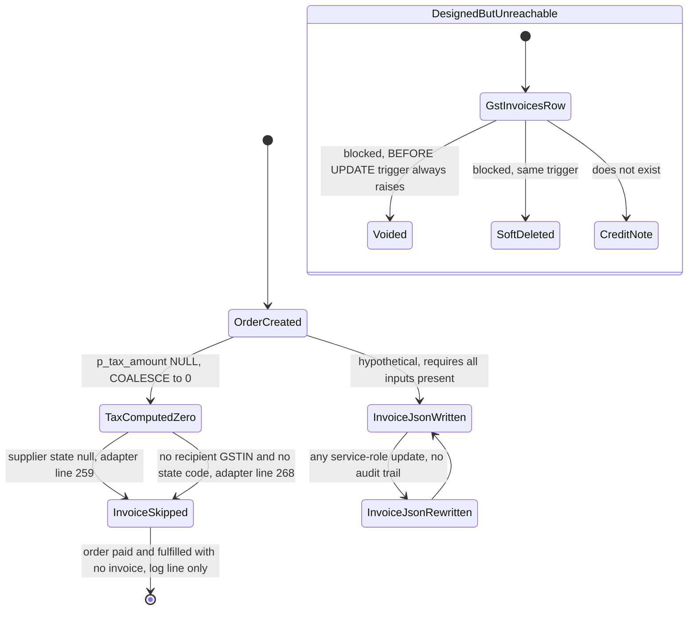

# 13 — GST: Sales / Output Tax and Invoices

**Run ID:** `2026-08-04T225330+0530-ee371182`
**Repository:** `/Users/saai_siddharth/Projects/Start_Up/Letbuyy_Store`
**Branch:** `stepup/main` · **Commit:** `ee371182` · **Run date:** 2026-08-04 (+0530)
**Scope:** India GST on the merchant's **sales** — merchant tax profile and GSTIN handling, place of supply, computation and rounding, inclusive/exclusive pricing, discounts, shipping tax, gift-card treatment, invoice creation, numbering, immutability, credit/debit notes, IRN/QR/e-invoice status, refund tax consequences, and reporting/exports. Input tax (purchases/ITC) is covered only where the sales model depends on it; the purchasing domain itself belongs to the purchasing/inventory document.
**Evidence basis:** the Phase-1 agent notes at `docs/merchant-system-discovery/2026-08-04T225330+0530-ee371182/_agent-notes/H-gst-invoices-reports.md`, read in full, plus direct re-verification of every load-bearing claim against source on this commit (migrations `144`, `170`, `168`, `000_baseline`; `packages/checkout-core/src/index.ts`; `services/api-gateway/src/execution/order-execution.adapter.ts`; `services/api-gateway/src/routes/storefront/checkout-payment-routes.ts`; `services/api-gateway/src/routes/tax.ts`; `services/api-gateway/src/routes/billing.ts`; `services/api-gateway/src/routes/stores.ts`; the storefront and merchant UIs).

**METHOD DISCLOSURE — nothing in this document was runtime-verified.** No server was started, no order was placed, no migration was applied, and no database was connected to. Every status here is a structural deduction from source code and schema. The ceiling for any capability in this document is `IMPLEMENTED_NOT_RUNTIME_VERIFIED`; nothing is `VERIFIED_E2E`. The `BROKEN` gradings are deterministic code-path deductions, not observed failures.

**This document is not legal or tax advice.** Every substantive statement is labelled `CODE_IMPLEMENTED` / `ACCOUNTING_POLICY_DEFINED` / `LEGALLY_VALIDATED` / `INFERRED-FROM-PRACTICE-NOT-REPO`. **`LEGALLY_VALIDATED` is NONE** — see §1.2. Section 15 ends with the explicit CA / tax-counsel review list.

**No secrets or PII appear in this document.** Environment variables are named only. One placeholder GSTIN literal that is already hard-coded in repository source is quoted as evidence of a defect; it is not a real registration and not user data.

---

## 1. Recommendation / verdict

### 1.1 The headline

**On the live storefront path, GST is structurally always ZERO and no GST invoice is ever created.** This is not a probability, a race, or a configuration risk. It is the deterministic result of three independent breaks, each of which alone forces the same outcome. `CODE_IMPLEMENTED` (this describes what the code does, not what tax law requires).

| # | Break | Consequence | Evidence |
|---|---|---|---|
| 1 | `tax_registrations` — the supplier-side source the checkout GST path reads — has **zero writers** anywhere in the repository. No UI, no gateway route, no RPC, no script inserts into it. It can only ever be empty. | `supplierStateCode` is always `null` | reader `services/api-gateway/src/routes/storefront/checkout-payment-routes.ts:300-307`; repo-wide the only `INSERT INTO public.tax_registrations` is in a test, `tests/executable/tax-postgres.test.mjs:109` |
| 2 | The storefront checkout **never sends a state code and never collects a customer GSTIN**. `grep` for `stateCode` / `state_code` across `apps/storefront-runtime/src` returns **zero** hits. | `recipientStateCode` is always `null` | payload builder `apps/storefront-runtime/src/app/store/[subdomain]/checkout/checkout-client.tsx:338-364` sends `{address, city, state, pincode}` only; the gateway reads `body.customer.address.stateCode` at `checkout-payment-routes.ts:324-326` |
| 3 | Post-commit invoice generation **returns `null` and silently skips** when the supplier state code is missing, or when both recipient GSTIN and recipient state code are missing. | no invoice row, no invoice JSON | `services/api-gateway/src/execution/order-execution.adapter.ts:259` (`if (!supplierStateCode) return null;`) and `:268` (`if (!recipientGstin && !recipientStateCode) return null;`) |

The chain through to the money RPC, verified line by line:

```
checkout-payment-routes.ts:334   if (supplierStateCode && recipientStateCode && defaultRateBps > 0) { ... }   // never true
checkout-payment-routes.ts:298   let computedTaxAmount: number | null = null;                                 // stays null
checkout-payment-routes.ts:392   tax_amount: computedTaxAmount                                                // NULL into the RPC
170_v1_shipping_rates_gst.sql:158  -- (b) GST: when the gateway has computed tax server-side, accept it; otherwise 0.
170_v1_shipping_rates_gst.sql:159  v_tax_amount := COALESCE(p_tax_amount, 0);                                 // 0
170_v1_shipping_rates_gst.sql:198  v_grand_total := GREATEST(subtotal + shipping + v_tax_amount - discount, 0);
170_v1_shipping_rates_gst.sql:293  UPDATE orders SET ... tax = v_tax_amount ...                                // orders.tax = 0
```

**Every storefront order books ₹0 GST and receives no GST invoice.** `CODE_IMPLEMENTED`.

### 1.2 The second headline

**The canonical immutable invoice table `gst_invoices` has ZERO writers in production code.** `CODE_IMPLEMENTED`.

- Its own migration header declares a writer: `-- Single writer: services/api-gateway/src/routes/tax.ts -> gst_invoices.` (`database/supabase/migrations/144_executable_tax_gst_invoices.sql:2`). `ACCOUNTING_POLICY_DEFINED` (this is a stated single-writer policy).
- `services/api-gateway/src/routes/tax.ts:143-149` — the named writer performs a `SELECT` and nothing else. There is no `insert`/`upsert` against `gst_invoices` anywhere in `services/`, `apps/`, or `packages/`.
- The only `INSERT INTO public.gst_invoices` in the repository is inside a test fixture (`tests/executable/tax-postgres.test.mjs:113`).
- Consequently the invoice-read endpoint can only ever return through its fallback branch: `services/api-gateway/src/routes/tax.ts:166-177` returns `orders.gst_invoice` labelled `source: 'orders.gst_invoice'` when no `gst_invoices` row exists. That fallback is not a degraded mode — it is the only reachable mode.

Every guarantee migration 144 provides — the reject-UPDATE/reject-DELETE triggers (`144:126-143`), the `tax_amount_minor = cgst + sgst + igst` CHECK (`144:110-111`), per-site invoice-number uniqueness (`144:118-120`), FORCE RLS (`144:166-173`) — applies to a table that never receives a row. The document a merchant would actually possess lives in `orders.gst_invoice jsonb`, written by a plain service-role `.update()` (`order-execution.adapter.ts:337-348`) with no trigger, no REVOKE, and no audit trail.

### 1.3 Verdict

**GST on sales is NOT shippable and must not be represented to any merchant, shopper, investor, or regulator as working.** The engine in `packages/checkout-core` is a competently written pure function; it is wired into a path that cannot fire, feeding tables that are not the canonical ones, producing documents nobody can see, with no credit note, no refund reversal, and no report. Four independent GST implementations exist in the repository, three of which hard-code 18%.

Three consequences follow immediately and do not require a CA to state:

1. **`LEGALLY_VALIDATED` is NONE.** There is no CA sign-off, no tax-counsel review artifact, no professional-review record anywhere in this repository for any part of the GST model. The only approval artifacts are self-graded internal audits, and two of them grade GST as PASS (`docs/final-v1-certification/MERCHANT_JOURNEY_AUDIT.md:13`).
2. **A live public legal page states the opposite of the code.** `apps/marketing-site/src/lib/legal/content/money.ts:64-65` asserts the platform "issues an invoice against each order" and that corrections are made "by a credit note against the original". Neither is true. This is a customer-facing claim and should be corrected before anything else in this document is scheduled.
3. **The pricing catalogue sells four GST features that do not work** — GST tax invoices, GST on shipping, tax-inclusive pricing, GST state code / place-of-supply handling — all marked available on the Launch plan (`database/supabase/migrations/183_v1_pricing_recompete.sql:143,174,179-183`).

**Recommended sequencing.** (a) Correct the public legal copy and the pricing feature matrix — days, no engineering risk. (b) Commission the CA / tax-counsel review in §15.3 — it blocks the specification of at least five remediations and cannot be compressed. (c) Do not build any GST report, export, or shopper-facing tax line until the invoice is real and immutable; a report built on today's `orders.tax` would be a fabricated compliance artifact.

---

## 2. Scope

**In scope:** output GST on merchant sales; the merchant tax profile; place-of-supply determination; the computation engine and its callers; invoice creation, numbering, immutability, and surfacing; credit/debit notes; IRN/QR/e-invoice; the tax consequences of refunds; GST reports, exports, period locking and reconciliation; the parallel GST implementations that affect a merchant's tax position (including LetBuyy's own subscription invoice, because that document is the merchant's input tax).

**Out of scope for this document (cross-referenced only):** the purchasing/supplier domain itself; order lifecycle and fulfilment mechanics; payment capture and ledger mechanics; shipping rate resolution beyond its tax interaction.

**Evidence ceiling:** `IMPLEMENTED_NOT_RUNTIME_VERIFIED`. See the method disclosure in the header.

**Corrections made to the source notes during re-verification** (stated explicitly, as required):

| Notes claim | Re-verified position on `ee371182` |
|---|---|
| `services/api-gateway/src/routes/stores.ts:725-727` holds the `sites` update allow-list | Content confirmed, **line numbers differ**: the allow-list is `stores.ts:762-771` — `tax_inclusive` at `:767`, `legal_name`/`gstin`/`gst_state_code`/`invoice_prefix` at `:768`, `invoice_number_next` at `:769` |
| `billing.ts:143-146` tax split and `:143-144` IRN | Content confirmed, **line numbers refined**: `cgst_minor: 0` at `:143`, `sgst_minor: 0` at `:144`, `igst_minor: input.taxMinor` at `:145`, `irn` at `:149`, `qr_payload` at `:150`, `.upsert(` at `:134` |

Three findings were **added** during re-verification and are not in the notes; each is flagged `[added at write-up]` where it appears: the `tax.ts` invoice fallback (§6.4), the `NOT NULL` constraint on `gst_invoices.irn`/`qr_payload` (§7.6), and the 4000-bps rate clamp in the engine (§5.1).

---

## 3. Current merchant user journeys — what a merchant can actually do today

`CODE_IMPLEMENTED` throughout this section.

| # | Journey | Reality today | Status |
|---|---|---|---|
| J1 | Enter my business GSTIN, legal name and state code | Works. `settings/business` writes `sites.gstin`, `sites.gst_state_code`, `sites.legal_name` through `PATCH /v1/stores/:id` (allow-list `stores.ts:768`). Client-side state-code derivation from the GSTIN prefix is validated against a 38-entry lookup (`apps/merchant-control-plane/src/lib/india/gst-states.ts:58-62`). | `IMPLEMENTED_NOT_RUNTIME_VERIFIED` |
| J2 | Set a GST rate for my store | Works, as a single store-wide default. `settings/taxes` CRUDs `tax_rates`. | `IMPLEMENTED_NOT_RUNTIME_VERIFIED` |
| J3 | Choose tax-inclusive pricing | The toggle saves (`settings/taxes/page.tsx:207` → `stores.ts:767`) and **nothing reads it**. Both computation callers hard-code `tax_inclusive: false`. | `BROKEN` |
| J4 | Set an HSN code on a product | **Not possible in the web merchant UI.** No HSN input exists on the product form. The mobile app has an HSN field on a *tax rate*, not on a product (`apps/mobile/merchant-app/lib/screens/settings/taxes_screen.dart:184`). | `NOT_IMPLEMENTED` |
| J5 | Have GST charged on an order | **Never happens.** §1.1. | `BROKEN` |
| J6 | Have a GST invoice created for an order | **Never happens.** §1.1. There is no manual "generate invoice" action anywhere. | `BROKEN` |
| J7 | View a GST invoice | Order detail shows one string (`gst_invoice_number`) and one aggregate number (`Tax (GST)`) — `apps/merchant-control-plane/src/app/[store]/orders/[orderId]/page.tsx:276-277`, `:531`. No CGST/SGST/IGST breakdown, no HSN, no place of supply, no document. | `NOT_IMPLEMENTED` |
| J8 | Print / download / email a GST invoice | No route, no PDF, no print view, no email attachment anywhere. | `NOT_IMPLEMENTED` |
| J9 | Run a GST report (GSTR-1, GSTR-3B, HSN summary, B2B/B2C split) | No route, no endpoint, no report. Repo-wide grep for GSTR/e-way returns zero product hits. | `NOT_IMPLEMENTED` |
| J10 | Export invoice or tax data | `services/api-gateway/src/routes/export.ts` exposes products, orders and customers only; grep for `gst`/`invoice`/`tax` over that file returns zero hits. | `NOT_IMPLEMENTED` |
| J11 | Close / lock a tax period | No period table, no `locked_at`, no filing-period concept. | `NOT_IMPLEMENTED` |
| J12 | Reconcile orders ↔ invoices ↔ ledger | No reconciliation RPC, view, job or report. | `NOT_IMPLEMENTED` |
| J13 | Issue a credit note for a refund | The concept does not exist in code. Two prose mentions only, one of them the public legal page. | `NOT_IMPLEMENTED` |
| J14 | Have a refund reverse the output GST | Never happens. `complete_order_refund` (`168_b1_b2_capture_refund_ledgering.sql:314`) contains **zero** occurrences of `gst`, `tax`, `invoice` or `credit_note` across the entire migration (verified by grep). | `NOT_IMPLEMENTED` |
| J15 | Get a GST invoice from LetBuyy for my subscription | A document is created, but always as IGST, with no GSTIN on it, a random number that is only unique per site, mutable via `.upsert()`, and carrying a fabricated IRN. | `BROKEN` |
| J16 | Register more than one GSTIN / place of business | Schema allows N rows per site (`144:28-30`); the product picks exactly one and the table has no writer. | `PARTIAL` |
| J17 | Operate as a composition dealer | Flag exists (`144:12-13`); no reader anywhere. A composition dealer would be issued a document labelled a tax invoice. | `PARTIAL` |

**Net: of seventeen GST journeys a GST-registered Indian merchant needs, one and a half work.** J1 and J2 work; everything downstream of them does not.

---

## 4. Feature matrix

Status strings are from the dossier taxonomy. "Label" is the required evidence class for the *claim*, not for its correctness.

| # | Capability | Status | Label | Evidence (path:line) | Gap |
|---|---|---|---|---|---|
| 1 | Merchant GSTIN column + 15-char format CHECK | `IMPLEMENTED_NOT_RUNTIME_VERIFIED` | CODE_IMPLEMENTED | `000_baseline.sql:12017`, `:12023` | — |
| 2 | Merchant GST state code + CHECK | `IMPLEMENTED_NOT_RUNTIME_VERIFIED` | CODE_IMPLEMENTED | `000_baseline.sql:12018`, `:12022` | — |
| 3 | Merchant GSTIN capture UI (web) | `IMPLEMENTED_NOT_RUNTIME_VERIFIED` | CODE_IMPLEMENTED | `apps/merchant-control-plane/src/app/[store]/settings/business/page.tsx:289-303`; allow-list `stores.ts:768` | — |
| 4 | Client-side state-code derivation + 38-state lookup | `IMPLEMENTED_NOT_RUNTIME_VERIFIED` | CODE_IMPLEMENTED | `apps/merchant-control-plane/src/lib/india/gst-states.ts:10-48`, `:58-62` | — |
| 5 | Server-side state-code extraction (no lookup validation) | `PARTIAL` | CODE_IMPLEMENTED | `packages/checkout-core/src/index.ts:722-725` | MCP-DISC-521 |
| 6 | `tax_registrations` supplier registry | `NOT_IMPLEMENTED` (zero writers) | CODE_IMPLEMENTED | `144:6-30`; reader `checkout-payment-routes.ts:300-307` | MCP-DISC-500 |
| 7 | Composition / unregistered registration type | `PARTIAL` (never read) | CODE_IMPLEMENTED | `144:12-13` | MCP-DISC-524 |
| 8 | Customer GSTIN capture at storefront checkout | `NOT_IMPLEMENTED` | CODE_IMPLEMENTED | column `000_baseline.sql:10163`; gateway accepts `checkout-payment-routes.ts` customer block; storefront never sends it (`checkout-client.tsx:343-353`) | MCP-DISC-500 |
| 9 | Recipient state code capture | `NOT_IMPLEMENTED` | CODE_IMPLEMENTED | grep `stateCode` over `apps/storefront-runtime/src` → **0 hits** (verified) | MCP-DISC-500 |
| 10 | Billing address capture | `NOT_IMPLEMENTED` | CODE_IMPLEMENTED | `orders.billing_address` exists `000_baseline.sql:10129`; storefront builds `shippingAddress` only | MCP-DISC-521 |
| 11 | B2B vs B2C distinction | `NOT_IMPLEMENTED` | CODE_IMPLEMENTED | no `is_b2b` anywhere; recipient GSTIN is optional metadata (`checkout-core:780-791`) | MCP-DISC-521 |
| 12 | Place-of-supply comparison (supplier state vs POS) | `IMPLEMENTED_NOT_RUNTIME_VERIFIED` | CODE_IMPLEMENTED | `packages/checkout-core/src/index.ts:836-838` | — |
| 13 | CGST/SGST vs IGST split | `IMPLEMENTED_NOT_RUNTIME_VERIFIED` | CODE_IMPLEMENTED | `checkout-core:806-808` | MCP-DISC-522 |
| 14 | Per-line integer-paise computation | `IMPLEMENTED_NOT_RUNTIME_VERIFIED` | CODE_IMPLEMENTED | `checkout-core:793-828` | — |
| 15 | Tax-inclusive support in the engine | `IMPLEMENTED_NOT_RUNTIME_VERIFIED` | CODE_IMPLEMENTED | `checkout-core:799-804` | — |
| 16 | Tax-inclusive honoured by callers | `BROKEN` | CODE_IMPLEMENTED | hard-coded `false` at `order-execution.adapter.ts:309` and `checkout-payment-routes.ts:358`; DB default is `true` (`000_baseline.sql:12001`) | MCP-DISC-507 |
| 17 | Discount in the taxable base | `BROKEN` | CODE_IMPLEMENTED | hard-coded `discount_amount_minor: 0` at `order-execution.adapter.ts:307` and `checkout-payment-routes.ts:356`; RPC applies the coupon after tax (`170:198`) | MCP-DISC-506 |
| 18 | Shipping tax | `NOT_IMPLEMENTED` | CODE_IMPLEMENTED | `.eq('is_shipping', false)` at `order-execution.adapter.ts:287` and `checkout-payment-routes.ts:314`; invoice lines built only from `order_items` (`:295-311`) | MCP-DISC-508 |
| 19 | Per-HSN rate resolution (`hsn_rates`) | `NOT_IMPLEMENTED` (dead table) | CODE_IMPLEMENTED | `144:32-52`; zero readers/writers | MCP-DISC-514 |
| 20 | Scope overrides (`tax_overrides`) | `NOT_IMPLEMENTED` (dead table) | CODE_IMPLEMENTED | `144:54-76`; zero readers | MCP-DISC-514 |
| 21 | HSN on a product (web UI) | `NOT_IMPLEMENTED` | CODE_IMPLEMENTED | column `000_baseline.sql:10626-10627`; no input in `apps/merchant-control-plane/src` | MCP-DISC-520 |
| 22 | Cess | `NOT_IMPLEMENTED` | CODE_IMPLEMENTED | no cess column on `gst_invoices` (`144:78-112`), no cess field in the engine | MCP-DISC-522 |
| 23 | Marketplace TCS (s.52) | `PARTIAL` (always 0) | CODE_IMPLEMENTED | columns `144:96-97`; engine `checkout-core:859-860`; sole caller passes `marketplace_tcs_bps: 0` (`order-execution.adapter.ts:333`) | MCP-DISC-521 |
| 24 | Reverse charge (RCM) | `NOT_IMPLEMENTED` | CODE_IMPLEMENTED | no column, no flag, no code | MCP-DISC-521 |
| 25 | Export / SEZ / zero-rated (state code `99`) | `NOT_IMPLEMENTED` | CODE_IMPLEMENTED | `IndianStateCodeSchema` `^(0[1-9]\|[12][0-9]\|3[0-8]\|97)$` — `packages/shared-types/src/index.ts:71-74`; `orders.place_of_supply_state` CHECK likewise `000_baseline.sql:10169` | MCP-DISC-521 |
| 26 | Immutable `gst_invoices` table + triggers + RLS FORCE | `IMPLEMENTED_NOT_RUNTIME_VERIFIED` (but unreachable) | CODE_IMPLEMENTED | `144:78-143`, `:166-173` | MCP-DISC-501 |
| 27 | A writer for `gst_invoices` | `NOT_IMPLEMENTED` | CODE_IMPLEMENTED | header claims `tax.ts` (`144:2`); `tax.ts:143-149` only SELECTs | MCP-DISC-501 |
| 28 | Invoice persisted to `orders.gst_invoice jsonb` (mutable) | `IMPLEMENTED_NOT_RUNTIME_VERIFIED` | CODE_IMPLEMENTED | `order-execution.adapter.ts:337-348` | MCP-DISC-501 |
| 29 | Invoice numbering — consecutive, FY-scoped | `PARTIAL` | CODE_IMPLEMENTED | `${invoice_prefix}-${order_number}` at `order-execution.adapter.ts:313,317`; `order_number` random (`166_d6_checkout_handoff_inventory.sql:68-69`); no FY in either unique index (`144:118-120`, `000_baseline.sql:17745`) | MCP-DISC-509 |
| 30 | `sites.invoice_number_next` counter | `NOT_IMPLEMENTED` (never read) | CODE_IMPLEMENTED | defined `122_mobile_business_profile.sql:9`; allowed through `stores.ts:769`; no reader | MCP-DISC-509 |
| 31 | Void / cancel an issued invoice | `BROKEN` | CODE_IMPLEMENTED | trigger fires on every UPDATE (`144:135-138`), so `status='voided'` (`144:102`) and `deleted_at` (`144:107`) are unreachable | MCP-DISC-510 |
| 32 | Credit note / debit note | `NOT_IMPLEMENTED` | CODE_IMPLEMENTED | repo-wide grep → two prose hits only (verified) | MCP-DISC-502 |
| 33 | Refund reverses output GST | `NOT_IMPLEMENTED` | CODE_IMPLEMENTED | `168_b1_b2_capture_refund_ledgering.sql` contains zero `gst`/`tax`/`invoice` (verified by grep); `refunds` has no tax columns (`000_baseline.sql:11134-11159`) | MCP-DISC-502 |
| 34 | IRN / QR from a real IRP | `STUB_OR_MOCK` | CODE_IMPLEMENTED | local FNV-1a hash → `SANDBOX-IRN-…`, `letbuyy://` QR — `checkout-core:755-772` | MCP-DISC-511 |
| 35 | Live-mode gate on the generating path | `NOT_IMPLEMENTED` | CODE_IMPLEMENTED | `assertSandboxIrpMode` exists only at `tax.ts:64-70`, called only at `:89`; `order-execution.adapter.ts` never checks it | MCP-DISC-511 |
| 36 | Shopper sees GST at checkout | `NOT_IMPLEMENTED` | CODE_IMPLEMENTED | storefront summary shows Subtotal / Delivery / Discount / Total only (`checkout-client.tsx:1053-1090`) | MCP-DISC-512 |
| 37 | Tax line in the order-confirmation email | `NOT_IMPLEMENTED` | CODE_IMPLEMENTED | grep `gst\|tax\|cgst` over `services/api-gateway/src/lib/order-confirmation-email.ts` → **0 hits** (verified) | MCP-DISC-512 |
| 38 | Merchant invoice view / PDF / print | `NOT_IMPLEMENTED` | CODE_IMPLEMENTED | no route under `apps/merchant-control-plane/src/app/[store]/` (directory listing verified: only `settings/taxes` is tax-related) | MCP-DISC-512 |
| 39 | GST report / GSTR-1 / GSTR-3B / HSN summary | `NOT_IMPLEMENTED` | CODE_IMPLEMENTED | repo-wide grep → zero product hits (verified) | MCP-DISC-513 |
| 40 | Invoice / tax export | `NOT_IMPLEMENTED` | CODE_IMPLEMENTED | `export.ts` has zero tax content (verified) | MCP-DISC-513 |
| 41 | Period locking | `NOT_IMPLEMENTED` | CODE_IMPLEMENTED | no period/lock table or column | MCP-DISC-513 |
| 42 | Reconciliation orders ↔ invoices ↔ ledger | `NOT_IMPLEMENTED` | CODE_IMPLEMENTED | none | MCP-DISC-513 |
| 43 | `/v1/tax/*` reachable from a product surface | `BACKEND_ONLY` | CODE_IMPLEMENTED | mounted `services/api-gateway/src/index.ts:803`; no app proxy; no api-client method (`packages/typescript/api-client` exposes `/shipping-tax/*` only) | MCP-DISC-525 |
| 44 | Gift-card issue taxed / invoiced | `NOT_IMPLEMENTED` | CODE_IMPLEMENTED | `services/api-gateway/src/routes/gift-cards.ts:88-93`; grep `gst\|tax` over `173_v1_gift_card_issuance_lifecycle.sql` → zero hits | MCP-DISC-502 / CA-05 |
| 45 | Gift-card redemption vs invoice value | `PARTIAL` (diverge by design) | CODE_IMPLEMENTED | `170:288` `v_payment_due := grand_total - gift_card_amount`; `170:295` `total = v_payment_due` | MCP-DISC-504 / CA-05 |
| 46 | Money representation: integer minor units on the tax path | `BROKEN` | CODE_IMPLEMENTED | `orders.tax numeric(12,2)`; `order_items.{taxable,cgst,sgst,igst}_amount numeric(10,2)` (`000_baseline.sql:10039-10042`, verified); `/100` float conversions at `order-execution.adapter.ts:344,358-362` | MCP-DISC-515 |
| 47 | LetBuyy's own subscription invoice | `BROKEN` | CODE_IMPLEMENTED | `services/api-gateway/src/routes/billing.ts:132-158`, `:273-274` | MCP-DISC-503 |
| 48 | Input GST / ITC from purchases | `NOT_IMPLEMENTED` | CODE_IMPLEMENTED | `suppliers` has no GSTIN (`000_baseline.sql:12460-12476`); `purchase_orders`/`purchase_order_lines` have no tax columns | MCP-DISC-519 |
| 49 | Professional (CA / tax counsel) sign-off | **NONE** | **LEGALLY_VALIDATED: NONE** | no such artifact anywhere in the repository | §15.3 |

---

## 5. UI / route inventory

### 5.1 Merchant control plane (`apps/merchant-control-plane`)

Directory listing under `apps/merchant-control-plane/src/app/[store]/` was enumerated directly. **There is exactly one tax-related route and no invoice route.**

| Route | Purpose | GST relevance | Status |
|---|---|---|---|
| `[store]/settings/taxes` | Tax-rate CRUD + the `tax_inclusive` toggle | rates that feed the store-wide default; the toggle is ignored downstream (`page.tsx:207`, `:485`) | `PARTIAL` |
| `[store]/settings/business` | Legal name, GSTIN, GST state code, business profile | the only supplier-profile write path in production | `IMPLEMENTED_NOT_RUNTIME_VERIFIED` |
| `[store]/settings/billing/profile` | A **second, different** GSTIN field, for LetBuyy's invoice to the merchant | cannot reach the billing invoice — the table has no GSTIN column | `UI_ONLY` |
| `[store]/access_account/checkout/checkout` | Subscription checkout; collects GSTIN + billing state; promises "GST invoice included" (`CheckoutClient.tsx:383`, `:512`) | the collected fields are **not** in the POST body (`:262-272`) | `UI_ONLY` |
| `[store]/orders/[orderId]` | Order detail | one `GST invoice number` row (`:276-277`), one `Tax (GST)` amount (`:531`), one `GSTIN` row when present (`:322-323`) | `PARTIAL` |
| `[store]/export` | Data export | no tax or invoice export | `NOT_IMPLEMENTED` |
| — | **GST invoice view / PDF / print** | **does not exist** | `NOT_IMPLEMENTED` |
| — | **GST report / GSTR / HSN summary** | **does not exist** | `NOT_IMPLEMENTED` |

### 5.2 Storefront runtime (`apps/storefront-runtime`)

| Surface | GST relevance | Status |
|---|---|---|
| `store/[subdomain]/checkout` address step | Free-text `State *` input (`checkout-client.tsx:793-801`), validated only as non-empty (`:320`). **No state-code selector, no GSTIN field.** | `BROKEN` for GST |
| `store/[subdomain]/checkout` order summary | Subtotal / Delivery / Discount / Total. **No tax line.** (`checkout-client.tsx:1053-1090`) | `NOT_IMPLEMENTED` |
| `api/orders` proxy | Forwards raw JSON to the gateway. No typed client. | `PARTIAL` |
| Success page / customer order page | No invoice, no tax figure | `NOT_IMPLEMENTED` |

**Latent UI defect worth flagging now.** The storefront total is computed client-side as `cartTotal + delivery − discount` with no tax term, while the RPC computes `subtotal + shipping + tax − discount` (`170:198`). Today the two agree only because tax is always 0. **The moment GST is wired, the shopper will be charged more than the displayed total with no explanatory line item.** `CODE_IMPLEMENTED`. This is a direct consequence of fixing MCP-DISC-500 and must be fixed in the same change.

### 5.3 Mobile merchant app (`apps/mobile/merchant-app`)

| Surface | GST relevance |
|---|---|
| `lib/screens/settings/taxes_screen.dart` | Tax-rate CRUD including an HSN field **on the rate** (`:126`, `:184`, `:281`) and the `tax_inclusive` toggle (`:78`) |
| `lib/screens/settings/store_details_screen.dart` | Store GST details |
| — | No invoice surface was found; the mobile document owner should confirm exhaustively. |

---

## 6. Backend / API / RPC / database mapping

### 6.1 The computation engine — `packages/checkout-core/src/index.ts`

`CODE_IMPLEMENTED`. A pure function, integer minor units throughout, no I/O.

| Symbol | Lines | Behaviour |
|---|---|---|
| `extractGstStateCode` | `722-725` | `gstin.slice(0,2)` — **no lookup validation** |
| `normalizeIndianStateCode` | `727-731` | pad to 2, validate against `IndianStateCodeSchema` |
| `requireIndianStateCode` | `733-741` | explicit state code, else GSTIN prefix, else **throw** |
| `defaultInvoiceNumber` | `749-753` | `LBY-${YYYYMMDD}-${orderNumber}` — a **second** numbering scheme |
| `stableTaxHash` | `755-762` | FNV-1a 32-bit |
| `buildSandboxIrpAcknowledgement` | `764-772` | `SANDBOX-IRN-<hash>`, `letbuyy://gst-invoice/<irn>`, `acknowledged_at` |
| `calculateGstLine` | `793-828` | see §5.1 below |
| `generateGstInvoice` | `830-879` | party build, POS, supply type, per-line map, totals reduce, TCS, IRP block |

### 6.2 The two computation sites — they disagree by construction

`CODE_IMPLEMENTED`.

| | **Site A — checkout time** | **Site B — post commit** |
|---|---|---|
| File | `services/api-gateway/src/routes/storefront/checkout-payment-routes.ts:295-369` | `services/api-gateway/src/execution/order-execution.adapter.ts:233-372` |
| Supplier source | `tax_registrations` (`:300-307`) — **zero writers** | `sites.gstin` / `sites.gst_state_code` (`:248-259`) |
| Recipient source | `body.customer.address.stateCode` only (`:324-326`) | `shipping_address.state_code` ‖ `.stateCode` ‖ `orders.place_of_supply_state` (`:263-267`) |
| Line price source | `products.price` — **`variantId` is ignored entirely** (`:338-348`) | `order_items.unit_price ?? price` (`:306`) |
| Rate | one store-wide default, `is_shipping=false`, `limit(1)` (`:309-318`) | same query shape (`:282-294`), then `taxRateBps(item.gst_rate) \|\| default` (`:308`) |
| Registration effective window | `.order('effective_from', desc).limit(1)` — **no `effective_from <= today`, no `effective_to` check** | n/a |
| Failure handling | `catch { computedTaxAmount = null }` with the comment *"GST computation is best-effort; fall through to 0 if it fails."* (`:366-369`) | throws on DB errors; `return null` on five business conditions |
| Writes | `tax_amount` into the RPC → `orders.tax`, `checkout_sessions.tax_total` | `orders.gst_invoice_number`, `orders.gst_invoice`, `orders.place_of_supply_state`, `orders.customer_gstin`, **`orders.tax`** (`:344`), and per-line `order_items` tax columns (`:352-369`) |

**Site B overwrites `orders.tax` and never recomputes `orders.total`.** `orders.total` was fixed at `170:295` as `v_payment_due`. If the two computations ever differ, the amount charged and the tax on the invoice diverge permanently. `CODE_IMPLEMENTED`.

### 6.3 The money RPC does not derive or validate tax

```sql
170_v1_shipping_rates_gst.sql:47   p_tax_amount NUMERIC(12,2) DEFAULT NULL
170_v1_shipping_rates_gst.sql:158  -- (b) GST: when the gateway has computed tax server-side, accept it; otherwise 0.
170_v1_shipping_rates_gst.sql:159  v_tax_amount := COALESCE(p_tax_amount, 0);
170_v1_shipping_rates_gst.sql:198  v_grand_total := GREATEST(COALESCE(v_order.subtotal,0) + v_shipping_amount + v_tax_amount - v_discount_amount, 0);
```

`CODE_IMPLEMENTED`. The `SECURITY DEFINER` money RPC performs **no validation** of the tax it is handed. The value is server-authoritative in the sense that it comes from the gateway rather than the browser, but it is **not DB-authoritative**: the RPC prices the order lines and the gateway prices the tax base separately, from different sources.

### 6.4 Tables

| Table | Role | Reality |
|---|---|---|
| `gst_invoices` (`144:78-112`) | canonical immutable invoice, `bigint` minor units, split CHECK, FORCE RLS | **zero writers** |
| `tax_registrations` (`144:6-30`) | supplier registry | **zero writers**; read at `checkout-payment-routes.ts:301` |
| `hsn_rates` (`144:32-52`) | per-HSN rate resolution | **zero readers, zero writers** |
| `tax_overrides` (`144:54-76`) | scope overrides incl. `tax_inclusive` | **zero readers** |
| `tax_rates` (`000_baseline.sql:12487` for `rate numeric(5,4)`) | the rate actually used | read by both sites; `ENABLE` RLS but **not `FORCE`** (`000_baseline.sql:27521`) |
| `orders.gst_invoice jsonb`, `orders.gst_invoice_number` | **the document actually issued** | fully mutable, plain `.update()` |
| `order_items.{hsn_code, gst_rate, taxable_amount, cgst_amount, sgst_amount, igst_amount}` (`000_baseline.sql:10037-10042`, verified) | per-line detail | mutable `numeric` rupees |
| `checkout_sessions.tax_total` | session snapshot | mutable |
| `refunds` (`000_baseline.sql:11134-11159`) | refunds | **no tax columns at all** |
| `merchant_billing_invoices` (`152_executable_billing_autopay.sql:124-158`) | LetBuyy → merchant | `bigint` minor units, **no GSTIN columns**, mutable via upsert |

`orders` and `order_items` are **not** in the money-table list of `scripts/validators/canonical-ledger-only-validator.mjs:12-26`, so a direct TypeScript `.update()` of tax amounts is not caught by any governance gate. `CODE_IMPLEMENTED`.

### 6.5 Gateway routes

| Route | Auth | Behaviour | Reachable? |
|---|---|---|---|
| `POST /v1/tax/calculate` (`tax.ts:87-117`) | merchant session + `verifySiteOwnership` (`:106`) | `assertSandboxIrpMode` (`:89`), then `generateGstInvoice(body)` on **entirely client-supplied JSON** (`:110`); returns `irp_mode: 'sandbox'` honestly (`:113`) | **No app proxy, no api-client method** |
| `GET /v1/tax/invoice/:orderId` (`tax.ts:119-180`) | unscoped order read (`:125-129`) then `verifySiteOwnership` (`:139`) — no leak, but the read precedes the check | selects `gst_invoices` (`:143-149`); **falls back to `orders.gst_invoice` labelled `source: 'orders.gst_invoice'`** at `:166-177` | **No app proxy, no api-client method** |

`[added at write-up]` The fallback at `tax.ts:166-177` was not called out in the notes. Because `gst_invoices` never receives a row, that fallback is the **only** branch this endpoint can ever return through. The endpoint therefore serves a mutable jsonb blob while presenting itself as the GST invoice API.

---

## 7. GST model, mechanism by mechanism

### 7.1 Merchant tax profile and GSTIN validation

`CODE_IMPLEMENTED`.

| Item | Where | Note |
|---|---|---|
| GSTIN | `sites.gstin text` (`000_baseline.sql:12017`) | CHECK `^[0-9]{2}[A-Z]{5}[0-9]{4}[A-Z][1-9A-Z]Z[0-9A-Z]$` (`:12023`) — **format only**, no checksum, no GSTN verification call |
| State code | `sites.gst_state_code` (`:12018`) | CHECK `^(0[1-9]\|[12][0-9]\|3[0-8]\|97)$` (`:12022`) |
| Legal name | `sites.legal_name` (`:12016`) | |
| Invoice prefix | `sites.invoice_prefix text DEFAULT 'LBY'` (`:12019`) | |
| Invoice counter | `sites.invoice_number_next` (`122_mobile_business_profile.sql:9`) | **read by nothing** |
| Trade name / entity type / PAN last-4 | `sites.business_profile jsonb` | free-form, unvalidated. Full PAN is not stored. |
| Registered / invoice address | `sites.invoice_address jsonb` (`122:7`) | **never used by the invoice generator** |

**Two competing GSTIN capture surfaces** (`CONTRADICTORY_EVIDENCE`): `settings/business` writes the merchant's own **sales** GSTIN to `sites.gstin`; `settings/billing/profile` writes a different `profile.gstin` intended for LetBuyy's invoice **to** the merchant. The second cannot land anywhere useful — `merchant_billing_invoices` has no GSTIN column (§7.11).

**State-code validation is inconsistent.** The merchant UI's `GST_STATES` list correctly omits the merged codes 25 and 28 (`apps/merchant-control-plane/src/lib/india/gst-states.ts:10-48`), but `IndianStateCodeSchema` accepts them (`packages/shared-types/src/index.ts:71-74`). **Code `99` (Other Country / export) is accepted by neither**, so exports and SEZ supplies have no representable place of supply.

### 7.2 Place of supply and intra vs inter-state determination

`CODE_IMPLEMENTED`. The deciding comparison, at `packages/checkout-core/src/index.ts:836-838`:

```ts
const placeOfSupplyStateCode = normalizeIndianStateCode(input.place_of_supply_state_code)
  || recipient.state_code;
const supplyType = supplier.state_code === placeOfSupplyStateCode ? 'intra_state' : 'inter_state';
```

Structurally this is the right comparison — supplier state vs place of supply, not supplier vs recipient. `supplier.state_code` is built by `buildGstInvoiceParty` (`:780-791`), which prefers an explicit state code and falls back to the GSTIN prefix (`:738`).

The caller (`order-execution.adapter.ts:332`) passes `place_of_supply_state_code: recipientStateCode`, i.e. **ship-to** — the right input for a supply of goods. `INFERRED-FROM-PRACTICE-NOT-REPO` that ship-to is correct for goods; a CA must confirm (CA-04).

**The fallback ordering is a live hazard for B2B.** If `place_of_supply_state_code` is absent, POS falls back to `recipient.state_code`, which itself falls back to the recipient **GSTIN prefix** (`:738`). For a B2B order shipped to a state other than the buyer's registration state, POS silently becomes the buyer's registration state rather than the ship-to state. `INFERRED-FROM-PRACTICE-NOT-REPO` — CA-04.

**Not handled at all** (`NOT_IMPLEMENTED`, all): export / zero-rated / SEZ (state code `99` unrepresentable); bill-to/ship-to three-party supplies; services vs goods (one rule for both, no SAC-specific POS); reverse charge; unregistered recipient with no address; deemed exports; OIDAR and e-commerce-operator special provisions. State code `97` (Other Territory) is accepted with no special handling.

### 7.3 Computation and rounding

`CODE_IMPLEMENTED`. `packages/checkout-core/src/index.ts:793-828`, all integer minor units inside the function:

```
794  quantity        = max(1, trunc(quantity))
797  lineAmountMinor = max(0, unitAmountMinor*quantity - discountAmountMinor)
798  gstRateBps      = clamp(trunc(gst_rate_bps), 0, 4000)          // [added at write-up] 40% ceiling
799  taxable         = tax_inclusive ? round(line*10000/(10000+bps)) : line
802  tax             = tax_inclusive ? line - taxable : round(taxable*bps/10000)
805  total           = taxable + tax
806  cgst = intra ? floor(tax/2) : 0
807  sgst = intra ? tax - cgst   : 0
808  igst = inter ? tax : 0
```

- Rounding is `Math.round` (half-up for positives), **per line**. There is **no invoice-level rounding and no round-off line item**; totals are a plain reduce over lines (`:840-858`).
- `cgst = floor(tax/2)` and `sgst = tax - cgst` means that for an odd-paise tax, **SGST exceeds CGST by 1 paise**. `INFERRED-FROM-PRACTICE-NOT-REPO` that CGST and SGST are normally equal — CA-03.
- `[added at write-up]` the 4000-bps clamp at `:798` caps any rate at 40%. The 28% slab (2800 bps) fits; a slab-plus-cess figure would not, which is one more reason cess needs its own field rather than a rate inflation.

### 7.4 Inclusive vs exclusive pricing — the store setting is ignored

`BROKEN`. `CODE_IMPLEMENTED`.

`sites.tax_inclusive boolean DEFAULT true` (`000_baseline.sql:12001`) is settable from the web merchant app (`settings/taxes/page.tsx:207`, `:485`) and the mobile app (`taxes_screen.dart:78`), and the gateway persists it (`stores.ts:767`). **No GST computation path reads it.** Both callers hard-code `tax_inclusive: false` (`order-execution.adapter.ts:309`, `checkout-payment-routes.ts:358`), while the engine fully supports the inclusive branch (`checkout-core:799-804`).

The DB default is `true`, so **an untouched store is configured tax-inclusive while the engine computes tax-exclusive**. That is the worst possible default pairing: once GST is wired, the default store over-charges the shopper by adding tax on top of a price that was declared to already include it.

### 7.5 Discounts

`BROKEN`. `CODE_IMPLEMENTED`.

Both callers hard-code `discount_amount_minor: 0` (`order-execution.adapter.ts:307`, `checkout-payment-routes.ts:356`), and the RPC applies the coupon **after** tax: `v_grand_total := subtotal + shipping + tax - discount` (`170:198`). So the tax base is the **undiscounted** subtotal and the invoice shows no discount at all.

Two separate problems, only one of which needs a CA:

1. `INFERRED-FROM-PRACTICE-NOT-REPO` — a discount known at the time of supply and shown on the invoice ordinarily reduces the taxable value, so this would overstate output GST. **CA-02.**
2. **Independent of tax law**, a pure arithmetic inconsistency: `invoice.total_amount_minor` cannot equal `orders.total` on any discounted order. That needs no professional opinion to be wrong.

### 7.6 Shipping tax

`NOT_IMPLEMENTED`. `CODE_IMPLEMENTED`.

Both rate lookups filter `.eq('is_shipping', false)` (`order-execution.adapter.ts:287`, `checkout-payment-routes.ts:314`). Invoice lines are built **solely** from `order_items` (`order-execution.adapter.ts:295-311`); no shipping line is ever added. `order_shipping_lines` rows are created by the RPC (`170:344-359`) with no tax columns.

`ACCOUNTING_POLICY_DEFINED` — the pricing catalogue nevertheless sells **"GST on shipping — Apply GST to shipping charges"** as a Launch-plan feature (`183_v1_pricing_recompete.sql:174`). The stated policy and the code contradict each other.

Because the invoice omits shipping entirely, **invoice total ≠ order total on every order that has shipping**, independent of the discount issue.

### 7.7 Gift cards

`CODE_IMPLEMENTED`.

| Event | Behaviour |
|---|---|
| Merchant issues a gift card | Via the `issue_gift_card` RPC (`services/api-gateway/src/routes/gift-cards.ts:88-93`). **No tax computed, no invoice, no voucher-supply handling** — grep for `gst`/`tax` over `173_v1_gift_card_issuance_lifecycle.sql` returns zero hits. |
| Customer redeems a gift card | Applied **after** the grand total: `v_payment_due := GREATEST(v_grand_total - v_gift_card_amount, 0)` (`170:288`), then `orders.total = v_payment_due` (`170:295`). |

**Consequence:** the invoice value (`grand_total`, covering the full supply) and `orders.total` (net of the voucher) **diverge by design**. Treating a voucher as a tender rather than a discount is `INFERRED-FROM-PRACTICE-NOT-REPO` plausible, but the code never records the distinction on the invoice, so the divergence is indistinguishable from an arithmetic error to anyone reading the data. **CA-05.**

COD and prepaid share the identical tax path; `170` has no COD branch in the tax block. `CODE_IMPLEMENTED`.

### 7.8 Invoice numbering and uniqueness

`PARTIAL`. `CODE_IMPLEMENTED`.

Two competing schemes:

| Scheme | Value | Where |
|---|---|---|
| Adapter (the live path) | `${sites.invoice_prefix ?? 'LBY'}-${orders.order_number}` | `order-execution.adapter.ts:313`, `:317` |
| `checkout-core` default (used by `/tax/calculate` and the unit test) | `LBY-${YYYYMMDD}-${orderNumber}` | `checkout-core:749-753` |

`orders.order_number` is **random**, not sequential: `LB-YYYYMMDD-<8 hex of a uuid>` (`166_d6_checkout_handoff_inventory.sql:68-69`), with a legacy trigger producing `ORD-YYYYMMDD-<4 random digits>` (`000_baseline.sql:4228-4234`).

**Per-financial-year uniqueness is enforced nowhere.**

| Index | Definition | FY component? |
|---|---|---|
| `gst_invoices_site_number_idx` (`144:118-120`) | `UNIQUE (site_id, invoice_number) WHERE deleted_at IS NULL` | **No** |
| `idx_orders_store_gst_invoice_number` (`000_baseline.sql:17745`) | `UNIQUE (store_id, gst_invoice_number) WHERE gst_invoice_number IS NOT NULL` | **No** |

Cross-site collision is prevented (both are site-scoped). There is no financial-year column, no FY reset, and no consecutive series. `INFERRED-FROM-PRACTICE-NOT-REPO` — the consecutive-serial-per-financial-year requirement is a CA determination (CA-06).

### 7.9 Immutability enforcement

`CODE_IMPLEMENTED`, and genuinely enforced — on a table nothing writes.

```sql
144:126-133  CREATE FUNCTION public.reject_gst_invoice_mutation() ... RAISE EXCEPTION 'gst_invoices are immutable; create a void/reversal record instead';
144:135-138  CREATE TRIGGER gst_invoices_reject_update BEFORE UPDATE ON public.gst_invoices FOR EACH ROW ...
144:140-143  CREATE TRIGGER gst_invoices_reject_delete BEFORE DELETE ON public.gst_invoices FOR EACH ROW ...
```

Proven against real Postgres at `tests/executable/tax-postgres.test.mjs:160-173`.

**But the invoice the merchant actually has lives in `orders.gst_invoice jsonb`**, which has no trigger, no REVOKE, and no immutability of any kind, and is written by a plain service-role `.update()` (`order-execution.adapter.ts:337-348`). Anything holding the service-role key can rewrite an issued invoice with no trace.

**Side effect of an unconditional BEFORE UPDATE trigger:** `status = 'voided'` (allowed by `144:102`) and the `deleted_at` soft-delete column (`144:107`) are both **unreachable**, because setting either requires an UPDATE, which always raises. Therefore there is no cancellation path, and the two partial unique indexes `WHERE deleted_at IS NULL` (`144:114-120`) are vacuous. The exception message itself instructs the caller to "create a void/reversal record instead" — **no such record type exists anywhere in the schema**. The test suite asserts this state as correct (`tax-postgres.test.mjs:172`).

### 7.10 Credit notes and debit notes

`NOT_IMPLEMENTED` `[HIGH-STAKES]`. `CODE_IMPLEMENTED` (as an absence, verified by exhaustive grep).

A repo-wide grep for `credit_note|creditNote|credit note|debit_note|debit note` across `services`, `apps`, `packages`, `database`, `tests`, `scripts`, `docs` (excluding `node_modules`, `graphify-out`, `.wrangler`, `.next`, archives) returns **two** non-dossier hits, **both prose**:

- `apps/marketing-site/src/lib/legal/content/money.ts:65` — a **live public legal page**: *"A correction is made by a credit note against the original, never by editing it — this is both a legal requirement and how the ledger is built."* `ACCOUNTING_POLICY_DEFINED`, and false.
- `docs/lcis-master/_evidence/panel-commerce.md:48` — an analyst note.

There is no credit-note table, column, route, type, or code path. `gst_invoices.taxable_amount_minor >= 0` and its sibling CHECKs (`144:90-95`) also forbid a negative document, so a credit note could not be represented in the existing table without a schema change.

### 7.11 Refund tax consequences

`NOT_IMPLEMENTED` `[HIGH-STAKES]`. `CODE_IMPLEMENTED`.

- `complete_order_refund` lives at `168_b1_b2_capture_refund_ledgering.sql:314`. A grep for `gst|tax|invoice|credit_note` over the **entire migration** returns zero hits (re-verified).
- `refunds` has `amount numeric(12,2)` and **no tax columns at all** (`000_baseline.sql:11134-11159`).
- `order_items.returned_quantity` and `refunded_quantity` exist (`000_baseline.sql:10034-10035`) but no reversal of `cgst_amount` / `sgst_amount` / `igst_amount` / `taxable_amount` happens anywhere.
- `orders.gst_invoice` is never touched by a refund.

**Result:** after a full or partial refund, the recorded output GST for the order remains at 100% of the original, with no reversing document. This is deterministic. Today it is masked because the recorded output GST is always ₹0 — which means **fixing GST without simultaneously building credit notes converts a zero-tax bug into an overstated-output-tax bug.** That sequencing constraint is the single most important operational point in this document.

### 7.12 IRN / QR / e-invoice status

`STUB_OR_MOCK` `[HIGH-STAKES]`. `CODE_IMPLEMENTED`.

`packages/checkout-core/src/index.ts:764-772` builds an "acknowledgement" from a local 32-bit FNV-1a hash of `invoiceNumber:orderId:invoiceDate`:

```ts
const irn = `SANDBOX-IRN-${stableTaxHash(...).toUpperCase()}`;
return { mode: 'sandbox', irn, qr_payload: `letbuyy://gst-invoice/${encodeURIComponent(irn)}`, acknowledged_at: invoiceDate };
```

**There is no network call to any IRP anywhere in the repository.** The `qr_payload` is a `letbuyy://` custom-scheme string, not a GST QR payload.

Three ways the mock can read as success:

1. **The live-mode gate does not cover the generating path.** `assertSandboxIrpMode(c.env)` exists at `tax.ts:64-70` and is called only at `tax.ts:89` — inside `POST /tax/calculate`, an endpoint no product surface reaches. `generateAndPersistGstInvoice` never checks it. Setting `LETBUYY_GST_IRP_MODE=live` would block the unused endpoint while the persisting path kept minting fake IRNs.
2. **The env var is undeclared.** `LETBUYY_GST_IRP_MODE` appears in the `Env` type (`services/api-gateway/src/index.ts:116`) but in no wrangler config and not in `config/env/schemas/worker.schema.json`. It is always `undefined`, therefore always `'sandbox'`.
3. **The mode is not visible where the record lives.** `gst_invoices.irp_mode` defaults honestly to `'sandbox'` (`144:98`) — but `orders.gst_invoice`, the record actually used, has no mode column; the mode sits inside the jsonb under `irp.mode`, and no merchant surface renders it.

The one honest element is the `SANDBOX-IRN-` label, and a validator enforces **only the label**:

```
scripts/validators/provider-mode-badge-validator.mjs:100  assert(checkoutCore.includes("SANDBOX-IRN-"), ...)
scripts/validators/provider-mode-badge-validator.mjs:101  assert(!checkoutCore.includes("MOCK-IRN-"), ...)
scripts/validators/provider-mode-badge-validator.mjs:104  assert(taxRoute.includes("irp_mode: 'sandbox'"), ...)
scripts/validators/provider-mode-badge-validator.mjs:105  assert(!taxRoute.includes("irp_mode: 'mock'"), ...)
```

This is a **string-substitution ratchet**: it forbids the word "mock" and mandates the word "sandbox" in two files. It does not check that any IRP is called, does not cover `order-execution.adapter.ts`, and does not cover `billing.ts` — which persists `irn: 'sandbox-irn-…'` and `qr_payload: 'sandbox-qr:…'` unconditionally in **every** environment (`billing.ts:149-150`).

`[added at write-up]` `gst_invoices.irn text NOT NULL` and `qr_payload text NOT NULL` (`144:99-100`). The correct remediation — stop populating IRN/QR until a real IRP exists — therefore requires a schema change to make both columns nullable. That is a migration, not a code edit, and belongs in the same change as the invoice writer.

### 7.13 Parallel GST implementations

**Four independent GST implementations exist.** The Constitution forbids parallel second systems for a domain with a canonical winner (`AGENTS.md:146`, WIN-R4). `CODE_IMPLEMENTED`.

| # | Implementation | Rate | Place of supply | Money representation |
|---|---|---|---|---|
| 1 | `packages/checkout-core/src/index.ts:793-879` — merchant sales | from `tax_rates`, clamped ≤ 4000 bps | computed | integer paise |
| 2 | `services/api-gateway/src/routes/billing.ts` — LetBuyy → merchant | **hard-coded `* 0.18`** (`:274`) | **none — always IGST** (`:143-145`) | `bigint` minor |
| 3 | `services/api-gateway/src/lib/theme-marketplace-auxiliary-routes.ts` — theme marketplace (FROZEN app, still wired to the gateway) | **hard-coded `= 18`** (`:55`) | none; inclusive back-calc `amount * 18 / 118` in **floating-point rupees** (`:93`) | `numeric` rupees in `theme_purchase_receipts` (`091_theme_marketplace_stepup.sql:129-132`) |
| 4 | `services/queue-workers/src/platform-queue-consumer.ts:1330-1333` — partner payouts | **`clampBps(payload.partner_gst_bps, 1800)`** | none | minor units |

Implementation 3 also carries a **placeholder GSTIN literal in source** — `const THEME_MARKETPLACE_DEV_GSTIN = '27ABCDE1234F1Z5';` (`:56`) — used whenever the runtime is not production-like (`:83`). Production is fail-closed on the real GSTIN (`:80-87`, `THEME_MARKETPLACE_GSTIN_REQUIRED`), tracked as `SKIP-THEME-MARKETPLACE-LIVE-GSTIN` in `SKIPPED_HUMAN_DECISIONS.md:58`. **This part is honest** and is the only place in the four where a production gate exists.

Implementation 2 deserves separate emphasis because it is **the merchant's input tax** — the document a merchant would use to claim ITC on LetBuyy's own fees. It is always IGST, has no GSTIN columns on the table at all (`152_executable_billing_autopay.sql:124-158`), uses `MBI-${crypto.randomUUID().slice(0,8).toUpperCase()}` (`billing.ts:273`) with only `UNIQUE (site_id, invoice_number)` (`152:157`) — so **two different merchants can receive LetBuyy invoices bearing the same number** — is written with `.upsert()` (`billing.ts:134`) and so is mutable, and carries a fabricated IRN. Meanwhile the merchant subscription checkout collects a GSTIN and billing state (`CheckoutClient.tsx:125`, `:131`, `:542-545`) and promises "GST invoice included" (`:383`) — and the POST body contains only `{store_id, plan_slug, billing_period, site_type, coupon_code}` (`:262-272`).

### 7.14 Reports, exports, period locking, reconciliation

All `NOT_IMPLEMENTED`. `CODE_IMPLEMENTED` (verified as absences).

| Capability | Evidence |
|---|---|
| GST report in the merchant UI | route enumeration of `apps/merchant-control-plane/src/app/[store]/` — the only tax route is `settings/taxes` |
| Invoice list / view / PDF / print | none |
| CSV/JSON export of invoices or tax | `services/api-gateway/src/routes/export.ts` — grep `gst\|invoice\|tax` → **0 hits** (verified) |
| GSTR-1 / GSTR-3B / HSN summary / B2B-B2C split | repo-wide grep → zero product hits (verified) |
| e-way bill | repo-wide grep → zero hits (verified) |
| Tax figures in analytics | grep over `analytics.ts` + `commerce-analytics.ts` → zero hits |
| Period locking | no period/lock table, no `locked_at`, no filing-period concept |
| Reconciliation orders ↔ invoices ↔ ledger | no RPC, view, job or report |
| Customer-facing invoice or tax line | none at checkout, on the success page, on the customer order page, or in the confirmation email (`order-confirmation-email.ts` grep → **0 hits**, verified) |

---

## 8. State machine

The GST invoice lifecycle as **designed** versus as **built**. `CODE_IMPLEMENTED`.



Reading of the diagram:

- **The only reachable terminal state today is `InvoiceSkipped`.** Both guards fail on every storefront order.
- `InvoiceJsonWritten` is reachable only if a supplier state code and a recipient state code or GSTIN are all present — which the storefront cannot produce.
- Everything inside `DesignedButUnreachable` is schema and trigger work that no row can ever enter.
- There is no transition out of an issued invoice at all: no void, no amendment, no supersede pointer, no `original_invoice_id`, no credit note. Amendment handling is `NOT_IMPLEMENTED` in full.

---

## 9. Auth / tenant / invariant analysis

`CODE_IMPLEMENTED`.

| Control | Finding |
|---|---|
| Storefront checkout auth | Public, store resolved by host. No merchant issuer involved. Correct for the flow; means the supplier profile must come from the DB, which is exactly the break in §1.1. |
| `/v1/tax/calculate` | Merchant session, `resolveCustomUser` + `verifySiteOwnership` (`tax.ts:98-108`). Correct. |
| `/v1/tax/invoice/:orderId` | The order row is selected **without** a store filter (`tax.ts:125-129`), then ownership is verified before any data is returned (`:139-141`). No leak, but the read-then-check ordering is the inverse of the safer pattern used elsewhere. |
| Tenant scoping of `gst_invoices` | `ENABLE` + `FORCE` RLS (`144:166-173`), site-scoped policies, proven by a real-Postgres GUC test (`tests/executable/tax-postgres.test.mjs:160-173`). Correct — on a table with no rows. |
| Tenant scoping of `tax_rates` | `ENABLE ROW LEVEL SECURITY` **without `FORCE`** (`000_baseline.sql:27521`); policies `service_all_tax_rates ... TO service_role USING (true) WITH CHECK (true)` (`:26589`) and `store_owners_manage_tax` (`:27285`); registered as a tenant table with `tenantColumn: store_id` (`services/api-gateway/src/tenant/tenant-tables.registry.ts:2707-2717`). The migration-144 GST tables **do** have ENABLE + FORCE, so this is an inconsistency rather than a house pattern. `[HIGH-STAKES]` |
| Canonical-ledger-only invariant | The tax path **writes money-adjacent values from TypeScript**: `orders.tax` via `.update()` (`order-execution.adapter.ts:344`) and six `order_items` tax columns (`:352-369`). `orders` and `order_items` are absent from `scripts/validators/canonical-ledger-only-validator.mjs:12-26`, so no gate catches it. `[HIGH-STAKES]` |
| PAY-R5 / R-8 (bigint minor units on every money path) | Violated on the whole tax path. `AGENTS.md:249` states the rule. `orders.tax numeric(12,2)`; `order_items.{taxable,cgst,sgst,igst}_amount numeric(10,2)` (`000_baseline.sql:10039-10042`, verified); RPC parameters `NUMERIC(12,2)` (`170:47`); conversions `invoice.tax_amount_minor / 100` (`order-execution.adapter.ts:344`) and `line.*_amount_minor / 100` (`:358-362`); `tax_rates.rate numeric(5,4)`; a fifth representation in `theme_purchase_receipts`. Only `gst_invoices` (dead) and `merchant_billing_invoices` use `bigint` minor units. `[HIGH-STAKES]` |
| Server-authoritative amounts | Partially held: the tax value comes from the gateway, not the browser. **Not** DB-authoritative: the RPC accepts `p_tax_amount` with no validation (`170:158-159`) and the gateway computes it from `products.price` while ignoring `variantId` (`checkout-payment-routes.ts:338-348`). `[HIGH-STAKES]` |
| ANTI-R9 (no fabricated provider artifacts) | Exposed: synthetic IRN/QR values are persisted (§7.12). `[HIGH-STAKES]` |
| WIN-R4 / ANTI-R1 (single winner per domain) | Violated: four parallel GST implementations (§7.13). |

---

## 10. Runtime and test evidence

**Nothing in this document was runtime-verified.** No server, no order, no migration, no DB connection. That is the honest ceiling and it applies without exception.

### 10.1 What the tests actually assert

| File | What it is | Real coverage |
|---|---|---|
| `tests/gst/gst-invoice.test.mjs` (181 lines) | The **only behavioural GST test.** Two cases: same state → CGST/SGST; different state → IGST. One line, ₹1000, 18%, exclusive, no discount. | intra vs inter split; the default invoice number `LBY-20260601-LBY-1001` (`:152`) |
| `services/api-gateway/src/__tests__/tax.test.ts` (49 lines) | **Source-text regex assertions only**, e.g. `assert.doesNotMatch(checkoutCoreSource, /MOCK-IRN-/)` (`:34`); migration-text assertions at `:39-47` | nothing behavioural |
| `tests/executable/tax-postgres.test.mjs` (178 lines) | Real Postgres. Applies migration 144, inserts one `gst_invoices` row **by hand** (`:113`), asserts RLS isolation by site GUC and that UPDATE/DELETE raise `immutable` (`:160-173`), then rolls back | tenant isolation and immutability of a table nothing writes |
| `tests/launch/lb7-shipping-gst.test.mjs` (28 tests) | **All source-text greps** — "migration declares `p_tax_amount`", "route imports `calculateGstLine`" | nothing behavioural |
| `scripts/validators/provider-mode-badge-validator.mjs:100-105`, `:285` | String-substitution ratchet on the words "sandbox" / "mock" | label only; no provider is exercised |

### 10.2 What no test covers

State-code combinations beyond two; rounding edges; the odd-paise CGST/SGST split; tax-inclusive pricing; discounts; shipping tax; partial or full refunds; credit notes; invoice-number uniqueness or FY rollover; concurrency; the end-to-end order → invoice path; the five `return null` early-exit branches in `generateAndPersistGstInvoice`; the `merchant_billing_invoices` tax split; any GST report.

**None of MCP-DISC-500, 502, 504, 506, 507, 508, 511, 514 would be caught by the current suite, and two of them are actively encoded as correct by it** — `tax-postgres.test.mjs:172` asserts that voiding an invoice must fail, and `tax.test.ts:34` asserts that the fake-IRN label is spelled the approved way.

### 10.3 Reliability of the one path that could produce an invoice

`PARTIAL`. Invoice generation is **fire-and-forget**:

```ts
checkout-payment-routes.ts:394-409
  const deferPostCommit = isCheckoutPostCommitDeferralEnabled(c.env);
  const order = await service.createOrder(orderCommand, tenant, { deferPostCommit });
  if (deferPostCommit) {
      c.executionCtx.waitUntil(
          service.completeOrderPostCommitWork(orderCommand, tenant, order).catch((error) => {
              console.error(JSON.stringify({ level: 'error', event: 'storefront.checkout.post_commit_failed', ... }));
          }),
      );
  }
```

The inner function throws on six DB errors (`order-execution.adapter.ts:242, 254, 277, 292, 350, 368`) and returns `null` on five business conditions (`:243, 255, 259, 268, 280`). **An order can be paid and fulfilled with no invoice and no operational signal beyond a log line.** No retry, no dead letter, no queue job, no merchant-visible alert.

Whether `isCheckoutPostCommitDeferralEnabled` is on in any environment is **UNKNOWN** — the flag's source was not traced. It changes only whether generation runs inline or deferred, not whether it succeeds.

---

## 11. Implemented vs missing

### Implemented and structurally sound (but unreachable or unused)

- The pure computation engine `calculateGstLine` / `generateGstInvoice` (`checkout-core:793-879`) — integer minor units, correct POS comparison, correct split shape.
- The `gst_invoices` schema: `bigint` minor units, `tax = cgst + sgst + igst` CHECK, immutability triggers, FORCE RLS, site-scoped unique indexes.
- Merchant GSTIN and state-code capture with a format CHECK and a 38-state client lookup.
- Tenant isolation of the GST tables, proven against real Postgres.
- The theme-marketplace production GSTIN fail-closed gate — the only honest production gate in the GST surface.

### Implemented but wrong

- `tax_inclusive` ignored (default `true` vs engine `false`).
- Discounts excluded from the taxable base and absent from the invoice.
- The adapter overwriting `orders.tax` without recomputing `orders.total`.
- Two computation sites with different supplier, price, and recipient sources.
- Invoice numbering: random, non-consecutive, FY-agnostic, two competing schemes, an unused counter column.
- Immutability implemented so completely that void and soft-delete are unreachable, with a reversal record type that does not exist.
- LetBuyy's own subscription invoice: always IGST, no GSTINs, non-unique series across merchants, mutable, fake IRN.
- Synthetic IRN/QR persisted with an `acknowledged_at` timestamp, gated only by a string ratchet.

### Missing entirely

Writers for `tax_registrations` and `gst_invoices`; storefront state-code and GSTIN capture; billing-address capture; B2B/B2C distinction; per-HSN and per-scope rate resolution; HSN entry in the web product form; shipping tax; cess; TCS beyond a zero constant; RCM; export/SEZ/zero-rated; credit and debit notes; refund tax reversal; invoice amendment; any invoice document surface for merchant or shopper; a tax line at checkout or in the confirmation email; every report, export, period lock and reconciliation; input GST from purchases; and any professional tax review.

---

## 12. Gap IDs

Severity and likelihood are an engineering assessment, not a legal one. Every money/tax/auth/tenancy item is tagged `[HIGH-STAKES]`. **No remediation below proposes a direct money-table write; money mutates only via `SECURITY DEFINER` RPCs.** Lowest ID = most severe.

---

### MCP-DISC-500 — GST is structurally unreachable end to end; every storefront order books ₹0 GST and gets no invoice

- **Domain:** GST / checkout · **Status:** `BROKEN` · **Invariant:** `[HIGH-STAKES]` · **Severity:** P0 · **Likelihood:** HIGH (deterministic)
- **User/business impact:** GST-registered merchants collect **no** GST on any order placed through the live storefront, and no tax invoice is ever created. Under-collection cannot be recovered from the shopper after the fact; the merchant remits from margin or does not remit.
- **Evidence:** `services/api-gateway/src/routes/storefront/checkout-payment-routes.ts:300-307` (reads `tax_registrations`, which has zero writers — only insert is `tests/executable/tax-postgres.test.mjs:109`); `:324-326` (recipient state from `body.customer.address.stateCode`); `:334` (the whole computation is gated on `supplierStateCode && recipientStateCode && defaultRateBps > 0`); `apps/storefront-runtime/src/app/store/[subdomain]/checkout/checkout-client.tsx:338-364` (payload has no `stateCode`, no `gstin`; grep for `stateCode` across `apps/storefront-runtime/src` returns 0 hits); `services/api-gateway/src/execution/order-execution.adapter.ts:259`, `:268` (two `return null` guards); `database/supabase/migrations/170_v1_shipping_rates_gst.sql:159` (`v_tax_amount := COALESCE(p_tax_amount, 0);`).
- **Expected behavior:** GST computed and a tax invoice issued for every taxable order of a GST-registered merchant.
- **Root cause:** three simultaneous breaks — (a) no write path for `tax_registrations`; (b) no state-code or GSTIN capture in the storefront; (c) a silent `return null` where a hard, observable failure belongs.
- **Blast radius:** every order of every GST-registered merchant; every downstream report, filing, and audit.
- **Dependencies:** MCP-DISC-501, MCP-DISC-504, MCP-DISC-512; CA-01, CA-04, CA-08.
- **Remediation approach:** decide the single supplier-profile source of truth (`sites` vs `tax_registrations`) and give it exactly one write path; capture a validated Indian state code — and an optional buyer GSTIN — in the storefront address step, with a picker rather than free text; convert the silent `return null` into an explicit, observable, retryable failure carrying a merchant-visible signal; add a configuration check so a GST-registered store cannot transact without a resolvable supplier state. **Fix the storefront total display in the same change** (§5.2) or the shopper will be charged more than the displayed total.
- **Acceptance criteria:** a GST-registered store completes a real order and the persisted invoice shows a non-zero, correctly split tax that equals the tax folded into the amount charged; a store missing tax configuration is blocked or loudly flagged, never silently zero-rated; the displayed storefront total equals the charged total to the paise.
- **Required tests:** integration order→invoice for intra-state, inter-state, missing state code, missing registration; a negative test asserting that a silent zero-tax outcome cannot occur.
- **Required owner:** founder + lead engineer + CA-tax (rate and POS confirmation).
- **Reversibility:** reversible in code; orders already created cannot be corrected without a CA-approved procedure. · **Confidence:** HIGH.

---

### MCP-DISC-501 — The immutable `gst_invoices` table has zero writers; the real invoice lives in a mutable jsonb column

- **Domain:** GST invoices · **Status:** `BROKEN` · **Invariant:** `[HIGH-STAKES]` · **Severity:** P0 · **Likelihood:** HIGH
- **User/business impact:** every guarantee the immutability design provides applies to a table that never receives a row. The document actually issued is `orders.gst_invoice jsonb`, rewritable by any service-role caller with no audit trail — indefensible in a dispute or an audit.
- **Evidence:** `database/supabase/migrations/144_executable_tax_gst_invoices.sql:2` (*"Single writer: services/api-gateway/src/routes/tax.ts -> gst_invoices"*); `services/api-gateway/src/routes/tax.ts:143-149` (the named writer only SELECTs); repo-wide the only `INSERT INTO public.gst_invoices` is `tests/executable/tax-postgres.test.mjs:113`; `services/api-gateway/src/execution/order-execution.adapter.ts:337-348` (plain `.update()` on `orders`); `services/api-gateway/src/routes/tax.ts:166-177` (the read endpoint's only reachable branch is the `orders.gst_invoice` fallback); `orders` and `order_items` absent from `scripts/validators/canonical-ledger-only-validator.mjs:12-26`.
- **Expected behavior:** issued invoices persisted to the immutable, constraint-enforced table, with `orders.gst_invoice` at most a derived read model.
- **Root cause:** the writer was never built; the migration header documents a writer that reads.
- **Blast radius:** every invoice; audit and dispute defensibility; every future report.
- **Dependencies:** MCP-DISC-500, MCP-DISC-510, MCP-DISC-511 (the `NOT NULL` IRN/QR columns must be made nullable in the same migration).
- **Remediation approach:** route invoice issuance through a `SECURITY DEFINER` RPC that inserts into `gst_invoices`, idempotent on `(site_id, order_id)`; demote `orders.gst_invoice` to a derived read model or drop it; extend the governance validator so invoice and tax columns are protected the way money tables are.
- **Acceptance criteria:** creating an order produces exactly one `gst_invoices` row; a second attempt is a no-op; a direct TypeScript write to invoice or tax columns fails the governance gate.
- **Required tests:** RPC idempotency under concurrency; immutability; tenant isolation; a validator regression test.
- **Required owner:** lead engineer + ARB. · **Reversibility:** reversible. · **Confidence:** HIGH.

---

### MCP-DISC-502 — No credit note or debit note, and refunds never reverse output GST

- **Domain:** GST / refunds · **Status:** `NOT_IMPLEMENTED` · **Invariant:** `[HIGH-STAKES]` `[IRREVERSIBLE]` (books state) · **Severity:** P0 · **Likelihood:** HIGH
- **User/business impact:** after a refund or return the recorded output GST stays at 100% of the original with no reversing document, so the merchant's output tax is overstated by the refunded tax. A live public legal page tells merchants the opposite.
- **Evidence:** repo-wide grep for `credit_note|creditNote|credit note|debit_note|debit note` returns only prose — `apps/marketing-site/src/lib/legal/content/money.ts:65` and `docs/lcis-master/_evidence/panel-commerce.md:48` (re-verified); `database/supabase/migrations/168_b1_b2_capture_refund_ledgering.sql:314` (`complete_order_refund`) contains zero `gst`/`tax`/`invoice` occurrences across the whole migration (re-verified); `refunds` has no tax columns (`000_baseline.sql:11134-11159`); `144:90-95` CHECKs forbid a negative document, so a credit note cannot be represented in the existing table without a schema change. Gift-card issuance is likewise untaxed and uninvoiced (`services/api-gateway/src/routes/gift-cards.ts:88-93`).
- **Expected behavior:** a refund or return raises a credit note against the original invoice, reversing the proportional CGST/SGST/IGST.
- **Root cause:** the entire credit-note model is absent.
- **Blast radius:** every refunded or returned order; the merchant's filings; the platform's ability to describe itself as GST-capable.
- **Dependencies:** MCP-DISC-501; CA-02, CA-05.
- **Remediation approach:** design a credit-note document type with its own numbering series, its own immutability, and a pointer to the original invoice, issued through a `SECURITY DEFINER` RPC as part of the existing refund flow; derive the amount and split from the **original invoice lines**, never recomputed from current rates. Correct the marketing legal copy in the same change. **Sequencing constraint: this must land with or before MCP-DISC-500**, because fixing GST first converts a zero-tax defect into an overstated-output-tax defect.
- **Acceptance criteria:** a full refund produces a credit note whose tax exactly reverses the original; a partial refund reverses proportionally; the invoice/credit-note pair reconciles to zero net tax.
- **Required tests:** full refund, partial refund, multi-line partial, refund after a rate change, idempotency, tenant isolation.
- **Required owner:** CA-tax + lead engineer + ARB. · **Reversibility:** reversible in code; historical books need a CA-approved correction. · **Confidence:** HIGH.

---

### MCP-DISC-503 — LetBuyy's own subscription invoice: always IGST, no GSTINs, non-unique series, mutable, fabricated IRN

- **Domain:** Billing — LetBuyy output tax = the merchant's input tax · **Status:** `BROKEN` · **Invariant:** `[HIGH-STAKES]` · **Severity:** P1 · **Likelihood:** HIGH
- **User/business impact:** this is the document a merchant relies on to claim input tax credit on LetBuyy's fees. As built it can be wrong on the tax split, carries no GSTINs or place of supply, can share an invoice number with another merchant's invoice, can be silently rewritten, and carries a fabricated IRN. Unlike merchant sales GST, **this document is actually being created today.**
- **Evidence:** `services/api-gateway/src/routes/billing.ts:143-145` (`cgst_minor: 0`, `sgst_minor: 0`, `igst_minor: input.taxMinor`), `:149-150` (`irn: 'sandbox-irn-…'`, `qr_payload: 'sandbox-qr:…'`), `:134` (`.upsert(...)` with `onConflict: 'site_id,invoice_number'` at `:155`), `:273` (`MBI-${crypto.randomUUID().slice(0,8).toUpperCase()}`), `:274` (`Math.round(amount.amountMinor * 0.18)`); schema `152_executable_billing_autopay.sql:124-158` — no supplier GSTIN, no recipient GSTIN, no place of supply, no SAC; `UNIQUE (site_id, invoice_number)` at `:157`.
- **Expected behavior:** a first-class GST document — one platform supplier profile, POS computed from LetBuyy's registered state versus the merchant's, both GSTINs and the SAC persisted, a single consecutive FY-scoped series across **all** merchants, immutability equivalent to `gst_invoices`, and no IRN populated until a real IRP is integrated.
- **Root cause:** the billing invoice was built as a receipt record, not as a tax document.
- **Blast radius:** every paying merchant's ITC claim on platform fees; LetBuyy's own output-tax filings.
- **Dependencies:** MCP-DISC-517, MCP-DISC-511; CA-13.
- **Remediation approach:** as in "expected behavior". Persist through a single writer, not `.upsert()`.
- **Acceptance criteria:** an intra-state merchant receives CGST+SGST; an inter-state merchant receives IGST; no two invoices share a number platform-wide; an issued invoice cannot be updated.
- **Required tests:** intra vs inter split; cross-merchant number uniqueness; immutability; idempotent reissue.
- **Required owner:** CA-tax + founder + lead engineer. · **Reversibility:** reversible in code; already-issued documents need a CA-approved correction. · **Confidence:** HIGH.

---

### MCP-DISC-504 — Two divergent supplier and price sources; the adapter overwrites `orders.tax` without recomputing `orders.total`

- **Domain:** GST computation · **Status:** `BROKEN` · **Invariant:** `[HIGH-STAKES]` · **Severity:** P1 · **Likelihood:** HIGH once MCP-DISC-500 is fixed
- **User/business impact:** the tax charged and the tax on the invoice are derived from different inputs. When they differ, the shopper is charged one figure and invoiced another, permanently, with no reconciliation path.
- **Evidence:** checkout-time supplier ← `tax_registrations` (`checkout-payment-routes.ts:300-307`) versus invoice-time supplier ← `sites.gstin`/`gst_state_code` (`order-execution.adapter.ts:248-259`); checkout-time price ← `products.price` with **`variantId` ignored** (`checkout-payment-routes.ts:338-348`) versus invoice-time price ← `order_items.unit_price` (`order-execution.adapter.ts:306`); different recipient-state fallbacks (`checkout-payment-routes.ts:324-326` versus `order-execution.adapter.ts:263-267`); `order-execution.adapter.ts:344` writes `tax: invoice.tax_amount_minor / 100` while `orders.total` was fixed at `170:295` and is never recomputed. Gift-card redemption widens the same divergence (`170:288`, `:295`).
- **Expected behavior:** tax computed exactly once, from one supplier source and one line-price source, inside the transaction that fixes the total.
- **Root cause:** two computation sites were built at different times against different tables and never reconciled.
- **Blast radius:** every order once GST is non-zero.
- **Dependencies:** MCP-DISC-500, MCP-DISC-505.
- **Remediation approach:** collapse to a single computation authority. If a post-commit recomputation is retained for any reason, make a divergence a hard error rather than a silent overwrite.
- **Acceptance criteria:** `orders.total` always equals `subtotal + shipping + tax − discount` using the same tax figure that appears on the invoice, including on variant, sale-priced, gift-carded and discounted orders.
- **Required tests:** variant-priced order; sale-priced order; gift-card order; discounted order; a divergence-detection test.
- **Required owner:** lead engineer + ARB. · **Reversibility:** reversible. · **Confidence:** HIGH.

---

### MCP-DISC-505 — The money RPC accepts a caller-supplied tax amount without revalidation, computed from a different price source

- **Domain:** GST / money invariants · **Status:** `PARTIAL` · **Invariant:** `[HIGH-STAKES]` · **Severity:** P1 · **Likelihood:** MEDIUM (masked today because tax is always 0)
- **User/business impact:** the tax folded into the charged total is derived from a price basis that can differ from the actual order lines — variants, sale prices, quantity pricing. The `SECURITY DEFINER` boundary provides no protection for this value.
- **Evidence:** `170_v1_shipping_rates_gst.sql:47` (`p_tax_amount NUMERIC(12,2) DEFAULT NULL`), `:158-159` (`v_tax_amount := COALESCE(p_tax_amount, 0);` with no validation), `:198` (folded into the grand total); the caller computes it from `products.price` ignoring `variantId` (`checkout-payment-routes.ts:338-348`) while the RPC prices the lines elsewhere.
- **Expected behavior:** the authority that prices the lines also computes the tax, or the RPC recomputes and rejects a mismatched `p_tax_amount`.
- **Root cause:** the tax parameter was added to an existing RPC as a pass-through rather than as a derived value.
- **Blast radius:** every order with a variant, a sale price, or quantity pricing, once GST is non-zero.
- **Dependencies:** MCP-DISC-500, MCP-DISC-504.
- **Remediation approach:** move the computation inside the pricing authority, or add an RPC-side recomputation with a rejection on mismatch. Do not add a second money table or a direct write.
- **Acceptance criteria:** a caller cannot cause the order total to carry a tax figure the RPC would not itself derive.
- **Required tests:** a test that supplies a deliberately wrong `p_tax_amount` and asserts rejection.
- **Required owner:** lead engineer + ARB. · **Reversibility:** reversible. · **Confidence:** HIGH.

---

### MCP-DISC-506 — Discounts are excluded from the taxable value and absent from the invoice

- **Domain:** GST computation · **Status:** `BROKEN` · **Invariant:** `[HIGH-STAKES]` · **Severity:** P1 · **Likelihood:** HIGH
- **User/business impact:** output GST is computed on the pre-discount subtotal while the discount reduces the amount charged. `invoice.total_amount_minor` cannot equal `orders.total` on any discounted order. `INFERRED-FROM-PRACTICE-NOT-REPO`: this would also overstate output GST if the discount must reduce the taxable value — CA-02.
- **Evidence:** `order-execution.adapter.ts:307` and `checkout-payment-routes.ts:356` both hard-code `discount_amount_minor: 0`; `170:198` applies the coupon after tax; the engine fully supports per-line discounts (`checkout-core:796-797`, `:819`).
- **Expected behavior:** order-level discounts allocated to lines and passed as `discount_amount_minor`, so the taxable value and the charged total derive from the same figures, with the discount visible on the invoice.
- **Root cause:** the discount is applied at the order level in the RPC and never propagated to the line inputs.
- **Blast radius:** every discounted order.
- **Dependencies:** MCP-DISC-500, MCP-DISC-504; CA-02 (order of operations).
- **Remediation approach:** allocate order-level discounts to lines before computing tax; confirm the order of operations with the CA before implementing.
- **Acceptance criteria:** for a discounted order, invoice total equals charged total to the paise, and the invoice shows the discount per line.
- **Required tests:** single-line discount, multi-line allocation with a remainder, 100% discount, discount plus gift card.
- **Required owner:** CA-tax + lead engineer. · **Reversibility:** reversible. · **Confidence:** HIGH.

---

### MCP-DISC-507 — `sites.tax_inclusive` (DB default `true`) is ignored; the engine always computes exclusive

- **Domain:** GST computation · **Status:** `BROKEN` · **Invariant:** `[HIGH-STAKES]` · **Severity:** P1 · **Likelihood:** HIGH (the default is `true`)
- **User/business impact:** a store configured for inclusive pricing has tax added *on top* of prices that already include it. The shopper is over-charged and the invoice misstates the taxable value. Because the DB default is `true`, this is the **default** behaviour for an untouched store.
- **Evidence:** `000_baseline.sql:12001` (`tax_inclusive boolean DEFAULT true`); settable at `apps/merchant-control-plane/src/app/[store]/settings/taxes/page.tsx:207`, `:485` and `apps/mobile/merchant-app/lib/screens/settings/taxes_screen.dart:78`; persisted through the allow-list at `services/api-gateway/src/routes/stores.ts:767`; **ignored** at `order-execution.adapter.ts:309` and `checkout-payment-routes.ts:358` (both hard-code `tax_inclusive: false`); the engine supports it at `checkout-core:799-804`; the per-scope `tax_overrides.tax_inclusive` is likewise never read.
- **Expected behavior:** the store setting (and any per-scope override) feeds the line input.
- **Root cause:** the flag was never threaded from the store row to the line input.
- **Blast radius:** every order of every store that uses inclusive pricing, which is the default.
- **Dependencies:** MCP-DISC-500, MCP-DISC-514.
- **Remediation approach:** read the store setting into the line input. Until that lands, either disable the toggle in both UIs or make the engine fail loudly when the setting and the computation disagree — do not leave a saved setting that silently does nothing.
- **Acceptance criteria:** an inclusive-priced store's invoice back-computes the taxable value and the shopper's total equals the displayed price.
- **Required tests:** inclusive and exclusive across both state pairs; inclusive with an odd-paise back-computation.
- **Required owner:** lead engineer + CA-tax. · **Reversibility:** reversible. · **Confidence:** HIGH.

---

### MCP-DISC-508 — Shipping charges are never taxed, while the pricing page markets "GST on shipping"

- **Domain:** GST computation · **Status:** `NOT_IMPLEMENTED` · **Severity:** P1 · **Likelihood:** HIGH
- **User/business impact:** shipping revenue carries no GST on any order, and the invoice omits the shipping line entirely — so invoice total ≠ order total on **every** order with shipping, independent of the discount defect. A marketed Launch-plan feature does not exist.
- **Evidence:** `.eq('is_shipping', false)` at `order-execution.adapter.ts:287` and `checkout-payment-routes.ts:314`; invoice lines built solely from `order_items` (`order-execution.adapter.ts:295-311`); `order_shipping_lines` created with no tax columns (`170:344-359`); marketed at `183_v1_pricing_recompete.sql:174`. `ACCOUNTING_POLICY_DEFINED` for the marketing claim; `CODE_IMPLEMENTED` for the absence.
- **Expected behavior:** a shipping line on the invoice carrying the `is_shipping` rate, or the goods rate, per CA-08.
- **Root cause:** the shipping rate class is deliberately filtered out of rate resolution and no shipping line is constructed.
- **Blast radius:** every order with a shipping charge.
- **Dependencies:** MCP-DISC-500; CA-08.
- **Remediation approach:** add a shipping line to the invoice so the invoice total reconciles to the charged total; the rate basis is a CA determination.
- **Acceptance criteria:** invoice total equals charged total on an order with shipping; the shipping line appears with its own rate and tax.
- **Required tests:** shipping with tax, free shipping, shipping plus discount, shipping plus gift card.
- **Required owner:** CA-tax + lead engineer. · **Reversibility:** reversible. · **Confidence:** HIGH.

---

### MCP-DISC-509 — Invoice numbers are random, not consecutive, and have no financial-year scoping

- **Domain:** GST invoices · **Status:** `PARTIAL` · **Invariant:** `[HIGH-STAKES]` · **Severity:** P1 · **Likelihood:** HIGH
- **User/business impact:** the invoice series is not a consecutive serial and has no FY component or reset. `INFERRED-FROM-PRACTICE-NOT-REPO`: a consecutive serial unique for a financial year is ordinarily required — CA-06. Two competing numbering schemes exist, and a counter column exists that nothing reads.
- **Evidence:** number = `${invoice_prefix}-${order_number}` (`order-execution.adapter.ts:313`, `:317`); `order_number` = `LB-YYYYMMDD-<8 random hex>` (`166_d6_checkout_handoff_inventory.sql:68-69`) with a legacy `ORD-YYYYMMDD-<4 random digits>` trigger (`000_baseline.sql:4228-4234`); neither unique index carries an FY component (`144:118-120`; `000_baseline.sql:17745`); `sites.invoice_number_next` defined at `122_mobile_business_profile.sql:9`, allowed through `stores.ts:769`, **read by nothing**; a second scheme at `checkout-core:749-753`.
- **Expected behavior:** a per-site, per-financial-year, gap-free consecutive series allocated inside the issuing RPC.
- **Root cause:** the invoice number was derived from the order number instead of being allocated.
- **Blast radius:** every invoice ever issued; once real invoices exist the series cannot be retroactively renumbered.
- **Dependencies:** MCP-DISC-501; CA-06.
- **Remediation approach:** allocate the number inside the issuing RPC from a per-site, per-FY sequence with a gap-free guarantee and a `(site_id, financial_year, seq)` unique constraint; retire the `checkout-core` scheme; confirm the required format with the CA **before** implementing.
- **Acceptance criteria:** N concurrent orders yield a strictly consecutive gap-free series per site per FY; the series resets at the FY boundary; no duplicate can be inserted.
- **Required tests:** concurrency with N parallel orders; FY-boundary rollover; gap detection; per-tenant isolation.
- **Required owner:** CA-tax + lead engineer. · **Reversibility:** reversible before any real invoice is issued; **irreversible afterwards**. · **Confidence:** HIGH.

---

### MCP-DISC-510 — The immutability trigger makes voiding and soft-deleting a GST invoice impossible

- **Domain:** GST invoices · **Status:** `BROKEN` · **Invariant:** `[HIGH-STAKES]` · **Severity:** P1 · **Likelihood:** HIGH
- **User/business impact:** no cancellation path exists for an issued invoice. `status='voided'` and `deleted_at` are unreachable, and the two partial unique indexes keyed on `WHERE deleted_at IS NULL` are therefore vacuous. The trigger's own message tells the caller to create a reversal record that does not exist.
- **Evidence:** `144:126-143` (BEFORE UPDATE **and** BEFORE DELETE, every row, unconditional raise); `144:102` (`status IN ('generated','voided')`); `144:107` (`deleted_at`); `144:114-120` (partial unique indexes); the behaviour is asserted as correct at `tests/executable/tax-postgres.test.mjs:172-173`.
- **Expected behavior:** a controlled cancellation path that appends a reversal document rather than mutating the original.
- **Root cause:** the reversal record type the trigger message assumes was never designed.
- **Blast radius:** every issued invoice, once invoices exist.
- **Dependencies:** MCP-DISC-501, MCP-DISC-502.
- **Remediation approach:** keep the invoice row immutable and model cancellation as a separate append-only reversal/credit-note document; drop the unreachable `voided` status and the `deleted_at` predicate, or make the trigger permit an explicit, RPC-only transition.
- **Acceptance criteria:** cancelling an invoice produces an auditable reversal document and the original row is byte-identical afterwards.
- **Required tests:** cancel-then-read-original; attempted direct UPDATE still rejected; unique-index behaviour after the `deleted_at` predicate change.
- **Required owner:** lead engineer + CA-tax. · **Reversibility:** reversible. · **Confidence:** HIGH.

---

### MCP-DISC-511 — Fabricated IRN/QR generated locally and persisted; the live-mode gate does not cover the generating path

- **Domain:** e-invoice / IRP · **Status:** `STUB_OR_MOCK` · **Invariant:** `[HIGH-STAKES]` (ANTI-R9) · **Severity:** P1 · **Likelihood:** MEDIUM (no surface renders it today)
- **User/business impact:** a value shaped and named like an IRP acknowledgement, carrying an `acknowledged_at` timestamp, is stored on invoice records. If any surface ever renders it as an IRN it becomes a fabricated compliance artifact. On the billing side it is already persisted in every environment.
- **Evidence:** `packages/checkout-core/src/index.ts:755-772` (FNV-1a hash → `SANDBOX-IRN-…`, `letbuyy://gst-invoice/…` QR); `assertSandboxIrpMode` exists only at `services/api-gateway/src/routes/tax.ts:64-70` and is called only at `:89`, never by `order-execution.adapter.ts`; `LETBUYY_GST_IRP_MODE` is declared at `services/api-gateway/src/index.ts:116` but is absent from every wrangler config and from `config/env/schemas/worker.schema.json`; `services/api-gateway/src/routes/billing.ts:149-150` persists `sandbox-irn-…`/`sandbox-qr:…` unconditionally with no mode column on `merchant_billing_invoices`; the only governance coverage is the string ratchet at `scripts/validators/provider-mode-badge-validator.mjs:100-105`, `:285`. `[added at write-up]` `gst_invoices.irn text NOT NULL` and `qr_payload text NOT NULL` (`144:99-100`).
- **Expected behavior:** no IRN or QR value exists unless an IRP returned it.
- **Root cause:** a placeholder was designed to look like a provider response instead of being left absent.
- **Blast radius:** every invoice record on both the sales and billing sides.
- **Dependencies:** MCP-DISC-501 (the same migration must make `irn`/`qr_payload` nullable); CA-15.
- **Remediation approach:** stop populating IRN/QR fields entirely until a real IRP integration exists — make the columns nullable rather than filling them with a locally derived placeholder; extend the provider-mode validator to cover `order-execution.adapter.ts` and `billing.ts`; declare `LETBUYY_GST_IRP_MODE` in the env schema and apply the gate to the **persisting** path, not only to the unused endpoint.
- **Acceptance criteria:** no invoice row carries a non-null IRN unless an IRP returned it; the validator fails if any file writes a synthetic IRN.
- **Required tests:** validator regression covering all three files; a schema test asserting nullability.
- **Required owner:** ARB + security + CA-tax. · **Reversibility:** reversible. · **Confidence:** HIGH.

---

### MCP-DISC-512 — Neither the shopper nor the merchant ever receives a GST invoice document

- **Domain:** GST invoices / UX · **Status:** `NOT_IMPLEMENTED` · **Severity:** P1 · **Likelihood:** HIGH
- **User/business impact:** even when an invoice is created it exists only inside a jsonb column that no human surface renders. The shopper sees no tax line at checkout, in the confirmation email, or on the order page; the merchant sees one string and one number.
- **Evidence:** no GST line in the storefront checkout summary (`apps/storefront-runtime/src/app/store/[subdomain]/checkout/checkout-client.tsx:1053-1090`); nothing on the success page or the customer order page; zero tax content in `services/api-gateway/src/lib/order-confirmation-email.ts` (re-verified by grep); merchant order detail shows only `apps/merchant-control-plane/src/app/[store]/orders/[orderId]/page.tsx:276-277` and `:531`; no invoice view, PDF or print route in the route enumeration.
- **Expected behavior:** one canonical invoice-rendering surface fed by the immutable invoice record, exposed to the merchant (view + PDF/print) and to the shopper (order page + email).
- **Root cause:** the rendering layer was never built.
- **Blast radius:** every merchant and every shopper.
- **Dependencies:** MCP-DISC-500, MCP-DISC-501, MCP-DISC-525; the mandatory-field list is CA-gated.
- **Remediation approach:** build one rendering surface over the immutable record; gate its content on the CA-approved mandatory-field list; add the checkout tax line as part of MCP-DISC-500 so the displayed total never diverges from the charged total.
- **Acceptance criteria:** a merchant can view and print an invoice containing every CA-approved mandatory field; a shopper sees the tax line at checkout and receives the invoice.
- **Required tests:** render tests over intra-state, inter-state, discounted, shipped and gift-carded invoices.
- **Required owner:** founder + lead engineer + CA-tax. · **Reversibility:** reversible. · **Confidence:** HIGH.

---

### MCP-DISC-513 — No GST reporting, no export, no period locking, no reconciliation

- **Domain:** GST reporting · **Status:** `NOT_IMPLEMENTED` · **Severity:** P1 · **Likelihood:** HIGH
- **User/business impact:** a merchant cannot produce a GST return, cannot export invoice data, cannot close a period, and cannot prove that orders, invoices and the ledger agree.
- **Evidence:** `services/api-gateway/src/routes/export.ts` exposes products, orders and customers only and contains zero tax content (re-verified); repo-wide grep for GSTR/e-way returns zero product hits (re-verified); no tax fields in `analytics.ts` or `commerce-analytics.ts`; no period or lock table or column; no reconciliation RPC, view or report.
- **Expected behavior:** a read-only, period-parameterised export from the immutable invoice table, plus a reconciliation report and a period-lock concept.
- **Root cause:** the reporting layer was never built, and there is no trustworthy source to build it from.
- **Blast radius:** every merchant's filing obligation.
- **Dependencies:** MCP-DISC-500, MCP-DISC-501, MCP-DISC-502.
- **Remediation approach:** build reports **only after** invoices are real and immutable, and **only from the invoice table** — never from `orders.tax`, which is unreliable per §6.2. Confirm the exact report shape with the CA.
- **Acceptance criteria:** a period export reconciles line by line to the invoice and credit-note tables and to the payment ledger; a locked period cannot receive a new invoice.
- **Required tests:** period boundary; locked-period rejection; reconciliation with a deliberately injected discrepancy.
- **Required owner:** CA-tax + lead engineer. · **Reversibility:** reversible. · **Confidence:** HIGH.

---

### MCP-DISC-514 — `hsn_rates` and `tax_overrides` are dead; there is no per-HSN or per-scope rate resolution

- **Domain:** GST rates · **Status:** `NOT_IMPLEMENTED` · **Severity:** P1 · **Likelihood:** HIGH
- **User/business impact:** every line on every invoice gets the same store-wide default rate. A catalogue with mixed GST slabs (0/5/12/18/28) cannot be invoiced correctly, and no effective-dated rate change is possible.
- **Evidence:** `hsn_rates` defined at `144:32-52` and `tax_overrides` at `144:54-76`, both with **zero readers and zero writers**; actual resolution is a single `limit(1)` store-wide default at `order-execution.adapter.ts:282-294` and `checkout-payment-routes.ts:309-318`; the per-line rate is `taxRateBps(item.gst_rate) || defaultGstRateBps` (`order-execution.adapter.ts:308`), where `order_items.gst_rate` is only ever written by that same function — so on first computation it is always the store default.
- **Expected behavior:** one rate-resolution authority performing product → HSN → rate with effective-date windows and an explicit fallback.
- **Root cause:** two candidate authorities were created and neither was wired.
- **Blast radius:** every multi-slab catalogue.
- **Dependencies:** MCP-DISC-500, MCP-DISC-520; CA slab mapping.
- **Remediation approach:** decide one authority (`hsn_rates` with effective-date windows, or `tax_rates` extended); implement per-line resolution; delete or explicitly document the losing table rather than leaving both.
- **Acceptance criteria:** a two-slab cart produces two different rates on one invoice; an effective-dated rate change applies from its date and not before.
- **Required tests:** two-slab cart; effective-date boundary; missing-HSN fallback.
- **Required owner:** CA-tax (slab mapping) + lead engineer. · **Reversibility:** reversible. · **Confidence:** HIGH.

---

### MCP-DISC-515 — The GST money path is numeric-rupees and float, violating PAY-R5 / R-8

- **Domain:** GST / money representation · **Status:** `BROKEN` · **Invariant:** `[HIGH-STAKES]` · **Severity:** P1 · **Likelihood:** MEDIUM
- **User/business impact:** rounding drift and representation mismatch between the engine (integer paise), the database (numeric rupees) and the `/100` float conversions.
- **Evidence:** the rule at `AGENTS.md:249`; `orders.tax numeric(12,2)` (`000_baseline.sql:10133` plus `109_orders_money_width.sql`); `order_items.{taxable_amount, cgst_amount, sgst_amount, igst_amount} numeric(10,2)` (`000_baseline.sql:10039-10042`, re-verified); `170:47`, `:61`, `:65`; conversions at `order-execution.adapter.ts:344`, `:358-362` and `checkout-payment-routes.ts:364`; `majorToMinor` at `order-execution.adapter.ts:110-112`; `tax_rates.rate numeric(5,4)` (`000_baseline.sql:12487`); a fifth representation in `theme_purchase_receipts` (`091_theme_marketplace_stepup.sql:129-130`). Only `gst_invoices` (dead) and `merchant_billing_invoices` use `bigint` minor units.
- **Expected behavior:** integer minor units end to end.
- **Root cause:** the GST columns were added to legacy `numeric` tables and were not included in the bigint plan.
- **Blast radius:** every stored tax figure.
- **Dependencies:** the Wave-5 bigint cutover (`AGENTS.md:159`, MIG-R5).
- **Remediation approach:** fold the GST columns into the planned expand/contract bigint-minor cutover; until then forbid float arithmetic on tax values in TypeScript and keep integer paise as the single computation representation.
- **Acceptance criteria:** no tax value is divided or multiplied as a float anywhere in TypeScript; the persisted representation matches the computed one.
- **Required tests:** a lint/validator rule; a rounding-drift test over a large multi-line order.
- **Required owner:** lead engineer + ARB. · **Reversibility:** reversible via expand/contract. · **Confidence:** HIGH.

---

### MCP-DISC-516 — Invoice generation is fire-and-forget; failures are logged and lost with no retry

- **Domain:** GST invoices / reliability · **Status:** `PARTIAL` · **Severity:** P1 · **Likelihood:** MEDIUM
- **User/business impact:** an order can be paid and fulfilled with no invoice and no operational signal beyond a log line. No queue job, dead letter, retry, or merchant alert exists.
- **Evidence:** `services/api-gateway/src/routes/storefront/checkout-payment-routes.ts:394-409` (`c.executionCtx.waitUntil(... .catch(err => console.error({event: 'storefront.checkout.post_commit_failed', ...})))`); the inner function throws on six DB errors (`order-execution.adapter.ts:242, 254, 277, 292, 350, 368`) and returns `null` on five business conditions (`:243, 255, 259, 268, 280`).
- **Expected behavior:** durable, retryable issuance with a dead-letter path and a merchant-visible "invoice missing" state.
- **Root cause:** post-commit work was attached to the request lifetime instead of to the durable queue.
- **Blast radius:** every order once invoices are real.
- **Dependencies:** MCP-DISC-500, MCP-DISC-501, MCP-DISC-520 (an HSN CHECK rejection at `order-execution.adapter.ts:357` currently destroys the invoice silently through this same wrapper).
- **Remediation approach:** move invoice issuance onto the durable queue with retry and a dead-letter path, or into the order transaction; surface "invoice missing" as a merchant-visible order state.
- **Acceptance criteria:** a transient DB failure results in a retried, eventually issued invoice; a permanent failure is visible to the merchant and to operations.
- **Required tests:** injected transient failure; injected permanent failure; retry idempotency.
- **Required owner:** lead engineer. · **Reversibility:** reversible. · **Confidence:** HIGH.

---

### MCP-DISC-517 — Merchant subscription checkout collects GSTIN and billing state, then discards them, while promising a GST invoice

- **Domain:** Billing UX · **Status:** `UI_ONLY` · **Invariant:** `[HIGH-STAKES]` · **Severity:** P1 · **Likelihood:** HIGH
- **User/business impact:** the merchant reasonably believes their GSTIN is on LetBuyy's invoice. It is not, and cannot be — the table has no column for it.
- **Evidence:** fields at `apps/merchant-control-plane/src/app/[store]/access_account/checkout/checkout/CheckoutClient.tsx:125`, `:131`, `:542-545`; promises at `:383` ("GST invoice included") and `:512` ("Used for payment and your GST invoice."); the POST body at `:262-272` contains only `store_id, plan_slug, billing_period, site_type, coupon_code`; `merchant_billing_invoices` has no GSTIN column (`152_executable_billing_autopay.sql:124-158`).
- **Expected behavior:** either transmit and persist the fields end to end, or remove the inputs and the claim.
- **Root cause:** the UI was built ahead of the billing invoice schema.
- **Blast radius:** every paying merchant.
- **Dependencies:** MCP-DISC-503.
- **Remediation approach:** as in "expected behavior". Removing the claim is the cheap interim move and should not wait for MCP-DISC-503.
- **Acceptance criteria:** either the GSTIN appears on the issued billing invoice, or no GSTIN is collected and no GST-invoice promise is displayed.
- **Required tests:** an end-to-end assertion that a collected GSTIN reaches the persisted document.
- **Required owner:** founder + lead engineer. · **Reversibility:** reversible. · **Confidence:** HIGH.

---

### MCP-DISC-518 — Governance, certification and public legal documents overstate GST capability

- **Domain:** Documentation / claims · **Status:** `CONTRADICTORY_EVIDENCE` · **Severity:** P2 generally, **P1 for the public legal page** · **Likelihood:** HIGH
- **User/business impact:** decisions are being made against a stated capability the code does not have, and a live public page makes a false compliance claim to merchants.
- **Evidence:**

  | Claim | Where | Reality |
  |---|---|---|
  | GST place-of-supply + immutable GST invoice (IRN/QR via mock IRP) + TCS are "built" | `GOVERNANCE_REWRITE_2026_06_10/LETBUYY_CONSTITUTION.md:240` (ART-15) | HSN unused (§7.13/§6.4); inclusive ignored (§7.4); the immutable table has no writer (§1.2); TCS hard-coded 0 (`order-execution.adapter.ts:333`) |
  | "Forbids … Invoicing without correct place-of-supply GST" | `LETBUYY_CONSTITUTION.md:242` | the live path invoices with no GST at all |
  | "GST breakdown shown at checkout" | `docs/ui-standards/india-localization.md:7` | no GST line (`checkout-client.tsx:1053-1090`) |
  | "GSTIN capture (B2B)" | `docs/ui-standards/india-localization.md:7` | no storefront GSTIN field |
  | "issues an invoice against each order"; "A correction is made by a credit note" | `apps/marketing-site/src/lib/legal/content/money.ts:64-65` (**live public page**) | invoices are silently skipped; credit notes do not exist |
  | "GST tax invoices", "GST on shipping", "Tax-inclusive pricing", "GST state code" on the Launch plan | `183_v1_pricing_recompete.sql:143,174,179-183` | none of the four work |
  | "GST \| PASS \| server-side CGST/SGST/IGST; immutable `gst_invoices` table" | `docs/final-v1-certification/MERCHANT_JOURNEY_AUDIT.md:13` | graded PASS despite §1.1 |
  | "GST — SOUND compute, mutable persistence (−) … Deduction: Med" | `docs/final-v1-certification/MONEY_SYSTEM_AUDIT.md:19-20,31` | spots the mutable-column issue, grades it Med, and misses that the path never fires |
  | "Engine is a complete pure function … that nothing calls at confirm" | `V1_SCOPE_LOCK_2026_06_12/LETBUYY_V1_SCOPE_LOCK.md:124` | **the most accurate document in the set.** It has since been wired — into a path that cannot fire |

- **Expected behavior:** stated capability matches code.
- **Root cause:** self-graded audits with no adversarial verification.
- **Blast radius:** planning, certification, and public legal exposure.
- **Dependencies:** none — this is the cheapest gap in the document to close.
- **Remediation approach:** correct the public legal copy and the pricing feature matrix first; then re-grade the certification documents against this evidence.
- **Acceptance criteria:** no public or governance document asserts a GST capability contradicted by §4.
- **Required owner:** founder + ARB, plus legal for the public page. · **Reversibility:** fully reversible. · **Confidence:** HIGH.

---

### MCP-DISC-519 — Input GST from purchases does not exist

- **Domain:** Input tax / ITC · **Status:** `NOT_IMPLEMENTED` · **Severity:** P1 for any "GST-complete" claim, P2 for a V1 sell-side scope · **Likelihood:** HIGH
- **User/business impact:** the GST layer has no input-tax data to consume, so net GST payable cannot be computed inside LetBuyy.
- **Evidence:** `suppliers` has `name, contact_name, email, phone, address jsonb, status, metadata` and **no GSTIN column** (`000_baseline.sql:12460-12476`); `purchase_orders` (`:5128-5139`) and `purchase_order_lines` (`:5100-5120`) have no tax, GST or HSN columns; no purchase-invoice or bill entity; no ITC or GSTR-2A/2B concept repo-wide.
- **Expected behavior:** either supplier GSTIN plus per-line HSN/rate/tax and a purchase-invoice document, or an explicit out-of-scope statement in product and marketing copy.
- **Root cause:** purchasing was built as an inventory feature, not as a tax feature.
- **Blast radius:** any merchant expecting net-GST computation.
- **Dependencies:** the purchasing domain document.
- **Remediation approach:** a founder scope decision first. If out of scope, say so explicitly wherever "GST" is marketed so no merchant expects net-GST computation.
- **Acceptance criteria:** either input tax is captured per purchase line, or the product copy states that only output tax is supported.
- **Required owner:** founder (scope) + CA-tax. · **Reversibility:** reversible. · **Confidence:** HIGH.

---

### MCP-DISC-520 — HSN validation is inconsistent across four layers, and HSN is not settable in the web merchant UI

- **Domain:** HSN/SAC · **Status:** `PARTIAL` · **Severity:** P2 · **Likelihood:** MEDIUM
- **User/business impact:** a value valid in `hsn_rates` or `tax_rates` (for example `"6403.99"`) will be **rejected** by the `order_items` CHECK when written back at `order-execution.adapter.ts:357`, raising `GST order item persistence failed` — and because the whole call is fire-and-forget, silently destroying the invoice. Separately, a web merchant cannot set an HSN code on a product at all.
- **Evidence:** patterns `^\d{4,8}$` (`packages/shared-types/src/index.ts:76-79`; `000_baseline.sql:10044` re-verified; `:10627`) versus `^[0-9A-Za-z.-]{2,20}$` (`144:35`) versus length ≤ 20 (`123_mobile_tax_rate_parity.sql`); HSN is `.optional().nullable()` at `checkout-core:618` and normalised silently to `null` when invalid (`checkout-core:716-719`, `:816`); no HSN input in `apps/merchant-control-plane/src` (grep returns only the search keyword at `components/settings/settings-navigation.ts:127`); the mobile app has an HSN field on **tax rates** only (`apps/mobile/merchant-app/lib/screens/settings/taxes_screen.dart:184`).
- **Expected behavior:** one HSN/SAC format authority applied in the schema, every CHECK, and both UIs; an HSN field on the web product form.
- **Root cause:** four independent format decisions across four migrations and packages.
- **Blast radius:** any store using a dotted or alphanumeric HSN.
- **Dependencies:** MCP-DISC-514, MCP-DISC-516; CA guidance on whether HSN is mandatory per line.
- **Remediation approach:** pick one format authority and apply it everywhere; add the product-form field; decide mandatory-ness with the CA.
- **Acceptance criteria:** a value accepted anywhere is accepted everywhere; an invalid value fails loudly at entry, never at invoice-write time.
- **Required owner:** CA-tax + lead engineer. · **Reversibility:** reversible. · **Confidence:** HIGH.

---

### MCP-DISC-521 — Exports/SEZ/RCM unrepresentable; B2B vs B2C never distinguished; billing address never captured; TCS always zero

- **Domain:** GST model completeness · **Status:** `NOT_IMPLEMENTED` · **Severity:** P2 · **Likelihood:** MEDIUM
- **User/business impact:** whole classes of supply cannot be represented, so a merchant who makes them would be silently mis-invoiced rather than blocked.
- **Evidence:** `IndianStateCodeSchema` `^(0[1-9]|[12][0-9]|3[0-8]|97)$` — no `99` (`packages/shared-types/src/index.ts:71-74`); `orders.place_of_supply_state` CHECK likewise (`000_baseline.sql:10169`); no `is_b2b` and no RCM flag anywhere; `orders.billing_address` exists (`000_baseline.sql:10129`) and is never written by the storefront checkout; `marketplace_tcs_bps: 0` hard-coded at `order-execution.adapter.ts:333`; the server-side `extractGstStateCode` performs no lookup validation (`checkout-core:722-725`) while the UI list correctly omits the merged codes 25 and 28 (`gst-states.ts:10-48`).
- **Expected behavior:** these supply classes are either supported or explicitly blocked at the point of sale.
- **Root cause:** the model was built for the simple domestic B2C goods case only.
- **Blast radius:** exporters, SEZ suppliers, RCM cases, B2B sellers.
- **Dependencies:** CA-01, CA-11.
- **Remediation approach:** confirm scope with the CA; if out of scope, **block** the transactions that would require them rather than silently mis-invoicing.
- **Acceptance criteria:** an unsupported supply class is refused with a clear message, never invoiced incorrectly.
- **Required owner:** CA-tax + founder. · **Reversibility:** reversible. · **Confidence:** HIGH.

---

### MCP-DISC-522 — Rounding: asymmetric CGST/SGST split, no invoice-level rounding, no cess

- **Domain:** GST computation · **Status:** `PARTIAL` · **Severity:** P2 · **Likelihood:** MEDIUM
- **User/business impact:** for an odd-paise tax, SGST exceeds CGST by 1 paise on every affected line. There is no invoice-level rounding and no round-off line. Cess cannot be represented at all.
- **Evidence:** `checkout-core:806-807` (`cgst = Math.floor(tax/2)`, `sgst = tax - cgst`); `:799-805` per-line `Math.round` with no invoice-level round-off; totals are a plain reduce (`:840-858`); no cess column on `gst_invoices` (`144:78-112`) and no cess field on the generated line type; `[added at write-up]` the rate is clamped to ≤ 4000 bps at `:798`, so cess cannot be smuggled in as an inflated rate.
- **Expected behavior:** the CA-specified rounding rule, including a round-off line if required, and an equal CGST/SGST split.
- **Root cause:** a reasonable default was chosen without a tax determination.
- **Blast radius:** every invoice with an odd-paise tax.
- **Dependencies:** CA-03, CA-09.
- **Remediation approach:** implement the CA-specified rule; add cess only if the CA confirms the merchant catalogue needs it.
- **Acceptance criteria:** CGST equals SGST on every intra-state line, or the CA-approved asymmetry rule is implemented and tested.
- **Required owner:** CA-tax. · **Reversibility:** reversible. · **Confidence:** HIGH.

---

### MCP-DISC-523 — Multi-GSTIN / multiple place of business unusable, and the registration reader ignores effective dates

- **Domain:** Merchant tax profile · **Status:** `PARTIAL` · **Severity:** P2 · **Likelihood:** MEDIUM
- **User/business impact:** a merchant with more than one registration cannot be served, and a future-dated registration would be selected for a present-day order.
- **Evidence:** `144:28-30` permits N registrations per site; the reader takes `.order('effective_from', {ascending:false}).limit(1)` with **no `effective_from <= today` filter and no `effective_to` check** (`checkout-payment-routes.ts:300-307`, re-verified); `sites.gstin` is a single scalar (`000_baseline.sql:12017`).
- **Expected behavior:** either single-GSTIN-per-store declared and enforced as a product constraint, or real place-of-business selection; in both cases the effective window must be filtered against the **order date**, not `now()`.
- **Root cause:** the reader was written as "latest row" rather than "effective row".
- **Blast radius:** multi-registration merchants; any store with a future-dated registration row.
- **Dependencies:** MCP-DISC-500; CA-10.
- **Remediation approach:** as in "expected behavior".
- **Acceptance criteria:** a future-dated registration is never selected; an expired one is never selected.
- **Required owner:** CA-tax + lead engineer. · **Reversibility:** reversible. · **Confidence:** HIGH.

---

### MCP-DISC-524 — Composition-scheme flag captured but never read

- **Domain:** Merchant tax profile · **Status:** `PARTIAL` · **Severity:** P2 · **Likelihood:** MEDIUM
- **User/business impact:** `INFERRED-FROM-PRACTICE-NOT-REPO` — a composition dealer would be issued a document labelled a tax invoice with a CGST/SGST split. CA-07.
- **Evidence:** `144:12-13` defines `registration_type IN ('regular','composition','unregistered')`; the only `tax_registrations` reader selects `gstin, state_code` (`checkout-payment-routes.ts:302`) and never reads `registration_type`.
- **Expected behavior:** the document type and the tax computation branch on the registration type, per CA guidance.
- **Root cause:** the flag was modelled and never wired.
- **Blast radius:** composition-scheme merchants.
- **Dependencies:** CA-07.
- **Remediation approach:** branch on registration type; block or warn until the branch exists.
- **Acceptance criteria:** a composition-scheme merchant is either served the correct document type or blocked with a clear message.
- **Required owner:** CA-tax. · **Reversibility:** reversible. · **Confidence:** HIGH.

---

### MCP-DISC-525 — `/v1/tax/calculate` and `/v1/tax/invoice/:orderId` are unreachable from any product surface

- **Domain:** GST API · **Status:** `BACKEND_ONLY` · **Severity:** P2 · **Likelihood:** HIGH
- **User/business impact:** the only GST API the platform has cannot be called by any app. Its surface area does not match reality, and its invoice endpoint can only return the mutable jsonb fallback.
- **Evidence:** mounted at `services/api-gateway/src/index.ts:803`; no app proxy under `apps/merchant-control-plane/src/app/api/stores/[store]/` (no `tax` or `invoices` directory); no api-client method — `packages/typescript/api-client/src/index.ts` exposes only `/shipping-tax/*` (`:5201-5209`); the mobile BFF allow-lists `/v1/shipping-tax` only (`services/mobile-bff/src/index.ts:58`); `[added at write-up]` the invoice endpoint's only reachable branch is the `orders.gst_invoice` fallback at `tax.ts:166-177`.
- **Expected behavior:** either wired through a proxy and a typed api-client method to the merchant invoice surface, or removed.
- **Root cause:** the route was built ahead of its consumer.
- **Blast radius:** none today; it is an unused surface with a misleading name.
- **Dependencies:** MCP-DISC-512.
- **Remediation approach:** as in "expected behavior".
- **Acceptance criteria:** every mounted `/v1/tax` route has a consumer, or is deleted.
- **Required owner:** lead engineer. · **Reversibility:** reversible. · **Confidence:** HIGH.

---

### MCP-DISC-526 — `tax_rates` has ENABLE but not FORCE row-level security

- **Domain:** Tenancy (GST-adjacent) · **Status:** `PARTIAL` · **Invariant:** `[HIGH-STAKES]` · **Severity:** P2 · **Likelihood:** MEDIUM
- **User/business impact:** the table owner bypasses RLS on a tenant table. Constitutional R-1..R-4 require ENABLE + FORCE on tenant tables.
- **Evidence:** `000_baseline.sql:27521` (`ENABLE ROW LEVEL SECURITY`, no `FORCE`); policies `service_all_tax_rates … TO service_role USING (true) WITH CHECK (true)` (`:26589`) and `store_owners_manage_tax` (`:27285`); registered as a tenant table with `tenantColumn: store_id` (`services/api-gateway/src/tenant/tenant-tables.registry.ts:2707-2717`). The migration-144 GST tables do have ENABLE + FORCE (`144:166-173`), so this is an inconsistency rather than a pattern.
- **Expected behavior:** `FORCE ROW LEVEL SECURITY` plus a GUC-scoped policy consistent with the migration-144 tables.
- **Root cause:** the table predates the FORCE convention.
- **Blast radius:** tenant isolation of rate configuration; the systemic view belongs to the tenancy document.
- **Dependencies:** none.
- **Remediation approach:** as in "expected behavior".
- **Acceptance criteria:** a real-Postgres GUC test proves cross-tenant reads are blocked with the table owner role.
- **Required owner:** security + ARB. · **Reversibility:** reversible. · **Confidence:** HIGH.

---

### MCP-DISC-527 — GST test coverage is two trivial cases plus source-text greps

- **Domain:** Testing · **Status:** `PARTIAL` · **Severity:** P2 · **Likelihood:** HIGH
- **User/business impact:** none of MCP-DISC-500, 502, 504, 506, 507, 508, 511, 514 would be caught by the suite, and several are **encoded as correct** by it.
- **Evidence:** `tests/gst/gst-invoice.test.mjs` has exactly two behavioural cases (`:142`, `:164`); `services/api-gateway/src/__tests__/tax.test.ts` is entirely regex-on-source (`:34`, `:39-47`); `tests/launch/lb7-shipping-gst.test.mjs` is 28 source-text greps; `tests/executable/tax-postgres.test.mjs:172` asserts that voiding an invoice must fail; `scripts/validators/provider-mode-badge-validator.mjs:100-105` is a string ratchet.
- **Expected behavior:** behavioural tests over the real engine and a real Postgres, using a CA-reviewed fixture matrix.
- **Root cause:** tests were written to satisfy a governance gate rather than to exercise behaviour.
- **Blast radius:** the credibility of every GST claim in the certification set.
- **Dependencies:** the CA fixture matrix.
- **Remediation approach:** replace source-text greps with behavioural tests covering state pairs, slabs, inclusive/exclusive, discounts, shipping, partial refunds, FY rollover, concurrency, and tenant isolation.
- **Acceptance criteria:** each of MCP-DISC-500 through MCP-DISC-514 has at least one test that fails on today's code.
- **Required owner:** lead engineer. · **Reversibility:** reversible. · **Confidence:** HIGH.

---

### MCP-DISC-528 — Four parallel GST implementations (WIN-R4 / ANTI-R1)

- **Domain:** Architecture · **Status:** `CONTRADICTORY_EVIDENCE` (against the single-winner rule) · **Severity:** P2 · **Likelihood:** HIGH
- **User/business impact:** three of the four hard-code 18% and none of those three computes a place of supply. A rate change or a POS rule change must be made in four places, and a hard-coded placeholder GSTIN literal sits in source.
- **Evidence:** (1) `packages/checkout-core/src/index.ts:793-879`; (2) `services/api-gateway/src/routes/billing.ts:143-145`, `:274`; (3) `services/api-gateway/src/lib/theme-marketplace-auxiliary-routes.ts:55` (`THEME_MARKETPLACE_GST_RATE = 18`), `:56` (placeholder GSTIN literal `27ABCDE1234F1Z5`), `:93` (float-rupee inclusive back-calculation), storage `091_theme_marketplace_stepup.sql:129-132`; (4) `services/queue-workers/src/platform-queue-consumer.ts:1330-1333` (`clampBps(payload.partner_gst_bps, 1800)`). Rule: `AGENTS.md:146`.
- **Expected behavior:** `checkout-core` is the single GST computation authority; billing, theme marketplace and partner payouts call it with their own supplier and recipient profiles; no hard-coded rates or GSTIN literals in source.
- **Root cause:** each surface implemented tax locally when it needed it.
- **Blast radius:** every rate or rule change; the theme-marketplace placeholder is a source-resident literal.
- **Dependencies:** MCP-DISC-503.
- **Remediation approach:** as in "expected behavior". Note that implementation 3's production fail-closed gate (`:80-87`, tracked as `SKIP-THEME-MARKETPLACE-LIVE-GSTIN` in `SKIPPED_HUMAN_DECISIONS.md:58`) is the correct pattern and should be preserved.
- **Acceptance criteria:** a single grep for a hard-coded GST rate returns zero hits outside `checkout-core` fixtures.
- **Required owner:** ARB + lead engineer. · **Reversibility:** reversible. · **Confidence:** HIGH.

---

## 13. Completion contract and acceptance criteria

"GST on sales is done" means all of the following are simultaneously true. Anything less is not done.

### 13.1 Structural contract

| # | Contract clause | Verified by |
|---|---|---|
| C1 | Exactly **one** supplier tax-profile source of truth, with exactly one write path and an effective-date-aware reader | MCP-DISC-500, MCP-DISC-523 acceptance tests |
| C2 | The storefront captures a **validated** Indian state code and an optional buyer GSTIN, and the displayed total equals the charged total | MCP-DISC-500, §5.2 |
| C3 | Tax is computed **exactly once**, by one authority, from the same line prices the order is billed at | MCP-DISC-504, MCP-DISC-505 |
| C4 | The taxable base includes discounts and shipping per the CA determination; the store's inclusive/exclusive setting is honoured | MCP-DISC-506, 507, 508 |
| C5 | Per-line rate resolution works for a multi-slab catalogue with effective-dated changes | MCP-DISC-514 |
| C6 | Every issued invoice is a row in an immutable, constraint-enforced, FORCE-RLS table with a per-site, per-FY, gap-free consecutive number | MCP-DISC-501, MCP-DISC-509 |
| C7 | Cancellation and correction happen only by appending a credit note or reversal document that points at the original | MCP-DISC-502, MCP-DISC-510 |
| C8 | Every refund raises a proportional credit note; invoice plus credit notes reconcile to zero net tax on a fully refunded order | MCP-DISC-502 |
| C9 | No IRN or QR value exists unless a real IRP returned it | MCP-DISC-511 |
| C10 | Merchant and shopper can each see the invoice, with every CA-approved mandatory field | MCP-DISC-512 |
| C11 | A period-parameterised export and a reconciliation report are built **from the invoice table**, never from `orders.tax` | MCP-DISC-513 |
| C12 | Integer minor units end to end; no float arithmetic on any tax value | MCP-DISC-515 |
| C13 | Issuance is durable and retryable; a missing invoice is a merchant-visible state | MCP-DISC-516 |
| C14 | One GST computation authority platform-wide; no hard-coded rates or GSTIN literals in source | MCP-DISC-528 |
| C15 | Behavioural tests cover the full CA-reviewed fixture matrix and each currently-open gap has a failing test today | MCP-DISC-527 |
| C16 | No public, marketing, pricing or governance document asserts a GST capability the code lacks | MCP-DISC-518 |

### 13.2 The gate that is not an engineering gate

| # | Clause |
|---|---|
| C17 | A named CA or tax counsel has reviewed and signed off, in a written artifact committed to the repository, on **every** item in §15.3. Until that artifact exists, `LEGALLY_VALIDATED` remains NONE and no document produced by this system may be presented to anyone as a tax invoice. |

### 13.3 Mandatory sequencing

1. **First, and independent of everything else:** correct the public legal page and the pricing feature matrix (MCP-DISC-518, MCP-DISC-517's claim removal). No engineering risk, immediate exposure reduction.
2. **In parallel:** commission the CA review (§15.3). It is on the critical path for MCP-DISC-502, 506, 509, 522, 521 and cannot be compressed by adding engineers.
3. **Then:** the invoice writer and the credit-note model **together** (MCP-DISC-501 + MCP-DISC-502), before turning GST on. Turning GST on first converts a zero-tax defect into an overstated-output-tax defect with no reversal instrument.
4. **Then:** turn GST on (MCP-DISC-500) with the storefront total fix in the same change.
5. **Only then:** reports and exports (MCP-DISC-513).

---

## 14. Risks

| # | Risk | Likelihood | Severity | Mitigation |
|---|---|---|---|---|
| R1 | A GST-registered merchant transacts on the platform believing GST is being collected, discovers at filing time that it was not, and cannot recover it from shoppers | HIGH (deterministic today) | P0 | Block GST-registered stores from transacting until MCP-DISC-500 is fixed, or state the limitation prominently in onboarding |
| R2 | GST is switched on before credit notes exist, converting under-collection into overstated output tax on every refund | HIGH if sequencing is ignored | P0 | The sequencing rule in §13.3; make MCP-DISC-502 a hard dependency of MCP-DISC-500 in the tracker |
| R3 | A report or export is built from `orders.tax` because it is the only number available | MEDIUM | P0 | Prohibit it explicitly in the remediation ticket for MCP-DISC-513; `orders.tax` is written by two disagreeing paths and overwritten post-commit |
| R4 | The public legal page's invoice and credit-note claims are relied on by a merchant in a dispute | MEDIUM | P1 | Correct the copy this week (MCP-DISC-518) |
| R5 | A synthetic `SANDBOX-IRN-…` value is rendered on a merchant- or shopper-facing surface by a future change | MEDIUM | P1 | MCP-DISC-511: stop populating the field; extend the validator beyond a string ratchet |
| R6 | Turning on GST silently over-charges every default store, because `tax_inclusive` defaults to `true` and the engine computes exclusive | HIGH once GST is on | P1 | MCP-DISC-507 must land in the same release as MCP-DISC-500 |
| R7 | The shopper is charged more than the displayed total the moment GST becomes non-zero | HIGH once GST is on | P1 | Fix the storefront summary in the same change (§5.2) |
| R8 | Invoice numbering is committed to production and later found non-compliant; already-issued numbers cannot be renumbered | MEDIUM | P1 | Get CA-06 answered **before** the first real invoice is issued |
| R9 | A merchant's ITC claim on LetBuyy's fees is rejected because the billing invoice lacks GSTINs and is always IGST | MEDIUM | P1 | MCP-DISC-503; interim, remove the "GST invoice included" promise (MCP-DISC-517) |
| R10 | A dotted or alphanumeric HSN silently destroys an invoice through the fire-and-forget wrapper | MEDIUM | P2 | MCP-DISC-520 + MCP-DISC-516 |
| R11 | Certification documents grading GST as PASS are used as evidence of readiness by a third party | MEDIUM | P2 | MCP-DISC-518 re-grading |

---

## 15. Tradeoffs, open questions, and required approvals

### 15.1 Tradeoffs the founder must decide, not the engineer

| # | Tradeoff | Options |
|---|---|---|
| T1 | **Block versus disclose.** GST-registered merchants currently transact with zero GST. | (a) Block GST-registered stores from checkout until MCP-DISC-500 lands — protects merchants, blocks revenue. (b) Disclose prominently in onboarding and settings — keeps revenue, transfers risk to the merchant, and requires the marketing and legal copy fixed first. There is no third option that is honest. |
| T2 | **Supplier profile authority.** Two registries exist. | (a) `sites.gstin` + `gst_state_code` — already has a UI and a write path; single registration per store. (b) `tax_registrations` — richer, supports multiple registrations and effective windows; needs a whole UI. Choosing (a) means writing off migration 144's registry; choosing (b) means building the UI before GST can be turned on. |
| T3 | **Input GST scope.** | (a) Build supplier GSTIN, per-line purchase tax, and ITC — large. (b) Declare output-tax-only and say so wherever GST is marketed — cheap and honest. |
| T4 | **e-invoicing.** | (a) Integrate a real IRP — external dependency, credentials, provider policy approval. (b) Leave IRN null and state that e-invoicing is not supported. Today's third option — a locally hashed placeholder — is not acceptable in either direction. |
| T5 | **Invoice numbering timing.** | The series is irreversible once real invoices exist. Getting CA-06 answered costs weeks; getting it wrong costs a permanent defect in the books. |

### 15.2 Open engineering questions (UNKNOWN, honestly)

1. **Runtime behaviour is entirely unverified.** No server started, no order placed, no migration applied. The `BROKEN` gradings are structural deductions, not observed failures.
2. **Whether migrations 139–195 are applied to any environment** — unknown; `graphify-out` was not treated as truth.
3. **Whether any production or staging store has a non-null `sites.gst_state_code`** — cannot be determined from the repository, and no database was connected to.
4. **Whether `tax_registrations` is populated out of band** by an operator script or manual SQL — no such script exists under `scripts/`, but manual DB access cannot be excluded.
5. **Whether `isCheckoutPostCommitDeferralEnabled` is on in any environment** — the flag's source was not traced. It changes only whether issuance is inline or deferred, not whether it succeeds.
6. **Whether the mobile merchant app has an invoice surface** — tax-rate CRUD and store GST details were found; the Flutter app was not exhaustively audited. The mobile document owner should confirm.
7. **Whether `orders.tax` has a third writer** — no third writer was found, but `orders` is written from many places and not every one was read.

### 15.3 CA / tax-counsel review list — REQUIRED, NONE COMPLETED

**`LEGALLY_VALIDATED`: NONE.** No CA sign-off, no tax-counsel review artifact, no professional-review record exists anywhere in this repository for any part of the GST model. The items below are **questions, not conclusions**, and are outside the competence of this document.

| ID | Question for the CA / tax counsel | Repository anchor |
|---|---|---|
| CA-01 | Is LetBuyy an e-commerce operator under s.52 (TCS) given the never-custody / merchant-of-record model, and if so what must be collected and filed? `marketplace_tcs_bps` is hard-coded 0. | `order-execution.adapter.ts:333` |
| CA-02 | Must a coupon or promotion discount reduce the taxable value on the invoice? Today the base is the pre-discount subtotal and the invoice shows no discount. | `170:198`; `order-execution.adapter.ts:307` |
| CA-03 | Is a 1-paise CGST/SGST asymmetry acceptable, and what per-invoice rounding is required (including a round-off line)? | `checkout-core:806-807` |
| CA-04 | For a B2B order shipped to a state other than the buyer's registration state, what is the correct place of supply, and is the current fallback (POS ← recipient GSTIN prefix) wrong? | `checkout-core:836-838`, `:738` |
| CA-05 | Correct treatment of gift-card issue and redemption (voucher rules), and how it must appear on the invoice. Today issue is untaxed and redemption reduces `orders.total` below the invoice value. | `170:288-295`; `gift-cards.ts:88-93` |
| CA-06 | Required invoice serial format: consecutive, FY-scoped, and reset. Current numbers are random and FY-agnostic. **Blocks MCP-DISC-509 and is irreversible after the first real invoice.** | `166_d6_checkout_handoff_inventory.sql:68`; `144:118-120` |
| CA-07 | Composition-scheme merchants must issue a *bill of supply*, not a tax invoice. The flag is captured but never read. | `144:12-13` |
| CA-08 | Are shipping/delivery charges a taxable supply at the goods rate or separately, and how must they appear? Today they are untaxed and absent from the invoice. | `order-execution.adapter.ts:287` |
| CA-09 | Does any part of the merchant catalogue attract **cess**? Cess is unrepresentable in the schema. | `144:78-112` |
| CA-10 | Multi-GSTIN / multiple place-of-business merchants: which registration applies to which order, and can the platform support them at all today? | `144:28-30`; `checkout-payment-routes.ts:300-307` |
| CA-11 | Exports, SEZ, zero-rated supplies and RCM — none representable (state code `99` unsupported, no RCM flag). Must these be blocked before launch? | `packages/shared-types/src/index.ts:71-74` |
| CA-12 | Retention, immutability and audit requirements for issued invoices — is a mutable jsonb column acceptable? | `order-execution.adapter.ts:337-348` |
| CA-13 | LetBuyy's **own** subscription invoices to merchants: correct CGST/SGST vs IGST determination, mandatory fields (both GSTINs, POS, SAC), a single consecutive series across all merchants, and whether the current always-IGST + random-number + upsert-mutable model is acceptable. | `billing.ts:143-145`, `:273-274`; `152_executable_billing_autopay.sql:124-158` |
| CA-14 | Sign-off on the public legal-page claims about invoices and credit notes before they remain live. | `apps/marketing-site/src/lib/legal/content/money.ts:64-65` |
| CA-15 | e-invoicing (IRP) applicability thresholds, and confirmation that a locally hashed `SANDBOX-IRN-…` value must never be presented to a merchant or shopper as an IRN. | `checkout-core:764-772`; `billing.ts:149-150` |

**MUST NOT SHIP WITHOUT PROFESSIONAL REVIEW**

1. Any document presented to a shopper or a merchant as a **tax invoice**.
2. Any IRN or QR value — every current value is locally generated, not IRP-issued.
3. LetBuyy's **own** subscription invoices (`merchant_billing_invoices`) — always IGST, no GSTINs, non-unique series across merchants.
4. The public legal-page GST claims (`apps/marketing-site/src/lib/legal/content/money.ts`).
5. Any GST figure surfaced in reporting. There is none today; **do not add one from `orders.tax`**, which is written by two disagreeing paths and overwritten post-commit.

### 15.4 Blockers outside this repository

- **BLOCKED_EXTERNAL — CA / tax-counsel review.** Fifteen questions above. Five remediations (MCP-DISC-502, 506, 509, 521, 522) cannot be specified until they are answered.
- **BLOCKED_EXTERNAL — runtime verification.** Confirming the zero-GST conclusion end to end needs a non-production environment with migrations applied and a test order. Out of scope for a read-only discovery phase.
- **BLOCKED_EXTERNAL — IRP provider decision.** `SKIP-THEME-MARKETPLACE-LIVE-GSTIN` (`SKIPPED_HUMAN_DECISIONS.md:58`) covers the theme-marketplace GSTIN only. **There is no equivalent recorded human-decision seam for merchant-sales e-invoicing** — the most consequential external dependency in this domain is not tracked anywhere.

---

## 16. Confidence and the main uncertainty

**Confidence in the headline: HIGH.** The zero-GST conclusion rests on three independent code-path facts, each re-verified against source on this commit during write-up: `tax_registrations` has no writer; the storefront sends no state code (grep returns literally zero hits across `apps/storefront-runtime/src`); and both adapter guards return `null`. Any one of the three alone forces ₹0 GST and no invoice. The `gst_invoices`-has-no-writer conclusion is equally firm — the only `INSERT` in the repository is in a test fixture, and the migration header's named writer performs a `SELECT`.

**Confidence in the gap set: HIGH** for the existence and location of every defect. Every path:line citation in this document was opened and read.

**The main uncertainty is not whether the code does this — it is whether the deployed environments match the code.** Specifically:

1. Whether migrations 139–195 are applied anywhere. If migration 144 is not applied, the checkout `tax_registrations` read returns a schema error rather than an empty row — which the `catch` at `checkout-payment-routes.ts:366-369` swallows into the same ₹0 outcome. The conclusion holds either way, but the failure mode differs.
2. Whether any store has a non-null `sites.gst_state_code`. It changes nothing on the checkout path (which reads `tax_registrations`, not `sites`), but it is the only input that could let the post-commit adapter get past its first guard.
3. Whether `tax_registrations` has been populated by manual SQL in some environment. No script exists; manual access cannot be excluded from the repository.

**Second-order uncertainty: everything in §15.3.** Whether the *correct* GST treatment for discounts, vouchers, rounding, shipping, place of supply and invoice numbering matches what the code does is not a question this document can answer, and it is exactly why those fifteen items are routed to a CA. Nothing here should be read as asserting what tax law requires.

---

## 17. Provisional-ID → MCP-DISC-NNN mapping

| Provisional (agent notes) | Final ID | Title |
|---|---|---|
| G-H-01 | MCP-DISC-500 | GST is structurally unreachable end to end; every storefront order books ₹0 GST and gets no invoice |
| G-H-02 | MCP-DISC-501 | The immutable `gst_invoices` table has zero writers; the real invoice lives in a mutable jsonb column |
| G-H-03 | MCP-DISC-502 | No credit note or debit note, and refunds never reverse output GST |
| G-H-12 | MCP-DISC-503 | LetBuyy's own subscription invoice: always IGST, no GSTINs, non-unique series, mutable, fabricated IRN |
| G-H-09 | MCP-DISC-504 | Two divergent supplier and price sources; the adapter overwrites `orders.tax` without recomputing `orders.total` |
| G-H-28 | MCP-DISC-505 | The money RPC accepts a caller-supplied tax amount without revalidation, computed from a different price source |
| G-H-06 | MCP-DISC-506 | Discounts are excluded from the taxable value and absent from the invoice |
| G-H-07 | MCP-DISC-507 | `sites.tax_inclusive` (DB default `true`) is ignored; the engine always computes exclusive |
| G-H-08 | MCP-DISC-508 | Shipping charges are never taxed, while the pricing page markets "GST on shipping" |
| G-H-05 | MCP-DISC-509 | Invoice numbers are random, not consecutive, and have no financial-year scoping |
| G-H-04 | MCP-DISC-510 | The immutability trigger makes voiding and soft-deleting a GST invoice impossible |
| G-H-14 | MCP-DISC-511 | Fabricated IRN/QR generated locally and persisted; the live-mode gate does not cover the generating path |
| G-H-15 | MCP-DISC-512 | Neither the shopper nor the merchant ever receives a GST invoice document |
| G-H-16 | MCP-DISC-513 | No GST reporting, no export, no period locking, no reconciliation |
| G-H-11 | MCP-DISC-514 | `hsn_rates` and `tax_overrides` are dead; there is no per-HSN or per-scope rate resolution |
| G-H-10 | MCP-DISC-515 | The GST money path is numeric-rupees and float, violating PAY-R5 / R-8 |
| G-H-29 | MCP-DISC-516 | Invoice generation is fire-and-forget; failures are logged and lost with no retry |
| G-H-13 | MCP-DISC-517 | Merchant subscription checkout collects GSTIN and billing state, then discards them, while promising a GST invoice |
| G-H-26 | MCP-DISC-518 | Governance, certification and public legal documents overstate GST capability |
| G-H-17 | MCP-DISC-519 | Input GST from purchases does not exist |
| G-H-21 | MCP-DISC-520 | HSN validation is inconsistent across four layers, and HSN is not settable in the web merchant UI |
| G-H-25 | MCP-DISC-521 | Exports/SEZ/RCM unrepresentable; B2B vs B2C never distinguished; billing address never captured; TCS always zero |
| G-H-20 | MCP-DISC-522 | Rounding: asymmetric CGST/SGST split, no invoice-level rounding, no cess |
| G-H-19 | MCP-DISC-523 | Multi-GSTIN / multiple place of business unusable, and the registration reader ignores effective dates |
| G-H-18 | MCP-DISC-524 | Composition-scheme flag captured but never read |
| G-H-22 | MCP-DISC-525 | `/v1/tax/calculate` and `/v1/tax/invoice/:orderId` are unreachable from any product surface |
| G-H-23 | MCP-DISC-526 | `tax_rates` has ENABLE but not FORCE row-level security |
| G-H-24 | MCP-DISC-527 | GST test coverage is two trivial cases plus source-text greps |
| G-H-27 | MCP-DISC-528 | Four parallel GST implementations (WIN-R4 / ANTI-R1) |

**Block usage:** MCP-DISC-500 through MCP-DISC-528 allocated (29 IDs). MCP-DISC-529 unused and available.
