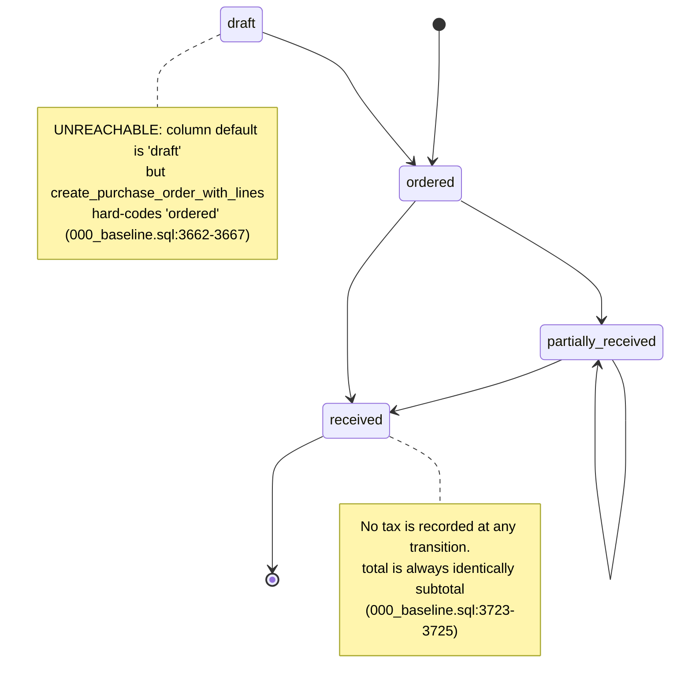
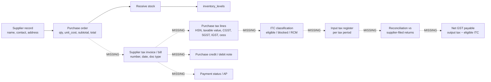

# 14 — GST: PURCHASES / INPUT TAX AND REPORTING

| Field | Value |
|---|---|
| Run ID | `docs/merchant-system-discovery/2026-08-04T225330+0530-bf35062e` |
| Branch | `stepup/main` |
| Commit | `bf35062e` |
| Run date | 2026-08-04 (+0530) |
| Scope | The **purchase side** of GST: supplier tax identity, purchase/supplier-bill documents, per-line purchase tax, input-tax-credit (ITC) eligibility, purchase credit/debit notes, purchase payment status, input-tax reporting, reconciliation against supplier-filed returns, export, and tax-period locking. Also the one purchase document a merchant actually receives inside the platform — LetBuyy's own subscription invoice — viewed strictly as the *merchant's input tax*. Output/sales GST (invoice generation, place of supply, IRN/QR, TCS, refund reversal) belongs to document 13 and is referenced, not re-adjudicated. Procurement mechanics (PO lifecycle, receiving, stock effects) belong to document 07 and are referenced, not re-adjudicated. |
| Evidence basis | The Phase-1 agent notes `_agent-notes/D-inventory-purchase-orders-input-gst.md` and `_agent-notes/H-gst-invoices-reports.md`, both read in full, plus direct re-verification against source at this commit: `database/supabase/migrations/000_baseline.sql`, `144_executable_tax_gst_invoices.sql`, `146_executable_checkout_state_machine.sql`, `152_executable_billing_autopay.sql`, `123_mobile_tax_rate_parity.sql`; `services/api-gateway/src/routes/inventory.ts`, `.../routes/billing.ts`, `.../routes/export.ts`, `.../routes/commerce-analytics.ts`, `.../execution/order-execution.adapter.ts`; `packages/commerce-core/src/index.ts`; `packages/typescript/api-client/src/index.ts`; the merchant web procurement and billing UIs; the Flutter merchant supplier and PO screens; and `GOVERNANCE_REWRITE_2026_06_10/LETBUYY_CONSTITUTION.md`. |
| **METHOD DISCLOSURE** | **Nothing in this document was runtime-verified.** No server was started, no request was issued, no database was connected to, no migration was applied, no test was executed. Every finding is a structural deduction from source and schema. The status ceiling for anything in this document is `IMPLEMENTED_NOT_RUNTIME_VERIFIED`; **nothing is `VERIFIED_E2E`.** Almost every finding here is an *absence*, and an exhaustively-grepped absence is the one class of static claim that does not need runtime confirmation — but the consequences attributed to those absences are still deductions, not observations. |
| Legal posture | **This document asserts no legal or tax compliance, and gives no tax advice.** The author is not a tax professional. |
| Secrets | **No secrets or PII appear in this document.** Environment variables are named only; no credential, token, connection string, `.env` content, customer datum, real GSTIN, real email address, phone number, or payment identifier appears anywhere. |

### Labelling convention (identical to document 13)

Every substantive statement carries one of four labels:

| Label | Means |
|---|---|
| `CODE_IMPLEMENTED` | A statement about what this repository **contains or does**, verified against source at this commit. Includes verified **absences** (an exhaustive grep that returns nothing is a `CODE_IMPLEMENTED` fact about the repository, not a claim about the world). |
| `ACCOUNTING_POLICY_DEFINED` | A written LetBuyy policy exists in the repository for this. |
| `LEGALLY_VALIDATED` | A CA, tax counsel, or equivalent professional has signed off, with an artifact in the repository. |
| `INFERRED-FROM-PRACTICE-NOT-REPO` | Drawn from general Indian GST practice, **not** from this repository. **Every such statement must be validated by a CA / tax counsel before anything is built on it.** These are questions, never conclusions. |

**`ACCOUNTING_POLICY_DEFINED` for input tax: NONE.**
**`LEGALLY_VALIDATED` for input tax: NONE.**
Both are verified absences — see §10.2 and §10.3.

---

## 1. Recommendation / verdict

### 1.1 The verdict

**Input GST / input tax credit is `NOT_IMPLEMENTED`. It is not partial, not stubbed, not behind a flag, and not "wired but unreachable". There is nothing to complete — there is only something to build, and it must not be built until a CA has specified it.** `CODE_IMPLEMENTED`.

The distinction matters because every other GST finding in this dossier is a *defect in something that exists*. This one is different. Concretely, verified by exhaustive grep across every migration in `database/supabase/migrations/` at this commit:

| Token searched across all migrations | Schema hits |
|---|---|
| a `gstin` column on `suppliers` | **0** |
| `reverse_charge` | **0** |
| `input_tax` | **0** |
| `input_credit` | **0** |
| `itc_` | **0** |
| `credit_note` | **0** |
| `debit_note` | **0** |
| `supplier_invoice` | **0** |
| `vendor_bill` | **0** |
| `bill_number` | **0** |
| `cess` (word-boundary) | **0** |
| `landed_cost` | **0** |
| `gstr` | **0** |
| `e-way` / `eway` (word-boundary) | **0** |
| `financial_year` / `fiscal_year` / `tax_period` / `filing_period` / `period_lock` | **0** |
| `place_of_supply` | **3** — all output-side (`gst_invoices.place_of_supply_state_code` `144:87`; `orders.place_of_supply_state` `000_baseline.sql:10164` + its CHECK `:10169`) |

`CODE_IMPLEMENTED`.

**Re-verification correction against the notes.** Both agent notes say "187 migrations". I re-counted: `find database/supabase/migrations -name '*.sql' | wc -l` returns **126** files, numbered up to `197_letbuyy_core_first_class_theme.sql`. There is exactly one Supabase migrations directory (`database/cloudflare/d1/migrations` is a separate D1 store and contains no `gstin` reference). The *conclusion* in the notes is unaffected — the greps above were re-run by me over all 126 files and return the counts shown — but the file count in the notes is wrong and this document uses **126**. `CODE_IMPLEMENTED`.

### 1.2 What this means for the founder, in one paragraph

A LetBuyy merchant today cannot record **who** they bought from in a tax-identifiable way, **what document** they bought against, **what tax** they paid, **whether that tax is creditable**, **whether they have paid the supplier**, or **whether the supplier filed it**. Therefore no input-tax figure exists anywhere in the system, therefore net GST payable (output tax minus eligible ITC) cannot be computed inside LetBuyy at all, therefore no input-tax report, export, or reconciliation is possible — and none exists. `CODE_IMPLEMENTED`. Combined with document 13's finding that the **output** side books ₹0 GST on every storefront order and issues no invoice (MCP-DISC-500, MCP-DISC-501), the correct summary of LetBuyy's GST position is: **the platform does not currently produce any GST number a merchant could file on, in either direction.** `CODE_IMPLEMENTED`.

### 1.3 The recommendation

**Do not build input GST from engineering judgement. Do not ship a partial ITC feature. Do state plainly, in product and marketing surfaces, that input GST is not supported.**

Three reasons, in order:

1. **There is no specification to build to.** No accounting policy, no CA sign-off, no requirements document, and no governance article covering purchase-side tax exists in this repository (§10.2, §10.3). ART-15 mentions GST exactly once, and only for output invoicing: *"…immutable GST invoice (IRN/QR via mock IRP) + TCS are built"* — `GOVERNANCE_REWRITE_2026_06_10/LETBUYY_CONSTITUTION.md:240`. `CODE_IMPLEMENTED`.
2. **A half-built ITC feature is worse than none.** A merchant who sees supplier-GSTIN and purchase-tax fields will reasonably assume the platform is producing a usable input-tax position. If the field set is wrong, the eligibility rules are absent, or the reconciliation is missing, the merchant files on a number the platform manufactured. That is a harm the merchant cannot detect and LetBuyy cannot undo. `INFERRED-FROM-PRACTICE-NOT-REPO` as to the filing consequence — **CA must confirm** — but the product risk is real regardless.
3. **The substrate is not ready either.** The purchase side stores money as `numeric(12,2)` rupees, not `bigint` minor units (§6.1); it has no supplier-record edit path (MCP-DISC-251, document 07); it has no PO cancel/close writer (MCP-DISC-246); and its receiving RPC is not idempotent (MCP-DISC-242). Building a tax model on that foundation multiplies the existing procurement defects into the tax ledger. `CODE_IMPLEMENTED`.

### 1.4 Recommended sequencing (approach only — no code, no migration, in this document)

| Order | Work | Owner | Gate |
|---|---|---|---|
| 0 | **Founder scope decision:** is input GST / ITC in LetBuyy's product scope at all, or do merchants keep purchases in external accounting software? | founder | Everything below is void if the answer is "out of scope" — in which case only MCP-DISC-542 (say so plainly) applies |
| 1 | If in scope: **engage a CA / tax counsel** and obtain a written field-set, eligibility-rule, retention and reconciliation specification (MCP-DISC-530) | CA-tax + founder | **Hard gate.** No schema work before this exists |
| 2 | Write the LetBuyy accounting policy from the CA specification (`ACCOUNTING_POLICY_DEFINED` currently NONE) | founder + CA-tax | Gate for ARB review |
| 3 | Fix the procurement substrate first: supplier edit (MCP-DISC-251), PO cancel/close (MCP-DISC-246), receive idempotency (MCP-DISC-242), money representation (MCP-DISC-541) | lead engineer + ARB | Otherwise the tax ledger inherits four known defects |
| 4 | Design supplier tax identity (MCP-DISC-531) and the supplier-bill document (MCP-DISC-532) as one ARB-reviewed data model | ARB + lead engineer | — |
| 5 | Per-line purchase tax (MCP-DISC-533), ITC classification (MCP-DISC-534), purchase credit/debit note (MCP-DISC-535), payment status (MCP-DISC-536) | lead engineer + CA-tax | — |
| 6 | Period model + locking (MCP-DISC-539), then reporting/export (MCP-DISC-537), then reconciliation (MCP-DISC-538) | lead engineer + CA-tax | Reporting last — a report over an unlocked, unreconciled ledger is a liability |
| — | **In parallel, independent of the above:** fix LetBuyy's own subscription invoice so it is usable ITC evidence for the merchant (MCP-DISC-540 / MCP-DISC-503) | CA-tax + founder + lead engineer | This is the merchant's *most certain* input tax and it is defective today |

---

## 2. Scope

**In scope.** Everything on the purchase/input side of GST:

- Supplier / vendor tax identity: `public.suppliers` DDL, the supplier create surfaces (web + mobile + gateway + typed client), and the tax fields they do or do not carry.
- Purchase documents: `public.purchase_orders`, `public.purchase_order_lines`, `public.purchase_order_receipts`, and the absence of any supplier-bill / purchase-invoice entity.
- Purchase-side tax data: taxable value, rate, CGST/SGST/IGST split, cess, HSN/SAC snapshot, reverse charge, ITC eligibility.
- Purchase credit/debit notes and their absence.
- Input-tax reporting, export, reconciliation against supplier-filed returns, and tax-period locking.
- LetBuyy's own subscription invoice (`public.merchant_billing_invoices`) **viewed as the merchant's input tax** — the merchant's ITC evidence for platform fees.
- The claims made about GST capability in governance, pricing and product surfaces, insofar as they touch purchases.

**Out of scope (owned elsewhere; referenced only).**

| Area | Owner document | Why not re-adjudicated here |
|---|---|---|
| Output/sales GST computation, place of supply, invoice generation, numbering, immutability, IRN/QR, TCS, refund tax reversal, sales credit notes | **13 — GST: Sales / Output Tax and Invoices** | Different data model, different owner, already fully evidenced there |
| PO lifecycle mechanics, receiving, stock effects, reservations, supplier CRUD gaps, valuation/landed cost/COGS | **07 — Inventory, Suppliers, Purchase Orders** | Already fully evidenced there; this document consumes those findings as dependencies |
| Ledger, refunds, payouts, reconciliation of *money* (as distinct from *tax*) | **12 — Money, Ledger, Refunds, Reconciliation** | — |

**Overlap declarations (for the commander's global register).** Three of my gaps are the input-side view of a defect already registered elsewhere. Each entry says so explicitly and names the prior ID, so the commander can collapse or keep them:

| My ID | Prior registration | Relationship |
|---|---|---|
| MCP-DISC-539 (period model + locking) | MCP-DISC-513 (doc 13, bundled into "no reporting, no export, no period locking, no reconciliation") | Same absence, purchase-side framing + explicit requirement set |
| MCP-DISC-540 (subscription invoice unusable as ITC evidence) | MCP-DISC-503, MCP-DISC-517 (doc 13, supply-side framing) | Same document, *recipient*-side framing; adds the merchant-UI rendering/download finding |
| MCP-DISC-537 (no input-tax reporting/export/net payable) | MCP-DISC-237, MCP-DISC-519 (umbrella "input GST not implemented") | MCP-DISC-237 and MCP-DISC-519 are the **umbrella**; MCP-DISC-530…542 are its decomposition into actionable, separately-ownable work |

**Constitutional check performed.** ART-15 (`LETBUYY_CONSTITUTION.md:239-242`) is the only Constitution article that names GST. Its decision text covers place of supply, HSN, inclusive/exclusive, the immutable invoice, IRN/QR and TCS — **all output-side**. Its `Forbids` clause is *"Invoicing without correct place-of-supply GST"* — also output-side. **No governance article, anywhere, addresses purchase-side or input tax.** Verified by grep for `input.?tax|\bITC\b|GSTR|purchase tax` across `GOVERNANCE_REWRITE_2026_06_10/`, root `AGENTS.md`, `CLAUDE.md` and `CAPABILITY_BACKLOG.md` — zero hits. `CODE_IMPLEMENTED`.

---

## 3. Current merchant user journeys — what a merchant can actually do today

Read this as *what happens when a real merchant clicks the button*, given the static evidence. **No journey below was executed.** `IMPLEMENTED_NOT_RUNTIME_VERIFIED` is the ceiling for every "works" row; every "cannot" row is a verified absence.

| Journey | What the merchant sees | What actually happens | Status |
|---|---|---|---|
| **Add a vendor** | Purchasing → Vendors → "New supplier". Fields: supplier name, contact name, email, phone, street/area, city, state, pincode | Proxy → gateway `POST /v1/inventory/suppliers` → `db.from('suppliers').insert({site_id, name, contact_name, email, phone, address, created_by})` (`services/api-gateway/src/routes/inventory.ts:334-362`). **No GSTIN field exists on the form, in the Zod schema, in the typed contract, or in the table.** State is captured as free text with no 2-digit state code. | `PARTIAL` — vendor exists as a contact record, **not** as a tax counterparty |
| **Record a vendor's GSTIN** | — | **There is no field anywhere.** `CreateSupplierSchema` (`packages/commerce-core/src/index.ts:311-318`) accepts `store_id, name, contact_name, email, phone, address` only. `interface Supplier` (`packages/typescript/api-client/src/index.ts:2288-2297`) likewise. The Flutter merchant supplier form collects name/contact/email/phone/address only (`apps/mobile/merchant-app/lib/screens/inventory/suppliers_screen.dart:333-338`). `public.suppliers` has no `gstin` column (`000_baseline.sql:12460-12476`). | **`NOT_IMPLEMENTED`** — **[HIGH-STAKES]** |
| **Correct a vendor's details later** | — | No PATCH, no DELETE, no `[id]` proxy directory. `suppliers.status` (`active|inactive`) and `deleted_at` exist and nothing writes either. | `NOT_IMPLEMENTED` — registered as MCP-DISC-251 (doc 07); a hard dependency of any future tax-identity work |
| **Raise a purchase order** | Purchasing → purchase orders → Create PO: supplier, destination location, expected date, notes, N lines of product/variant/qty/unit cost | Works end to end through `create_purchase_order_with_lines` (`000_baseline.sql:3616`). Server-authoritative subtotal `Σ(unit_cost × quantity)` computed in-RPC and written as **`subtotal = v_subtotal, total = v_subtotal`** (`000_baseline.sql:3720-3726`). **`total` is definitionally equal to `subtotal` — there is no tax component in the PO total, so a merchant cannot even record the gross (tax-inclusive) value of an order.** | `PARTIAL` — commercially usable, **tax-blind** |
| **Enter GST on a purchase order** | — | No tax field on the create modal, no tax field in `CreatePurchaseOrderSchema`, no tax column on `purchase_orders` or `purchase_order_lines`, no tax term in the totals RPC. | **`NOT_IMPLEMENTED`** — **[HIGH-STAKES]** |
| **Enter an HSN/SAC on a purchase line** | — | `purchase_order_lines` has `product_id, variant_id, location_id, quantity_ordered, quantity_received, unit_cost, total_cost, status, metadata` and no `hsn_code` (`000_baseline.sql:5100-5122`). `products.hsn_code` exists (`000_baseline.sql:10626-10627`) but is never joined onto a purchase line and never snapshotted. Note also: there is **no HSN input anywhere in the web merchant UI at all** (document 06's finding). | **`NOT_IMPLEMENTED`** |
| **Receive stock against a PO** | Receive modal with per-line quantity | RPC path is real (`receive_purchase_order` `000_baseline.sql:5012`). **But the web receive modal is unusable** because the gateway returns raw DB field names (`quantity_ordered`/`quantity_received`) and the UI reads contract names (`quantity`/`received_quantity`) → `NaN` → "All lines received" always — MCP-DISC-234 (doc 07). | `BROKEN` (doc 07) |
| **Record the supplier's tax invoice against a receipt** | — | `purchase_order_receipts` carries `quantity_received, idempotency_key, request_id, metadata` and **no invoice number, no invoice date, no amount, no tax** (`000_baseline.sql:10949-10968`). There is no supplier-bill table anywhere. | **`NOT_IMPLEMENTED`** — **[HIGH-STAKES]** |
| **Mark a supplier bill as paid** | — | No AP concept. Grep for `accounts_payable|supplier_payment|vendor_payment|ap_ledger|bill_payment` across all 126 migrations: **zero hits**. `purchase_orders.currency` (default `'INR'`) is the only financial metadata beyond the two numeric totals. | **`NOT_IMPLEMENTED`** |
| **Raise a purchase credit note (goods returned to a supplier)** | — | No table, no column, no route, no type. There is not even a PO cancel path to anchor one on: the CHECK permits `cancelled` and `closed` (`000_baseline.sql:5154`) and `cancelled_at` exists (`:5137`), but **no writer exists for either state** — MCP-DISC-246 (doc 07). | **`NOT_IMPLEMENTED`** — **[HIGH-STAKES]** |
| **See how much input tax I paid this month** | — | No surface. Merchant nav has no Reports, Finance, Bills or Expenses section (`apps/merchant-control-plane/src/components/merchantNavigation.ts:65-172`); the only tax page in the entire merchant app is `settings/taxes`, which is **output** rate CRUD (677 lines, zero purchase/supplier/ITC references). | **`NOT_IMPLEMENTED`** |
| **Compute net GST payable** | — | Impossible by construction: there is no input-tax value in the system for the GST layer to read. | **`NOT_IMPLEMENTED`** |
| **Export purchase data for my accountant** | Export & import page | `services/api-gateway/src/routes/export.ts` exposes `/products` (`:686`), `/orders` (`:706`), `/customers` (`:727`), `/import-products` (`:747`), `/jobs/:id` (`:648`), `/jobs/:id/download` (`:656`). **No purchases, no suppliers, no POs, no tax.** Grep for `gst|tax|invoice` across the whole 835-line file: **zero hits**. | **`NOT_IMPLEMENTED`** |
| **Reconcile my purchases against what my suppliers filed** | — | No GSTR-2A/2B concept, no import path, no matching model, no `supplier_filed`/`reconciled` state anywhere. | **`NOT_IMPLEMENTED`** |
| **Close / lock a tax period** | — | No period, financial-year, filing-period or lock concept anywhere in the schema (all five tokens: zero hits). The 28 `locked_at` hits in migrations are queue-job and outbox row locks (`081`, `082`, `083`, `089`, `000_baseline.sql:751-762`) and one `orders.order_locked_at` (`147:19`) — none is a tax period lock. | **`NOT_IMPLEMENTED`** |
| **Get a GST invoice from LetBuyy for my subscription fee** | Settings → Money → Billing shows an invoice table | Rows render **Date, Invoice number, Period, Amount, Status** only (`apps/merchant-control-plane/src/app/[store]/settings/billing/page.tsx:199-221`; `InvoiceRow` is `{id, invoice_number, amount, status, billing_period, created_at}` at `:29-36`). **No taxable value, no CGST/SGST/IGST breakdown, no GSTIN of either party, no place of supply, no SAC, no download, no PDF, no print.** The underlying row (`merchant_billing_invoices`) has no GSTIN or POS column to render even if the UI wanted to (`152_executable_billing_autopay.sql:124-158`). | **`UI_ONLY` / `BROKEN` as ITC evidence** — **[HIGH-STAKES]** |
| **Enter my GSTIN so it appears on LetBuyy's invoice to me** | Subscription checkout collects GSTIN and billing state, and promises *"GST invoice included"* | The POST body drops both fields; the destination table has no column for them — MCP-DISC-517 (doc 13). | `UI_ONLY` (doc 13) |

**Journey summary.** Of the fifteen purchase-tax journeys a GST-registered merchant needs, **zero are supported**. Two adjacent procurement journeys (create vendor, raise PO) work but are structurally tax-blind. `CODE_IMPLEMENTED`.

---

## 4. Feature matrix

Status ceiling reminder: **no row below is `VERIFIED_E2E`.** Rows marked `NOT_IMPLEMENTED` are verified absences (exhaustive grep, plus DDL read); rows marked `PARTIAL`/`BROKEN` are structural deductions from source.

| # | Capability | Status | Evidence (path:line) | Evidence type | Gap ID |
|---|---|---|---|---|---|
| 1 | Supplier / vendor record exists | `IMPLEMENTED_NOT_RUNTIME_VERIFIED` | `000_baseline.sql:12460-12476`; `services/api-gateway/src/routes/inventory.ts:300,334` | DB_SCHEMA, GATEWAY_CODE | — |
| 2 | Supplier GSTIN | **`NOT_IMPLEMENTED`** | `000_baseline.sql:12460-12476` (no column); `packages/commerce-core/src/index.ts:311-318` (no field); `packages/typescript/api-client/src/index.ts:2279-2297` (no field); `apps/merchant-control-plane/src/app/[store]/products/suppliers/page.tsx:147-203` (no input); `apps/mobile/merchant-app/lib/screens/inventory/suppliers_screen.dart:333-338` (no input) | DB_SCHEMA, SERVICE_CODE, API_CLIENT_CODE, UI_CODE | **MCP-DISC-531** |
| 3 | Supplier legal name (distinct from trade name) | **`NOT_IMPLEMENTED`** | `suppliers.name` is the only name field (`000_baseline.sql:12462`). Contrast the seller side: `tax_registrations.legal_name` (`144:9`) | DB_SCHEMA | **MCP-DISC-531** |
| 4 | Supplier registration type (regular / composition / unregistered) | **`NOT_IMPLEMENTED`** | No column on `suppliers`. Exists on the seller side only: `tax_registrations.registration_type` (`144:12-13`) — and is itself never read (MCP-DISC-524, doc 13) | DB_SCHEMA | **MCP-DISC-531** |
| 5 | Supplier state code (2-digit, for place of supply) | **`NOT_IMPLEMENTED`** | `suppliers.address jsonb` free-form (`000_baseline.sql:12467`); UI captures state as free text (`suppliers/page.tsx:197-200`). Contrast `tax_registrations.state_code text CHECK (state_code ~ '^[0-9]{2}$')` (`144:11`) | DB_SCHEMA, UI_CODE | **MCP-DISC-531** |
| 6 | Supplier record editable / deactivatable | `NOT_IMPLEMENTED` | Gateway has GET (`inventory.ts:300`) + POST (`:334`) only; no `[id]` proxy dir | GATEWAY_CODE | MCP-DISC-251 (doc 07) |
| 7 | Purchase order document | `IMPLEMENTED_NOT_RUNTIME_VERIFIED` | `000_baseline.sql:5128-5155`; RPC `:3616` | DB_SCHEMA, RPC_FUNCTION | — |
| 8 | Supplier tax invoice / bill entity | **`NOT_IMPLEMENTED`** | No table in any of the 126 migrations; grep `supplier_invoice|vendor_bill|bill_number` → 0 | DB_SCHEMA | **MCP-DISC-532** |
| 9 | Supplier invoice number | **`NOT_IMPLEMENTED`** | Absent from `purchase_orders` (`:5128-5155`), `purchase_order_lines` (`:5100-5122`), `purchase_order_receipts` (`:10949-10968`) | DB_SCHEMA | **MCP-DISC-532** |
| 10 | Supplier invoice date | **`NOT_IMPLEMENTED`** | `ordered_at`/`expected_at`/`received_at`/`cancelled_at` are PO milestones, not the supplier's document date (`:5133-5137`) | DB_SCHEMA | **MCP-DISC-532** |
| 11 | Purchase place of supply | **`NOT_IMPLEMENTED`** | All three `place_of_supply` hits in the schema are output-side (`144:87`; `000_baseline.sql:10164`, `:10169`) | DB_SCHEMA | **MCP-DISC-532** |
| 12 | HSN/SAC per purchase line | **`NOT_IMPLEMENTED`** | No column on `purchase_order_lines` (`:5100-5122`); `products.hsn_code` (`:10626-10627`) is never joined or snapshotted | DB_SCHEMA | **MCP-DISC-533** |
| 13 | Taxable value per purchase line | **`NOT_IMPLEMENTED`** | `unit_cost`/`total_cost numeric(12,2)` only (`:5109-5110`), with **no** statement of whether tax is included | DB_SCHEMA | **MCP-DISC-533** |
| 14 | CGST / SGST / IGST split + rates on purchases | **`NOT_IMPLEMENTED`** | Zero tax columns on any purchase table. Contrast the sales side: `gst_invoices.cgst_amount_minor/sgst_amount_minor/igst_amount_minor` + `gst_invoices_tax_split_check` (`144:88-93`, `:110-111`) | DB_SCHEMA | **MCP-DISC-533** |
| 15 | Cess | **`NOT_IMPLEMENTED`** everywhere (both sides) | Word-boundary grep `cess` across all migrations → 0; no field on `GeneratedGstInvoiceLine` either | DB_SCHEMA | **MCP-DISC-533** (purchase side) / MCP-DISC-522 (sales side, doc 13) |
| 16 | Reverse-charge flag | **`NOT_IMPLEMENTED`** | grep `reverse_charge` → 0 across all migrations and all of `services/`, `apps/`, `packages/` | DB_SCHEMA | **MCP-DISC-534** |
| 17 | ITC eligibility / blocked-credit classification | **`NOT_IMPLEMENTED`** | grep `itc_`, `input_tax`, `input_credit` → 0 | DB_SCHEMA | **MCP-DISC-534** |
| 18 | Purchase credit note / debit note | **`NOT_IMPLEMENTED`** | grep `credit_note`, `debit_note` → 0 schema hits; no PO cancel writer exists to anchor one | DB_SCHEMA, RPC_FUNCTION (absence) | **MCP-DISC-535** |
| 19 | Supplier-bill payment status / AP ledger | **`NOT_IMPLEMENTED`** | grep `accounts_payable|supplier_payment|vendor_payment|ap_ledger|bill_payment` → 0 | DB_SCHEMA | **MCP-DISC-536** |
| 20 | Purchase totals include a tax component | **`NOT_IMPLEMENTED`** | `create_purchase_order_with_lines` sets `subtotal = v_subtotal, total = v_subtotal` (`000_baseline.sql:3723-3725`) | RPC_FUNCTION | **MCP-DISC-533** |
| 21 | Input-tax register / period aggregation | **`NOT_IMPLEMENTED`** | No table, no view, no RPC, no route | DB_SCHEMA | **MCP-DISC-537** |
| 22 | Net GST payable (output − eligible ITC) | **`NOT_IMPLEMENTED`** | No input value exists to subtract | SERVICE_CODE (absence) | **MCP-DISC-537** |
| 23 | Input-tax report in the merchant UI | **`NOT_IMPLEMENTED`** | No nav entry, no route; the only tax page is output rate CRUD (`settings/taxes/page.tsx`, 677 lines, zero purchase references) | UI_CODE | **MCP-DISC-537** |
| 24 | Purchase / tax export (CSV, JSON, accounting) | **`NOT_IMPLEMENTED`** | `export.ts` routes are products/orders/customers only; zero `gst|tax|invoice` hits in 835 lines. No Tally/Zoho/QuickBooks integration anywhere | GATEWAY_CODE | **MCP-DISC-537** |
| 25 | GSTR-2A / 2B reconciliation | **`NOT_IMPLEMENTED`** | grep `gstr` → 0 across all migrations and all source | DB_SCHEMA, SERVICE_CODE | **MCP-DISC-538** |
| 26 | Tax period / financial year / period locking | **`NOT_IMPLEMENTED`** | grep `period_lock|financial_year|fiscal_year|filing_period|tax_period` → 0; the 28 `locked_at` hits are queue/outbox locks | DB_SCHEMA | **MCP-DISC-539** (overlaps MCP-DISC-513) |
| 27 | E-way bill | **`NOT_IMPLEMENTED`** | grep `e-way|eway` (word-boundary) → 0 | DB_SCHEMA | out of scope — noted for completeness |
| 28 | Procurement **operational** reporting (per-supplier PO count, on-time rate, avg lead time) | `IMPLEMENTED_NOT_RUNTIME_VERIFIED` | `services/api-gateway/src/routes/commerce-analytics.ts:48-172` (`/supplier-metrics`) | GATEWAY_CODE | — (this is the *only* purchase reporting that exists, and it is **not** tax reporting) |
| 29 | LetBuyy subscription invoice exists (merchant's input tax) | `PARTIAL` | `152_executable_billing_autopay.sql:124-158`; writer `services/api-gateway/src/routes/billing.ts:132-160` | DB_SCHEMA, GATEWAY_CODE | **MCP-DISC-540** / MCP-DISC-503 (doc 13) |
| 30 | …carries both GSTINs / POS / SAC | **`NOT_IMPLEMENTED`** | `merchant_billing_invoices` columns are `subtotal_minor, cgst_minor, sgst_minor, igst_minor, total_minor, period_start, period_end, irn, qr_payload, metadata` — no GSTIN, no state, no POS, no HSN/SAC (`152:124-158`) | DB_SCHEMA | **MCP-DISC-540** |
| 31 | …tax split is computed rather than hard-coded | **`BROKEN`** | `cgst_minor: 0, sgst_minor: 0, igst_minor: input.taxMinor` — **always IGST** (`billing.ts:143-145`); rate `Math.round(amountMinor * 0.18)` (`:274`) | GATEWAY_CODE | MCP-DISC-503 (doc 13) |
| 32 | …renders a tax breakdown / is downloadable by the merchant | **`NOT_IMPLEMENTED`** | `InvoiceRow` (`settings/billing/page.tsx:29-36`) and `invoiceColumns` (`:199-221`) carry Date / Invoice / Period / Amount / Status only; no download, PDF or print control anywhere in the file | UI_CODE | **MCP-DISC-540** |
| 33 | Written input-tax accounting policy | **`NOT_IMPLEMENTED`** | `ACCOUNTING_POLICY_DEFINED: NONE` — see §10.2 | DOC_CLAIM (absence) | **MCP-DISC-530** |
| 34 | CA / tax-counsel sign-off on anything input-side | **`NOT_IMPLEMENTED`** | `LEGALLY_VALIDATED: NONE` — see §10.3 | DOC_CLAIM (absence) | **MCP-DISC-530** |
| 35 | Any test covering purchase tax | **`NOT_IMPLEMENTED`** | The only GST tests are `tests/gst/gst-invoice.test.mjs` and `tests/executable/tax-postgres.test.mjs`, both output-side; no purchase-order test exists at all | UNIT_TEST/INTEGRATION_TEST (absence) | **MCP-DISC-537** (tests are part of its completion contract) |
| 36 | Purchase money in `bigint` minor units | **`BROKEN`** (constitutional deviation) | `purchase_orders.subtotal/total numeric(12,2)` (`:5140-5141`); `purchase_order_lines.unit_cost/total_cost numeric(12,2)` (`:5109-5110`) vs R-8/PAY-R5 | DB_SCHEMA | **MCP-DISC-541** |
| 37 | A product statement that input GST is out of scope | **`NOT_IMPLEMENTED`** | No such statement in `docs/` (non-archive), the pricing catalogue, or the marketing legal pages | DOC_CLAIM (absence) | **MCP-DISC-542** |

---

## 5. UI / route inventory

### 5.1 Merchant web — every surface that touches purchases

| Surface | File | Backing endpoint | Tax content |
|---|---|---|---|
| Purchasing → purchase orders | `apps/merchant-control-plane/src/app/[store]/products/purchase-orders/page.tsx` | `/api/stores/[store]/purchase-orders` → `/v1/inventory/purchase-orders` | **none** |
| Purchasing → Vendors | `apps/merchant-control-plane/src/app/[store]/products/suppliers/page.tsx` | `/api/stores/[store]/suppliers` → `/v1/inventory/suppliers` | **none** — form fields at `:147` (name), `:157` (contact), `:163` (email), `:172` (phone), `:184` (street), `:191` (city), `:197` (state, free text), `:203` (pincode) |
| Purchasing → Receipts | `.../products/receipts/page.tsx:89` | `/v1/inventory/receipts` | **none** |
| Purchasing → Transfers | `.../products/transfers/page.tsx:192,606` | `/v1/inventory/transfers` | **none** |
| Inventory → Operations dashboard | `.../products/operations-dashboard/page.tsx:118` | `/v1/commerce-analytics/*` | **none** (operational metrics only) |
| Settings → Taxes | `.../settings/taxes/page.tsx` (677 lines) | `/v1/stores/:id`, `tax_rates` CRUD | **output only** — zero purchase, supplier, vendor or ITC references |
| Settings → Money → Billing | `.../settings/billing/page.tsx` | `/api/stores/[store]/billing` → `/v1/billing/invoices` | **the merchant's own input-tax document — rendered with no tax data** (§6.4) |
| Settings → Billing → Profile | `.../settings/billing/profile/page.tsx:110-126` | billing profile payload | collects a GSTIN that reaches no invoice (MCP-DISC-517, doc 13) |

**Absent by inspection of `apps/merchant-control-plane/src/components/merchantNavigation.ts:65-172`:** there is no Reports section, no Finance section, no Bills section, no Expenses section, and no Taxes top-level entry. The `Purchasing` group (`:100-110`) contains exactly Transfers, Receipts, Vendors. The `Money` group (`:122-133`) contains Billing (its own path), Payouts, Gift cards. **No purchase-tax surface is reachable from anywhere in the merchant app.** `CODE_IMPLEMENTED`.

### 5.2 Merchant mobile (Flutter)

| Screen | File | Tax content |
|---|---|---|
| Suppliers | `apps/mobile/merchant-app/lib/screens/inventory/suppliers_screen.dart` | Form fields at `:333-338`: name, contact name, email, phone, address (one free-text line). **No GSTIN, no state code.** Grep for `gstin|tax|gst|hsn` in the file → 0 |
| Purchase orders | `.../screens/inventory/purchase_orders_screen.dart` | Grep for `gstin|tax|gst|hsn` → 0 |
| Settings → Taxes | `.../screens/settings/taxes_screen.dart:126,184,281` | **output** rate CRUD, with an HSN field on the *tax rate* (not on a product, not on a purchase) |
| Settings → Store details | `.../screens/settings/store_details_screen.dart:215-222,644` | the **merchant's own** GSTIN (seller side), with a format validator |

`CODE_IMPLEMENTED`. Mobile is at parity with web on the purchase-tax question: nothing exists on either.

### 5.3 App proxies (merchant-control-plane → gateway)

```
apps/merchant-control-plane/src/app/api/stores/[store]/suppliers/route.ts              GET, POST
apps/merchant-control-plane/src/app/api/stores/[store]/purchase-orders/route.ts        GET, POST
apps/merchant-control-plane/src/app/api/stores/[store]/purchase-orders/[id]/receive/route.ts  POST
apps/merchant-control-plane/src/app/api/stores/[store]/billing/route.ts                GET, POST
```

That is the complete purchase-side proxy surface. There is **no** `[id]/route.ts` for suppliers or POs (no edit, no cancel), and **no** `tax`, `invoices`, `bills`, or `reports` proxy directory. `CODE_IMPLEMENTED`.

---

## 6. Backend / API / RPC / database mapping

### 6.1 The purchase-side tables, in full, as they exist at this commit

All read directly from `database/supabase/migrations/000_baseline.sql`. `CODE_IMPLEMENTED`.

**`public.suppliers` — `000_baseline.sql:12460-12476`**

```
id uuid, site_id uuid NOT NULL, name text NOT NULL, contact_name text, email text, phone text,
address jsonb DEFAULT '{}' NOT NULL, status text DEFAULT 'active' NOT NULL,
metadata jsonb DEFAULT '{}' NOT NULL, created_by uuid, updated_by uuid,
created_at timestamptz, updated_at timestamptz, deleted_at timestamptz,
CONSTRAINT suppliers_status_check CHECK (status IN ('active','inactive'))
```

**`public.purchase_orders` — `000_baseline.sql:5128-5155`**

```
id uuid, site_id uuid NOT NULL, supplier_id uuid, location_id uuid, po_number text NOT NULL,
status text DEFAULT 'draft' NOT NULL, ordered_at, expected_at, received_at, cancelled_at timestamptz,
currency text DEFAULT 'INR' NOT NULL, subtotal numeric(12,2) DEFAULT 0 NOT NULL,
total numeric(12,2) DEFAULT 0 NOT NULL, notes text, idempotency_key text NOT NULL, request_id text,
metadata jsonb, created_by, updated_by, created_at, updated_at, deleted_at,
CONSTRAINT purchase_orders_status_check CHECK (status IN ('draft','ordered','partially_received','received','cancelled','closed'))
```

**`public.purchase_order_lines` — `000_baseline.sql:5100-5122`**

```
id uuid, site_id uuid NOT NULL, purchase_order_id uuid NOT NULL, product_id uuid NOT NULL,
variant_id uuid, location_id uuid, quantity_ordered integer NOT NULL,
quantity_received integer DEFAULT 0 NOT NULL, unit_cost numeric(12,2) DEFAULT 0 NOT NULL,
total_cost numeric(12,2) DEFAULT 0 NOT NULL, status text DEFAULT 'ordered' NOT NULL,
metadata jsonb, created_by, updated_by, created_at, updated_at, deleted_at,
CHECK (quantity_ordered > 0), CHECK (quantity_received >= 0),
CHECK (status IN ('ordered','partially_received','received','cancelled'))
```

**`public.purchase_order_receipts` — `000_baseline.sql:10949-10968`**

```
id uuid, site_id uuid NOT NULL, purchase_order_id uuid NOT NULL, purchase_order_line_id uuid,
product_id uuid NOT NULL, variant_id uuid, location_id uuid, quantity_received integer NOT NULL,
idempotency_key text NOT NULL, request_id text, metadata jsonb, created_by, updated_by,
created_at, updated_at, deleted_at, CHECK (quantity_received > 0)
```

**Observation, stated plainly:** across four tables and 78 columns, the complete financial vocabulary of the purchase side is **four numbers** — `unit_cost`, `total_cost`, `subtotal`, `total` — and one currency code. There is no document identity, no counterparty tax identity, no tax, no eligibility, and no settlement state. `CODE_IMPLEMENTED`.

**And the RPC confirms there is nowhere for tax to enter:** `create_purchase_order_with_lines` accumulates `v_subtotal := v_subtotal + (COALESCE(v_line.unit_cost, 0) * v_line.quantity)` (`000_baseline.sql:3720`) and then writes `UPDATE purchase_orders SET subtotal = v_subtotal, total = v_subtotal` (`:3723-3725`). **`total` is identically `subtotal`.** `CODE_IMPLEMENTED`, `RPC_FUNCTION`.

### 6.2 THE DATA-GAP TABLE — every field an input-tax-credit workflow needs

This is the core deliverable of this document. For each field: **PRESENT** (with the exact column) or **ABSENT** (with the proof of absence).

> **Provenance of the checklist itself.** `INFERRED-FROM-PRACTICE-NOT-REPO`. Rows 1–17 are the fields I would expect an input-tax-credit workflow to need, drawn from general Indian GST practice — **not** from any LetBuyy document, because none exists. **The actual required field set, the mandatory-vs-optional split, the retention period, and the reconciliation obligation must be specified by a CA / tax counsel before anything is built (MCP-DISC-530). Nothing in this table should be treated as a requirement until they have.** The *verdicts* in the right-hand columns are `CODE_IMPLEMENTED` — they are statements about this repository and are exhaustively verified.

| # | Field an ITC workflow needs | Verdict | Where it is / proof it is not | Nearest thing that exists (output side) |
|---|---|---|---|---|
| 1 | **Supplier GSTIN** | **ABSENT** | `public.suppliers` has no `gstin` column — `000_baseline.sql:12460-12476`. Every `gstin` column in the schema is output-side or CRM: `sites.gstin` `:12017`; `orders.customer_gstin` `:10163`; `customer_addresses.gstin` `:8886`; `tax_registrations.gstin` `144:10`; `draft_orders.customer_gstin` `116:10`; `checkout_sessions.buyer_gstin` `146:14`; `theme_purchase_receipts.buyer_gstin`/`seller_gstin` `091:131-132`; `contact_requests.gstin` `195:59`. **Eight GSTIN columns exist in this schema and not one of them belongs to a supplier.** No GSTIN format CHECK exists for a supplier. | `tax_registrations.gstin` + `tax_registrations_gstin_check` (`144:10`, `:22-23`) |
| 2 | **Supplier legal name** | **ABSENT** as a distinct field | `suppliers.name` (`:12462`) is a single trade-name string; there is no legal-name column and no registration-type column | `tax_registrations.legal_name` (`144:9`), `tax_registrations.registration_type` (`144:12-13`) |
| 3 | **Supplier state code (2-digit) / derivable place of supply** | **ABSENT** | `suppliers.address jsonb` is free-form (`:12467`); the web form writes street/city/state/pincode as free text (`suppliers/page.tsx:184-203`) and the Flutter form writes a **single** free-text address line (`suppliers_screen.dart:337`). No 2-digit code, no CHECK, no lookup. Place of supply is therefore not derivable from any stored value. | `tax_registrations.state_code text NOT NULL CHECK (state_code ~ '^[0-9]{2}$')` (`144:11`) |
| 4 | **Supplier invoice number** | **ABSENT** | No column on `purchase_orders` (`:5128-5155`), `purchase_order_lines` (`:5100-5122`) or `purchase_order_receipts` (`:10949-10968`). No supplier-bill table exists: grep `supplier_invoice|vendor_bill|bill_number` across all 126 migrations → **0** | `gst_invoices.invoice_number` (`144:82`) |
| 5 | **Supplier invoice date** | **ABSENT** | The four timestamps on `purchase_orders` (`ordered_at`, `expected_at`, `received_at`, `cancelled_at` — `:5133-5137`) are LetBuyy-side PO milestones. None is the supplier's document date, and there is no column for one | `gst_invoices.invoice_date` (`144:83`) |
| 6 | **Document type (tax invoice / bill of supply / debit note / credit note / RCM self-invoice)** | **ABSENT** | No document-type concept on the purchase side at all | `gst_invoices.supply_type` (intra/inter only — not a document type) (`144:88`) |
| 7 | **Place of supply on the purchase** | **ABSENT** | All three `place_of_supply` schema hits are output-side: `gst_invoices.place_of_supply_state_code` (`144:87`), `orders.place_of_supply_state` (`000_baseline.sql:10164`) and its CHECK (`:10169`) | `gst_invoices.place_of_supply_state_code` |
| 8 | **HSN / SAC per purchase line** | **ABSENT** | No `hsn_code` on `purchase_order_lines` (`:5100-5122`). `products.hsn_code text CHECK (hsn_code ~ '^\d{4,8}$')` exists (`:10626-10627`) but is **never joined onto a purchase line and never snapshotted** — a later HSN edit would silently rewrite purchase history. Note also that there is **no HSN input in the web merchant UI at all** (doc 06), so `products.hsn_code` is itself effectively unpopulated from the web | `order_items.hsn_code` (`:10037`); `hsn_rates.hsn_code` (`144:35`); `tax_rates.hsn_code` (`123:5`) |
| 9 | **Taxable value per line** | **ABSENT** | `unit_cost` / `total_cost numeric(12,2)` (`:5109-5110`) are undifferentiated cost with **no** statement of whether tax is included or excluded. There is no `tax_inclusive` flag on the purchase side (the store-level `sites.tax_inclusive` — `:12001` — is a sales setting and is ignored even there, MCP-DISC-507) | `gst_invoices.taxable_amount_minor` (`144:90`); per-line `order_items.taxable_amount` (`:10039`) |
| 10 | **CGST amount + rate** | **ABSENT** | Zero tax columns on any purchase table | `gst_invoices.cgst_amount_minor` (`144:91`); `order_items.cgst_amount` (`:10040`) |
| 11 | **SGST/UTGST amount + rate** | **ABSENT** | Zero tax columns on any purchase table | `gst_invoices.sgst_amount_minor` (`144:92`); `order_items.sgst_amount` (`:10041`) |
| 12 | **IGST amount + rate** | **ABSENT** | Zero tax columns on any purchase table | `gst_invoices.igst_amount_minor` (`144:93`); `order_items.igst_amount` (`:10042`) |
| 13 | **Cess amount + rate** | **ABSENT — on both sides** | Word-boundary grep `cess` across all 126 migrations → **0**. There is no cess column on `gst_invoices` either (`144:78-112`) and no cess field on `GeneratedGstInvoiceLine` | **nothing** |
| 14 | **Reverse-charge flag** | **ABSENT** | grep `reverse_charge` across all migrations **and** across `services/`, `apps/`, `packages/` → **0** | **nothing** |
| 15 | **ITC eligibility flag / ITC category (eligible / ineligible / blocked / partly common)** | **ABSENT** | grep `itc_`, `input_tax`, `input_credit` → **0** | **nothing** |
| 16 | **Purchase credit note / debit note (against a specific supplier invoice)** | **ABSENT** | grep `credit_note`, `debit_note` → **0** schema hits. Repo-wide the only two matches anywhere are prose: `apps/marketing-site/src/lib/legal/content/money.ts:65` (a live public legal page) and `docs/lcis-master/_evidence/panel-commerce.md:48`. Additionally there is **no PO cancel writer at all** to hang a purchase return on (MCP-DISC-246) | **nothing** |
| 17 | **Payment status of the supplier bill (paid / unpaid / part-paid, with a payment date)** | **ABSENT** | No AP table, no supplier-payment table, no `paid_at` on any purchase table. grep `accounts_payable|supplier_payment|vendor_payment|ap_ledger|bill_payment` → **0**. `purchase_orders.currency` (default `'INR'`, `:5138`) is the only remaining financial metadata | **nothing** |
| — | *(recorded for completeness, not requested)* Supplier PAN | **ABSENT** | No PAN column on `suppliers`. The seller side stores only `pan_last4` inside `sites.business_profile jsonb` (`settings/business/page.tsx:292`) | — |
| — | *(completeness)* Supplier MSME status / TDS section | **ABSENT** | No column, no grep hit | — |
| — | *(completeness)* Import/bill-of-entry fields for IGST on imports | **ABSENT** | `products.country_of_origin` and `products.hs_code` exist (`:10620-10621`) but are catalogue attributes; no bill-of-entry, no customs document, no import-IGST concept | — |

**Score: 0 of 17 PRESENT. 17 of 17 ABSENT.** `CODE_IMPLEMENTED`.

**One field is worse than absent — it is misleadingly adjacent.** `products.hs_code` (customs HS code, `:10621`) is used as a **fallback for the GST HSN** on the *sales* invoice: `hsn_code: textValue(item.hsn_code) || textValue(snapshot.hsn_code) || textValue(snapshot.hs_code)` — `services/api-gateway/src/execution/order-execution.adapter.ts:304`. `CODE_IMPLEMENTED`. Whether a customs HS code is an acceptable substitute for a GST HSN is `INFERRED-FROM-PRACTICE-NOT-REPO` and **must be put to the CA** — it is added to the review list as CA-P-09 (§15.2). It is an output-side code path (doc 13 owns it), recorded here because any future purchase-side HSN design must not repeat the fallback.

### 6.3 The GST machinery that does exist, and why none of it is reachable from a purchase

| Artifact | Where | Direction | Reachable from a purchase? |
|---|---|---|---|
| `tax_registrations` (legal name, GSTIN, state code, registration type, effective window) | `144:6-30` | **seller's own** registration | No. It models *the merchant as supplier*, not the merchant's suppliers. It also has **zero writers** anywhere (MCP-DISC-500, doc 13) |
| `hsn_rates` (per-site HSN → `gst_rate_bps`, effective-dated) | `144:32-52` | rate library | No. **Zero readers and zero writers** in production code — repo-wide the only references are `services/api-gateway/src/tenant/tenant-tables.registry.ts:1017` and a source-text assertion in `services/api-gateway/src/__tests__/tax.test.ts:41`. Registered as MCP-DISC-514 (doc 13) |
| `tax_overrides` (`scope_type IN ('product','collection','shipping','order')`) | `144:54-76` | rate override | No — and note the enum has **no `purchase` scope**. Also zero readers/writers (`tenant-tables.registry.ts:2696`, `tax.test.ts:40`) |
| `gst_invoices` (immutable, `*_minor bigint`, CGST+SGST+IGST split CHECK) | `144:78-120` | **output** sales invoice | No. `order_id NOT NULL REFERENCES public.orders(id)` (`144:81`) — the table is structurally bound to a sales order and cannot represent a purchase. It also has zero writers (MCP-DISC-501, doc 13) |
| `tax_rates` (store-wide rate, `is_shipping`, `priority`, and `hsn_code` added by `123:5`) | `000_baseline.sql:12483-12499` + `123_mobile_tax_rate_parity.sql:5` | **output** rate resolution | No. Columns are `store_id, name, rate numeric(5,4), country, state, is_compound, is_shipping, priority, is_active, hsn_code` — **there is no direction/purchase flag**, so a purchase rate cannot even be distinguished from a sales rate in this table |
| `/v1/tax/*` routes | `services/api-gateway/src/routes/tax.ts` (182 lines) | **output** | No. `tax.ts` computes and reads sales invoices; it has no purchase concept. It is also unreachable from any product surface (MCP-DISC-525, doc 13) |
| `packages/checkout-core` GST engine | `packages/checkout-core/src/index.ts:793-879` | **output** | Structurally it is a pure line-tax function and could in principle serve purchases, but it takes a *sales* invoice shape (`supplier`/`recipient` parties, invoice numbering, TCS, IRN) and no purchase caller exists |

**Conclusion.** The GST subsystem is a **single-direction** system. It has one supplier (the merchant) and many recipients (shoppers). There is no counterparty model in which the merchant is the *recipient*. That is the structural reason input GST is `NOT_IMPLEMENTED` rather than partially implemented: it is not a missing feature on an existing model, it is a missing half of the model. `CODE_IMPLEMENTED`.

### 6.4 The one purchase document a merchant actually receives inside LetBuyy

Every LetBuyy merchant on a paid plan receives at least one purchase invoice from LetBuyy itself. From the merchant's point of view this is **input tax on platform fees** — the single most certain, most recurring ITC item they have inside the product. It is worth stating exactly what it is.

**Table — `public.merchant_billing_invoices`, `152_executable_billing_autopay.sql:124-158`:**

```
id, site_id, subscription_id, billing_history_id, invoice_number text NOT NULL,
status text DEFAULT 'issued' CHECK (status IN ('issued','payment_failed','void')),
currency text DEFAULT 'INR' CHECK (currency = 'INR'),
subtotal_minor bigint, cgst_minor bigint, sgst_minor bigint, igst_minor bigint, total_minor bigint,
period_start timestamptz, period_end timestamptz, irn text, qr_payload text, metadata jsonb,
created_by, updated_by, deleted_by, created_at, updated_at, deleted_at,
UNIQUE (site_id, invoice_number)
```

**Writer — `services/api-gateway/src/routes/billing.ts:132-160`:**

```ts
.from('merchant_billing_invoices')
.upsert({ …,
  cgst_minor: 0,
  sgst_minor: 0,
  igst_minor: input.taxMinor,      // ALWAYS IGST
  irn:        `sandbox-irn-${input.invoiceNumber}`,
  qr_payload: `sandbox-qr:${input.invoiceNumber}`,
}, { onConflict: 'site_id,invoice_number' })
```

and `:273-274` — `const invoiceNumber = \`MBI-${crypto.randomUUID().slice(0, 8).toUpperCase()}\`;` / `const taxMinor = Math.round(amount.amountMinor * 0.18);`

**Reader — `services/api-gateway/src/routes/billing.ts:425-438`** (`GET /v1/billing/invoices` → `billing_history` joined with `merchant_billing_invoices(*)`), proxied at `apps/merchant-control-plane/src/app/api/stores/[store]/billing/route.ts:42-46`.

**Rendering — `apps/merchant-control-plane/src/app/[store]/settings/billing/page.tsx`:** `InvoiceRow` is `{id, invoice_number, amount, status, billing_period, created_at}` (`:29-36`); the table columns are Date, Invoice, Period, Amount, Status (`:199-221`). **No tax breakdown is rendered, and there is no download, PDF, print or export control in the file.**

**As ITC evidence, therefore, this document:** `CODE_IMPLEMENTED` for every point below.

| Property | State |
|---|---|
| Supplier (LetBuyy) GSTIN | **no column** |
| Recipient (merchant) GSTIN | **no column** — and the merchant *does* type one into the subscription checkout, which discards it (MCP-DISC-517) |
| Place of supply | **no column**; the split is hard-coded `igst_minor = taxMinor` regardless of either party's state |
| SAC (service code) | **no column** |
| Tax rate | hard-coded `0.18` in TypeScript (`billing.ts:274`) |
| Invoice number series | `MBI-<8 random hex>` with `UNIQUE (site_id, invoice_number)` — **site-scoped, so two different merchants can legitimately receive LetBuyy invoices bearing the same number** |
| Immutability | **none** — `.upsert()`; an issued invoice can be silently rewritten |
| IRN / QR | locally fabricated strings persisted unconditionally in every environment, with **no mode column** on this table |
| Merchant-visible tax detail | **none rendered** |
| Merchant-downloadable copy | **none** |

`INFERRED-FROM-PRACTICE-NOT-REPO`: a document without either party's GSTIN, without a place of supply, and without a SAC would not normally be usable to substantiate an ITC claim on the fees. **This is a CA question (CA-P-08, §15.2), not my conclusion.** What I *can* assert without a tax opinion is the arithmetic and structural facts above, and that the merchant is being told *"GST invoice included"* on the subscription checkout (`apps/merchant-control-plane/src/app/[store]/access_account/checkout/checkout/CheckoutClient.tsx:383`, `:512`) while receiving a row that renders no tax at all. `CODE_IMPLEMENTED`.

### 6.5 END-TO-END TRACE — "Merchant claims input tax credit on a purchase"

The required trace format, applied to the material capability this document is about. **Every link is MISSING.**

| # | Link | State | Evidence |
|---|---|---|---|
| 1 | Merchant entry point (a "Bills" / "Purchases" / "Input tax" nav item) | **MISSING** | `merchantNavigation.ts:65-172` — no such entry |
| 2 | Page / route (`/[store]/purchases/bills` or equivalent) | **MISSING** | no directory under `apps/merchant-control-plane/src/app/[store]/` |
| 3 | App proxy (`/api/stores/[store]/bills`) | **MISSING** | only `suppliers`, `purchase-orders`, `purchase-orders/[id]/receive`, `billing` exist |
| 4 | Typed client method | **MISSING** | `packages/typescript/api-client/src/index.ts` exposes `CreateSupplierInput`/`Supplier` (`:2279-2297`) and `PurchaseOrder`/`PurchaseOrderLine` (`:2228-2269`) — no bill, no tax |
| 5 | `/v1` gateway route | **MISSING** | `services/api-gateway/src/routes/inventory.ts` has `/suppliers` GET+POST, `/purchase-orders` GET+POST, `/purchase-orders/:id/receive` POST — no bill, no tax |
| 6 | Auth issuer + authz + ownership check | **N/A** (would be present by pattern) | every existing procurement route does call `resolveCustomUser` → `verifySiteOwnership` → `assertStaffPermission('products:write')` (`inventory.ts:340-345`, `:403-407`, `:450-455`) — the pattern exists, the route does not |
| 7 | Validation / server-authoritative computation of tax | **MISSING** | no schema, no computation, no RPC |
| 8 | RPC / tables + RLS | **MISSING** | no supplier-bill table, no purchase-tax columns, therefore no policies |
| 9 | Webhook / queue / provider (e.g. a GSTN or supplier-return feed) | **MISSING** | no provider, no adapter, no env var, no config |
| 10 | Consequence: an input-tax register, a net-payable figure, or a report | **MISSING** | no table, no view, no route, no page |
| 11 | Export | **MISSING** | `export.ts` is products/orders/customers only |
| 12 | Tests | **MISSING** | no purchase-tax test; no purchase-order test of any kind |
| 13 | Runtime observation | **MISSING** | none performed anywhere in this run for this domain |

**13 of 13 links MISSING.** `CODE_IMPLEMENTED`.

### 6.6 END-TO-END TRACE — "Merchant obtains GST-valid evidence for platform fees"

| # | Link | State | Evidence |
|---|---|---|---|
| 1 | Merchant entry point | **present** | Settings → Money → Billing (`merchantNavigation.ts:122-133`) |
| 2 | Page | **present** | `apps/merchant-control-plane/src/app/[store]/settings/billing/page.tsx` |
| 3 | App proxy | **present** | `apps/merchant-control-plane/src/app/api/stores/[store]/billing/route.ts:42-46` |
| 4 | Typed client | **present** | `apiClient.billing.invoices.list({store_id, limit})` |
| 5 | `/v1` gateway route | **present** | `services/api-gateway/src/routes/billing.ts:425` |
| 6 | Auth + ownership | **present** | `resolveTenantContextForOwnedSite(c, query.store_id)` (`billing.ts:427`) |
| 7 | Server-authoritative tax computation | **BROKEN** | hard-coded `Math.round(amountMinor * 0.18)` (`:274`); always IGST (`:143-145`) — MCP-DISC-503 |
| 8 | Persistence + RLS | **present but mutable** | `merchant_billing_invoices` via `.upsert()` (`:133`), no immutability trigger |
| 9 | Required tax fields on the record | **MISSING** | no supplier GSTIN, no recipient GSTIN, no POS, no SAC (`152:124-158`) |
| 10 | Merchant-visible tax breakdown | **MISSING** | `settings/billing/page.tsx:199-221` renders Date/Invoice/Period/Amount/Status only |
| 11 | Download / PDF / print | **MISSING** | no control in the page, no route |
| 12 | Tests | **MISSING** | no test covers `merchant_billing_invoices` tax split (doc 13 §14) |
| 13 | Runtime observation | **MISSING** | none |

**7 present, 6 MISSING or BROKEN — and every one of the six is on the tax half.** `CODE_IMPLEMENTED`.

---

## 7. State machine

### 7.1 What exists: the purchase-order lifecycle (tax-blind)



`CODE_IMPLEMENTED`. Three of the six states permitted by `purchase_orders_status_check` (`draft`, `cancelled`, `closed`) have no writer — MCP-DISC-246 (doc 07).

### 7.2 What does not exist: the input-tax document chain



`CODE_IMPLEMENTED`. Solid arrows are implemented; every dotted arrow and every node from `E` rightward has no table, no route, no code and no UI anywhere in the repository.

**Read the two diagrams together and the shape of the work is exact:** LetBuyy has a complete *goods* chain (order → receive → stock) and an entirely absent *document and tax* chain hanging off the same purchase order. The former is not a partial implementation of the latter; they are orthogonal.

---

## 8. Auth / tenant / invariant analysis

### 8.1 Tenancy on the purchase-side tables that exist

| Table | Tenant column | RLS ENABLE | RLS FORCE | Tenant GUC policy | Evidence |
|---|---|---|---|---|---|
| `suppliers` | `site_id` | yes (`000_baseline.sql:27499`) | yes, via the `164` sweep | `app_tenant_guc_*` from `164_d4_tenant_role_guc.sql:63-73` | doc 07 §9 |
| `purchase_orders` | `site_id` | yes (`:25949`) | yes, via `164` | as above; baseline also has `*_owner_read` + `*_service_all` | doc 07 §9 |
| `purchase_order_lines` | `site_id` | yes (`:25971`) | yes, via `164` | as above | doc 07 §9 |
| `purchase_order_receipts` | `site_id` | yes (`:25993`) | yes, via `164` | as above | doc 07 §9 |
| `merchant_billing_invoices` | `site_id` | (billing domain; not re-derived here) | — | — | `152:124-158` |

**Two systemic caveats carried from document 07, both of which any future input-tax table inherits:**

1. **The tenant GUC is never set for gateway traffic.** `withTenantTx` / `withResolvedTenantTx` (`services/api-gateway/src/lib/tenant-transaction.ts:15-35`, `services/api-gateway/src/lib/tenant-context.ts:67-73`) have **zero callers** repo-wide, and there is no `db_pre_request` hook in `database/`. Every `164` GUC policy is therefore dormant for gateway traffic; the gateway reaches these tables as `service_role` through `USING (true)` policies, with the TypeScript-tier `verifySiteOwnership` as the only real tenant boundary. Registered as MCP-DISC-235 (doc 07). **[HIGH-STAKES]**
2. **No `REVOKE` / `GRANT EXECUTE` on any procurement `SECURITY DEFINER` RPC.** Across all 126 migrations the only function-level grant statements are `195_contact_requests.sql:327-328`. PostgreSQL grants `EXECUTE` to `PUBLIC` by default. Registered as MCP-DISC-245 (doc 07). **[HIGH-STAKES]**

**Why this matters for input tax specifically.** Purchase-tax data is a tenant's tax position. If input-tax tables are added under the current pattern, they will land with an RLS policy that is inert for the only caller that exists, and a `SECURITY DEFINER` write path that is `PUBLIC`-executable by default. **Any input-tax schema work must be blocked on MCP-DISC-235 and MCP-DISC-245, or must explicitly opt into a different, proven pattern.** This is recorded as a hard dependency on MCP-DISC-531 and MCP-DISC-532. `CODE_IMPLEMENTED`.

### 8.2 AuthZ on the existing purchase surfaces

Every procurement route calls the same three-step guard before touching data — `resolveCustomUser` → `verifySiteOwnership` → `assertStaffPermission(…, 'products:write')`:

- suppliers list `services/api-gateway/src/routes/inventory.ts:314`; create `:340-345`
- purchase orders list `:377`; create `:403-407`
- receive `:450-455`

`CODE_IMPLEMENTED`, `IMPLEMENTED_NOT_RUNTIME_VERIFIED`. **Observation for the future model:** `products:write` is the permission gate for procurement. Purchase-tax data is a *financial and tax* record, not a catalogue record. `INFERRED-FROM-PRACTICE-NOT-REPO` and a product decision, not a tax one: whoever may edit a product title can, under the current permission map, create the tax records a merchant would file on. **This should be an explicit RBAC decision when the model is designed** (open question OQ-6, §15.1).

### 8.3 Money invariants

| Rule | Purchase-side state | Verdict |
|---|---|---|
| R-8 / PAY-R5 — `bigint` minor units (paise) on every money path | `purchase_orders.subtotal/total numeric(12,2)`; `purchase_order_lines.unit_cost/total_cost numeric(12,2)` (`000_baseline.sql:5109-5110`, `:5140-5141`) | **DEVIATION** — MCP-DISC-541. Note the sales tax side *is* minor units (`gst_invoices.*_minor bigint`, `144:90-97`) and the LetBuyy billing invoice is too (`152:132-136`), so the purchase side is the outlier |
| Canonical-ledger-only — money mutates through `SECURITY DEFINER` RPCs, never a TypeScript `.insert/.update` | Purchase tables are **not** in `scripts/validators/canonical-ledger-only-validator.mjs:12-26`. `create_purchase_order_with_lines` and `receive_purchase_order` are RPCs, so today's behaviour is compliant in spirit; but nothing *enforces* it, and the supplier row is written by a direct `.insert()` (`inventory.ts:347-359`) | **PARTIAL** — acceptable today (a supplier is not a money table), but **any purchase-tax table must be added to the validator's protected list at the same time it is created** |
| Idempotency inside the money/stock RPC | `receive_purchase_order` guards only terminal statuses; a partial-receive replay double-increments — MCP-DISC-242 (doc 07) | **DEVIATION** — a hard dependency for a bill/receipt tax model |

**Standing remediation constraint for this entire document:** **no remediation proposed anywhere below writes a money table directly.** Any purchase-tax mutation must go through a `SECURITY DEFINER` RPC with an in-RPC idempotency claim, exactly as the sales-side money RPCs do. `CODE_IMPLEMENTED` (this is the repository's own rule, `CLAUDE.md` "Canonical ledger only").

---

## 9. Runtime and test evidence

### 9.1 What was NOT verified — be explicit

**Nothing in this document was runtime-verified.** Specifically, in this run and for this domain:

- No server, worker, or app was started. No HTTP request was issued to any gateway.
- No database was connected to. No migration was applied. No RPC was called.
- No test was executed — not one.
- No build was run.
- The Flutter merchant app was read, not built or run.

Therefore: **no capability in this document may be marked `VERIFIED_E2E`, and the ceiling for anything that exists is `IMPLEMENTED_NOT_RUNTIME_VERIFIED`.** The `NOT_IMPLEMENTED` findings are exhaustively-grepped absences, which is the strongest class of static evidence available and does not require runtime confirmation of the absence itself — but the *consequences* attributed to those absences (e.g. "a merchant cannot compute net GST payable") are deductions from the absence, not observed outcomes.

### 9.2 Test coverage for the purchase-tax domain

| Test | Kind | Covers input tax? |
|---|---|---|
| `tests/gst/gst-invoice.test.mjs` | the only behavioural GST test in the repo — two cases (intra-state → CGST/SGST; inter-state → IGST), single line, ₹1000, 18%, exclusive, no discount | **No** — output side |
| `tests/executable/tax-postgres.test.mjs` | real Postgres; applies migration `144`, hand-inserts one `gst_invoices` row, asserts RLS isolation and that UPDATE/DELETE raise `immutable` | **No** — output side |
| `services/api-gateway/src/__tests__/tax.test.ts` | source-text regex only (e.g. `assert.match(migrationSource, /CREATE TABLE IF NOT EXISTS public\.hsn_rates/)` `:41`) | **No** — and proves no behaviour |
| `tests/launch/lb7-shipping-gst.test.mjs` | 28 source-text greps | **No** |
| Purchase orders | **no test exists anywhere** — no test in the repository references `create_purchase_order_with_lines` or `receive_purchase_order` | **No** |
| Suppliers | **no test exists anywhere** | **No** |
| `merchant_billing_invoices` tax split | **no test exists** | **No** |

**There is zero test coverage of the purchase side, tax or otherwise.** `CODE_IMPLEMENTED`. This is a completion-contract input, not merely an observation: the tests listed in §12 are *new* tests, not repairs of existing ones.

### 9.3 What would make this document runtime-verified

For the record, and so the founder knows what an honest upgrade of these statuses costs:

| Claim | What would verify it | Cost |
|---|---|---|
| "A merchant cannot record a supplier GSTIN" | Open the Vendors page in a running merchant app and observe the form | Low — one browser session against a running staging app |
| "No input-tax figure exists" | `SELECT` against a staging database for any tax column on a purchase table | Low — read-only DB access |
| "The subscription invoice renders no tax" | Open Settings → Money → Billing on a store with at least one paid cycle | Low |
| "Net GST payable cannot be computed" | Deductive, not observable — follows from the absence | Not applicable |

**None of these was performed.** They are recorded as blocker B-2 (§15.3).

---

## 10. Implemented vs missing

### 10.1 What IS implemented on the purchase side (the honest positive list)

`CODE_IMPLEMENTED`, `IMPLEMENTED_NOT_RUNTIME_VERIFIED`:

1. A supplier/vendor **contact** record with tenant scoping, create + list, RBAC and RLS (`000_baseline.sql:12460-12476`; `inventory.ts:300,334`).
2. A purchase order with server-authoritative line and header totals computed in an RPC, in-RPC idempotency replay on `(site_id, idempotency_key)`, an `inventory_events` journal entry, and an `outbox_events` emission (`000_baseline.sql:3616-3745`).
3. Receiving, full and partial at the RPC layer, with a `purchase_order_receipts` evidence row and stock effects (`000_baseline.sql:5012`, `:5159-5215`) — though the web receive modal is unusable (MCP-DISC-234).
4. Per-supplier **operational** analytics: PO count, on-time rate, average lead time (`services/api-gateway/src/routes/commerce-analytics.ts:48-172`).
5. LetBuyy's own subscription invoice record, in `bigint` minor units, with a per-site unique number and a merchant-visible list.

**That is the complete list.** From repository data a merchant can answer: *what did I order, from whom, when did it arrive, how late, at what stated unit cost.* They cannot produce anything referencing a supplier's GSTIN, an invoice number, a tax amount, or an ITC claim. `CODE_IMPLEMENTED`.

### 10.2 `ACCOUNTING_POLICY_DEFINED` — what written policy exists

**NONE for input tax.** Verified:

- `docs/` excluding `docs/archive/` contains no purchasing-tax, input-tax or ITC policy document.
- Re-verification correction against the notes: the D notes say the only "input GST"/"ITC" matches outside the discovery run are competitor-research files (`docs/research/shopify-product-intelligence/pages/purchase-orders.md`, `…/create-purchase-order.md`). **I re-grepped both files for `\bITC\b|input gst|input tax` and they return zero hits** — those files contain no tax content at all. The correct statement is stronger than the notes': outside this discovery run, the **only** non-archive documents in the repository that mention input-tax credit are `docs/checkout-research/README.md:150` and `docs/checkout-research/18-unknowns-register.md:435`, and **both refer to the *shopper's* ITC on the merchant's sales invoice** — i.e. still the output side. **There is no document anywhere in this repository about the merchant's own input tax.** `CODE_IMPLEMENTED`.
- Governance: grep for `input.?tax|\bITC\b|GSTR|purchase tax` across `GOVERNANCE_REWRITE_2026_06_10/`, root `AGENTS.md`, `CLAUDE.md`, `CAPABILITY_BACKLOG.md` → **zero hits**. ART-15 mentions GST only for output invoicing (`LETBUYY_CONSTITUTION.md:240`).

### 10.3 `LEGALLY_VALIDATED` — what professional sign-off exists

**NONE — for input tax, and none for output tax either.** No CA sign-off, no tax-counsel review artifact, and no professional-review record exists anywhere in this repository for any part of the GST model. The only "approval" artifacts are self-graded internal audits (`docs/final-v1-certification/MERCHANT_JOURNEY_AUDIT.md:13` grades GST **PASS**; `docs/final-v1-certification/MONEY_SYSTEM_AUDIT.md:19-20` grades it **Med**), which document 13 shows to be contradicted by the code. `CODE_IMPLEMENTED` (this is a statement about repository contents).

**I assert nothing about legal or tax compliance in either direction.**

### 10.4 What input-tax reporting is possible today — the precise answer

**Essentially none. Precisely: nothing that references a tax amount, a supplier's tax identity, or a credit.** `CODE_IMPLEMENTED`.

| Question a merchant would ask | Answerable today? | From what |
|---|---|---|
| What did I order and from whom? | **Yes** | `purchase_orders` + `suppliers` (list route `inventory.ts:377`) |
| When did it arrive and was it late? | **Yes** | `/commerce-analytics/supplier-metrics` (`commerce-analytics.ts:48-172`) |
| What did I pay per unit? | **Yes** (stated order cost only; not received cost, not landed cost) | `purchase_order_lines.unit_cost` |
| What is my total purchase spend this month? | **Partially** — `purchase_orders.total` can be summed, but it is the *ordered* value, is `subtotal` by construction, and there is no report or export that does it | `purchase_orders.total` |
| **How much GST did I pay on purchases?** | **NO** | no value exists |
| **How much of that is creditable?** | **NO** | no eligibility model exists |
| **What is my net GST payable?** | **NO** | requires input tax, which does not exist |
| **Which of my purchases have my suppliers filed?** | **NO** | no reconciliation model exists |
| **Can I export any of this for my accountant?** | **NO** | `export.ts` is products/orders/customers only; no accounting integration exists |
| **Can I lock a filed period so it cannot change?** | **NO** | no period concept exists |

**One important negative recommendation.** Do **not** be tempted to build an input-tax report from `purchase_orders.total` by back-computing tax at a store default rate. It would be a fabricated figure: the column carries no tax, no rate, no inclusive/exclusive flag, and no counterparty identity. Document 13 already makes the equivalent prohibition for the output side (*"do not add one from `orders.tax`, which is unreliable"*). `INFERRED-FROM-PRACTICE-NOT-REPO` as to the filing consequence; `CODE_IMPLEMENTED` as to the fact that the underlying data does not support the computation.

### 10.5 The minimum data model — a REQUIREMENTS description

**This section is requirements, not a migration.** No DDL, no column types, no index definitions, no code. **It is also `INFERRED-FROM-PRACTICE-NOT-REPO` in its entirety and must be replaced by, or validated against, a CA specification (MCP-DISC-530) before any of it is designed.** It is written so that when the CA specification arrives, the founder and lead engineer can diff it against this and see what changes.

**R1 — Supplier tax identity (extends the existing supplier entity).**
A supplier must be describable as a *tax counterparty*, not only a contact: a registration number, a legal name distinct from the trade name, a registration type (which determines whether the supplier issues a tax invoice at all), a structured address whose state is a code rather than free text, and an effective window (registrations start and end). The existing seller-side `tax_registrations` shape (`144:6-30`) is the closest precedent in the repository and should be studied, not copied blindly — it models one registration for the merchant, whereas a supplier may have several and the merchant may deal with more than one. **Precondition:** suppliers must first become editable and deactivatable (MCP-DISC-251), or every tax identity captured is permanently uncorrectable.

**R2 — A supplier bill as a first-class document, separate from the purchase order.**
The PO is the merchant's intent; the bill is the supplier's document, and they are not the same object — one PO may produce several bills, one bill may span several POs, and a bill may exist with no PO at all. The bill needs: its own identity (the supplier's number, not a LetBuyy number), the supplier's document date, a document type (tax invoice vs bill of supply vs debit note vs an RCM self-invoice), a place of supply, a counterparty reference, a gross and a taxable value, a currency, links to the POs/receipts it settles, and its own immutability discipline. **Consider the sales-side precedent carefully**: `gst_invoices` is immutable via a `BEFORE UPDATE/DELETE` trigger (`144:126-143`) and document 13 shows that this made voiding impossible (MCP-DISC-510). The purchase-side design must decide up front how corrections are represented (see R5) rather than discovering the problem after issuance.

**R3 — Per-line purchase tax.**
Each bill line needs the item reference, a **snapshotted** HSN/SAC (snapshotted, so a later catalogue edit cannot rewrite tax history — this is the specific mistake to avoid, given that `order_items.hsn_code` *is* snapshotted on the sales side while `purchase_order_lines` has nothing), the quantity, the taxable value, an explicit inclusive/exclusive statement, the applicable rate, and the CGST / SGST-UTGST / IGST amounts plus cess as separate values with their own rates. Amounts must be integer minor units from the outset — do not repeat the purchase side's `numeric(12,2)` (MCP-DISC-541) — and the header must reconcile to the sum of lines with a stated rounding rule.

**R4 — ITC classification.**
Per bill and, where they differ, per line: whether the tax is claimable, ineligible, blocked, or apportionable between taxable and exempt use; whether the supply is under reverse charge (in which case the merchant is also the tax payer and a self-invoice may be required); and the period in which the credit is claimed, which is not necessarily the period of the bill. This is the single most CA-dependent requirement in the list. **Do not design it from engineering inference.**

**R5 — Purchase credit and debit notes.**
A correction to a bill must be a *new, linked, append-only document* with its own number, date and tax split, pointing at the original — the same discipline document 13 recommends for the sales side (MCP-DISC-502). This also requires the purchase-order cancel path that does not exist today (MCP-DISC-246), so that a returned-to-supplier movement has something to attach to.

**R6 — Payment / settlement state.**
Whether and when the merchant paid the supplier, in part or full, must be recorded, because the eligibility of a credit may depend on it. `INFERRED-FROM-PRACTICE-NOT-REPO` — **CA must state whether payment status is a condition, and within what window.**

**R7 — Tax period and locking.**
A first-class tax period (with the financial year the repository currently has no concept of), a state machine of open → closed → filed, and a lock that prevents any document dated in a closed period from being created, amended or deleted. This applies to **both** directions of the tax ledger, not only purchases, and is the single requirement most likely to be forgotten until after the first filing.

**R8 — Input-tax register and net position.**
A period-parameterised, read-only aggregation over bills and notes — never over `purchase_orders.total`, never a back-computation — that produces the input-tax position, and a net-payable view that composes it with the (currently non-functional) output-tax position.

**R9 — Reconciliation against supplier-filed data.**
A model in which each bill line carries a reconciliation state against externally-supplied supplier-return data, with an import path, a matching rule, an unmatched/disputed state and an audit trail. Whether this is required at all is a CA question.

**R10 — Export.**
Period-scoped, read-only export of the register and its supporting documents, with the field set specified by the CA — not by whatever columns happen to exist.

**R11 — Non-functional requirements that apply to all of R1–R10.**
Tenant isolation that actually engages (blocked on MCP-DISC-235); `REVOKE`/`GRANT EXECUTE` on every new `SECURITY DEFINER` function (per the `195_contact_requests.sql:327-328` precedent, addressing MCP-DISC-245); in-RPC idempotency on every mutation (not app-tier, per MCP-DISC-242); integer minor units; addition of every new tax table to `scripts/validators/canonical-ledger-only-validator.mjs` at creation time; and behavioural tests against real Postgres from the first commit, not source-text greps.

### 10.6 Reconciliation and export capability — the direct answer

| Capability | State | Evidence |
|---|---|---|
| Reconcile purchases ↔ bills | **impossible** — bills do not exist | §6.2 rows 4–6 |
| Reconcile bills ↔ payments | **impossible** — payment state does not exist | §6.2 row 17 |
| Reconcile input tax ↔ supplier-filed returns (GSTR-2A/2B) | **impossible** — no model, no import path, grep `gstr` → 0 | §4 row 25 |
| Reconcile purchases ↔ the money ledger | **impossible** — purchase money is `numeric` rupees in a separate table family with no ledger linkage; there is no reconciliation RPC, view or job anywhere | §6.1, §8.3 |
| Export purchases | **not possible** — `export.ts` exposes products/orders/customers only (`:686`, `:706`, `:727`); zero `gst|tax|invoice` hits in 835 lines | §4 row 24 |
| Export to an accounting system | **not possible** — no Tally, Zoho or QuickBooks integration exists (grep across `services/`, `apps/merchant-control-plane/src`, `packages/` → the only `tally` hits are the substring in `totally` inside unrelated test fixtures) | §4 row 24 |

`CODE_IMPLEMENTED` for every row.

### 10.7 Period locking — the direct answer

**There is no tax period, no financial year, no filing period, and no locking anywhere in the system — on either the purchase side or the sales side.** `CODE_IMPLEMENTED`. Verified: `period_lock`, `financial_year`, `fiscal_year`, `filing_period`, `tax_period` all return **zero** hits across all 126 migrations. The 28 `locked_at` occurrences are queue and outbox row locks (`081_partition_outbox_events.sql:15`, `082_partition_platform_queue_jobs.sql:16`, `083_partition_webhook_deliveries.sql:16`, `089_quarantine_platform_queue_job.sql:22`, `000_baseline.sql:751-762`) plus one order-risk column (`147_executable_order_state_risk.sql:19`). None is a tax lock.

Two consequences worth stating explicitly:

1. Sales invoice numbering has **no financial-year component and no reset** — the unique indexes are `(site_id, invoice_number)` (`144:118-120`) and `(store_id, gst_invoice_number)` (`000_baseline.sql:17745`), neither FY-scoped (MCP-DISC-509, doc 13). The purchase side has no numbering at all. So even if input tax were built tomorrow, there is no period axis to attach it to.
2. `orders.gst_invoice` — the mutable jsonb column that actually holds the issued sales invoice (MCP-DISC-501) — can be rewritten at any time by any service-role caller, including for a period a merchant has already filed. `INFERRED-FROM-PRACTICE-NOT-REPO` as to whether that is acceptable; **CA question CA-P-06 (§15.2).**

---

## 11. Gap IDs

Allocated from block **MCP-DISC-530 … MCP-DISC-559**. Lowest number = most severe. **MCP-DISC-237** (doc 07) and **MCP-DISC-519** (doc 13) are the pre-existing *umbrella* registrations of "input GST is not implemented"; everything below is the decomposition of that umbrella into separately-ownable, separately-acceptance-testable work. The commander may collapse them back if a single register line is preferred.

**Standing constraint on every remediation below: no direct money-table write. Money and tax mutate only via `SECURITY DEFINER` RPCs with in-RPC idempotency.**

---

### MCP-DISC-530 — No CA/tax specification and no accounting policy for input tax: the blocking precondition [HIGH-STAKES]

- **Domain:** GST / purchases — governance and policy
- **Status:** `NOT_IMPLEMENTED`
- **User / business impact:** there is nothing to build to. Any input-tax model designed today would encode an engineer's inference of Indian GST practice as if it were a requirement, and a merchant would file on the result. This is the gap that makes all the others un-actionable until it is closed.
- **Evidence:**
  - `ACCOUNTING_POLICY_DEFINED: NONE` — `docs/` (excluding `docs/archive/`) contains no purchasing-tax or ITC policy. The only non-archive, non-discovery documents mentioning input-tax credit are `docs/checkout-research/README.md:150` and `docs/checkout-research/18-unknowns-register.md:435`, and both concern the **shopper's** ITC on the merchant's *sales* invoice.
  - `LEGALLY_VALIDATED: NONE` — no CA sign-off, tax-counsel review, or professional-review artifact exists anywhere in the repository, for either direction of GST.
  - Governance silence: grep `input.?tax|\bITC\b|GSTR|purchase tax` across `GOVERNANCE_REWRITE_2026_06_10/`, `AGENTS.md`, `CLAUDE.md`, `CAPABILITY_BACKLOG.md` → **0 hits**. ART-15 covers GST for output invoicing only (`GOVERNANCE_REWRITE_2026_06_10/LETBUYY_CONSTITUTION.md:240`).
- **Evidence types:** `DOC_CLAIM` (absence)
- **Expected behavior:** a written specification — required field set, mandatory/optional split, eligibility rules, reverse-charge handling, payment conditions, period and retention rules, reconciliation obligation — signed by a CA / tax counsel, and a LetBuyy accounting policy derived from it.
- **Missing link / root cause:** input tax was never scoped. It is absent from the Constitution, the roadmap and the backlog, so it was never assigned an owner.
- **Blast radius:** every GST-registered merchant; and every downstream gap in this document, all of which depend on this one.
- **Invariant:** **[HIGH-STAKES]** (tax)
- **Severity:** **P1** · **Likelihood:** HIGH (deterministic — the absence is total) · **Confidence:** HIGH
- **Dependencies:** none upstream. **Blocks MCP-DISC-531 … MCP-DISC-539 and MCP-DISC-542.**
- **Recommended remediation APPROACH:** founder makes the scope decision first (in scope / out of scope). If in scope, engage a CA / tax counsel and obtain the written specification **before** any schema design, using §10.5 as the *starting question list*, not as an answer. Record the specification in the repository so `ACCOUNTING_POLICY_DEFINED` stops being NONE. **Engineering must not draft the tax requirements.**
- **Acceptance criteria:** a CA-signed specification exists in the repository; a LetBuyy accounting policy derived from it exists; the Constitution or the backlog names an owner for purchase-side tax.
- **Required tests:** none (a document, not code). The specification must, however, define the fixture matrix for MCP-DISC-537's tests.
- **Required owner:** **CA-tax first**, then founder (scope), then ARB (to admit it into governance)
- **Reversibility:** fully reversible — it is a document.

---

### MCP-DISC-531 — Supplier tax identity does not exist: no GSTIN, legal name, registration type, or state code on `suppliers` [HIGH-STAKES]

- **Domain:** procurement ↔ tax
- **Status:** `NOT_IMPLEMENTED`
- **User / business impact:** a merchant cannot record **who** they bought from in a tax-identifiable way. Without a counterparty tax identity no purchase document can be tax-typed, no place of supply can be determined, and no credit can be attributed. Every other purchase-tax capability is downstream of this one.
- **Evidence:**
  - `public.suppliers` — `database/supabase/migrations/000_baseline.sql:12460-12476` — columns are `id, site_id, name, contact_name, email, phone, address jsonb, status, metadata, created_by, updated_by, created_at, updated_at, deleted_at`. **No `gstin`, no `legal_name`, no `registration_type`, no `state_code`.**
  - Eight `gstin` columns exist in the schema and none belongs to a supplier: `sites.gstin` `:12017`; `orders.customer_gstin` `:10163`; `customer_addresses.gstin` `:8886`; `tax_registrations.gstin` `144:10`; `draft_orders.customer_gstin` `116:10`; `checkout_sessions.buyer_gstin` `146:14`; `theme_purchase_receipts.buyer_gstin`/`seller_gstin` `091:131-132`; `contact_requests.gstin` `195:59`.
  - Validation schema: `CreateSupplierSchema` — `packages/commerce-core/src/index.ts:311-318` — `store_id, name, contact_name, email, phone, address` only.
  - Typed contract: `CreateSupplierInput` / `Supplier` — `packages/typescript/api-client/src/index.ts:2279-2297` — no tax field.
  - Gateway write: `services/api-gateway/src/routes/inventory.ts:347-359` — inserts exactly those columns.
  - Web UI: `apps/merchant-control-plane/src/app/[store]/products/suppliers/page.tsx:147-203` — name, contact, email, phone, street, city, **state as free text**, pincode. No GSTIN input.
  - Mobile UI: `apps/mobile/merchant-app/lib/screens/inventory/suppliers_screen.dart:333-338` — name, contact, email, phone, **one free-text address line**. No GSTIN input.
  - Contrast (the shape that exists for the seller): `tax_registrations` — `144:6-30` — `legal_name`, `gstin` + format CHECK, `state_code` + `^[0-9]{2}$` CHECK, `registration_type IN ('regular','composition','unregistered')`, `effective_from`/`effective_to`.
- **Evidence types:** `DB_SCHEMA`, `SERVICE_CODE`, `API_CLIENT_CODE`, `GATEWAY_CODE`, `UI_CODE`
- **Expected behavior:** **UNKNOWN until MCP-DISC-530 is closed.** Requirement R1 (§10.5) is the *question set*, not the answer.
- **Missing link / root cause:** the supplier entity was designed as a procurement contact, not a tax counterparty. `INFERRED-FROM-PRACTICE-NOT-REPO` that a tax counterparty is what an ITC workflow needs — CA must confirm.
- **Blast radius:** every GST-registered merchant with any supplier; every downstream purchase-tax gap.
- **Invariant:** **[HIGH-STAKES]** (tax)
- **Severity:** **P1** · **Likelihood:** HIGH · **Confidence:** HIGH
- **Dependencies:** **blocked by MCP-DISC-530**. Hard prerequisites: MCP-DISC-251 (suppliers must be editable before immutable tax identity is captured on them); MCP-DISC-235 and MCP-DISC-245 (tenancy and RPC grant pattern must be sound before tax data lands).
- **Recommended remediation APPROACH:** extend the supplier entity to describe a tax counterparty per the CA specification — registration number with a format constraint, legal name distinct from trade name, registration type, a structured address whose state is a validated code, and an effective window. Capture it on both the web and Flutter surfaces so the two do not diverge (they already diverge on inventory adjustment reasons — MCP-DISC-248). Do not begin before MCP-DISC-530.
- **Acceptance criteria:** defined by the CA specification, not by engineering. At minimum: a supplier can be recorded with a validated registration identity and a state code; a supplier's identity can be corrected; and the same field set is present on web and mobile.
- **Required tests:** schema constraint tests for the registration-number and state-code formats; a tenant-isolation `RLS_POLICY` test; a contract test asserting web and mobile submit the same field set.
- **Required owner:** **CA-tax** (field set) → founder (scope) → ARB (schema + tenancy pattern) → lead engineer
- **Reversibility:** additive and reversible **before** any supplier tax identity is captured; **partially irreversible afterwards** — a wrong field set means a data migration of real tax counterparty records.

---

### MCP-DISC-532 — No supplier bill / purchase tax invoice entity: the purchase order is the only document and carries no invoice number, date, or place of supply [HIGH-STAKES]

- **Domain:** procurement ↔ tax
- **Status:** `NOT_IMPLEMENTED`
- **User / business impact:** a merchant cannot record **the document they are claiming against**. A purchase order is the merchant's own intent, not the supplier's tax document; the two differ in number, date, value and count (one PO may produce several bills and vice versa). Without a bill entity there is nothing for tax lines, eligibility, notes or payment state to attach to.
- **Evidence:**
  - No supplier-bill table exists in any of the 126 migrations — grep `supplier_invoice|vendor_bill|bill_number` → **0**.
  - `purchase_orders` — `000_baseline.sql:5128-5155` — has `po_number` (LetBuyy's own), four milestone timestamps, `currency`, `subtotal`, `total`, `notes`, `idempotency_key`. **No supplier invoice number, no supplier invoice date, no document type, no place of supply.**
  - `purchase_order_receipts` — `000_baseline.sql:10949-10968` — records `quantity_received` and idempotency metadata only. **No amount, no document reference.**
  - The PO total cannot even hold a gross value: `create_purchase_order_with_lines` writes `subtotal = v_subtotal, total = v_subtotal` — `000_baseline.sql:3723-3725`.
  - Contrast the sales side, which has a full document entity: `gst_invoices` — `144:78-112` — with `invoice_number`, `invoice_date`, `supplier jsonb`, `recipient jsonb`, `place_of_supply_state_code`, `supply_type`, `lines jsonb`, and a tax-split CHECK. It is structurally unusable for purchases: `order_id uuid NOT NULL REFERENCES public.orders(id)` (`144:81`).
- **Evidence types:** `DB_SCHEMA`, `RPC_FUNCTION`
- **Expected behavior:** **UNKNOWN until MCP-DISC-530.** Requirement R2 (§10.5) is the question set.
- **Missing link / root cause:** the purchase model stops at goods receipt. The document and settlement half was never designed.
- **Blast radius:** every GST-registered merchant; blocks MCP-DISC-533 … MCP-DISC-538 entirely.
- **Invariant:** **[HIGH-STAKES]** (tax)
- **Severity:** **P1** · **Likelihood:** HIGH · **Confidence:** HIGH
- **Dependencies:** blocked by MCP-DISC-530 and MCP-DISC-531. Prerequisite: MCP-DISC-242 (receive idempotency) and MCP-DISC-246 (PO cancel/close), since bills settle against receipts and cancelled orders.
- **Recommended remediation APPROACH:** design a supplier-bill document as a first-class entity distinct from the PO, per the CA specification — its own identity from the supplier's document, its own date and type, its own counterparty reference, its own totals, and links (many-to-many) to the POs and receipts it settles. Decide the correction model (MCP-DISC-535) **before** issuance discipline is fixed, so the sales side's mistake — an immutability trigger that made voiding impossible (MCP-DISC-510) — is not repeated. All mutations through a `SECURITY DEFINER` RPC with an in-RPC idempotency claim.
- **Acceptance criteria:** defined by the CA specification. At minimum: a supplier's tax invoice can be recorded against one or more POs and receipts; the same supplier document cannot be recorded twice for a site; a recorded bill is not silently editable; a bill that has been corrected shows its correcting document.
- **Required tests:** `INTEGRATION_TEST` for record → duplicate-record rejected → correction linked; idempotency replay; tenant isolation; a constraint test that a bill's header reconciles to its lines.
- **Required owner:** **CA-tax** (document model) → ARB (schema + immutability strategy) → lead engineer
- **Reversibility:** additive; reversible before first real use, then subject to a data migration.

---

### MCP-DISC-533 — Purchase lines carry no tax fields at all: no taxable value, no rate, no CGST/SGST/IGST split, no cess, no HSN snapshot [HIGH-STAKES]

- **Domain:** procurement ↔ tax
- **Status:** `NOT_IMPLEMENTED`
- **User / business impact:** even given a supplier and a bill, there would be nowhere to record **how much tax was paid and at what rate**. This is the field set an input-tax figure is literally made of.
- **Evidence:**
  - `purchase_order_lines` — `000_baseline.sql:5100-5122` — `product_id, variant_id, location_id, quantity_ordered, quantity_received, unit_cost numeric(12,2), total_cost numeric(12,2), status, metadata`. **Zero tax columns. No HSN. No inclusive/exclusive flag.**
  - `unit_cost` / `total_cost` are undifferentiated cost with **no statement of whether tax is included**; the store-level `sites.tax_inclusive` (`000_baseline.sql:12001`) is a sales setting and is ignored even there (MCP-DISC-507).
  - HSN exists on the catalogue but is never snapshotted onto a purchase line: `products.hsn_code text CHECK (hsn_code ~ '^\d{4,8}$')` — `000_baseline.sql:10626-10627`. There is also **no HSN input in the web merchant UI at all** (doc 06), so the source field is itself effectively unpopulated from web.
  - Cess is absent from the entire repository — word-boundary grep `cess` across all 126 migrations → **0**; also no cess column on `gst_invoices` (`144:78-112`).
  - Header totals cannot hold tax either: `subtotal = total` — `000_baseline.sql:3723-3725`.
  - Rate library exists but is output-only and dead: `hsn_rates` (`144:32-52`) and `tax_overrides` (`144:54-76`) have **zero readers and zero writers** (only `tenant-tables.registry.ts:1017`, `:2696` and source-text assertions in `services/api-gateway/src/__tests__/tax.test.ts:40-41`) — MCP-DISC-514. `tax_overrides.scope_type` is `('product','collection','shipping','order')` — **no purchase scope**. `tax_rates` (`000_baseline.sql:12483-12499` + `123_mobile_tax_rate_parity.sql:5`) has no direction flag, so a purchase rate cannot be distinguished from a sales rate.
- **Evidence types:** `DB_SCHEMA`, `RPC_FUNCTION`, `SERVICE_CODE`
- **Expected behavior:** **UNKNOWN until MCP-DISC-530.** Requirement R3 (§10.5).
- **Missing link / root cause:** the purchase line models quantity and cost only. Tax was never in the model.
- **Blast radius:** every GST-registered merchant.
- **Invariant:** **[HIGH-STAKES]** (tax)
- **Severity:** **P1** · **Likelihood:** HIGH · **Confidence:** HIGH
- **Dependencies:** blocked by MCP-DISC-530, MCP-DISC-532. Interacts with MCP-DISC-514 (rate authority) and MCP-DISC-520 (HSN format is inconsistent across four layers — `^\d{4,8}$` in `shared-types` and the `products`/`order_items` CHECKs vs `^[0-9A-Za-z.-]{2,20}$` in `hsn_rates` `144:35` vs length ≤ 20 in `tax_rates` `123:31`). **A purchase-side HSN must not add a fifth format.**
- **Recommended remediation APPROACH:** per the CA specification, model per-line purchase tax on the bill document (not the PO): a snapshotted HSN/SAC, an explicit inclusive/exclusive statement, rate, taxable value, and CGST / SGST-UTGST / IGST / cess as separate amounts with their own rates, in integer minor units, with a header-to-lines reconciliation constraint and a stated rounding rule. **Snapshot, do not join** — a catalogue HSN edit must not rewrite tax history. Resolve the HSN format authority (MCP-DISC-520) first.
- **Acceptance criteria:** defined by the CA specification. At minimum: a two-slab bill records two different rates; the header reconciles to the sum of lines to the paise; editing a product's HSN afterwards does not change any recorded bill.
- **Required tests:** `INTEGRATION_TEST` over real Postgres for a multi-slab bill, an inclusive-priced bill, a cess-bearing line, and rounding edges; a regression test asserting a catalogue HSN edit leaves recorded bills unchanged.
- **Required owner:** **CA-tax** (slab and rounding rules) → lead engineer
- **Reversibility:** additive; irreversible in practice once real bills are recorded.

---

### MCP-DISC-534 — No ITC eligibility, blocked-credit, or reverse-charge classification anywhere [HIGH-STAKES]

- **Domain:** tax
- **Status:** `NOT_IMPLEMENTED`
- **User / business impact:** even with supplier, bill and tax amounts, the system could not say **whether the tax is creditable**. An input-tax total that does not distinguish eligible from ineligible or blocked credit is not an ITC position; it is a sum of tax paid, which is a different and misleading number.
- **Evidence:**
  - grep `itc_`, `input_tax`, `input_credit` across all 126 migrations → **0**.
  - grep `reverse_charge` across all migrations **and** across `services/`, `apps/`, `packages/` → **0**.
  - No eligibility, apportionment, or claim-period concept exists on any table.
  - The output side has no reverse-charge concept either (doc 13 §4.4 lists RCM among the unhandled cases), so there is no precedent to extend.
- **Evidence types:** `DB_SCHEMA`, `SERVICE_CODE` (both absences)
- **Expected behavior:** **UNKNOWN — and this is the single most CA-dependent item in this document.** Requirement R4 (§10.5) is a question list. `INFERRED-FROM-PRACTICE-NOT-REPO`: eligibility, blocked credits, apportionment between taxable and exempt use, reverse-charge self-invoicing, and the claim period are all rule-driven and are **not** derivable from any data LetBuyy holds. **Engineering must not infer them.**
- **Blast radius:** every GST-registered merchant; determines whether any input-tax number the platform produces is meaningful.
- **Invariant:** **[HIGH-STAKES]** (tax)
- **Severity:** **P1** · **Likelihood:** HIGH · **Confidence:** HIGH (the absence); the *design* is UNKNOWN
- **Dependencies:** blocked by MCP-DISC-530, MCP-DISC-532, MCP-DISC-533.
- **Recommended remediation APPROACH:** obtain the classification taxonomy and its decision rules from the CA in writing, then model it as explicit stored classification per bill (and per line where they differ), with the classifier's provenance recorded (merchant-declared vs rule-derived) so an audit can tell which is which. **Never default a line to "eligible."** Where the platform cannot determine eligibility, the correct behaviour is to say so, not to guess.
- **Acceptance criteria:** defined entirely by the CA specification.
- **Required tests:** to be defined with the specification; at minimum a fixture matrix covering each classification the CA defines, and a negative test asserting that an unclassified line is excluded from any claimable total rather than defaulted in.
- **Required owner:** **CA-tax** (rules — non-delegable) → lead engineer
- **Reversibility:** additive; a misclassification model is expensive to correct because it changes historical positions.

---

### MCP-DISC-535 — No purchase credit note or debit note, and no purchase-order cancel path to anchor one on [HIGH-STAKES]

- **Domain:** procurement ↔ tax
- **Status:** `NOT_IMPLEMENTED`
- **User / business impact:** a merchant cannot record a correction to a purchase — a return to a supplier, a short receipt, a price correction, or a supplier's own credit note. Whatever input tax was recorded stays recorded at 100%. This is the exact mirror of the sales-side defect document 13 registers as MCP-DISC-502.
- **Evidence:**
  - grep `credit_note`, `debit_note` across all 126 migrations → **0** schema hits. Repo-wide the only two matches anywhere are prose: `apps/marketing-site/src/lib/legal/content/money.ts:65` — a **live public legal page** stating that *"A correction is made by a credit note against the original, never by editing it"* — and `docs/lcis-master/_evidence/panel-commerce.md:48`.
  - There is not even a cancel path to attach a purchase return to: `purchase_orders_status_check` permits `cancelled` and `closed` (`000_baseline.sql:5154`) and `cancelled_at` exists (`:5137`), but **no writer exists for either state** — no PATCH/DELETE in `services/api-gateway/src/routes/inventory.ts`, and no `[id]/route.ts` proxy (only `[id]/receive/route.ts`). MCP-DISC-246.
  - The sales-side note table could not be reused as-is: `gst_invoices` forbids negative documents via `taxable_amount_minor >= 0` and siblings (`144:90-95`).
- **Evidence types:** `DB_SCHEMA`, `GATEWAY_CODE`, `DOC_CLAIM`
- **Expected behavior:** **UNKNOWN until MCP-DISC-530.** Requirement R5 (§10.5).
- **Missing link / root cause:** the correction model was never designed on either side of the tax ledger.
- **Blast radius:** every merchant who ever returns goods to a supplier or receives a supplier credit.
- **Invariant:** **[HIGH-STAKES]** (tax) **[IRREVERSIBLE]** (a recorded tax position that cannot be corrected)
- **Severity:** **P1** · **Likelihood:** HIGH · **Confidence:** HIGH
- **Dependencies:** blocked by MCP-DISC-530, MCP-DISC-532, MCP-DISC-533. Requires MCP-DISC-246 (PO cancel/close) as a prerequisite.
- **Recommended remediation APPROACH:** model corrections as new, linked, append-only documents with their own identity, date and tax split, pointing at the original — the same discipline recommended for the sales side (MCP-DISC-502). Derive the amount and split **from the original recorded document**, never by recomputing at current rates. Issue through a `SECURITY DEFINER` RPC. Add the missing PO cancel/close transitions in the same programme so a return has something to attach to.
- **Acceptance criteria:** a full purchase return produces a note whose tax exactly reverses the original; a partial return reverses proportionally; original and note reconcile to the correct net; the original document is byte-identical afterwards.
- **Required tests:** `INTEGRATION_TEST` for full return, partial return, multi-line partial, return after a rate change, idempotency, and tenant isolation.
- **Required owner:** **CA-tax** + lead engineer + ARB
- **Reversibility:** additive in code; a historical position already recorded without a correction path needs a CA-approved remedy.

---

### MCP-DISC-536 — No supplier-bill payment status and no accounts-payable state [HIGH-STAKES]

- **Domain:** procurement ↔ finance ↔ tax
- **Status:** `NOT_IMPLEMENTED`
- **User / business impact:** a merchant cannot record whether they have paid a supplier, in part or in full, or when. Accounts payable is invisible in the product, and — separately — if the eligibility of a credit depends on payment, the condition cannot be evaluated.
- **Evidence:**
  - grep `accounts_payable|supplier_payment|vendor_payment|ap_ledger|bill_payment` across all 126 migrations → **0**.
  - No `paid_at`, `payment_status`, `settled_at` or equivalent on `purchase_orders` (`000_baseline.sql:5128-5155`), `purchase_order_lines` (`:5100-5122`) or `purchase_order_receipts` (`:10949-10968`).
  - `purchase_orders.currency` (default `'INR'`, `:5138`) is the only remaining financial metadata beyond the two totals.
  - Registered in document 07 as part of MCP-DISC-246 ("no supplier bill, so accounts payable is invisible"); recorded here as its own gap because the *tax* consequence is distinct from the *procurement* consequence.
- **Evidence types:** `DB_SCHEMA`
- **Expected behavior:** **UNKNOWN until MCP-DISC-530.** Requirement R6 (§10.5). `INFERRED-FROM-PRACTICE-NOT-REPO`: whether payment to the supplier is a condition of the credit, and within what window, is a CA question (CA-P-04, §15.2).
- **Blast radius:** every merchant with credit terms from suppliers.
- **Invariant:** **[HIGH-STAKES]** (tax; and financial state)
- **Severity:** **P2** · **Likelihood:** HIGH · **Confidence:** HIGH
- **Dependencies:** blocked by MCP-DISC-530, MCP-DISC-532. Interacts with MCP-DISC-534 (if payment is an eligibility condition, the classifier reads this state).
- **Recommended remediation APPROACH:** model settlement state on the supplier-bill document — amount settled, settlement date(s), and the resulting status — as an append-only history rather than a mutable flag, so a reversal is recordable. Whether LetBuyy should also *effect* supplier payments is a separate and much larger product question that this gap does not propose. **Do not write any money table directly.**
- **Acceptance criteria:** a bill can be marked part-paid and then fully paid, with dates; the history is append-only; the derived status is a projection, not a stored mutable field.
- **Required tests:** `INTEGRATION_TEST` for part payment → full payment → reversal; idempotency; tenant isolation.
- **Required owner:** founder (scope: does LetBuyy do AP at all?) + CA-tax (is payment an eligibility condition?) + lead engineer
- **Reversibility:** additive.

---

### MCP-DISC-537 — No input-tax reporting, export, or net-GST-payable computation; a merchant cannot produce or reconcile any purchase-tax figure [HIGH-STAKES]

- **Domain:** tax reporting
- **Status:** `NOT_IMPLEMENTED`
- **User / business impact:** a merchant cannot see, aggregate, export or file anything about purchase tax, and cannot compute net GST payable, because no input value exists. Combined with document 13's finding that output GST is always ₹0 with no invoice, **the platform produces no GST number a merchant could file on in either direction.**
- **Evidence:**
  - No input-tax register table, view, RPC or route anywhere.
  - No merchant surface: `apps/merchant-control-plane/src/components/merchantNavigation.ts:65-172` has no Reports, Finance, Bills, Expenses or Taxes entry; the only tax page is `apps/merchant-control-plane/src/app/[store]/settings/taxes/page.tsx` (677 lines), which is **output** rate CRUD with zero purchase/supplier/ITC references.
  - No export: `services/api-gateway/src/routes/export.ts` exposes `/products` (`:686`), `/orders` (`:706`), `/customers` (`:727`), `/import-products` (`:747`), `/jobs/:id` (`:648`), `/jobs/:id/download` (`:656`). Grep `gst|tax|invoice` across all 835 lines → **0 hits**.
  - No accounting integration: no Tally, Zoho or QuickBooks code anywhere (the only `tally` matches in the tree are the substring inside `totally` in unrelated test fixtures).
  - The only purchase reporting that exists is operational, not fiscal: `/commerce-analytics/supplier-metrics` — `services/api-gateway/src/routes/commerce-analytics.ts:48-172` — PO count, on-time rate, average lead time.
  - No test coverage of any kind on the purchase side.
- **Evidence types:** `DB_SCHEMA`, `GATEWAY_CODE`, `UI_CODE` (all absences)
- **Expected behavior:** **UNKNOWN until MCP-DISC-530.** Requirements R8 and R10 (§10.5).
- **Missing link / root cause:** there is no input data to report on. This gap cannot be closed by building a report; it closes only after MCP-DISC-531 … MCP-DISC-536.
- **Blast radius:** every GST-registered merchant.
- **Invariant:** **[HIGH-STAKES]** (tax)
- **Severity:** **P1** · **Likelihood:** HIGH · **Confidence:** HIGH
- **Dependencies:** blocked by MCP-DISC-530 … MCP-DISC-536 and MCP-DISC-539 (a report over an unlocked period is a liability). Overlaps the umbrella MCP-DISC-237 / MCP-DISC-519.
- **Recommended remediation APPROACH:** build reporting **last**, read-only, period-parameterised, derived exclusively from recorded bills and notes. **Never** back-compute a tax figure from `purchase_orders.total` — that column carries no tax, no rate, no inclusive/exclusive flag and no counterparty (this mirrors document 13's prohibition on deriving reports from `orders.tax`). Compose the net position from the input register and the output invoice table only once both are real.
- **Acceptance criteria:** for a period, the register total equals the sum of its recorded documents to the paise; the export contains exactly the CA-specified field set; the net-payable view reconciles to input and output registers; a period with no recorded documents reports zero and says so, rather than being absent.
- **Required tests:** `INTEGRATION_TEST` over real Postgres with a CA-reviewed fixture matrix (multi-slab, inclusive/exclusive, notes, partial periods, tenant isolation); a negative test asserting no report can be produced from `purchase_orders.total`.
- **Required owner:** **CA-tax** (report shape) + lead engineer
- **Reversibility:** fully reversible (read-only surfaces).

---

### MCP-DISC-538 — No reconciliation model against supplier-filed returns, and no import path for supplier-filed data [HIGH-STAKES]

- **Domain:** tax reporting
- **Status:** `NOT_IMPLEMENTED`
- **User / business impact:** a merchant cannot check their recorded purchases against what their suppliers actually filed, so they cannot know which of their claims are supported.
- **Evidence:**
  - grep `gstr` across all 126 migrations and across `services/`, `apps/`, `packages/` → **0**.
  - No reconciliation state on any purchase table; no matching rule; no unmatched/disputed concept; no import route; no provider adapter; no environment variable naming any tax-authority or GSP endpoint (`services/api-gateway/src/index.ts` Env type carries `LETBUYY_GST_IRP_MODE` — declared but absent from every wrangler config and from `config/env/schemas/worker.schema.json` — and nothing else GST-related; MCP-DISC-511, doc 13).
  - Nothing anywhere models a purchase's relationship to a supplier's filing.
- **Evidence types:** `DB_SCHEMA`, `SERVICE_CODE`, `PROVIDER_OR_CONFIG_EVIDENCE` (all absences)
- **Expected behavior:** **UNKNOWN.** `INFERRED-FROM-PRACTICE-NOT-REPO`: reconciliation against supplier-filed data is commonly performed before an ITC claim. **Whether LetBuyy must provide it at all is a CA and founder decision (CA-P-05, OQ-3).** I take no position.
- **Blast radius:** every GST-registered merchant, if the CA says it is required.
- **Invariant:** **[HIGH-STAKES]** (tax)
- **Severity:** **P2** (conditional on the CA answer; **P1 if reconciliation is required for the target merchant profile**) · **Likelihood:** HIGH · **Confidence:** HIGH (the absence); UNKNOWN (the obligation)
- **Dependencies:** blocked by MCP-DISC-530 … MCP-DISC-537.
- **Recommended remediation APPROACH:** only after the CA states whether it is required. If so: model a per-line reconciliation state with an explicit matching rule, an import path for externally-supplied supplier-return data, an unmatched/disputed state, and an audit trail of every match decision. **Decide up front whether LetBuyy ingests this data itself or the merchant supplies it** — the first choice makes LetBuyy a tax-data processor with consequences well outside engineering.
- **Acceptance criteria:** defined by the CA specification.
- **Required tests:** to be defined with the specification.
- **Required owner:** **CA-tax** (is it required?) + founder (does LetBuyy do it?) + ARB (data-processing posture) + lead engineer
- **Reversibility:** additive.

---

### MCP-DISC-539 — No tax period, no financial year, and no period locking anywhere in the tax ledger (input or output) [HIGH-STAKES]

- **Domain:** tax — both directions
- **Status:** `NOT_IMPLEMENTED`
- **Overlap:** this is the input-side framing and requirement set for an absence document 13 registers, bundled, as **MCP-DISC-513**. The commander may merge; it is kept separate here because the *requirement* (a period state machine plus a lock) is distinct from "there is no report".
- **User / business impact:** a filed period can be silently changed after filing, on either side of the ledger, with no lock and no audit boundary. There is also no period axis for any future input-tax register to hang on.
- **Evidence:**
  - grep `period_lock`, `financial_year`, `fiscal_year`, `filing_period`, `tax_period` across all 126 migrations → **0 each**.
  - The 28 `locked_at` occurrences are unrelated row locks: `081_partition_outbox_events.sql:15`, `082_partition_platform_queue_jobs.sql:16`, `083_partition_webhook_deliveries.sql:16`, `089_quarantine_platform_queue_job.sql:22`, `000_baseline.sql:751-762`, plus `orders.order_locked_at` (`147_executable_order_state_risk.sql:19`).
  - Sales invoice numbering has no FY component or reset: unique indexes are `(site_id, invoice_number)` (`144:118-120`) and `(store_id, gst_invoice_number)` (`000_baseline.sql:17745`) — MCP-DISC-509.
  - The issued sales invoice actually lives in a **mutable** jsonb column, `orders.gst_invoice`, written by a plain service-role `.update()` (`services/api-gateway/src/execution/order-execution.adapter.ts:337-348`) — MCP-DISC-501 — so a filed period's documents are rewritable today.
- **Evidence types:** `DB_SCHEMA`, `SERVICE_CODE`
- **Expected behavior:** **UNKNOWN until MCP-DISC-530.** Requirement R7 (§10.5).
- **Blast radius:** the entire tax ledger, both directions.
- **Invariant:** **[HIGH-STAKES]** (tax) **[IRREVERSIBLE]** (a changed filed period cannot be un-filed)
- **Severity:** **P1** · **Likelihood:** HIGH · **Confidence:** HIGH
- **Dependencies:** blocked by MCP-DISC-530. Depends on MCP-DISC-501 (invoices must live somewhere immutable before locking them means anything).
- **Recommended remediation APPROACH:** model a first-class tax period including the financial year the repository has no concept of, with an open → closed → filed state machine and a lock enforced **in the database**, not in TypeScript, that rejects creation, amendment or deletion of any document dated in a closed period. Apply it to both directions from the outset. Correction of a locked period must go through the note/reversal mechanism (MCP-DISC-535 / MCP-DISC-502), never by editing.
- **Acceptance criteria:** a document dated in a closed period cannot be created, amended or deleted by any path including service-role; the only way to affect a closed period is a note dated in an open one; the period state transition is auditable.
- **Required tests:** `INTEGRATION_TEST` over real Postgres asserting rejection on every mutation path for a closed period, including a direct service-role write; a test that the note mechanism is the only permitted route.
- **Required owner:** **CA-tax** (period definition and lock timing) + ARB (enforcement location) + lead engineer
- **Reversibility:** additive; the *policy* of what is locked is hard to change afterwards.

---

### MCP-DISC-540 — The only purchase document a merchant receives inside LetBuyy (the subscription invoice) is unusable as ITC evidence and cannot be downloaded [HIGH-STAKES]

- **Domain:** billing — LetBuyy's output tax **is** the merchant's input tax
- **Status:** `BROKEN` (as ITC evidence) / `UI_ONLY` (as a rendered document)
- **Overlap:** the supply-side defects of this document are registered as **MCP-DISC-503** and **MCP-DISC-517** (doc 13). This entry is the **recipient**-side framing and adds two findings document 13 does not carry: the merchant-visible rendering contains no tax data at all, and there is no download.
- **User / business impact:** every paying merchant has at least one recurring input-tax item — LetBuyy's own fee. The document they receive for it has no GSTIN for either party, no place of supply, no SAC, an always-IGST split regardless of state, an invoice number that is unique only within their own site, no immutability, a fabricated IRN — and the merchant UI renders none of the tax fields and offers no copy to download. The merchant is told *"GST invoice included"* at subscription checkout.
- **Evidence:**
  - Schema: `merchant_billing_invoices` — `152_executable_billing_autopay.sql:124-158` — `subtotal_minor, cgst_minor, sgst_minor, igst_minor, total_minor, period_start, period_end, irn, qr_payload, metadata`, `UNIQUE (site_id, invoice_number)`. **No supplier GSTIN, no recipient GSTIN, no state, no place of supply, no HSN/SAC.**
  - Writer: `services/api-gateway/src/routes/billing.ts:132-160` — `.upsert()` (mutable) with `cgst_minor: 0, sgst_minor: 0, igst_minor: input.taxMinor` (always IGST) and `irn: \`sandbox-irn-…\``, `qr_payload: \`sandbox-qr:…\`` persisted in **every** environment with no mode column.
  - Numbering and rate: `:273` — `MBI-${crypto.randomUUID().slice(0,8).toUpperCase()}`; `:274` — `Math.round(amount.amountMinor * 0.18)`.
  - Read path: `services/api-gateway/src/routes/billing.ts:425-438`; proxy `apps/merchant-control-plane/src/app/api/stores/[store]/billing/route.ts:42-46`.
  - **Rendering (new here):** `apps/merchant-control-plane/src/app/[store]/settings/billing/page.tsx:29-36` — `InvoiceRow` is `{id, invoice_number, amount, status, billing_period, created_at}`; `:199-221` — columns are Date, Invoice, Period, Amount, Status. **No tax breakdown. No download, PDF or print control exists in the file.**
  - The promise: `apps/merchant-control-plane/src/app/[store]/access_account/checkout/checkout/CheckoutClient.tsx:383` (*"GST invoice included"*), `:512` (*"Used for payment and your GST invoice."*), with the GSTIN and billing state fields at `:125`, `:131`, `:542-545` — dropped from the POST body at `:262-272` (MCP-DISC-517).
- **Evidence types:** `DB_SCHEMA`, `GATEWAY_CODE`, `UI_CODE`
- **Expected behavior:** `INFERRED-FROM-PRACTICE-NOT-REPO` — a document a recipient can rely on to substantiate a credit would normally carry both parties' registration numbers, a place of supply and a service code, with a consecutive series and immutability. **CA question CA-P-08 (§15.2); I state the structural facts, not the legal conclusion.** What is assertible without a tax opinion: the tax split is computed without reference to either party's state, and the merchant is shown no tax data and given no copy.
- **Missing link / root cause:** LetBuyy's own invoicing was built as a billing receipt, not as a GST document, and the merchant-facing surface was built to show amounts, not tax.
- **Blast radius:** **every paying merchant on the platform** — this is the highest-certainty input-tax item in the product.
- **Invariant:** **[HIGH-STAKES]** (tax, money)
- **Severity:** **P1** · **Likelihood:** HIGH (deterministic) · **Confidence:** HIGH
- **Dependencies:** MCP-DISC-503, MCP-DISC-517 (doc 13) carry the supply-side remediation. This entry adds the rendering and download requirement. Also depends on MCP-DISC-530 for the mandatory-field list.
- **Recommended remediation APPROACH:** treat LetBuyy's invoicing as a first-class GST document per document 13's MCP-DISC-503 approach — one platform supplier profile, a single consecutive FY-scoped series across all merchants, place of supply computed from LetBuyy's registered state against the merchant's, both registration numbers and the service code persisted, immutability, and **no IRN field populated until a real IRP integration exists**. In addition, and specific to this entry: transmit and persist the GSTIN and billing state the checkout already collects (MCP-DISC-517), render the full tax breakdown in the merchant billing surface, and provide a downloadable copy. **If any of that cannot be delivered, remove the "GST invoice included" claim from the checkout until it can.**
- **Acceptance criteria:** an intra-state merchant's invoice shows CGST+SGST and an inter-state merchant's shows IGST; both registration numbers and the place of supply appear on the record and in the rendered document; no two invoices platform-wide share a number; an issued invoice cannot be updated; a merchant can download a copy; and no claim about GST invoicing appears in the UI that the document does not satisfy.
- **Required tests:** `INTEGRATION_TEST` for intra-state vs inter-state split; a uniqueness test across sites; an immutability test; a contract test asserting the rendered payload contains the CA-specified mandatory fields.
- **Required owner:** **CA-tax** (mandatory fields) + founder (the checkout claim) + lead engineer
- **Reversibility:** reversible in code; **documents already issued need a CA-approved correction procedure.**

---

### MCP-DISC-541 — Purchase money is `numeric(12,2)` rupees, not `bigint` minor units: the substrate for any input-tax model is already non-conformant [HIGH-STAKES]

- **Domain:** procurement ↔ money representation
- **Status:** `BROKEN` (constitutional deviation)
- **User / business impact:** any purchase-tax model built on the current purchase tables inherits a rupee-decimal representation, guaranteeing conversion boundaries and rounding drift between the tax computation and storage — the same class of defect document 13 registers for the sales tax path (MCP-DISC-515).
- **Evidence:**
  - `purchase_order_lines.unit_cost numeric(12,2)`, `total_cost numeric(12,2)` — `database/supabase/migrations/000_baseline.sql:5109-5110`.
  - `purchase_orders.subtotal numeric(12,2)`, `total numeric(12,2)` — `:5140-5141`.
  - Rule: `bigint` minor units (paise) on every money path — root `AGENTS.md:249` (PAY-R5), R-8.
  - The purchase side is the outlier, not the norm: the sales tax table uses minor units (`gst_invoices.taxable_amount_minor/cgst_amount_minor/sgst_amount_minor/igst_amount_minor/tax_amount_minor/total_amount_minor bigint` — `144:90-97`) and so does LetBuyy's own billing invoice (`152:132-136`).
  - Mitigation noted in document 07: procurement cost is merchant-internal, not platform ledger money, so today this is a consistency deviation rather than a canonical-ledger breach. **That mitigation lapses the moment tax is recorded on these tables.**
- **Evidence types:** `DB_SCHEMA`, `DOC_CLAIM` (the rule)
- **Expected behavior:** integer minor units on any money or tax value.
- **Blast radius:** every future purchase-tax value.
- **Invariant:** **[HIGH-STAKES]** (money)
- **Severity:** **P2** today; **P1 the moment MCP-DISC-533 is built** · **Likelihood:** MEDIUM · **Confidence:** HIGH
- **Dependencies:** the planned Wave-5 bigint cutover (`AGENTS.md:159`, MIG-R5). Gates MCP-DISC-532 and MCP-DISC-533.
- **Recommended remediation APPROACH:** do not extend the rupee representation. Any new bill/tax entity must be integer minor units from creation, and the existing purchase columns should be folded into the planned expand/contract cutover rather than migrated ad hoc. Until then, forbid float arithmetic on any purchase value in TypeScript.
- **Acceptance criteria:** no new purchase or tax column is `numeric` rupees; the existing four are scheduled into the cutover with an ARB-approved plan.
- **Required tests:** a governance validator asserting new money/tax columns on purchase tables are `bigint` minor units.
- **Required owner:** ARB + lead engineer
- **Reversibility:** the *rule* is free to adopt now; migrating the existing four columns requires a data migration and is partially irreversible.

---

### MCP-DISC-542 — Nothing anywhere states that input GST is unsupported, while adjacent surfaces imply GST completeness

- **Domain:** product claims / documentation
- **Status:** `CONTRADICTORY_EVIDENCE`
- **User / business impact:** a GST-registered merchant evaluating LetBuyy sees GST features marketed and a Taxes settings page, and has no way to learn that the purchase half does not exist. They may adopt the platform expecting a net-GST position and discover the gap only at filing time.
- **Evidence:**
  - No statement of non-support exists: `docs/` (non-archive) contains no scope statement for input tax; the pricing catalogue markets *"GST tax invoices — Issue GST-compliant invoices automatically"*, *"GST on shipping"*, *"Tax-inclusive pricing"* and *"GST state code — Place-of-supply handling"* on the Launch plan (`database/supabase/migrations/183_v1_pricing_recompete.sql:143,174,179-183`) with no purchase-side qualification.
  - `apps/marketing-site/src/lib/legal/content/money.ts:64-65` — a **live public legal page** asserting the platform *"issues an invoice against each order"* and that *"A correction is made by a credit note against the original"*. Document 13 shows both to be false on the sales side; on the purchase side there is no invoice and no credit note at all.
  - The merchant app presents a "Taxes" settings page (`settings/taxes/page.tsx`, 677 lines) with no indication that it is output-only.
  - ART-15 (`GOVERNANCE_REWRITE_2026_06_10/LETBUYY_CONSTITUTION.md:240`) asserts GST is "built" without qualifying direction.
  - Registered separately from MCP-DISC-518 / MCP-DISC-526 (doc 13, which cover the *overstatement* of output capability) because the remediation here is different: **the fix is to add a statement, not to correct one.**
- **Evidence types:** `DOC_CLAIM`, `UI_CODE`, `DB_SCHEMA`
- **Expected behavior:** the product says plainly what it does and does not do.
- **Blast radius:** every prospective and current GST-registered merchant.
- **Invariant:** none constitutional; a merchant-trust and claims-accuracy issue.
- **Severity:** **P2** · **Likelihood:** HIGH · **Confidence:** HIGH
- **Dependencies:** MCP-DISC-530 (the founder's scope decision determines whether the statement is "not supported" or "coming").
- **Recommended remediation APPROACH:** once the founder's scope decision exists, state it explicitly in the pricing feature matrix, the Taxes settings surface, and the public legal copy — and have the public legal page reviewed before it is amended (document 13's MCP-DISC-518 already routes that page to legal). If input GST is out of scope, say "purchases and input tax credit are not tracked in LetBuyy"; do not leave it to inference.
- **Acceptance criteria:** a merchant reading the pricing page or the Taxes settings page can determine, without asking, that purchase-side GST is not tracked.
- **Required tests:** none (copy). A documentation validator could assert the statement exists where the CA/legal reviewer requires it.
- **Required owner:** founder + legal reviewer (for the public page) + ARB
- **Reversibility:** fully reversible.

---

## 12. Completion contract and acceptance criteria

**This section is deliberately conditional.** The completion contract for input GST cannot be written by engineering; it is an output of MCP-DISC-530. What follows is the *contract for the contract* — what must be true before any input-tax work is considered complete, expressed as gates rather than features.

### 12.1 Gate 0 — scope (founder)

| Criterion | Evidence required |
|---|---|
| The founder has decided whether input GST / ITC is in LetBuyy's scope | A recorded decision in the repository (a governance article or a backlog entry with an owner) |
| If out of scope: MCP-DISC-542 closed | The non-support statement is live in the pricing matrix and the Taxes settings surface |
| If in scope: an owner is named | The Constitution or the backlog names one |

**If the answer is "out of scope", the contract ends here.** Only MCP-DISC-542 applies, and MCP-DISC-540 (LetBuyy's own invoice, which is input tax whether or not purchases are in scope) remains independently required.

### 12.2 Gate 1 — specification (CA-tax) — blocks everything below

| Criterion | Evidence required |
|---|---|
| A CA / tax-counsel specification exists in the repository | The document, with the professional's attribution |
| It defines: required field set, mandatory vs optional, eligibility and blocked-credit rules, reverse-charge handling, payment conditions, period definition and lock timing, retention, reconciliation obligation, required report shapes and export field sets | Each item traceable to a section of the specification |
| A LetBuyy accounting policy derived from it exists | `ACCOUNTING_POLICY_DEFINED` is no longer NONE |
| Every `INFERRED-FROM-PRACTICE-NOT-REPO` statement in this document has been ruled on | The §15.2 CA list is answered item by item |

### 12.3 Gate 2 — substrate (lead engineer + ARB)

| Criterion | Gap |
|---|---|
| Suppliers can be edited and deactivated | MCP-DISC-251 |
| Purchase orders can be cancelled and closed, with `incoming` unwound | MCP-DISC-246 |
| Receiving is idempotent **inside** the RPC | MCP-DISC-242 |
| The tenancy mechanism for gateway → RPC traffic is decided and applied | MCP-DISC-235 |
| `REVOKE ALL … FROM PUBLIC` + `GRANT EXECUTE … TO service_role` is the standing pattern for procurement RPCs | MCP-DISC-245 |
| New money/tax columns are integer minor units | MCP-DISC-541 |

### 12.4 Gate 3 — model (per the specification, not per this document)

| Criterion | Gap |
|---|---|
| Supplier tax identity recordable and correctable | MCP-DISC-531 |
| Supplier bill is a first-class document, distinct from the PO, with a decided correction model | MCP-DISC-532 |
| Per-line purchase tax with snapshotted HSN/SAC, explicit inclusive/exclusive, and header-to-lines reconciliation | MCP-DISC-533 |
| ITC classification stored explicitly, never defaulted to eligible, with provenance | MCP-DISC-534 |
| Purchase credit/debit notes as append-only linked documents | MCP-DISC-535 |
| Settlement state as append-only history | MCP-DISC-536 |
| Every new tax table added to `scripts/validators/canonical-ledger-only-validator.mjs` **at creation** | — |
| Every mutation through a `SECURITY DEFINER` RPC with in-RPC idempotency | — |

### 12.5 Gate 4 — period, reporting, reconciliation

| Criterion | Gap |
|---|---|
| Tax period with financial year, state machine, and a database-enforced lock | MCP-DISC-539 |
| Input-tax register and net-payable view, read-only, period-parameterised, derived only from recorded documents | MCP-DISC-537 |
| Export with the CA-specified field set | MCP-DISC-537 |
| Reconciliation against supplier-filed data, **if** the CA says it is required | MCP-DISC-538 |

### 12.6 Gate 5 — evidence (applies to all of the above)

| Criterion | Why |
|---|---|
| Behavioural tests against real Postgres from the first commit — **not** `readFileSync` + `assert.match` source-text greps | The existing GST suite is two behavioural cases plus 28+ source-text greps (MCP-DISC-527); it would not catch a single defect in this document, and in one case encodes a defect as correct |
| A CA-reviewed fixture matrix | Engineering cannot author tax test cases |
| Tenant-isolation tests on every new table | The GUC pattern is currently inert (MCP-DISC-235) |
| Runtime verification of at least one end-to-end purchase-tax path in a non-production environment | Nothing in this document is runtime-verified |

---

## 13. Risks

| # | Risk | Likelihood | Severity | Mitigation |
|---|---|---|---|---|
| R1 | A GST-registered merchant adopts LetBuyy expecting a net-GST position, discovers at filing time that purchases are not tracked, and either churns or files on numbers reconstructed by hand | **HIGH** | **P1** | MCP-DISC-542 — state non-support explicitly, now, independent of any build decision |
| R2 | Input GST is built from engineering inference (including from §10.5 of this document) without a CA specification, and merchants file on a manufactured number | **MEDIUM** | **P0 if it happens** | MCP-DISC-530 as a hard gate. This document's requirements section is explicitly labelled `INFERRED-FROM-PRACTICE-NOT-REPO` for exactly this reason |
| R3 | A partial ITC feature ships — supplier GSTIN and tax fields, but no eligibility model, no notes, no reconciliation — and reads as complete to the merchant | **MEDIUM** | **P0 if it happens** | Sequence the gates (§12); do not release the model without Gate 4. A visible input-tax number with no eligibility classification is worse than no number |
| R4 | Input-tax tables are added under the current tenancy pattern and land with an inert RLS policy plus a `PUBLIC`-executable `SECURITY DEFINER` write path | **HIGH** if not gated | **P1** | Gate 2 (§12.3): MCP-DISC-235 and MCP-DISC-245 are prerequisites, not parallel work |
| R5 | Merchants rely on LetBuyy's own subscription invoice as ITC evidence for platform fees; it lacks both GSTINs, place of supply and a SAC, is always IGST, is mutable, shares numbers across merchants, and shows them no tax at all | **HIGH** — this is already happening for every paying merchant | **P1** | MCP-DISC-540 + MCP-DISC-503 + MCP-DISC-517. **This is the one input-tax item that is live today and does not wait on scope** |
| R6 | A filed period's documents are altered after filing — `orders.gst_invoice` is a mutable jsonb column writable by any service-role caller, and no period lock exists in either direction | **MEDIUM** | **P1** | MCP-DISC-539 + MCP-DISC-501. Note this risk exists **today**, on the output side, independent of any purchase work |
| R7 | The public legal page continues to claim invoices are issued against every order and corrected by credit note — neither of which is true in either direction | **HIGH** | **P1** | MCP-DISC-518 (doc 13) routes the page to legal; MCP-DISC-542 adds the purchase-side statement |
| R8 | A future purchase-side HSN introduces a **fifth** incompatible HSN format, or joins `products.hsn_code` live instead of snapshotting, so a catalogue edit rewrites tax history | **MEDIUM** | **P2** | Resolve MCP-DISC-520 (format authority) before MCP-DISC-533; snapshot, never join |
| R9 | Purchase-tax data is written into `numeric(12,2)` rupee columns, extending the money-representation deviation into the tax ledger | **MEDIUM** | **P2** | MCP-DISC-541 as a Gate-2 prerequisite |
| R10 | Because there is no test coverage of the purchase side at all, the first regression in a newly built input-tax model is invisible | **HIGH** if not gated | **P1** | Gate 5 (§12.6): behavioural tests from the first commit, not source-text greps |
| R11 | The gaps in this document are read as thirteen separate tickets and partially executed out of order — e.g. reporting before the model | **MEDIUM** | **P1** | The sequencing table (§1.4) and the gate structure (§12) exist precisely to prevent this. MCP-DISC-537 explicitly cannot be closed before MCP-DISC-531 … MCP-DISC-536 |

---

## 14. Tradeoffs

| Decision | Option A | Option B | What the evidence says |
|---|---|---|---|
| **Is input GST in scope at all?** | Build it: LetBuyy becomes the merchant's single GST surface, which is a strong India-first differentiator | Declare it out of scope: merchants keep purchases in accounting software and LetBuyy stays a sell-side platform | The evidence is neutral on the product question but decisive on the cost: the purchase side has **0 of 17** required fields, no document entity, no correction model, no period concept and no tests. This is a programme, not a feature. **Option B is legitimate and cheap — but only if it is stated (MCP-DISC-542), not left to inference.** Founder decision, OQ-1 |
| **Build order: model first vs reporting first** | Ship a report early so merchants see value | Build the model completely, report last | The evidence forces B. There is no data to report on, and a report derived from `purchase_orders.total` would be a fabricated figure (§10.4). Document 13 makes the identical prohibition for `orders.tax` |
| **Extend `suppliers` vs a separate tax-counterparty entity** | Extend: fewer joins, one vendor record | Separate: a supplier may have several registrations with effective windows, which a single row cannot express | The seller-side precedent already chose separation (`tax_registrations`, N per site with an effective window — `144:6-30`). Extending `suppliers` would re-create the exact multi-registration limitation document 13 registers as MCP-DISC-523. **Leans B**, but is a CA-informed decision |
| **Bill as an extension of the PO vs a separate document** | Extend the PO: less schema, reuses the existing lifecycle | Separate: one PO ↔ many bills, one bill ↔ many POs, and a bill can exist with no PO | Extending the PO cannot express the cardinality, and the PO's `total` is structurally `subtotal` (`000_baseline.sql:3723-3725`). **Strongly leans B** |
| **Immutability strategy for a purchase bill** | Copy the sales-side trigger (`144:126-143`) | Design corrections first, then choose enforcement | The sales-side trigger made `status='voided'` and `deleted_at` **unreachable** and the partial unique indexes vacuous (MCP-DISC-510). **Do not copy it. Decide the correction model first** |
| **Reconciliation: LetBuyy ingests supplier-return data vs merchant supplies it** | Ingest: better UX, complete picture | Merchant supplies: far smaller data-processing and compliance surface | The evidence carries no opinion, but ingestion makes LetBuyy a processor of tax-authority data with obligations far outside engineering. **ARB + founder + CA decision**, OQ-3 |
| **Fix LetBuyy's own subscription invoice now vs with the input-tax programme** | Now: it is live, recurring, affects every paying merchant, and the merchant is already promised a "GST invoice" | Later: bundle with the programme | It is **independent of the scope decision** — the merchant's input tax on platform fees exists whether or not purchases are tracked. **Do it now** (MCP-DISC-540) |
| **Money representation for new tax columns** | Match the surrounding purchase tables (`numeric(12,2)`) for consistency | Integer minor units per PAY-R5 | Consistency with a known deviation is not a virtue. The sales tax table and LetBuyy's billing invoice both already use minor units. **Minor units**, MCP-DISC-541 |

---

## 15. Open questions / human approvals needed

### 15.1 Open questions (founder / ARB / engineering)

| ID | Question | Why it matters | Owner |
|---|---|---|---|
| OQ-1 | Is input GST / ITC in LetBuyy's product scope at all, or do target merchants keep purchases in external accounting software? | Determines whether MCP-DISC-531 … MCP-DISC-539 are a programme or explicitly out of scope. **Everything else waits on this** | founder |
| OQ-2 | If in scope, what is the target merchant profile — regular registered, composition, or unregistered? | Changes the document types, the eligibility rules and whether ITC applies at all | founder + CA-tax |
| OQ-3 | Should LetBuyy ingest supplier-filed return data itself, or should the merchant supply it? | Ingestion makes LetBuyy a processor of tax-authority data, with obligations well outside engineering | founder + ARB + CA-tax |
| OQ-4 | Should LetBuyy record supplier payments at all (accounts payable), or only their status? | Scope of MCP-DISC-536 | founder |
| OQ-5 | Is `products:write` the right permission for creating tax records? Today the same permission that edits a product title would create the documents a merchant files on | RBAC design for MCP-DISC-531/532 | founder + security |
| OQ-6 | Should the purchase-tax model reuse `packages/checkout-core`'s line-tax engine, or is a separate engine warranted? | Reuse is consistent with WIN-R4 (single winner) which document 13 shows is already violated four ways (MCP-DISC-528); a fifth engine would make it worse | ARB |
| OQ-7 | Does the founder accept that GST is currently non-functional in **both** directions, and what is the launch posture for GST-registered merchants until that changes? | This is the strategic consequence of documents 13 and 14 read together | founder + ARB |

### 15.2 CA / tax-counsel review items — **`LEGALLY_VALIDATED`: NONE of the following has any professional sign-off**

These are **questions, not conclusions.** I am not qualified to answer any of them. They are the purchase-side complement to the fifteen output-side items document 13 routes to a CA (CA-01 … CA-15).

| ID | Question for the CA / tax counsel | Repo anchor |
|---|---|---|
| CA-P-01 | What is the complete, authoritative field set required to substantiate an input-tax credit for LetBuyy's merchant profile, and which fields are mandatory vs optional? **§6.2 of this document is my inference and must be replaced by your answer.** | §6.2 |
| CA-P-02 | What are the eligibility, ineligibility, blocked-credit and apportionment rules that must be modelled, and can any of them be derived from data a commerce platform holds — or must they always be merchant-declared? | MCP-DISC-534 |
| CA-P-03 | How must reverse-charge purchases be represented, and does the merchant need to raise a self-invoice inside the platform? | MCP-DISC-534 |
| CA-P-04 | Is payment to the supplier a condition of the credit, within what window, and what happens if it lapses? | MCP-DISC-536 |
| CA-P-05 | Is reconciliation against supplier-filed returns required before a claim, and if so must the platform provide it or may the merchant do it externally? | MCP-DISC-538 |
| CA-P-06 | What are the retention, immutability and period-locking requirements for purchase tax records — and is the platform's current ability to rewrite an issued **sales** invoice (a mutable `orders.gst_invoice` jsonb column) acceptable? | MCP-DISC-539, MCP-DISC-501 |
| CA-P-07 | What document types must the purchase side support (tax invoice, bill of supply, debit note, credit note, RCM self-invoice, bill of entry for imports), and are any out of scope for this merchant profile? | MCP-DISC-532 |
| CA-P-08 | **LetBuyy's own subscription invoice to the merchant** — the merchant's ITC evidence for platform fees. It carries no GSTIN for either party, no place of supply, no SAC, an always-IGST split computed without reference to either state, a site-scoped-only invoice number, `.upsert()` mutability, and a locally fabricated IRN; and the merchant UI renders no tax and offers no download. Is it usable as ITC evidence, and what must change? | MCP-DISC-540; `billing.ts:132-160`, `:273-274`; `152:124-158`; `settings/billing/page.tsx:199-221` |
| CA-P-09 | Is a customs HS code an acceptable substitute for a GST HSN? The sales invoice currently falls back to `products.hs_code` when no HSN is present. | `services/api-gateway/src/execution/order-execution.adapter.ts:304` |
| CA-P-10 | Does any part of a typical merchant's purchase catalogue attract **cess**? Cess is unrepresentable anywhere in this schema, in either direction. | MCP-DISC-533; `144:78-112` |
| CA-P-11 | Are imports (bill of entry, IGST on imports) in scope? Nothing models them; `products.country_of_origin` and `products.hs_code` are catalogue attributes only. | §6.2 |
| CA-P-12 | What must LetBuyy say publicly about GST capability while input GST does not exist and output GST is non-functional? The live legal page currently claims invoices are issued against every order and corrected by credit note. | MCP-DISC-542; `apps/marketing-site/src/lib/legal/content/money.ts:64-65` |

### 15.3 Blockers

| ID | Blocker | Type |
|---|---|---|
| B-1 | **CA / tax-counsel review is required before any input-GST work.** MCP-DISC-530 gates every other gap in this document. **`BLOCKED_EXTERNAL`** | external |
| B-2 | **Runtime verification.** Confirming the merchant-facing consequences (the Vendors form has no GSTIN field; the billing surface renders no tax) requires a running non-production environment with migrations applied. Out of scope for a read-only discovery phase. **`BLOCKED_EXTERNAL`** | external |
| B-3 | **Founder scope decision (OQ-1).** Without it, MCP-DISC-531 … MCP-DISC-539 cannot be prioritised at all | internal |
| B-4 | **ARB decisions** on: the tenancy mechanism for RPC traffic (MCP-DISC-235), the supplier-bill schema and immutability strategy (MCP-DISC-532), the money-representation cutover (MCP-DISC-541), and whether a purchase-tax engine may exist separately from `checkout-core` (OQ-6) | internal |
| B-5 | **Legal review** of the public marketing legal page before any GST claim on it is amended (shared with document 13's MCP-DISC-518) | external |

---

## 16. Confidence and the main uncertainty

### 16.1 Confidence

| Claim class | Confidence | Why |
|---|---|---|
| **The absences** (no supplier GSTIN, no purchase-tax columns, no ITC flag, no purchase credit/debit note, no cess, no reverse charge, no period lock, no GSTR concept, no purchase export) | **VERY HIGH** | Each is an exhaustive grep over all 126 migration files plus a direct read of the four purchase-table DDL blocks. An absence verified this way is the strongest static evidence available and does not need runtime confirmation |
| **The verdict `NOT_IMPLEMENTED` rather than `PARTIAL`** | **VERY HIGH** | 0 of 17 required fields present; no document entity; no counterparty tax model; no reporting. There is no partial implementation to complete |
| **"No input-tax reporting is possible today"** | **HIGH** | Follows deductively from the absences plus a direct read of `export.ts` (835 lines, zero `gst|tax|invoice` hits) and the merchant navigation |
| **The `merchant_billing_invoices` findings** (always IGST, no GSTINs, no POS, site-scoped number, `.upsert()`, fabricated IRN, no tax rendered, no download) | **HIGH** | Read directly from schema (`152:124-158`), writer (`billing.ts:132-160`, `:273-274`), reader (`:425-438`), proxy and UI (`settings/billing/page.tsx:29-36`, `:199-221`) |
| **`ACCOUNTING_POLICY_DEFINED: NONE` and `LEGALLY_VALIDATED: NONE`** | **HIGH** | Exhaustive doc grep; and I re-verified and *corrected* the notes' claim about where the only ITC references live (§10.2) |
| **The consequences attributed to the absences** ("a merchant cannot compute net GST payable", "cannot claim ITC from platform data") | **HIGH as engineering deductions; NOT tax opinions** | They follow from the data model. Whether they matter legally is CA territory |
| **The requirements in §10.5** | **LOW as requirements; HIGH as a question list** | Explicitly `INFERRED-FROM-PRACTICE-NOT-REPO`. They are what I would ask a CA, not what a CA has said |
| **Anything runtime** | **NONE** | Nothing was executed |

### 16.2 The main uncertainty

**The single largest uncertainty in this document is not technical — it is that nobody has decided whether input GST is LetBuyy's problem.**

Everything else here is settled to a high degree of confidence: the fields are absent, the entities are absent, the reporting is absent, and the absences are exhaustively verified. What is entirely unknown is whether that is a **defect** or a **scope boundary**. If LetBuyy's target merchant keeps purchases in accounting software, then MCP-DISC-531 through MCP-DISC-539 are not gaps at all — they are correct product decisions that were never written down, and the only real gap is MCP-DISC-542 (say so). If the target merchant expects a net-GST position from LetBuyy, then this is a multi-month, CA-gated programme that has not started and is not on any roadmap.

**Nothing in this document resolves that question, and nothing should be built until the founder answers it.** — OQ-1, blocker B-3.

**Second-order uncertainty:** even given a "yes", the *correct* field set, eligibility rules, payment conditions, period rules and reconciliation obligations are outside my competence, which is precisely why §15.2 exists. **Nothing in §6.2 or §10.5 should be read as asserting what Indian GST law requires.**

**Third-order uncertainty (deploy-time, unreadable from the repository):** whether any of migrations `139`–`197` are applied to any environment; whether any store has a populated `sites.gst_state_code`; and whether `tax_registrations` is populated by out-of-band manual SQL. All three are `BLOCKED_EXTERNAL` and all three belong to document 13's output-side analysis, but they bound how much of the *sales* half exists in practice, which in turn bounds how meaningful a net-GST position would be even if the purchase half were built.

---

## 17. Provisional-ID → MCP-DISC-NNN mapping table

Allocated from block **MCP-DISC-530 … MCP-DISC-559**. Provisional IDs are from the Phase-1 agent notes (`G-D-*` = agent D, `G-H-*` = agent H). Where this document **decomposes** an umbrella finding that a sibling document already registered, the prior ID is named.

| Provisional ID (agent notes) | Final ID | Title |
|---|---|---|
| **NEW in doc 14** — derived from `G-D-07` §7.3 (`ACCOUNTING_POLICY_DEFINED: NONE`) + `G-H-17` + agent H §13 | **MCP-DISC-530** | No CA/tax specification and no accounting policy for input tax: the blocking precondition |
| `G-D-07` (part) — decomposition of the umbrella **MCP-DISC-237** / **MCP-DISC-519** | **MCP-DISC-531** | Supplier tax identity does not exist: no GSTIN, legal name, registration type, or state code on `suppliers` |
| `G-D-07` (part) + `G-D-08` (supplier-bill limb) — decomposition of **MCP-DISC-237**; the PO-lifecycle limb of `G-D-08` remains **MCP-DISC-246** | **MCP-DISC-532** | No supplier bill / purchase tax invoice entity: the PO is the only document and carries no invoice number, date, or place of supply |
| `G-D-07` (part) + `G-H-17` (part) — decomposition of **MCP-DISC-237** / **MCP-DISC-519** | **MCP-DISC-533** | Purchase lines carry no tax fields at all: no taxable value, no rate, no CGST/SGST/IGST split, no cess, no HSN snapshot |
| `G-D-07` (part, fields 11–12) | **MCP-DISC-534** | No ITC eligibility, blocked-credit, or reverse-charge classification anywhere |
| `G-D-07` (part, field 13) + `G-D-08` (cancel limb) | **MCP-DISC-535** | No purchase credit note or debit note, and no purchase-order cancel path to anchor one on |
| `G-D-07` (part, field 14) | **MCP-DISC-536** | No supplier-bill payment status and no accounts-payable state |
| `G-D-07` §7.3 + `G-H-16` (purchase-side limb) + `G-H-17` | **MCP-DISC-537** | No input-tax reporting, export, or net-GST-payable computation; a merchant cannot produce or reconcile any purchase-tax figure |
| `G-H-17` (GSTR-2A/2B limb) + `G-D-07` §7.3 (`INFERRED-FROM-PRACTICE-NOT-REPO` reconciliation note) | **MCP-DISC-538** | No reconciliation model against supplier-filed returns, and no import path for supplier-filed data |
| `G-H-16` (period-locking limb; **overlaps MCP-DISC-513**) | **MCP-DISC-539** | No tax period, no financial year, and no period locking anywhere in the tax ledger (input or output) |
| `G-H-12` + `G-H-13`, viewed from the **recipient** side (**overlaps MCP-DISC-503, MCP-DISC-517**); the tax-rendering and download findings are new in this document | **MCP-DISC-540** | The only purchase document a merchant receives inside LetBuyy (the subscription invoice) is unusable as ITC evidence and cannot be downloaded |
| `G-D` §11 (money-representation row, procurement scope) + `G-H-10` (purchase-side limb) | **MCP-DISC-541** | Purchase money is `numeric(12,2)` rupees, not `bigint` minor units: the substrate for any input-tax model is already non-conformant |
| **NEW in doc 14** — derived from `G-H-26` (claims overstatement) applied to the purchase side, and from `G-H-17`'s remediation note *"if it is out of scope, say so explicitly"* | **MCP-DISC-542** | Nothing anywhere states that input GST is unsupported, while adjacent surfaces imply GST completeness |

**Block usage:** MCP-DISC-530 … MCP-DISC-542 allocated (13 gaps). **MCP-DISC-543 … MCP-DISC-559 unused and available.**

**Umbrella relationship, for the global register.** `G-D-07` was registered by document 07 as **MCP-DISC-237** and `G-H-17` by document 13 as **MCP-DISC-519**, both as single umbrella findings ("input GST is not implemented"). MCP-DISC-530 … MCP-DISC-542 are that umbrella decomposed into separately-ownable, separately-acceptance-testable work with distinct owners (CA-tax, founder, ARB, security, lead engineer). **The commander may either keep the decomposition and mark MCP-DISC-237 / MCP-DISC-519 as superseded-by-decomposition, or collapse 530–542 back into them — but they must not be counted twice in any severity roll-up.**

**Provisional IDs from the two source notes with no allocation in this document** (all are owned and already registered by documents 07 or 13, and are referenced here only as dependencies): `G-D-01` … `G-D-06` and `G-D-08` … `G-D-21` → MCP-DISC-230 … MCP-DISC-253 (document 07); `G-H-01` … `G-H-16` and `G-H-18` … `G-H-29` → MCP-DISC-500 … MCP-DISC-528 (document 13). Note that `G-D-08` and `G-D-13` are *partially* consumed here — the supplier-bill and cancel limbs of `G-D-08` feed MCP-DISC-532 and MCP-DISC-535, and `G-D-13`'s supplier-bill dependency feeds MCP-DISC-532 — while their procurement limbs remain owned by MCP-DISC-246 and MCP-DISC-247 respectively.

---

*End of document 14. Nothing in this document was runtime-verified. Nothing here is legal or tax advice. `ACCOUNTING_POLICY_DEFINED: NONE`. `LEGALLY_VALIDATED: NONE`. No secrets or PII appear in this document.*
