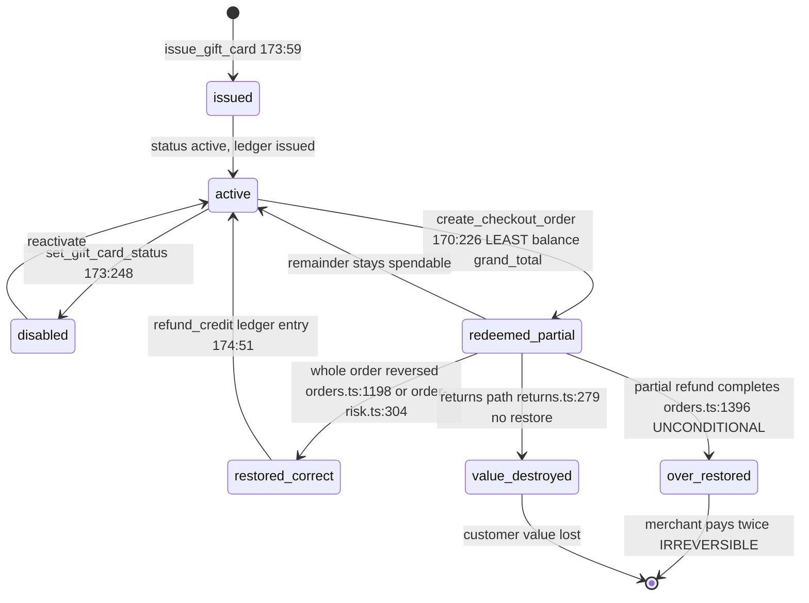
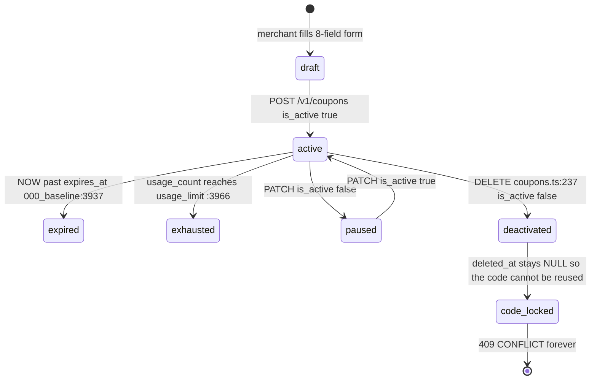
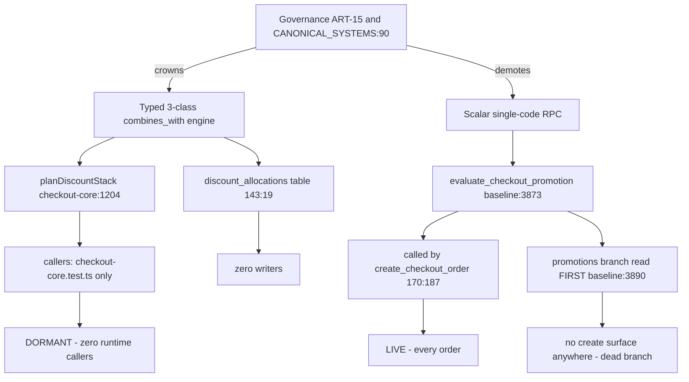

# 15 — COUPONS, DISCOUNTS, GIFT CARDS

| Field | Value |
|---|---|
| **Run ID** | `docs/merchant-system-discovery/2026-08-04T225330+0530-bf35062e` |
| **Branch** | `stepup/main` |
| **Commit** | `bf35062e` |
| **Run date** | 2026-08-04 (+0530) |
| **Scope** | Merchant coupons/discounts (create → edit → delete → redeem → track), the typed 3-class discount engine, the legacy promotions model, gift cards (issue → deliver → redeem → restore), platform billing coupons (adjacent), and every UI, proxy, gateway route, RPC, table, RLS policy and test that touches them. |
| **Evidence basis** | Agent I discovery notes (`_agent-notes/I-discounts-gift-cards.md`, 1233 lines) plus direct re-verification of 14 load-bearing source locations by this author (listed in §9.3). |
| **METHOD DISCLOSURE** | **Nothing in this document was runtime-verified.** No RPC was executed, no database was connected, no order was created, no gift card was issued, no provider was called. Every status is capped at `IMPLEMENTED_NOT_RUNTIME_VERIFIED`. Where a claim depends on live grants or live data it is marked `BLOCKED_EXTERNAL` or `CONTRADICTORY_EVIDENCE`. |
| **Secrets/PII** | No secrets or PII appear in this document. |

---

## 1. Recommendation / verdict

**Do not launch coupons or gift cards in their current state without fixing three defects that move real money.**

The three, in order:

1. **`POST /orders/:id/refund/complete` over-restores gift-card value on partial refunds.** The call to `restore_gift_card_on_refund` is unconditional and the RPC restores *every* committed redemption on the order at *full* amount. Refund ₹200 of a ₹1,000 gift-card-funded order and the merchant pays ₹200 in cash **and** credits ₹1,000 back onto the card. The credit is an append-only ledger entry and no compensating-entry path exists. `[HIGH-STAKES] [IRREVERSIBLE]` — `MCP-DISC-560`, P0.
2. **The returns refund path never restores gift-card value at all** (`returns.ts:279`). That silently destroys customer value — precisely the bug migration 174 was written to fix, left open on one of the four order-reversal entry points. `MCP-DISC-562`, P1.
3. **Gift-card issuance is not idempotent and has no staff-permission gate.** The gateway mints a fresh `crypto.randomUUID()` idempotency key on every request (`gift-cards.ts:87`), so a double-click or a retry mints a second card — money created twice. And unlike coupons, `gift-cards.ts` contains **zero** `assertStaffPermission` calls; `verifySiteOwnership` alone gates the ability to create store money. `MCP-DISC-563`, P1.

**The winner-selection inversion is the structural headline.** Governance (`LETBUYY_CANONICAL_SYSTEMS.md:90`, `:210-213`; ART-15) crowns the **typed 3-class `combines_with` discount engine** as CANONICAL and demotes the **scalar single-code discount RPC**. The code does the exact inverse: `create_checkout_order` calls `evaluate_checkout_promotion` (the scalar RPC), and `planDiscountStack` — the typed engine — has **zero non-test callers**. `discount_allocations`, the table migration 143 created for it, has **zero writers**. A third model (`promotions` / `promotion_codes` / `promotion_effects`) is evaluated *ahead of* coupons inside the live money RPC and has no create surface anywhere in the product. Three parallel discount models for one domain, with the governance-named winner being the dormant one — `WIN-R4` / `ANTI-R1`. `MCP-DISC-567`.

The inversion is worse than dormancy because the **typed configuration surface is live while the typed evaluation is not**. `planCouponCreate` persists `discount_class`, `combines_with`, `automatic`, `priority`; `POST /coupons/validate` echoes them back as valid; checkout ignores every one of them. The API tells a merchant their combinable, automatic, product-scoped discount is configured, and then behaves as if none of it was set.

**Where the implementation is genuinely strong — and this deserves stating plainly:**

- **Gift-card balance is a correct ledger projection.** `gift_card_accounts.balance` is written exactly once at issuance and never decremented anywhere in migrations or TypeScript. Every reader — `create_checkout_order`, `gift_card_available_balance`, `list_gift_cards`, `check_gift_card_balance`, `gift_card_transactions`, `set_gift_card_status` — computes the balance from `gift_card_ledger_entries`. The invariant is machine-pinned by `scripts/validators/canonical-ledger-only-validator.mjs:174-188`, which asserts `create_checkout_order` *excludes* `UPDATE gift_card_accounts`. **`ANTI-R4` is satisfied.** This is the best-built part of the domain.
- **Gift-card redemption is `FOR UPDATE`-locked** on the account row *before* the ledger is projected (`170:206` → `170:210-224`), so two simultaneous redemptions of the same card cannot overspend. `balance_after >= 0` is a DB CHECK backstop.
- **Coupon code uniqueness is correctly per-store**, case-insensitively — `UNIQUE (store_id, code)` plus `UNIQUE (store_id, upper(code)) WHERE deleted_at IS NULL` — and **total-usage and per-customer limits are row-locked** (`FOR UPDATE` on the coupon row held to COMMIT), so N concurrent checkouts of one coupon cannot exceed `usage_limit`. This is better than the discovery brief anticipated.
- **Discount amounts are server-authoritative.** The subtotal fed to `evaluate_checkout_promotion` is read back from the persisted `orders` row, not from the client. The client's only inputs are a code string and an email. `CODE-R6` / `ANTI-R6` satisfied for the amount.
- **All gift-card mutations go through `SECURITY DEFINER` RPCs** with `ON CONFLICT` idempotency and DB-level `>= 0` CHECKs. Zero direct `.from('gift_card_*').insert/update` in TypeScript.

**The honest summary for the founder:** the *ledger* is right and the *engine* is wrong. The gift-card money model is well-engineered but has no customer-facing surface at all (there is no gift-card input in the storefront checkout), so a merchant can issue and email a code that the recipient has nowhere to enter. The coupon money model is concurrency-safe but is governed by dates that are wrong by up to 42 hours in IST, capped by a `maximum_discount` field the web UI cannot set, and restricted by `applicable_products` values the code silently throws away. And none of it has ever been executed by a test — the "tests" for this domain are `readFileSync` + `assert.match` regexes over source text.

---

## 2. Scope

**In scope**

| Area | Included |
|---|---|
| Merchant coupons | `public.coupons`, `/v1/coupons` + `/v1/discounts` (same router), MCP `/[store]/coupons`, mobile `discounts/` screens |
| Typed discount engine | `planDiscountStack`, `discount_allocations`, migration 143 typed columns |
| Legacy promotions | `promotions`, `promotion_codes`, `promotion_effects`, `promotion_rules`, `promotion_redemptions`, `promotion_usage_counters` |
| Checkout redemption | `evaluate_checkout_promotion`, `create_checkout_order`, storefront checkout coupon UI + public validate |
| Gift cards | `gift_card_accounts`, `gift_card_ledger_entries`, `gift_card_redemptions`, migrations 170/173/174, `/v1/products/gift-cards`, MCP + mobile gift-card screens, issuance email |
| Refund interaction | `restore_gift_card_on_refund` and all four order-reversal entry points |
| Adjacent | `subscription_coupons` (platform→merchant billing) — reported because it is the *model of how it should be done* and it has its own defect |

**Out of scope (owned by other documents in this dossier)**

- GST computation mechanics and invoice immutability beyond the discount-ordering defect (`MCP-DISC-564` is raised here and cross-referenced to the GST document).
- The order lifecycle, refund state machine, and returns workflow in general.
- Platform-wide RLS posture (`ANTI-R5`) — the service-role bypass is noted here as context but belongs to the tenancy document.
- Razorpay signature verification and the payment ledger proper.

---

## 3. Current merchant user journeys (what a merchant can actually do today)

Read this section as "what happens if a merchant sits down at the product right now". Every row is static-code-derived; none was executed.

### 3.1 Coupons — web (merchant control plane)

| Step | What the merchant sees | What actually happens | Verdict |
|---|---|---|---|
| Open `/[store]/coupons` | Coupon list with code, type, value, `used/max`, IST-formatted expiry | `GET` proxy → `/v1/coupons` → `normalizeCouponRecord` | Works |
| Click "New coupon" | Form with **8 fields**: code, type, value, min purchase, max uses, start date, expiry date, active | `coupons/page.tsx:402-480`, payload at `:202-210` | Works, but see next rows |
| Set "20% off" | No field for a maximum discount cap | The proxy field map (`api/stores/[store]/coupons/route.ts:17-28`) never sends `maximum_discount`; the RPC enforces the cap only *if set* (`000_baseline.sql:4009-4011`) | **Every web-created percentage coupon is uncapped.** ₹10,000 given away on a ₹50,000 order. `MCP-DISC-565` |
| Set expiry "31 Aug" | Date picker shows 31 Aug | `<input type="date">` → bare `"2026-08-31"` → `z.coerce.date()` → `new Date(v).toISOString()` → `2026-08-31T00:00:00Z` = **05:30 IST on 31 Aug** | **The coupon dies 18.5 h before the merchant intends.** `MCP-DISC-568` |
| Want a per-customer limit | No field | Silently defaults to 1; mobile *can* set it | Client divergence. `MCP-DISC-565` |
| Want to restrict to a product | No field on web; the API accepts `applicable_products` | `planCouponCreate` omits it entirely; the RPC never reads it | **Accepted and discarded.** `MCP-DISC-566` |
| Edit a coupon | Form pre-filled from the stored ISO timestamp, `.split('T')[0]` | Any non-UTC-midnight timestamp renders as the **previous day** and is silently re-saved wrong | Round-trip corruption. `MCP-DISC-568` |
| Delete a coupon | Row disappears from the active list | `.update({ is_active: false })` — `deleted_at` is never set | **That code can never be recreated.** 409 CONFLICT forever. `MCP-DISC-579` |
| Ask "how much did discounts cost me" | Nothing | No discount analytics endpoint exists anywhere | `MCP-DISC-580` |

### 3.2 Coupons — mobile (merchant app, Flutter)

The mobile form exposes **more** than the web: description, minimum, **maximum**, usage limit, **per-customer limit**, expiry. Two merchant clients, two different money rules for the same coupon.

But `CouponService.validateCoupon` sends `subtotal` where `ValidateCouponSchema` requires `order_total` (`packages/checkout-core/src/index.ts:990-996`) → **mobile coupon validation fails schema validation every time**. `MCP-DISC-576`.

### 3.3 Gift cards — web

| Step | What the merchant sees | What actually happens | Verdict |
|---|---|---|---|
| Open `/[store]/products/gift-cards` | List with projected balance, status, recipient, redemption count | `list_gift_cards` (ledger projection) | Works |
| Issue a card | **Two fields**: value + recipient email | `POST /v1/products/gift-cards` → `issue_gift_card` | Works |
| Double-click "Issue" | Two cards | Gateway mints a fresh random idempotency key each call | **Money created twice.** `MCP-DISC-563` |
| Copy the code | One-time on-screen reveal | Plaintext is returned once and never persisted (only SHA-256 hash + last4 stored) | Correct by design |
| Set an expiry date | No field | `gift_card_accounts.expires_at` exists and is enforced; the UI never sets it | No expiry control (and, incidentally, no TZ exposure) |
| Ask "what is my outstanding gift-card liability" | Nothing on web | The **only** aggregate liability figure in the whole product is `_totalBalance` on the Flutter screen | Balance-sheet blind spot. `MCP-DISC-580` |
| Disable / reactivate a card | Works | `set_gift_card_status`, `FOR UPDATE`, does not burn balance | Correct |
| Adjust or void a card with a compensating credit | Not possible | No such route | Missing |

### 3.4 Gift cards — mobile

Issuance collects **no recipient email**, so no delivery email is sent; and the plaintext code is rendered only in the ephemeral in-memory list row (`card.code.isEmpty ? card.id : card.code`). After any refresh `list_gift_cards` returns no `code`, the row shows the account UUID, and **the plaintext is unrecoverable**. A card issued on mobile and not transcribed immediately is a permanent, unredeemable liability sitting on the merchant's books. `MCP-DISC-576`.

### 3.5 The customer

| Capability | Reality |
|---|---|
| Apply a coupon at checkout | Present (`checkout-client.tsx:1079-1120`) |
| See why a coupon failed | Present, mapped strings |
| **Apply a gift card at checkout** | **Absent.** A repo-wide grep of `apps/storefront-runtime/src` for `giftCard`/`gift_card` returns **exactly one hit** — the API proxy passthrough at `app/api/orders/route.ts:55`. There is no input field. Redemption is reachable only by hand-crafting the order API payload. `MCP-DISC-569` |
| Check my gift-card balance | Absent — `check_gift_card_balance` is behind merchant auth + `verifySiteOwnership` |
| Automatic / cart-level promotions | Not implemented — nothing reads `coupons.automatic` |

---

## 4. Feature matrix

| # | Capability | Status | Evidence (path:line) | Gap |
|---|---|---|---|---|
| 1 | Create coupon (8 fields) | `IMPLEMENTED_NOT_RUNTIME_VERIFIED` | `coupons.ts:84-135`; `checkout-core/src/index.ts:1304-1326` | — |
| 2 | Coupon code uniqueness, per store, case-insensitive | `IMPLEMENTED_NOT_RUNTIME_VERIFIED` | `000_baseline.sql:13731`, `:16961` | — |
| 3 | Edit coupon | `PARTIAL` | `coupons.ts:161-213`; `COUPON_UPDATE_FIELDS` `checkout-core:1113-1129` | 568 |
| 4 | Delete coupon | `PARTIAL` | `coupons.ts:235-238` (`is_active:false` only) | 579 |
| 5 | Coupon date window enforcement (SQL side) | `IMPLEMENTED_NOT_RUNTIME_VERIFIED` | `000_baseline.sql:3936-3937` (`NOW()`, correct in kind) | — |
| 6 | Coupon date **entry** (IST correctness) | `BROKEN` | `coupons/page.tsx:455,461,207-208`; `checkout-core:982-983,1139-1146` | 568 |
| 7 | Minimum order enforcement | `IMPLEMENTED_NOT_RUNTIME_VERIFIED` | `000_baseline.sql:3950-3956` | — |
| 8 | Total usage limit (concurrency-safe) | `IMPLEMENTED_NOT_RUNTIME_VERIFIED` | `000_baseline.sql:3941` (`FOR UPDATE`), `:3966-3976` | — |
| 9 | Per-customer limit | `PARTIAL` | `000_baseline.sql:3982-4004` — email string only, no DB backstop | 573 |
| 10 | Maximum-discount cap (percentage) | `PARTIAL` | Enforced `000_baseline.sql:4009-4011`; **web cannot set it** `coupons/route.ts:17-28` | 565 |
| 11 | Product / collection restriction | `NOT_IMPLEMENTED` | Schema `checkout-core:980-981` + column `000_baseline.sql:8843-8844`; `planCouponCreate` omits; RPC never reads | 566 |
| 12 | Automatic (no-code) discounts | `NOT_IMPLEMENTED` | Persisted `checkout-core:1314`, zero readers | 566 |
| 13 | `combines_with` / stacking | `DORMANT_FLAGGED` | `planDiscountStack` `checkout-core:1204-1269`, callers = tests only; `170:39` single `p_coupon_code` | 567 |
| 14 | `discount_allocations` writes | `NOT_IMPLEMENTED` | `143:19-38`, zero writers repo-wide | 567 |
| 15 | Legacy `promotions` model | `DORMANT_FLAGGED` | `evaluate_checkout_promotion:3890-3921` reads it FIRST; no create surface | 571 |
| 16 | Public coupon validate (preview) | `IMPLEMENTED_NOT_RUNTIME_VERIFIED` | `public-routes.ts:858-910`; `pricing_authority:'checkout'` | — |
| 17 | Server-authoritative discount amount | `IMPLEMENTED_NOT_RUNTIME_VERIFIED` | `170:189` reads `v_order.subtotal` from the persisted row | — |
| 18 | GST computed **after** discount | `NOT_IMPLEMENTED` | `checkout-payment-routes.ts:353` `discount_amount_minor: 0`; `170:194` subtracts discount after tax | 564 |
| 19 | Gift-card issuance | `IMPLEMENTED_NOT_RUNTIME_VERIFIED` | `gift-cards.ts:62-140`; `173:59-156` | 563 |
| 20 | Gift-card issuance idempotency (end-to-end) | `BROKEN` | `gift-cards.ts:87` fresh UUID per call | 563 |
| 21 | Gift-card staff-permission gate | `NOT_IMPLEMENTED` | zero `assertStaffPermission` in `gift-cards.ts` (verified: only `verifySiteOwnership` at `:48,70,154,180,206`) | 563 |
| 22 | Gift-card code hashing | `IMPLEMENTED_NOT_RUNTIME_VERIFIED` | `173:100-101` SHA-256 + last4 | — |
| 23 | Gift-card issuance email | `IMPLEMENTED_NOT_RUNTIME_VERIFIED` | `gift-card-email.ts:78-131`; worker `queue-workers/src/index.ts:472` | 575 |
| 24 | Gift-card balance = ledger projection | `IMPLEMENTED_NOT_RUNTIME_VERIFIED` **(correct)** | `170:210-224`, `173:32-50`; pinned `canonical-ledger-only-validator.mjs:174-188` | — |
| 25 | Gift-card redemption locking | `IMPLEMENTED_NOT_RUNTIME_VERIFIED` **(correct)** | `170:198-206` `FOR UPDATE` before projection | — |
| 26 | Gift-card projection consistency across readers | `CONTRADICTORY_EVIDENCE` | `173:50` clamps `GREATEST(…,0)`; `170:210-224` does not | 572 |
| 27 | **Customer gift-card redemption UI** | `BACKEND_ONLY` | 1 grep hit in the entire storefront app | 569 |
| 28 | Customer gift-card balance check | `NOT_IMPLEMENTED` | `gift-cards.ts:146-157` merchant-auth gated | 569 |
| 29 | Gift-card restore on whole-order cancel/refund | `IMPLEMENTED_NOT_RUNTIME_VERIFIED` | `orders.ts:1198` | — |
| 30 | Gift-card restore on COD cancellation | `IMPLEMENTED_NOT_RUNTIME_VERIFIED` | `order-risk.ts:304` (**enrichment — see §9.4**) | — |
| 31 | Gift-card restore on **partial** refund | `BROKEN` | `orders.ts:1393-1409` unconditional; `174:39-67` restores all at full amount | **560** |
| 32 | Gift-card restore on the **returns** path | `NOT_IMPLEMENTED` | `returns.ts:279` calls `complete_order_refund`, no restore (verified) | 562 |
| 33 | Gift-card money RPC EXECUTE grants | `CONTRADICTORY_EVIDENCE` / `BLOCKED_EXTERNAL` | `173`/`174` have no `REVOKE`; `184:213-216` does | 561 |
| 34 | Money width (`bigint` minor units) | `PARTIAL` | `coupons`+gift-card tables `numeric`; `143:28` and `184:15,18` correct | 578 |
| 35 | Discount / gift-card reporting | `NOT_IMPLEMENTED` | zero hits for `coupon`/`discount`/`gift_card` in `analytics.ts`, `commerce-analytics.ts` | 580 |
| 36 | Behavioural tests | `STUB_OR_MOCK` | `discounts.test.ts` entire file is `readFileSync` + `assert.match` (verified) | 570 |
| 37 | Platform billing coupons (`subscription_coupons`) | `PARTIAL` | Well built (`bigint`, `FOR UPDATE`, explicit `REVOKE`) but `max_redemptions` unenforced at redeem | 574 |
| 38 | Legacy DEAD `gift_cards` table | `PARTIAL` | `000_baseline.sql:9444-9457` + `USING (true)` policy `:26666` | 577 |
| 39 | `bogo` scope lock | `IMPLEMENTED_NOT_RUNTIME_VERIFIED` **(correct)** | Honest 422 at `coupons.ts:91-99,170-178` | — |

---

## 5. UI / route inventory

### 5.1 Merchant control plane (web)

| Surface | Path | Notes |
|---|---|---|
| Coupon list + form | `apps/merchant-control-plane/src/app/[store]/coupons/page.tsx` (600 lines) | 8-field form `:402-480`; payload `:202-210`; hydration slice `:182-183`; list `:535,537` |
| Coupon proxy (collection) | `apps/merchant-control-plane/src/app/api/stores/[store]/coupons/route.ts` | `resolveOwnedStoreId` `:89`; `toWorkerCoupon` 8-field map `:17-28`; POST `:83-105` |
| Coupon proxy (item) | `.../coupons/[couponId]/route.ts` | PATCH `:31-51`; same 8-field map `:17-28` |
| Gift-card page | `apps/merchant-control-plane/src/app/[store]/products/gift-cards/page.tsx` (604 lines) | Issue `:197-204`; reveal+copy `:242-249`; disable/reactivate `:251-268` |
| Gift-card proxies | `.../gift-cards/route.ts` `:25-44`, `.../gift-cards/[id]/route.ts` | |

### 5.2 Storefront runtime

| Surface | Path | Notes |
|---|---|---|
| Checkout client | `apps/storefront-runtime/src/app/store/[subdomain]/checkout/checkout-client.tsx` | Coupon state `:164`; discount applied to displayed total `:252-254`; submit `:361`; preview fetch `:382`; coupon UI `:1062-1120`. **No gift-card input anywhere.** |
| Coupon validate proxy | `apps/storefront-runtime/src/app/api/coupons/validate/route.ts:10-31` | GET, unauthenticated |
| Order proxy | `apps/storefront-runtime/src/app/api/orders/route.ts:48-58` | `:55` passes `giftCardCode` through — the only gift-card reference in the app |

### 5.3 API gateway

| Route | Path | Auth |
|---|---|---|
| `/v1/coupons` **and** `/v1/discounts` (same router object) | `services/api-gateway/src/index.ts:807-808` (verified) | merchant session + `marketing:write` |
| Coupon list/create/get/update/delete/validate | `services/api-gateway/src/routes/coupons.ts:37,84,137,161,215,250` | `verifySiteOwnership` + `assertStaffPermission` `:108,191,232` |
| Public storefront coupon validate | `services/api-gateway/src/routes/storefront/public-routes.ts:373,858,865-910` | **unauthenticated** |
| Storefront order create (money path) | `services/api-gateway/src/routes/storefront/checkout-payment-routes.ts:250-400` | public + idempotency `:265-276` |
| Gift-card routes (mounted on the products router) | `services/api-gateway/src/routes/gift-cards.ts:38-227`, registered `products.ts:1002` | `verifySiteOwnership` only — **no staff permission** |
| Second order path | `services/api-gateway/src/index.ts:724` → `routes/checkout.ts:680` | confirm-time revalidation `:404-416` is decorative (checks only `is_active`) |

### 5.4 Mobile merchant app

`lib/screens/discounts/coupons_screen.dart` (623), `coupon_form_screen.dart` (366), `gift_cards_screen.dart` (483), `lib/services/coupon_service.dart`.

---

## 6. Backend / API / RPC / database mapping

### 6.1 Tables

| Table | Definition | Money type | Role |
|---|---|---|---|
| `public.coupons` | `000_baseline.sql:8817-8848` | `numeric(10,2)` / `numeric(12,2)` | **LIVE** merchant coupon table |
| `coupons` typed columns (`discount_class`, `combines_with`, `automatic`, `priority`, `allocation_method`) | `143_executable_discount_stack.sql:5-12` | — | **written, never read at checkout** |
| `public.discount_allocations` | `143:19-38` | `amount_minor bigint` (correct) | **zero writers** |
| `promotions` / `promotion_codes` / `promotion_effects` / `promotion_rules` / `promotion_redemptions` / `promotion_usage_counters` | `000_baseline.sql` (read `:3890-3942`, written `:2002-2062`) | numeric | read **first** by the live RPC; **no create surface** |
| `gift_card_accounts` | `000_baseline.sql:9366-9387` | `numeric(12,2)`, `balance >= 0` CHECK `:9384` | account (SHA-256 hash + last4) |
| `gift_card_ledger_entries` | `:9394-9413`, CHECKs `:9410-9411` | `numeric(12,2)` | **balance source of truth** |
| `gift_card_redemptions` | `:9420-9437` | `numeric(12,2)` | order ↔ card link |
| `public.gift_cards` (LEGACY) | `:9444-9457` | mutable `numeric(10,2)` balance | **DEAD** per `LETBUYY_CANONICAL_SYSTEMS.md:166`; zero code references; retains `USING (true)` policy `:26666` |
| `subscription_coupons` / `subscription_coupon_redemptions` | `184_v1_subscription_coupons.sql:9-58` | **`bigint` minor** (correct) | platform → merchant billing |
| `order_line_adjustments` | `000_baseline.sql:10069`, written `:1979-2001` | | records `promotion`/`gift_card` rows — **never read** |

### 6.2 RPCs

| RPC | Definition | `SECURITY DEFINER` | Live? | Explicit `REVOKE`? |
|---|---|---|---|---|
| `create_checkout_order` (16-arg) | `170_v1_shipping_rates_gst.sql:31-51` | yes | **LIVE** — the only order-create authority | no |
| `evaluate_checkout_promotion` | `000_baseline.sql:3873-4032` | yes | **LIVE** — the demoted scalar engine | no |
| `gift_card_available_balance` | `173:22-52` | yes | LIVE (projection, clamps to 0) | no |
| `issue_gift_card` | `173:59-156` | yes | LIVE — **mints money** | **no** |
| `list_gift_cards` | `173:160-194` | yes | LIVE | no |
| `check_gift_card_balance` | `173:199-243` | yes | LIVE (merchant-only) | no |
| `set_gift_card_status` | `173:248-319` | yes | LIVE | no |
| `gift_card_transactions` | `173:323-369` | yes | LIVE | no |
| `restore_gift_card_on_refund` | `174:18-89` | yes | LIVE — **credits money**, 3 call sites | **no** |
| `validate_subscription_coupon` | `184:69-154` | yes | LIVE (billing) | **yes** `184:213-216` |
| `redeem_subscription_coupon` | `184:157-211` | yes | LIVE (billing) | **yes** `184:213-216` |

The `REVOKE` column is the single most important asymmetry in this table. See `MCP-DISC-561`.

### 6.3 TypeScript engines

| Symbol | File:line | Runtime callers |
|---|---|---|
| `planDiscountStack` (the typed 3-class engine) | `packages/checkout-core/src/index.ts:1204-1269` | **NONE** — only `test/checkout-core.test.ts:100,138` |
| `planCouponCreate` | `:1304-1326` | `coupons.ts:125` |
| `planCouponUpdate` | `:1328-1341` | `coupons.ts:194` |
| `planCouponValidation` | `:1343-1391` | `coupons.ts:275`, `public-routes.ts:892` |
| `normalizeCouponRecord` | `:1283-1302` | `coupons.ts:80,133,157,211` |
| `toCouponIsoTimestamp` | `:1139-1146` — `new Date(String(value)).toISOString()` (verified) | `planCouponCreate`, `planCouponUpdate` |

### 6.4 END-TO-END TRACE — apply a coupon at checkout (the live money path)

```
Merchant entry point   coupon created via MCP /[store]/coupons  → coupons/page.tsx:402-480
Customer entry point   coupon field in storefront checkout      → checkout-client.tsx:1099-1120
page/route             /store/[subdomain]/checkout
app proxy (preview)    /api/coupons/validate                    → apps/storefront-runtime/.../coupons/validate/route.ts:10-31   [UNAUTHENTICATED]
/v1 gateway (preview)  GET /storefront/:subdomain/coupons/validate → public-routes.ts:858-910
  auth issuer          NONE (public)                            → rate limit = queryCostRateLimit index.ts:681   [UNVERIFIED_RUNTIME — see UQ-5]
  computation          planCouponValidation(subtotal from QUERY STRING) → public-routes.ts:867,892   [DISPLAY ONLY]
client applies         totalAmount = max(0, cartTotal + delivery − discountAmount) → checkout-client.tsx:252-254
order submit           couponCode: appliedCoupon?.code           → checkout-client.tsx:361
app proxy (order)      POST /api/orders                          → apps/storefront-runtime/.../orders/route.ts:48-58
/v1 gateway route      POST /storefront/:subdomain/orders        → checkout-payment-routes.ts:250
  auth issuer          public storefront tenant context          → :264   [NO customer_id binding for guests]
  idempotency          IdempotencyExecutionAdapter 'storefront.checkout.order.create' → :265-276
  server shipping      resolveShippingRate                       → :291
  server GST           calculateGstLine(discount_amount_minor: 0) → :346-360   *** MISSING: discount not known yet ***
typed client           OrderExecutionAdapter.createOrder         → :395
RPC                    db.rpc('create_checkout_order')           → order-execution.adapter.ts:158-176
  server-authoritative COALESCE(v_order.subtotal,0) read from the persisted orders row → 170:181-189   [CORRECT]
  discount engine      evaluate_checkout_promotion(...)          → 170:187-193   *** the DEMOTED engine ***
    promotions branch  promotion_codes ⨝ promotions ⨝ promotion_effects → 000_baseline.sql:3890-3921   [DEAD BRANCH, evaluated FIRST]
    coupons branch     coupons ... FOR UPDATE                    → :3922-3942
    eligibility        dates :3936-7 · min order :3950-6 · total usage :3966-76 · code :3978-80 · per-customer(email) :3982-4004
    amount             percentage / fixed / free_shipping, capped at subtotal+shipping → :4006-4020
  totals               grand_total = subtotal + shipping + tax − discount, floored at 0 → 170:194
tables + RLS           orders.discount / coupon_code / coupon_discount → 170:282-292
                       coupons ENABLE+FORCE 143:67-68, GUC policy :77, blanket policy 164:63-73
                       *** gateway connects as service-role (lib/supabase.ts:13-19) → RLS BYPASSED;
                           tenancy rests on verifySiteOwnership in TypeScript ***
audit rows             order_line_adjustments :1979-2001 · promotion_redemptions :2002-2032
                       coupons.usage_count += 1 :2040-2043 · promotion_usage_counters upsert :2044-2061
webhook/queue          none for discounts
reporting consequence  orders.discount in the CSV export (export.ts:92,510) — MISSING: no discount analytics
tests                  MISSING — no test executes this path
runtime observation    MISSING
```

**MISSING links, summarised:** typed engine (never invoked), `discount_allocations` (never written), stacking (structurally impossible — `170:39` takes one `p_coupon_code`), product/collection restriction (never persisted), automatic discounts (never read), GST-after-discount (ordering inverted), discount analytics, behavioural tests, runtime verification.

### 6.5 END-TO-END TRACE — issue → deliver → redeem → restore a gift card

```
Merchant entry point   MCP /[store]/products/gift-cards  → page.tsx:197-204   [value + recipient email only]
app proxy              POST /api/stores/[store]/gift-cards → gift-cards/route.ts:25-44
typed client           createMerchantApiClient().…
/v1 gateway route      POST /products/gift-cards          → gift-cards.ts:62 (router registered at products.ts:1002)
  auth issuer          merchant ES256 session
  authz                verifySiteOwnership                → gift-cards.ts:70
  staff permission     *** MISSING — zero assertStaffPermission in the file (verified) ***
  code generation      generateGiftCardCodeFromBytes(crypto.getRandomValues(16B)) → :86   [128-bit CSPRNG, correct]
  idempotency key      `gift_card.issue:${store}:${crypto.randomUUID()}` → :87   *** FRESH PER CALL — not idempotent ***
RPC                    issue_gift_card                    → 173:59-156
  account insert       ON CONFLICT (site_id, code_hash) DO NOTHING → 173:103-121
  ledger 'issued'      ON CONFLICT (site_id, idempotency_key) DO NOTHING → 173:127-138
  code storage         SHA-256 hash + last4 only          → 173:100-101   [correct]
delivery               enqueueGiftCardIssuedEmail          → gift-cards.ts:119-131 → gift-card-email.ts:78-131
                       *** plaintext code inside the queue payload :52,61,88 ***
                       *** unescaped ${greetingName}/${note}/${fromStore} in HTML :59-64 ***
                       *** silent skip if no queue and no RESEND key :102-112, still returns 201 ***
queue worker           email.gift_card_issued              → queue-workers/src/index.ts:472
Customer entry point   *** MISSING — no gift-card input in the storefront checkout ***
redemption (backend)   create_checkout_order               → 170:196-278
  lookup               site_id + code_hash + status active + not expired, FOR UPDATE → 170:198-206   [correct]
  balance              ledger SUM projection               → 170:210-224   *** initial_value fallback, no GREATEST clamp ***
  amount               LEAST(balance, grand_total)         → 170:226
  redemption row       ON CONFLICT (site_id, idempotency_key) → 170:233-259
  ledger 'debit'       ON CONFLICT                          → 170:261-278
  payment due          grand_total − gift_card_amount      → 170:280; auto paid/confirmed if 0 → :289-290
restore on reversal    restore_gift_card_on_refund         → 174:18-89
  call site 1          PATCH /orders/:id status cancelled|refunded → orders.ts:1198   [CORRECT — whole order]
  call site 2          COD cancellation                     → order-risk.ts:304   [CORRECT — whole order]
  call site 3          POST /orders/:id/refund/complete     → orders.ts:1396   *** UNCONDITIONAL — WRONG on partial ***
  call site 4          POST /returns/:id/refund/complete    → returns.ts:279   *** MISSING ENTIRELY ***
reporting consequence  MISSING — no liability report on web; only gift_cards_screen.dart:68
tests                  tests/launch/lb11-giftcards.test.mjs, lb11-refund-restore.test.mjs — 100% regex-on-source
runtime observation    MISSING
```

---

## 7. State machines

### 7.1 Gift-card redemption and restore



The three terminal outcomes on the right are the whole of `MCP-DISC-560` and `MCP-DISC-562`. Two of the four reversal entry points are correct; one over-credits; one under-credits.

### 7.2 Coupon lifecycle



Note the missing transition: there is no path that sets `deleted_at`, so `code_locked` is absorbing. `MCP-DISC-579`.

### 7.3 Discount engine selection (the inversion)



---

## 8. Auth / tenant / invariant analysis

### 8.1 Auth and authorization per surface

| Surface | Issuer | Ownership check | Staff permission | Verdict |
|---|---|---|---|---|
| `POST/PATCH/DELETE /v1/coupons` | merchant ES256 session | `verifySiteOwnership` `coupons.ts:104,187,230` | `marketing:write` `:108,191,232` | Correct |
| `POST /v1/coupons/validate` | merchant session | yes | — (read-only preview) | Acceptable |
| `GET /storefront/:subdomain/coupons/validate` | **none** | subdomain-scoped | — | Preview only; code-enumeration oracle risk unresolved (`UQ-5`) |
| `POST /storefront/:subdomain/orders` | **none** (public checkout) | subdomain-scoped | — | Amount is server-authoritative; guest identity is an email string |
| **All 5 gift-card routes** | merchant session | `verifySiteOwnership` `:48,70,154,180,206` | **NONE** (verified) | **Gap `MCP-DISC-563`** — money creation is less protected than coupon editing |
| `POST /orders/:id/refund/complete` | merchant session | `resolveTenantContextForOrder` | `orders:write` `orders.ts:1348` | Permission correct; the *logic* is wrong (`MCP-DISC-560`) |

### 8.2 Tenancy

- **Coupon codes are correctly per-store.** `coupons_site_id_code_key UNIQUE (store_id, code)` (`000_baseline.sql:13731`) plus `idx_coupons_store_code_active UNIQUE (store_id, upper(code)) WHERE deleted_at IS NULL` (`:16961`). The second is the one that matters, because lookup normalizes with `UPPER()` (`evaluate_checkout_promotion:3925`). Gift cards: `gift_card_accounts_site_id_code_hash_key UNIQUE (site_id, code_hash)` (`:14147`) — also correct. `subscription_coupons` is globally unique (`184:33-34`) — correct for platform billing.
- **Dual tenant columns on a live money table.** `coupons.site_id` is backfilled from `store_id` (`143:14-17`); the RLS policy uses `COALESCE(site_id, store_id)` (`143:77`) while all application code and both unique indexes use `store_id`. A divergence between the two columns would split RLS from uniqueness.
- **RLS exists but is bypassed in production.** `coupons` and `discount_allocations` get `ENABLE` + `FORCE` + a GUC policy at `143:67-86`; migration `164_d4_tenant_role_guc.sql:33-76` dynamically applies `ENABLE` + `FORCE` + `FOR ALL TO app_tenant USING (site_id = public.current_site_id())` to every `public` base table with a `site_id`/`store_id` column, which covers all four gift-card tables. **But the gateway does not connect as `app_tenant`** — `getSupabaseAdmin` (`services/api-gateway/src/lib/supabase.ts:13-19`) returns the service-role client wrapped by an in-process guard. Tenant isolation for this domain therefore rests on `verifySiteOwnership` in TypeScript, not on database RLS. This is the platform-wide `ANTI-R5` posture, not a discount-specific finding; it belongs to the tenancy document but is load-bearing here because gift-card RPCs take `p_store_id` as a caller-supplied parameter.
- **The DEAD `public.gift_cards` table retains `CREATE POLICY … USING (true) WITH CHECK (true)` with no `TO` clause** (`000_baseline.sql:26666`), so it applies to `PUBLIC`. Exploitability depends on Supabase-managed table grants that are not in the repo. `MCP-DISC-577`.

### 8.3 Invariant scorecard

| Invariant | Verdict | Evidence |
|---|---|---|
| `ANTI-R4` — money is a ledger projection, not a mutable column | **SATISFIED** for gift cards | `gift_card_accounts.balance` written once at issuance (`173:108`), never decremented; grep for `SET balance`/`balance = balance` on that table returns nothing; pinned by `canonical-ledger-only-validator.mjs:174-188` |
| Canonical-ledger-only — no TS writes to money tables | **SATISFIED** for gift cards | `gift-cards.ts` uses only `db.rpc(...)` at `:53,88,159,185,211` |
| Validator coverage of the ledger tables | **PARTIAL** | `canonical-ledger-only-validator.mjs:12-25` lists `gift_card_accounts` + `gift_card_ledger_entries` but **omits `gift_card_redemptions`** — a direct TS write there would pass the gate (none exists today) |
| `CODE-R6` / `ANTI-R6` — server-authoritative amounts | **SATISFIED** for the discount amount | `170:189` reads `v_order.subtotal` from the persisted row; client supplies only a code and an email |
| Idempotency on every money RPC | **PARTIAL** | Redemption/restore/status are idempotent at the RPC; **issuance is not idempotent end-to-end** because the gateway mints the key (`gift-cards.ts:87`) |
| `FOR UPDATE` + `ON CONFLICT` | **SATISFIED** | redemption `170:206`, status `173:275`, restore `174:46`; `ON CONFLICT` at `170:258,277`, `173:138,305`, `174:67` |
| Balances ≥ 0 at the DB level | **SATISFIED** | `000_baseline.sql:9384,9410,9411,9435` |
| `WIN-R4` / `ANTI-R1` — one winner per capability | **VIOLATED** | Three discount models; the governance winner is the dormant one |
| `ANTI-R3` — no governance theater | **VIOLATED in spirit** | `discounts.test.ts:43` asserts `/export function planDiscountStack/` — that the function *exists in the file* — while nothing calls it (verified: entire file is `readFileSync` + `assert.match`) |
| `ANTI-R9` — no silent success | **VIOLATED** | `applicable_products`/`applicable_categories` accepted then discarded; gift-card email silently skipped while returning 201 |
| Step-up on money creation | **ABSENT** | Refunds/payouts require HMAC step-up; gift-card *issuance* — which mints money — has none |
| Money width (`*_minor bigint`) | **VIOLATED** (known, scheduled) | `coupons` + gift-card tables are `numeric`; `LEG-043` Wave 5 |

---

## 9. Runtime and test evidence

### 9.1 What was NOT verified — state this to anyone reading the document

Nothing was executed. Specifically **not** verified:

- No gift card was issued. No balance was computed. No redemption occurred.
- No order was created. `evaluate_checkout_promotion` was never invoked.
- No refund was completed, so the over-restore defect (`MCP-DISC-560`) is proven **from code reading only** — the call site is unconditional and the RPC restores all committed redemptions at full amount; both facts are re-verified from source by this author, but the resulting double-payment was not observed.
- No concurrency behaviour was observed. The row-lock analysis in §8 is a reading of `FOR UPDATE` placement under READ COMMITTED, not an experiment.
- No database was connected, so effective `EXECUTE` grants on `issue_gift_card` / `restore_gift_card_on_refund` are **unknown** (`MCP-DISC-561`).
- No app build was run for this domain.

### 9.2 Existing test coverage

| Test | What it actually does | Verdict |
|---|---|---|
| `services/api-gateway/src/__tests__/discounts.test.ts` (47 lines, 2 tests) | **Verified by this author: every assertion is `assert.match` over `readFileSync`.** Asserts migration 143 text, `api.route('/discounts', couponsRouter)`, and `/export function planDiscountStack/` | `STUB_OR_MOCK` |
| `tests/launch/lb11-giftcards.test.mjs` (11 tests) | 100% regex-on-source over migration 173, `gift-cards.ts`, `products.ts`, `gift-card-email.ts`, the worker, the MCP page | `STUB_OR_MOCK` |
| `tests/launch/lb11-refund-restore.test.mjs` (6 tests) | Regex over migration 174 + `orders.ts`; `:46` asserts the PATCH call site exists. **No assertion about full-vs-partial gating** | `STUB_OR_MOCK` |
| `tests/launch/lb-merchant-admin.test.mjs:145` | Regex asserting 3 `assertStaffPermission(… 'marketing:write')` sites in `coupons.ts`. Does **not** cover `gift-cards.ts` — which is why the missing gift-card permission is invisible to the gate | `UNIT_TEST` (weak) |
| `packages/checkout-core/test/checkout-core.test.ts:100,138` | Two real unit cases for `planDiscountStack` | `UNIT_TEST` — **a real test of dead code** |
| `tests/executable/discount-postgres.test.mjs` (1 test) | Real Postgres (docker): applies migration 143, checks `discount_allocations` RLS isolation, rolls back | `INTEGRATION_TEST` — real, but scoped to a table with **zero writers**; tests no discount behaviour |
| `tests/e2e/` | grep for `coupon`/`gift` → **zero hits** | `E2E_TEST` MISSING |

**Coverage that does not exist anywhere in the repository:** issuing a gift card and redeeming it; any numeric assertion on the balance projection; any concurrency test (coupon usage limit, gift-card double-spend); any test of `evaluate_checkout_promotion` behaviour; any timezone/date-boundary test; any test that a partial refund does not over-restore; any test that the returns path restores.

### 9.3 Re-verification performed by this author

The following were re-opened from source and **confirmed** to match the notes:

| Claim | Location | Result |
|---|---|---|
| Unconditional restore on refund completion | `services/api-gateway/src/routes/orders.ts:1393-1409` | Confirmed — no full-vs-partial gate |
| Correct restore on whole-order status change | `orders.ts:1195-1211` | Confirmed |
| Returns path has no restore | `returns.ts:279` (`complete_order_refund` only) | Confirmed |
| `restore_gift_card_on_refund` restores all committed redemptions at full `v_redemption.amount` | `174:39-67` | Confirmed |
| Migration 174 header disclaims partial splitting | `174:14-16` | Confirmed |
| `toCouponIsoTimestamp` = `new Date(String(value)).toISOString()` | `packages/checkout-core/src/index.ts:1139-1146` | Confirmed |
| `planCouponCreate` omits `applicable_products` / `applicable_categories`, writes typed columns | `checkout-core:1304-1326` | Confirmed |
| Fresh random idempotency key per issuance | `gift-cards.ts:87` | Confirmed |
| No `assertStaffPermission` in `gift-cards.ts` | `gift-cards.ts` (only `verifySiteOwnership` at `:48,70,154,180,206`) | Confirmed |
| `/coupons` and `/discounts` route the same router object | `services/api-gateway/src/index.ts:807-808` | Confirmed |
| `evaluate_checkout_promotion` called from `create_checkout_order` with `v_order.subtotal` | `170:187-193` | Confirmed |
| Gift-card balance projection with `initial_value` fallback, no `GREATEST` clamp | `170:210-224` | Confirmed |
| `discount_amount_minor: 0` into `calculateGstLine` | `checkout-payment-routes.ts:353` | Confirmed |
| Coupon delete sets only `is_active: false` | `coupons.ts:235-238` | Confirmed |
| `discounts.test.ts` is entirely regex-on-source | whole file | Confirmed |
| Storefront has no gift-card UI (1 grep hit, the API passthrough) | `apps/storefront-runtime/src` | Confirmed |

### 9.4 Enrichment — one fact the notes did not record

The notes state `restore_gift_card_on_refund` is "invoked from 2 of 3 refund paths". There are in fact **three** call sites, not two:

1. `services/api-gateway/src/routes/orders.ts:1198` — `PATCH /orders/:id` → `cancelled`/`refunded` (whole order, **correct**)
2. `services/api-gateway/src/routes/orders.ts:1396` — `POST /orders/:id/refund/complete` (**unconditional, wrong on partial**)
3. `services/api-gateway/src/routes/order-risk.ts:304` — `releaseCancelledCodOrderResources`, invoked when a COD order is cancelled/rejected/auto-expired (whole order, **correct**)

and the fourth order-reversal entry point, `services/api-gateway/src/routes/returns.ts:279`, has **no restore at all**.

This does not contradict the notes' finding; it strengthens their remediation argument. Gift-card restoration is being replicated per-route with a copy-paste `try/catch`. Three routes got it (one incorrectly), one did not. That is exactly why restoration must become a property of `complete_order_refund` itself rather than of whichever route the engineer remembered — see `MCP-DISC-562`.

---

## 10. Implemented vs missing

### 10.1 Implemented and correct

1. Gift-card balance as a genuine ledger projection, identical formula in three places, machine-pinned by a validator. `ANTI-R4` satisfied.
2. Gift-card redemption `FOR UPDATE`-locked before projection — no same-card double-spend.
3. Coupon total-usage and per-customer limits row-locked and concurrency-safe on the live path.
4. Coupon codes per-store unique, case-insensitively.
5. Discount amounts server-authoritative; the client supplies only a code string.
6. All gift-card mutations via `SECURITY DEFINER` RPCs with `ON CONFLICT` and DB-level `>= 0` CHECKs.
7. Gift-card codes stored SHA-256-hashed with only `code_last4` in the clear; plaintext never persisted by the gateway.
8. Fraud hold works — `set_gift_card_status` gates redemption on `status = 'active'` without burning balance.
9. `bogo` is scope-locked at the API with an honest 422 even though the DB CHECK allows it — a good example of an honest capability boundary.
10. The platform's own billing-coupon system (migration 184) is the model the storefront coupon system should be measured against: `bigint` minor units, `FOR UPDATE`, plan and billing-period restrictions, unique idempotency key, and an explicit `REVOKE … FROM PUBLIC`.

### 10.2 Implemented but wrong

| Thing | Wrongness |
|---|---|
| Partial-refund gift-card restore | Restores the full redemption. Merchant pays twice. `MCP-DISC-560` |
| Coupon start/expiry dates | Stored as UTC midnight from a bare `type="date"` input; ~42 h skew vs IST intent. `MCP-DISC-568` |
| Gift-card issuance idempotency | Key minted server-side per request; retries mint money. `MCP-DISC-563` |
| GST ordering | Tax computed before the discount is known; invoice overstates output tax. `MCP-DISC-564` |
| Coupon "delete" | Deactivates without setting `deleted_at`; the code is permanently unreusable. `MCP-DISC-579` |
| `create_checkout_order` balance projection | Diverges from `gift_card_available_balance` (no `GREATEST` clamp, has an `initial_value` fallback). `MCP-DISC-572` |
| Mobile coupon validate | Wrong field name; fails schema validation every time. `MCP-DISC-576` |
| `subscription_coupons` redeem | `max_redemptions` not re-checked under the lock. `MCP-DISC-574` |

### 10.3 Missing

| Thing | Consequence |
|---|---|
| Storefront gift-card input | The entire redemption engine is unreachable by a customer. `MCP-DISC-569` |
| Customer balance-check surface | Recipients cannot see what they hold. `MCP-DISC-569` |
| Gift-card restore on the returns refund path | Customer value silently destroyed. `MCP-DISC-562` |
| Typed engine invocation + `discount_allocations` writes | Governance winner is dormant. `MCP-DISC-567` |
| Stacking / `combines_with` evaluation | Structurally impossible — one `p_coupon_code` per order |
| Product / collection restriction persistence and enforcement | Accepted and discarded. `MCP-DISC-566` |
| Automatic (no-code) discounts | Persisted, never read. `MCP-DISC-566` |
| `maximum_discount`, `per_customer_limit`, `description` on the web form | Uncapped percentage coupons. `MCP-DISC-565` |
| Gift-card expiry, bulk issuance, resend, adjust/void, currency, recipient name on the web form | Operational dead ends |
| Discount analytics; gift-card liability report | Merchant cannot cost their promotions or book their liability. `MCP-DISC-580` |
| Staff permission on gift-card routes; step-up on issuance | Money creation is under-protected. `MCP-DISC-563` |
| `REVOKE … FROM PUBLIC` on the 170/173/174 money RPCs | Unknown blast radius. `MCP-DISC-561` |
| Any behavioural test of this domain | The gate is green on untested money code. `MCP-DISC-570` |

---

## 11. Gap IDs

Twenty-one gaps, `MCP-DISC-560` … `MCP-DISC-580`, ordered most-severe first. Every status is capped at `IMPLEMENTED_NOT_RUNTIME_VERIFIED` because nothing was executed.

---

### MCP-DISC-560 — `POST /orders/:id/refund/complete` over-restores gift-card value on partial refunds `[HIGH-STAKES] [IRREVERSIBLE]`

| Field | Value |
|---|---|
| **Domain** | Gift cards × refunds |
| **Status** | `IMPLEMENTED_NOT_RUNTIME_VERIFIED` (defect present in code; consequence not runtime-observed) |
| **Severity** | **P0** |
| **Likelihood** | MEDIUM (needs a gift-card-funded order plus a partial refund; both are supported features — though `MCP-DISC-569` suppresses reachability today) |
| **Reversibility** | **IRREVERSIBLE** — the credit is an append-only `gift_card_ledger_entries` row and no compensating-entry path exists in any code |
| **Confidence** | HIGH |
| **Owner** | lead engineer + ARB (touches a money RPC and a validator-pinned refund path) |

**User/business impact.** A merchant refunds ₹200 of a ₹1,000 order that the customer paid entirely with a gift card. The customer receives the ₹200 **and** the full ₹1,000 is credited back onto the gift card. The merchant has paid out ₹1,200 of value on a ₹1,000 order and has no way to claw it back. Silent, repeatable, and invisible in any report (there is none — `MCP-DISC-580`).

**Exact evidence.**
- `services/api-gateway/src/routes/orders.ts:1341` — route `POST /:id/refund/complete` (verified).
- `services/api-gateway/src/routes/orders.ts:1393-1409` — the `restore_gift_card_on_refund` call sits in an unconditional `try/catch` after the lifecycle email, with no comparison of the refunded amount to the order total (verified). `GATEWAY_CODE`
- `services/api-gateway/src/routes/orders.ts:1427` + `services/api-gateway/src/execution/order-execution.adapter.ts:486-495` — `POST /orders/:id/refund` accepts `lines`, i.e. partial refunds via `create_order_return_and_refund(p_lines)`. `SERVICE_CODE`
- `database/supabase/migrations/174_v1_gift_card_refund_restore.sql:39-67` — the RPC loops **all** `gift_card_redemptions` rows for the order with `status='committed'` and credits `v_redemption.amount` — the **full** redeemed amount — for each (verified). `RPC_FUNCTION`
- `database/supabase/migrations/174_v1_gift_card_refund_restore.sql:14-16` — the migration's own header: partial refunds of gift-card orders are deliberately not auto-split here (verified). `RPC_FUNCTION`

**Expected behavior.** Either restore proportionally to the refunded amount, or refuse to auto-restore on a partial refund and surface an explicit merchant decision. The RPC honours its own stated boundary by not splitting; the *call site* does not honour it by not gating.

**Missing link / root cause.** The call site has no full-vs-partial gate. The RPC was written for the unambiguous "whole order reversed" signal and was then copy-pasted onto a route that also serves partial refunds.

**Blast radius.** Every gift-card-funded order that is partially refunded, on every store. `gift_card_ledger_entries`, `gift_card_redemptions`, merchant liability, and any future liability report.

**Dependencies.** `MCP-DISC-562` (the same restoration logic must move to one place), `MCP-DISC-569` (the missing storefront UI is currently suppressing reachability — fixing 569 without fixing 560 raises this from MEDIUM to HIGH likelihood).

**Recommended remediation approach (no code).** Gate restoration on whether the refund reverses the whole order — compare the refunded total against the order's `total + gift_card_total`, or read the refund row's line coverage. For genuine partial cases, introduce a proportional-split path **inside a `SECURITY DEFINER` RPC** with its own idempotency key. **Never write `gift_card_ledger_entries` from TypeScript** — extend or add an RPC. The cleanest shape is the one described in `MCP-DISC-562`: fold restoration into `complete_order_refund`, where the refunded amount is already known, so the gate cannot be forgotten again.

**Acceptance criteria.**
1. A partial refund restores at most the refunded share of the gift-card tender.
2. A full refund restores exactly once, exactly the redeemed amount.
3. Both are idempotent under replay (double-completion credits nothing extra).
4. Restoration is recorded with an idempotency key derived from the refund, not the order alone.

**Required tests.** Real-Postgres integration: (a) full refund restores once; (b) partial refund restores the proportional amount and no more; (c) double-completion of the same refund credits nothing extra; (d) a fixture order with two gift cards restores each proportionally.

---

### MCP-DISC-561 — No `REVOKE`/`GRANT` control on the gift-card `SECURITY DEFINER` money RPCs `[HIGH-STAKES]`

| Field | Value |
|---|---|
| **Domain** | Gift cards / security |
| **Status** | `CONTRADICTORY_EVIDENCE` (repo shows no grant control; effective grants not determinable statically) → confirmation is `BLOCKED_EXTERNAL` |
| **Severity** | **P0 if confirmed**, P2 as defence-in-depth otherwise |
| **Likelihood** | UNKNOWN |
| **Reversibility** | reversible (a `REVOKE` migration) |
| **Confidence** | MEDIUM on the risk, HIGH on the asymmetry |
| **Owner** | security + ARB |

**User/business impact if the PostgreSQL default holds.** PostgreSQL grants `EXECUTE` to `PUBLIC` on newly created functions. `issue_gift_card` (mints money), `set_gift_card_status`, and `restore_gift_card_on_refund` (credits money) are `SECURITY DEFINER`, take `p_store_id` as a **caller-supplied parameter**, and perform **no internal ownership check** — the only authorization is `verifySiteOwnership` at the gateway route. If PostgREST exposes them to `anon`, an unauthenticated caller holding the public anon key could mint gift cards for an arbitrary `site_id`.

**Exact evidence.**
- `database/supabase/migrations/184_v1_subscription_coupons.sql:213-216` — explicitly `REVOKE ALL ON FUNCTION … FROM PUBLIC` then grants selectively. `RPC_FUNCTION`
- `database/supabase/migrations/173_v1_gift_card_issuance_lifecycle.sql` and `174_v1_gift_card_refund_restore.sql` — whole-file read, **no `GRANT`, no `REVOKE`**. `RPC_FUNCTION`
- Repo-wide grep for `REVOKE` in migrations returns only `165:463-464`, `163:202,216`, `195:327`. `DB_SCHEMA`
- The RPCs take `p_store_id` with no ownership assertion: `173:59-97`, `174:18-37`. `RPC_FUNCTION`

**Expected behavior.** Every `SECURITY DEFINER` money function is revoked from `PUBLIC` and granted only to the roles that need it, and additionally asserts ownership internally so it is safe regardless of grant state.

**Missing link / root cause.** Migration 184 got it right; 170/173/174 did not. The asymmetry within one repository is itself strong evidence of an omission rather than a decision.

**Blast radius.** If confirmed: unauthenticated money creation across all tenants. If not: defence-in-depth only.

**Invariant.** `[HIGH-STAKES]`.

**Dependencies.** Requires a live database check — `\df+ public.issue_gift_card` — and knowledge of Supabase's role bootstrap, which is not in this repo.

**Recommended remediation approach.** Mirror migration 184: `REVOKE ALL … FROM PUBLIC` and grant `EXECUTE` to `service_role` only, for every money RPC introduced in 170/173/174. Independently, add an in-RPC ownership assertion so the function is safe even if grants drift. Add a repository validator that fails when a `SECURITY DEFINER` function touching a money table has no explicit `REVOKE … FROM PUBLIC`.

**Acceptance criteria.** A validator asserts the `REVOKE` for every money RPC; a live `\df+` shows no `PUBLIC` EXECUTE on `issue_gift_card`, `set_gift_card_status`, `restore_gift_card_on_refund`, `create_checkout_order`, `evaluate_checkout_promotion`.

**Required tests.** A static validator over migrations; a live grant check as part of the deployment certification.

---

### MCP-DISC-562 — The returns refund path never restores gift-card value `[HIGH-STAKES] [IRREVERSIBLE]`

| Field | Value |
|---|---|
| **Domain** | Gift cards × returns |
| **Status** | `NOT_IMPLEMENTED` (on that path) |
| **Severity** | P1 |
| **Likelihood** | MEDIUM |
| **Reversibility** | IRREVERSIBLE for the affected customer without a manual compensating issuance |
| **Confidence** | HIGH |
| **Owner** | ARB + lead engineer (`complete_order_refund` is validator-pinned) |

**User/business impact.** A refund completed through the returns workflow silently destroys the customer's redeemed gift-card balance. The customer paid with a gift card, returned the goods, was refunded through returns — and the gift-card value is gone. This is precisely the bug migration 174 exists to fix, left open on one of the four order-reversal entry points.

**Exact evidence.**
- `services/api-gateway/src/routes/returns.ts:279-286` — calls `complete_order_refund` and returns; no subsequent `restore_gift_card_on_refund` (verified by reading `:265-295` and by grepping `restore_gift_card` across `services/api-gateway/src/routes/`). `GATEWAY_CODE`
- Contrast: `orders.ts:1198`, `orders.ts:1396`, `order-risk.ts:304` all call it. `GATEWAY_CODE`
- `database/supabase/migrations/174_v1_gift_card_refund_restore.sql:1-16` states the destruction consequence the migration exists to prevent. `RPC_FUNCTION`

**Expected behavior.** Every refund-completion path restores gift-card tender.

**Missing link / root cause.** The call was added to `orders.ts` (and later `order-risk.ts`) as a per-route `try/catch`, never to `returns.ts`. Restoration is a per-route copy-paste rather than a property of refund completion.

**Blast radius.** All returns-driven refunds of gift-card-funded orders.

**Dependencies.** Interacts with `MCP-DISC-560` — fixing both with one change is the right move.

**Recommended remediation approach.** Fold gift-card restoration into `complete_order_refund` itself, inside the same transaction, where the refunded amount is already known. That fixes `MCP-DISC-560`'s gating problem and `MCP-DISC-562`'s omission with one change and immunises future routes. `complete_order_refund` is validator-pinned, so this requires ARB. Do not replicate the call a fourth time.

**Acceptance criteria.** Restoration is a property of refund completion, not of a particular route; a test proves all four reversal entry points (`PATCH` status, `refund/complete`, COD cancellation, returns) restore correctly and proportionally.

**Required tests.** Postgres integration covering all four entry points with a gift-card-funded fixture order.

---

### MCP-DISC-563 — Gift-card issuance is not idempotent and has no staff-permission gate `[HIGH-STAKES] [IRREVERSIBLE]`

| Field | Value |
|---|---|
| **Domain** | Gift cards / security |
| **Status** | `IMPLEMENTED_NOT_RUNTIME_VERIFIED` (both defects present in code) |
| **Severity** | P1 |
| **Likelihood** | HIGH — a double-click is enough for (a); (b) is unconditional |
| **Reversibility** | IRREVERSIBLE — an over-issued card is redeemable money and there is no void/adjust route |
| **Confidence** | HIGH |
| **Owner** | security + lead engineer |

**User/business impact.**
(a) Every `POST /products/gift-cards` mints a fresh idempotency key, so a double-click, a client timeout-and-retry, or a proxy retry **issues a second gift card** — money created twice, with no linkage between the two cards and no way to void either.
(b) `gift-cards.ts` contains **zero** `assertStaffPermission` calls (verified). Any principal that clears `verifySiteOwnership` can mint store money — while the strictly *less* dangerous coupon routes are gated on `marketing:write`.

**Exact evidence.**
- `services/api-gateway/src/routes/gift-cards.ts:87` — `` `gift_card.issue:${body.store_id}:${crypto.randomUUID()}` `` inside the retry loop, minted per attempt (verified). `GATEWAY_CODE`
- `apps/merchant-control-plane/src/app/[store]/products/gift-cards/page.tsx:197-204` — no client-supplied key. `UI_CODE`
- `database/supabase/migrations/173_v1_gift_card_issuance_lifecycle.sql:81-83,91-97,138` — the RPC **is** idempotent on the key it is given (`ON CONFLICT (site_id, idempotency_key) DO NOTHING`); the gateway defeats it. `RPC_FUNCTION`
- Absence of `assertStaffPermission` in `gift-cards.ts` (only `verifySiteOwnership` at `:48,70,154,180,206` — verified) vs its presence at `services/api-gateway/src/routes/coupons.ts:108,191,232` and `services/api-gateway/src/routes/products.ts:1113,1141,1167,1198`. `GATEWAY_CODE`
- `tests/launch/lb-merchant-admin.test.mjs:145` pins the coupon permission check and omits `gift-cards.ts` — which is why the gap is invisible to the gate. `UNIT_TEST`

**Expected behavior.** A client-supplied idempotency key threaded end-to-end (as orders and checkout already do via `IdempotencyExecutionAdapter`), and a `marketing:write`-or-stronger permission on money creation.

**Missing link / root cause.** The gateway treats the idempotency key as an internal implementation detail rather than a client contract; the staff-permission convention was applied route-by-route and this router was missed.

**Blast radius.** Every gift card ever issued; total store liability; the (non-existent) liability report.

**Recommended remediation approach.** Require an `Idempotency-Key` header or body field on issuance and pass it verbatim to `issue_gift_card`; add `assertStaffPermission(…, 'marketing:write')` — or a dedicated `giftcards:issue` — to all five gift-card routes; evaluate step-up (HMAC) for issuance above a merchant-configurable threshold, consistent with the refund/payout policy, since issuance is money *creation*. Extend `lb-merchant-admin.test.mjs` to cover `gift-cards.ts`.

**Acceptance criteria.** Replaying the same issuance request returns the same card and creates no second ledger entry; a staff member without the permission receives 403; the staff-permission test covers `gift-cards.ts`; the MCP and mobile clients both send a stable key.

**Required tests.** Integration: same key twice → one card; different key → two cards. Authorization: staff without `marketing:write` → 403 on all five routes.

---

### MCP-DISC-564 — GST is computed on the pre-discount amount `[HIGH-STAKES]`

| Field | Value |
|---|---|
| **Domain** | Discounts × GST |
| **Status** | `IMPLEMENTED_NOT_RUNTIME_VERIFIED` (defect present) |
| **Severity** | P1 |
| **Likelihood** | HIGH (any discounted order in a GST-registered store) |
| **Reversibility** | **Effectively irreversible per invoice** — GST invoices are immutable once issued |
| **Confidence** | HIGH on the code path; the legal characterization must be confirmed by the CA |
| **Owner** | CA-tax + ARB + lead engineer |

**User/business impact.** The customer is charged GST on the undiscounted value; the invoice overstates output tax; the merchant's GSTR filings will not reconcile with the amount actually collected. A ₹500-off coupon on a ₹5,000 order still carries GST on ₹5,000. Under CGST Act s.15(3)(a), a discount recorded at the time of supply reduces the taxable value.

**Exact evidence.**
- `services/api-gateway/src/routes/storefront/checkout-payment-routes.ts:346-360` — `calculateGstLine({ …, discount_amount_minor: 0, … })` at `:353` (verified). `calculateGstLine` supports `discount_amount_minor` as a first-class field; the gateway simply never populates it. `GATEWAY_CODE`
- `services/api-gateway/src/routes/storefront/checkout-payment-routes.ts:365` — `computedTaxAmount = taxMinor / 100`. `GATEWAY_CODE`
- `database/supabase/migrations/170_v1_shipping_rates_gst.sql:159` — `v_tax_amount := COALESCE(p_tax_amount, 0)`; `:194` — `grand_total = subtotal + shipping + tax − discount` (verified: the discount is resolved at `:187-193`, *after* the tax was computed in the gateway). `RPC_FUNCTION`

**Expected behavior.** The discount is resolved server-side **before** GST, allocated to lines, and passed into `calculateGstLine` as `discount_amount_minor`.

**Missing link / root cause.** Ordering inversion. The gateway computes tax before it knows the discount; the RPC resolves the discount afterwards and subtracts it from a total that already contains the wrong tax.

**Blast radius.** Every discounted order's invoice and tax liability, in every GST-registered store.

**Dependencies.** `MCP-DISC-567` — a discount engine that can allocate to lines before tax is a prerequisite for doing this properly rather than approximately.

**Recommended remediation approach.** Move discount resolution ahead of GST computation: either resolve the discount in the gateway before the tax loop using the same server-authoritative source, or move GST computation inside `create_checkout_order` after the discount is known. The second is architecturally cleaner (one transaction, one authority) but touches a validator-pinned money RPC, so it requires ARB. Cross-check with the GST document in this dossier; the invoice is immutable, so this must be right **before any real invoice is issued**.

**Acceptance criteria.** A ₹5,000 order with a ₹500 coupon shows GST computed on ₹4,500 on both the order and the invoice; line-level allocation is deterministic and sums to the order discount; a CA sign-off records the treatment.

**Required tests.** Unit tests over the allocation arithmetic; Postgres integration asserting invoice taxable value on a discounted multi-line order at multiple GST rates.

---

### MCP-DISC-565 — The merchant web UI cannot set the discount cap, per-customer limit, or description; mobile can `[HIGH-STAKES]`

| Field | Value |
|---|---|
| **Domain** | Discounts / merchant-client parity |
| **Status** | `PARTIAL` |
| **Severity** | P1 |
| **Likelihood** | HIGH (every web-created percentage coupon) |
| **Reversibility** | reversible |
| **Confidence** | HIGH |
| **Owner** | lead engineer + founder (whether to force a cap) |

**User/business impact.** On the web, **every percentage coupon is uncapped**. A "20% off" coupon applied to a ₹50,000 order gives away ₹10,000 with no ceiling. `per_customer_limit` is stuck at the schema default of 1 and cannot be raised or lowered. The mobile merchant app exposes both fields. Two merchant clients, two different money rules for the same product.

**Exact evidence.**
- `apps/merchant-control-plane/src/app/api/stores/[store]/coupons/route.ts:17-28` and `.../[couponId]/route.ts:17-28` — `toWorkerCoupon` maps exactly 8 fields. `PROXY_CODE`
- `apps/merchant-control-plane/src/app/[store]/coupons/page.tsx:202-210` — the form payload. `UI_CODE`
- `apps/mobile/merchant-app/lib/screens/discounts/coupon_form_screen.dart:139,164,171,181,189` — description, minimum, **maximum**, usage limit, **per-customer limit**. `UI_CODE`
- The cap **is** enforced when set: `database/supabase/migrations/000_baseline.sql:4009-4011`. `RPC_FUNCTION`
- The schema supports both: `packages/checkout-core/src/index.ts:977,979`. `SERVICE_CODE`

**Expected behavior.** Both merchant clients expose the same money-affecting fields, and a percentage coupon above a threshold cannot be saved without a cap.

**Missing link / root cause.** The proxy field map was written against the first version of the web form and never extended; the mobile client was written independently against the fuller schema.

**Blast radius.** Every percentage coupon created on the web; direct margin exposure.

**Recommended remediation approach.** Add `maximum_discount`, `per_customer_limit`, and `description` to the web form and to both proxy field maps. Consider making `maximum_discount` **required** for percentage coupons above a founder-chosen threshold — this is a product decision, not an engineering one. Longer-term, generate both clients' payload contracts from the shared schema so divergence cannot recur.

**Acceptance criteria.** A percentage coupon created on web and on mobile produces byte-identical `coupons` rows for the same inputs; a percentage coupon over the threshold cannot be saved without a cap; a capped coupon's discount is observably clamped at redemption.

**Required tests.** Contract test asserting the web proxy field map covers every money-affecting field in `CreateCouponSchema`; integration test asserting the cap clamps.

---

### MCP-DISC-566 — Product/collection restrictions and automatic discounts are accepted and silently discarded `[HIGH-STAKES]`

| Field | Value |
|---|---|
| **Domain** | Discounts |
| **Status** | `NOT_IMPLEMENTED` (presented through the API as if supported) |
| **Severity** | P1 |
| **Likelihood** | MEDIUM (requires an API client or a future form to set them) |
| **Reversibility** | reversible |
| **Confidence** | HIGH |
| **Owner** | lead engineer |

**User/business impact.** An API client can set `applicable_products` / `applicable_categories`; the request succeeds with 2xx; the values are **never stored** and **never enforced**. A coupon a merchant believes is limited to one product applies to the entire cart. Separately, `automatic: true` **is** persisted and never acted on — no automatic discount ever applies, anywhere.

**Exact evidence.**
- `packages/checkout-core/src/index.ts:980-981` — `CreateCouponSchema` accepts `applicable_products` and `applicable_categories`. `SERVICE_CODE`
- `packages/checkout-core/src/index.ts:1304-1326` — `planCouponCreate` omits both (verified: the returned `couponInsert` object contains neither). `SERVICE_CODE`
- `packages/checkout-core/src/index.ts:1113-1129` — `COUPON_UPDATE_FIELDS` omits both, so they are not editable either. `SERVICE_CODE`
- The columns exist: `database/supabase/migrations/000_baseline.sql:8843-8844`. `DB_SCHEMA`
- `evaluate_checkout_promotion` (`000_baseline.sql:3873-4032`) never references either identifier. `RPC_FUNCTION`
- `automatic` is written at `checkout-core:1314` and has zero readers. `SERVICE_CODE`

**Expected behavior.** Either enforce the restriction at redemption, or reject the field at the API boundary with an explicit error. Accept-and-drop on a money-affecting field is the worst of the three options.

**Missing link / root cause.** The persist plan and the evaluation RPC. The Zod schema was written for the intended (typed-engine) design; the persist plan was written for the actual (scalar) design; nobody reconciled them.

**Blast radius.** Any merchant or integrator relying on targeted or automatic discounts; uncontrolled discount scope on real money.

**Dependencies.** `MCP-DISC-567` — the engine decision determines whether the honest fix is "enforce" or "reject".

**Recommended remediation approach.** Fold into the `MCP-DISC-567` ARB decision. In the interim, the honest fix is to **reject** unsupported fields with a clear 422 rather than accept-and-drop (`ANTI-R9` — no silent success). Apply the same treatment as the existing `bogo` rejection at `coupons.ts:91-99`, which is a good model.

**Acceptance criteria.** Either a product-restricted coupon fails to apply to an ineligible cart, or setting the field returns an explicit "not supported in V1" 422 naming the field.

**Required tests.** API contract test for the 422; if enforced, a Postgres integration test with an eligible and an ineligible cart.

---

### MCP-DISC-567 — The governance-canonical typed discount engine is dormant; the demoted scalar RPC is the live checkout engine

| Field | Value |
|---|---|
| **Domain** | Discounts / architecture |
| **Status** | `DORMANT_FLAGGED` (typed engine) + `IMPLEMENTED_NOT_RUNTIME_VERIFIED` (scalar engine) |
| **Severity** | P1 |
| **Likelihood** | HIGH — certain; it is the current state |
| **Reversibility** | reversible |
| **Confidence** | HIGH |
| **Owner** | ARB + lead engineer |

**User/business impact.** The platform cannot express any of the discount semantics the Constitution says it must: the `combines_with` matrix, product/order/shipping classes, automatic discounts, or stacking. Merchants get one code per order, no cap on percentage discounts from the web, and no product targeting. Worse, the typed *configuration* surface is live: `planCouponCreate` persists `discount_class`, `combines_with`, `automatic`, `priority`, and `POST /coupons/validate` echoes them back as valid — so the API misrepresents platform behaviour to any integrator who reads it.

**Exact evidence.**
- `GOVERNANCE_REWRITE_2026_06_10/LETBUYY_CANONICAL_SYSTEMS.md:90` — winner registry row 19 names the typed engine CANONICAL and the scalar RPC the loser; `:210-213` — the typed engine is built but dormant. `DOC_CLAIM`
- `packages/checkout-core/src/index.ts:1204-1269` — `planDiscountStack`. `SERVICE_CODE`
- Call-site grep → only `packages/checkout-core/test/checkout-core.test.ts:100,138`. **Zero runtime callers.** `UNIT_TEST`
- `database/supabase/migrations/170_v1_shipping_rates_gst.sql:39` — one `p_coupon_code text` parameter; `:187-193` — calls `evaluate_checkout_promotion` (verified). Stacking is structurally impossible. `RPC_FUNCTION`
- `database/supabase/migrations/143_executable_discount_stack.sql:19-38` — `discount_allocations` with **zero** insert/update sites anywhere in `services/`, `apps/`, `packages/`. `DB_SCHEMA`
- `services/api-gateway/src/index.ts:807-808` — `/coupons` and `/discounts` route the **same** `couponsRouter` object (verified). There is no separate typed-discount API. `GATEWAY_CODE`
- `services/api-gateway/src/__tests__/discounts.test.ts:40-46` — asserts `api.route('/discounts', couponsRouter)` exists in source and that `/export function planDiscountStack/` appears in `checkout-core` (verified: the entire file is `readFileSync` + `assert.match`). It asserts the function *exists in the file*, never that it is *invoked*. `UNIT_TEST`

**Expected behavior.** Per ART-15 and the winner registry: the typed engine evaluates the cart, writes `discount_allocations`, and `evaluate_checkout_promotion` is marked `LEGACY` with a deletion wave.

**Missing link / root cause.** Task 007 delivered the schema, a pure allocator, and an alias mount, and shipped regex tests asserting existence rather than invocation. `planDiscountStack` also only *allocates* pre-computed `amountMinor` values — the rule-evaluation half of the engine was never written. The build ledger records the task as done.

**Blast radius.** Every order. `create_checkout_order`, `evaluate_checkout_promotion`, `coupons`, `discount_allocations`, the coupons/discounts API, both merchant clients, the storefront checkout.

**Invariant.** `WIN-R4` / `WIN-R5` / `ANTI-R1` / `ANTI-R3`. No direct money invariant is breached — the live path is server-authoritative and concurrency-safe.

**Dependencies.** `MCP-DISC-571` (the third model), `MCP-DISC-566` (fields that only make sense under the typed engine), `MCP-DISC-564` (line allocation is a prerequisite for discount-before-tax).

**Recommended remediation approach.** ARB decision first — one of two, not both:
(a) Build the missing rule-evaluation half of the typed engine, route `create_checkout_order` through it, write `discount_allocations`, and mark `evaluate_checkout_promotion` `TRANSITIONAL` → `LEGACY` per `LETBUYY_CANONICAL_SYSTEMS.md:213`; or
(b) Formally re-litigate the winner, demote the typed engine, and delete `discount_allocations` and the typed columns.
What must **not** continue is both existing with the loser live. Either way, replace the regex tests with behavioural tests that fail when a symbol declared canonical has zero non-test callers.

**Acceptance criteria.** Exactly one discount engine is reachable from checkout; a test asserts a discount row lands in the chosen allocation table; the demoted engine is annotated `LEGACY` with a deletion wave; the winner registry and the code agree.

**Required tests.** Postgres integration applying two combinable and two non-combinable discounts and asserting the allocation set; a static validator that fails when a canonical-declared export has zero non-test callers.

---

### MCP-DISC-568 — Coupon start/expiry are stored as UTC midnight from a bare `type="date"` input (India-first date bug)

| Field | Value |
|---|---|
| **Domain** | Discounts / India-first |
| **Status** | `BROKEN` |
| **Severity** | P1 |
| **Likelihood** | HIGH — certain, every coupon |
| **Reversibility** | reversible for future coupons; existing rows need a data migration |
| **Confidence** | HIGH |
| **Owner** | lead engineer |

**User/business impact.** Every date-bounded campaign is wrong. A coupon set to expire **31 Aug** stops working at **05:30 IST on 31 Aug** — the merchant loses the whole of the intended final day. A coupon set to start **1 Sep** is dead for the first 5 h 30 m of 1 Sep IST. Correct IST semantics for "valid through 31 Aug" would be `2026-09-01T18:29:59Z`; the stored value is ~42.5 hours early. Merchants will read this as "the coupon randomly stopped working", and the list column renders the value with `formatIndiaDate`, so the UI shows an IST date that disagrees with the instant that actually governs the coupon.

**Exact evidence.**
- `apps/merchant-control-plane/src/app/[store]/coupons/page.tsx:455,461` — `<Input type="date" …>` yields the bare string `"YYYY-MM-DD"`; `:207-208` sends it unchanged. `UI_CODE`
- `apps/merchant-control-plane/src/app/api/stores/[store]/coupons/route.ts:25-26` — passthrough. `PROXY_CODE`
- `packages/checkout-core/src/index.ts:982-983` — `z.coerce.date()`; `:1139-1146` — `toCouponIsoTimestamp` does `new Date(String(value)).toISOString()` (verified). ECMA-262 parses a date-only ISO string as **UTC**. `SERVICE_CODE`
- `database/supabase/migrations/000_baseline.sql:8827-8828` — the columns are `timestamptz`, compared against `NOW()` at `:3936-3937` — the SQL layer is **correct in kind**; the bug is entirely at the entry point. `DB_SCHEMA` / `RPC_FUNCTION`
- Round-trip hazard: `page.tsx:182-183` slices the stored UTC ISO string with `.split('T')[0]`. Any coupon whose timestamp is not UTC-midnight — e.g. one created via the mobile free-text field `coupon_form_screen.dart:197` — renders as **the previous day** and is silently re-saved as that wrong day. `UI_CODE`
- Financial-year consequence: a "valid till 31 Mar" campaign closes in the *previous* financial year by IST reckoning. No financial-year handling exists anywhere in this domain.

**Expected behavior.** `starts_at` = start-of-day IST; `expires_at` = end-of-day IST (`23:59:59.999+05:30`), each stored as the correct UTC instant; the edit form renders the stored instant back in IST.

**Missing link / root cause.** No timezone normalization anywhere between the date picker and the database.

**Blast radius.** Every coupon; both merchant clients; `evaluate_checkout_promotion`; the storefront preview; existing rows.

**Recommended remediation approach.** Normalize at **one** boundary — convert merchant-entered dates to IST day boundaries before persisting, and render stored instants back in IST for the form. Put the conversion in `checkout-core` so every client inherits it. State the policy explicitly: platform-IST is the sane India-first default; a per-store timezone field is the more correct long-term answer and should be a founder decision. Existing rows need a one-off corrective migration with a documented rule.

**Acceptance criteria.** A coupon set to expire 31 Aug is valid at 23:59 IST on 31 Aug and invalid at 00:01 IST on 1 Sep; a coupon set to start 1 Sep is valid at 00:01 IST on 1 Sep; editing an existing coupon shows the same date the merchant entered.

**Required tests.** Unit tests over the conversion helper at IST day boundaries and across the DST-free IST offset; an integration test that pins `NOW()` either side of the IST boundary and asserts eligibility.

---

### MCP-DISC-569 — Gift cards have no customer-facing surface: no checkout input, no balance check `[HIGH-STAKES]`

| Field | Value |
|---|---|
| **Domain** | Gift cards |
| **Status** | `BACKEND_ONLY` |
| **Severity** | P1 |
| **Likelihood** | HIGH — certain |
| **Reversibility** | reversible |
| **Confidence** | HIGH |
| **Owner** | founder (product decision) + lead engineer |

**User/business impact.** The entire gift-card redemption engine — schema, ledger, `SECURITY DEFINER` RPC, `FOR UPDATE` locking, refund restore — is unreachable by a customer. A merchant can issue and email a code; the recipient has nowhere to enter it. Redemption is reachable only by hand-crafting a `giftCardCode` field in the order API. The merchant's books carry a liability that customers structurally cannot draw down.

**Exact evidence.**
- Grep of `apps/storefront-runtime/src` for `giftCard`/`gift_card` returns **exactly one hit**: `apps/storefront-runtime/src/app/api/orders/route.ts:55` — the proxy passthrough (verified). `UI_CODE`
- `apps/storefront-runtime/src/app/store/[subdomain]/checkout/checkout-client.tsx` has a coupon input at `:1079-1120` and no gift-card input anywhere (verified). `UI_CODE`
- The gateway accepts it: `services/api-gateway/src/routes/storefront/checkout-payment-routes.ts:388`. `GATEWAY_CODE`
- The RPC implements it fully: `170:196-278`. `RPC_FUNCTION`
- Balance check is merchant-auth-gated: `services/api-gateway/src/routes/gift-cards.ts:146-157`. `GATEWAY_CODE`

**Expected behavior.** A gift-card field in the storefront checkout, an applied-balance line in the order summary showing the residual payment due, and a public "check my balance" surface.

**Missing link / root cause.** Storefront UI was never built for a backend that was.

**Blast radius.** The whole gift-card feature. Also note: this currently *masks* the reachability of `MCP-DISC-560` and `MCP-DISC-562` — shipping the UI without fixing those two raises both from MEDIUM to HIGH likelihood. **Sequence the fixes: 560 and 562 before 569.**

**Recommended remediation approach.** Add the gift-card field to the storefront checkout and a rate-limited, code-hash-based public balance endpoint. Do **not** expose `check_gift_card_balance` publicly as-is — it is a code-guessing oracle. Gate it with Turnstile plus rate limiting, and return only masked data (last4, balance, status). Also add merchant-side partial-redemption visibility so the remainder is legible.

**Acceptance criteria.** A customer can redeem an emailed code end-to-end; a partial redemption leaves the remainder spendable on a later order; the storefront shows the applied amount and the residual payment due; the public balance endpoint resists enumeration.

**Required tests.** E2E: issue → email → redeem → partial remainder → second order spends the remainder. Abuse test for the balance endpoint (enumeration rate).

---

### MCP-DISC-570 — Discount and gift-card behaviour has no behavioural test coverage; the "tests" are source-text regexes

| Field | Value |
|---|---|
| **Domain** | Discounts / Gift cards / governance |
| **Status** | `STUB_OR_MOCK` |
| **Severity** | P1 |
| **Likelihood** | HIGH — certain |
| **Reversibility** | reversible |
| **Confidence** | HIGH |
| **Owner** | lead engineer |

**User/business impact.** The validator gate is green on this domain while none of it has ever been executed. The regex tests structurally cannot catch any of `MCP-DISC-560` … `MCP-DISC-580`.

**Exact evidence.**
- `services/api-gateway/src/__tests__/discounts.test.ts` — entire 47-line file; every assertion is `assert.match` over `readFileSync` (verified in full). `:43` asserts `/export function planDiscountStack/` while nothing calls it. `UNIT_TEST`
- `tests/launch/lb11-giftcards.test.mjs:27-110` — same pattern, 11 tests, no RPC executed, no card issued, no balance computed. `UNIT_TEST`
- `tests/launch/lb11-refund-restore.test.mjs:19-59` — same pattern; `:43-47` asserts the PATCH call site exists and says nothing about the ungated `refund/complete` call site. `UNIT_TEST`
- `tests/executable/discount-postgres.test.mjs:105` — the only real-Postgres test in the domain, and it exercises `discount_allocations`, a table with zero writers. `INTEGRATION_TEST`
- Grep of `tests/e2e/` for `coupon`/`gift` → zero. `E2E_TEST` MISSING

**Expected behavior.** Behaviour is asserted by executing it.

**Recommended remediation approach.** Add real Postgres integration tests for: the coupon eligibility matrix; concurrent redemption against `usage_limit`; IST date boundaries; gift-card issue → redeem → partial remainder; concurrent double-redemption of one card; full vs partial refund restoration across all four reversal entry points. Then add a static validator that fails when a symbol declared canonical in the winner registry has zero non-test callers — that validator would have caught `MCP-DISC-567` at merge time.

**Acceptance criteria.** Each of `MCP-DISC-560`, `562`, `563`, `566`, `568`, `572` has a test that fails on the current code and passes after the fix.

---

### MCP-DISC-571 — A third, write-surface-less promotion model is evaluated ahead of coupons in the live money path `[HIGH-STAKES]`

| Field | Value |
|---|---|
| **Domain** | Discounts |
| **Status** | `DORMANT_FLAGGED` |
| **Severity** | P2 |
| **Likelihood** | MEDIUM |
| **Reversibility** | reversible |
| **Confidence** | HIGH |
| **Owner** | ARB |

**User/business impact.** `evaluate_checkout_promotion` queries `promotion_codes ⨝ promotions ⨝ promotion_effects` **first** and only falls back to `coupons`. Nothing in the product can create those rows. It is a dead branch inside the hottest money RPC, and it is the source of the promotion-level usage-limit race in `MCP-DISC-573`. If rows ever appear — an import, an ops script, a future feature — they silently outrank every merchant coupon.

**Exact evidence.**
- `database/supabase/migrations/000_baseline.sql:3890-3921` (promotion branch) vs `:3922-3942` (coupon fallback). `RPC_FUNCTION`
- Grep for `promotion_codes` / `from('promotions')` / `promotion_redemptions` across `services/api-gateway/src` and `apps/merchant-control-plane/src` → hits only in `services/api-gateway/src/tenant/tenant-tables.registry.ts:1807,1829` (registry metadata). `GATEWAY_CODE`
- Coupon redemptions are nevertheless written into `promotion_redemptions` (`000_baseline.sql:2002-2032`) and `promotion_usage_counters` (`:2044-2061`). `RPC_FUNCTION`

**Expected behavior.** One discount model per `WIN-R4`.

**Missing link / root cause.** UNKNOWN — an older promotions design was schema'd and half-wired, then coupons were bolted into the same evaluation function.

**Blast radius.** `evaluate_checkout_promotion`, six tables, every order.

**Recommended remediation approach.** Decide it inside the `MCP-DISC-567` ARB: either give promotions a real create surface or strip the branch from the RPC and mark the tables `LEGACY` with a deletion wave. Do not leave a higher-precedence dead branch inside a money function.

**Acceptance criteria.** `evaluate_checkout_promotion` (or its successor) reads exactly one model, and the counters it writes belong to that model.

---

### MCP-DISC-572 — The gift-card ledger projection has a divergent fallback that can brick a card `[HIGH-STAKES] [IRREVERSIBLE]`

| Field | Value |
|---|---|
| **Domain** | Gift cards |
| **Status** | `PARTIAL` / `CONTRADICTORY_EVIDENCE` (two "canonical" projections disagree) |
| **Severity** | P2 |
| **Likelihood** | LOW today (all issuance goes through `issue_gift_card`), HIGH impact if it fires |
| **Reversibility** | IRREVERSIBLE for the affected card without a manual compensating credit |
| **Confidence** | MEDIUM — the trigger condition is not proven to exist in data |
| **Owner** | ARB + lead engineer (touches `create_checkout_order`) |

**User/business impact.** For any `gift_card_accounts` row without an `'issued'` ledger entry, the first redemption succeeds using `initial_value` as the balance; the **second** redemption computes a **negative** balance and raises "gift card has no redeemable balance" — destroying all remaining value on the card. Meanwhile `gift_card_available_balance` clamps to 0, so the merchant's UI reports `0` while the checkout RPC sees a negative. The two projections claimed to be canonical are not identical.

**Exact evidence.**
- `database/supabase/migrations/170_v1_shipping_rates_gst.sql:210-224` — `COALESCE(SUM(...), COALESCE(v_gift_card.initial_value, v_gift_card.balance, 0))`, **no `GREATEST` clamp** (verified); `:226-230` — `LEAST(balance, grand_total)` then raise if `<= 0`. `RPC_FUNCTION`
- `database/supabase/migrations/173_v1_gift_card_issuance_lifecycle.sql:32-50` — the same formula with `GREATEST(…, 0)` at `:50`. `RPC_FUNCTION`
- The issued-entry insert is `ON CONFLICT … DO NOTHING` (`173:138`), which can in principle leave an account without its issued entry. `RPC_FUNCTION`

**Expected behavior.** One projection function used by every reader **including** `create_checkout_order`, with no `initial_value` fallback — an account with no ledger has zero spendable balance by definition.

**Recommended remediation approach.** Have `create_checkout_order` call `gift_card_available_balance` instead of inlining the SUM; drop the `initial_value` fallback; add a data check asserting every `gift_card_accounts` row has an `'issued'` entry. Requires ARB because it touches `create_checkout_order`. **Never** repair affected cards with a direct balance write — issue a compensating ledger entry through a `SECURITY DEFINER` RPC.

**Acceptance criteria.** Exactly one projection implementation exists in the schema; a card with no ledger rows has balance 0 in every reader; a data check reports zero accounts without an issued entry.

**Required tests.** Integration: a synthetic account with no issued entry cannot be redeemed at all (rather than being redeemable once and then bricked).

---

### MCP-DISC-573 — Per-customer limits are email-string-based with no DB backstop; the promotion-level limit is racy `[HIGH-STAKES]`

| Field | Value |
|---|---|
| **Domain** | Discounts / abuse |
| **Status** | `PARTIAL` |
| **Severity** | P2 |
| **Likelihood** | HIGH for the email bypass; LOW for the race (promotions unreachable today) |
| **Reversibility** | reversible |
| **Confidence** | HIGH |
| **Owner** | lead engineer + founder (guest-abuse policy) |

**User/business impact.** `per_customer_limit` is enforced by counting `promotion_redemptions` rows matching a lowercased email. Guest checkout carries no `customer_id`, so `a+1@…`, `a+2@…`, or any fresh address defeats it entirely. Separately, the promotion-level `usage_limit` is checked while holding a lock on `promotion_codes` only, so two *different* codes of the same promotion redeemed concurrently can both pass.

**Exact evidence.**
- `database/supabase/migrations/000_baseline.sql:3982-4004` — `LOWER(p_customer_email)` count. `RPC_FUNCTION`
- `:3916` — `FOR UPDATE OF pc` locks `promotion_codes` only, while `promotion_usage_limit` comes from `promotions.usage_limit` (`:3895`) and is checked against a count over the whole promotion (`:3966-3976`). `RPC_FUNCTION`
- No `UNIQUE (coupon_id, customer_email)` index exists in `000_baseline.sql` or `143`. `DB_SCHEMA`
- Public storefront tenant context carries no customer binding: `services/api-gateway/src/routes/storefront/checkout-payment-routes.ts:264`. `GATEWAY_CODE`

**Note the positive alongside it.** For the *live* coupon path the total-usage and per-customer counts are held under `FOR UPDATE` on the coupon row (`000_baseline.sql:3941`) inside the caller's transaction, so N concurrent checkouts of one coupon **cannot** exceed `usage_limit`. The defect is identity, not concurrency.

**Expected behavior.** Per-customer limits keyed on an authenticated customer identity where one exists, with a database unique backstop; promotion-level limits locked at the promotion row.

**Recommended remediation approach.** Bind the limit to `store_customers.id` when the buyer is logged in; add a normalized-email plus optional phone fallback for guests (strip `+tags`, normalize dots for common providers — a founder policy call on how aggressive to be); add a partial unique index as a DB backstop so any future code path that skips the lock still cannot exceed the limit; if promotions are kept, lock the promotion row and not just the code row.

**Acceptance criteria.** A limit-1 coupon cannot be used twice by the same authenticated customer; a concurrency test proves the promotion-level limit holds under two concurrent different-code redemptions.

---

### MCP-DISC-574 — `subscription_coupons.max_redemptions` is not enforced at redemption `[HIGH-STAKES]`

| Field | Value |
|---|---|
| **Domain** | Platform billing coupons (adjacent) |
| **Status** | `PARTIAL` |
| **Severity** | P2 |
| **Likelihood** | MEDIUM |
| **Reversibility** | reversible |
| **Confidence** | HIGH |
| **Owner** | lead engineer + founder |

**User/business impact.** `redeem_subscription_coupon` locks the coupon row and increments `used_count` but never re-checks `max_redemptions`; the only check lives in the **unlocked, read-only** `validate_subscription_coupon`. Concurrent or replayed subscriptions can exceed a launch-offer cap — the seeded `LAUNCH20` has `max_redemptions = 1000`. This is platform revenue, not merchant revenue.

**Exact evidence.**
- `database/supabase/migrations/184_v1_subscription_coupons.sql:116-118` — the check, in a function that takes no lock. `RPC_FUNCTION`
- `:185-207` — the `FOR UPDATE` lock and the `used_count` increment, with **no** `max_redemptions` re-check. `RPC_FUNCTION`
- Seeds at `:219-229`. `DB_SCHEMA`
- Call sites: `services/api-gateway/src/routes/payments.ts:948,1008-1016`. `GATEWAY_CODE`

**Recommended remediation approach.** Move the `max_redemptions` and per-merchant checks inside `redeem_subscription_coupon` **after** the `FOR UPDATE`, and return a refusal verdict rather than recording the redemption. Keep `validate_subscription_coupon` as the read-only preview, exactly as the storefront coupon preview is.

**Acceptance criteria.** A coupon at its cap cannot be redeemed even under concurrency; the read-only validate and the redeem agree.

---

### MCP-DISC-575 — Gift-card plaintext codes traverse the queue payload; the issuance email is built with unescaped interpolation `[HIGH-STAKES]`

| Field | Value |
|---|---|
| **Domain** | Gift cards / security |
| **Status** | `IMPLEMENTED_NOT_RUNTIME_VERIFIED` |
| **Severity** | P2 |
| **Likelihood** | MEDIUM |
| **Reversibility** | reversible |
| **Confidence** | HIGH |
| **Owner** | security |

**User/business impact.** (a) The redeemable bearer instrument — the plaintext gift-card code — is written into a queue message body. The envelope is signed, but anyone with queue read access holds spendable money. (b) `greetingName`, `note`, and `fromStore` are interpolated into the HTML email without escaping, allowing markup injection from merchant- and staff-controlled fields. (c) If neither the notification queue nor a real Resend key is configured, the send is skipped with a warn log and the caller **still returns 201 with the code** — issuance succeeds, delivery silently does not, and the merchant's only recovery is the one-time on-screen reveal.

**Exact evidence.** `services/api-gateway/src/lib/gift-card-email.ts:52,61` (code embedded in text and HTML bodies), `:83-97` (payload → queue, signed at `:96`), `:59-64` (unescaped `${greetingName}` / `${note}` / `${fromStore}`), `:102-112` (silent skip) — `SERVICE_CODE`; `services/api-gateway/src/routes/gift-cards.ts:116-140` (best-effort, never blocks) — `GATEWAY_CODE`.

**Recommended remediation approach.** Pass an opaque one-time-retrieval reference through the queue instead of the plaintext code (or encrypt that payload field at rest); HTML-escape every interpolated value; surface a delivery-status signal to the merchant instead of a silent skip (`ANTI-R9`). Env var **names** only in any config documentation — never values.

**Acceptance criteria.** No plaintext gift-card code appears in a queue payload; an email built with `<script>` in a merchant note renders escaped; a failed enqueue is visible to the merchant.

---

### MCP-DISC-576 — Mobile merchant coupon validation is broken; mobile gift-card issuance loses the code `[HIGH-STAKES]`

| Field | Value |
|---|---|
| **Domain** | Discounts / Gift cards — mobile |
| **Status** | `BROKEN` |
| **Severity** | P2 |
| **Likelihood** | HIGH — deterministic |
| **Reversibility** | (a) reversible; (b) **irreversible per card** — an unrecoverable code is a permanent unredeemable liability |
| **Confidence** | HIGH |
| **Owner** | lead engineer |

**User/business impact.** (a) `CouponService.validateCoupon` sends `subtotal` where the gateway requires `order_total`, so the request fails schema validation every time — mobile coupon validation simply does not work. (b) Mobile gift-card issuance collects no recipient email, so no delivery email is sent, and the plaintext code is rendered only in the ephemeral in-memory list row. After any refresh, `list_gift_cards` returns no `code` and the row shows the account UUID — **the plaintext is unrecoverable**. The card becomes a permanent, unredeemable liability on the merchant's books. (c) `coupon_service.dart:26-33` passes `is_active` as a list filter that `ListCouponsQuery` does not understand, so it is silently ignored.

**Exact evidence.** `apps/mobile/merchant-app/lib/services/coupon_service.dart:78-85` vs `packages/checkout-core/src/index.ts:990-996` (`order_total: MoneySchema` required) and `packages/shared-types/src/index.ts:52-55` — `UI_CODE` + `SERVICE_CODE`; `apps/mobile/merchant-app/lib/screens/discounts/gift_cards_screen.dart:394-467` (no recipient field), `:269` (`card.code.isEmpty ? card.id : card.code`) — `UI_CODE`; `services/api-gateway/src/routes/gift-cards.ts:100` (code returned once, never persisted) — `GATEWAY_CODE`; `coupon_service.dart:26-33` vs `ListCouponsQuery` `checkout-core:998-1001` — `UI_CODE`.

**Recommended remediation approach.** Align the mobile payloads to the shared contracts — ideally generate the Dart client from the same schema so drift cannot recur. Add a recipient-email field and a persistent one-time reveal dialog with copy, mirroring the web page. Until then, the mobile gift-card issuance screen should be disabled rather than shipped, because it manufactures unrecoverable liabilities.

**Acceptance criteria.** Mobile coupon validate returns a verdict; a card issued on mobile is either delivered by email or its code is reliably shown in a dismissible-only-after-copy dialog.

---

### MCP-DISC-577 — The DEAD legacy `gift_cards` table retains a `USING (true)` policy `[HIGH-STAKES]`

| Field | Value |
|---|---|
| **Domain** | Gift cards / tenancy |
| **Status** | `PARTIAL`; exploitability `BLOCKED_EXTERNAL` |
| **Severity** | P2 |
| **Likelihood** | LOW |
| **Reversibility** | reversible |
| **Confidence** | HIGH on the policy text, UNKNOWN on reachability |
| **Owner** | ARB |

**User/business impact.** `CREATE POLICY service_role_gift_cards ON public.gift_cards USING (true) WITH CHECK (true)` has no `TO` clause, so it applies to `PUBLIC`. The table is DEAD — zero code references — but is still present with a **mutable `balance` column**, the exact anti-pattern `ANTI-R4` forbids. Whether it is reachable depends on table grants managed outside the repository.

**Exact evidence.** `database/supabase/migrations/000_baseline.sql:26666` — `RLS_POLICY`; `:9444-9457` — the table with a mutable `balance` — `DB_SCHEMA`; zero code references (only `services/api-gateway/src/tenant/tenant-tables.registry.ts:995`) — `GATEWAY_CODE`; `GOVERNANCE_REWRITE_2026_06_10/LETBUYY_CANONICAL_SYSTEMS.md:166` marks `gift_cards.balance` DEAD — `DOC_CLAIM`.

**Recommended remediation approach.** Execute the already-planned deletion per `LETBUYY_CANONICAL_SYSTEMS.md:166` with a rollback script. In the interim, drop the `USING (true)` policy. Deleting the table removes the question entirely.

**Acceptance criteria.** The table is gone (or the policy is scoped to `service_role`), and a validator asserts no `USING (true)` policy without a `TO` clause exists on any money-shaped table.

---

### MCP-DISC-578 — Coupon and gift-card money columns are `numeric`, not `bigint` minor units `[HIGH-STAKES]`

| Field | Value |
|---|---|
| **Domain** | Discounts / Gift cards |
| **Status** | `PARTIAL` (known governance drift, already scheduled) |
| **Severity** | P2 |
| **Likelihood** | MEDIUM |
| **Reversibility** | reversible (a planned migration wave) |
| **Confidence** | HIGH |
| **Owner** | ARB |

**User/business impact.** Mixed money representation across the estate. `discount_allocations.amount_minor bigint` (`143:28`) and `subscription_coupons` (`184:15,18,44-46`) are correct; `coupons` (`000_baseline.sql:8823-8825,8840-8841`) and all three gift-card tables (`:9370-9371,9399-9400,9426`) are `numeric(10,2)` / `numeric(12,2)`. Every conversion boundary is a rounding-bug opportunity, and one already exists in the adjacent tax path (`checkout-payment-routes.ts:365` — `computedTaxAmount = taxMinor / 100`).

**Exact evidence.** As cited — `DB_SCHEMA`. Governance requirement: root `AGENTS.md:245` and the project operating context (`*_minor bigint` money). `LETBUYY_CANONICAL_SYSTEMS.md:166` lists `LEG-043` int32/numeric money columns for deletion in Wave 5 — **this is a known, scheduled item, not a new discovery.**

**Recommended remediation approach.** Follow the existing `LEG-043` / Wave-5 plan. Do **not** do it piecemeal for this domain alone — a half-converted money estate is worse than a consistently wrong one.

---

### MCP-DISC-579 — Coupon "delete" only deactivates, and the code can then never be reused

| Field | Value |
|---|---|
| **Domain** | Discounts / merchant UX |
| **Status** | `PARTIAL` |
| **Severity** | P2 |
| **Likelihood** | HIGH |
| **Reversibility** | reversible |
| **Confidence** | HIGH |
| **Owner** | lead engineer |

**User/business impact.** `DELETE /v1/coupons/:id` sets `is_active = false` and leaves `deleted_at` NULL, so the row keeps occupying `UNIQUE (store_id, upper(code)) WHERE deleted_at IS NULL`. Re-creating a retired code — e.g. running `DIWALI20` again next year — returns 409 CONFLICT forever. The coupon list grows without bound. The mobile client removes the row from its local list while the server only deactivates, so it reappears on refresh.

**Exact evidence.** `services/api-gateway/src/routes/coupons.ts:235-238` — `.update({ is_active: false })` only (verified) — `GATEWAY_CODE`; `database/supabase/migrations/000_baseline.sql:16961` — the partial unique index — `DB_SCHEMA`; `coupons.ts:112-117` — the pre-insert uniqueness check with no `deleted_at` filter — `GATEWAY_CODE`; `apps/mobile/merchant-app/lib/services/coupon_service.dart:73-77` — local removal — `UI_CODE`.

**Recommended remediation approach.** Set `deleted_at` on delete; filter it in list, get, and the create-uniqueness pre-check; keep `is_active` for pause/resume as a separate concept. `evaluate_checkout_promotion:3929` already excludes soft-deleted rows, so there is no checkout regression.

**Acceptance criteria.** A deleted coupon disappears from the list, its code can be recreated, and the recreated coupon has a fresh usage count.

---

### MCP-DISC-580 — No discount or gift-card reporting; no gift-card liability figure on the web

| Field | Value |
|---|---|
| **Domain** | Reporting / merchant decision-making |
| **Status** | `NOT_IMPLEMENTED` |
| **Severity** | P2 |
| **Likelihood** | HIGH |
| **Reversibility** | reversible |
| **Confidence** | HIGH |
| **Owner** | founder (what merchants need) + lead engineer |

**User/business impact.** A merchant cannot answer "how much did discounts cost me", "which coupon drove revenue", or "what is my outstanding gift-card liability". The last is a balance-sheet item — unissued-but-unredeemed gift-card value is a real liability that the web product does not surface at all.

**Exact evidence.** Grep of `services/api-gateway/src/routes/analytics.ts` and `commerce-analytics.ts` for `coupon` / `discount` / `gift_card` → **zero hits** — `GATEWAY_CODE`; the only exposure is `orders.discount` in the CSV export (`services/api-gateway/src/routes/export.ts:92,510`) — `GATEWAY_CODE`; the only aggregate liability figure anywhere in the product is `apps/mobile/merchant-app/lib/screens/discounts/gift_cards_screen.dart:68` — `UI_CODE`; `order_line_adjustments` (`000_baseline.sql:10069`) is written (`:1979-2001`) and never read — `DB_SCHEMA`.

**Recommended remediation approach.** Add a **read-only** discount-performance endpoint over `order_line_adjustments` / `promotion_redemptions`, and a gift-card liability read that sums `gift_card_available_balance` per site. No new money mutation is involved. This is also the surface that would have made `MCP-DISC-560` visible instead of silent.

**Acceptance criteria.** A merchant can see discount spend by coupon over a date range and a single outstanding gift-card liability figure, both derived from the canonical ledger/adjustment rows.

---

## 12. Completion contract and acceptance criteria

The domain is "complete" when all of the following hold. This is the contract a lead engineer can work against.

### 12.1 Money correctness (blocking for launch)

1. A partial refund of a gift-card-funded order restores **at most** the refunded share; a full refund restores **exactly once**; both are idempotent under replay. (`MCP-DISC-560`)
2. **Every** refund-completion path — `PATCH` status, `refund/complete`, COD cancellation, returns — restores gift-card tender identically, because restoration lives in one place. (`MCP-DISC-562`)
3. Replaying a gift-card issuance request produces one card, not two; every gift-card route enforces a staff permission. (`MCP-DISC-563`)
4. GST is computed on the post-discount taxable value, with CA sign-off, **before any real invoice is issued**. (`MCP-DISC-564`)
5. Every `SECURITY DEFINER` money RPC in 170/173/174 has an explicit `REVOKE … FROM PUBLIC` and an internal ownership assertion; a live `\df+` confirms it. (`MCP-DISC-561`)

### 12.2 Merchant correctness

6. A coupon set to expire 31 Aug works until 23:59 IST on 31 Aug, and editing it shows 31 Aug. (`MCP-DISC-568`)
7. The web and mobile merchant forms expose the same money-affecting fields; percentage coupons above the founder-chosen threshold cannot be saved uncapped. (`MCP-DISC-565`)
8. Unsupported coupon fields are either enforced or rejected with an explicit 422 — never accepted and dropped. (`MCP-DISC-566`)
9. A deleted coupon's code can be recreated. (`MCP-DISC-579`)
10. The merchant can see discount spend and outstanding gift-card liability on the web. (`MCP-DISC-580`)

### 12.3 Architecture

11. Exactly **one** discount engine is reachable from checkout; the winner registry and the code agree; the demoted engine is annotated `LEGACY` with a deletion wave; `discount_allocations` either has writers or is deleted. (`MCP-DISC-567`)
12. `evaluate_checkout_promotion` (or its successor) reads exactly one model — the dead promotions branch is either given a surface or removed. (`MCP-DISC-571`)
13. One gift-card balance projection implementation exists, used by every reader including `create_checkout_order`. (`MCP-DISC-572`)

### 12.4 Customer

14. A customer can redeem an emailed gift-card code end-to-end, sees the applied amount and residual payment due, and can spend the remainder on a later order. **Sequenced after items 1 and 2.** (`MCP-DISC-569`)

### 12.5 Evidence

15. Each of items 1–14 has a **behavioural** test that fails on today's code and passes after the fix. A static validator fails when a canonical-declared export has zero non-test callers. (`MCP-DISC-570`)
16. At least one runtime observation exists for: issue → redeem → partial remainder; full refund restore; partial refund restore; coupon redemption at the IST boundary. Until then, nothing in this domain may be claimed as `VERIFIED_E2E`.

---

## 13. Risks

| # | Risk | Likelihood | Severity | Mitigation |
|---|---|---|---|---|
| R1 | Shipping the storefront gift-card UI before fixing the refund defects converts a latent P0 into an active one — reachability jumps from MEDIUM to HIGH | HIGH if unsequenced | P0 | **Sequence: `MCP-DISC-560` and `MCP-DISC-562` land before `MCP-DISC-569`.** Make this an explicit release gate. |
| R2 | The gift-card money RPCs are executable by `PUBLIC` in the live database | UNKNOWN | P0 | Run `\df+` on a real database this week; if confirmed, ship the `REVOKE` migration before any further gift-card work |
| R3 | A real GST invoice is issued with pre-discount tax; invoices are immutable | HIGH once discounted orders flow in a GST-registered store | P1 | Fix `MCP-DISC-564` before the first real invoice; CA sign-off on the treatment |
| R4 | Fixing the discount engine (`MCP-DISC-567`) touches `create_checkout_order`, the highest-blast-radius money RPC | MEDIUM | P1 | ARB-gated; run `graph:intel blast create_checkout_order` before the PR; land behind a per-store flag with the scalar path as the fallback |
| R5 | Correcting stored coupon timestamps changes the effective window of live campaigns mid-flight | MEDIUM | P2 | Migrate with a documented rule, notify merchants, and prefer widening (end-of-day IST) over narrowing |
| R6 | A partial fix to `MCP-DISC-560` that gates on order status rather than refunded amount still over-restores on multi-step partial refunds | MEDIUM | P1 | Acceptance criterion is amount-based, not status-based; the test must cover two sequential partial refunds |
| R7 | The regex test suite gives false confidence that this domain is covered, so fixes ship without behavioural verification | HIGH | P1 | Treat `MCP-DISC-570` as a prerequisite for closing any other gap in this domain, not a follow-up |
| R8 | Mobile gift-card issuance keeps manufacturing unrecoverable cards while the fix is scheduled | HIGH | P2 | Disable that screen in the next mobile release rather than waiting for the full fix |
| R9 | Money-width conversion (`MCP-DISC-578`) done piecemeal for this domain introduces new rounding boundaries | MEDIUM | P2 | Only inside the `LEG-043` Wave-5 plan; explicitly out of scope for the launch fixes |

---

## 14. Tradeoffs

| Decision | Option A | Option B | This document's read |
|---|---|---|---|
| Where gift-card restoration lives | Per-route call sites (status quo) | Inside `complete_order_refund` | **B.** Three routes got it, one incorrectly, one missed it entirely. A per-route convention has already failed twice. B costs an ARB review of a validator-pinned RPC; that cost is worth it. |
| Partial-refund restoration | Proportional auto-split | Refuse and surface a merchant decision | Either is acceptable; **refusing is safer to ship first** and can be shipped in days, with proportional split as a follow-up. What is not acceptable is the current unconditional full restore. |
| Discount engine | Activate the typed engine | Formally demote it and delete the schema | **Founder/ARB call.** Activation is the larger build (the rule-evaluation half was never written) but is what governance and the merchant feature list assume. Demotion is honest and cheap but permanently caps the product at one code per order. Do not defer the decision again — deferral is what produced three models. |
| Coupon timezone policy | Platform-wide IST | Per-store timezone field | **IST now, per-store later.** The platform is India-first; IST unblocks the fix this week. A per-store field is more correct but drags in store settings, migrations, and every date surface. |
| Guest per-customer limits | Email normalization heuristics | Require login for limited coupons | **Founder call.** Heuristics reduce but never eliminate abuse; requiring login kills conversion. A DB unique backstop is worth adding under either choice. |
| Public gift-card balance endpoint | Ship it for customer convenience | Withhold it as a code-guessing oracle | **Ship it only with Turnstile plus rate limiting and masked output.** The convenience is real, but an unthrottled balance endpoint over a bearer instrument is an enumeration target. |
| Accept-and-drop vs reject on unsupported fields | Keep accepting (no client breaks) | Reject with 422 | **Reject.** Silent success on a money-affecting field is the more dangerous failure mode, and `bogo` already sets the precedent for an honest 422. |

---

## 15. Open questions / human approvals needed

| # | Question | Who decides | Blocking? |
|---|---|---|---|
| UQ-1 | What are the **effective `EXECUTE` grants** on `issue_gift_card`, `set_gift_card_status`, `restore_gift_card_on_refund`, `create_checkout_order`, `evaluate_checkout_promotion`? Needs `\df+` against a real database. `BLOCKED_EXTERNAL` | security + DB operator | **Yes** — gates the severity of `MCP-DISC-561` |
| UQ-2 | What are the effective **table grants to `anon`/`authenticated`**? Supabase manages them out-of-band. Determines whether `MCP-DISC-577` is exploitable | security + DB operator | No |
| UQ-3 | Typed discount engine: **activate or formally demote?** (`MCP-DISC-567`) | ARB + founder | Yes for roadmap; no for launch |
| UQ-4 | Partial-refund restoration: **proportional split or refuse?** (`MCP-DISC-560`) | founder + ARB | Yes |
| UQ-5 | Is the existing rate limit sufficient to prevent **coupon-code enumeration** against the unauthenticated `GET /storefront/:subdomain/coupons/validate`? `queryCostRateLimit` is applied at `services/api-gateway/src/index.ts:681` with a `skip` predicate (`shouldSkipGatewayQueryCostLimit`) that was not read | security | No |
| UQ-6 | Do any `gift_card_accounts` rows exist **without an `'issued'` ledger entry**? Determines whether `MCP-DISC-572` is live or theoretical. Data question | DB operator | No |
| UQ-7 | Does `createTenantGuardedSupabaseClient` constrain `.rpc()` calls or only `.from()` table access? If only tables, gift-card RPC tenant safety rests **solely** on `verifySiteOwnership`. `services/api-gateway/src/tenant/tenant-scoped.ts` was not read | tenancy document owner | No, but materially affects `MCP-DISC-561` |
| UQ-8 | Middleware ordering: `api.route('/coupons', …)` at `index.ts:807` is registered after `api.use('/*', authMiddleware)` at `:750`. The handlers call `c.get('auth')` unconditionally, which would throw if auth were absent — read as auth-protected, but **not executed** | identity/gateway document owner | No |
| UQ-9 | Should gift-card **issuance above a threshold require step-up (HMAC)**, consistent with refunds and payouts? Issuance is money creation and currently has none | founder + security | No |
| UQ-10 | Timezone policy: platform-IST or per-store? (`MCP-DISC-568`) | founder | Yes for the fix shape |
| UQ-11 | Which of `coupons.usage_count` (read by the storefront preview) and the `promotion_redemptions` COUNT (read by checkout enforcement) is **authoritative**? Nothing in the repository states it, and the two can diverge because the `usage_count` UPDATE has no `ON CONFLICT` guard while the redemption INSERT does | lead engineer | No |

---

## 16. Confidence and the main uncertainty

**Confidence: HIGH on structure, code paths, and the presence of every defect described. ZERO on runtime behaviour.**

Every defect in §11 was located by reading source, and the fifteen most load-bearing locations were independently re-verified by this author against the files at commit `bf35062e` (§9.3). The winner-selection inversion, the unconditional restore call site, the missing returns restore, the per-call idempotency key, the `new Date(...).toISOString()` conversion, the absent staff-permission checks, the absent storefront gift-card input, and the regex-only test suite are all directly readable facts, not inferences.

**The main uncertainty is that nothing was executed.** In particular:

1. **The over-restore consequence was not observed.** The code says the restore is unconditional and the RPC restores all committed redemptions at full amount. The double-payment follows logically. It was not reproduced against a database.
2. **The concurrency analysis is a reading of lock placement, not an experiment.** The claim that N concurrent checkouts of one coupon cannot exceed `usage_limit` rests on `FOR UPDATE` at `000_baseline.sql:3941` being held to COMMIT inside the caller's transaction under READ COMMITTED. That reading is sound and was cross-checked against the same pattern in gift-card redemption, but no concurrent transaction was run.
3. **`MCP-DISC-561` cannot be resolved from this repository at all.** Whether the gift-card money RPCs are executable by `PUBLIC` is the single largest open severity swing in this document — P0 or P2 depending on one `\df+` query. Resolve it before any other gift-card work.
4. **`MCP-DISC-572`'s trigger condition is a data question.** The divergent projection is real in code; whether any account lacks an `'issued'` entry in production is unknown.

Secondary uncertainty: the tenancy posture. Gift-card RPCs take `p_store_id` as a caller-supplied parameter with no internal ownership check, and the gateway connects as service-role, so RLS does not defend them. `verifySiteOwnership` is the entire boundary. Whether the in-process tenant guard constrains `.rpc()` calls at all (UQ-7) was not determined here and belongs to the tenancy document — but if the answer is "no", `MCP-DISC-561` becomes considerably more urgent.

---

## 17. Provisional-ID → MCP-DISC-NNN mapping

| Provisional ID (Agent I notes) | Final ID | Title |
|---|---|---|
| G-I-03 | **MCP-DISC-560** | `POST /orders/:id/refund/complete` over-restores gift-card value on partial refunds |
| G-I-15 | **MCP-DISC-561** | No `REVOKE`/`GRANT` control on the gift-card `SECURITY DEFINER` money RPCs |
| G-I-04 | **MCP-DISC-562** | The returns refund path never restores gift-card value |
| G-I-07 | **MCP-DISC-563** | Gift-card issuance is not idempotent and has no staff-permission gate |
| G-I-10 | **MCP-DISC-564** | GST is computed on the pre-discount amount |
| G-I-12 | **MCP-DISC-565** | Merchant web UI cannot set the discount cap, per-customer limit, or description; mobile can |
| G-I-08 | **MCP-DISC-566** | Product/collection restrictions and automatic discounts are accepted and silently discarded |
| G-I-01 | **MCP-DISC-567** | The governance-canonical typed discount engine is dormant; the demoted scalar RPC is live |
| G-I-05 | **MCP-DISC-568** | Coupon start/expiry stored as UTC midnight from a bare `type="date"` input (India-first date bug) |
| G-I-06 | **MCP-DISC-569** | Gift cards have no customer-facing surface: no checkout input, no balance check |
| G-I-17 | **MCP-DISC-570** | Discount and gift-card behaviour has no behavioural test coverage; the "tests" are source-text regexes |
| G-I-02 | **MCP-DISC-571** | A third, write-surface-less promotion model is evaluated ahead of coupons in the live money path |
| G-I-14 | **MCP-DISC-572** | The gift-card ledger projection has a divergent fallback that can brick a card |
| G-I-09 | **MCP-DISC-573** | Per-customer limits are email-string-based with no DB backstop; the promotion-level limit is racy |
| G-I-20 | **MCP-DISC-574** | `subscription_coupons.max_redemptions` is not enforced at redemption |
| G-I-18 | **MCP-DISC-575** | Gift-card plaintext codes traverse the queue payload; issuance email uses unescaped interpolation |
| G-I-13 | **MCP-DISC-576** | Mobile merchant coupon validation is broken; mobile gift-card issuance loses the code |
| G-I-21 | **MCP-DISC-577** | The DEAD legacy `gift_cards` table retains a `USING (true)` policy |
| G-I-16 | **MCP-DISC-578** | Coupon and gift-card money columns are `numeric`, not `bigint` minor units |
| G-I-11 | **MCP-DISC-579** | Coupon "delete" only deactivates, and the code can then never be reused |
| G-I-19 | **MCP-DISC-580** | No discount or gift-card reporting; no gift-card liability figure on the web |

**Allocated block:** `MCP-DISC-560` … `MCP-DISC-580` (21 of 30 available in the assigned range `560-589`). Unused: `MCP-DISC-581` … `MCP-DISC-589`.

**Note for the commander:** Agent I's notes describe `restore_gift_card_on_refund` as invoked from "2 of 3 refund paths". This author verified **three** call sites (`orders.ts:1198`, `orders.ts:1396`, `order-risk.ts:304`) plus one refund-completion path with no restore (`returns.ts:279`). This is an enrichment, not a contradiction — it strengthens the case for `MCP-DISC-562`'s remediation (move restoration into `complete_order_refund`) and is recorded in §9.4.

---

*End of document 15. Static discovery only — no runtime verification. No repository file other than this document was created, edited, or deleted.*
