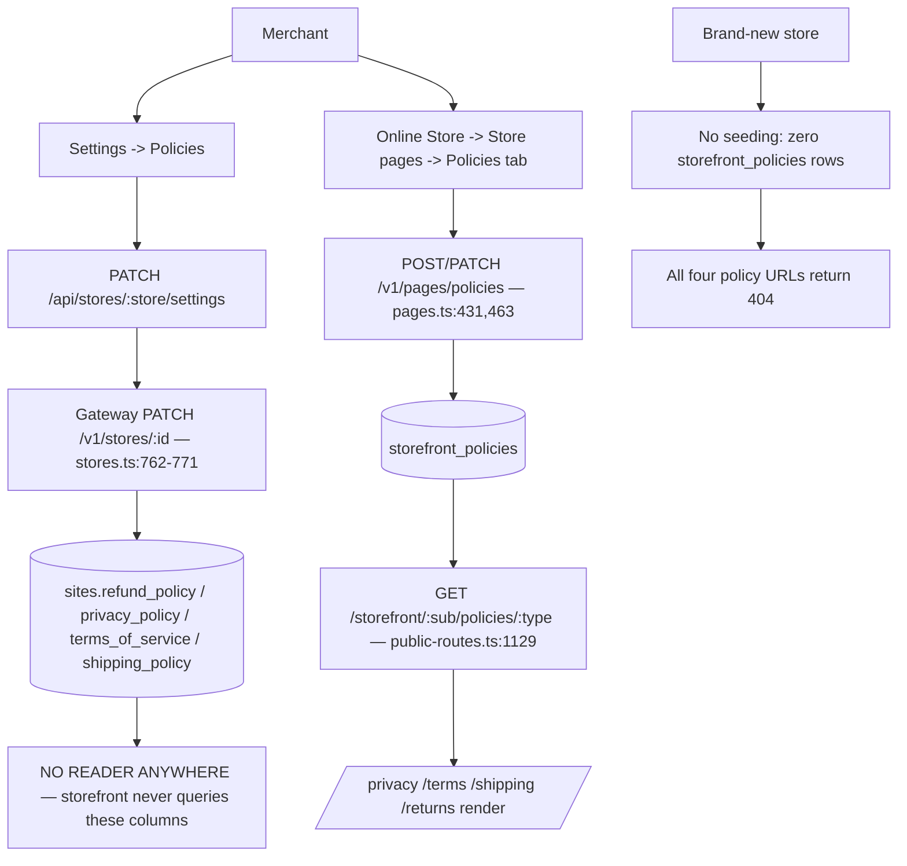
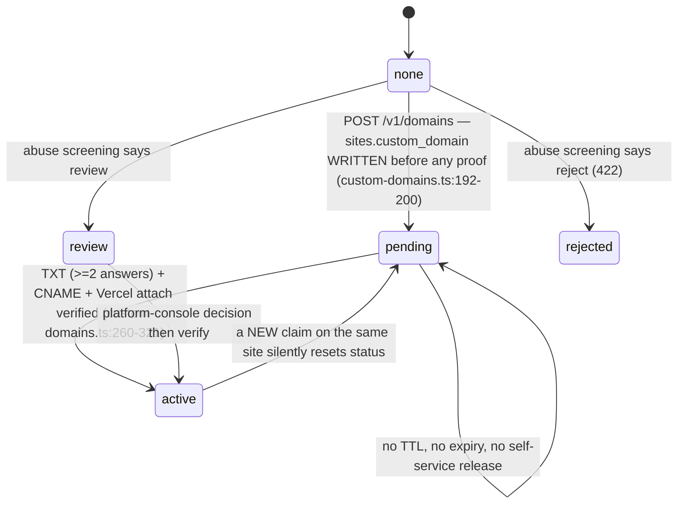

# 16 — BLOG, PAGES, POLICY PAGES, NAVIGATION, CMS

- **Run ID:** `docs/merchant-system-discovery/2026-08-04T225330+0530-bf35062e`
- **Branch:** `stepup/main` · **Commit:** `bf35062e` · **Run date:** 2026-08-04 (+0530), authored 2026-08-05
- **Scope:** merchant-authored content — blog posts, comments, categories/tags, custom pages, **policy pages**, navigation menus, custom domains as they affect content addressing, and the stored-XSS posture of merchant-authored HTML on both storefront render paths.
- **Evidence basis:** Agent J notes (`_agent-notes/J-cms-blog-policies-themes.md`, read in full) plus first-hand re-verification of every load-bearing claim in this document against the working tree at authoring time (source files, DDL, validators).
- **METHOD DISCLOSURE:** **Nothing in this document was runtime-verified.** No dev server was started, no database was queried, no build was run, no test was executed. Every status is derived from static source, schema and configuration reading. The ceiling for any capability here is `IMPLEMENTED_NOT_RUNTIME_VERIFIED`; nothing is `VERIFIED_E2E`.
- **No secrets or PII appear in this document.** Environment variable **names** appear; no values, no `.env` content, no customer data.

> **Line-number note.** Line numbers below were re-read from the working tree while authoring. A few differ from the agent notes by ±1 to ~110 lines (`packages/cms-core/src/index.ts`, `services/api-gateway/src/routes/stores.ts`, `services/api-gateway/src/routes/domains.ts`) because the working tree carries ~6,800 uncommitted user modifications and is live. **No code fact changed** — only the offsets. Where I re-verified, I cite the number I read myself.

---

## 1. Recommendation / verdict

**Do not launch an Indian storefront on this CMS as it stands. Two findings are launch-blocking and both are in the policy system.**

1. **There are two entirely separate policy systems, and the discoverable one is a dead end.** The merchant surface a founder or merchant will actually find — **Settings → Policies** — writes four columns on `sites` (`refund_policy`, `privacy_policy`, `terms_of_service`, `shipping_policy`) that **no storefront code reads**. I re-verified this with a source-only repo grep: the only non-artifact hits outside the writer itself are `apps/merchant-control-plane/src/app/[store]/settings/policies/page.tsx:38,46,54,62` and `services/api-gateway/src/routes/stores.ts:765`. `apps/storefront-runtime/src` has **zero** hits. Meanwhile that same UI tells the merchant, verbatim, that these policies *appear on storefront policy pages and during checkout* (`settings/policies/page.tsx:226-229`). A merchant who completes that screen has a store whose `/privacy`, `/terms`, `/shipping` and `/returns` all `notFound()`. → **MCP-DISC-600 [HIGH-STAKES] P0**.

2. **Nothing seeds policy pages at store creation.** Store creation (`services/api-gateway/src/routes/stores.ts:718-733`) inserts a `sites` row and emits `store_created`; it writes no `storefront_policies` and no `storefront_pages` row. `services/api-gateway/src/routes/onboarding.ts` contains **no** occurrence of `policy|policies|privacy|terms|shipping|refund|page` (re-verified: grep returns nothing). The `policies` navigation menu that the storefront footer renders is never created either, and there are **no hardcoded policy links anywhere in the storefront components** (re-verified: `grep -rn "/privacy|/terms|/shipping|/returns" apps/storefront-runtime/src/components` returns nothing outside the data-driven footer). A brand-new Indian store therefore launches with **zero policy pages, zero policy links, and four 404s**. → **MCP-DISC-601 [HIGH-STAKES] P0**.

Beyond the launch blockers, the shape of this domain is consistent: **the backend is broadly complete and correct; the last mile to the merchant and to the storefront is where it breaks.**

- **The blog is BROKEN on the renderer that is actually live.** `/blog` on the default React renderer renders the store's **home-page sections**, not the article list. The route's own header comment says it out loud — it is a "Blog listing page for Liquid-engine stores" (`apps/storefront-runtime/src/app/store/[subdomain]/blog/page.tsx:1`) — and Liquid is default-OFF. → **MCP-DISC-602 P1**.
- **Scheduled publication is DORMANT_FLAGGED.** The column, the status value and the Zod enum all exist; the gateway never writes `scheduled_at` on create or PATCH, and no worker publishes. A `scheduled` post is invisible forever. → **MCP-DISC-618**.
- **Blog comment moderation is a structurally-always-empty queue.** There is no POST comment route anywhere and no storefront comment form. → **MCP-DISC-615**.
- **Navigation editing is half-built.** Only `main` is editable; `footer` and `policies` menus — both read by the storefront — can never be created; and the replace algorithm destroys hierarchy by design. → **MCP-DISC-606**, **MCP-DISC-616**.
- **Domains carry two real risks:** a domain is written onto `sites.custom_domain` **before ownership is proven**, which is a squatting/self-DoS vector (**MCP-DISC-604**); and `POST /v1/domains/purchase` accepts an **unverified, client-supplied `payment_reference`** and then spends real money at a registrar (**MCP-DISC-605 [HIGH-STAKES]**). The UI simultaneously promises a purchase flow that does not exist (**MCP-DISC-612**).
- **Stored XSS: merchant HTML is SAFE on both render paths.** I am not inventing a hole here. The Liquid path sanitizes every fragment through DOMPurify with an allowlist profile; the live React path never uses `dangerouslySetInnerHTML` for merchant content at all. The caveats are stated precisely in §8.4 and recorded as **MCP-DISC-619 (P3, policy question)** — not as a vulnerability.

**Minimum ship gate for an India launch of the content surface:** MCP-DISC-600, MCP-DISC-601, MCP-DISC-606 (so the seeded policies are reachable from the footer), and a decision on MCP-DISC-602 (blog or no blog). MCP-DISC-605 must be closed or the route must be provably unreachable before any domain-purchase UI ships.

---

## 2. Scope

**In scope for this document**

| Area | Included |
|---|---|
| Blog | posts, comments, categories/tags, scheduling, storefront listing + detail |
| Pages | `storefront_pages` + legacy `pages`, revisions, templates, SEO |
| Policy pages | both policy systems, seeding, storefront policy routes |
| Navigation | `navigation_menus` / `navigation_menu_items`, locations, page↔nav sync |
| Domains | subdomain routing, custom-domain claim/verify, "buy a domain" — as they gate content addressing |
| Content security | stored-XSS posture of merchant-authored HTML on both render paths |
| Caching | storefront cache invalidation on content publish |

**Explicitly out of scope here** (same agent notes, different document of this run): the theme engine internals — the Liquid canary gate being merchant-settable (notes `G-J-18`), the three competing theme-draft tables (`G-J-19`), theme editor capability matrix, ART-17 section-freeze compliance, theme-marketplace freeze confirmation. Those are theme-governance findings and are **not** allocated MCP-DISC IDs in my block; the commander must ensure the themes document allocates them. The migration-count documentation drift (`G-J-22`) belongs to the governance document — I note only that the count is itself moving (see §15).

**Runtime not in scope:** this pass was static by mandate.

---

## 3. Current merchant user journeys (what a merchant can actually do today)

Each journey is written as what happens, not what is intended.

### 3.1 "I want to write a blog post"
Merchant navigates **Content → Blog posts** (`apps/merchant-control-plane/src/components/merchantNavigation.ts:149-155`), gets a list + a form with **title, slug, excerpt, a plain `<Textarea>` body, and a status select (draft/published/archived)**. Save POSTs the same-origin proxy → gateway → `blog_posts`. The post is created correctly, `author_id` and `published_at` are set server-side (`services/api-gateway/src/routes/blog.ts:148,157`).
**Then:** the post is reachable at `/blog/<slug>` on the storefront, but **`/blog` shows the home page**, so nobody finds it unless they have the direct URL. The merchant cannot set an SEO title, a cover image, a category or a tag from the web console. If they paste formatted HTML, the live renderer strips every tag.

### 3.2 "I want to moderate comments"
Merchant navigates **Content → Comments** (`merchantNavigation.ts:155`). The list is empty. It will always be empty: there is no comment-creation endpoint on the gateway and no comment form on the storefront.

### 3.3 "I want an About page"
Two different doors lead to two different editors:
- **Online Store → Store pages** (`merchantNavigation.ts:167`) — the full editor with Pages / Policies / Navigation tabs.
- **Content → Pages** (`merchantNavigation.ts:185, 239`) — a second, simpler editor with only title/slug/body (`apps/merchant-control-plane/src/app/[store]/pages/page.tsx:40-44`).
Both write the same resource. Editing from the simple one can silently unlink the page from the main menu (§6.5, MCP-DISC-610).

### 3.4 "I want my store to be legally compliant" — the broken journey
The merchant opens **Settings** (`apps/merchant-control-plane/src/app/[store]/settings/page.tsx`, items `domains`, `notifications`, `policies`), clicks **Policies**, sees four labelled fields — Refund policy, Privacy policy, Terms of service, Shipping policy (`settings/policies/page.tsx:36-69`) — with reassuring guidance copy, fills them in, and gets a toast: *"Policies saved"* plus *"N of 4 storefront policies completed."*

The text lands on `sites.refund_policy` / `privacy_policy` / `terms_of_service` / `shipping_policy` (`stores.ts:762-771` allowed list → `.from('sites').update(updates)` at `:786-790`). **No storefront code reads those columns.** `/privacy`, `/terms`, `/shipping`, `/returns` continue to 404.

The *working* door is elsewhere and unlabelled as the policy authority: **Online Store → Store pages → Policies tab** (`apps/merchant-control-plane/src/app/[store]/online-store/pages/page.tsx:325-373`), which writes `storefront_policies` via `POST/PATCH /v1/pages/policies` (`services/api-gateway/src/routes/pages.ts:431, 463`). That one works — if the merchant finds it, and if they know to publish rather than leave it draft.

### 3.5 "I want to organise my menus"
**Online Store → Store pages → Navigation tab.** The UI hard-codes the location: it fetches `…/navigation?location=main` (`online-store/pages/page.tsx:213`) and saves to `…/navigation/main` with `name: 'Main menu'` (`:379-383`). There is no way to edit the **footer** menu or the **policies** menu, both of which the storefront reads (`apps/storefront-runtime/src/lib/store-service.ts:485-492`) and the footer renders (`apps/storefront-runtime/src/components/layout/dynamic-footer.tsx:68, 163-175`).

### 3.6 "I want my own domain"
**Settings → Domains.** The merchant can connect an owned domain (real TXT challenge + CNAME + Vercel attach) — this path is well built. The merchant can also expand a "buy a new domain" panel that promises *pay securely and LetBuyy registers and auto-connects it*, search for a domain, see a price… and then find no purchase button, because there is none.

---

## 4. Feature matrix

Status strings are from the mandated taxonomy. **No row can exceed `IMPLEMENTED_NOT_RUNTIME_VERIFIED`** because nothing was executed.

| # | Capability | Status | Key evidence | Gap ID |
|---|---|---|---|---|
| 1 | Blog post create / edit / archive (web console) | IMPLEMENTED_NOT_RUNTIME_VERIFIED | `blog.ts:129-178`, `:196-238`; `[store]/posts/page.tsx` | — |
| 2 | Blog post appears on storefront **listing** `/blog` | **BROKEN** | `blog/page.tsx:1,62-101`; `composition-engine.tsx:568`; `template-resolver.ts:286-289` | MCP-DISC-602 |
| 3 | Blog post detail `/blog/<slug>` | IMPLEMENTED_NOT_RUNTIME_VERIFIED | `blog/[slug]/page.tsx` → `ContentResourceRenderer` → `core.rich-content` | — |
| 4 | Scheduled publication | **DORMANT_FLAGGED** | schema `cms-core` accepts; DDL `000_baseline.sql:8556, 8576`; not in insert `blog.ts:146-163`; not in PATCH allowlist `blog.ts:201-205`; no worker | MCP-DISC-618 |
| 5 | Blog comment moderation | **BACKEND_ONLY** (structurally dead) | only `GET/PATCH/DELETE` at `blog.ts:454, 499, 541`; no POST anywhere; no storefront form | MCP-DISC-615 |
| 6 | Blog categories / tags | PARTIAL | gateway CRUD exists; no web merchant UI; `[store]/categories/page.tsx` is product categories | MCP-DISC-614 |
| 7 | Blog tag attach tenancy | **BROKEN** | `blog.ts:172-175`, `:232-238` insert client `tag_ids` unchecked | MCP-DISC-611 |
| 8 | Custom pages CRUD + revisions | IMPLEMENTED_NOT_RUNTIME_VERIFIED | `pages.ts:155-190, 336, 624, 736` | — |
| 9 | One page editor / one page table | **CONTRADICTORY_EVIDENCE** | two UIs; gateway dual-paths `storefront_pages` ↔ legacy `pages` | MCP-DISC-607 |
| 10 | `show_in_nav` persistence | **BROKEN** | column absent from DDL `000_baseline.sql:12284-12302`; `cms-core:261` forces `false` | MCP-DISC-610 |
| 11 | Policy pages readable by storefront (`storefront_policies`) | IMPLEMENTED_NOT_RUNTIME_VERIFIED | `pages.ts:431-545`; `storefront.ts:1227-1245`; `public-routes.ts:1099, 1129` | — |
| 12 | Policy pages via **Settings → Policies** | **BROKEN / dead end** | writer `stores.ts:765`; **no reader** | MCP-DISC-600 |
| 13 | Default policy pages at onboarding | **NOT_IMPLEMENTED** | `stores.ts:718-733`; `onboarding.ts` — zero policy/page references | MCP-DISC-601 |
| 14 | Content preview (draft) | **NOT_IMPLEMENTED** | every public read filters `status='published'` (`storefront.ts:1196, 1234`); no content preview token | MCP-DISC-609 |
| 15 | SEO fields / cover image in web console | **BACKEND_ONLY** | schemas + `generateMetadata` consume them; no web form fields (Flutter has them) | MCP-DISC-614 |
| 16 | Navigation `main` edit | IMPLEMENTED_NOT_RUNTIME_VERIFIED | `pages.ts:547-621`; `online-store/pages/page.tsx:213, 379-383` | — |
| 17 | Navigation `footer` / `policies` edit | **NOT_IMPLEMENTED** (reader exists) | `store-service.ts:485-492`; `dynamic-footer.tsx:68`; UI hard-codes `main` | MCP-DISC-606 |
| 18 | Navigation hierarchy survives save | **BROKEN** | `pages.ts:588-614` — delete-all + reinsert with stale `parent_item_id` at `:605` | MCP-DISC-616 |
| 19 | Cache invalidation on content publish | **PARTIAL** | `bumpStorefrontCacheVersion` called from exactly one place (theme publish) | MCP-DISC-608 |
| 20 | Slug reuse after archive | **BROKEN** | non-partial uniques; soft delete; raw `error.message` 500 at `blog.ts:227-229` | MCP-DISC-617 |
| 21 | Subdomain routing `{store}.letbuyy.com` | IMPLEMENTED_NOT_RUNTIME_VERIFIED | `proxy.ts`; `internal-store-access.ts`; `store-context.ts:201-258` | — |
| 22 | Custom-domain connect + TXT/CNAME + SSL | IMPLEMENTED_NOT_RUNTIME_VERIFIED (provider BLOCKED_EXTERNAL) | `custom-domains.ts:150-330` | — |
| 23 | Custom-domain claim before verification | **BROKEN** | `custom-domains.ts:192-200` writes before proof; `:173-175` `409 DOMAIN_TAKEN` | MCP-DISC-604 |
| 24 | "Buy a new domain" | **UI_ONLY** | copy at `settings/domains/page.tsx:226-247`; no button, no proxy | MCP-DISC-612 |
| 25 | Domain purchase payment verification | **BROKEN** | `domains.ts:27, 117-136, 141-147` — unverified client reference then real purchase | MCP-DISC-605 |
| 26 | CMS tenant tables FORCE RLS | **PARTIAL** (governance drift) | `ENABLE` present; **85** `FORCE ROW LEVEL SECURITY` statements exist, none for a CMS table | MCP-DISC-603 |
| 27 | Cross-tenant content read isolation | IMPLEMENTED_NOT_RUNTIME_VERIFIED | every read scoped by `store_id` behind `verifySiteOwnership` / `loadPublishedStore` | — |
| 28 | Stored XSS on merchant HTML (Liquid path) | IMPLEMENTED_NOT_RUNTIME_VERIFIED — **SAFE** | DOMPurify allowlist `theme-renderer.ts:170-232`, applied to every fragment | MCP-DISC-619 (policy) |
| 29 | Stored XSS on merchant HTML (React path — the live default) | IMPLEMENTED_NOT_RUNTIME_VERIFIED — **SAFE** | `rich-content.tsx:23-29, 88, 91`; no `dangerouslySetInnerHTML` on this path | — |
| 30 | Rich-text authoring | **NOT_IMPLEMENTED** | every web body field is a bare `<Textarea>` | MCP-DISC-613 |

---

## 5. UI / route inventory

### 5.1 Merchant console (web)

| Route | File | What it edits | Notes |
|---|---|---|---|
| `/[store]/posts` | `apps/merchant-control-plane/src/app/[store]/posts/page.tsx` (578 L) | `blog_posts` | title/slug/excerpt/body/status only |
| `/[store]/comments` | `apps/merchant-control-plane/src/app/[store]/comments/page.tsx` | `blog_comments` | always empty (MCP-DISC-615) |
| `/[store]/categories` | `apps/merchant-control-plane/src/app/[store]/categories/page.tsx` | **product** categories | not `blog_categories` — `:96` |
| `/[store]/pages` | `apps/merchant-control-plane/src/app/[store]/pages/page.tsx` (526 L) | pages | simple editor, `PageFormData` `:40-44` = title/slug/body |
| `/[store]/online-store/pages` | `apps/merchant-control-plane/src/app/[store]/online-store/pages/page.tsx` (830 L) | pages + **policies** + navigation | the only working policy writer |
| `/[store]/settings/policies` | `apps/merchant-control-plane/src/app/[store]/settings/policies/page.tsx` | `sites.*_policy` | **dead end** (MCP-DISC-600) |
| `/[store]/settings/domains` | `apps/merchant-control-plane/src/app/[store]/settings/domains/page.tsx` (280 L) | custom domains | buy-panel is UI_ONLY |

Merchant navigation entries: `apps/merchant-control-plane/src/components/merchantNavigation.ts:149-155` (Content → Blog posts, Comments), `:167` (Online Store → Store pages), `:185, 222, 231-239` (Content → Pages/Posts/Comments for the portfolio/landing/blog site types).

### 5.2 App proxies (same-origin, ownership-resolving)

`apps/merchant-control-plane/src/app/api/stores/[store]/…`: `posts/route.ts`, `posts/[postId]/route.ts`, `blog-comments/route.ts` + `[commentId]/route.ts`, `pages/route.ts` + `pages/[pageId]/route.ts`, `policies/route.ts` + `[policyId]/route.ts`, `navigation/route.ts` + `navigation/[location]/route.ts`, `domains/route.ts` + `domains/[domain]/route.ts` + `domains/[domain]/[action]/route.ts`.
Every one resolves ownership before forwarding (`resolveOwnedStoreId`) and calls the typed client (`createMerchantApiClient()`), so the browser never talks to `/v1` directly. **There is no `domains/purchase` proxy** — see MCP-DISC-612.

### 5.3 Storefront (public)

| Route | File | Data source |
|---|---|---|
| `/blog` | `apps/storefront-runtime/src/app/store/[subdomain]/blog/page.tsx` | `ContentService.listBlogPosts` → `GET /storefront/:sub/blog` (`public-routes.ts:1237`) |
| `/blog/[slug]` | `.../blog/[slug]/page.tsx` | `GET /storefront/:sub/blog/:slug` (`public-routes.ts:1260`) |
| `/privacy`, `/terms`, `/shipping`, `/returns` | `.../privacy|terms|shipping|returns/page.tsx` | `ContentService.getPolicy` → `GET /storefront/:sub/policies/:type` (`public-routes.ts:1129`), then `getPageBySlug` fallback, else `notFound()` |
| `/[...path]` (single segment) | `.../[...path]/page.tsx` | `GET /storefront/:sub/pages/:slug` (`public-routes.ts:1170`) |
| footer menus | `components/layout/dynamic-footer.tsx` | `GET /storefront/:sub/navigation?location=` (`public-routes.ts:1034`) for `main`, `footer`, `policies` |

`/returns` tries `getPolicy('refund')`, then `getPolicy('returns')`, then the `returns` page slug. Note that `'returns'` is **not** a valid `policy_type` (DB CHECK allows `privacy|refund|shipping|terms|contact|custom`, `000_baseline.sql:12324`); it can only match through `loadStorefrontPolicy`'s secondary `policy.slug === token` comparison (`storefront.ts:1242-1245`).

---

## 6. Backend / API / RPC / database mapping

### 6.1 Gateway routes

| Route | File:line | Authz |
|---|---|---|
| `GET/POST /v1/blog/posts`, `PATCH/DELETE /v1/blog/posts/:id` | `services/api-gateway/src/routes/blog.ts:129, 196, 258` | `resolveCustomUser` + `verifySiteOwnership` (`:138`, `:197`) |
| `GET /v1/blog/comments`, `PATCH`, `DELETE` | `blog.ts:454, 499, 541` | store-scoped + `verifySiteOwnership` |
| `GET/POST /v1/pages`, `PATCH/DELETE /v1/pages/:id` | `services/api-gateway/src/routes/pages.ts:276, 336, 624, 736` | `requireOwnedStore` (`:131-153`) |
| `POST/PATCH/DELETE /v1/pages/policies…` | `pages.ts:431, 463, 517` | `requireOwnedStore` |
| `GET /v1/pages/navigation`, `PUT /v1/pages/navigation/:location` | `pages.ts:547, 574` | `requireOwnedStore` (`:581`) |
| `PATCH /v1/stores/:id` (carries the four `sites.*_policy` keys) | `services/api-gateway/src/routes/stores.ts:749`, allowed list `:762-771` | `resolveCustomUser` + owner filter `:790` |
| public content reads | `services/api-gateway/src/routes/storefront/public-routes.ts:1034, 1069, 1099, 1129, 1170, 1237, 1260` | none (public), tenant-scoped by resolved store |
| custom domains | `services/api-gateway/src/routes/custom-domains.ts:150, 260, 352, 411, 443, 483, 540, 562, 590` | `requireOwnedSite` |
| domain purchase | `services/api-gateway/src/routes/domains.ts` (`POST /v1/domains/purchase`) | `requireOwnedSite` — **no payment verification** |

**There are no CMS RPCs.** All content writes are direct `db.from(table).insert/update` through the service-role client (`getSupabaseAdmin`) behind an ownership check. That is consistent with the money-law boundary (content is not money), but it means **RLS is defence-in-depth here, not the enforcing layer** — which makes the missing `FORCE` (MCP-DISC-603) matter.

### 6.2 Tables

| Table | DDL | Notes |
|---|---|---|
| `blog_posts` | `000_baseline.sql:8544-8577` | has `scheduled_at` `:8556`; status CHECK includes `'scheduled'` `:8576` |
| `blog_categories`, `blog_tags`, `blog_post_tags`, `blog_comments` | baseline | all store-scoped |
| `storefront_pages` | `000_baseline.sql:12284-12302` | **no `show_in_nav` column** |
| `storefront_page_revisions` | baseline | monotonic `revision_number`; `published_revision_id` on the page |
| `storefront_policies` | `000_baseline.sql:12306-12325` | `policy_type` CHECK `:12324`; UNIQUE `(store_id, policy_type)` `:15928` |
| `pages` (legacy) | RLS at `:25347` | live fallback target |
| `navigation_menus`, `navigation_menu_items` | `:9855`, RLS `:25148`, `:25122` | `status='active'` required by the public reader |
| `sites.refund_policy|privacy_policy|terms_of_service|shipping_policy` | on `sites` | **written, never read** |
| `domain_orders` | migration-created | holds `amount_minor`, `payment_provider`, `payment_reference` |

### 6.3 Slug uniqueness — per site, correct

`blog_posts_store_id_slug_key`, `blog_categories_store_id_slug_key`, `blog_tags_store_id_slug_key`, `storefront_pages_store_id_slug_key`, `storefront_policies_store_id_policy_type_key` (`000_baseline.sql:15928`), `navigation_menus_store_id_handle_key`. **No global unique slug exists** — tenancy is right. The defect is that none of these is partial on `deleted_at IS NULL` while deletes are soft (MCP-DISC-617).

### 6.4 Public read filters (the reason drafts are invisible and the reason there is no preview)

`storefront.ts:1188-1198` (page by slug: `status='published'` + `deleted_at IS NULL`), `:1227-1236` (policies list: same), `public-routes.ts:1237-1246` and `:1260-1305` (blog list/detail: `store_id` + `status='published'`). `listStorefrontPolicies` returns `[]` — not an error — when the table is missing (`storefront.ts:1237`), which means a schema mismatch degrades to "no policies" silently.

### 6.5 The `show_in_nav` chain (why editing a page can unlink it)

1. `storefront_pages` has no `show_in_nav` column (`000_baseline.sql:12284-12302`, re-verified in full).
2. `normalizeStorefrontPageRecord` computes `show_in_nav: Boolean(row.show_in_nav)` (`packages/cms-core/src/index.ts:261`) → always `false` for rows from that table.
3. PATCH resolves `show_in_nav: body.show_in_nav ?? previous.show_in_nav` (`pages.ts:678`) where `previous.show_in_nav` is that always-`false` value.
4. `syncPageNavigationItem` soft-deletes the nav item when `!page.show_in_nav || page.status !== 'published'` (`pages.ts:249`).
→ Any client that PATCHes without re-sending `show_in_nav: true` removes the page from the menu. The simple editor sends only `{title, slug, body}` (`[store]/pages/page.tsx:40-44`). The full editor happens to spread the whole draft, which is why this is latent rather than constant.

### 6.6 Caching

`services/api-gateway/src/lib/storefront-cache.ts` — TTL 60 s, SWR 300 s, `Cache-Tag` emitted, per-handle version in KV. `bumpStorefrontCacheVersion` has **exactly one** call site repo-wide: `services/api-gateway/src/routes/themes.ts:154-155` (theme publish). `revalidateTag` / `revalidatePath` appear nowhere in `apps/storefront-runtime`, `apps/merchant-control-plane` or `services/api-gateway`. → MCP-DISC-608.

---

## 7. State machines

### 7.1 Content lifecycle (blog post; pages/policies are the same shape minus `scheduled`)

```mermaid
stateDiagram-v2
    [*] --> draft
    draft --> published: PATCH status=published (published_at set server-side, blog.ts:212-214)
    published --> draft: PATCH status=draft (published_at NOT cleared)
    draft --> archived: DELETE (soft; status=archived, blog.ts:262)
    published --> archived: DELETE (soft)
    draft --> scheduled: reachable ONLY by direct API call
    scheduled --> scheduled: no worker publishes — terminal in practice
    archived --> archived: slug stays reserved (non-partial UNIQUE)
```

Notes: `scheduled` is accepted by the Zod enum and the DB CHECK but `scheduled_at` is never persisted (not in the create payload `blog.ts:146-163`, not in the PATCH allowlist `blog.ts:201-205`), and no worker in `services/queue-workers/src` publishes it. The public read filters `status='published'`, so the row is invisible forever.

### 7.2 The policy authority split — the P0 in one picture

### 7.3 Custom-domain claim

Routing only honours `active` (`services/api-gateway/src/middleware/store-context.ts:223-224`; `apps/storefront-runtime/src/proxy.ts:329-338`), so an unverified claim cannot hijack traffic. What it *can* do is occupy the global namespace (MCP-DISC-604).

---

## 8. Auth / tenant / invariant analysis

### 8.1 Issuer and ownership — correct on every CMS route
Every merchant CMS write resolves the merchant identity from the gateway auth context and then calls `verifySiteOwnership` (blog: `blog.ts:138, 197, 258`; pages/policies/navigation: `requireOwnedStore`, `pages.ts:131-153`). No customer-session (HS256) path touches CMS writes. The app proxies additionally resolve the owned store id before forwarding, so the store handle in the URL cannot be swapped.

### 8.2 Tenant scoping on reads — no leak found
| Read | Filter |
|---|---|
| merchant blog list | `.in('store_id', ownedStoreIds)` |
| merchant blog detail / patch / delete | ownership re-checked from the row's `store_id` |
| comments | `.eq('store_id', …)` + ownership |
| pages / policies / navigation (merchant) | `requireOwnedStore` then `.eq('store_id', …)` |
| public blog / pages / policies / navigation | `store.id` from `loadPublishedStore(subdomain)` |
| storefront cache keys | namespaced per handle + per-handle version |

No `USING (true)` policy exists on any CMS table.

### 8.3 Two real tenancy defects
- **`blog_post_tags` accepts foreign tag ids** — `blog.ts:172-175` (create) and `:232-238` (patch) insert `{post_id, tag_id}` straight from the client with no check that `tag_id` belongs to `body.store_id`, and the merchant read joins `blog_tags(id, name, slug)`. Impact is metadata disclosure, not data theft, but the invariant is unconditional. → **MCP-DISC-611 [HIGH-STAKES]**.
- **ENABLE without FORCE** — re-verified: `blog_comments` `:24412`, `blog_posts` `:24424`, `navigation_menus` `:25148`, `pages` `:25347`, `storefront_pages` `:27347`, `storefront_policies` `:27373` all have `ENABLE ROW LEVEL SECURITY`. The migration tree now contains **85** `FORCE ROW LEVEL SECURITY` statements (the agent notes counted 56; migration `196_theme_rls_tenant_hardening.sql` alone added 29 for the theme tables). **None of the 85 names a CMS table.** The registry disagrees with the DDL: `services/api-gateway/src/tenant/tenant-tables.registry.ts:430, 444, 1287, 2614, 2625` register `blog_comments`, `blog_posts`, `navigation_menus`, `storefront_pages`, `storefront_policies` as tenant tables. A FORCE hardening rollout is demonstrably active in this repo and it **skipped the CMS**. → **MCP-DISC-603 [HIGH-STAKES]**.

### 8.4 Stored XSS on merchant-authored HTML — the honest assessment

**Write-time posture is store-raw.** `blog_posts.content_html` (up to 150,000 chars), `blog_posts.content`, `storefront_pages.content.body`, `storefront_policies.body.body` are persisted without sanitization (`blog.ts:153`, `pages.ts` via `pageBodyToContent`, `packages/cms-core/src/index.ts:235`). That is only acceptable if render sanitizes. Both render paths were traced.

**Path 1 — Liquid (canary only; Liquid is default OFF): SAFE.** Sections deliberately use `{{ … | raw }}` because the engine sets `outputEscape:'escape'`; every rendered fragment then passes through `sanitizeRenderedHtml`, which is DOMPurify over JSDOM with `LIQUID_RENDERED_HTML_DOMPURIFY_CONFIG` (`packages/theme-engine/src/theme-renderer.ts:170-232`, re-read in full): `USE_PROFILES: {html: true}` (an **allowlist profile, not a regex denylist**), explicit `ADD_TAGS`/`ADD_ATTR`, a `CUSTOM_ELEMENT_HANDLING.tagNameCheck` regex restricted to the `lb-*` island elements, `FORBID_ATTR: ['style']`, `FORBID_TAGS: ['base','embed','object','script']`. Only the sanitized string reaches `dangerouslySetInnerHTML` (`apps/storefront-runtime/src/lib/theme-engine/composition-engine.tsx:93`). Regression tests exist for both the page and the article case.

**Path 2 — React (the LIVE default): SAFE.** `ContentResourceRenderer` → `core.rich-content` → `apps/storefront-runtime/src/components/content/rich-content.tsx`. `content.blocks` become typed React nodes with all values as JSX children; `content.body` is split into `
{paragraph}
` (`:88`); `content.html` is passed through `stripHtml` (`:23-29`) and then rendered as JSX text (`:91`). **There is no `dangerouslySetInnerHTML` on this path.** Re-verified repo-wide: the storefront has exactly three occurrences — two JSON-LD blocks with `<` escaped (`product/[productId]/page.tsx:75`, `collections/[slug]/page.tsx:125`) and the sanitized Liquid one.

**Stated precisely so nobody over-reads it:**
- Safety on the React path comes from **React's escaping of JSX children**, not from the quality of the `stripHtml` regex. Even if the regex missed a construct, the output is escaped text. This is a robust property, but it also means any future change that renders `content.html` as HTML on this path removes the protection entirely and **must** carry the same allowlist sanitizer plus a security sign-off.
- The Liquid sanitizer's `ADD_TAGS` includes `'iframe'` and `'meta'` and `ADD_ATTR` includes `src`, `sandbox`, `content` (`theme-renderer.ts:174-175` and the `ADD_ATTR` block). DOMPurify's default URI allowlist still blocks `javascript:`, and the first-party app-block renderer legitimately emits a sandboxed iframe (`composition-engine.tsx:115-121`), which is presumably why the tag is allowed. A merchant-authored `<iframe src="https://…">` is nonetheless renderable on that path. **This is a product/security policy question, not a demonstrated exploit** → MCP-DISC-619 (P3).
- **None of this was executed.** No payload was rendered. The assessment is a static reading of the sanitizer configuration and the render path.

---

## 9. Runtime and test evidence — what was NOT verified

**Runtime: nothing.** No storefront was rendered, no gateway route was called, no migration was applied, no cache header was observed. Every "works" in this document means "the code path exists and reads correctly", i.e. `IMPLEMENTED_NOT_RUNTIME_VERIFIED`.

**Tests that exist and were NOT run:**

| Test | Covers |
|---|---|
| `packages/theme-engine/test/liquid-l14-blog.test.ts` | Liquid article render + XSS sanitization |
| `packages/theme-engine/test/liquid-l15-page.test.ts` | Liquid page `body_html` sanitization |
| `services/api-gateway/src/__tests__/tenant-isolation.test.ts:153-156` | asserts the tenant filters exist **in the route source text** — not a functional test |
| `tests/contracts/custom-domains.test.ts`, `custom-domain-abuse-screening.test.ts`, `vercel-domain-attach.test.ts`, `apex-mx-warning.test.ts`, `reserved-subdomain.test.ts` | custom-domain contracts |
| `tests/contracts/buy-a-domain.test.ts:43` | asserts the literal string `payment_provider: 'razorpay'` exists in the source — **does not test payment verification** |
| `tests/performance/storefront-cache.test.mjs` | cache headers |

**Test coverage that does not exist at all:** no test covers the React blog listing, merchant blog CRUD end-to-end, the gateway blog route behaviourally, policy publish → storefront 200, navigation replace round-trip, or `show_in_nav` preservation across a partial PATCH.

**Blocked by design of this pass:** provider configuration (`REGISTRAR_*`, the Vercel domain token/project vars, `CUSTOM_DOMAIN_CNAME_TARGET` / `NEXT_PUBLIC_CUSTOM_DOMAIN_CNAME_TARGET`, `PREVIEW_SIGNING_KEY`, `STORE_ACCESS_SIGNING_KEY`, `INTERNAL_API_SECRET`, `ABUSE_REPUTATION_API_*`, `STOREFRONT_CACHE`) is deploy-time; none appears in `services/api-gateway/wrangler.toml`; **no `.env` was read**. Domain purchase and registrar behaviour are therefore `BLOCKED_EXTERNAL` for verification.

**Deployed schema shape is unknown.** Every gateway CMS route carries an `isMissingTableError` / `isSchemaMismatchError` fallback, so I cannot tell from the repository whether production runs the `storefront_pages` path or the legacy `pages` path. MCP-DISC-607's real-world impact depends on that answer.

---

## 10. Implemented vs missing

**Implemented and structurally sound (not runtime-verified)**
- Blog post, page, policy and navigation CRUD with correct per-store ownership checks on every mutation.
- Server-authoritative fields where they matter (`author_id`, `published_at`).
- Page revisions with a `published_revision_id` pointer, so the public read resolves a specific revision.
- Per-tenant slug uniqueness; no global namespace collisions.
- Tenant-scoped public reads with `status='published'` + `deleted_at IS NULL`.
- Custom-domain ownership challenge (TXT requiring ≥2 matching answers, plus CNAME, plus Vercel attach), abuse screening with a human-review path, and a fail-closed middleware that denies routing when the internal secret or API base is unset.
- Sanitization of merchant HTML on the Liquid path; structural immunity on the React path.

**Missing**
- Any bridge between the discoverable policy UI and the policy table the storefront reads.
- Any seeding of policy pages or of the `footer` / `policies` menus.
- A React blog-listing render path.
- A comment submission path (public endpoint + storefront form).
- A scheduled-publication writer and worker.
- A `show_in_nav` column (or a nav-authority decision that makes it unnecessary).
- Content preview for drafts.
- SEO/cover-image/category/tag fields in the web console (Flutter has them; web does not).
- Cache invalidation on content publish.
- A rich-text authoring experience anywhere.
- Payment verification before a domain purchase; a purchase UI path at all.
- `FORCE ROW LEVEL SECURITY` on the ten CMS tenant tables.

---

## 11. Gap IDs

Severity ordering: lowest ID = most severe. All evidence paths are repository-relative.

---

### MCP-DISC-600 — Two policy systems; the discoverable one writes columns nothing reads
- **Domain:** Policies / Compliance
- **Status:** CONTRADICTORY_EVIDENCE
- **User / business impact:** [HIGH-STAKES] A merchant completes **Settings → Policies**, is told *"Policies saved"* and *"N of 4 storefront policies completed"*, reads guidance stating the policies appear on storefront policy pages and during checkout — and their `/privacy`, `/terms`, `/shipping` and `/returns` URLs all return 404. For an India-first storefront this is payment-gateway-onboarding exposure and consumer-law exposure, not a cosmetic bug. It also means the founder's own dashboard cannot be trusted as a compliance signal.
- **Evidence:**
  - Writer UI: `apps/merchant-control-plane/src/app/[store]/settings/policies/page.tsx:38, 46, 54, 62` (the four keys), `:165-169` (PATCH `/api/stores/:store/settings`), `:226-229` (guidance: *"Policies appear on your storefront"* / *"These policies appear on storefront policy pages and during checkout."*).
  - Gateway persists to `sites`: `services/api-gateway/src/routes/stores.ts:762-771` (allowed list; the four policy keys at `:765`) → `.from('sites').update(updates)` `:786-790`.
  - **No reader** (re-verified, source-only grep across `apps/storefront-runtime/src`, `apps/merchant-control-plane/src`, `services`, `packages`, `database`, `apps/mobile`): the only hits are the writer UI, `stores.ts:765`, and unrelated app-marketplace `privacy_policy_url` fields. `apps/storefront-runtime/src` = **zero hits**. `apps/mobile` = **zero hits** (so the Flutter app does not write these columns either).
  - Actual storefront source: `apps/storefront-runtime/src/app/store/[subdomain]/privacy/page.tsx:43-46` (`ContentService.getPolicy(subdomain,'privacy')` then `getPageBySlug`), `:47` `if (!store || !resource) return notFound();`; identical in `terms`, `shipping`, `returns/page.tsx:44-49`.
  - Read chain: `GET /storefront/:sub/policies/:policyType` (`services/api-gateway/src/routes/storefront/public-routes.ts:1129`) → `loadStorefrontPolicy` (`services/api-gateway/src/routes/storefront.ts:1242-1245`) → `listStorefrontPolicies` (`:1227-1236`, `status='published'`) → `storefront_policies`.
  - The working writer: `apps/merchant-control-plane/src/app/[store]/online-store/pages/page.tsx:325-373` → `POST/PATCH /v1/pages/policies` (`services/api-gateway/src/routes/pages.ts:431, 463`, upsert on `store_id,policy_type` `:452`).
- **Expected behavior:** exactly one policy authority. The settings surface either writes it or does not exist.
- **Missing link / root cause:** `sites.*_policy` is a legacy field set that survived the `storefront_policies` migration. Nothing bridges them, and no validator forbids a second writer.
- **Blast radius:** every merchant; all four required policy URLs; the storefront footer; any checkout policy link that is later added.
- **Invariant tag:** [HIGH-STAKES]
- **Severity:** P0 · **Likelihood:** HIGH
- **Dependencies:** MCP-DISC-601 (seeding), MCP-DISC-606 (footer menu), MCP-DISC-607 (which page/policy editor survives).
- **Recommended remediation APPROACH (no code):** declare `storefront_policies` the single authority — it is the one the storefront reads and the only one with status, SEO and soft-delete semantics. Repoint the Settings → Policies screen at `/v1/pages/policies`. Backfill existing `sites.*_policy` text into `storefront_policies` under a reviewed migration with a rollback. Only then retire the four columns from the `stores.ts` allowed list, staged. Do **not** add a second reader on the storefront to "make settings work".
- **Acceptance criteria:** saving in Settings → Policies causes `/privacy`, `/terms`, `/shipping` and `/returns` to return 200 with that text on the live renderer; a governance validator fails the build if any new writer of `sites.*_policy` appears.
- **Required tests:** E2E per policy type (save → publish → 200 with content); contract test asserting `sites.*_policy` has no reader; migration test for the backfill including the rollback.
- **Required owner:** founder (which surface survives) + lead engineer (mechanism) + CA-tax / legal counsel (the resulting policy text).
- **Reversibility:** reversible; the column retirement is the [IRREVERSIBLE] step and must be staged behind a backup.
- **Confidence:** HIGH (re-verified first-hand).

---

### MCP-DISC-601 — No default policy pages are seeded at onboarding
- **Domain:** Policies / Onboarding / Compliance
- **Status:** NOT_IMPLEMENTED
- **User / business impact:** [HIGH-STAKES] Every new Indian storefront goes live with **zero** policy pages. The footer's policy section is also empty, because the `policies` navigation menu is never created and no policy links are hardcoded — so there is not even a broken link to signal the gap to the merchant or to a payment-provider reviewer. The merchant must author privacy, terms, shipping and returns from scratch, with no template and no prompt.
- **Evidence:**
  - Store creation: `services/api-gateway/src/routes/stores.ts:718-733` inserts the `sites` row (name, subdomain, site_type, status `draft`, tagline, locale, theme_id, template_config) and `:739-743` emits `store_created`. **No `storefront_policies`, no `storefront_pages`, no navigation menu.**
  - Onboarding: `services/api-gateway/src/routes/onboarding.ts` — re-verified, a grep for `policy|policies|privacy|terms|shipping|refund|page` returns **nothing**.
  - Migrations: no seed INSERT for `storefront_policies` / `storefront_pages`; only `update_updated_at` triggers reference them.
  - 404 on absence: `apps/storefront-runtime/src/app/store/[subdomain]/privacy/page.tsx:47`.
  - Footer: `apps/storefront-runtime/src/components/layout/dynamic-footer.tsx:68` `const policyLinks = store.navigation?.policies || []`, rendered only when non-empty (`:163-175`). Re-verified: **no hardcoded `/privacy`, `/terms`, `/shipping`, `/returns` link exists anywhere under `apps/storefront-runtime/src/components`.**
- **Expected behavior:** store creation seeds draft policy pages from India-appropriate, counsel-reviewed templates (with merchant name / GSTIN / address placeholders) and creates the `policies` navigation menu; onboarding shows a checklist item until each is published.
- **Missing link / root cause:** no seeding step exists in store creation or onboarding completion. UNKNOWN whether this was ever specified.
- **Blast radius:** 100% of new merchants.
- **Invariant tag:** [HIGH-STAKES]
- **Severity:** P0 · **Likelihood:** HIGH
- **Dependencies:** MCP-DISC-600 must settle the authority first; MCP-DISC-606 for the menu; MCP-DISC-609 (preview) would let a merchant review before publishing.
- **Recommended remediation APPROACH (no code):** seed `storefront_policies` rows at status `draft` for `privacy`, `terms`, `shipping`, `refund` and `contact` at store creation, from templates **written or approved by counsel/CA-tax, not by engineering**, and create the `policies` menu at the same time. Surface an onboarding checklist item per policy until published. Show an explicit merchant-facing warning for an unpublished policy rather than letting the URL 404 silently.
- **Acceptance criteria:** a freshly created store has five draft policy rows and a `policies` navigation menu; publishing each makes the corresponding URL return 200; an unpublished policy produces a merchant-visible warning in the console, not a silent storefront 404.
- **Required tests:** integration test on store creation asserting the five rows and the menu; E2E publish → 200 for each URL; a test asserting the footer renders the policy links once the menu exists.
- **Required owner:** founder + CA-tax / legal counsel (template text) · lead engineer (mechanism).
- **Reversibility:** reversible.
- **Confidence:** HIGH.

---

### MCP-DISC-602 — `/blog` renders the store's home page on the default (React) renderer
- **Domain:** Blog / storefront rendering
- **Status:** BROKEN
- **User / business impact:** A merchant publishes posts, the console shows "Published", and the live `/blog` page shows the store's **home-page sections** instead of the article list. Blog is one of the first-class site types offered at signup, so a merchant can choose a blog store and get a storefront with no article index.
- **Evidence:**
  - The route file's own header: *"Blog listing page for Liquid-engine stores"* — `apps/storefront-runtime/src/app/store/[subdomain]/blog/page.tsx:1` (re-verified).
  - `:62-66` resolves the plan with `resolveStorefrontTemplate(store, {type:'blog', …})` — **no `templateKey`, no `fallbackSections`**.
  - `:79-101` builds the article drop and passes it only as `liquidPage._blog`.
  - `apps/storefront-runtime/src/lib/theme-engine/composition-engine.tsx:568` — `if (plan.rendererEngine !== 'liquid' || !plan.liquidBundle) return null;` → in React mode `liquidPage` is never consumed (re-verified by grep: this is the only such guard).
  - `apps/storefront-runtime/src/lib/theme-engine/template-resolver.ts:286-289` — with no assigned template, no `templates.blog` and no fallback, the plan falls through to `resolveLegacyTemplate(store, 'blog')`.
  - `:86-96` — `resolveLegacyTemplate` returns `store.templateConfig.sections` minus header/footer, i.e. **the home page**.
  - `packages/theme-engine/src/theme-governance.ts:14` — `THEME_LIQUID_RENDERING_DEFAULT_ENABLED = false`, so the React branch is the live one.
  - Root cause in the section inventory: the Liquid example theme ships `blog-listing.liquid` and `article-content.liquid`; the React section registry has no blog/article listing renderer.
- **Expected behavior:** `/blog` lists published posts (title, excerpt, image, link to `/blog/<slug>`) on the default renderer, and renders an honest empty state when there are none.
- **Missing link / root cause:** there is no React blog-listing section, and the blog route supplies no `fallbackSections` for the React plan. **MISSING**.
- **Blast radius:** every store with site type `blog`; every storefront exposing `/blog`.
- **Invariant tag:** none
- **Severity:** P1 · **Likelihood:** HIGH
- **Dependencies:** ART-17 freezes the React section registry, so the fix cannot simply add a new file under `apps/storefront-runtime/src/components/sections/` without an ARB reading.
- **Recommended remediation APPROACH (no code):** ARB decides the ownership question first. Then either (a) have the blog route supply `fallbackSections` composed from already-frozen renderer keys, bound to the article list through the existing section-data plan, or (b) gate `/blog` behind a per-theme Liquid canary and render an honest, explicit empty state on React until then. Do not add a new file to the frozen React section directory without an ARB decision.
- **Acceptance criteria:** with `THEME_LIQUID_RENDERING_DEFAULT_ENABLED=false`, a published post appears at `/blog` with title, excerpt, image and a working link; a store with zero posts renders an empty state, **not** the home page.
- **Required tests:** E2E — publish a post, GET `/blog`, assert the slug is present and home-page section markers are absent; unit — `resolveStorefrontTemplate({type:'blog'})` in React mode does not return the legacy home template.
- **Required owner:** lead engineer + ARB (ART-17 interpretation).
- **Reversibility:** reversible.
- **Confidence:** HIGH.

---

### MCP-DISC-603 — CMS tenant tables have RLS ENABLE but not FORCE
- **Domain:** Tenancy / RLS
- **Status:** PARTIAL (governance drift)
- **User / business impact:** [HIGH-STAKES] The tenancy article requires ENABLE **+ FORCE** on tenant tables. Without FORCE, the table owner role — and any future non-service-role path — bypasses RLS on the CMS tables. Today the gateway uses the service-role client behind `verifySiteOwnership`, which is precisely why FORCE matters: RLS is the only backstop if an ownership check is ever missed or a new caller is added.
- **Evidence:**
  - `ENABLE` present (re-verified): `database/supabase/migrations/000_baseline.sql:24412` (`blog_comments`), `:24424` (`blog_posts`), `:25148` (`navigation_menus`), `:25347` (`pages`), `:27347` (`storefront_pages`), `:27373` (`storefront_policies`); plus `blog_categories`, `blog_tags`, `navigation_menu_items`, `storefront_page_revisions`.
  - **85** `FORCE ROW LEVEL SECURITY` statements exist across `database/supabase/migrations/` (re-verified count; the agent notes recorded 56 — the tree has grown). `database/supabase/migrations/196_theme_rls_tenant_hardening.sql` alone adds 29, naming 24 theme tables at `:84-107`. **None of the 85 names a CMS table** (re-verified: filtering the FORCE list for `blog_|storefront_page|storefront_polic|navigation_|pages` returns nothing).
  - Registry disagrees with the DDL: `services/api-gateway/src/tenant/tenant-tables.registry.ts:430, 444, 1287, 2614, 2625` register `blog_comments`, `blog_posts`, `navigation_menus`, `storefront_pages`, `storefront_policies` as tenant tables with `tenantColumn: "store_id"`.
- **Expected behavior:** ENABLE + FORCE on every registered tenant table, with a validator asserting registry ⊆ FORCE.
- **Missing link / root cause:** the FORCE rollout is real and recent (migration 196) and simply skipped the CMS tables.
- **Blast radius:** all CMS tenant data across all merchants.
- **Invariant tag:** [HIGH-STAKES]
- **Severity:** P1 · **Likelihood:** MEDIUM
- **Dependencies:** must not break the service-role gateway path — each table's owner-manage policy must admit the gateway role, or the gateway must adopt the per-transaction tenant GUC for these tables (the pattern used by `164_d4_tenant_role_guc.sql`).
- **Recommended remediation APPROACH (no code):** ARB-reviewed migration adding FORCE to the ten CMS tenant tables, modelled on migration 196 (which already documents the ordering and the owner-lockout hazard), with a matching rollback and a validator asserting the registry is a subset of the FORCE set.
- **Acceptance criteria:** a red-team test returns zero rows from these tables when the tenant GUC is unset; the deterministic validator gate stays green; no CMS route regresses.
- **Required tests:** extend the existing tenant red-team suites (`tests/executable/tenant-redteam-postgres.test.mjs`, `tests/governance/d2-rls-red-team.test.mjs`).
- **Required owner:** security + ARB.
- **Reversibility:** reversible (rollback provided).
- **Confidence:** HIGH.

---

### MCP-DISC-604 — A custom domain is claimed before ownership is proven (squatting / self-DoS)
- **Domain:** Domains / Tenancy
- **Status:** BROKEN
- **User / business impact:** [HIGH-STAKES] (a) Merchant A submits `somebrand.in`; `sites.custom_domain` is written immediately, and the genuine owner's later attempt returns `409 DOMAIN_TAKEN`. There is no expiry on the pending claim and no self-service release — a denial of service against another merchant, executable by anyone with a store. (b) A merchant with a **live** custom domain who submits a second domain silently overwrites `custom_domain` and resets `custom_domain_status` to `pending`, which immediately stops the subdomain → custom-domain canonical redirect.
- **Evidence (re-verified):**
  - `services/api-gateway/src/routes/custom-domains.ts:192-200` — `.from('sites').update({custom_domain: domain, custom_domain_status: 'pending'|'review', custom_domain_verification_token, …}).eq('id', site_id)` executes **before** any TXT check; verification is a separate endpoint (`:260`).
  - Collision path: `:166-171` looks up any site already holding the domain; `:173-175` returns `409 DOMAIN_TAKEN`.
  - No guard for an existing `active` value in the update at `:192-200`.
  - Redirect gate: `apps/storefront-runtime/src/proxy.ts:329-338` requires `custom_domain_status === 'active'`.
  - **Mitigating and true:** routing is safe — `services/api-gateway/src/middleware/store-context.ts:223-224` requires `custom_domain_status='active'`, and `active` is only reachable through TXT (≥2 matching answers) + CNAME + Vercel attach. Abuse screening exists (`services/api-gateway/src/lib/custom-domain-abuse.ts`) but its protected-brand list is small and cannot cover arbitrary third-party domains.
- **Expected behavior:** an unverified claim must not consume the global domain namespace and must not disturb an already-active domain.
- **Missing link / root cause:** the pending claim is stored on the tenant-global `sites.custom_domain` column instead of the per-site `site_domains` table that already models pending states.
- **Blast radius:** platform-wide domain namespace; any merchant whose desired domain has been claimed; any merchant with a live domain who adds a second one.
- **Invariant tag:** [HIGH-STAKES]
- **Severity:** P1 · **Likelihood:** MEDIUM
- **Dependencies:** `site_domains` mirroring (`services/api-gateway/src/lib/site-domains.ts`) and the reconciler must be kept consistent.
- **Recommended remediation APPROACH (no code):** move the pending claim entirely into `site_domains` with status `pending`; keep `sites.custom_domain` for the **verified primary only**; allow multiple sites to hold a pending claim on the same domain and let verification decide the winner; add a TTL sweep for stale pending claims and a support release path.
- **Acceptance criteria:** two sites can hold a pending claim on the same domain; only the site that proves TXT ownership is promoted; an existing `active` domain is untouched while a new claim is pending.
- **Required tests:** contract tests extending `tests/contracts/custom-domains.test.ts` for concurrent claims and for active-domain preservation; a test asserting the pending claim expires.
- **Required owner:** security + lead engineer.
- **Reversibility:** reversible.
- **Confidence:** MEDIUM-HIGH (routing safety verified directly; the squatting consequence is inferred from the write order plus the 409 path, not observed at runtime).

---

### MCP-DISC-605 — Domain purchase records an unverified, client-supplied payment reference and then spends real money
- **Domain:** Domains / money-adjacent
- **Status:** BROKEN (currently unreachable from the UI, which caps today's exposure)
- **User / business impact:** [HIGH-STAKES] `POST /v1/domains/purchase` accepts an arbitrary `payment_reference` string from the caller, writes a `domain_orders` row stamped `payment_provider: 'razorpay'` with a real `amount_minor`, and then calls the registrar to actually purchase the domain. **No Razorpay signature verification and no provider order lookup happens anywhere in the handler.** If the endpoint is ever exposed (see MCP-DISC-612), a caller can trigger a real, paid registrar purchase with a fabricated reference. A registrar purchase is not reversible.
- **Evidence (re-verified):**
  - `services/api-gateway/src/routes/domains.ts:27` — `payment_reference: z.string().min(3).max(180)` on the request schema.
  - `:117` — `const checkoutStatus = checkoutMode === 'sandbox' ? 'verified' : 'reference_recorded';` — in the non-sandbox mode the "checkout status" is literally *reference recorded*.
  - `:119-136` — `.from('domain_orders').upsert({… amount_minor (:128), payment_provider: 'razorpay' (:129), payment_reference: parsed.data.payment_reference (:130), idempotency_key (:131)}, {onConflict:'idempotency_key'})`.
  - `:141-147` — `provider.purchaseDomain({… paymentReference …})`, then `configureDns` `:148`, `attachVercelProjectDomain` `:149`.
  - `:152-159` — on success writes `sites.custom_domain` + `custom_domain_status`.
  - The only contract test asserts the literal string `payment_provider: 'razorpay'` exists in the source (`tests/contracts/buy-a-domain.test.ts:43`) — it does not test verification.
  - **Additional finding not in the agent notes (verified here):** `domain_orders` is **not** in the money-mutation table list of `scripts/validators/canonical-ledger-only-validator.mjs:12-25`, so a direct TypeScript write to a table carrying `amount_minor` + `payment_provider` + `payment_reference` passes the deterministic gate untouched. The route is tracked by `scripts/validators/single-writer-ownership-validator.mjs:31-51` for ownership, but that validator does not assert payment verification.
  - Contrast with the platform's own money law: Razorpay signatures are verified server-side with HMAC-SHA256 + `timingSafeEqualHex` elsewhere in this codebase. That pattern is absent here.
- **Expected behavior:** the server verifies the payment with the provider — or the whole purchase runs through the canonical order path — **before** any registrar call spends money.
- **Missing link / root cause:** server-side payment verification is **MISSING** entirely.
- **Blast radius:** platform funds at the registrar; `domain_orders` integrity; any future reconciliation of domain revenue.
- **Invariant tag:** [HIGH-STAKES] · the registrar purchase itself is [IRREVERSIBLE]
- **Severity:** P1 today (P0 the moment a UI wires it) · **Likelihood:** LOW today (no caller exists) / HIGH once exposed
- **Dependencies:** MCP-DISC-612 must not ship before this is closed.
- **Recommended remediation APPROACH (no code):** payments-provider + ARB decision. The purchase must be preceded by a server-verified Razorpay payment (signature verification, or a platform order confirmed via the webhook path), and the domain fee must be modelled as a real order on the canonical ledger. **Never write a money table directly from TypeScript — money mutates only through `SECURITY DEFINER` RPCs.** Until the decision lands, keep the route unexposed and consider gating it behind an internal token. Separately, ask ARB whether `domain_orders` belongs in the canonical-ledger validator's table list.
- **Acceptance criteria:** a purchase request whose payment reference cannot be verified is rejected **before** any registrar call; a verified payment produces exactly one `domain_orders` row (idempotency honoured) and exactly one registrar order; a replayed request is a no-op.
- **Required tests:** contract test asserting rejection on an unverifiable reference; idempotency test for duplicate submissions; a test asserting no registrar call occurs on the rejection path.
- **Required owner:** payments-provider + ARB + security.
- **Reversibility:** reversible in code; the registrar purchase is [IRREVERSIBLE].
- **Confidence:** HIGH.

---

### MCP-DISC-606 — Only the `main` menu is editable; the `footer` and `policies` menus are unreachable
- **Domain:** Navigation
- **Status:** PARTIAL
- **User / business impact:** The storefront footer renders `store.navigation.footer` and `store.navigation.policies`. Both are permanently empty because no merchant surface can create them and nothing seeds them. This is the reason a compliant merchant still has no visible policy links — it compounds MCP-DISC-600 and MCP-DISC-601 directly.
- **Evidence (re-verified):** reader `apps/storefront-runtime/src/lib/store-service.ts:485-492` fetches `main`, `footer` **and** `policies`; footer consumption `apps/storefront-runtime/src/components/layout/dynamic-footer.tsx:68` (`policyLinks`), rendered at `:163-175`; the merchant UI hard-codes `main` on both read (`apps/merchant-control-plane/src/app/[store]/online-store/pages/page.tsx:213`) and write (`:379-383`, `name: 'Main menu'`); the gateway already accepts an arbitrary location (`services/api-gateway/src/routes/pages.ts:574`).
- **Expected behavior:** the merchant can edit the footer menu and the policies menu.
- **Missing link / root cause:** a location selector in the merchant navigation editor, plus seeding. The backend is ready.
- **Blast radius:** every storefront footer.
- **Invariant tag:** none · **Severity:** P2 · **Likelihood:** HIGH
- **Dependencies:** seed alongside MCP-DISC-601 so a new store's policy links exist from day one.
- **Recommended remediation APPROACH (no code):** add location tabs to the existing navigation editor (the gateway needs no change) and seed `footer` + `policies` menus at store creation.
- **Acceptance criteria:** a merchant can add a footer link and a policy link and both render on the storefront footer.
- **Required tests:** E2E footer-link and policy-link round-trip.
- **Required owner:** lead engineer · **Reversibility:** reversible · **Confidence:** HIGH.

---

### MCP-DISC-607 — Duplicate authority: two page editors and two page tables
- **Domain:** Pages
- **Status:** CONTRADICTORY_EVIDENCE
- **User / business impact:** Two merchant surfaces edit the same resource with different field sets — and the narrower one triggers the nav-unlink bug (MCP-DISC-610). The gateway additionally dual-paths between `storefront_pages` and a legacy `pages` table on schema errors, so behaviour depends on which table exists in the deployed schema, which cannot be determined from the repository.
- **Evidence:** UI A `apps/merchant-control-plane/src/app/[store]/online-store/pages/page.tsx` (830 L; pages + policies + navigation); UI B `apps/merchant-control-plane/src/app/[store]/pages/page.tsx` (526 L; `PageFormData` at `:40-44` = title/slug/body only) — both reachable from the merchant nav (`merchantNavigation.ts:167` and `:185/:239`). Gateway dual-path in `services/api-gateway/src/routes/pages.ts` (list `:276`, create `:336`, patch `:624`, delete `:736`, each with an `isMissingTableError`/`isSchemaMismatchError` fallback to `pages`); read side `services/api-gateway/src/routes/storefront.ts:1188-1224` (`loadStorefrontPageBySlug` falls back to `listLegacyStorefrontPages` at `:1115`). Both tables live: `storefront_pages` DDL `000_baseline.sql:12284`; `pages` RLS `:25347`.
- **Expected behavior:** one page editor, one page table.
- **Missing link / root cause:** a decision plus a migration retiring the legacy table and one of the editors never happened.
- **Blast radius:** all page content; the nav-sync bug rides on it; the policy tab lives in one of the two UIs.
- **Invariant tag:** none · **Severity:** P2 · **Likelihood:** HIGH
- **Dependencies:** MCP-DISC-600 (the surviving UI hosts the policy editor), MCP-DISC-610, MCP-DISC-614.
- **Recommended remediation APPROACH (no code):** declare `storefront_pages` canonical (revisions, SEO jsonb, template assignment); migrate residual `pages` rows under a reviewed migration with rollback; remove the fallback branches; keep exactly one merchant editor and archive the removed UI under the existing dead-shell convention.
- **Acceptance criteria:** one page route in the merchant nav; zero `from('pages')` references in the gateway; a validator prevents reintroducing the legacy path.
- **Required tests:** migration test for the row move (with rollback); contract test asserting a single writer.
- **Required owner:** ARB (deletion law) + lead engineer.
- **Reversibility:** the table retirement is [IRREVERSIBLE] and must be staged behind a backup + rollback script.
- **Confidence:** HIGH.

---

### MCP-DISC-608 — No cache invalidation on any content publish
- **Domain:** Blog / Pages / Policies / Navigation
- **Status:** PARTIAL
- **User / business impact:** Publishing or correcting content — including a legally required policy or a wrong price in a page — is not visible for up to ~60 s at the gateway edge, up to ~360 s under stale-while-revalidate, plus a 60 s Next.js data-cache layer. A merchant cannot force a correction live. During an incident this is the difference between a 30-second fix and a 6-minute one.
- **Evidence:** `services/api-gateway/src/lib/storefront-cache.ts:12-13` (TTL 60 / SWR 300), `:24-26` (`Cache-Control`), `:45` (`Cache-Tag` emitted), `:83-90` (`bumpStorefrontCacheVersion`), `:92-101` (per-handle version key). **Only call site repo-wide:** `services/api-gateway/src/routes/themes.ts:154-155`. No cache call exists in `services/api-gateway/src/routes/blog.ts` (create `:144`, patch `:220`, delete `:262`) or `services/api-gateway/src/routes/pages.ts` (create `:336`, patch `:624`, delete `:736`, policies `:431/:463/:517`, navigation `:574`). `revalidateTag` / `revalidatePath` appear nowhere in `apps/storefront-runtime`, `apps/merchant-control-plane` or `services/api-gateway`. Tags are emitted on the public reads but never purged.
- **Expected behavior:** every mutation of published content bumps the tenant's storefront cache version — the mechanism already exists and is already used by theme publish.
- **Missing link / root cause:** `bumpStorefrontCacheVersion(c, [handle])` is simply not called from the content writers. **MISSING**.
- **Blast radius:** all tenants; every content surface.
- **Invariant tag:** none · **Severity:** P2 · **Likelihood:** HIGH
- **Dependencies:** the write path needs the store handle, which is available from the ownership lookup.
- **Recommended remediation APPROACH (no code):** call the existing bump after each successful content mutation; separately decide whether the Next.js layer needs a tag purge or a shorter `revalidate` for content routes.
- **Acceptance criteria:** a publish is reflected on the next storefront request (cache header shows a miss) for post, page, policy and navigation.
- **Required tests:** integration — mutate then read, assert a cache miss and the new body; extend `tests/performance/storefront-cache.test.mjs`.
- **Required owner:** lead engineer · **Reversibility:** reversible · **Confidence:** HIGH.

---

### MCP-DISC-609 — No preview for pages, policies or posts
- **Domain:** CMS
- **Status:** NOT_IMPLEMENTED
- **User / business impact:** A merchant must publish to see how content looks. Combined with MCP-DISC-608 there is no safe way to check a policy or a page before it is public and cached. For a legal document this is the wrong order of operations.
- **Evidence:** every public content read filters `status='published'` (`services/api-gateway/src/routes/storefront.ts:1196` pages, `:1234` policies; `public-routes.ts:1240, 1269` blog); no draft-preview route exists under `apps/storefront-runtime/src/app`; the only preview machinery is **theme** preview (`apps/merchant-control-plane/src/app/api/themes/[themeId]/preview-session/route.ts`, `apps/storefront-runtime/src/lib/theme-preview-server.ts`, `?theme_preview_token=` handled on the policy and `[...path]` routes), which carries a theme token, not a content identity.
- **Expected behavior:** a signed, short-lived, per-resource draft preview.
- **Missing link / root cause:** no content scope on the preview token and no draft-aware read path. **MISSING**.
- **Blast radius:** all CMS content.
- **Invariant tag:** none · **Severity:** P2 · **Likelihood:** HIGH
- **Dependencies:** must not weaken the unauthenticated read path.
- **Recommended remediation APPROACH (no code):** reuse the existing signed-preview primitive with a content scope; the storefront reads the draft **only** when the token validates. Never relax the `status='published'` filter on the unauthenticated path.
- **Acceptance criteria:** a draft page is viewable only with a valid, expiring token and 404s without it or with an expired one.
- **Required tests:** contract test for the three cases (no token → 404, valid → 200, expired → 404).
- **Required owner:** lead engineer + security review of the token scope · **Reversibility:** reversible · **Confidence:** HIGH.

---

### MCP-DISC-610 — `show_in_nav` is not persisted for `storefront_pages`; editing a page can silently unlink it from the menu
- **Domain:** Pages / Navigation
- **Status:** BROKEN
- **User / business impact:** A merchant marks a page "show in navigation", later edits it from the other page editor, and the page silently disappears from the main menu with no error and no indication.
- **Evidence (re-verified):** the column is **absent** from the DDL — `database/supabase/migrations/000_baseline.sql:12284-12302` lists `id, store_id, slug, title, status, page_type, seo, content, assigned_template_key, published_revision_id, published_at, created_by, updated_by, created_at, updated_at, deleted_at` and nothing else — and it is absent from every `select` in `services/api-gateway/src/routes/pages.ts`. `normalizeStorefrontPageRecord` computes `show_in_nav: Boolean(row.show_in_nav)` (`packages/cms-core/src/index.ts:261`) → always `false` for that table. PATCH resolves `body.show_in_nav ?? previous.show_in_nav` (`pages.ts:678`) against that always-false value. `syncPageNavigationItem` soft-deletes the nav item when `!page.show_in_nav || page.status !== 'published'` (`pages.ts:249`). The simple editor sends only `{title, slug, body}` (`apps/merchant-control-plane/src/app/[store]/pages/page.tsx:40-44`).
- **Expected behavior:** the flag is stored and survives partial updates.
- **Missing link / root cause:** either a `show_in_nav` column on `storefront_pages`, or a decision that the nav item's existence is the source of truth. Today neither holds.
- **Blast radius:** every page with show-in-nav on the canonical table.
- **Invariant tag:** none · **Severity:** P2 · **Likelihood:** MEDIUM
- **Dependencies:** MCP-DISC-607 (consolidating to one editor removes the trigger).
- **Recommended remediation APPROACH (no code):** decide the authority. If a column, add it with a migration + rollback and include it in every select. If nav-item presence, make the sync a no-op when `show_in_nav` is absent from the request rather than treating `undefined` as `false`.
- **Acceptance criteria:** set show-in-nav, then PATCH only the title from the simpler editor — the nav item is still present.
- **Required tests:** gateway integration test for a partial PATCH preserving nav membership.
- **Required owner:** lead engineer · **Reversibility:** reversible · **Confidence:** MEDIUM-HIGH.

---

### MCP-DISC-611 — Blog tag attach does not verify tag tenancy
- **Domain:** Blog / Tenancy
- **Status:** BROKEN
- **User / business impact:** [HIGH-STAKES] A merchant can attach another tenant's `blog_tags.id` to their own post. The merchant read joins `blog_tags(id, name, slug)`, so the other tenant's tag name and slug are disclosed. The volume is low and a UUID must be guessed, but the tenancy invariant is unconditional.
- **Evidence (re-verified):** `services/api-gateway/src/routes/blog.ts:172-175` (create) and `:232-238` (patch) insert `blog_post_tags` rows built directly from client-supplied `tag_ids` with no `store_id` check; the schema validates format only; `blog_tags` is store-scoped by `blog_tags_store_id_slug_key`; RLS is `ENABLE` only and the gateway uses the service-role client, so RLS does not stop it (see MCP-DISC-603).
- **Expected behavior:** tag ids are validated to belong to `body.store_id`; a foreign id is rejected and nothing is written.
- **Missing link / root cause:** a tenant filter on the tag ids before insert. **MISSING**.
- **Blast radius:** cross-tenant metadata disclosure.
- **Invariant tag:** [HIGH-STAKES] (tenancy)
- **Severity:** P2 · **Likelihood:** LOW (UUID guess required) — but the invariant is not conditional on likelihood
- **Dependencies:** none.
- **Recommended remediation APPROACH (no code):** select the supplied tag ids scoped to the store and reject any id not returned; or push the attach into a `SECURITY DEFINER` RPC that enforces tenancy. Add `blog_post_tags` to the tenant-table registry checks.
- **Acceptance criteria:** attaching a foreign tag id returns 403/422 and writes nothing; attaching an own tag id still works.
- **Required tests:** a red-team test in the existing tenant red-team style.
- **Required owner:** security + lead engineer · **Reversibility:** reversible · **Confidence:** HIGH.

---

### MCP-DISC-612 — "Buy a new domain" promises a purchase flow that does not exist
- **Domain:** Domains
- **Status:** UI_ONLY
- **User / business impact:** The domains settings page tells merchants they can pay and have LetBuyy register and auto-connect a domain. There is no buy button and no proxy. Merchants search, see a price, and hit a dead end — a trust failure at exactly the moment a merchant is deciding to commit to the platform. Search itself returns 503 unless registrar credentials are configured.
- **Evidence:** copy at `apps/merchant-control-plane/src/app/[store]/settings/domains/page.tsx:226-247` (*"Search for a new domain, pay securely, and LetBuyy registers and auto-connects it."*, *"Buying registers the domain and connects DNS automatically — no records to copy."*); the expanded panel renders search + quote + badge only (`:229-249`); `apps/merchant-control-plane/src/app/api/stores/[store]/domains/` contains only list/search/connect/verify/primary/history — **no purchase route**; the gateway endpoint exists unreferenced (`services/api-gateway/src/routes/domains.ts`); `createDomainRegistrarProvider` throws without credentials so search 503s; no `REGISTRAR_*` variable name appears in `services/api-gateway/wrangler.toml` (deploy-time only).
- **Expected behavior:** either a working purchase flow or copy that describes only what exists.
- **Missing link / root cause:** the merchant purchase proxy and button, and registrar credentials. **MISSING**.
- **Blast radius:** merchant trust; onboarding conversion.
- **Invariant tag:** none today — becomes [HIGH-STAKES] on completion (MCP-DISC-605)
- **Severity:** P2 · **Likelihood:** HIGH
- **Dependencies:** **MCP-DISC-605 must be closed before any purchase button ships.**
- **Recommended remediation APPROACH (no code):** founder decides scope. If deferred, change the copy to describe search-only and remove the payment promise. If shipped, wire the proxy only after server-side payment verification is real.
- **Acceptance criteria:** the UI describes only what the system does; no unreachable promise remains in merchant-facing copy.
- **Required owner:** founder (scope) · **Reversibility:** reversible · **Confidence:** HIGH.

---

### MCP-DISC-613 — No rich-text editing anywhere; merchant HTML is flattened on the live renderer
- **Domain:** CMS / UX
- **Status:** PARTIAL
- **User / business impact:** Every body field in the web console is a bare textarea. On the live React renderer, `content.html` is passed through `stripHtml` (all tags removed) and `content.body` is split into paragraphs and escaped — so a merchant who pastes formatted HTML gets plain text, and one who types HTML into the body sees literal tags. Headings, lists, links and inline images are impossible for the majority of merchants. This is the direct UX cost of the (correct) security posture.
- **Evidence:** editors — `apps/merchant-control-plane/src/app/[store]/posts/page.tsx:501-508`, `[store]/online-store/pages/page.tsx`, `[store]/settings/policies/page.tsx:272-279` (all `<Textarea>`); renderer — `apps/storefront-runtime/src/components/content/rich-content.tsx:23-29` (`stripHtml`), `:88` (`paragraphNodes(body)`), `:91` (`paragraphNodes(stripHtml(html))`); `content_html` is persisted (`services/api-gateway/src/routes/blog.ts:153`) but only the Liquid path renders it.
- **Expected behavior:** a structured editor producing `content.blocks` — a shape the renderer already supports (`rich-content.tsx:43-76`) and which is inherently escape-safe.
- **Missing link / root cause:** no editor exists, and no decision has been taken on the React path's HTML policy.
- **Blast radius:** every merchant authoring content; policy pages read worst of all (long legal text as undifferentiated paragraphs).
- **Invariant tag:** none · **Severity:** P2 · **Likelihood:** HIGH
- **Dependencies:** MCP-DISC-607 (build it once, in the surviving editor).
- **Recommended remediation APPROACH (no code):** target the existing `content.blocks` shape (heading/paragraph/list/quote/image) rather than loosening `stripHtml`. Any decision to render merchant HTML on the React path requires the same allowlist sanitizer the Liquid path uses **and** a security sign-off — see §8.4.
- **Acceptance criteria:** a merchant can produce headings, lists and images that render identically on both engines.
- **Required tests:** render-parity test for the block shape across both engines.
- **Required owner:** lead engineer + security (if HTML is chosen) · **Reversibility:** reversible · **Confidence:** HIGH.

---

### MCP-DISC-614 — SEO fields, cover image, categories and tags exist in the API but have no web merchant UI
- **Domain:** Blog / Pages / SEO
- **Status:** BACKEND_ONLY (web); the Flutter app is ahead
- **User / business impact:** Merchants cannot set the page/post title or description that actually drives search results, cannot attach a cover image, and cannot categorise or tag posts from the web console — while the storefront's `generateMetadata` consumes exactly those fields. Organic discovery is left on the table for every web-only merchant.
- **Evidence:** schemas support them (`packages/cms-core/src/index.ts` — SEO fields on the page, policy and blog schemas); `generateMetadata` consumes them on the storefront blog-detail and `[...path]` routes; the gateway persists them (`services/api-gateway/src/routes/blog.ts:158-159`, `services/api-gateway/src/routes/pages.ts`); a grep for `seo_title|seo_description|featured_image|category_id|tag` across the three web CMS pages returns only an unrendered type field in `posts/page.tsx:41`; the Flutter post editor **does** expose excerpt, featured image, category id, SEO title and SEO description (`apps/mobile/merchant-app/lib/screens/content/post_editor_screen.dart`). The web `[store]/categories` page manages **product** categories, not `blog_categories` (`[store]/categories/page.tsx:96`).
- **Expected behavior:** channel parity — the fields are editable where the merchant actually works.
- **Missing link / root cause:** form fields in the web CMS surfaces. **MISSING**.
- **Blast radius:** organic discovery for every merchant on a web-only workflow.
- **Invariant tag:** none · **Severity:** P2 · **Likelihood:** HIGH
- **Dependencies:** MCP-DISC-607 — add the fields to the single consolidated editor, not to both duplicates.
- **Recommended remediation APPROACH (no code):** add the fields to the surviving CMS editor with a media picker reusing the existing theme media-library proxy; add a blog-category/tag management surface or explicitly drop the capability from the web console.
- **Acceptance criteria:** setting the SEO title/description in the web console changes the rendered `<title>` and meta description on the storefront.
- **Required tests:** E2E — set SEO fields, assert the rendered metadata.
- **Required owner:** lead engineer · **Reversibility:** reversible · **Confidence:** HIGH.

---

### MCP-DISC-615 — Blog comment moderation has no submission path
- **Domain:** Blog
- **Status:** BACKEND_ONLY (structurally always empty)
- **User / business impact:** The merchant navigation ships a "Comments" destination (web and Flutter) that can never contain a row. `blog_posts.allow_comments` and `comment_count` are decorative. Merchant attention is spent on a permanently empty queue, and the product implies a capability it does not have.
- **Evidence (re-verified):** the gateway has only `GET /blog/comments` (`services/api-gateway/src/routes/blog.ts:454`), `PATCH /blog/comments/:id` (`:499`) and `DELETE /blog/comments/:id` (`:541`) — **no POST**. The public storefront router's only POSTs are `/:subdomain/analytics/beacon` (`public-routes.ts:627`) and `/:subdomain/contact` (`:1319`). A grep for `comment` across `apps/storefront-runtime/src/**/*.tsx` returns **no file**. Nav entries at `merchantNavigation.ts:155, 238`. An `"Authenticated users create comments"` RLS INSERT policy exists in the baseline with no client.
- **Expected behavior:** either a storefront comment form plus a rate-limited, Turnstile-gated public POST, or the moderation surface is hidden.
- **Missing link / root cause:** the public comment-creation endpoint and the storefront form. **MISSING**.
- **Blast radius:** the blog site type.
- **Invariant tag:** none today — **becomes [HIGH-STAKES] the moment a public write is added**, since it would be an unauthenticated write endpoint and must carry Turnstile + rate limiting like the existing `/contact` handler.
- **Severity:** P2 · **Likelihood:** HIGH
- **Dependencies:** none.
- **Recommended remediation APPROACH (no code):** founder decides scope. If out of scope, hide the nav entries. If in scope, model the public POST on the existing `/:subdomain/contact` handler including Turnstile verification and the sensitive rate limit, defaulting new rows to `pending`.
- **Acceptance criteria:** either the Comments entry is absent for all site types, or a storefront submission lands as `pending` and appears in moderation.
- **Required tests:** E2E submit → moderate → appears/disappears on the storefront; abuse test for rate limit + Turnstile.
- **Required owner:** founder (scope) then lead engineer · **Reversibility:** reversible · **Confidence:** HIGH.

---

### MCP-DISC-616 — Navigation replace destroys menu hierarchy
- **Domain:** Navigation
- **Status:** BROKEN (latent — no current UI emits parents)
- **User / business impact:** Any client that saves a nested menu gets a flat menu back. Sub-menus are impossible through the API. The defect is invisible today only because the merchant UI has no parent field.
- **Evidence (re-verified):** `services/api-gateway/src/routes/pages.ts:588-593` soft-deletes **every** existing item of the menu (`update({deleted_at, is_visible:false})`), then `:600-614` inserts fresh rows — new UUIDs from the DB default — while copying the client's `parent_item_id` verbatim (`:605`). Those parent ids point at the rows just soft-deleted. The public loader filters `deleted_at IS NULL` (`services/api-gateway/src/routes/storefront.ts:1268`) and `buildPublicNavigationTree` (`packages/cms-core/src/index.ts:612`) only nests a child when its parent is in the visible set, so orphans are promoted to root. The merchant UI has no parent field today (`apps/merchant-control-plane/src/app/[store]/online-store/pages/page.tsx:34-42`).
- **Expected behavior:** hierarchy survives a replace.
- **Missing link / root cause:** no old-id → new-id remap (and no stable client-supplied keys) in the replace transaction. **MISSING**.
- **Blast radius:** all menus, the day nesting is exposed.
- **Invariant tag:** none · **Severity:** P2 · **Likelihood:** MEDIUM today, HIGH the day nesting ships
- **Dependencies:** MCP-DISC-606 (adding footer/policies menus increases the surface).
- **Recommended remediation APPROACH (no code):** make the replace order-aware — insert roots first, build an old→new id map from the client's ids, then insert children with remapped parents inside a single transaction, or move the whole replace into a `SECURITY DEFINER` RPC so it is atomic.
- **Acceptance criteria:** PUT a two-level menu and GET it back with the hierarchy intact; the public navigation endpoint returns nested children.
- **Required tests:** gateway integration test for a nested replace round-trip.
- **Required owner:** lead engineer · **Reversibility:** reversible · **Confidence:** MEDIUM (parent emission is not currently exercised anywhere).

---

### MCP-DISC-617 — Soft delete permanently burns a slug and surfaces a raw database error
- **Domain:** Blog / Pages
- **Status:** BROKEN
- **User / business impact:** A merchant archives "summer-sale", tries to recreate it next year, and receives a 500 containing a Postgres constraint string. Nothing in the UI explains what happened or offers a way forward.
- **Evidence:** the uniques are not partial on `deleted_at IS NULL` — `blog_posts_store_id_slug_key`, `storefront_pages_store_id_slug_key` (`000_baseline.sql:15928` for the policy analogue); delete is soft — `services/api-gateway/src/routes/blog.ts:262` sets `status='archived'` and does not touch `deleted_at`, `services/api-gateway/src/routes/pages.ts:736-759` sets both; the error is passed through verbatim as a 500 — `blog.ts:227-229` (`message: error.message`) and the equivalent on the pages create path.
- **Expected behavior:** a friendly 409 with a suggested slug, or a partial unique index scoped to live rows. Never a 500 with SQL text.
- **Missing link / root cause:** partial unique indexes and/or a pre-insert slug-conflict check, plus mapping Postgres `23505` to a 409.
- **Blast radius:** any merchant reusing a slug; also a minor information-disclosure smell (raw DB messages to the client).
- **Invariant tag:** none · **Severity:** P3 · **Likelihood:** MEDIUM
- **Dependencies:** if archived slugs become reclaimable, the existing slug-redirect table should handle the old URL.
- **Recommended remediation APPROACH (no code):** decide whether archived slugs are reclaimable; if yes, migrate the uniques to partial indexes and map the constraint violation to a 409 with merchant-readable guidance. Stop returning raw `error.message` to clients on these routes.
- **Acceptance criteria:** recreating an archived slug either succeeds or returns a 409 with guidance — never a 500 containing SQL.
- **Required tests:** contract test for the recreate-after-archive path.
- **Required owner:** lead engineer · **Reversibility:** index change is reversible · **Confidence:** HIGH.

---

### MCP-DISC-618 — Scheduled publication is advertised by the schema but never happens
- **Domain:** Blog
- **Status:** DORMANT_FLAGGED
- **Provisional ID:** none — this finding is recorded in the agent notes as §1.3 and in the contradictions list, with no `G-J-` number allocated.
- **User / business impact:** The data model, the DB CHECK and the request schema all advertise scheduled publication. Any client that sets `status='scheduled'` (a direct API call today; a future UI or partner integration tomorrow) writes a post that is **never published and never visible**, with no error and no alert. Silent data loss of intent.
- **Evidence (re-verified):**
  - Schema accepts it: `packages/cms-core/src/index.ts` — the blog status enum includes `'scheduled'` and `scheduled_at` is an optional coerced date.
  - DB supports it: `database/supabase/migrations/000_baseline.sql:8556` (`scheduled_at timestamp with time zone`), `:8576` (`CHECK (status = ANY (ARRAY['draft','published','archived','scheduled']))`).
  - The gateway never writes it: the create payload `services/api-gateway/src/routes/blog.ts:146-163` has **no `scheduled_at`** key; the PATCH allowlist `:201-205` is `title, slug, excerpt, content, content_html, featured_image, category_id, status, seo_title, seo_description, og_image_url, allow_comments, is_featured, is_pinned, reading_time_min` — `scheduled_at` is absent, so it can never be set after creation either.
  - No worker publishes: `services/queue-workers/src` contains no blog publisher; the only cron `scheduled:` string is an incident-postmortem reminder.
  - The public read filters `status='published'`, so a `scheduled` row is invisible forever.
  - Neither merchant UI offers it (web status options are draft/published/archived; Flutter chips are draft/published).
- **Expected behavior:** either scheduled publication works end to end (write `scheduled_at`, a worker flips to `published` at the time, the merchant sees the scheduled state), or the status value and column are explicitly retired so nothing advertises a capability that does not exist.
- **Missing link / root cause:** the writer for `scheduled_at` and the publishing worker are both **MISSING**.
- **Blast radius:** the blog site type; any future API consumer trusting the schema.
- **Invariant tag:** none · **Severity:** P3 · **Likelihood:** LOW today (no UI path) — rises the moment any integration writes the documented status
- **Dependencies:** MCP-DISC-608 (a scheduled publish must also bust the cache to be visible).
- **Recommended remediation APPROACH (no code):** founder decides scope. If in scope: accept `scheduled_at` on create and PATCH, add a queue-worker cron that promotes due posts to `published` (setting `published_at` server-side) and bumps the storefront cache, and expose the state in both merchant UIs. If out of scope: reject `'scheduled'` at the API boundary with a clear error and plan the CHECK/column retirement as a staged migration.
- **Acceptance criteria:** either a post scheduled for T+5 minutes is publicly visible shortly after T+5 and shows as scheduled before it, or `status='scheduled'` is rejected with an explicit "not supported" error.
- **Required tests:** integration — schedule, advance the clock, assert published; or contract — assert the rejection.
- **Required owner:** founder (scope) then lead engineer · **Reversibility:** reversible · **Confidence:** HIGH.

---

### MCP-DISC-619 — Sanitizer allows merchant-authored `<iframe>` and `<meta>` on the Liquid render path
- **Domain:** CMS / Themes / Security
- **Status:** PARTIAL (policy observation, **not** a demonstrated vulnerability)
- **User / business impact:** [HIGH-STAKES tag applied because it touches the storefront's security boundary] Merchant-authored HTML that reaches the Liquid render path can produce an `<iframe src="https://…">` and `<meta>` tags. DOMPurify's default URI allowlist still blocks `javascript:` URIs, `script` is forbidden, and `sandbox` is an allowed attribute — but an iframe on a page that also carries checkout links is a clickjacking and consent-UI surface, and `<meta>` can affect page directives.
- **Evidence (re-verified):** `packages/theme-engine/src/theme-renderer.ts:170-232` — `LIQUID_RENDERED_HTML_DOMPURIFY_CONFIG` with `USE_PROFILES: {html: true}`, `ADD_TAGS` containing the `lb-*` island elements plus `'iframe'` (`:174`) and `'meta'` (`:175`), an `ADD_ATTR` list including `content`, `sandbox`, `src`, `href`, `name`, `type`, a `CUSTOM_ELEMENT_HANDLING.tagNameCheck` restricted to `lb-*`, `FORBID_ATTR: ['style']`, `FORBID_TAGS: ['base','embed','object','script']`. The first-party app-block renderer emits a sandboxed iframe deliberately (`apps/storefront-runtime/src/lib/theme-engine/composition-engine.tsx:115-121`), which is presumably why the tag is on the list.
- **Expected behavior:** an explicit, recorded product decision — either merchant content may embed iframes, or the permissive config is reserved for platform-generated fragments and merchant content is sanitized with a stricter config.
- **Missing link / root cause:** the sanitizer config does not distinguish platform-emitted markup from merchant-authored markup.
- **Blast radius:** stores on the Liquid canary only — Liquid is default OFF, so the live React path is unaffected.
- **Invariant tag:** [HIGH-STAKES]
- **Severity:** P3 · **Likelihood:** LOW
- **Dependencies:** any future decision to render merchant HTML on the React path (MCP-DISC-613) would make this decision urgent rather than theoretical.
- **Recommended remediation APPROACH (no code):** security review. If iframes are needed only for app blocks, sanitize merchant-authored content with a stricter configuration and keep the permissive one for platform fragments. Do not relax the sanitizer anywhere to compensate for a UX gap.
- **Acceptance criteria:** a documented decision plus a test asserting the chosen behaviour for merchant-authored HTML on both paths.
- **Required tests:** sanitizer unit test per content origin.
- **Required owner:** security · **Reversibility:** reversible · **Confidence:** MEDIUM (this is a policy question; no exploit was demonstrated and none was attempted).

---

## 12. Completion contract and acceptance criteria

### 12.1 End-to-end traces

Format: entry → route → proxy → typed client → `/v1` → auth/authz → validation/server-authoritative → RPC/tables + RLS → webhook/queue/provider → storefront/reporting consequence → tests → runtime observation.

**T1 — Publish a blog post and have a customer find it**
`Content → Blog posts` (`merchantNavigation.ts:149-155`) → `/[store]/posts` (`posts/page.tsx`) → proxy `api/stores/[store]/posts/route.ts` (ownership resolved) → typed client `blog.posts.create` → `POST /v1/blog/posts` (`blog.ts:129`) → merchant issuer + `resolveCustomUser` + `verifySiteOwnership` (`:138`) → `CreateBlogPostSchema` validation; `author_id` and `published_at` server-set (`:148, :157`) → `db.from('blog_posts').insert` (`:144-165`), RLS ENABLE (no FORCE — **MCP-DISC-603**) → **no queue, no webhook, no cache bump — MISSING (MCP-DISC-608)** → storefront `/blog/<slug>` renders; **`/blog` renders the home page — MISSING (MCP-DISC-602)** → tests: **none for this path — MISSING** → runtime: **NOT OBSERVED**.

**T2 — Publish a policy the storefront actually serves (the working door)**
`Online Store → Store pages → Policies tab` (`online-store/pages/page.tsx:325-373`) → proxy `api/stores/[store]/policies/route.ts` → typed client → `POST/PATCH /v1/pages/policies` (`pages.ts:431, 463`) → `requireOwnedStore` (`:131-153`) → `CreatePolicySchema`; upsert on `(store_id, policy_type)` (`:452`) → `storefront_policies`, RLS ENABLE (no FORCE) → **no cache bump — MISSING** → `GET /storefront/:sub/policies/:type` (`public-routes.ts:1129`) → `loadStorefrontPolicy` (`storefront.ts:1242`) → `/privacy` renders (`privacy/page.tsx:43-49`) → tests: **none — MISSING** → runtime: **NOT OBSERVED**.

**T3 — Publish a policy the way a merchant will actually find it (the broken door)**
`Settings → Policies` (`settings/policies/page.tsx`) → PATCH `/api/stores/:store/settings` (`:165-169`) → proxy → `PATCH /v1/stores/:id` → `resolveCustomUser` + owner filter → allowed list includes the four policy keys (`stores.ts:765`) → `.from('sites').update(updates)` (`:786-790`) → **NO READER — MISSING (MCP-DISC-600)** → storefront `/privacy` → `notFound()` → tests: **none — MISSING** → runtime: **NOT OBSERVED**.

**T4 — Add a policy link to the footer**
`Online Store → Store pages → Navigation tab` → **only `main` is reachable — MISSING for `footer` and `policies` (MCP-DISC-606)** → `PUT /v1/pages/navigation/main` (`pages.ts:574`) → `requireOwnedStore` → delete-all + reinsert (`:588-614`) — **hierarchy lost (MCP-DISC-616)** → `navigation_menu_items` → **no cache bump — MISSING** → storefront footer reads `policies` (`store-service.ts:489`, `dynamic-footer.tsx:68`) → **always empty** → tests: **none — MISSING** → runtime: **NOT OBSERVED**.

**T5 — Connect a custom domain**
`Settings → Domains` → proxy `api/stores/[store]/domains/route.ts` → `POST /v1/domains` (`custom-domains.ts:150`) → `requireOwnedSite` → abuse screening → **`sites.custom_domain` written before proof (MCP-DISC-604)** → merchant adds TXT + CNAME → `POST /v1/domains/verify` (`:260`) requires ≥2 matching TXT answers + CNAME match → `attachVercelProjectDomain` (provider **BLOCKED_EXTERNAL**) → `custom_domain_status='active'` → routing honours it (`store-context.ts:223-224`), canonical redirect fires (`proxy.ts:329-338`) → tests exist (`tests/contracts/custom-domains.test.ts` and siblings) but **were not run** → runtime: **NOT OBSERVED**.

**T6 — Buy a domain**
`Settings → Domains → buy panel` (`settings/domains/page.tsx:226-249`) → **no button — MISSING** → **no proxy — MISSING** → `POST /v1/domains/purchase` (`domains.ts`) → `requireOwnedSite` → **no payment verification — MISSING (MCP-DISC-605)** → `domain_orders` upsert with `amount_minor`/`payment_provider`/client `payment_reference` (`:119-136`) → registrar purchase (`:141-147`, [IRREVERSIBLE]) → `sites.custom_domain` written (`:152-159`) → tests: a source-string assertion only → runtime: **NOT OBSERVED**.

### 12.2 Completion contract

The content domain is "done" for an India launch when all of the following hold:

1. A single policy authority exists; saving from the merchant-discoverable policy surface makes all four policy URLs return 200 on the live renderer (MCP-DISC-600).
2. A newly created store has counsel-approved draft policies plus a `policies` menu, and an onboarding checklist that does not clear until each is published (MCP-DISC-601, MCP-DISC-606).
3. `/blog` lists articles or the blog capability is honestly withdrawn from the affected site types (MCP-DISC-602).
4. All ten CMS tenant tables carry `FORCE ROW LEVEL SECURITY`, and a validator keeps registry ⊆ FORCE (MCP-DISC-603).
5. No unverified payment can trigger a registrar purchase, and no merchant-facing copy promises a flow that does not exist (MCP-DISC-605, MCP-DISC-612).
6. Content publish invalidates the storefront cache on the next request (MCP-DISC-608).
7. Drafts are previewable through a signed, expiring token without weakening the public read filter (MCP-DISC-609).
8. Exactly one page editor and one page table remain (MCP-DISC-607), and editing a page cannot silently unlink it from navigation (MCP-DISC-610).
9. Cross-tenant tag attachment is rejected (MCP-DISC-611).
10. Every one of the above has at least one executable test, and the whole set has been **runtime-verified at least once** — which this discovery pass explicitly did not do.

---

## 13. Risks

| # | Risk | Likelihood | Severity | Mitigation |
|---|---|---|---|---|
| R1 | A store goes live with no policy pages and a payment provider or a consumer complaint surfaces it | HIGH | P0 | MCP-DISC-600 + MCP-DISC-601 before any merchant onboarding |
| R2 | A merchant believes they are compliant because the console said "Policies saved" | HIGH | P0 | Fix the writer; until then, treat the settings screen as actively misleading and consider removing it |
| R3 | A blog-type merchant launches and the article index shows the home page | HIGH | P1 | MCP-DISC-602; interim, do not offer the blog site type |
| R4 | A third party claims a domain another merchant owns and blocks them indefinitely | MEDIUM | P1 | MCP-DISC-604; interim, a support-side release procedure |
| R5 | The domain-purchase route is wired to a UI before payment verification exists | LOW today | P0 if it happens | Hard dependency: MCP-DISC-605 gates MCP-DISC-612 |
| R6 | A future non-service-role path reads CMS tables without RLS enforcement | MEDIUM | P1 | MCP-DISC-603 FORCE migration |
| R7 | Someone "fixes" the flattened-HTML UX by rendering `content.html` directly on the React path | MEDIUM | P0 if it happens | §8.4 is explicit: that change requires the allowlist sanitizer and a security sign-off (MCP-DISC-613) |
| R8 | A partner or mobile client writes `status='scheduled'` and the merchant's post silently never publishes | LOW | P2 | MCP-DISC-618 — implement or reject at the boundary |
| R9 | A policy correction is invisible for minutes during an incident | HIGH | P2 | MCP-DISC-608 |
| R10 | Production runs the legacy `pages` table and the fixes are applied to the wrong one | UNKNOWN | P2 | Determine the deployed schema before starting MCP-DISC-607 |

---

## 14. Tradeoffs

1. **Consolidating the policy authority vs. shipping fast.** The fastest apparent fix for MCP-DISC-600 is to add a storefront reader for `sites.*_policy`. That would create a second reader, permanently entrench the duplicate authority, and lose status/SEO/revision semantics. Repointing the writer is more work and is the right call.
2. **Blog listing on React vs. ART-17.** Fixing MCP-DISC-602 the obvious way means a new React section, which the freeze forbids. The alternatives (data-bound fallback from frozen renderers, or a Liquid canary for the blog template) are each more constrained. This is genuinely an ARB decision, not an engineering preference.
3. **`FORCE ROW LEVEL SECURITY` vs. operational risk.** FORCE subjects the table owner to RLS and can break tooling — migration 196 documents exactly this hazard for the theme tables. The safety gain is real, and so is the risk of a bad rollout; it must be staged with a rollback.
4. **Rich text vs. safety.** The React path is safe precisely because it refuses to render HTML. Targeting the structured `content.blocks` shape keeps that property; permitting HTML trades a proven structural guarantee for a sanitizer that must then be maintained forever.
5. **Seeded policy templates vs. legal exposure.** Seeding gives every merchant a starting point, but a wrong template applied to thousands of stores is worse than none. The templates must come from counsel, and seeded rows should start as `draft` so publication is a deliberate merchant act.
6. **Retiring the legacy `pages` table.** Deleting it removes a whole class of divergence, but it is irreversible and the deployed schema shape is unknown from the repository. Staging it behind a backup is slower and correct.

---

## 15. Open questions / human approvals needed

| # | Question | Who must answer |
|---|---|---|
| Q1 | Which policy surface survives — Settings → Policies, or the Store-pages Policies tab? | founder |
| Q2 | What is the exact text of the seeded India-first privacy / terms / shipping / refund templates? | CA-tax / legal counsel (**not** engineering) |
| Q3 | Is the blog a launch capability at all? If not, which site types drop it? | founder |
| Q4 | Does fixing `/blog` without a new React section require an ART-17 exception, or is the fallback-section route acceptable? | ARB |
| Q5 | Is domain purchase in launch scope? If not, the copy must change this week. | founder |
| Q6 | If domain purchase is in scope, how is the payment verified and does the fee belong on the canonical ledger? Should `domain_orders` be added to the canonical-ledger validator's table list? | payments-provider + ARB |
| Q7 | Approve the FORCE-RLS migration for the ten CMS tables, given the owner-lockout hazard migration 196 documents. | ARB + security |
| Q8 | May merchant-authored HTML embed iframes on the Liquid path, or is that reserved for app blocks? | security |
| Q9 | Are blog comments a product commitment? Today the nav promises a feature that cannot exist. | founder |
| Q10 | Which page table does production actually run — `storefront_pages` or legacy `pages`? Not determinable from the repository. | lead engineer (production inspection) |
| Q11 | Scheduled publication: implement or reject at the boundary? | founder |

**Repository-state note for the commander:** the working tree is live and changing during this run. Two counts I re-verified differ from the agent notes: `FORCE ROW LEVEL SECURITY` statements are now **85** (notes: 56), and `database/supabase/migrations` currently holds **126** `.sql` files with the highest numbered **197** (the commander fact quoted in the notes was 187 files / highest 195). The documentation-drift gap belongs to the governance document; I record the observation only so the register is not built on a stale count.

---

## 16. Confidence and the main uncertainty

**Confidence: HIGH on the structural findings.** Every claim in §1 and every gap's primary evidence line was re-opened and re-read by me against the working tree while authoring, not copied from the notes. The two P0s in particular — no reader for `sites.*_policy`, and no seeding at store creation or onboarding — were each confirmed by an independent grep and by reading the store-creation insert and the storefront policy routes end to end.

**The main uncertainty is that none of this was executed.** Static reading proves what the code *says*; it does not prove what the deployed system *does*. Three specific consequences:

1. **The deployed schema is unknown.** Every CMS gateway route has a missing-table / schema-mismatch fallback. If production runs the legacy `pages` table, some of the details in MCP-DISC-607 and MCP-DISC-610 shift, though the policy P0s do not.
2. **Provider wiring is unknown and out of bounds.** Registrar, Vercel domain, CNAME target and cache-KV configuration are deploy-time; no `.env` was read and none of these names appears in the gateway's `wrangler.toml`. The domain findings are therefore code-true and runtime-unproven.
3. **The Flutter merchant app was only partially traced.** I confirmed the mobile app does **not** write `sites.*_policy` (zero hits across `apps/mobile`), and that its post editor exposes SEO/cover/category fields the web console lacks. Its pages/policies screens were not traced field by field, so whether the mobile app can write `storefront_policies` is **UNKNOWN** and would change MCP-DISC-600's remediation surface (a third writer to repoint).

Secondary uncertainties: `MCP-DISC-616` is latent and its severity assumes nesting will eventually ship; `MCP-DISC-604`'s squatting consequence is inferred from the write order plus the 409 path rather than observed; and the entire §8.4 security assessment is a reading of configuration, not a test with a payload.

---

## 17. Provisional-ID → MCP-DISC-NNN mapping (mandatory, last)

| Provisional (agent J) | Final ID | Title | Severity | Status |
|---|---|---|---|---|
| G-J-04 | **MCP-DISC-600** | Two policy systems; the discoverable one writes columns nothing reads | P0 [HIGH-STAKES] | CONTRADICTORY_EVIDENCE |
| G-J-05 | **MCP-DISC-601** | No default policy pages are seeded at onboarding | P0 [HIGH-STAKES] | NOT_IMPLEMENTED |
| G-J-01 | **MCP-DISC-602** | `/blog` renders the store's home page on the default (React) renderer | P1 | BROKEN |
| G-J-14 | **MCP-DISC-603** | CMS tenant tables have RLS ENABLE but not FORCE | P1 [HIGH-STAKES] | PARTIAL |
| G-J-15 | **MCP-DISC-604** | Custom domain claimed before ownership is proven (squatting / self-DoS) | P1 [HIGH-STAKES] | BROKEN |
| G-J-17 | **MCP-DISC-605** | Domain purchase records an unverified client-supplied payment reference | P1 [HIGH-STAKES] | BROKEN |
| G-J-07 | **MCP-DISC-606** | Only the `main` menu is editable; `footer` and `policies` unreachable | P2 | PARTIAL |
| G-J-11 | **MCP-DISC-607** | Duplicate authority: two page editors and two page tables | P2 | CONTRADICTORY_EVIDENCE |
| G-J-02 | **MCP-DISC-608** | No cache invalidation on any content publish | P2 | PARTIAL |
| G-J-09 | **MCP-DISC-609** | No preview for pages, policies or posts | P2 | NOT_IMPLEMENTED |
| G-J-08 | **MCP-DISC-610** | `show_in_nav` not persisted; editing a page can silently unlink it | P2 | BROKEN |
| G-J-13 | **MCP-DISC-611** | Blog tag attach does not verify tag tenancy | P2 [HIGH-STAKES] | BROKEN |
| G-J-16 | **MCP-DISC-612** | "Buy a new domain" promises a purchase flow that does not exist | P2 | UI_ONLY |
| G-J-21 | **MCP-DISC-613** | No rich-text editing; merchant HTML flattened on the live renderer | P2 | PARTIAL |
| G-J-10 | **MCP-DISC-614** | SEO fields, cover image, categories and tags have no web merchant UI | P2 | BACKEND_ONLY |
| G-J-03 | **MCP-DISC-615** | Blog comment moderation has no submission path | P2 | BACKEND_ONLY |
| G-J-06 | **MCP-DISC-616** | Navigation replace destroys menu hierarchy | P2 | BROKEN |
| G-J-12 | **MCP-DISC-617** | Soft delete permanently burns a slug and surfaces a raw DB error | P3 | BROKEN |
| *(none — notes §1.3)* | **MCP-DISC-618** | Scheduled publication advertised by the schema but never happens | P3 | DORMANT_FLAGGED |
| G-J-20 | **MCP-DISC-619** | Sanitizer allows merchant-authored `<iframe>` / `<meta>` on the Liquid path | P3 [HIGH-STAKES] | PARTIAL |

**Allocated range used:** MCP-DISC-600 … MCP-DISC-619 (block 600-629; 620-629 unused).

**Provisional IDs from the same agent notes deliberately NOT allocated here** — they are theme-engine / governance findings outside this document's scope and must be picked up by the themes and governance documents of this run, or they will be lost:

| Provisional | Title | Why not here |
|---|---|---|
| G-J-18 | Liquid canary gate is merchant-settable and auto-flips on publish [HIGH-STAKES, P1] | theme-engine governance |
| G-J-19 | Three theme draft stores instead of one [P2] | theme-engine governance |
| G-J-22 | Documentation drift: migration count in root `AGENTS.md` [P3] | repository governance (and the count has moved again — see §15) |
