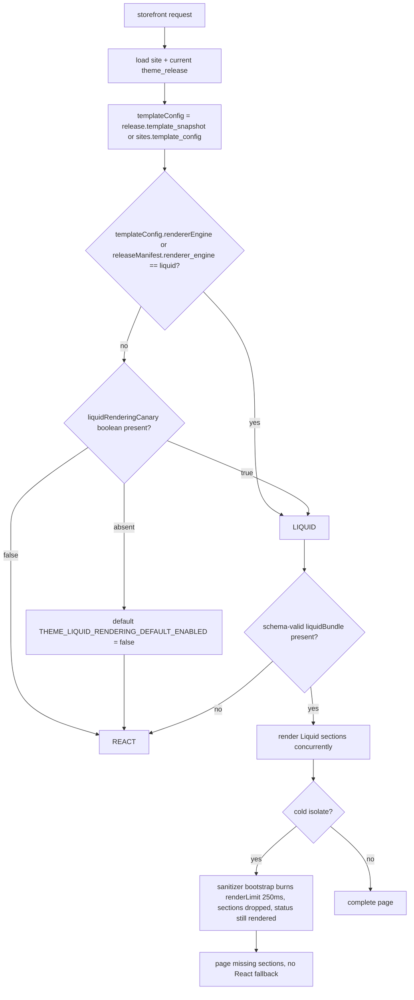
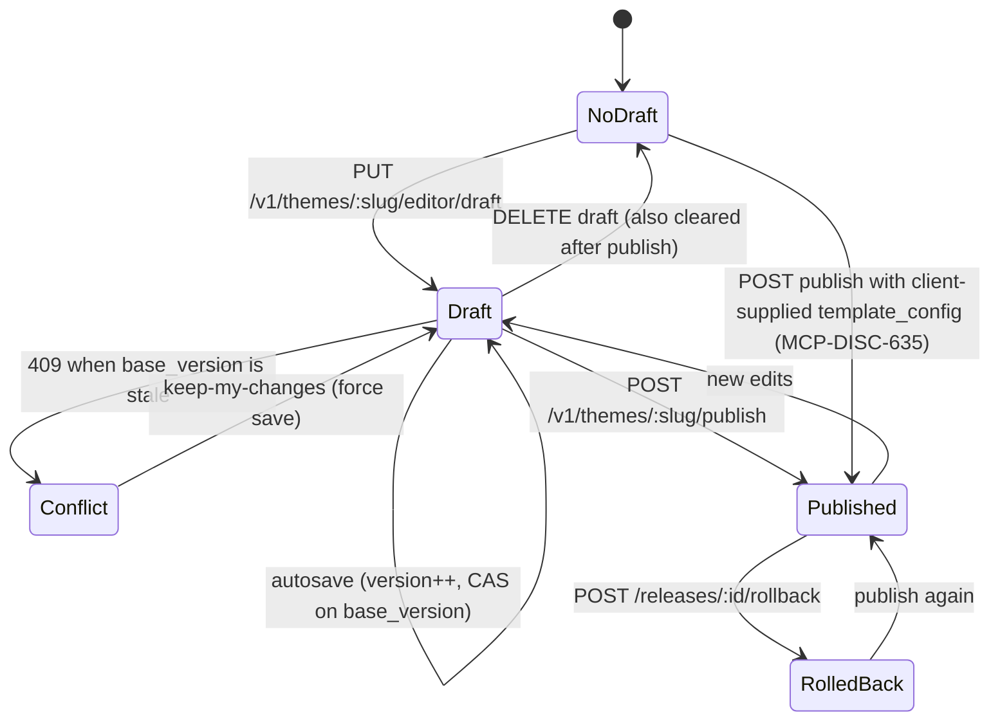
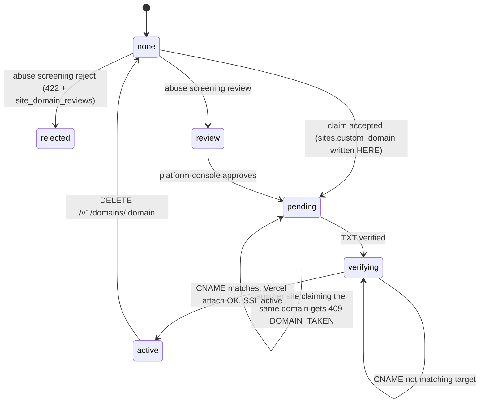

# 17 — STOREFRONT, DOMAINS, THEMES, EDITOR

| Field | Value |
|---|---|
| Run ID | `docs/merchant-system-discovery/2026-08-04T225330+0530-ee371182` |
| Branch | `stepup/main` |
| Commit | `ee371182` |
| Run date | 2026-08-04 (+0530) |
| Scope | Storefront rendering engine (React vs Liquid), theme selection/editor/publish/release/rollback, ART-17 freeze governance, theme draft storage, subdomain + custom-domain routing, domain add/verify/SSL, domain purchase |
| Evidence basis | Agent J notes (`_agent-notes/J-cms-blog-policies-themes.md`, static discovery) + agent L notes (`_agent-notes/L-runtime-build-test.md`, §5.5 / G-L-08 / G-L-09, the only executed evidence in this run) + first-hand re-verification of every load-bearing citation in this document against source at commit `ee371182` |
| **METHOD DISCLOSURE** | **Nothing in this document was runtime-verified by its author.** Every claim here is static code, schema, config or test-source reading, re-checked against the files cited. The single exception is the cross-referenced Liquid renderer defect (G-L-08) and the render-budget regression (G-L-09), which agent L obtained by actually executing `pnpm --filter @letbuyy/theme-engine test` and an instrumented probe; those are cited as `RUNTIME_OBSERVATION`, they are agent L's evidence, not this document's. No storefront was rendered, no store was seeded, no domain was verified, no theme was published during this pass. |
| Secrets | No secrets or PII appear in this document. Environment variable **names** appear; no values. |

---

## 1. Recommendation / verdict

**Do not enable Liquid. Do not flip the platform default. Do not treat the existing Liquid code as evidence that the gate is close to green.**

React is the live default renderer and the constitutional flip is ARB-deferred (`packages/theme-engine/src/theme-governance.ts:14,16-18`). That is the correct state today, and three of the four ART-17 gates are unproven or red:

1. **The gate itself is not enforced.** Any authenticated store owner can set `liquidRenderingCanary: true` and ship an arbitrary `liquidBundle` through the merchant-control-plane editor proxies, and publish then *automatically* stamps `renderer_engine: 'liquid'` into the release manifest whenever a bundle is present. An ARB-deferred constitutional decision is, in practice, merchant-settable. **MCP-DISC-630 [HIGH-STAKES].**
2. **The engine a merchant could flip themselves onto is provably broken on cold start.** Agent L executed the theme-engine suite and instrumented the renderer: on the first render in a fresh isolate, the canonical Liquid renderer **silently drops whole sections while reporting `status: 'rendered'`**, so the React fallback never engages (G-L-08, `RUNTIME_OBSERVATION`, 3/3 deterministic). Its own render benchmark is also red (G-L-09). Points 1 and 2 compound: the merchant-settable path leads onto a renderer with a proven, invisible content-loss defect.
3. **Cross-engine parity has never been run.** `HR-LIQUID-PARITY-STAGING` (`EXECUTABLE_HUMAN_REQUIRED.md:27`) is still open; the parity matrix is 202 PENDING cells (`EXECUTION_LEDGER.md:238`). The canary (`HR-LIQUID-CANARY-DEPLOY`, `:28`), the ARB flip (`HR-LIQUID-ARB-FLIP`, `:29`) and React decommission (`HR-LIQUID-REACT-DECOMMISSION`, `:30`) are all downstream of it.
4. **Parity is inverted from the assumption baked into the freeze.** Liquid ships **42** section templates; React ships **20**, and React has **no** blog-listing, article-content, page-content, policy-content, search, 404 or password-gate section renderer at all. The freeze ("no new React sections") is therefore freezing React below the feature line, not above it. **MCP-DISC-633.**

Separately, the ART-17 freeze validator has a scope hole: it scans exactly one directory, and a *registered React section renderer* (`core.announcement-bar`) lives outside it, so the validator passes while a React section renderer sits unfrozen. Two files inside the frozen directory are dead. **MCP-DISC-634.**

On domains: subdomain and custom-domain **routing is safe** — an unverified domain cannot route (`services/api-gateway/src/middleware/store-context.ts:219-226` requires `custom_domain_status='active'`). But the **claim** is written to `sites.custom_domain` before any ownership proof, which allows namespace squatting and silently resets a live domain (**MCP-DISC-631 [HIGH-STAKES]**), the whole verify/SSL path has zero runtime evidence and is provider-blocked (**MCP-DISC-637**), and the "buy a domain" gateway endpoint accepts an unverified client-supplied payment reference before calling a registrar with real money (**MCP-DISC-632 [HIGH-STAKES]**).

**Action order for the founder:** (a) close MCP-DISC-630 before anything else touches the renderer — it is a governance control failure, not a feature request; (b) keep the domain purchase route unexposed until MCP-DISC-632 is fixed by the payments owner; (c) fix MCP-DISC-631 before onboarding merchants who will bring their own domains; (d) treat the ART-17 flip as blocked until G-L-08 is fixed and `HR-LIQUID-PARITY-STAGING` actually runs.

**Highest attainable status for anything in this document is `IMPLEMENTED_NOT_RUNTIME_VERIFIED`,** except where agent L's execution is cited.

---

## 2. Scope

**In scope**

- Storefront request path: host → tenant resolution → render plan → renderer engine → page.
- Renderer truth: which engine is live, how it is chosen, who can change it.
- ART-17 governance: the React-section freeze, its validator, the Liquid parity list, the four `HR-LIQUID-*` human seams.
- Theme lifecycle a merchant can drive: library → install → editor → autosave draft → preview session → publish → release → rollback → duplicate/rename/archive.
- Theme draft storage (`theme_editor_drafts`, `theme_instance_drafts`, `theme_draft_patches`).
- Domains: subdomain routing, custom-domain connect / TXT+CNAME verify / Vercel attach / SSL status / primary / history / abuse screening / reconciler, and the "buy a new domain" surface.

**Out of scope for this document (owned elsewhere in this dossier)**

- Blog, pages, policy pages, navigation menus and their CMS gaps (agent J, provisional `G-J-01`…`G-J-14`, `G-J-21`) — reported in the CMS/content document. Where a storefront-rendering root cause underlies one of those symptoms (notably the `/blog` listing rendering the home page), it is analysed here as **MCP-DISC-633** and cross-referenced, not double-counted.
- Build/test/CI truth and the Liquid cold-start defect itself — agent L (`G-L-08`, `G-L-09`), reported in the runtime/build/test document.
- Checkout, money, identity — other documents.
- `apps/theme-marketplace` beyond confirming it is frozen and not a deploy target.

---

## 3. Current merchant user journeys (what a merchant can actually do today)

All statuses below are `IMPLEMENTED_NOT_RUNTIME_VERIFIED` unless stated. Nothing in this section was exercised.

### 3.1 "I want to change how my store looks"

1. Merchant opens **Online Store → Themes** (`apps/merchant-control-plane/src/app/[store]/online-store/themes/page.tsx`, 683 L). Lists themes via `GET /api/themes`, installs via `POST /api/themes/install`, publishes/unpublishes the *store* via `POST /api/themes/publish` (that proxy toggles `sites.status`, it does **not** publish a theme release — `apps/merchant-control-plane/src/app/api/themes/publish/route.ts:29-32`).
2. Merchant opens the **editor** (`.../online-store/themes/[themeId]/editor/page.tsx`, 1810 L). Section tree, schema-driven settings forms, app-block slots, AI customization panel, template switcher, translations sub-route, device preview (`PREVIEW_DEVICES` at `:165`), inspector overlay.
3. Edits autosave as a draft (`saveDraft` at `:954` → `POST /api/themes/[themeId]/editor/draft` → `PUT /v1/themes/:slug/editor/draft`).
4. Live preview runs through a signed session (`:1009` → `POST /api/themes/[themeId]/preview-session` → `POST /v1/themes/:slug/preview-session`; storefront side resolves the token from an explicit param or a per-subdomain cookie, `apps/storefront-runtime/src/lib/theme-preview-server.ts:5-13`).
5. Concurrent-edit conflict → HTTP 409 → `ConflictDialog`, autosave paused (`:998-1002`, `components/theme-editor/ConflictDialog.tsx`).
6. **Publish** (`handlePublish` at `:1079`) refuses while the editor is dirty (`:1081-1088`), then `PUT /api/themes/[themeId]/editor` → `POST /v1/themes/:slug/publish`. This creates a `theme_releases` row via the `publish_theme_release` RPC, deletes the draft, and purges the storefront edge cache (`services/api-gateway/src/routes/themes.ts:673-686`).
7. Releases list + rollback exist (`api/themes/[themeId]/releases/route.ts`, `.../releases/[releaseId]/rollback/route.ts` → `POST /v1/themes/:slug/releases/:releaseId/rollback`, also cache-purging at `themes.ts:739`).
8. Duplicate / rename / archive / update / update-preview all have proxies.

**What the merchant does NOT get:** any control over which rendering engine their store uses (the editor UI never sends `liquidRenderingCanary`/`liquidBundle` — but the proxy it posts to accepts both, see §8.2), and no visibility that a Liquid store can silently lose sections (G-L-08).

### 3.2 "I want my store on my own domain"

1. **Settings → Domains** (`apps/merchant-control-plane/src/app/[store]/settings/domains/page.tsx`, 280 L) → "Connect existing domain".
2. `POST /api/stores/[store]/domains` → `POST /v1/domains`. Gateway normalises + validates the domain, screens it for brand/phishing/homoglyph abuse, checks global uniqueness, then **immediately writes `sites.custom_domain` with status `pending`** and issues a random TXT challenge token (`services/api-gateway/src/routes/custom-domains.ts:150-200`).
3. Merchant adds `_letbuyy-challenge.<domain>` TXT and a CNAME to the platform target, then hits Verify (`POST /v1/domains/verify`, `:260`).
4. Gateway requires **≥ 2 matching TXT answers** (`:284`), then CNAME match (`:294-295`), then attaches the domain at Vercel and reads SSL status (`:308-321`), then mirrors into `site_domains` and writes a verification history row.
5. Once `custom_domain_status='active'`, the storefront middleware 301-redirects the subdomain to the custom domain (`apps/storefront-runtime/src/proxy.ts:377-389`) and the gateway resolves the tenant from that host (`services/api-gateway/src/middleware/store-context.ts:219-226`).
6. Also available: set primary, patch, delete, status, history, and a trust-review decision route gated by a platform-console token (`custom-domains.ts:352,411,443,483,540,562,590`).

**What the merchant does NOT get:** a working "buy a domain" flow. The UI says *"Search for a new domain, pay securely, and LetBuyy registers and auto-connects it"* (`settings/domains/page.tsx:227`) and *"Buying registers the domain and connects DNS automatically — no records to copy"* (`:245`). The panel renders a search box, a price quote and a badge — **there is no buy button** (`:226-249`) and **no purchase proxy** under `apps/merchant-control-plane/src/app/api/stores/[store]/domains/`.

### 3.3 "A shopper visits my store"

`{store}.letbuyy.com` or the custom domain → `apps/storefront-runtime/src/proxy.ts` → `GET /v1/internal/store-access/resolve?host=` (internal secret) → tenant + access mode → rewrite to `/store/<subdomain>/…` → `resolveStorefrontTemplate` picks a render plan → `StorefrontCompositionEngine` renders React sections (default) or Liquid (per-theme only).

---

## 4. Feature matrix

| # | Capability | Status | Evidence (path:line) | Gap |
|---|---|---|---|---|
| 1 | React is the live default renderer | IMPLEMENTED_NOT_RUNTIME_VERIFIED (code-confirmed) | `packages/theme-engine/src/theme-governance.ts:14`; `apps/storefront-runtime/src/lib/theme-engine/template-resolver.ts:241-246` | — |
| 2 | Platform-wide Liquid flip is ARB-deferred | IMPLEMENTED_NOT_RUNTIME_VERIFIED | `theme-governance.ts:16-18`; `EXECUTABLE_HUMAN_REQUIRED.md:29` | — |
| 3 | Renderer engine is platform-controlled | **BROKEN (governance control)** | `apps/merchant-control-plane/src/app/api/themes/[themeId]/editor/draft/route.ts:23-35`; `.../editor/route.ts:23-41`; `services/api-gateway/src/execution/theme-execution.adapter.ts:644-650,669` | **MCP-DISC-630** |
| 4 | Liquid canary is per-theme opt-in only | PARTIAL | `theme-governance.ts:144-182` — `explicitEngine.includes('liquid')` returns `true` at `:160` *before* the canary checks | MCP-DISC-630 |
| 5 | Liquid renderer renders completely on cold start | **BROKEN** (`RUNTIME_OBSERVATION`, agent L) | `_agent-notes/L-runtime-build-test.md` §5.5; `packages/theme-engine/src/theme-renderer.ts:704-707,416-417,1316-1345,480-490,647` | **G-L-08** (allocated in the runtime document) |
| 6 | Liquid render performance within budget | **BROKEN** (test assertion, agent L) | `packages/theme-engine/test/liquid-render-benchmark.test.ts` | **G-L-09** (runtime document) |
| 7 | Cross-engine parity harness executed | **NOT_IMPLEMENTED / BLOCKED_EXTERNAL** | `EXECUTABLE_HUMAN_REQUIRED.md:27`; `EXECUTION_LEDGER.md:238` (202 PENDING cells) | MCP-DISC-633 (context) |
| 8 | 20 Liquid section ports exist | IMPLEMENTED_NOT_RUNTIME_VERIFIED | `theme-governance.ts:15,23-44`; 42 files in `packages/theme-engine/examples/letbuyy-core-liquid/files/sections/` | — |
| 9 | React has content/blog/search/404/password sections | **NOT_IMPLEMENTED** | `apps/storefront-runtime/src/lib/theme-engine/renderer-registry.tsx` (21 keys, none of them content/blog/search/404) | **MCP-DISC-633** |
| 10 | ART-17 "no new React sections" CI ban | PARTIAL (validator passes; scope hole) | `scripts/validators/no-new-react-sections-validator.mjs:9-30,33-38`; `scripts/validators/phase-b-common.mjs:46-66` | **MCP-DISC-634** |
| 11 | Theme editor: autosave draft | IMPLEMENTED_NOT_RUNTIME_VERIFIED | editor `page.tsx:954`; `services/api-gateway/src/routes/themes.ts:634` | — |
| 12 | Theme editor: signed live preview | IMPLEMENTED_NOT_RUNTIME_VERIFIED | editor `page.tsx:1009`; `themes.ts:689`; `apps/storefront-runtime/src/lib/theme-preview-server.ts:5-13` | — |
| 13 | Theme editor: optimistic-concurrency conflict handling | PARTIAL | editor `page.tsx:998-1002`; **bypass documented in source** at `theme-execution.adapter.ts:1417-1423` | **MCP-DISC-635** |
| 14 | Publish requires the saved draft | **BROKEN (control)** | `theme-execution.adapter.ts:1425-1432` accepts a client-supplied `template_config`; `packages/theme-engine/src/index.ts:995-1001` makes it optional and unconstrained | **MCP-DISC-635** |
| 15 | Publish purges the storefront cache | IMPLEMENTED_NOT_RUNTIME_VERIFIED | `themes.ts:140-153,684` (and rollback `:739`) — note: the **only** cache-purge call sites in the repo | — (content-side gap is `G-J-02`, CMS document) |
| 16 | Releases + rollback | IMPLEMENTED_NOT_RUNTIME_VERIFIED | `themes.ts:703,727`; proxies `api/themes/[themeId]/releases/**` | — |
| 17 | One draft system | **BROKEN (governance)** | `theme-execution.adapter.ts:454-516` writes `theme_instance_drafts` **and** `theme_draft_patches`; `:979-1094` writes `theme_editor_drafts` | **MCP-DISC-636** |
| 18 | Theme marketplace frozen / not deployed | CONFIRMED | absent from `.github/workflows/production-deploy.yml` and `staging-deploy.yml`; zero references from `apps/merchant-control-plane/src` | — |
| 19 | Subdomain routing `{store}.letbuyy.com` | IMPLEMENTED_NOT_RUNTIME_VERIFIED | `apps/storefront-runtime/src/proxy.ts:87-120,213,346` | — |
| 20 | Storefront middleware fails closed without config | IMPLEMENTED_NOT_RUNTIME_VERIFIED (good) | `proxy.ts:87-92,97-105,112-115` | — |
| 21 | Unverified custom domain cannot route | IMPLEMENTED_NOT_RUNTIME_VERIFIED (good) | `services/api-gateway/src/middleware/store-context.ts:219-226`; `proxy.ts:377-389` | — |
| 22 | Custom domain claimed only after ownership proof | **BROKEN** | `custom-domains.ts:166-175` (409 on collision) vs `:192-200` (writes `sites.custom_domain` before any TXT check) | **MCP-DISC-631 [HIGH-STAKES]** |
| 23 | TXT + CNAME ownership challenge | IMPLEMENTED_NOT_RUNTIME_VERIFIED | `custom-domains.ts:177,246,284,294-295` | — |
| 24 | SSL / provider attach | IMPLEMENTED_NOT_RUNTIME_VERIFIED; provider **BLOCKED_EXTERNAL** | `custom-domains.ts:308-321`; `services/api-gateway/src/lib/vercel-domains.ts`; no provider vars in `services/api-gateway/wrangler.toml` | **MCP-DISC-637** |
| 25 | Domain abuse screening + human review | IMPLEMENTED_NOT_RUNTIME_VERIFIED | `custom-domains.ts:164,177-190,206-220,411-414`; `services/api-gateway/src/lib/custom-domain-abuse.ts:19-57` (`PROTECTED_BRANDS` `:19`, `STATIC_BLOCKLIST_FRAGMENTS` `:38`, `HOMOGLYPHS` `:49`) | — |
| 26 | "Buy a new domain" | **UI_ONLY** | `settings/domains/page.tsx:226-249`; no purchase proxy in `api/stores/[store]/domains/` | **MCP-DISC-638** |
| 27 | Domain purchase verifies payment | **BROKEN** | `services/api-gateway/src/routes/domains.ts:27,118,120-137,142-161` | **MCP-DISC-632 [HIGH-STAKES]** |
| 28 | Merchant HTML on the Liquid path is sanitized | IMPLEMENTED_NOT_RUNTIME_VERIFIED (allowlist, good) | `packages/theme-engine/src/theme-renderer.ts:170-231,1351-1370`; only content `dangerouslySetInnerHTML` at `composition-engine.tsx:93` | **MCP-DISC-639** (iframe/meta allowance) |
| 29 | Renderer-control keys excluded from the theme-config safety validator | **by design, and that is the hole** | `packages/theme-engine/src/index.ts:824-828` deletes `liquidBundle`, `releaseManifest`, `rendererEngine` before `validateSafeThemeJson` | MCP-DISC-630 |
| 30 | Flutter theme editor parity with web | **UNKNOWN** | `apps/mobile/merchant-app/lib/screens/customize/theme_screen.dart` (634 L), `screens/editor/section_editor_screen.dart` (1200 L); `SaveThemeDraftSchema.client` accepts `'flutter-builder'` (`packages/theme-engine/src/index.ts:987-993`) | — (open question §15) |

---

## 5. UI / route inventory

### 5.1 Merchant control plane — theme & domain surfaces

| Surface | Path | Notes |
|---|---|---|
| Theme library | `apps/merchant-control-plane/src/app/[store]/online-store/themes/page.tsx` (683 L) | list / install / store publish toggle |
| Theme detail | `.../online-store/themes/[themeId]/` | |
| **Theme editor** | `.../online-store/themes/[themeId]/editor/page.tsx` (1810 L) | the main surface |
| Editor translations | `.../online-store/themes/[themeId]/editor/translations/` | |
| Theme update | `.../online-store/themes/update/UpdatePageClient.tsx` | |
| Storefront preferences | `.../online-store/preferences/` | |
| Domains | `.../settings/domains/page.tsx` (280 L) | connect / verify / primary / buy (dead) |

Editor components: `components/theme-editor/{SectionTreePanel, SchemaFormRenderer, AppBlockSlotPanel, AICustomizationPanel, TemplateSwitcherPanel, ThemeUpdatePanel, ExperiencePicker, PreviewInspectorOverlay, CenterPanel, BlockChildRow, ConflictDialog}.tsx`.

### 5.2 Merchant app proxies (same-origin → gateway)

```
api/themes/route.ts                                  → GET  /v1/themes
api/themes/install/route.ts                          → POST /v1/themes/:slug/install
api/themes/library/route.ts, library/create/route.ts → /v1/themes/library*
api/themes/publish/route.ts                          → sites.status toggle (NOT a theme release)
api/themes/[themeId]/route.ts
api/themes/[themeId]/editor/route.ts                 GET  → /v1/themes/:slug/editor
                                                     PUT  → /v1/themes/:slug/publish        ← lifts liquid keys
api/themes/[themeId]/editor/draft/route.ts           POST → PUT /v1/themes/:slug/editor/draft ← lifts liquid keys
                                                     DELETE → DELETE /v1/themes/:slug/editor/draft
api/themes/[themeId]/editor/ai-customization/route.ts
api/themes/[themeId]/preview-session/route.ts        → POST /v1/themes/:slug/preview-session
api/themes/[themeId]/releases/route.ts
api/themes/[themeId]/releases/[releaseId]/rollback/route.ts
api/themes/[themeId]/{duplicate,rename,archive,update,update-preview}/route.ts
api/themes/[themeId]/sections/route.ts, sections/reorder/route.ts
api/stores/[store]/themes/{app-blocks,media-library}/route.ts
api/stores/[store]/domains/route.ts                  GET list / GET search / POST connect
api/stores/[store]/domains/[domain]/route.ts
api/stores/[store]/domains/[domain]/[action]/route.ts  POST verify / POST primary / GET history
```

**There is no `api/stores/[store]/domains/purchase` route.** (MCP-DISC-638.)

### 5.3 Storefront runtime routes (what an engine has to be able to render)

`store/[subdomain]/` — `page.tsx`, `layout.tsx`, `[...path]/page.tsx`, `blog/page.tsx`, `blog/[slug]/page.tsx`, `product/[productId]/`, `products/`, `shop/`, `collections/[slug]/`, `cart/`, `checkout/` (+ `success`, `paypal-return`), `account/` (`page`, `orders`, `orders/[id]`, `addresses`, `wishlist`, `settings`), `customers/login/`, `orders/`, `privacy/`, `terms/`, `shipping/`, `returns/`.

Against that, the **React renderer registry** (`apps/storefront-runtime/src/lib/theme-engine/renderer-registry.tsx`) offers 21 renderer keys: `core.header`, `core.footer`, `core.announcement-bar`, `core.hero`, `core.product-grid`, `core.product-detail`, `core.featured-products`, `core.testimonials`, `core.about`, `core.newsletter`, `core.portfolio-grid`, `core.skills`, `core.experience-timeline`, `core.contact-form`, `core.cta`, `core.services-grid`, `core.rich-content`, `commerce.category-grid`, `commerce.brand-marquee`, `commerce.trust-badges`, `apps.app-block-slot`.

Liquid offers 42 section templates including `blog-listing`, `article-content`, `page-content`, `policy-content`, `collection-banner`, `collection-product-list`, `cart-summary`, `search-box`, `password-gate`, `404-page`, `spotlight` and the full `customer-*` account set. **MCP-DISC-633.**

---

## 6. Backend / API / RPC / database mapping

### 6.1 Themes

| Gateway route | File:line | Auth / authz | Writes |
|---|---|---|---|
| `GET /v1/themes/:slug/editor` | `services/api-gateway/src/routes/themes.ts:609` | `c.get('auth')` → `resolveCustomUser` → `ThemeExecutionAdapter.loadEditor` (which calls `verifyStoreOwner`) | — |
| `PUT /v1/themes/:slug/editor/draft` | `:634` (`validate('json', SaveThemeDraftSchema)`) | same | `theme_editor_drafts`, `theme_instance_drafts`, `theme_draft_patches` |
| `DELETE /v1/themes/:slug/editor/draft` | `:646` | same | soft-deletes drafts |
| `POST /v1/themes/:slug/publish` | `:673` (`validate('json', PublishThemeSchema)`) | same | RPC `publish_theme_release` → `theme_releases`, `sites`; then `purgeThemeStorefrontCache` `:684` |
| `POST /v1/themes/:slug/preview-session` | `:689` | same | signed preview token |
| `GET /v1/themes/:slug/releases` · `POST /v1/themes/:slug/releases/:releaseId/rollback` | `:703`, `:727` | same | `theme_releases`; purge `:739` |
| `POST /v1/themes/:slug/install` · `duplicate` · `rename` · `archive` · `library/create` | `:1402,1188,1244,1272,1137` | same | `themes`, `sites` |

Ownership is `ThemeExecutionAdapter.verifyStoreOwner(storeId, userId)` — `services/api-gateway/src/execution/theme-execution.adapter.ts:474-486` selects the site by id `AND (custom_user_id = user OR user_id = user)`. The DB client is the service-role admin client, so RLS is defence-in-depth here, not the enforcing layer.

Validation: `collectThemeTemplateValidationIssues` (`packages/theme-engine/src/index.ts:782-831`) — size cap 256 000 bytes, theme-id match, section/settings schema validation, then `validateSafeThemeJson`. **It explicitly deletes `liquidBundle`, `releaseManifest` and `rendererEngine` from the object before the safe-JSON pass (`:824-828`).**

Publish artifacts: `buildReleaseArtifacts` (`theme-execution.adapter.ts:638-690`) —

```
644  const liquidBundle = resolveLiquidBundleArtifact(input.releaseConfig);
646  const rendererEngine = liquidBundle ? 'liquid' : (rendererManifest.engine ?? 'json-contract');
669  renderer_engine: rendererEngine,
670  liquid_ready: Boolean(liquidBundle) || rendererManifest.liquid_ready === true,
677  template_snapshot: input.releaseConfig,
```

`resolveLiquidBundleArtifact` (`:196-200`) does run `LiquidThemePackageBundleSchema.safeParse`, so the bundle must be *shape-valid* — it does not constrain the Liquid template **content**.

Release publish itself is an RPC: `publish_theme_release` (`:712-723`), with a TS fallback path (`:738+`) when the function is missing.

### 6.2 Theme tables

| Table | DDL | Written by | Read by |
|---|---|---|---|
| `themes` | baseline | platform | `getTheme` |
| `theme_releases` | baseline | `publish_theme_release` RPC / fallback `:779-800` | `store-service.ts:547-556` (live storefront) |
| `theme_instances` | baseline | `ensureThemeInstance` | publish/finalize |
| `theme_editor_drafts` | `database/supabase/migrations/000_baseline.sql:12618` (UNIQUE `(store_id, theme_id)` at `:16084-16088`) | `theme-execution.adapter.ts:979,991,1007,1020,1053,1066,1094,1328,1337,1899` | editor load, publish |
| `theme_instance_drafts` | `:12637` | `theme-execution.adapter.ts:454-500` | `theme-execution.adapter.ts:558`; `services/api-gateway/src/routes/storefront/public-routes.ts:477-483` |
| `theme_draft_patches` | `:12594` | `theme-execution.adapter.ts:504-516` (`operation.source = 'theme_editor_drafts.compat'`, `metadata.compatibility_snapshot = true`) | **nothing** (`docs/governance/theme-engine-governance.md:45`) |

**MCP-DISC-636.**

### 6.3 Live render config resolution

`apps/storefront-runtime/src/lib/store-service.ts:547-556`:

```
547  const releaseConfig = asRecord(release?.template_snapshot || release?.release_config);
548  const releaseManifest = asRecord(release?.release_manifest);
549  const legacyTemplateConfig = asRecord(data.template_config);
551  const rawTemplateConfig = releaseConfig | releaseManifest.templateConfig | legacyTemplateConfig
```

then `:670-686` lifts `liquidBundle` (schema-parsed), `liquidRenderingCanary` (boolean or `undefined`, deliberately not `false`) and `rendererEngine` out of it into `StoreModel.templateConfig`.

**Consequence:** whatever a merchant publishes becomes `template_snapshot`, which becomes the live `templateConfig`, which feeds the engine decision. Publish is the write, the storefront is the read; there is no platform review in between.

### 6.4 Domains

| Gateway route | File:line | Notes |
|---|---|---|
| `POST /v1/domains` | `custom-domains.ts:150` | screen → uniqueness (409 `DOMAIN_TAKEN` `:174`) → **write claim** `:192-200` |
| `POST /v1/domains/verify` | `:260` | TXT ≥2 `:284` → `verifying` → CNAME `:294-295` → Vercel attach `:308` → status read `:319` → `site_domains` + verification history |
| `GET /v1/domains/:domain/status` | `:352` | |
| `POST /v1/domain-reviews/:reviewId/decision` | `:411` | gated by `X-Platform-Console-Token` |
| `DELETE /v1/domains/:domain` | `:443` | |
| `GET /v1/domains` | `:483` | |
| `POST /v1/domains/:domain/primary` · `PATCH /v1/domains/:domain` · `GET /v1/domains/:domain/history` | `:540,562,590` | |
| `GET /v1/domains/search` · `POST /v1/domains/purchase` | `services/api-gateway/src/routes/domains.ts:79,84` | registrar; purchase is **unreferenced by any UI** |

Tables: `sites.custom_domain`, `sites.custom_domain_status`, `sites.custom_domain_verification_token`; `site_domains` (multi-domain mirror, `services/api-gateway/src/lib/site-domains.ts`); `site_domain_reviews`; domain verification history; `domain_orders` (purchase).

Reconciler: `services/api-gateway/src/routes/internal-custom-domain-reconcile.ts` with `tests/contracts/custom-domain-reconciler.test.ts`.

---

## 7. State machines

### 7.1 Renderer-engine resolution (per request, per store)



Citations: decision order `packages/theme-engine/src/theme-governance.ts:144-182` (explicit engine wins at `:160`); plan build `apps/storefront-runtime/src/lib/theme-engine/template-resolver.ts:241-271`; bundle gate `:110-125,246`; React branch `apps/storefront-runtime/src/lib/theme-engine/composition-engine.tsx:568`; cold-start box = **G-L-08** (`_agent-notes/L-runtime-build-test.md` §5.5).

### 7.2 Theme draft → release lifecycle



Note the second path into `Published`: `PublishThemeSchema.template_config` is optional and unconstrained (`packages/theme-engine/src/index.ts:995-1001`), and `theme-execution.adapter.ts:1425-1432` prefers it over the saved draft; `base_version` is likewise optional and the staleness check is a documented no-op when it is absent (`:1417-1423`).

### 7.3 Custom-domain status lifecycle



The state `pending` is where **MCP-DISC-631** lives: entry into `pending` consumes the global namespace and, for a site that already had an `active` domain, overwrites it.

---

## 8. Auth / tenant / invariant analysis

### 8.1 What is sound

| Control | Evidence | Verdict |
|---|---|---|
| Storefront middleware fails closed without gateway config or signing keys | `apps/storefront-runtime/src/proxy.ts:87-92` (`backendConfig()` returns `null`), `:97-105` (`signingKey` returns `null` + warn), `:112-115` (`resolveAccess` → `unavailable`) | GOOD |
| Host → tenant resolution is server-side and internally authenticated | `proxy.ts:112-120` → `GET /v1/internal/store-access/resolve` with the internal secret; `services/api-gateway/src/routes/internal-store-access.ts:17-57` | GOOD |
| Unverified custom domains cannot serve a store | `services/api-gateway/src/middleware/store-context.ts:219-226` (`custom_domain_status='active'`), secondary domains `:232-240` (`site_domains.status='active'`) | GOOD |
| Canonical redirect only for verified domains | `proxy.ts:377-389` (requires `custom_domain_status === 'active'` **and** public/published) | GOOD |
| `/store/<subdomain>` cannot be used to bypass the access gate | `proxy.ts:186-212,219-234` (root-host requests naming a store are re-resolved against that store's own host) | GOOD |
| Theme mutations are ownership-checked | `theme-execution.adapter.ts:474-486` (`verifyStoreOwner`), every route in `themes.ts:609-745` resolves the custom user first | GOOD |
| Theme publish is idempotent when a key is supplied | `theme-execution.adapter.ts:1383-1412` (pre-check scoped by `store_id`) and post-enrich `:1470-1495` | GOOD |
| Merchant HTML on the Liquid path is allowlist-sanitized | `packages/theme-engine/src/theme-renderer.ts:170-231` (DOMPurify `USE_PROFILES:{html:true}`, explicit `ADD_TAGS`/`ADD_ATTR`, `FORBID_ATTR:['style']`, `FORBID_TAGS:['base','embed','object','script']`), applied at `:477,611,647,911,1351-1370`; the only content `dangerouslySetInnerHTML` in the storefront is `composition-engine.tsx:93` | GOOD (with MCP-DISC-639) |
| Liquid engine is sandboxed | `theme-renderer.ts:733-740` — `strictFilters:true` (`:733`), `ownPropertyOnly:true` (`:735`), `outputEscape:'escape'` (`:736`), `jsTruthy:false` (`:737`), `parseLimit:300_000` (`:738`); limits at `:705-707` (`templateLimit:20_000`, `renderLimit:250`, `memoryLimit:2_000_000`). **Correction to the agent-J notes:** those notes cite `:1371-1385` for these options; on re-verification at `ee371182` the engine options are at `:733-740` and the limits at `:705-707`. The substance of the claim is unchanged. | GOOD (but see G-L-08: `renderLimit` is the defect vector) |
| Dev engine override cannot be used in production | `apps/storefront-runtime/src/lib/theme-engine/template-resolver.ts:228-233` (`process.env.NODE_ENV === 'production'` → `{}`) | GOOD |

### 8.2 The invariant that is broken — renderer engine is merchant-settable [HIGH-STAKES]

The constitutional position (`packages/theme-engine/src/theme-governance.ts:16-18`):

```
16  export const THEME_LIQUID_PLATFORM_WIDE_FLIP_DECISION = {
17    status: 'deferred',
18    authority: 'ARB',
```

`EXECUTABLE_HUMAN_REQUIRED.md:29` (`HR-LIQUID-ARB-FLIP`) states that `theme-governance-validator.mjs` **fails the gate if the flip is made without ARB sign-off**, and agent A recorded that this validator passes today (`_agent-notes/A-governance-topology.md:445`). That validator asserts the *constant* stays `false` (`scripts/validators/theme-governance-validator.mjs`, `THEME_LIQUID_RENDERING_DEFAULT_ENABLED\s*=\s*false`). It says nothing about per-store data.

Two data paths open the gate without ARB:

**(a) Publish auto-stamps the engine.** `theme-execution.adapter.ts:644-650` — if the release config carries a shape-valid `liquidBundle`, `renderer_engine` becomes `'liquid'` and is written into `release_manifest` (`:669`) and the bundle is embedded (`:672-675`). `resolveThemeLiquidRenderingEnabled` then short-circuits at `theme-governance.ts:160` — *before* any canary check — and returns `true`.

**(b) The merchant supplies both keys.** The merchant app proxies lift them straight out of the client request body:

- `apps/merchant-control-plane/src/app/api/themes/[themeId]/editor/draft/route.ts:23-35` (`mergeLiquidDraftConfig`) — merges `liquidBundle` / `liquid_bundle` and `liquidRenderingCanary` / `liquid_rendering_canary` into the draft config.
- `apps/merchant-control-plane/src/app/api/themes/[themeId]/editor/route.ts:23-41` (`readPublishTemplateConfig`) — same two keys, merged into the **publish** `template_config`, forwarded at `:126-132`.

The gateway schemas accept an open record: `SaveThemeDraftSchema.template_config: z.record(z.string(), z.unknown())` (`packages/theme-engine/src/index.ts:987-993`) and the same for `PublishThemeSchema` (`:995-1001`). And the theme-config safety validator **explicitly removes** exactly the three renderer-control keys before validating (`:824-828`).

So: an authenticated store owner posts `{"templateConfig": {...}, "liquidRenderingCanary": true, "liquidBundle": {...}}` to their own store's editor proxy; publish stamps `renderer_engine: 'liquid'`; `template_snapshot` becomes the live config; the storefront renders merchant-authored Liquid. **MCP-DISC-630.**

This is a **governance/control failure, not a proven RCE**: the bundle is schema-parsed at write (`theme-execution.adapter.ts:196-200`) and at read (`template-resolver.ts:110-125`), LiquidJS is sandboxed, and all output is sanitized. What is lost is the ARB's exclusive authority over the engine — and, in combination with G-L-08, the merchant lands on an engine that drops sections invisibly.

### 8.3 The ART-17 freeze validator's scope hole

`scripts/validators/no-new-react-sections-validator.mjs:33-38`:

```
for (const entry of phaseBEntries(["apps/storefront-runtime/src/components/sections"])) {
  if (!entry.path.endsWith(".tsx")) continue;
  if (!frozenReactSections.has(entry.path)) offenders.push(...)
```

`phaseBEntries` lists workspace files under the directories it is given (`scripts/validators/phase-b-common.mjs:46-66`). The validator therefore has visibility into **exactly one directory**. Three consequences, all verified by listing:

1. `apps/storefront-runtime/src/components/sections/` contains exactly the 20 allowlisted `.tsx` files → the validator passes.
2. **`core.announcement-bar` is a registered React section renderer whose component is not in that directory.** `renderer-registry.tsx:21` imports `AnnouncementBar` from `@/components/layout/announcement-bar`, and `:82-91` registers it for section types `announcementBar`, `announcement-bar`, `announcement_bar` with a schema (`announcementBar` is one of the 25 `BUILT_IN_SECTION_TYPES`, `packages/theme-engine/src/built-in-section-schemas.ts:5`). It is a section by every definition the engine uses — and it is outside the freeze. The same is structurally true of `core.header`/`core.footer` (`components/layout/dynamic-header.tsx`, `dynamic-footer.tsx`), though those are chrome rather than merchant-placeable sections.
3. Two files **inside** the frozen directory are dead: `banner-carousel.tsx` and `marquee.tsx` have no registry entry and are imported nowhere in `apps/storefront-runtime/src`; the parity list points them at renderer keys `frozen.banner-carousel` / `frozen.marquee` (`theme-governance.ts:25,34`) that do not exist in the runtime registry.

Net: the validator counts 20 frozen files, the registry exposes 21 renderer keys of which 18 map to frozen files, one maps to an unfrozen layout component, and two frozen files map to nothing. A new React section can be added today by placing it in `components/layout/` (or any other directory) and registering it — the gate stays green. **MCP-DISC-634.**

### 8.4 Tenancy on the surfaces in this document

No cross-tenant defect was found in the theme or domain paths. Theme routes resolve `customUser` then `verifyStoreOwner` on the site id; every subsequent query is `.eq('store_id', …)`. Domain routes go through a local `requireOwnedSite` wrapper (`custom-domains.ts:134`) — note agent L proved the tenancy validator does **not** recognise that wrapper by name and produces a false positive on it (`_agent-notes/L-runtime-build-test.md:164`, `G-L-08`'s sibling `G-L-08` numbering there is for the naming drift; the route **is** gated). Do not carry that as a vulnerability.

The one platform-level namespace issue is the *global* uniqueness of `sites.custom_domain` combined with a pre-verification write — MCP-DISC-631.

---

## 9. Runtime and test evidence — and what was NOT verified

### 9.1 What was actually executed (agent L only)

| Evidence | Result | Source |
|---|---|---|
| `pnpm --filter @letbuyy/theme-engine test` | **1721 pass / 5 fail** | `_agent-notes/L-runtime-build-test.md` §5.5 |
| `liquid-l3-compiler`, `liquid-l5-product`, `liquid-l6-collection`, `liquid-l7-search` | FAIL — expected rendered content absent on the first render in the process | same |
| Determinism re-run (`liquid-l5-product` ×3) | Identical every time: first render in a process fails (~370 ms), later renders pass (~12 ms) | same |
| Instrumented probe | `RENDER 1 (cold) status=rendered sections=["product-detail-default:ERROR","product-related"] warnings=["… failed to render and was skipped: template render limit exceeded"]`; `RENDER 2 (warm) status=rendered` complete | same |
| `liquid-render-benchmark` | FAIL — "Production steady-state avg 27ms is >25% slower than LiquidJS-only baseline 7ms" | `packages/theme-engine/test/liquid-render-benchmark.test.ts` |
| `tests/theme-engine/liquid-renderer-contract.test.ts:21` | FAIL — **source-shape assertion only**; the sanitize call still exists at `packages/theme-engine/src/theme-renderer.ts:647` (variable renamed to `rawLayoutHtml`). **Not** a sanitizer regression | `_agent-notes/L-runtime-build-test.md:317` |
| `tests/contracts` (13 failures incl. `custom-domains`, `apex-mx-warning`, `merchant-domains-settings` ×2, `theme-editor-publish-separation` ×2, `theme-editor-real-preview`, `liquid-commerce-embeds`, `env-domain-contract`) | FAIL — all `readFileSync` + regex source-shape assertions | `:319` |
| Storefront runtime boot (port 9000) | Boots and serves; unknown subdomains 404 (correct fail-closed); **no seeded store, so positive tenant routing was never proven** | `:460-463` |

**Mechanism of G-L-08, as instrumented by agent L** (`packages/theme-engine/src/theme-renderer.ts`): `renderLimit: 250` is a **wall-clock** LiquidJS budget (`:704-707`); sections render concurrently via `Promise.allSettled` (`:416-417`); each awaits `sanitizeRenderedHtml` (`:477`, `:911`); the first call lazily and synchronously constructs a JSDOM window (`:1316-1345`, ~300-450 ms) which blocks the loop; a sibling's bootstrap therefore consumes the in-flight section's budget → `template render limit exceeded`; the per-section catch substitutes an HTML comment (`:480-490`) which the whole-document sanitize then strips (`:647`); `result.status` stays `'rendered'`, so `composition-engine.tsx:568/641` never falls back to React. **The section vanishes with no visible trace.**

Production reachability of G-L-08: `rendererEngine` is resolved per theme (`apps/storefront-runtime/src/lib/store-service.ts:682-739`, `template-resolver.ts:241-254`) and consumed at `apps/storefront-runtime/src/app/store/[subdomain]/layout.tsx:148`, `cart/page.tsx:27`, `account/layout.tsx:22`. Every merchant on a Liquid theme is exposed on every isolate cold start. Agent L could not observe it against a live storefront (no seeded Liquid store), so the **defect** is `VERIFIED_E2E` at the renderer layer while its **blast radius** is `IMPLEMENTED_NOT_RUNTIME_VERIFIED`.

### 9.2 What was NOT verified — read this before acting

- **No storefront page was rendered in this discovery.** Not React, not Liquid, not a single route.
- **No theme was edited, saved, previewed, published or rolled back.** The entire editor journey in §3.1 is code-shaped only.
- **No domain was connected, verified, attached at the provider, or issued a certificate.** The whole of §3.2 step 2-6 is code-shaped only.
- **No provider credential is in the repo.** `REGISTRAR_PROVIDER`, `REGISTRAR_API_KEY`, `REGISTRAR_USERNAME`, `REGISTRAR_PASSWORD`, `REGISTRAR_SANDBOX_ENABLED`, the Vercel domain token/project vars, `CUSTOM_DOMAIN_CNAME_TARGET`, `NEXT_PUBLIC_CUSTOM_DOMAIN_CNAME_TARGET`, `PREVIEW_SIGNING_KEY`, `STORE_ACCESS_SIGNING_KEY`, `INTERNAL_API_SECRET`, `STOREFRONT_CACHE` — **names only**, none present in `services/api-gateway/wrangler.toml`. Deploy-time presence is unknown. `BLOCKED_EXTERNAL`. (MCP-DISC-637.)
- **Test-suite colour is not proof.** Agent L's central finding is that the repo's suites are dominated by `readFileSync` + regex source-shape assertions — `tests/launch` 39/39 files, `tests/federation` 26/26, `tests/contracts` 60/64 (`_agent-notes/L-runtime-build-test.md:646`). `tests/contracts/buy-a-domain.test.ts:43` asserts only that the literal string `payment_provider: 'razorpay'` exists in the source. A green domain contract test is not evidence that domain purchase works.
- **CI has never run on this branch.** `.github/workflows/ci.yml:3-11` triggers only on `develop`/`main`; current branch is `stepup/main` (`_agent-notes/L-runtime-build-test.md:512-518`).
- **Flutter theme editor parity is UNKNOWN.** `SaveThemeDraftSchema.client` accepts `'flutter-builder'` (`packages/theme-engine/src/index.ts:987-993`), so the mobile app is a first-class draft writer; its capability matrix was not traced.
- **Which draft table the editor read path and the preview path each consult in all cases is UNKNOWN.** Both are written; the divergence risk is real but unmeasured.

---

## 10. Implemented vs missing

### 10.1 Implemented (code-complete, unproven at runtime)

- React storefront rendering with a 21-key renderer registry, schema-driven section settings, app-block slots.
- Liquid renderer with 42 example section templates, sandboxed engine, allowlist sanitizer, per-theme activation.
- Theme editor: autosave draft with CAS/conflict dialog, signed preview session, device preview, publish, releases, rollback, duplicate/rename/archive, translations, AI customization panel.
- Theme publish → release snapshot via a `SECURITY DEFINER`-style RPC, with idempotency key support and a TS fallback.
- Storefront edge-cache purge on theme publish and rollback (the **only** two purge call sites in the repo).
- Subdomain host routing, fail-closed middleware, access modes (public / preview_only / password / offline), preview tokens, password gate.
- Custom domain: claim, abuse screening (protected brands, phishing fragments, homoglyph skeleton), TXT challenge requiring ≥2 answers, CNAME check against a configured target, Vercel attach + SSL status read, `site_domains` mirror, verification history, primary/patch/delete/status/history, platform-console trust review, internal reconciler.

### 10.2 Missing / not implemented

| Missing | Consequence | Gap |
|---|---|---|
| Any platform control over who sets the renderer engine | ARB gate is merchant-settable | MCP-DISC-630 |
| React section renderers for blog listing, article, page, policy, search, 404, password gate | React (the live default) cannot render four route families natively; content routes depend on a generic `core.rich-content` fallback, and `/blog` falls through to the store's home-page sections | MCP-DISC-633 (root cause of `G-J-01`, reported in the CMS document) |
| Freeze validator coverage beyond one directory | ART-17 is bypassable by file placement | MCP-DISC-634 |
| Mandatory `base_version` on publish; a publish that must come from the saved draft | Draft-staleness CAS is bypassable; a publish can carry arbitrary config that was never drafted, previewed or seen in the editor | MCP-DISC-635 |
| A single draft authority | 3 tables written per save, one with no reader, no deprecation path | MCP-DISC-636 |
| Any runtime/E2E proof of the domain verification and SSL path | Custom domains are entirely unproven; a first merchant is the test | MCP-DISC-637 |
| Domain purchase UI + payment verification | UI promises a purchase that does not exist; the gateway endpoint would spend real money on an unverified reference | MCP-DISC-638, MCP-DISC-632 |
| Cross-engine parity execution | ART-17 flip cannot be evaluated | `HR-LIQUID-PARITY-STAGING` |
| Cold-start-safe Liquid rendering | Silent section loss on the constitutionally canonical renderer | `G-L-08` (runtime document) |

---

## 11. Gap IDs

Severity ordering: lowest number = most severe. All statuses use the run taxonomy exactly.

---

### MCP-DISC-630 — The Liquid canary gate is merchant-settable and publish auto-stamps the renderer engine
- **Domain:** Themes / storefront rendering / ART-17 governance
- **Status:** BROKEN
- **Invariant tag:** **[HIGH-STAKES]** (constitutional gate + storefront correctness; ARB authority)
- **User / business impact:** `THEME_LIQUID_PLATFORM_WIDE_FLIP_DECISION.status = 'deferred'` with `authority: 'ARB'`, yet any authenticated store owner can move their own storefront onto Liquid. Two independent routes: (a) any published release whose config carries a schema-valid `liquidBundle` is stamped `renderer_engine: 'liquid'`, which short-circuits the canary check entirely; (b) the merchant-control-plane editor proxies lift `liquidRenderingCanary` and `liquidBundle` out of the client request body into an unvalidated open-record `template_config`, for both draft-save and publish. The ARB's exclusive authority over the render engine is, in code, a client-supplied boolean. **Compounding factor:** the engine so reached is the one agent L proved drops sections silently on cold start (`G-L-08`) — so a merchant can self-serve onto a renderer that will lose their product detail, collection loop or header with no error and no fallback.
- **Exact evidence:**
  - `packages/theme-engine/src/theme-governance.ts:14` — `THEME_LIQUID_RENDERING_DEFAULT_ENABLED = false`
  - `packages/theme-engine/src/theme-governance.ts:16-18` — `{ status: 'deferred', authority: 'ARB', … }`
  - `packages/theme-engine/src/theme-governance.ts:144-160` — `explicitEngine.includes('liquid')` returns `true` **before** the canary candidate list at `:162-179`
  - `services/api-gateway/src/execution/theme-execution.adapter.ts:644` / `:646` / `:669` / `:670` / `:677` — bundle → `rendererEngine = 'liquid'` → `release_manifest.renderer_engine` → `template_snapshot`
  - `apps/merchant-control-plane/src/app/api/themes/[themeId]/editor/draft/route.ts:23-35` — `mergeLiquidDraftConfig` lifts both keys from the body
  - `apps/merchant-control-plane/src/app/api/themes/[themeId]/editor/route.ts:23-41` and `:126-132` — same two keys merged into the **publish** payload
  - `packages/theme-engine/src/index.ts:987-993` (`SaveThemeDraftSchema`), `:995-1001` (`PublishThemeSchema`) — `template_config: z.record(z.string(), z.unknown())`
  - `packages/theme-engine/src/index.ts:824-828` — the safety validator **deletes** `liquidBundle`, `releaseManifest`, `rendererEngine` before `validateSafeThemeJson`
  - Read side: `apps/storefront-runtime/src/lib/store-service.ts:670-686`; `apps/storefront-runtime/src/lib/theme-engine/template-resolver.ts:241-271`
  - Governance intent: `EXECUTABLE_HUMAN_REQUIRED.md:29` (`HR-LIQUID-ARB-FLIP`); validator passes today per `_agent-notes/A-governance-topology.md:445`
- **Expected behavior:** the renderer engine is a platform-controlled, per-theme, ARB-gated decision. Merchant-originated payloads must not be able to set it, and publish must not infer it.
- **Missing link / root cause:** no allowlist (or explicit strip) of renderer-control keys at the merchant→gateway boundary, and `buildReleaseArtifacts` infers the engine from bundle presence instead of consulting an explicit platform canary list.
- **Blast radius:** the render engine of any store; the credibility of the entire Liquid rollout plan; every ART-17 gate downstream of it (`HR-LIQUID-PARITY-STAGING`, `HR-LIQUID-CANARY-DEPLOY`, `HR-LIQUID-ARB-FLIP`, `HR-LIQUID-REACT-DECOMMISSION`).
- **Severity:** P1 (P0 for the flip decision) · **Likelihood:** MEDIUM (requires an authenticated owner crafting a request; the first-party editor UI does not send these keys)
- **Dependencies:** must not break the intended per-theme canary for platform-published Liquid themes; interacts with MCP-DISC-635 (publish accepts arbitrary config) and G-L-08.
- **Recommended remediation approach (no code):** ARB decides who may set the engine. Then: strip/reject `liquidBundle`, `liquidRenderingCanary`, `rendererEngine` (and snake_case variants) from any merchant-originated `template_config` at the gateway boundary; source `liquidBundle` only from a platform-verified theme package version, never from a request body; make `buildReleaseArtifacts` consult an explicit platform canary allowlist rather than inferring from bundle presence; extend the theme-governance validator to assert the boundary strip exists. Do **not** relax the sanitizer to compensate, and do **not** ship this as "the canary now works".
- **Acceptance criteria:** a draft-save or publish carrying `liquidRenderingCanary` or `liquidBundle` from a merchant client is rejected or has those keys stripped; the resolved engine for that store stays `react`; a platform-flagged canary theme still resolves to `liquid`; a governance validator fails if renderer-control keys appear in merchant-writable config.
- **Required tests:** contract test posting both keys via the editor draft proxy and the publish proxy, asserting the persisted `template_config` and the resolved engine; unit test on `resolveThemeLiquidRenderingEnabled` for the platform-vs-merchant source distinction; validator test.
- **Required owner:** **ARB** (authority) + security (boundary) + lead engineer (theme)
- **Reversibility:** reversible · **Confidence:** HIGH for the code paths (all re-verified first-hand); MEDIUM-HIGH that no other guard exists in a deployed environment, since nothing was executed.

---

### MCP-DISC-631 — A custom domain is claimed before ownership is proven (namespace squatting + silent reset of a live domain)
- **Domain:** Domains / tenancy
- **Status:** BROKEN
- **Invariant tag:** **[HIGH-STAKES]** (tenancy / platform namespace)
- **User / business impact:** (a) Merchant A submits `competitorbrand.in`; `sites.custom_domain` is written immediately with status `pending`, and the real owner's later attempt returns `409 DOMAIN_TAKEN`. There is no expiry on the pending claim and no self-service release — a self-service denial of service against another merchant's own domain. (b) A merchant with a **live** custom domain who submits a second domain has `custom_domain` overwritten and `custom_domain_status` reset to `pending` with no guard; the subdomain → custom-domain canonical 301 stops firing immediately and the live domain stops resolving to the store.
- **Exact evidence:**
  - `services/api-gateway/src/routes/custom-domains.ts:167-175` — global uniqueness check → `409 DOMAIN_TAKEN`
  - `services/api-gateway/src/routes/custom-domains.ts:192-200` — `.update({ custom_domain: domain, custom_domain_status: 'pending'|'review', custom_domain_verification_token })` executes **before** any DNS proof (verification is a separate endpoint at `:260`)
  - Redirect gate that breaks: `apps/storefront-runtime/src/proxy.ts:377-389` (requires `custom_domain_status === 'active'`)
  - Routing itself stays safe: `services/api-gateway/src/middleware/store-context.ts:219-226`
  - Partial mitigation: `services/api-gateway/src/lib/custom-domain-abuse.ts:19-57` (`PROTECTED_BRANDS` `:19`, `STATIC_BLOCKLIST_FRAGMENTS` `:38`, `HOMOGLYPHS` `:49`) (protected-brand list, phishing fragments, homoglyph skeleton) — small list, does not cover arbitrary third-party domains
  - A per-site domain table that could hold pending intents already exists: `services/api-gateway/src/lib/site-domains.ts`
- **Expected behavior:** an unverified claim must not consume the global namespace and must not disturb an existing active domain.
- **Missing link / root cause:** the pending claim is recorded on the globally-unique `sites.custom_domain` column instead of the per-site `site_domains` table; promotion to `sites.custom_domain` should happen only on successful verification.
- **Blast radius:** the platform-wide domain namespace; any merchant with a live custom domain who adds a second one.
- **Severity:** P1 · **Likelihood:** MEDIUM
- **Dependencies:** `site_domains` semantics; the reconciler (`services/api-gateway/src/routes/internal-custom-domain-reconcile.ts`).
- **Recommended remediation approach (no code):** move pending claims entirely into `site_domains` with status `pending`, allow multiple sites to hold a pending claim on the same domain, let verification decide the winner, keep `sites.custom_domain` for the verified primary only, add a TTL sweep for stale pending claims and a support-side release path. Guard the update so an `active` domain is never reset by a new claim.
- **Acceptance criteria:** two sites can hold a pending claim on the same domain; only the site that proves TXT ownership is promoted; an existing `active` domain is untouched while a new claim is pending; a stale pending claim expires.
- **Required tests:** contract tests extending `tests/contracts/custom-domains.test.ts` for concurrent claims, for active-domain preservation, and for TTL expiry — **behavioural, not source-regex** (see §9.2).
- **Required owner:** security + lead engineer
- **Reversibility:** reversible · **Confidence:** MEDIUM-HIGH (routing safety verified in source; the squatting outcome is inferred from write order + the 409 path, never executed)

---

### MCP-DISC-632 — Domain purchase records an unverified client-supplied payment reference before spending money
- **Domain:** Domains / money-adjacent
- **Status:** BROKEN (currently unreachable from any UI, which caps today's exposure)
- **Invariant tag:** **[HIGH-STAKES]** (money)
- **User / business impact:** `POST /v1/domains/purchase` accepts an arbitrary `payment_reference` string from the client, writes a `domain_orders` row stamped `payment_provider: 'razorpay'`, and then calls the registrar to actually buy a domain and attach it. No Razorpay signature verification, no order lookup, no webhook confirmation. In `external_reference` mode the recorded checkout status is literally `'reference_recorded'`. If this endpoint is ever wired to the UI (which MCP-DISC-638 proposes), a caller can trigger a real, paid registrar purchase with a fabricated reference — platform funds, not merchant funds.
- **Exact evidence:**
  - `services/api-gateway/src/routes/domains.ts:27` — `payment_reference: z.string().min(3).max(180)` (client-supplied)
  - `:118` — `checkoutStatus = 'reference_recorded'`
  - `:120-137` — upsert into `domain_orders` with `payment_provider: 'razorpay'`
  - `:142-151` — registrar purchase + DNS + provider attach; `:153-161` — writes `sites.custom_domain` on success
  - `tests/contracts/buy-a-domain.test.ts:43` — asserts only that the literal string `payment_provider: 'razorpay'` appears in the source
  - Contrast with the platform's own money law (root `AGENTS.md` / `CLAUDE.md`): Razorpay signatures are verified server-side with HMAC-SHA256 + `timingSafeEqualHex` elsewhere; that pattern is absent here
  - `createDomainRegistrarProvider` defaults to `resellerclub` and throws without credentials (`services/api-gateway/src/lib/registrar/index.ts:298-315`), so search returns 503 unconfigured (`domains.ts:79-81`) — today's practical brake
- **Expected behavior:** the server verifies the payment with the provider — or the domain fee runs as a real order through the canonical ledger — **before** any registrar call.
- **Missing link / root cause:** no server-side payment verification on this path; the fee is not modelled as a canonical order.
- **Blast radius:** platform funds at the registrar; `domain_orders` integrity; any future merchant-facing purchase flow.
- **Severity:** P1 today (**P0 the moment the UI wires it**) · **Likelihood:** LOW today (no caller) / HIGH once exposed
- **Dependencies:** MCP-DISC-638 must not ship before this is closed.
- **Recommended remediation approach (no code):** payments-provider + ARB decision. The purchase must be preceded by a server-verified Razorpay payment (signature verified against the merchant-of-record account, or a platform order confirmed by webhook), and the domain fee must be modelled as a real order on the canonical ledger with an `idempotency_key`. **Never** write a money table directly from TypeScript — money mutates only via the `SECURITY DEFINER` RPCs. Until then, keep the route unexposed and consider gating it behind an internal token.
- **Acceptance criteria:** a purchase request carrying an unverifiable reference is rejected **before** any registrar call; a verified payment produces exactly one `domain_orders` row (idempotency honoured) and exactly one registrar order; a duplicate submission is a no-op.
- **Required tests:** behavioural contract test asserting rejection on an unverified reference; idempotency test for duplicate submissions; a test that the registrar client is never invoked on the rejection path.
- **Required owner:** **payments-provider** + ARB + security
- **Reversibility:** reversible in code; **a registrar purchase itself is [IRREVERSIBLE]** · **Confidence:** HIGH

---

### MCP-DISC-633 — The live React renderer has no content, blog, search, 404 or password-gate section renderers; engine parity is inverted
- **Domain:** Storefront rendering / theme engine / ART-17
- **Status:** NOT_IMPLEMENTED (React side) / CONTRADICTORY_EVIDENCE (against the freeze narrative)
- **Invariant tag:** none
- **User / business impact:** The freeze ("no new React sections, add Liquid instead") assumes React is ahead and Liquid is catching up. The files say the opposite: Liquid ships 42 section templates, React 21 renderer keys. React has **no** `blog-listing`, `article-content`, `page-content`, `policy-content`, `collection-banner`, `collection-product-list`, `cart-summary`, `search-box`, `password-gate` or `404-page` renderer. Consequence on the **default** engine: content routes fall back to a generic `core.rich-content` section, and `/blog` — with no template, no fallback sections and no blog renderer — falls through `resolveLegacyTemplate` to the store's **home-page sections**. A merchant publishes posts, the console says "Published", and the storefront blog page shows the home page. (That symptom is agent J's `G-J-01`, reported in the CMS document; the root cause is this parity gap and it is owned here.)
- **Exact evidence:**
  - `apps/storefront-runtime/src/lib/theme-engine/renderer-registry.tsx` — 21 renderer keys (`:59,71,83,93,99,107,123,131,137,143,149,155,161,167,173,179,185,191,197,203,209`), none content/blog/search/404/password
  - Liquid inventory: 42 files in `packages/theme-engine/examples/letbuyy-core-liquid/files/sections/` including `blog-listing.liquid`, `article-content.liquid`, `page-content.liquid`, `policy-content.liquid`, `search-box.liquid`, `password-gate.liquid`, `404-page.liquid`, the `customer-*` set
  - Fallthrough: `apps/storefront-runtime/src/lib/theme-engine/template-resolver.ts:283-288` → `:86-96` `resolveLegacyTemplate` returns the store's home sections
  - React branch ignores the Liquid page drop: `apps/storefront-runtime/src/lib/theme-engine/composition-engine.tsx:568`
  - Parity constant expects only 20 pairs: `packages/theme-engine/src/theme-governance.ts:15,23-44`
  - The freeze that blocks the obvious fix: `scripts/validators/no-new-react-sections-validator.mjs:9-38`
- **Expected behavior:** the default engine can render every first-class storefront route family, or the route returns an honest empty state — never another page's content.
- **Missing link / root cause:** the section-parity programme was defined as "React → Liquid" for 20 sections and never covered the routes Liquid added beyond React; the React registry was frozen at that 20-section line.
- **Blast radius:** every store on the default renderer; the `blog` site type entirely; `/search`, `/404` and password-gate experiences.
- **Severity:** P1 · **Likelihood:** HIGH (deterministic for any store with a `/blog` route)
- **Dependencies:** ART-17 forbids adding a new file under `apps/storefront-runtime/src/components/sections/`; MCP-DISC-634 shows the freeze is narrower than intended, which is a governance question, not a licence.
- **Recommended remediation approach (no code):** ARB decides the interpretation first. Two honest options: (a) supply `fallbackSections` on the affected routes composed **from already-frozen renderer keys** and bind the data through the existing section data plan — no new section file; or (b) gate those routes behind a per-theme Liquid canary (which requires MCP-DISC-630 and G-L-08 closed first) and return an explicit empty state on React in the meantime. Do not add new files under the frozen directory, and do not "fix" this by widening the freeze walkaround in MCP-DISC-634.
- **Acceptance criteria:** with `THEME_LIQUID_RENDERING_DEFAULT_ENABLED = false`, a published post appears at `/blog` with title, excerpt and link, and a store with zero posts renders an empty state — not the home page; the same for page/policy/search routes.
- **Required tests:** unit — `resolveStorefrontTemplate({type:'blog'})` in React mode does not return the legacy home template; E2E — publish post → `GET /blog` contains the slug and does not contain home-page section markers.
- **Required owner:** **ARB** (ART-17 interpretation) + lead engineer (theme)
- **Reversibility:** reversible · **Confidence:** HIGH (registry and file inventories re-verified first-hand)

---

### MCP-DISC-634 — The ART-17 React-section freeze validator scans one directory; a registered React section renderer lives outside it
- **Domain:** Themes / governance / CI
- **Status:** PARTIAL (validator passes; the control is narrower than the rule it claims to enforce)
- **Invariant tag:** none
- **User / business impact:** `no-new-react-sections-validator` is the CI enforcement of ART-17 "React section registry is frozen; add Liquid sections instead". It enumerates 20 allowlisted paths and flags any other `.tsx` **in one directory**. Today `core.announcement-bar` — a registered section renderer for section types `announcementBar` / `announcement-bar` / `announcement_bar`, with a schema, and one of the 25 `BUILT_IN_SECTION_TYPES` — is implemented by a component in `components/layout/`, which the validator never sees. Any future React section can be added the same way and the gate stays green. In the other direction, two files inside the frozen directory are dead and two parity entries point at renderer keys that do not exist. The result is a governance control that reports compliance it does not measure.
- **Exact evidence:**
  - `scripts/validators/no-new-react-sections-validator.mjs:9-30` (the 20-path allowlist), `:33-38` (`phaseBEntries(["apps/storefront-runtime/src/components/sections"])`)
  - `scripts/validators/phase-b-common.mjs:46-66` — `phaseBEntries` lists workspace files under the given directories only
  - `apps/storefront-runtime/src/lib/theme-engine/renderer-registry.tsx:21` (`import AnnouncementBar from '@/components/layout/announcement-bar'`), `:82-91` (`rendererKey: 'core.announcement-bar'`, `sectionTypes: ['announcementBar','announcement-bar','announcement_bar']`, `schema: schemaFor('announcementBar')`)
  - `packages/theme-engine/src/built-in-section-schemas.ts:3-29` — `announcementBar` is a built-in section type
  - Directory listing: `apps/storefront-runtime/src/components/sections/` = exactly the 20 allowlisted files (validator therefore passes)
  - Dead files: `sections/banner-carousel.tsx`, `sections/marquee.tsx` — no registry entry, no import anywhere in `apps/storefront-runtime/src`; parity entries `theme-governance.ts:25,34` name renderer keys `frozen.banner-carousel` / `frozen.marquee` that the registry does not define
  - Same structural exemption applies to `core.header` / `core.footer` (`renderer-registry.tsx:19-20,58-80`) — chrome rather than merchant-placeable sections, but equally invisible to the freeze
- **Expected behavior:** the freeze measures **registered section renderers**, not files in one folder.
- **Missing link / root cause:** the validator's unit of enforcement is a path, not the renderer registry.
- **Blast radius:** ART-17's credibility; every future decision that treats "the gate is green" as evidence of freeze compliance.
- **Severity:** P2 · **Likelihood:** HIGH (the walkaround already exists in the tree)
- **Dependencies:** interacts with MCP-DISC-633 — widening the freeze must not become the excuse to add React sections elsewhere, and narrowing it must not block the honest fix for the content routes.
- **Recommended remediation approach (no code):** ARB restates the rule in terms of the renderer registry: enumerate `SECTION_RENDERER_DEFINITIONS` and freeze the **set of renderer keys**, wherever the component file lives; declare `core.header`/`core.footer`/`core.announcement-bar` explicitly as frozen chrome entries rather than leaving them implicitly exempt; reconcile the parity list with the registry (either register `frozen.banner-carousel` / `frozen.marquee` or archive the two dead files under the existing dead-code convention with a lockstep validator edit).
- **Acceptance criteria:** adding a new registered section renderer fails the gate regardless of which directory the component file is in; the parity list and the registry agree on every renderer key; no unreferenced `.tsx` remains in the frozen directory.
- **Required tests:** validator unit test that registers a section renderer from a non-frozen directory and asserts a failure; a registry-vs-parity consistency assertion.
- **Required owner:** ARB + lead engineer (theme)
- **Reversibility:** reversible · **Confidence:** HIGH (validator, registry, parity list and directory contents all re-verified first-hand)

---

### MCP-DISC-635 — Publish accepts a client-supplied template config and an optional base version, bypassing the saved draft and the staleness check
- **Domain:** Themes / theme editor
- **Status:** BROKEN (control)
- **Invariant tag:** none
- **User / business impact:** The editor UI enforces "save before publish" and shows a conflict dialog on 409, so a merchant using the console is protected. The API is not: `PublishThemeSchema.template_config` is optional and unconstrained, and the adapter **prefers it over the saved draft**; `base_version` is optional and the staleness check is a documented no-op when it is absent. So a publish can (a) ship configuration that was never drafted, never previewed and never seen in the editor, and (b) silently overwrite a concurrent session's work. This is also the delivery vehicle for MCP-DISC-630's `liquidBundle`.
- **Exact evidence:**
  - `packages/theme-engine/src/index.ts:995-1001` — `template_config: z.record(z.string(), z.unknown()).optional()`, `base_version: …optional()`
  - `services/api-gateway/src/execution/theme-execution.adapter.ts:1417-1423` — in-source comment: *"KNOWN BYPASS: `isStaleThemeEditorBaseVersion` returns false when `base_version` is undefined/null. A publish that omits `base_version` skips the draft-staleness check."* (the same comment appears at `:1232` for the sibling path)
  - `:1425-1432` — `suppliedPublishConfig` wins over `draftRecord?.draft_config`
  - `:1444-1456` — that config becomes `releaseConfig` → `template_snapshot`
  - Client side that is safe today: editor `page.tsx:1081-1088` (refuses while dirty), `:1091-1101` (sends `baseVersion`)
  - Proxy that forwards whatever it is given: `apps/merchant-control-plane/src/app/api/themes/[themeId]/editor/route.ts:114-132`
- **Expected behavior:** a publish promotes a **saved, validated draft**; concurrent-edit protection is mandatory, not opt-in.
- **Missing link / root cause:** `base_version` is not required for editor clients, and the publish path treats a request body as an equal-authority config source.
- **Blast radius:** every theme publish; lost merchant work on concurrent edits; the MCP-DISC-630 attack surface.
- **Severity:** P2 · **Likelihood:** MEDIUM
- **Dependencies:** the source comment already names the intended closure as ARB-gated; coordinate with MCP-DISC-630 (same boundary) and MCP-DISC-636 (which draft is authoritative).
- **Recommended remediation approach (no code):** ARB decides whether a non-editor API client may publish arbitrary config at all. Then require `base_version` for `client` values that represent an editor (`admin-web`, `flutter-builder`), and make publish promote the stored draft by id rather than accepting a config body — or, if a body must remain supported, require it to match the stored draft hash.
- **Acceptance criteria:** a publish without `base_version` from an editor client is rejected; a publish whose `template_config` does not correspond to the stored draft is rejected; the existing conflict dialog still fires on a genuine race.
- **Required tests:** behavioural contract test — publish with a stale `base_version` → 409; publish with no `base_version` → 400; publish with a config that differs from the saved draft → rejected.
- **Required owner:** ARB + lead engineer (theme)
- **Reversibility:** reversible · **Confidence:** HIGH (the bypass is documented in the source itself)

---

### MCP-DISC-636 — Three theme draft stores instead of one
- **Domain:** Themes / governance / data model
- **Status:** BROKEN (governance)
- **Invariant tag:** none
- **User / business impact:** Governance requires a single draft system. Every editor save writes `theme_editor_drafts`, mirrors the same config into `theme_instance_drafts`, and appends a whole-config snapshot to `theme_draft_patches` — a table with **no reader anywhere**. The two draft stores can diverge; the storefront preview path reads `theme_instance_drafts` while the editor/publish path reads `theme_editor_drafts`, so a divergence surfaces as "the preview does not match the editor" with no diagnostic. There is no documented deprecation path, and the repo's own earlier discovery already recorded it as unresolved.
- **Exact evidence:**
  - `theme_editor_drafts` — DDL `database/supabase/migrations/000_baseline.sql:12618`, UNIQUE `(store_id, theme_id)` `:16084-16088`; written at `services/api-gateway/src/execution/theme-execution.adapter.ts:979,991,1007,1020,1053,1066,1094,1328,1337,1899`
  - `theme_instance_drafts` — DDL `:12637`; written at `theme-execution.adapter.ts:454-500`; read at `:558` and `services/api-gateway/src/routes/storefront/public-routes.ts:477-483`
  - `theme_draft_patches` — DDL `:12594`; written at `theme-execution.adapter.ts:504-516` with `operation.source = 'theme_editor_drafts.compat'` and `metadata.compatibility_snapshot = true`; documented as having no reader at `docs/governance/theme-engine-governance.md:45`
  - Prior record of the same finding: `docs/storefront-liquid-discovery/01_REPOSITORY_DISCOVERY.md:377`, `03_STOREFRONT_DISCOVERY.md:362`
- **Expected behavior:** one draft authority, written and read by every client.
- **Missing link / root cause:** a compatibility mirror was added during the theme-engine migration and never retired; no ARB decision on the authority.
- **Blast radius:** theme editing for all merchants; preview correctness; storage growth from a write-only patch table.
- **Severity:** P2 · **Likelihood:** MEDIUM
- **Dependencies:** MCP-DISC-635 (publish source of truth).
- **Recommended remediation approach (no code):** ARB picks the authority; converge every writer and reader onto it; either give `theme_draft_patches` a real consumer (undo/replay) or retire it. Any table retirement is staged behind a reviewed migration **with** a rollback and a backup — never a bare drop.
- **Acceptance criteria:** exactly one table is written on an editor save; the storefront preview reads the same table the editor writes; a validator enforces the single writer.
- **Required tests:** integration test asserting a single draft write per save; a preview-vs-editor consistency test; migration test with rollback for any retirement.
- **Required owner:** ARB + lead engineer
- **Reversibility:** the convergence is reversible; **table retirement is [IRREVERSIBLE]** and must be staged · **Confidence:** HIGH

---

### MCP-DISC-637 — The custom-domain verification and SSL path has zero runtime evidence and is provider-blocked
- **Domain:** Domains / infrastructure
- **Status:** UNVERIFIED_RUNTIME (provider layer: BLOCKED_EXTERNAL)
- **Invariant tag:** none
- **User / business impact:** Connecting a custom domain is a first-week merchant action and a visible trust moment. Nothing in the path — TXT resolution over DoH, the ≥2-answer rule, CNAME target matching, the provider attach, the SSL status read, the `site_domains` mirror, the reconciler — has ever been executed in this discovery, and the credentials it needs are not present in the repo, so it cannot be. The four contract tests that exist for it are `readFileSync` + regex source-shape assertions, and agent L observed several of them failing at HEAD for pure refactor drift. In effect, the first merchant to connect a domain is the integration test.
- **Exact evidence:**
  - Code path: `services/api-gateway/src/routes/custom-domains.ts:260-350` (verify), `services/api-gateway/src/lib/vercel-domains.ts` (attach/status), `services/api-gateway/src/lib/custom-domain-config.ts:16-22` (`CUSTOM_DOMAIN_CNAME_TARGET` / `NEXT_PUBLIC_CUSTOM_DOMAIN_CNAME_TARGET`, throws when unset)
  - No provider variables in `services/api-gateway/wrangler.toml` (names only, deploy-time)
  - Test shape: agent L, `_agent-notes/L-runtime-build-test.md:319` — `tests/contracts` failures include `custom-domains`, `apex-mx-warning`, `merchant-domains-settings` (×2), `env-domain-contract`; `:646` — `tests/contracts` 60/64 files are `readFileSync` assertions
  - CI never ran on this branch: `.github/workflows/ci.yml:3-11` vs branch `stepup/main`
- **Expected behavior:** the domain path is exercised end to end in staging against a real DNS zone and a real provider project before a merchant is asked to use it.
- **Missing link / root cause:** no staging environment with provider credentials was available to this pass; there is no behavioural test that stubs DoH + the provider client and asserts the state machine.
- **Blast radius:** every merchant bringing their own domain; brand trust at the exact moment a merchant commits to the platform.
- **Severity:** P2 · **Likelihood:** HIGH (that it is unproven — not a prediction that it fails)
- **Dependencies:** deploy-time secrets; a staging DNS zone. Related to MCP-DISC-631 (whose fix changes this state machine).
- **Recommended remediation approach (no code):** add behavioural tests that inject a fake DoH resolver and a fake provider client and assert every transition in §7.3 (TXT missing → `pending`; TXT present, CNAME missing → `verifying`; both present + attach OK → `active`; attach failure → error surfaced, status unchanged). Separately, run one real end-to-end connect on a throwaway domain in staging and record the evidence. Do not count the existing regex contract tests toward this.
- **Acceptance criteria:** a documented staging run showing `pending → verifying → active` with a real certificate, plus a behavioural test suite covering all transitions and failure modes that runs without credentials.
- **Required tests:** DoH-stubbed + provider-stubbed state-machine tests; one recorded staging E2E.
- **Required owner:** lead engineer + founder (staging domain + provider access)
- **Reversibility:** n/a (adds evidence) · **Confidence:** HIGH that the evidence is absent

---

### MCP-DISC-638 — "Buy a new domain" promises a purchase flow that does not exist
- **Domain:** Domains / merchant trust
- **Status:** UI_ONLY
- **Invariant tag:** none (becomes **[HIGH-STAKES]** the moment it is completed — see MCP-DISC-632)
- **User / business impact:** The domains settings page tells merchants they can *"pay securely, and LetBuyy registers and auto-connects it"* and that *"Buying registers the domain and connects DNS automatically — no records to copy."* There is no buy button and no purchase proxy. A merchant searches, sees a price, and hits a dead end — and the search itself returns 503 unless registrar credentials are configured.
- **Exact evidence:**
  - Copy: `apps/merchant-control-plane/src/app/[store]/settings/domains/page.tsx:227` and `:245`
  - The panel renders search + quote + badge only: `:226-249`
  - No purchase route: `apps/merchant-control-plane/src/app/api/stores/[store]/domains/` contains only `route.ts`, `[domain]/route.ts`, `[domain]/[action]/route.ts`
  - Orphan gateway endpoint: `services/api-gateway/src/routes/domains.ts:84`
  - Search 503s unconfigured: `domains.ts:79-81`; `services/api-gateway/src/lib/registrar/index.ts:298-315`
- **Expected behavior:** the UI describes only what the system does.
- **Missing link / root cause:** the merchant purchase proxy and button were never built; registrar credentials were never provisioned.
- **Blast radius:** merchant trust; onboarding conversion.
- **Severity:** P2 · **Likelihood:** HIGH
- **Dependencies:** **MCP-DISC-632 must be closed before any purchase button ships.**
- **Recommended remediation approach (no code):** founder decides scope. If deferred: change the copy to describe search only and remove the payment claim (a text-only change, safe now). If shipped: provision registrar credentials, close MCP-DISC-632 first, then wire the proxy.
- **Acceptance criteria:** no unreachable promise remains in the domains surface; if shipped, a purchase requires a server-verified payment.
- **Required owner:** founder (scope), then lead engineer
- **Reversibility:** reversible · **Confidence:** HIGH

---

### MCP-DISC-639 — The Liquid sanitizer allows merchant-authored `<iframe>` and `<meta>`
- **Domain:** Themes / security
- **Status:** PARTIAL (policy observation, not a demonstrated exploit)
- **Invariant tag:** **[HIGH-STAKES]** (it governs what merchant-authored markup may do on a page that also carries checkout links)
- **User / business impact:** Merchant-authored HTML that reaches the Liquid render path can emit an `<iframe src="https://…" sandbox=…>` and `<meta>` tags. DOMPurify's default URI allowlist still blocks `javascript:`, `style` is forbidden and `script`/`object`/`embed`/`base` are stripped — so this is not an XSS finding. It is a clickjacking / consent-UI / third-party-embed surface on a storefront page, with no stated policy separating platform-emitted markup from merchant-authored markup.
- **Exact evidence:**
  - `packages/theme-engine/src/theme-renderer.ts:172-176` — `ADD_TAGS: [...LIQUID_HYDRATION_CUSTOM_ELEMENTS, 'iframe', 'meta']`
  - `:177-222` — `ADD_ATTR` includes `content` (`:181`), `sandbox` (`:217`), `src` (`:218`), plus `href`, `name`, `type`
  - `:229-230` — `FORBID_ATTR: ['style']`, `FORBID_TAGS: ['base','embed','object','script']`
  - Why the tag is probably allowed: the first-party app-block renderer deliberately emits a sandboxed iframe (`apps/storefront-runtime/src/lib/theme-engine/composition-engine.tsx:115-121`)
  - Applied everywhere output is produced: `theme-renderer.ts:477,611,647,911,1351-1370`
- **Expected behavior:** an explicit, recorded product/security decision — either merchant content may embed iframes, or the allowance is narrowed to the platform-generated app-block path.
- **Missing link / root cause:** one sanitizer configuration serves both platform-generated and merchant-authored fragments.
- **Blast radius:** any storefront on the Liquid path (today: canary stores only; more if MCP-DISC-630 is exploited).
- **Severity:** P3 · **Likelihood:** LOW
- **Recommended remediation approach (no code):** security review. If iframes are needed only for app blocks, sanitize merchant-authored content with a stricter configuration and keep the permissive one for platform-generated fragments.
- **Acceptance criteria:** a documented decision plus a test asserting the chosen behaviour for merchant-authored HTML on both engines.
- **Required owner:** **security**
- **Reversibility:** reversible · **Confidence:** MEDIUM (a policy question, not a demonstrated exploit)

---

### Cross-referenced gaps owned by other documents (do not renumber here)

| Provisional ID | Title | Owner document | Why it matters here |
|---|---|---|---|
| `G-L-08` | Canonical Liquid renderer silently drops sections on cold start and reports `status: 'rendered'` | runtime/build/test | **The single most important input to the ART-17 flip decision.** `VERIFIED_E2E` at the renderer layer; blast radius unverified. Compounds MCP-DISC-630. |
| `G-L-09` | Liquid render performance regressed ~285% past its own budget | runtime/build/test | The perf leg of the ART-17 gate is red. |
| `G-J-01` | `/blog` renders the store's home page on the default React renderer | CMS/content | Symptom; root cause is MCP-DISC-633. |
| `G-J-02` | No cache invalidation on content publish | CMS/content | Theme publish/rollback are the **only** two `bumpStorefrontCacheVersion` call sites in the repo (`services/api-gateway/src/routes/themes.ts:684,739`). |

---

## 12. Completion contract and acceptance criteria

The founder can call this area "done for V1" when **all** of the following hold. Each line is verifiable.

**Renderer governance**
1. A merchant-originated draft-save or publish containing `liquidBundle`, `liquidRenderingCanary` or `rendererEngine` (either casing) is rejected or stripped at the gateway boundary; a behavioural test proves the store's resolved engine stays `react`. (MCP-DISC-630)
2. `buildReleaseArtifacts` no longer infers `renderer_engine` from bundle presence; it consults an explicit platform canary list. (MCP-DISC-630)
3. A governance validator fails if renderer-control keys appear in merchant-writable config. (MCP-DISC-630)
4. The React-section freeze is expressed over the renderer registry, not one directory; adding a registered section renderer from any directory fails the gate. (MCP-DISC-634)
5. `THEME_LIQUID_RENDERING_DEFAULT_ENABLED` is still `false` and `THEME_LIQUID_PLATFORM_WIDE_FLIP_DECISION.status` is still `'deferred'` unless ARB has signed `HR-LIQUID-ARB-FLIP` with the parity + canary evidence attached.

**Renderer correctness (blocking any flip)**
6. `packages/theme-engine/test/liquid-l3/l5/l6/l7` pass **with no process warm-up**, and a cold-start parity test asserts render 1 == render 2. (G-L-08)
7. `result.status` is not `'rendered'` when any section errored, and the React fallback engages. (G-L-08)
8. `liquid-render-benchmark` is green or its baseline has been formally re-based with a recorded rationale. (G-L-09)
9. `/blog`, page, policy, search and 404 routes render correctly on the **default** engine, or return an explicit empty state — never another page's content. (MCP-DISC-633)

**Theme editor**
10. Publish requires a `base_version` from editor clients and promotes the stored draft; an arbitrary config body is rejected. (MCP-DISC-635)
11. Exactly one draft table is written per save, and the preview reads that table; a validator enforces it. (MCP-DISC-636)

**Domains**
12. Two sites can hold a pending claim on the same domain; only the site proving TXT ownership is promoted; an `active` domain is never reset by a new claim; stale pending claims expire. (MCP-DISC-631)
13. `POST /v1/domains/purchase` rejects an unverifiable payment reference **before** any registrar call; a verified payment yields exactly one `domain_orders` row and one registrar order under an idempotency key. (MCP-DISC-632)
14. The domains UI makes no claim the system cannot fulfil. (MCP-DISC-638)
15. The domain state machine has behavioural (DoH- and provider-stubbed) tests, plus one recorded staging E2E connect. (MCP-DISC-637)

**Evidence quality (cross-cutting, from agent L)**
16. Every acceptance criterion above is proven by a test that **executes behaviour**, not by a `readFileSync` regex over source. A source-shape assertion may accompany a behavioural test; it may never substitute for one.

---

## 13. Risks

| # | Risk | Likelihood | Severity | Mitigation |
|---|---|---|---|---|
| 1 | A merchant (or anyone with their session) flips their store to Liquid and lands on the cold-start section-loss defect; the store silently serves incomplete pages | MEDIUM | **P1 / customer-facing** | Close MCP-DISC-630 (boundary strip) before anything else; close G-L-08 before any canary widening |
| 2 | The ART-17 flip is evaluated on the strength of "the code exists and the validators are green" | MEDIUM | **P0 for the platform** | This document, plus the four `HR-LIQUID-*` seams; require the parity matrix to be filled, not asserted |
| 3 | The freeze validator's green status is read as freeze compliance while React sections are added elsewhere | HIGH | P2 | MCP-DISC-634 |
| 4 | A merchant's competitor squats their domain, or a merchant loses their live domain by adding a second one | MEDIUM | **P1** | MCP-DISC-631 |
| 5 | The domain purchase endpoint gets wired to a UI before payment verification exists, and the platform buys domains for free | LOW today / HIGH once wired | **P0 once wired** | MCP-DISC-632 gates MCP-DISC-638; keep the route unexposed |
| 6 | Domain verification fails in production in a way no test covers, on a merchant's first real domain | HIGH (unproven) | P2 | MCP-DISC-637 |
| 7 | Preview and editor disagree because the two draft tables diverge; a merchant publishes what they did not see | MEDIUM | P2 | MCP-DISC-636 |
| 8 | A concurrent publish overwrites another session's theme work because `base_version` was omitted | MEDIUM | P2 | MCP-DISC-635 |
| 9 | Fixing MCP-DISC-633 by adding a React section file is blocked by ART-17, so the blog stays broken indefinitely | MEDIUM | P1 | ARB decision required — the fix is a governance decision, not an engineering one |
| 10 | Remediation of MCP-DISC-630 breaks the intended per-theme canary for platform-published Liquid themes | MEDIUM | P2 | Distinguish platform-sourced from merchant-sourced config explicitly; test both directions |

---

## 14. Tradeoffs

1. **Ship Liquid vs stay on React.** Liquid has broader section coverage (42 vs 21) and is the constitutionally canonical target. React is the live default, has no cold-start defect on record, and is what every merchant is on today. The honest position: React stays default; Liquid stays per-theme canary; nothing moves until G-L-08 is fixed and parity actually runs. Widening Liquid to buy blog/search/404 coverage means accepting a renderer with a proven silent-content-loss defect — that trade is not available yet.
2. **Fix MCP-DISC-633 within the freeze vs relax the freeze.** Composing fallback sections from already-frozen renderer keys respects ART-17 but produces a weaker blog experience than a purpose-built section. Relaxing the freeze is faster and better-looking but reopens exactly the drift ART-17 exists to stop — and MCP-DISC-634 shows the freeze is already softer than it appears. This is an ARB call, not an engineering preference.
3. **Strict boundary strip vs merchant flexibility.** Stripping renderer-control keys from merchant config closes MCP-DISC-630 but also removes any path for a merchant to bring their own Liquid theme. Given that theme-marketplace and developer-portal are frozen, there is no legitimate merchant-authored-bundle use case today — so the strict strip costs nothing now and can be relaxed deliberately later.
4. **Domain claim in `sites` vs `site_domains`.** Keeping the claim on the globally-unique `sites.custom_domain` column is simpler and matches the current routing read. Moving pending claims to `site_domains` fixes squatting but adds a promotion step and a second source of truth to keep consistent. The routing read must remain a single `active` lookup either way.
5. **Behavioural tests vs shipping speed.** Adding DoH/provider stubs and cold-start parity tests costs days. Agent L's evidence is that source-regex tests have already let real defects through (the renderer defect was found by an actual render, not by the 1053 passing string assertions). Skipping the behavioural tests here means the next regression is found by a merchant.

---

## 15. Open questions / human approvals needed

| # | Question | Who must answer | Blocks |
|---|---|---|---|
| 1 | Who may set a store's renderer engine — platform only, or platform + a merchant opt-in? | **ARB** | MCP-DISC-630 |
| 2 | Is `core.announcement-bar` (and header/footer) inside or outside the ART-17 freeze? Restate the rule over the registry. | **ARB** | MCP-DISC-634 |
| 3 | For the content routes React cannot render: compose from frozen renderers, or Liquid-canary those routes? | **ARB** | MCP-DISC-633 |
| 4 | Which draft table is authoritative, and does `theme_draft_patches` get a reader or a retirement? | **ARB** + lead engineer | MCP-DISC-636 |
| 5 | Is "buy a domain" in V1 scope at all? | **founder** | MCP-DISC-638 (and 632) |
| 6 | Who is the merchant of record for a domain purchase, and does the fee run through the canonical ledger? | **payments-provider** + ARB | MCP-DISC-632 |
| 7 | May merchant-authored HTML embed iframes on a storefront page? | **security** | MCP-DISC-639 |
| 8 | When can `HR-LIQUID-PARITY-STAGING` actually run — i.e. when will there be a deployed staging storefront with a persisted Liquid bundle and a canary store? | **founder** (infrastructure) | the entire L14→L18 chain |
| 9 | How many merchants are currently on a Liquid theme? (Determines G-L-08's real blast radius. Requires production data; not sought in this pass.) | **founder** | severity of G-L-08 |
| 10 | Does the Flutter merchant app reach parity with the web theme editor, and does it write the same draft table? | lead engineer (mobile) | MCP-DISC-636 scope |
| 11 | Which page/policy table shape does production actually run (the gateway has missing-table fallbacks everywhere)? | lead engineer + founder | affects CMS gaps and, indirectly, MCP-DISC-633 |

---

## 16. Confidence and the main uncertainty

**Confidence: HIGH on structure, LOW on behaviour.**

Every code citation in this document was re-opened and re-verified at commit `ee371182` — the governance constants, the engine-resolution order, the publish stamping, the two editor proxies that lift the Liquid keys, the schema exemption that removes exactly those keys from validation, the freeze validator's single-directory scan, the announcement-bar registration, the two dead frozen files, the domain claim/verify sequence, and the domain purchase payload. Those are facts about the tree.

**The main uncertainty is that none of it was run.** Specifically:

- I do not know whether a deployed environment has an additional guard (a WAF rule, a gateway middleware not in this path, an env flag) that would blunt MCP-DISC-630. Nothing in the repo suggests one, but "nothing in the repo" is not "nothing in production."
- I do not know whether the domain verification path works at all. It has never been executed with credentials, and its contract tests assert source text.
- I do not know how many merchants are on a Liquid theme, which is the difference between G-L-08 being a P1 today and a latent P0.
- I do not know which of `theme_editor_drafts` / `theme_instance_drafts` the editor read path consults in every case, so the practical impact of MCP-DISC-636 (divergence visible to merchants) is bounded above but not measured.
- I did not trace the Flutter theme editor field by field; it is a first-class draft writer and could carry its own version of any finding here.

Treat every "IMPLEMENTED_NOT_RUNTIME_VERIFIED" in this document as exactly that: the code is there and reads correctly; no one has watched it work.

---

## 17. Provisional-ID → MCP-DISC-NNN mapping table (mandatory)

| Provisional ID (agent notes) | Final ID | One-line title |
|---|---|---|
| `G-J-18` | **MCP-DISC-630** | Liquid canary gate is merchant-settable and publish auto-stamps `renderer_engine: 'liquid'` **[HIGH-STAKES]** |
| `G-J-15` | **MCP-DISC-631** | Custom domain claimed before ownership is proven — squatting and silent reset of a live domain **[HIGH-STAKES]** |
| `G-J-17` | **MCP-DISC-632** | Domain purchase records an unverified client-supplied payment reference before calling the registrar **[HIGH-STAKES]** |
| *(new — root cause of `G-J-01`, whose symptom is reported in the CMS document)* | **MCP-DISC-633** | React renderer has no content/blog/search/404/password-gate sections; engine parity is inverted (42 Liquid vs 21 React) |
| *(new — found while verifying the ART-17 freeze; not in the agent notes)* | **MCP-DISC-634** | ART-17 freeze validator scans one directory; `core.announcement-bar` is a registered React section renderer outside it; two frozen files are dead |
| *(new — from the in-source "KNOWN BYPASS" comment at `theme-execution.adapter.ts:1417`)* | **MCP-DISC-635** | Publish accepts a client-supplied `template_config` and an optional `base_version`, bypassing the saved draft and the staleness check |
| `G-J-19` | **MCP-DISC-636** | Three theme draft stores instead of one (`theme_editor_drafts` + `theme_instance_drafts` + write-only `theme_draft_patches`) |
| *(new — consolidates agent J §3.3 "BLOCKED_EXTERNAL" and agent L's test-shape finding)* | **MCP-DISC-637** | Custom-domain verification and SSL path has zero runtime evidence; provider credentials are deploy-time only |
| `G-J-16` | **MCP-DISC-638** | "Buy a new domain" UI promises a purchase flow that does not exist |
| `G-J-20` | **MCP-DISC-639** | Liquid sanitizer allows merchant-authored `<iframe>` and `<meta>` **[HIGH-STAKES]** (policy question, not a demonstrated exploit) |

**Cross-referenced, NOT allocated in this block** (owned by the documents named): `G-L-08` (Liquid cold-start silent section loss, `RUNTIME_OBSERVATION`), `G-L-09` (Liquid render-budget regression), `G-J-01` (`/blog` renders the home page), `G-J-02` (no cache invalidation on content publish).

**Allocated range used:** MCP-DISC-630 … MCP-DISC-639. **Unused in my block:** MCP-DISC-640 … MCP-DISC-659.
