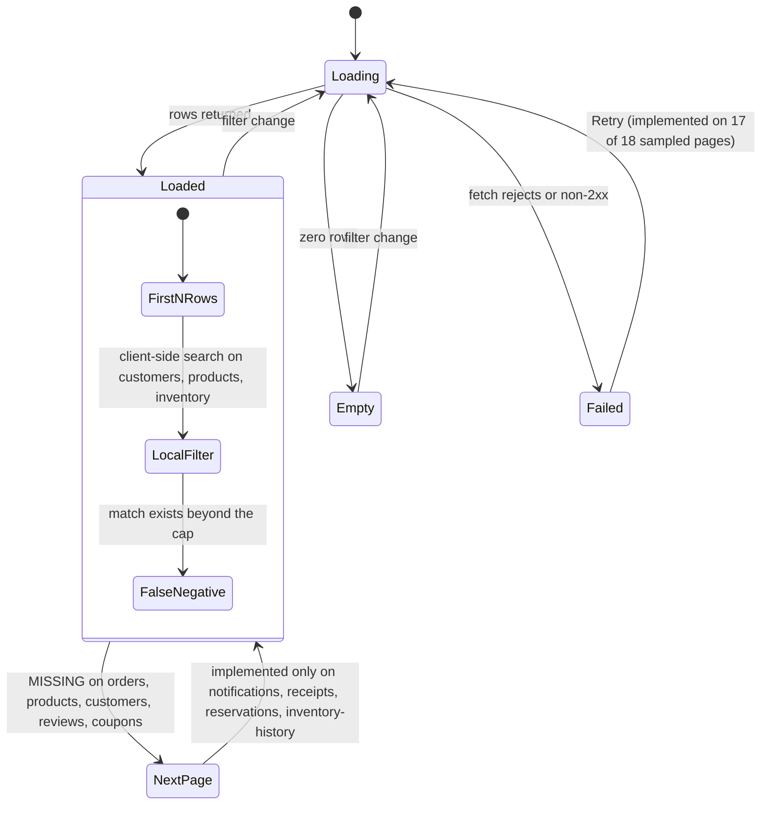
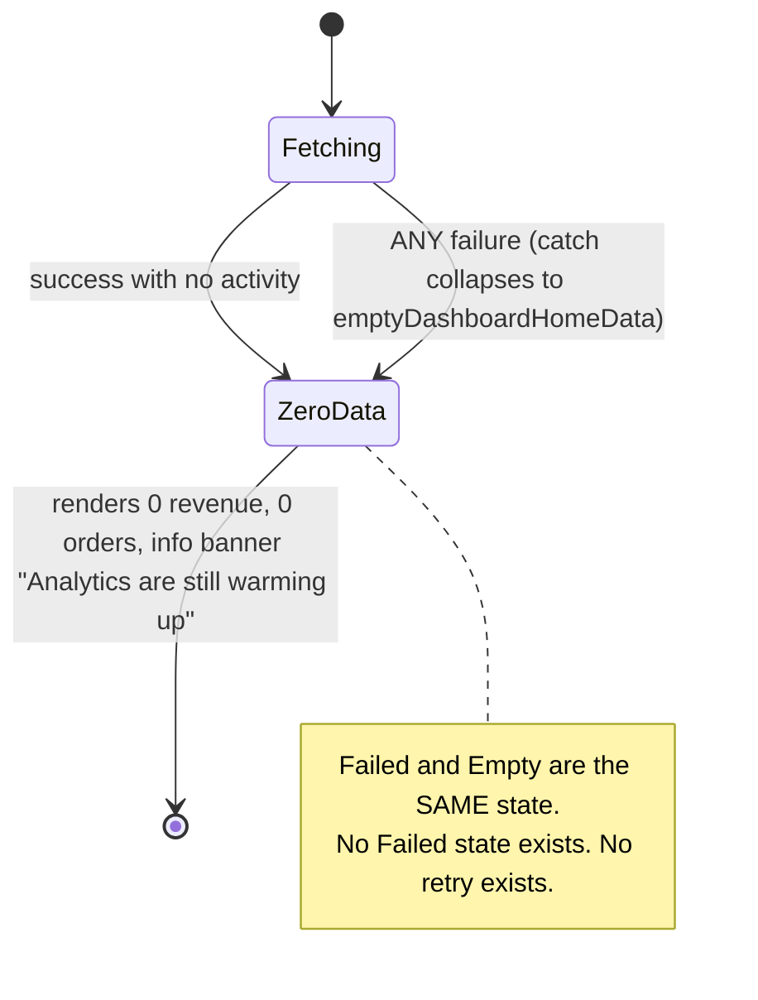
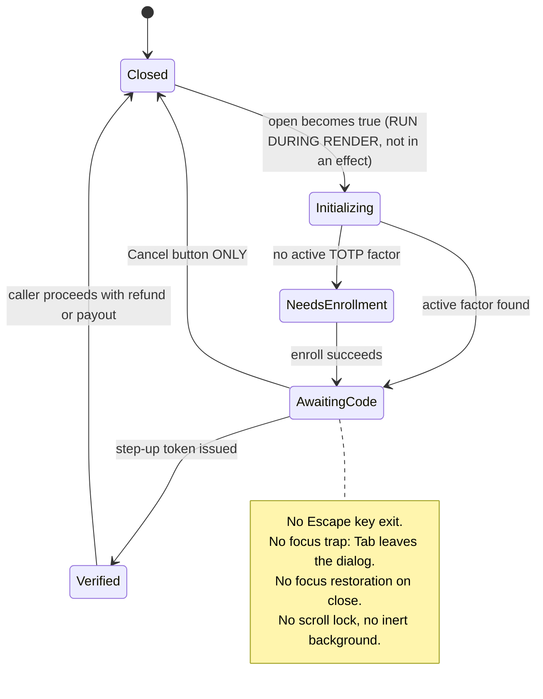

# 23 — UX, MOBILE, ACCESSIBILITY, AND STATE AUDIT

| Field | Value |
|---|---|
| **Run ID** | `docs/merchant-system-discovery/2026-08-04T225330+0530-ee371182` |
| **Branch** | `stepup/main` |
| **Commit** | `ee371182` |
| **Run date** | 2026-08-04 (+0530) |
| **Scope** | Merchant-facing UX quality: page state triads (loading / empty / error+retry), destructive-action confirmation, list pagination, design-token and dark-mode coverage, India-first date and currency formatting, accessibility of the shared primitives and the highest-stakes dialog, and behaviour at ~360px. Surfaces covered: `apps/merchant-control-plane` (77 routes) and `apps/platform-console` (20 dashboard routes). `apps/mobile/merchant-app` (Flutter) is referenced only where it contradicts the web surface. |
| **Evidence basis** | Agent notes `_agent-notes/M-quality-observability-operations.md` and `_agent-notes/B-merchant-ui-routes.md`, plus 14 targeted re-verification commands run by this author against working-tree source at commit `ee371182` (logged in §9.3). |
| **METHOD DISCLOSURE** | **Nothing in this document was runtime-verified.** No page was rendered, no browser was opened, no screen reader was run, no contrast ratio was measured, no viewport was resized, and no automated accessibility scanner was executed against any merchant route. Every finding is static source reading. The ceiling status in this document is therefore `IMPLEMENTED_NOT_RUNTIME_VERIFIED`; the string `VERIFIED_E2E` does not appear as a verdict anywhere below. |
| **Coverage disclosure** | The page scorecard in §5.1 is a **sample of 18 of 77 merchant routes** plus a **20-route console sample**. It is not exhaustive route coverage. The accessibility work in §8 is a **spot check of the shared component library and of the single highest-stakes dialog**. **It is not a WCAG audit and must not be cited as one.** |
| **Secrets / PII** | No secrets or PII appear in this document. |

---

## 1. Recommendation / verdict

**The merchant UI's component craft is good and its product-level state handling is not. Do not read the two as the same thing.**

The shared library (`@letbuyy/ui`) is genuinely well built: real focus traps, real `aria-live` regions, `useId`-associated labels, `aria-invalid` wiring, a token-driven theme provider that sets `colorScheme`, and — contrary to what the notes state — **26 automated `axe` assertions that actually run**. The merchant app composes from it almost everywhere, uses `ConfirmDialog` in 30 files, and carries a proper skeleton → empty → error → retry triad on 16 of the 18 sampled pages.

Four defects sit on top of that good foundation and are the ones that matter:

1. **A merchant cannot reach their own 51st order.** No pagination exists on `orders`, `products`, `customers`, `reviews`, or `coupons` — while the gateway contract has implemented `page`, `cursor`, `limit` and `sort` all along, *and while four other merchant pages already paginate correctly using the shared primitive*. Because the order **detail** page has no actions at all, an unreachable order is an **unrefundable** order. This is the single worst finding in this document.
2. **Five of six date formatters render in the runtime timezone, which is UTC on the edge.** Every merchant timestamp between 00:00 and 05:29 IST displays as the previous calendar day, and every wall-clock time is 5 h 30 m early — on order dates, payout dates and gift-card dates. This is not cosmetic; it changes which GST period a record appears to belong to.
3. **The dialog that gates refund approval and payout release is the one dialog in the product that ignores the accessible dialog primitives.** No focus trap, no Escape, no focus restoration, no scroll lock — and it starts a `fetch` during the render phase. Meanwhile `SettingsShell` — a *navigation drawer* — implements all four correctly. The capability exists; it was not applied to the money gate.
4. **51 referenced `--lb-*` tokens are never emitted**, four of them because the token layer deliberately deletes them at runtime. Per CSS, those declarations are invalid-at-computed-value-time, so affected KPI cards draw borders in the text colour and "2xl" values render at inherited size.

**Verdict: NOT LAUNCH-READY on UX state and India-first correctness; launch-capable on component craft.** The remediation is unusually cheap for the severity, because in every one of the four cases the correct implementation already exists somewhere else in the same repository. This is an *adoption* problem, not a *build* problem — which is also why nothing here should be deferred on cost grounds.

One structural warning the evidence supports: there is **no ratchet holding any of it**. The a11y assertions cover `packages/typescript/ui` primitives only; no validator checks that a `var(--lb-*)` reference resolves; no lint rule forbids a bare `toLocaleDateString`; no test asserts a list page can reach its last record. Every finding below can silently return the day after it is fixed.

---

## 2. Scope

### In scope
- Page state machine per route: loading, empty, error, retry.
- Destructive-action confirmation coverage across the merchant app.
- List pagination and client-side search behaviour.
- Design-token resolution and dark/light mode coverage in both web surfaces.
- India-first rendering: date/timezone and INR currency formatting.
- Accessibility of `@letbuyy/ui` primitives and of `StepUpDialog` (the refund/payout gate).
- Layout behaviour at the declared ~360px mobile tier.

### Out of scope (cross-referenced, no gap ID allocated here)
| Topic | Where it belongs | Why not here |
|---|---|---|
| CSV export 100-row truncation (`G-B-09` / `G-M-24`) | Data-portability / GST document | Covered by another author's block; duplicating the ID would corrupt the global register. The *state surface* of that page (toast-only feedback) **is** mine — MCP-DISC-747. |
| Provider-mode honesty badge coverage (`G-B-05`) | Payments document | Money-honesty invariant, not a UX-state invariant. |
| Staff RBAC not gating the UI (`G-B-14`) | Identity / RBAC document | Authorization affordance. |
| Dead nav links, unreachable pages, orphaned proxies (`G-B-12`) | Route/navigation document | Reachability, not state. |
| Audit, alerting, operator tooling (`G-M-01`..`G-M-21`) | Observability / operations document | Not merchant-facing UX. |
| Console tables at mobile widths | Recorded as an observation in §5.4 only. Agent M explicitly declined to raise it as a gap ("Acceptable for an operator console; noted, not a gap"); this author does not overrule that judgement. |

### Explicitly not attempted
- No WCAG 2.1/2.2 conformance assessment at any level.
- No colour-contrast measurement. Contrast in the merchant app is a property of `packages/typescript/ui/src/tokens.ts` per theme, not of the pages, and **no contrast checker exists in this repository**. Contrast remains `UNVERIFIED_RUNTIME`.
- No screen-reader testing, no keyboard walkthrough, no zoom/reflow testing, no motion-preference testing.
- No mobile device or emulator testing at 360px.

---

## 3. Current merchant user journeys — what a merchant can actually do today

Read as: *what is the merchant's lived experience of these surfaces*, given only static evidence.

| Journey | What actually happens | Status |
|---|---|---|
| **Land on the dashboard** | Server component fetches analytics, orders, products, shipping zones and payment config. Every call is individually `.catch(() => null)` and the whole block is wrapped in `catch { return emptyDashboardHomeData() }` (`apps/merchant-control-plane/src/app/[store]/dashboard/page.tsx:206-249`). On any failure the merchant sees ₹0 revenue, 0 orders, and an **info-tone** banner titled "Analytics are still warming up" (`DashboardClient.tsx:585-589`). A total gateway outage and a brand-new empty store are visually identical. There is no retry control. | `BROKEN` |
| **Work the order queue** | `orders/page.tsx` renders a real skeleton, a real empty state and a real error banner with retry. The merchant filters by status and payment status, searches server-side, expands a row, and acts. The fetch hardcodes `limit: '50'` and never sends `page` or `cursor` (`:204-208`). The section header reads `${totalCount} orders in the current view` using `payload.meta.total` (`:616`) — so a 240-order store is told "240 orders in the current view" with 50 rendered. **There is no route to order 51.** | `PARTIAL` |
| **Open one order** | `/{store}/orders/{orderId}` renders customer, items, totals, refund and return status — and offers **no action whatsoever**. Every action (ship, refund, cancel) lives on the list-row expansion. Combined with the row above, an order that has fallen out of the newest 50 is unreachable *and* unactionable. | `PARTIAL` |
| **Approve a refund** | The merchant enters an amount and a reason on the list-row panel, then a `StepUpDialog` demands a TOTP code. The TOTP round-trip is real cryptography, not a string-length check. The dialog itself is a hand-rolled `<div role="dialog" aria-modal="true">` with **no focus trap, no Escape, no focus restoration and no scroll lock** (`components/security/StepUpDialog.tsx:220-227`), and it fires an async `initialize()` **during render** (`:209-215`). | `PARTIAL` |
| **Find a customer** | The search box on `customers`, `products` and `products/inventory` filters the **already-fetched, 100-row-capped array**. `searchQuery` never enters a fetch. A merchant searching for their 250th customer is told, confidently, that no such customer exists. | `BROKEN` |
| **Disable a gift card** | A `variant="destructive"` button calls `changeStatus(row, 'disabled')` **on the first click, with no confirmation** (`products/gift-cards/page.tsx:356-365`). The same app uses `ConfirmDialog` in 30 other files. Reversible via a Reactivate button, but a shopper may hit a failed redemption in the interim and (per the observability document) no audit row records who did it. | `PARTIAL` |
| **Read any date** | Order dates, payout dates, gift-card dates, staff dates and enrolment dates render through formatters that do **not** set `timeZone`. On Cloudflare Workers and Next server components that resolves to UTC. `2026-08-04T01:30:00Z` — 07:00 IST on 4 August — displays as **3 August**. | `BROKEN` |
| **Read any amount** | Mostly correct `en-IN` INR, but through **three** independent formatter implementations plus six hand-rolled `₹${…}` template literals, some dividing by 100 and some not. | `PARTIAL` |
| **Use the product at 360px** | The design system declares `--breakpoint-xs: 360px` and `--breakpoint-mobile: 480px`. Neither is used **anywhere** in the merchant app: `xs:` and `mobile:` occur **zero** times. Everything falls to the un-prefixed base layout. `SettingsShell` does ship a correct mobile drawer. No evidence exists that anyone has tested at 360px. | `UNVERIFIED_RUNTIME` |
| **Toggle the console to light mode** | `apps/platform-console` renders a `ThemeToggleButton` over 144 hardcoded dark-palette classes. Switching to light produces dark-on-light tables. This is the surface used for money reconciliation and incident command. | `BROKEN` |

---

## 4. Feature matrix

Capability = a UX guarantee, not a business feature. Evidence tags per the run's taxonomy.

| # | Capability | Status | Evidence | Gap |
|---|---|---|---|---|
| 1 | Skeleton loading state on merchant list/detail pages | `IMPLEMENTED_NOT_RUNTIME_VERIFIED` | `UI_CODE` — 17/18 sampled pages; 44/77 routes carry all three states | — |
| 2 | Empty state on merchant list pages | `IMPLEMENTED_NOT_RUNTIME_VERIFIED` | `UI_CODE` — 15/18 sampled | — |
| 3 | Error + retry on merchant list pages | `PARTIAL` | `UI_CODE` — 17/18 sampled; dashboard and export are the holes | MCP-DISC-733, MCP-DISC-747 |
| 4 | Dashboard distinguishes outage from empty store | `BROKEN` | `UI_CODE` `dashboard/page.tsx:206-264`, `DashboardClient.tsx:585-589` | MCP-DISC-733 |
| 5 | Pagination on merchant list pages | `PARTIAL` | `UI_CODE` — implemented on 4 pages, absent on the 5 highest-traffic ones; `API_CLIENT_CODE` `checkout-core/src/index.ts:881-894` | MCP-DISC-730 |
| 6 | Server-side search on list pages | `PARTIAL` | `UI_CODE` — orders only; customers/products/inventory filter locally | MCP-DISC-735 |
| 7 | Debounced search input | `NOT_IMPLEMENTED` | `UI_CODE` `orders/page.tsx:232,234,624` | MCP-DISC-743 |
| 8 | Destructive-action confirmation | `PARTIAL` | `UI_CODE` — `ConfirmDialog` in 30 files; 3 of 9 destructive-button files lack it | MCP-DISC-740 |
| 9 | Forms disable while submitting | `IMPLEMENTED_NOT_RUNTIME_VERIFIED` | `UI_CODE` `packages/typescript/ui/src/button.tsx:63,69,116,134` | — |
| 10 | Toast discipline (errors actually surface) | `IMPLEMENTED_NOT_RUNTIME_VERIFIED` | `UI_CODE` — 125 `success` vs 159 `critical` call sites | — |
| 11 | Dark mode in the merchant app (token swap) | `IMPLEMENTED_NOT_RUNTIME_VERIFIED` | `UI_CODE` `theme-provider.tsx:70-78`, `globals.css:271-290` | — |
| 12 | Dark **and light** mode in the console (UI-R3) | `BROKEN` | `UI_CODE` `(dashboard)/layout.tsx:43,46,73`; `ConsoleDataTable.tsx:33,34,40,46,52` | MCP-DISC-736 |
| 13 | All referenced `--lb-*` tokens resolve | `BROKEN` | `UI_CODE` — 140 referenced, 51 undefined; `tokens.ts:9-21,1095-1097` | MCP-DISC-737 |
| 14 | Token-resolution governance | `NOT_IMPLEMENTED` | absence of `SERVICE_CODE` — no validator checks consumer references | MCP-DISC-737 |
| 15 | IST timezone on merchant dates | `BROKEN` | `UI_CODE` `packages/typescript/ui/src/formatting.ts` — `timeZone` set once at `:167` | MCP-DISC-731 |
| 16 | Single INR formatter | `PARTIAL` | `UI_CODE` — 3 implementations + 6 hand-rolled templates | MCP-DISC-738 |
| 17 | `en-IN` dates on billing surfaces | `CONTRADICTORY_EVIDENCE` | `UI_CODE` `formatting.ts:108-128` vs `UNIT_TEST` `tests/contracts/date-format-single-source.test.ts:29-30` | MCP-DISC-739 |
| 18 | Dates formatted at all on the payouts page | `BROKEN` | `UI_CODE` `payouts/page.tsx:181-183` renders raw API strings | MCP-DISC-742 |
| 19 | Accessible dialog primitives exist | `IMPLEMENTED_NOT_RUNTIME_VERIFIED` | `UI_CODE` `overlays.tsx:149,241,340,392,439` | — |
| 20 | The refund/payout gate uses them | `PARTIAL` | `UI_CODE` `StepUpDialog.tsx:220-227`; `useFocusTrap|Escape|useScrollLock` grep = **0** | MCP-DISC-732 |
| 21 | No render-phase side effects on the money gate | `BROKEN` | `UI_CODE` `StepUpDialog.tsx:209-215` | MCP-DISC-741 |
| 22 | Automated a11y assertions on shared primitives | `IMPLEMENTED_NOT_RUNTIME_VERIFIED` | `UNIT_TEST` — 26 `axe` assertions across 2 files *(corrects the notes)* | — |
| 23 | Automated a11y assertions on any merchant route | `NOT_IMPLEMENTED` | absence of `E2E_TEST`/`UNIT_TEST` | MCP-DISC-734 |
| 24 | Colour-contrast verification | `UNVERIFIED_RUNTIME` | no tooling exists in-repo | MCP-DISC-734 |
| 25 | 360px mobile tier exercised | `NOT_IMPLEMENTED` | `UI_CODE` — `xs:`/`mobile:` = 0 occurrences | MCP-DISC-745 |
| 26 | Horizontal-overflow containment on mobile | `IMPLEMENTED_NOT_RUNTIME_VERIFIED` | `UI_CODE` — 12 files use `overflow-x-auto`; one `min-w` above 360px | — |
| 27 | Mobile navigation drawer with focus management | `IMPLEMENTED_NOT_RUNTIME_VERIFIED` | `UI_CODE` `SettingsShell.tsx:59-89` | — |
| 28 | Shipped capabilities described honestly in the UI | `CONTRADICTORY_EVIDENCE` | `UI_CODE` `settings/custom-data/page.tsx:11-24` vs `GATEWAY_CODE` `routes/metafields.ts` | MCP-DISC-744 |
| 29 | Error boundary follows the design system | `PARTIAL` | `UI_CODE` `src/app/error.tsx` | MCP-DISC-748 |
| 30 | Login page follows the design system | `PARTIAL` | `UI_CODE` `[store]/login/page.tsx:23-26` | MCP-DISC-749 |
| 31 | Single icon system | `PARTIAL` | `UI_CODE` — Material Symbols in main nav, Lucide in settings nav | MCP-DISC-750 |
| 32 | Token ratchet holds radius and spacing | `PARTIAL` | `UI_CODE` — 26 raw `rounded-*` in 12 files; 23 files with raw px/palette | MCP-DISC-746 |
| 33 | List filter state is URL-addressable | `NOT_IMPLEMENTED` | `UI_CODE` `orders/page.tsx` local state; `merchantNavigation.ts:66-68` | MCP-DISC-751 |
| 34 | Onboarding checklist progress persists | `NOT_IMPLEMENTED` | `UI_CODE` `AISidebar.tsx:146-151`, `TrialBanner.tsx:13,51` | MCP-DISC-752 |
| 35 | Redirect routes avoid a blank frame | `PARTIAL` | `UI_CODE` `[store]/online-store/page.tsx` client `router.replace` returning `null` | MCP-DISC-753 |

---

## 5. UI / route inventory

### 5.1 Sampled page scorecard — 18 of 77 merchant routes (SAMPLE, NOT EXHAUSTIVE)

Reproduced in full from `_agent-notes/M-quality-observability-operations.md:30-49`. Scored by reading the actual rendering primitives, not by filename or route existence.

**This is 18 of 77 merchant routes — 23 % of the merchant surface. It is a sample. Do not cite it as coverage.**

Legend: ✅ present · ⚠️ partial/qualified · ❌ absent · n/a not applicable to the surface.
"Dark mode" = the page renders through `--lb-*` tokens (which flip at the root via `LetbuyyThemeProvider`) rather than hardcoded palette classes.

| # | Page (`apps/merchant-control-plane/src/app/[store]/…`) | Skeleton | Empty | Error+Retry | Destructive confirm | Pagination | Dark mode |
|---|---|---|---|---|---|---|---|
| 1 | `dashboard/page.tsx` | ❌ | ❌ | ❌ (failures rendered as ₹0 + info banner) | n/a | n/a | ✅ |
| 2 | `orders/page.tsx` | ✅ | ✅ | ✅ | ✅ (1 dialog) | ❌ hard `limit:'50'` | ✅ |
| 3 | `orders/[orderId]/page.tsx` | ✅ | ✅ | ✅ | ❌ | n/a | ✅ |
| 4 | `products/page.tsx` | ✅ | ✅ | ✅ | ❌ | ❌ hard `limit=100` | ✅ |
| 5 | `products/inventory/page.tsx` | ✅ | ✅ | ✅ | ❌ | ❌ | ✅ |
| 6 | `products/gift-cards/page.tsx` | ✅ | ✅ | ✅ | ❌ **disable fires immediately** | ❌ | ✅ |
| 7 | `customers/page.tsx` | ✅ | ✅ | ✅ | ❌ | ❌ hard `limit=100` | ✅ |
| 8 | `payouts/page.tsx` | ✅ | ✅ | ✅ | ⚠️ step-up TOTP (stronger than a dialog) | ❌ | ✅ |
| 9 | `analytics/page.tsx` | ✅ | ✅ | ✅ | n/a | n/a | ✅ |
| 10 | `coupons/page.tsx` | ✅ | ✅ | ✅ | ✅ | ❌ `limit=100` | ✅ |
| 11 | `reviews/page.tsx` | ✅ | ✅ | ✅ | ✅ | ❌ `limit=100` | ✅ |
| 12 | `settings/payments/page.tsx` | ✅ | ❌ | ✅ | ❌ | n/a | ✅ |
| 13 | `settings/taxes/page.tsx` | ✅ | ✅ | ✅ | ✅ | n/a | ✅ |
| 14 | `settings/shipping/page.tsx` | ✅ | ✅ | ✅ | ✅ | n/a | ⚠️ raw `rounded-lg` |
| 15 | `settings/users/page.tsx` | ✅ | ❌ | ✅ | ✅ | n/a | ✅ |
| 16 | `settings/security/page.tsx` | ✅ | ✅ | ✅ | ✅ inline TOTP re-auth | n/a | ✅ |
| 17 | `settings/notifications/page.tsx` | ✅ | ✅ | ✅ | ❌ | ✅ | ✅ |
| 18 | `settings/custom-data/page.tsx` | n/a | n/a | n/a | n/a | n/a | ✅ — but renders a **stale "backend needed" placeholder** (MCP-DISC-744) |

**Sample verdict (as recorded in the notes):** 16 of 18 carry a proper skeleton → empty → error → retry triad. The two outliers are `dashboard` — the merchant's landing page, and the worst error handling in the app — and `settings/custom-data`, a placeholder for a capability that ships.

**Two corrections this author verified against source and must state explicitly (see §9.3):**

1. The notes' cell for row 17 reads *"✅ (only page with any)"*. That parenthetical is **wrong**. Re-verification finds **four** merchant pages with real, server-backed pagination using the shared `Pagination` primitive: `settings/notifications`, `products/receipts`, `products/reservations`, and `products/inventory-history` — all four hold `{ total, page, per_page, has_next }` meta in state, send `url.searchParams.set('page', …)`, and render `<Pagination>`. The scorecard cell is corrected above to plain ✅. **This makes the pagination gap worse, not better**: the pattern is proven inside this very app and simply was not adopted on the five pages merchants use most.
2. Row 1's `❌` on Skeleton is a consequence of `dashboard/page.tsx` being a server component that awaits its data — there is no client loading phase to skeleton. The `❌` on Error+Retry is the real defect and is scored correctly.

### 5.2 Beyond the sample — the 77-route picture

From `_agent-notes/B-merchant-ui-routes.md:398-405`, scripted heuristically across all 77 routes (`Skeleton|isLoading|loading ?|Spinner` / `EmptyState|emptyState|emptyMessage` / `Banner…critical|setError|loadError`):

- **44 of 77 routes carry all three states.** The 33 with a gap are predominantly settings forms where an empty state is meaningless — that is a defensible pattern, not a defect.
- Genuinely notable holes: `/[store]/export` (no loading, no empty, no error UI — all feedback is toast-only), `/[store]/dashboard` (no error state), `/[store]/settings` (static index, no state), `/[store]/online-store` (renders `null` while client-redirecting).
- Confirmed strong: `analytics`, `operations-dashboard`, `ai`, `marketing`, `orders`, `payouts`, `gift-cards` all carry a real `Skeleton` + `EmptyState` + retry `Banner`.

### 5.3 Console sample — 20 dashboard routes (SAMPLE)

`apps/platform-console/src/app/(dashboard)/`: `money-reconciliation`, `operations`, `merchants/[id]`, `developers`, `audit-logs`, `stores`, `subscriptions`, `trust-safety`, `revenue`, `analytics`, `risk`, `compliance`, `incidents`, `employees`, `users`, `settings`, `founding`, `marketplace-governance`, `dashboard`, `(dashboard)/page`.

These consistently ship `EmptyDataState` + `ConsoleApiErrorPanel` + **real pagination** via `ConsoleDataTable` — **better than the merchant app on pagination, far worse on theming** (MCP-DISC-736). This author re-verified that `Pagination`/`ConsoleDataTable` is referenced by at least 10 console routes.

### 5.4 Mobile inventory (~360px)

| Fact | Evidence | Re-verified |
|---|---|---|
| `--breakpoint-xs: 360px` and `--breakpoint-mobile: 480px` are declared | `config/tailwind/letbuyy-tokens.css:21-22` | yes |
| `xs:` and `mobile:` prefixes are used **zero** times in the merchant app | grep over `apps/merchant-control-plane/src/**/*.tsx` | yes — 0 matches |
| Only `sm:` (61), `md:` (118), `lg:` (25) are used | notes `B §6.6` | not re-counted |
| `globals.css` has 48 media queries; smallest breakpoints are 600/639/640px; explicit 360px handling in exactly three hand-written blocks (`:1997`, `:3508`, `:13794`) | notes `B §6.6` | not re-counted |
| Exactly **one** `min-w-[…px]` in the merchant app exceeds 360px: `settings/notifications/page.tsx:615` `min-w-[640px]`, inside a scroll container | grep | yes — the notes say "two"; this author found **one** (the others are 112/136/180/220px). Refinement, same direction. |
| 12 merchant files wrap tables in `overflow-x-auto` | grep | yes |
| `SettingsShell` ships a correct mobile drawer: scroll lock, Escape, full Tab/Shift-Tab cycle, focus restoration | `components/settings/SettingsShell.tsx:59-89` | yes — read line by line |
| Console tables set `min-w` up to 1120px (`compliance/page.tsx:236`), all inside `overflow-x-auto` | notes `M §3.5` | not re-verified |

**Console mobile is recorded as an observation, not a gap.** Agent M assessed it as horizontal scrolling rather than breakage and acceptable for an operator surface. This author does not overrule that.

---

## 6. Backend / API / RPC / database mapping

A UX audit's "backend" is the set of contracts the UI is supposed to honour. These are the four that matter here.

| Contract | Location | What it offers | What the UI does with it |
|---|---|---|---|
| **List pagination** | `packages/checkout-core/src/index.ts:881-894` — `ListOrdersQuery` with `page: z.coerce.number().int().min(1).default(1)`, `cursor: z.string().max(512).optional()`, `limit: …max(100).default(20)`, `withCount`, `sort: 'created_at'\|'total'\|'status'`, `order: 'desc'` | Offset **and** cursor paging, sortable, with count | `orders/page.tsx:204-208` sends only `status`, `payment_status`, `limit:'50'`, and conditionally `search`. **`page` and `cursor` are never sent.** Identical shape at `products/page.tsx:103`, `customers/page.tsx:178`, `reviews/page.tsx:116`, `coupons/page.tsx:124`. |
| **Design tokens** | `packages/typescript/ui/src/tokens.ts` — 271 distinct explicit `--lb-*` literals plus names composed recursively by `appendTokenVariables` (`:1018-1029`) under the `--lb-primitive-*` / `--lb-semantic-*` / `--lb-component-*` prefixes | The full token surface, injected at runtime by `LetbuyyThemeProvider` | 140 `var(--lb-…)` references in merchant source; **51 resolve to nothing**. `deprecatedTokenAliasVariables` (`:9-21`) holds **11** aliases which `:1095-1097` deletes from the emitted map; **four of those eleven are still referenced by merchant pages**. |
| **Date/currency formatters** | `packages/typescript/ui/src/formatting.ts` — `formatInrCurrency:9`, `formatDisplayDate:78`, `formatIndiaDate:97`, `formatUsShortDate:108`, `formatUsLongDate:119`, `formatIndiaDateWithTime:130`, `formatIndiaDayMonthTime:141`, `formatIndiaDateTime:152`, `formatCurrency:185`, `formatDate:204` | One canonical INR formatter; six date formatters | `timeZone: 'Asia/Kolkata'` appears **exactly once**, at `:167` inside `formatIndiaDateTime` (5 call sites). Every other formatter renders in the runtime zone. Two formatters are hardcoded `locale: 'en-US'` (`:114`, `:125`). |
| **Accessible overlay primitives** | `packages/typescript/ui/src/overlays.tsx` — `useFocusTrap` at `:149` (Modal) and `:439` (Drawer); `role="dialog" aria-modal="true"` at `:173-174`, `:459-460`; Escape at `:241,340,392`; roving-tabindex menu at `:303-392`; visible focus ring at `:367,477`; `ConfirmDialog` exported at `:508` | Correct dialog semantics, free | Used by 30 merchant files for `ConfirmDialog`. **Not used by `StepUpDialog`**, the refund/payout gate. |

**No RPC, table or RLS policy is in scope for this document.** No UX finding here recommends any database change, and — per the run's standing rule — **no remediation below proposes a direct write to a money table.** The gift-card confirmation gap (MCP-DISC-740) is remediated entirely in the client; the underlying status change continues to go through the existing `PATCH /api/stores/:s/gift-cards/:id` path.

---

## 7. State machine

The merchant list page has a well-implemented five-state machine with one transition missing — and that one missing transition is what makes order 51 unreachable.



The dashboard implements a degenerate version of the same machine, and that is the defect:



The money-gate dialog's state machine is correct in its business logic and wrong in where it runs:



---

## 8. Auth / tenant / invariant analysis

This document touches exactly one auth-critical component: **`StepUpDialog`, the dialog that gates refund approval and payout release** (`components/security/StepUpDialog.tsx:6` — `type StepUpAction = 'refund.approve' | 'payout.release'`). Both are `[HIGH-STAKES]`; a released payout is `[IRREVERSIBLE]`.

### What is right
- The step-up is **real**: a genuine factor lookup (`GET …/security/two-factor`), a genuine enrolment path (`POST …/two-factor/enroll`), and a genuine challenge (`POST …/security/step-up`) returning `{ token, verifiedAt }` which is threaded into the refund/payout request body. This is cryptography-backed TOTP, not a client-side pretence.
- `autoFocus` on the code input (`:296`) is correct.
- The error path uses `Banner variant="critical"` → `role="alert"` (`:243`), which announces correctly.
- The overlay carries `aria-labelledby="step-up-title"` pointing at a real `<h2 id="step-up-title">` (`:222-232`). This author re-verified it; the notes did not mention it and it is a point in the component's favour.
- Submit buttons pass `loading` and `disabled` (`:277,302`), and `Button` maps `loading` to both `aria-disabled` and `disabled` with `disabled:pointer-events-none` (`packages/typescript/ui/src/button.tsx:63,69,116,134`). No double-submit exposure was found.

### What is wrong
| Defect | Evidence | Consequence |
|---|---|---|
| No focus trap | grep for `useFocusTrap` in the file → **0** (re-verified) | Tab walks out of an open "Verify identity" modal into the page behind it. A keyboard user can reach the Refund button *while the verification modal is open*. |
| No Escape dismissal | grep for `Escape` → **0** (re-verified) | The only exit is the Cancel button. |
| No focus restoration | no `previousActiveElement` handling | On close, focus is lost to `<body>`; a screen-reader user is dropped at the top of the page. |
| No scroll lock, no background inerting | hand-rolled `<div className="fixed inset-0 …">` at `:220-227` | Background scrolls and remains in the tab order. |
| Async fetch + `setState` **during render** | `:209-215` — `if (open && !initialized) { void initialize() }` and `if (!open && initialized) { setInitialized(false); reset() }`, where `initialize()` (`:75-96`) performs a `fetch` | Under StrictMode or concurrent rendering this can double-invoke the 2FA-status fetch and leave inconsistent dialog state **on the money path**. |

### The damning comparison
`components/settings/SettingsShell.tsx:59-89` — a *settings navigation drawer* — implements **all four** of the missing behaviours: `document.body.style.overflow = 'hidden'` (scroll lock), an `Escape` branch, a full Tab/Shift-Tab cycle with first/last wrapping, and `previousEl?.isConnected && previousEl.focus()` on cleanup (focus restoration). This author read it line by line to confirm.

**The capability exists in this codebase and was applied to a navigation menu but not to the refund gate.** That is the finding. It is not a resourcing problem.

### Tenancy
No tenancy defect is in scope here. For completeness: the merchant app's single tenancy gate is `src/app/[store]/layout.tsx:19-28`, and every API proxy re-resolves ownership through `src/lib/stores/resolve-owned-store.ts`. Whether the gateway enforces `verifySiteOwnership` is `UNVERIFIED_RUNTIME` by this author and belongs to the governance/identity documents. The related finding that **staff permissions gate nothing in the UI** (`G-B-14`) is cross-referenced, not re-raised here — but note its UX consequence: a `viewer` is served the Refund button and the Payouts "Release" button, so every accessibility and confirmation defect above is exposed to every role.

---

## 9. Runtime and test evidence

### 9.1 What was NOT verified — read this before citing anything above

| Not done | Consequence for this document |
|---|---|
| No page was rendered in any browser | Every visual claim (border colour falling back to `currentColor`, font size falling back to inherited, dark-on-light console tables) is **reasoned from the CSS specification**, not observed. |
| No accessibility scanner was run against any merchant route | §8 is a **code-reading spot check of one dialog plus the shared primitives**. It is not a WCAG audit at any level. There may be violations this method cannot see, and some findings above may be mitigated at runtime in ways static reading cannot reveal. |
| No colour-contrast ratio was measured | Contrast is `UNVERIFIED_RUNTIME` for both surfaces, including the specific `text-zinc-500` on `bg-zinc-900` console concern. |
| No screen reader was used | No claim is made about announcement order, live-region behaviour, or landmark navigation. |
| No viewport was resized; no device was used | The 360px section describes **declared configuration and grep counts only**. Whether the merchant app is usable at 360px is unknown. |
| No date was rendered under a UTC process TZ | The IST finding is derived from `Intl.DateTimeFormat` semantics plus the absence of `timeZone` in five formatters. The specific "3 August instead of 4 August" example is arithmetic, not an observation. |
| The app was not built and no test suite was executed | Per the run's standing safety rule, `pnpm validate:*` and `pnpm run validate:governance` were **not** run — the orchestrator deletes `node_modules`/`dist`/`.next` before validating (finding G-L-01) and would destroy the user's environment. |

**Ceiling status for this entire document is `IMPLEMENTED_NOT_RUNTIME_VERIFIED`.**

### 9.2 Test evidence that does exist

| Layer | What exists | Assessment |
|---|---|---|
| **Accessibility, shared primitives** | `packages/typescript/ui/tests/vitest.setup.ts:3,5` imports `toHaveNoViolations` from `jest-axe` and extends `expect`. `tests/components/foundation.test.tsx:77` defines `expectAxeClean(container)` and calls it at **25** sites across 36 tests. `tests/components/navigation-linked-parent.test.tsx:78-80` adds a 26th (`expect((await axe(container)).violations).toEqual([])`). Dependencies `jest-axe@^10.0.0` and `@types/jest-axe@^3.5.9` are declared at `packages/typescript/ui/package.json:79,82`. | **Real, and it runs.** `UNIT_TEST`. CI executes it via `pnpm turbo test --filter="...[HEAD^1]"` (`.github/workflows/ci.yml:118`) — i.e. **only when the `ui` package or a dependent changed**. |
| **Accessibility, application code** | **Nothing.** No axe assertion exists in `apps/merchant-control-plane`, `apps/platform-console`, or `tests/`. `find` for `*a11y*`/`*accessib*` outside `docs/archive/` and `.claude/worktrees/` returns only `apps/mobile/merchant-app/lib/widgets/shared/accessible_tap_region.dart` — a Flutter widget, not a test. | `NOT_IMPLEMENTED`. `StepUpDialog` lives in the app, so **the a11y ratchet structurally cannot see the money gate.** |
| **Visual regression** | `packages/typescript/ui` ships `test:visual` → `tests/visual/storybook-visual-regression.mjs` (`package.json:43`). Not executed by this author; not known to be wired into the merchant app. | `UNVERIFIED_RUNTIME` |
| **Date formatting** | `tests/contracts/date-format-single-source.test.ts:29-30` asserts `formatUsShortDate(value) === 'Jun 6, 2026'` and `formatUsLongDate(value) === 'June 6, 2026'`, and `:38-48` forbids only *locally declared* formatter helpers. | **Green, and it enforces the wrong thing** — see MCP-DISC-739. No test asserts any formatter's timezone. |
| **Pagination / list reachability** | No test found asserting that a list page can reach its last record. | `NOT_IMPLEMENTED` |
| **End-to-end merchant journey** | `tests/e2e/merchant-journey.spec.ts:9-13` self-skips when staging is unreachable or 5xx-ing and reports green (Agent M's `G-M-38`, out of this document's block). | Cannot be relied on to catch any finding above. |

### 9.3 Re-verification log — commands this author ran against source

All read-only. No file in the working tree was modified except this document.

| # | Claim checked | Source read | Result |
|---|---|---|---|
| 1 | `timeZone` appears once in the formatter module | `packages/typescript/ui/src/formatting.ts` | **CONFIRMED** — `timeZone: 'Asia/Kolkata'` at `:167` only; `locale: 'en-US'` at `:114`, `:125` |
| 2 | Deprecated token aliases are deleted from the emitted map | `packages/typescript/ui/src/tokens.ts:5-21`, `:1095-1097` | **CONFIRMED, with a correction of magnitude** — the set holds **11** aliases (not 4); four of them (`--lb-color-text-primary`, `--lb-color-text-secondary`, `--lb-color-border-subtle`, `--lb-color-danger`) are among the 51 tokens the merchant app still references. The notes' "four" is the *overlap*, not the set size. |
| 3 | Named tokens are genuinely unemitted | `tokens.ts` + `globals.css` vs `*.tsx` | **CONFIRMED** — `--lb-font-size-sm` (13 files), `--lb-color-surface-hovered` (9), `--lb-font-size-xs` (8), `--lb-size-icon-lg` (6), `--lb-color-text-tertiary` (4) appear in **neither** definition source. Control tokens `--lb-radius-lg`, `--lb-space-4`, `--lb-color-text`, `--lb-color-border` **are** defined. Per-file counts vary ±2 from the notes because this author restricted to `*.tsx`. |
| 4 | Token names are composed, so a literal grep could mislead | `tokens.ts:1018-1029` | **CONFIRMED SAFE** — composed names carry `--lb-primitive-*`/`--lb-semantic-*`/`--lb-component-*` prefixes; the flat aliases the app uses are 271 explicit literals. The notes' diff method is sound. |
| 5 | Gift-card disable fires with no confirmation | `[store]/products/gift-cards/page.tsx:355-365` | **CONFIRMED** — `variant="destructive"` → `onClick={() => void changeStatus(row, 'disabled')}`, no dialog |
| 6 | Orders list never sends `page`/`cursor` | `[store]/orders/page.tsx:203-212` | **CONFIRMED** — `URLSearchParams({ status, payment_status, limit: '50' })` + conditional `search` |
| 7 | Backend implements paging | `packages/checkout-core/src/index.ts:881-894` | **CONFIRMED** — `page`, `cursor`, `limit.max(100)`, `withCount`, `sort`, `order` |
| 8 | Misleading count label | `[store]/orders/page.tsx:616` | **CONFIRMED** — `${totalCount} orders in the current view` |
| 9 | `StepUpDialog` lacks focus trap / Escape / scroll lock | `components/security/StepUpDialog.tsx:205-232` | **CONFIRMED** — grep for `useFocusTrap\|Escape\|useScrollLock` → **0**. Render-phase `void initialize()` confirmed at `:209-215`. `aria-labelledby="step-up-title"` present (positive, unrecorded in the notes). |
| 10 | `SettingsShell` implements what `StepUpDialog` does not | `components/settings/SettingsShell.tsx:59-89` | **CONFIRMED** — scroll lock, Escape, full Tab cycle, focus restoration |
| 11 | 360px tier is dead | `config/tailwind/letbuyy-tokens.css:18-26` + grep | **CONFIRMED** — breakpoints declared; `xs:`/`mobile:` = **0** occurrences. **Refinement:** exactly **one** `min-w-[…px]` exceeds 360px (`settings/notifications:615`, 640px), not two. 12 files use `overflow-x-auto`. |
| 12 | **No a11y tooling exists** (notes' claim) | all `package.json` + `packages/typescript/ui/tests/` | **CONTRADICTED — see §9.2.** `jest-axe@^10.0.0` is installed and **26 `axe` assertions run**. The correct statement is that a11y enforcement exists for shared primitives and covers **zero** application routes. |
| 13 | **Only `settings/notifications` paginates** (notes' claim) | 4 merchant pages | **CONTRADICTED — see §5.1.** `products/receipts`, `products/reservations`, `products/inventory-history` each hold `{ total, page, per_page, has_next }`, send `page`, and render `<Pagination>`. |
| 14 | `ConfirmDialog` adoption vs destructive buttons | grep over `apps/merchant-control-plane/src` | **CONFIRMED** — `ConfirmDialog` in **30** files; `variant="destructive"` in **9** files; the three lacking a confirm are `products/gift-cards`, `products/new`, `settings/security` (the last uses inline TOTP re-auth, which is stronger) |
| 15 | Console palette vs merchant palette | `ConsoleDataTable.tsx:33-55` + counts | **CONFIRMED directionally** — this author's narrower `*.tsx` regex yields 3 (merchant) vs 86 (console); the notes report 6 vs 144 with a broader pattern. Both show the same ~25–30× ratio. `ConsoleDataTable` hardcodes `border-zinc-800 bg-zinc-900`, `bg-zinc-950/60`, `text-zinc-500`, `divide-zinc-800`. |

### 9.4 End-to-end traces

Format: entry point → route → proxy → typed client → `/v1` gateway → auth/authz/ownership → validation → RPC/tables + RLS → webhook/queue/provider → downstream consequence → tests → runtime.

**Trace A — "Show me my 51st-newest order" `[HIGH-STAKES]`**
```
Merchant entry point : sidebar "Orders" (shortcut g o)
page/route           : /{store}/orders  (orders/page.tsx)
app proxy            : /api/stores/[store]/orders/route.ts
typed client         : apiClient.orders.list
/v1 gateway route    : GET /v1/orders   (ListOrdersQuery: page, cursor, limit, sort, order)
auth + ownership     : session cookie -> [store]/layout.tsx:19-28 -> resolveOwnedStoreId per proxy
validation           : ListOrdersQuery (checkout-core:881-894) accepts page and cursor
RPC/tables + RLS     : out of scope for this document
UI paging control    : MISSING  -- no next/prev, no load-more, no page param ever sent
UI sort/date filter  : MISSING  -- filters are status + payment_status + search only
count label          : MISLEADING -- "240 orders in the current view" with 50 rendered (orders/page.tsx:616)
downstream           : the order detail page has NO actions, so the list row is the ONLY
                       place the Refund control exists -> an unreachable order is unrefundable
tests                : MISSING  -- no test asserts last-record reachability
runtime observation  : NOT OBSERVED
```

**Trace B — "Approve a refund with step-up" `[HIGH-STAKES]` `[IRREVERSIBLE]`**
```
Merchant entry point : Orders list row -> "Refund" (orders/page.tsx:437)
page/route           : /{store}/orders, refund panel at :798-825
gate                 : StepUpDialog(action='refund.approve')  (orders/page.tsx:681)
  focus trap         : MISSING (StepUpDialog.tsx grep useFocusTrap -> 0)
  Escape to dismiss  : MISSING
  focus restoration  : MISSING
  scroll lock/inert  : MISSING
  effect discipline  : BROKEN -- fetch + setState during render (:209-215)
  labelling          : PRESENT -- role=dialog, aria-modal, aria-labelledby -> h2#step-up-title
app proxy            : /api/stores/[store]/orders/[orderId]/refund/route.ts -> resolveOwnedStoreId
/v1 gateway route    : POST /v1/.../refund with idempotency_key, amount_minor,
                       step_up_token, step_up_verified_at
server-authoritative : NOT VERIFIED HERE -- whether amount_minor is capped to the refundable
                       remainder is the payments document's question
RPC/ledger/RLS       : out of scope for this document
UI consequence       : success toast "Refund recorded" + refetch
provider-mode badge  : MISSING on this panel (cross-ref: payments document)
tests, a11y          : MISSING -- the ui axe suite cannot see app-level components
tests, keyboard      : MISSING
runtime observation  : NOT OBSERVED
```

**Trace C — "When was my payout released?" `[HIGH-STAKES]`**
```
Merchant entry point : Money -> Payouts
page/route           : /{store}/payouts  (payouts/page.tsx)
amount rendering     : payouts/page.tsx:16-18 minor units -> :28-30 a PRIVATE currency(minor)
                       helper duplicating formatInrCurrency  -> MCP-DISC-738
period rendering     : payouts/page.tsx:181-183 renders `${period_start} - ${period_end}`
                       -- RAW API STRINGS, no formatter at all  -> MCP-DISC-742
date correctness     : even where a formatter is used, no timeZone is set -> UTC on the edge,
                       so a payout at 02:00 IST shows the previous day -> MCP-DISC-731
pagination           : MISSING
audit of who released: MISSING (observability document)
tests                : MISSING
runtime observation  : NOT OBSERVED
```

---

## 10. Implemented vs missing

### Implemented and genuinely good — do not regress these
1. **Shared primitive accessibility.** `useId`-associated labels, `aria-describedby`, `aria-invalid` (`input.tsx:33,43-44,55,117,127-128,138`); focus-trapped Modal and Drawer (`overlays.tsx:149,439`); roving-tabindex menus (`:303-392`); `Banner` with `role="alert"`/`role="status"` (`feedback.tsx:139`); toast region `aria-live="polite"` with per-toast `role="alert"` for critical (`:224,239`).
2. **Theme provider correctness.** `data-theme` + class + `root.style.colorScheme` (`theme-provider.tsx:70-78`) — the third of those is what makes native controls render correctly and is routinely forgotten.
3. **Token discipline in the merchant app.** 3–6 hardcoded palette classes in the entire app, most carrying explicit `dark:` variants.
4. **State triad coverage.** 44/77 routes with all three; 16/18 in the sample.
5. **Confirmation discipline.** `ConfirmDialog` in 30 files.
6. **Submit-button discipline.** `loading` → `aria-disabled` + `disabled` + `pointer-events-none`, applied consistently.
7. **Toast honesty on errors.** 159 `critical` vs 125 `success` — errors genuinely surface.
8. **The mobile settings drawer.** A textbook implementation.
9. **Pagination — where adopted.** Four pages do it correctly with the shared primitive.
10. **26 running axe assertions** on the primitives.

### Missing
1. Pagination on the five list pages merchants actually use.
2. Server-side search on customers, products, inventory.
3. Search debouncing anywhere on a list page.
4. A distinct `Failed` state on the dashboard, and any retry control there.
5. `timeZone: 'Asia/Kolkata'` in five of six date formatters.
6. Any date formatting at all on the payouts period column.
7. A single canonical INR formatter.
8. Focus trap / Escape / focus restore / scroll lock on the refund and payout gate.
9. Effect discipline on that same gate.
10. Any a11y assertion covering any application route or app-level component.
11. Any colour-contrast verification anywhere.
12. Any use of the declared 360px and 480px breakpoints.
13. Resolution of 51 `--lb-*` token references.
14. A validator that fails when a `var(--lb-*)` reference does not resolve.
15. A lint rule forbidding bare `toLocaleDateString`/`toLocaleString`/`₹${` in application code.
16. Working light mode in the platform console.
17. Loading / empty / error surfaces on the export page.
18. URL-addressable list filter state.
19. Server-persisted onboarding-checklist and banner-dismissal state.

---

## 11. Gap IDs

24 gaps, `MCP-DISC-730` … `MCP-DISC-753`, ordered most-severe first. `[HIGH-STAKES]` marks money, payments, refunds, gift cards, payouts, settlements, GST, auth, tenancy or RLS. **No remediation below proposes a direct write to a money table; money mutates only via `SECURITY DEFINER` RPCs.**

---

### MCP-DISC-730 — No pagination on any high-traffic merchant list page; the 51st order is unreachable, and with it the only Refund control `[HIGH-STAKES]`

- **Domain:** merchant UX / scale / order operations
- **Status:** `PARTIAL`
- **Provisional:** `G-M-23`
- **User/business impact:** A store with 51 or more orders cannot open its 51st-newest order through the UI. There is no next-page control, no load-more, no date filter, and no sort control on the page. The same holds for products, customers, reviews and coupons past 100 rows. The section header compounds it by reading `"240 orders in the current view"` from `meta.total` while rendering 50. **The money consequence is the severe part:** the order *detail* page carries no actions at all, so the list row is the only surface in the web merchant OS that exposes the Refund control. An order that has scrolled out of the newest 50 is therefore not merely invisible — it is **unrefundable from the web admin**. Any store doing more than ~50 orders per operating window loses access to its own history.
- **Evidence:**
  - Backend contract implements paging: `packages/checkout-core/src/index.ts:881-894` — `page: z.coerce.number().int().min(1).default(1)`, `cursor: z.string().max(512).optional()`, `limit: …max(100).default(20)`, `withCount`, `sort: z.enum(['created_at','total','status']).default('created_at')`, `order: …default('desc')`. `API_CLIENT_CODE`. *(Re-verified.)*
  - UI never sends `page` or `cursor`: `apps/merchant-control-plane/src/app/[store]/orders/page.tsx:203-212` — `new URLSearchParams({ status: filter, payment_status: paymentFilter, limit: '50' })`. `UI_CODE`. *(Re-verified.)*
  - Same shape: `products/page.tsx:103` (`limit=100`), `customers/page.tsx:178` (`100`), `reviews/page.tsx:116`, `coupons/page.tsx:124`. `UI_CODE`.
  - Misleading count: `orders/page.tsx:616` — `` `${totalCount} ${totalCount === 1 ? 'order' : 'orders'} in the current view.` ``. `UI_CODE`. *(Re-verified.)*
  - Detail page has no actions: `orders/[orderId]/page.tsx` — the only `onClick` handlers are `:310-315`, `:331-336` (`router.push` to the customer profile) and `:661,667` (retry / back). `UI_CODE`.
  - **The pattern already works in this app:** `settings/notifications/page.tsx:236-237,296,673`, `products/receipts/page.tsx:76,92,352`, `products/reservations/page.tsx:111,127,389`, `products/inventory-history/page.tsx:135,173,543` all hold `{ total, page, per_page, has_next }`, send `url.searchParams.set('page', …)`, and render the shared `<Pagination>` from `packages/typescript/ui/src/productivity.tsx:139`. `UI_CODE`. *(Re-verified; corrects the source notes, which state only one page paginates.)*
- **Expected behavior:** Every merchant list page can reach its last record, and any rendered count matches what is rendered or is explicitly qualified ("showing 50 of 240").
- **Missing link / root cause:** Pure UI omission. The gateway contract, the shared `Pagination` primitive, and four working reference implementations all pre-exist. Root cause of the *non-adoption* is UNKNOWN — plausibly that the five pages were built before the primitive landed and were never revisited.
- **Blast radius:** `orders`, `products`, `customers`, `reviews`, `coupons` — the five most-used merchant surfaces. Every store above the cap. Compounds MCP-DISC-735 (search over the truncated array) and the export truncation finding held in another document.
- **Invariant:** `[HIGH-STAKES]` — blocks access to the refund control on money-bearing records.
- **Severity:** P1 (P0 for any store past the cap, which is any real store) · **Likelihood:** HIGH (deterministic)
- **Dependencies:** none. All required pieces exist.
- **Remediation approach:** Adopt the existing four-page pattern on the five missing pages — hold `{ total, page, per_page, has_next }` in state, send `page` (or `cursor`), render the shared `Pagination`. Correct the count label to state what is rendered against the total. Add a date-range filter and a sort control on orders so history is navigable by intent, not only by paging. Do not invent a second pagination pattern.
- **Acceptance criteria:** With 120 seeded orders a merchant can open order 120 and invoke Refund on it; with 300 products the 300th is reachable; the count label matches the rendered set or explicitly qualifies itself; the same holds for customers, reviews and coupons.
- **Required tests:** Component test over a dataset larger than the limit asserting the last record is reachable — for each of the five pages. A test asserting the count label is consistent with the rendered row count. Extend the merchant e2e journey to page to the last order.
- **Required owner:** lead engineer
- **Reversibility:** fully reversible
- **Confidence:** HIGH

---

### MCP-DISC-731 — Five of six date formatters omit `timeZone`, so merchant dates render in UTC on the edge `[HIGH-STAKES]`

- **Domain:** India-first correctness / merchant UX
- **Status:** `BROKEN`
- **Provisional:** `G-M-29`
- **User/business impact:** `Intl.DateTimeFormat` with no `timeZone` uses the runtime's zone. These are Next server components and Cloudflare Workers, where that zone is **UTC**. Every merchant timestamp between 00:00 and 05:29 IST therefore displays as the **previous calendar day**, and every rendered wall-clock time is **5 h 30 m early**. Concretely, an order placed at 07:00 IST on 4 August renders as 3 August. This lands on order dates, payout dates, gift-card dates, 2FA enrolment dates and staff dates. It changes which day a record appears to belong to during a support call, and which **GST period** it appears to fall in at a month boundary.
- **Evidence:**
  - `packages/typescript/ui/src/formatting.ts` — `timeZone: 'Asia/Kolkata'` appears **exactly once**, at `:167`, inside `formatIndiaDateTime` (`:152-170`, 5 call sites). `UI_CODE`. *(Re-verified.)*
  - Omitted from `formatIndiaDate` (`:97-106`, **41** call sites), `formatIndiaDateWithTime` (`:130-139`, **11** call sites, renders hour/minute), `formatIndiaDayMonthTime` (`:141-150`), `formatDate` (`:204-212`, **32** call sites), `formatDisplayDate` (`:78-95`). `UI_CODE`. *(Function line numbers re-verified; call-site counts taken from the notes.)*
  - 36 raw `toLocaleDateString`/`toLocaleTimeString`/`toLocaleString` call sites across `apps/merchant-control-plane/src` and `apps/platform-console/src`, **none** passing `timeZone` — e.g. `[store]/settings/security/page.tsx:190`, `[store]/products/gift-cards/page.tsx:343,562`. `UI_CODE`.
- **Expected behavior:** Every merchant-facing date and time renders in `Asia/Kolkata` unless the merchant has explicitly chosen another zone.
- **Missing link:** `timeZone` omitted from five of six formatter option objects; no lint rule prevents a bare `toLocale*` from reintroducing the bug.
- **Blast radius:** Every date in the merchant UI and the console — order, payout, gift-card, invoice-adjacent, security and staff surfaces.
- **Invariant:** `[HIGH-STAKES]` — GST period boundaries and money-record dating.
- **Severity:** P1 · **Likelihood:** HIGH (deterministic for ~23 % of the clock, and for **every** rendered time-of-day)
- **Dependencies:** none technical. CA-tax should confirm the GST period-boundary implication before the fix is signed off.
- **Remediation approach:** Set `timeZone: 'Asia/Kolkata'` in the shared formatters; replace the 36 raw `toLocale*` call sites with the shared formatters; add a lint rule forbidding bare `toLocaleDateString`/`toLocaleTimeString`/`toLocaleString` in application source. Do not introduce a per-page timezone override.
- **Acceptance criteria:** A timestamp of `2026-08-04T01:30:00Z` renders as `4 Aug 2026, 07:00` in the merchant UI when the process TZ is UTC; a formatter unit test pinned to `TZ=UTC` asserts it; zero bare `toLocale*` calls remain in application source.
- **Required tests:** Formatter unit tests executed under `TZ=UTC`. A lint rule with its own tests. A GST-adjacent test asserting a month-boundary timestamp lands in the correct period.
- **Required owner:** lead engineer, with CA-tax confirming the GST implication
- **Reversibility:** fully reversible
- **Confidence:** HIGH on the code facts; the runtime timezone being UTC is an inference from the Workers/Next execution model and is **not runtime-observed**

---

### MCP-DISC-732 — The refund and payout step-up dialog is not an accessible dialog `[HIGH-STAKES]`

- **Domain:** accessibility / money gate
- **Status:** `PARTIAL`
- **Provisional:** `G-M-32`
- **User/business impact:** The single most security-sensitive dialog in the product is the one that ignores the accessible dialog primitives the design system already provides. A keyboard or screen-reader user can Tab out of an open "Verify identity" modal into the page behind it — **including onto the Refund button the modal is supposed to be gating** — cannot dismiss with Escape, and loses their place entirely when the dialog closes. The background scrolls and remains in the tab order.
- **Evidence:**
  - Scope of the gate: `apps/merchant-control-plane/src/components/security/StepUpDialog.tsx:6` — `type StepUpAction = 'refund.approve' | 'payout.release'`. `UI_CODE`.
  - Hand-rolled overlay: `:220-227` — a bare `<div role="dialog" aria-modal="true" aria-labelledby="step-up-title" className="fixed inset-0 z-50 …">`. `UI_CODE`. *(Re-verified.)*
  - `grep -c "useFocusTrap\|Escape\|useScrollLock"` in that file → **0**. `UI_CODE` (absence). *(Re-verified.)*
  - The unused primitives: `packages/typescript/ui/src/overlays.tsx:149,439` (`useFocusTrap` on Modal and Drawer), `:241,340,392` (Escape handling), `useScrollLock`/`useDismiss` imported at `:8`. `UI_CODE`.
  - **Proof the app can do this correctly:** `apps/merchant-control-plane/src/components/settings/SettingsShell.tsx:59-89` implements scroll lock (`document.body.style.overflow = 'hidden'`), an `Escape` branch, a full Tab/Shift-Tab cycle with first/last wrapping, and focus restoration (`previousEl?.isConnected && previousEl.focus()`) — on a *navigation drawer*. `UI_CODE`. *(Re-verified line by line.)*
  - Partial credit, unrecorded in the notes: the dialog does carry `aria-labelledby` pointing at a real `<h2 id="step-up-title">` (`:222-232`), `autoFocus` on the code input (`:296`), and a `Banner variant="critical"` → `role="alert"` error (`:243`). *(Re-verified.)*
- **Expected behavior:** Tab cycles within the dialog; Escape dismisses; focus returns to the invoking control on close; the background is inert and does not scroll.
- **Missing link:** `StepUpDialog` was hand-rolled instead of composed on the shared `Modal`. Root cause UNKNOWN — plausibly that the two-phase enrol/verify flow was thought not to fit the Modal API.
- **Blast radius:** Every refund approval and every payout release performed by a keyboard or assistive-technology user; every such user on any device.
- **Invariant:** `[HIGH-STAKES]`; the payout release it gates is `[IRREVERSIBLE]`.
- **Severity:** P1 · **Likelihood:** MEDIUM (bites keyboard and AT users, and anyone who reflexively presses Escape)
- **Dependencies:** none. Fixing this makes MCP-DISC-741 disappear as a side effect if the rebuild moves initialisation into an effect.
- **Remediation approach:** Rebuild `StepUpDialog` on the shared `Modal` from `@letbuyy/ui`, keeping the two-phase enrol/verify logic and the TOTP round-trip **byte-for-byte intact**. Do not weaken or restructure the step-up protocol while doing accessibility work — treat it as a pure presentation-layer swap and have security review the diff.
- **Acceptance criteria:** Tab and Shift-Tab cycle within the dialog and never reach the page behind it; Escape dismisses without submitting; focus returns to the invoking button; the background does not scroll; the refund and payout flows still gate correctly and still transmit `step_up_token` and `step_up_verified_at` unchanged.
- **Required tests:** Keyboard-interaction component test (Tab wrap, Shift-Tab wrap, Escape, focus restore). A test asserting the step-up request/response contract is unchanged. An axe assertion on the dialog once MCP-DISC-734 lands.
- **Required owner:** lead engineer, with security co-signing the money-gate diff
- **Reversibility:** fully reversible
- **Confidence:** HIGH

---

### MCP-DISC-733 — The merchant dashboard renders a gateway failure as ₹0 with a reassuring banner

- **Domain:** merchant UX / error honesty
- **Status:** `BROKEN`
- **Provisional:** `G-M-22` (also `G-B-11`)
- **User/business impact:** Every upstream call on the merchant's landing page is individually swallowed, and the whole block is wrapped in a catch that returns all-zero data. The only failure signal is an **info-tone** banner reading "Analytics are still warming up. Summary cards will update when the analytics endpoint returns store activity." A total gateway outage and a brand-new empty store are **visually identical**, and the outage is described to the merchant as a benign warm-up. A merchant with real revenue sees ₹0. There is no retry control. Worse, `analyticsAvailable` is derived **solely** from the analytics call — if `orders.list` fails but analytics succeeds, `recentActivity` is silently empty with **no signal at all**.
- **Evidence:**
  - `apps/merchant-control-plane/src/app/[store]/dashboard/page.tsx:206-249` — every call `.catch(() => null)`, whole block `catch { return emptyDashboardHomeData() }`. `UI_CODE`.
  - `:252-264` — `emptyDashboardHomeData()` returns `totalRevenue: 0, totalOrders: 0, totalProducts: 0, avgOrderValue: 0, analyticsAvailable: false`. `UI_CODE`.
  - `apps/merchant-control-plane/src/app/[store]/dashboard/DashboardClient.tsx:583-589` — `{!homeData.analyticsAvailable && (<Banner variant="info" title="Analytics are still warming up">…)}`; metric cards render the zeros immediately below at `:592-600`. `UI_CODE`. *(Re-verified.)*
- **Expected behavior:** Distinguish "no activity yet" from "we could not load your analytics"; render a critical banner with a working Retry on failure; never render ₹0 as authoritative when the fetch failed.
- **Missing link:** No per-source load outcome is tracked; the code models only `available`/`not available` and conflates failure with emptiness.
- **Blast radius:** The dashboard, every merchant, during any gateway degradation. It is the first screen after login.
- **Invariant:** none formally, but it is an honesty defect on a money-adjacent surface.
- **Severity:** P1 · **Likelihood:** HIGH once any degradation occurs; the rendering is deterministic given a failure
- **Dependencies:** none.
- **Remediation approach:** Track a per-source outcome (`ok` / `empty` / `failed`); render an explicit error state with retry for `failed`; render the empty state only for `ok + empty`; **suppress the money figures entirely** rather than rendering zeros when the source failed. Extend the same treatment to the orders source so an orders failure is not silent.
- **Acceptance criteria:** With the analytics endpoint forced to 500 the dashboard shows a critical banner with a working Retry and does **not** show ₹0 revenue; with the orders endpoint forced to 500 the activity panel shows an error rather than an empty list; a genuinely new store still shows the friendly empty state.
- **Required tests:** Component test with a failing client asserting the error state and the **absence** of any zero-value metric card. A second test asserting a partial failure (orders only) is surfaced.
- **Required owner:** lead engineer
- **Reversibility:** fully reversible
- **Confidence:** HIGH

---

### MCP-DISC-734 — Accessibility enforcement covers only the shared primitives; zero coverage of any merchant route, app-level dialog, or the console

- **Domain:** accessibility governance
- **Status:** `PARTIAL`
- **Provisional:** `G-M-31` **(materially corrected — see below)**
- **User/business impact:** Root `AGENTS.md:291` states *"UI-R4 — MUST meet WCAG AA; no migration may regress accessibility (the floor)."* The ratchet that holds that floor exists **only** for `packages/typescript/ui`. No axe assertion, no a11y test and no contrast check covers any of the 77 merchant routes, any application-level component, or any of the 20 console routes. `StepUpDialog` — the highest-stakes dialog in the product, and the one with the most defects (MCP-DISC-732) — lives in the application, so the ratchet **structurally cannot see it**. Every accessibility improvement made to application code today can silently regress tomorrow.
- **Evidence:**
  - **Correction of the source notes.** `_agent-notes/M-quality-observability-operations.md:120,642` states that grep across all `package.json` for `axe-core|@axe-core|jest-axe|pa11y|lighthouse` returns **zero**. This author re-verified from source and that claim is **wrong**: `packages/typescript/ui/package.json:79` declares `"@types/jest-axe": "^3.5.9"` and `:82` declares `"jest-axe": "^10.0.0"`. `PROVIDER_OR_CONFIG_EVIDENCE`.
  - The tooling is wired and used: `packages/typescript/ui/tests/vitest.setup.ts:3,5` (`import { toHaveNoViolations } from 'jest-axe'; expect.extend(toHaveNoViolations)`); `tests/components/foundation.test.tsx:77` defines `expectAxeClean` and calls it at 25 sites (`:117,133,150,165,191,210,217,232,251,269,291,310,356,387,403,424,524,554,601,639,682,749,773,792,900`) across 36 tests; `tests/components/navigation-linked-parent.test.tsx:78-80` adds a 26th. `UNIT_TEST`. *(Re-verified.)*
  - It runs in CI, conditionally: `.github/workflows/ci.yml:118` — `pnpm turbo test --filter="...[HEAD^1]"`, i.e. only when the `ui` package or a dependent changed. `PROVIDER_OR_CONFIG_EVIDENCE`. *(Re-verified.)*
  - **The gap that remains and is real:** `packages/typescript/ui/tests/components/` contains exactly **2** test files. No axe assertion exists anywhere in `apps/merchant-control-plane`, `apps/platform-console`, or `tests/`. `find` for `*a11y*`/`*accessib*` outside `docs/archive/` and `.claude/worktrees/` returns only `apps/mobile/merchant-app/lib/widgets/shared/accessible_tap_region.dart`, a Flutter widget. `UNIT_TEST` (absence). *(Re-verified.)*
  - No contrast tooling of any kind exists in the repository, so `--lb-*` token contrast per theme is `UNVERIFIED_RUNTIME` and will remain so.
- **Expected behavior:** A newly introduced serious or critical accessibility violation on a merchant route fails CI.
- **Missing link:** No a11y assertion layer for application components or routes; no contrast checker; the primitive-level suite is not a gate on application changes.
- **Blast radius:** All 77 merchant routes, all 20 console routes, every hand-rolled dialog (`StepUpDialog`, `TranslationValueEditor`, `SettingsShell`, `MediaLibrary`).
- **Invariant:** none formally; UI-R4 is the stated floor.
- **Severity:** P1 · **Likelihood:** HIGH (a regression is undetectable today)
- **Dependencies:** none — `jest-axe` is already a proven dependency in this monorepo, so extension is cheap.
- **Remediation approach:** Extend the existing `jest-axe` pattern to application component tests, starting with the hand-rolled dialogs and the highest-traffic routes; add axe assertions to the Playwright merchant journey; wire the result into the validator gate so it ratchets rather than reports. Add a contrast checker over `tokens.ts` per theme so §8's `UNKNOWN` can be closed. Sequence `StepUpDialog` first so MCP-DISC-732 lands with a test behind it.
- **Acceptance criteria:** CI fails on a newly introduced serious/critical violation on any sampled merchant route or app-level dialog; a contrast report exists for both themes; the coverage set is documented so future readers know exactly what is and is not checked.
- **Required tests:** The assertions themselves; a deliberate-regression test proving the gate actually fails.
- **Required owner:** lead engineer, with the design-system owner on the contrast report
- **Reversibility:** fully reversible
- **Confidence:** HIGH — the correction and the residual gap were both verified directly from source

---

### MCP-DISC-735 — Search on customers, products and inventory filters only the fetched page and returns confident false negatives

- **Domain:** merchant UX / support correctness
- **Status:** `BROKEN`
- **Provisional:** `G-M-25`
- **User/business impact:** The search boxes on `customers`, `products` and `products/inventory` are bound to local state that filters the **already-fetched, 100-row-capped array**. `searchQuery` never enters a fetch. A merchant searching for their 250th customer — while that customer is on the phone — receives a confident "no results". The failure mode is worse than an error, because it looks like an answer.
- **Evidence:**
  - `apps/merchant-control-plane/src/app/[store]/customers/page.tsx:372`, `products/page.tsx:377`, `products/inventory/page.tsx:351` — `searchQuery` appears only in state, chip, clear-button and `onChange` positions, never in a `URLSearchParams` or fetch. `UI_CODE`.
  - The arrays being filtered are capped: `customers/page.tsx:178` (`limit=100`), `products/page.tsx:103` (`limit=100`). `UI_CODE`.
  - The correct pattern exists in the same app: `orders/page.tsx:210` — `if (searchQuery.trim()) query.set('search', searchQuery.trim())`. `UI_CODE`. *(Re-verified.)*
- **Expected behavior:** Search queries the full dataset server-side, or the UI states plainly that search is limited to the loaded page.
- **Missing link:** `search` is never added to the query string on these three pages.
- **Blast radius:** Customers, products, inventory — the three pages most used during live support and fulfilment.
- **Invariant:** none formally; it is a correctness and honesty defect.
- **Severity:** P1 · **Likelihood:** HIGH (any store above the cap)
- **Dependencies:** Best sequenced with MCP-DISC-730 and MCP-DISC-743 as one list-page pass.
- **Remediation approach:** Send `search` to the gateway exactly as `orders/page.tsx:210` already does, behind the shared debounce introduced for MCP-DISC-743. Until that lands, label the input to state its scope rather than implying a full search.
- **Acceptance criteria:** With 300 customers seeded, searching for the 250th returns it; the same for products and inventory.
- **Required tests:** Component test over a dataset larger than the cap asserting a beyond-cap match is found. A test asserting the query parameter is actually sent.
- **Required owner:** lead engineer
- **Reversibility:** fully reversible
- **Confidence:** HIGH

---

### MCP-DISC-736 — `apps/platform-console` is dark-only in practice while shipping a light/dark toggle (UI-R3)

- **Domain:** design system / UI-R3
- **Status:** `BROKEN`
- **Provisional:** `G-M-34`
- **User/business impact:** The console renders a `ThemeToggleButton`. Switching to light produces dark-on-light tables with failing contrast — on the operator surface used for **money reconciliation** and **incident command**, i.e. the screens an operator reads under time pressure during an incident. Root `AGENTS.md:290` requires *"Every screen MUST support light AND dark mode (reachable, not just wired)"*; UI-R1 requires a single token source.
- **Evidence:**
  - Toggle rendered: `apps/platform-console/src/app/(dashboard)/layout.tsx:73` — `<ThemeToggleButton label="Toggle console theme" />`; provider defaults dark at `:43,46`. `UI_CODE`. *(Re-verified.)*
  - Hardcoded palette: `apps/platform-console/src/components/ConsoleDataTable.tsx:33` — `className="rounded-lg border-zinc-800 bg-zinc-900 shadow-none"`, `tableClassName="min-w-full divide-y divide-zinc-800 text-sm"`; `:34` `<thead className="bg-zinc-950/60">`; `:40` column headers `text-zinc-500`; `:46` empty cell `text-zinc-500`; `:52` row hover `hover:bg-zinc-800/40`. `UI_CODE`. *(Re-verified.)*
  - Volume: the notes count **144** hardcoded palette classes across `apps/platform-console/src`, concentrated in `ConsoleDataTable.tsx` (30), `(dashboard)/employees/page.tsx` (53), `(auth)/login/page.tsx` (24), `(auth)/mfa/page.tsx` (14), `(dashboard)/settings/page.tsx` (10). This author's narrower `*.tsx`-only re-count yields **86** — same conclusion, different pattern breadth. Merchant-app comparison: 6 (notes) / 3 (narrower re-count).
  - Contrast concern flagged by the notes and **not measured by anyone**: `text-zinc-500` on `bg-zinc-900` for column headers, which is a risk even in the intended dark theme and unreadable in light.
- **Expected behavior:** Either both modes render legibly at AA contrast, or the toggle is removed and the console is documented as dark-only.
- **Missing link:** `ConsoleDataTable` and the auth/employee pages were never migrated to `--lb-*` tokens.
- **Blast radius:** Every console route rendering a table — which is most of them, including money reconciliation and incidents.
- **Invariant:** none formally; UI-R1 and UI-R3 are the stated rules.
- **Severity:** P1 · **Likelihood:** HIGH (deterministic the moment an operator presses the toggle)
- **Dependencies:** none.
- **Remediation approach:** Migrate `ConsoleDataTable` first — it is the single highest-leverage file — then the auth and employee pages, to `--lb-*` tokens. If light mode is not wanted, **remove the toggle** and record the decision; leaving a toggle that produces an unreadable screen is the worst of the three options. Measure contrast in both themes once MCP-DISC-734's contrast checker exists.
- **Acceptance criteria:** Toggling the console to light produces legible tables meeting AA contrast, **or** the toggle is removed and an ADR records the dark-only decision.
- **Required tests:** A contrast assertion over the console table tokens in both themes. A test that fails if a raw palette class is reintroduced into `ConsoleDataTable`.
- **Required owner:** lead engineer with the design-system owner
- **Reversibility:** fully reversible
- **Confidence:** HIGH on the code facts; the contrast failure itself is **inferred, not measured**

---

### MCP-DISC-737 — 51 referenced `--lb-*` tokens are never emitted; four are deliberately deleted at runtime

- **Domain:** design system / merchant UX
- **Status:** `BROKEN` (visual), with `NOT_IMPLEMENTED` governance
- **Provisional:** `G-B-06`
- **User/business impact:** Pages reference `var(--lb-…)` names the runtime token map never emits. Per the CSS specification an unresolvable `var()` with no fallback makes the declaration **invalid at computed-value time**: border colours fall back to `currentColor`, font sizes to inherited, backgrounds to transparent. Whole clusters of pages render off-design and off-brand, and will not follow a theme or brand change. The concrete case: `products/operations-dashboard/page.tsx:35,37,39` puts four undefined tokens on a single KPI card, so the cards draw borders in the **text colour** rather than a subtle grey and the "2xl" KPI value renders at inherited size — it is not visually a KPI.
- **Evidence:**
  - Scripted diff by Agent B of every `var(--lb-…)` in `apps/merchant-control-plane/src` against the union of `packages/typescript/ui/src/tokens.ts` emissions and `apps/merchant-control-plane/src/app/globals.css` definitions: **140 referenced, 51 undefined**. `UI_CODE`.
  - Deliberate deletion: `packages/typescript/ui/src/tokens.ts:9-21` declares `deprecatedTokenAliasVariables`; `:1095-1097` executes `deprecatedTokenAliasVariables.forEach((alias) => { delete variables[alias as \`--${string}\`]; })`. `UI_CODE`. *(Re-verified. **Refinement of the notes:** the set contains **11** aliases — `--lb-color-text-primary`, `--lb-color-text-secondary`, `--lb-color-border-default`, `--lb-color-border-subtle`, `--lb-color-danger`, `--lb-semantic-focus-ring`, `--lb-semantic-accent-brand`, `--lb-semantic-accent-text`, `--lb-semantic-text-primary`, `--lb-semantic-text-secondary`, `--lb-semantic-text-muted`. The notes' "four" is the number still referenced by merchant pages, not the size of the set.)*
  - Independent spot-check by this author confirming genuine absence from **both** definition sources: `--lb-font-size-sm` (13 files), `--lb-color-surface-hovered` (9), `--lb-font-size-xs` (8), `--lb-size-icon-lg` (6), `--lb-color-text-tertiary` (4). Control tokens `--lb-radius-lg`, `--lb-space-4`, `--lb-color-text`, `--lb-color-border` **are** defined, confirming the method discriminates. `UI_CODE`. *(Re-verified.)*
  - Method soundness: `tokens.ts:1018-1029` composes nested names under `--lb-primitive-*`/`--lb-semantic-*`/`--lb-component-*` prefixes; the flat aliases the app consumes are **271 distinct explicit literals**, so a literal diff is valid for these names. *(Re-verified.)*
  - Highest-count offenders per the notes: `--lb-font-size-sm` (13 files), `--lb-color-surface-hovered` (11), `--lb-color-text-secondary` (9, deprecated), `--lb-font-size-xs` (9), `--lb-color-text-primary` (8, deprecated), `--lb-color-border-subtle` (8, deprecated), `--lb-size-icon-lg` (6), plus ~40 more including `--lb-font-size-2xl`, `--lb-space-0-5`, `--lb-space-20`, `--lb-size-avatar-md`, `--lb-color-on-primary`, `--lb-radius-pill`, `--lb-shadow-overlay`.
  - **No governance covers it:** `scripts/validators/token-source-single-validator.mjs` guards token *authority*; `packages/typescript/ui/tests/validators/ui-token-variable-snapshot-validator.mjs` and `ui-no-new-token-alias-validator.mjs` snapshot the *producer*; the five UI ESLint rules (`packages/typescript/ui/eslint/index.cjs:145`) cover hex, raw colour, raw element, raw form control and Tailwind default colour. **Nothing validates that a consumer's token reference resolves.** `SERVICE_CODE` (absence).
- **Expected behavior:** Every `var(--lb-*)` reference in application source resolves to an emitted token.
- **Missing link / root cause:** A producer-side deprecation was executed (aliases deleted) without a consumer-side migration, and no validator exists to detect the resulting dangling references.
- **Blast radius:** ~30 files including `orders/[orderId]`, `customers/[email]`, `customers/segments`, `marketing`, the `products/*` warehousing pages, `settings/notifications`, the theme editor and the theme library.
- **Invariant:** none.
- **Severity:** P2 · **Likelihood:** HIGH (deterministic)
- **Dependencies:** none.
- **Remediation approach:** Add a governance validator that extracts emitted token names from `tokens.ts` (explicit literals **and** composed names) plus app CSS, and fails on any unresolved `var(--lb-*)` in application source. Then migrate the 51 references to live tokens. **Do not "fix" this by re-adding the deprecated aliases** — that would silently reverse a deliberate design-system decision.
- **Acceptance criteria:** The validator is wired into the governance gate and reports zero unresolved references across all apps; the operations-dashboard KPI cards render a real border colour and a real display font size.
- **Required tests:** The new validator plus its self-test (including a deliberate dangling reference that must fail).
- **Required owner:** lead engineer (design system)
- **Reversibility:** fully reversible
- **Confidence:** HIGH on the diff and on the deletion mechanism; **MEDIUM on the exact per-property visual outcome, because no page was rendered**

---

### MCP-DISC-738 — Three parallel INR formatters with inconsistent minor-unit handling `[HIGH-STAKES]`

- **Domain:** money display / India-first
- **Status:** `PARTIAL`
- **Provisional:** `G-M-30` (and `G-B §7.1`)
- **User/business impact:** There is one canonical `formatInrCurrency`, **two** duplicate implementations, and at least six hand-rolled `₹${…}` template literals — some dividing by 100 and some not. Every one is individually `en-IN`, so no output is provably wrong today. The defect is that **a 100× display error in this codebase would be indistinguishable from correct output during review**. That is the condition under which a merchant is shown ₹150 instead of ₹15,000 on a settlement figure and nobody notices. This is asserted as a *systemic risk*, **not** as a live 100× bug.
- **Evidence:**
  - Canonical: `packages/typescript/ui/src/formatting.ts:9-36` — `formatInrCurrency`, 42 call sites across 12 files. `UI_CODE`.
  - Duplicate #2: `apps/merchant-control-plane/src/app/[store]/payouts/page.tsx:28-30` — a private `currency(minor)` helper. `UI_CODE`.
  - Duplicate #3: `apps/platform-console/src/lib/console-api.ts:107-115` — `formatMoneyFromPaise`. `UI_CODE`.
  - Hand-rolled **with** `/100`: `[store]/customers/segments/page.tsx:140`, `access_account/checkout/select-plan/SelectPlanClient.tsx:41`. Hand-rolled **without** `/100`: `[store]/settings/shipping/page.tsx:557`, `[store]/products/collections/page.tsx:541`, `SelectPlanClient.tsx:37`, `[store]/settings/business/page.tsx:181`. **`SelectPlanClient.tsx` divides by 100 on one line and not on the adjacent one.** `UI_CODE`.
  - Additional local `Intl.NumberFormat` instances on money surfaces: `orders/page.tsx:106`, `settings/plan/page.tsx:101`, `settings/business/page.tsx:179`, `access_account/checkout/checkout/CheckoutClient.tsx:83` — the last being the merchant's own payment checkout. `UI_CODE`.
- **Expected behavior:** One exported money formatter with an explicit minor-unit contract; zero hand-rolled `₹` templates in application source.
- **Missing link / root cause:** No lint rule forbids a `₹${` template literal or a local `Intl.NumberFormat` with `currency: 'INR'`, so each new surface reinvents the formatter.
- **Blast radius:** Payouts, settlements, commission, shipping rates, collections, plan checkout, customer segments — every money-rendering surface in both web apps.
- **Invariant:** `[HIGH-STAKES]` — money display.
- **Severity:** P2 · **Likelihood:** MEDIUM (the risk is of a future defect, not a proven present one)
- **Dependencies:** The payments/catalog owner must resolve the open unit question below before the migration can be mechanical.
- **Open unknown carried from the notes and not resolved here:** whether `ShippingRate.price` and `Product.price` are rupees or paise. `ShippingRate` is not exported from `@letbuyy/api-client` and neither the notes' author nor this author resolved it statically. Until it is resolved, **no claim is made that any of these surfaces renders a wrong number.**
- **Remediation approach:** Converge on one exported formatter that takes minor units **explicitly** (e.g. `formatInrFromMinor`), delete the two duplicates and the hand-rolled templates, document the minor-unit contract per field, and add a lint rule forbidding `₹${` templates and local INR `Intl.NumberFormat` instances in application code. Have the payments owner confirm the two unknown field units first. **No money table is written by any part of this remediation — it is display-layer only.**
- **Acceptance criteria:** One exported money formatter; zero hand-rolled `₹` templates in `apps/`; a documented minor-unit contract for every money field rendered in the UI; the lint rule green.
- **Required tests:** Unit tests on the formatter including the minor-unit boundary. The lint rule with its own tests. A rendering test per money surface asserting the expected magnitude for a known fixture.
- **Required owner:** lead engineer with the payments owner
- **Reversibility:** fully reversible
- **Confidence:** HIGH on the existence of three formatters and the inconsistent `/100`; **MEDIUM overall because two field units are UNKNOWN**

---

### MCP-DISC-739 — US-locale dates on merchant billing surfaces, sanctioned by a green contract test `[HIGH-STAKES]`

- **Domain:** India-first / governance contradiction
- **Status:** `CONTRADICTORY_EVIDENCE`
- **Provisional:** `G-B-10`
- **User/business impact:** An Indian merchant reads invoice dates, the next-charge date and the trial-end date in US format (`Jun 6, 2026`) while the rest of the product uses `6 Jun 2026`. On money and compliance surfaces, mixed date conventions are genuinely ambiguous — and this sits on the billing history a merchant would hand to an accountant. Compounding: MCP-DISC-731 means these same dates are also computed in the wrong timezone.
- **Evidence:**
  - Formatters are explicitly `en-US`: `packages/typescript/ui/src/formatting.ts:108-117` (`formatUsShortDate`), `:119-127` (`formatUsLongDate`) — `locale: 'en-US'` at `:114` and `:125`. `UI_CODE`. *(Re-verified.)*
  - Used on money surfaces: `apps/merchant-control-plane/src/app/[store]/settings/billing/page.tsx:200` (invoice date column), `:254` (upcoming charge), `:322` (trial end). Also `settings/users/page.tsx:390`, `online-store/pages/page.tsx:470,528`, `components/domains/DomainDetailView.tsx:195,287,319`. `UI_CODE`.
  - **The contradiction:** `tests/contracts/date-format-single-source.test.ts:29-30` asserts `formatUsShortDate(value) === 'Jun 6, 2026'` and `formatUsLongDate(value) === 'June 6, 2026'`; `:38-48` forbids only *locally declared* formatter helpers. Governance therefore **blesses** US dates. `CLAUDE.md`'s India-first standard says `en-IN dates`. `UNIT_TEST` vs `DOC_CLAIM`.
  - Separately, 10 call sites bypass the shared formatter entirely with raw `toLocaleDateString('en-IN', …)`: `experience/page.tsx:77`, `projects/page.tsx:96`, `education/page.tsx:77`, `certifications/page.tsx:74`, `settings/security/page.tsx:190`, `products/gift-cards/page.tsx:343`, `CheckoutClient.tsx:182,193,200`, `FoundingMerchantCard.tsx:54` — correct locale, wrong single source.
- **Expected behavior:** One documented decision, enforced by one test.
- **Missing link / root cause:** UNKNOWN. Two authorities disagree and both are currently green; nothing in the repo records which is intended.
- **Blast radius:** Billing history, staff admin, domains, CMS.
- **Invariant:** `[HIGH-STAKES]` on billing — invoice dating.
- **Severity:** P2 · **Likelihood:** HIGH (unconditional rendering) · this is a **decision**, not a bug fix
- **Dependencies:** Must be decided before MCP-DISC-731 is executed, so the two changes land as one coherent formatting pass.
- **Remediation approach:** ARB or founder decides. Then **either** migrate the call sites to `formatIndiaDate`/`formatIndiaDateWithTime` and update the contract test, **or** record the exception in governance with an explicit rationale for why US dates are correct on an India-first merchant OS. Also eliminate the 10 raw `toLocaleDateString` call sites either way.
- **Acceptance criteria:** One documented rule; the contract test enforces that rule and no other; zero raw `toLocaleDateString` calls in application source.
- **Required tests:** The revised contract test. The `toLocale*` lint rule shared with MCP-DISC-731.
- **Required owner:** ARB for the decision; lead engineer for execution
- **Reversibility:** fully reversible
- **Confidence:** HIGH on the facts; the resolution is a governance decision

---

### MCP-DISC-740 — Gift-card disable executes immediately with no confirmation `[HIGH-STAKES]`

- **Domain:** merchant UX / stored-value instrument
- **Status:** `PARTIAL`
- **Provisional:** `G-M-28`
- **User/business impact:** One misclick makes a customer's stored-value card unredeemable, immediately, with no confirmation step. It is reversible via the adjacent **Reactivate** button — so this is not P1 — but a shopper may hit a failed redemption at checkout in the interim, and (per the observability document) **no audit row records who did it or why**. The same application uses `ConfirmDialog` in 30 other files, including for far less consequential deletions.
- **Evidence:**
  - `apps/merchant-control-plane/src/app/[store]/products/gift-cards/page.tsx:355-365` — `<Button variant="destructive" loading={statusBusyId === row.id} disabled={statusBusyId === row.id} onClick={() => void changeStatus(row, 'disabled')}>` with **no dialog**; handler at `:251-275`; reactivation at `:367-377`. `UI_CODE`. *(Re-verified.)*
  - The shared primitive that was not used: `packages/typescript/ui/src/overlays.tsx:508` — `export function ConfirmDialog(`. `UI_CODE`. *(Re-verified.)*
  - Adoption evidence: **30 files** in the merchant app import/use `ConfirmDialog`; **9 files** contain a `variant="destructive"` button; the three destructive files **without** a confirm are `products/gift-cards/page.tsx`, `products/new/page.tsx`, and `settings/security/page.tsx` — the last correctly using inline TOTP re-auth (`:197-228`), which is a stronger gate than a dialog. So gift-cards and `products/new` are the only genuine holes. `UI_CODE`. *(Re-verified.)*
- **Expected behavior:** Disabling a stored-value instrument requires explicit confirmation and captures a reason.
- **Missing link:** `ConfirmDialog` not wired on this action.
- **Blast radius:** Every gift card in every store; the shopper-facing consequence is a failed redemption.
- **Invariant:** `[HIGH-STAKES]` — stored-value liability.
- **Severity:** P2 (reversible via Reactivate) · **Likelihood:** MEDIUM
- **Dependencies:** The reason field is most valuable once merchant-side audit exists (observability document, `G-M-07`); do not block this fix on that.
- **Remediation approach:** Wrap the disable action in the shared `ConfirmDialog`, name the card and its remaining balance in the confirmation copy, and capture a short reason for the future audit record. **The status change continues to go through the existing `PATCH /api/stores/:s/gift-cards/:id` gateway path — no money table is written from the client.**
- **Acceptance criteria:** Disabling requires explicit confirmation naming the card; a reason is captured; Reactivate remains available; cancelling the dialog performs no request.
- **Required tests:** Component test asserting no request fires until confirmation; a test asserting cancel is a no-op.
- **Required owner:** lead engineer
- **Reversibility:** fully reversible
- **Confidence:** HIGH

---

### MCP-DISC-741 — `StepUpDialog` mutates state and starts a fetch during the render phase `[HIGH-STAKES]`

- **Domain:** correctness / money gate
- **Status:** `BROKEN`
- **Provisional:** `G-M-33`
- **User/business impact:** The dialog that gates refund approval and payout release performs a state update and an async `fetch` **during render**, not in an effect. Under React StrictMode or concurrent rendering this can double-invoke the 2FA-status fetch and leave the dialog in inconsistent state on the highest-stakes path in the product — for example showing the enrolment step to a merchant who already has an active factor, or the reverse.
- **Evidence:** `apps/merchant-control-plane/src/components/security/StepUpDialog.tsx:208-215`:
  ```tsx
  // Initialize on open
  if (open && !initialized) {
      void initialize()
  }
  if (!open && initialized) {
      setInitialized(false)
      reset()
  }
  ```
  `initialize()` (`:75-96`) performs a `fetch`. `UI_CODE`. *(Re-verified.)*
- **Expected behavior:** Initialisation runs in a `useEffect` keyed on `open`; no state update or network call occurs during render.
- **Missing link:** The logic was written as a render-phase guard instead of an effect.
- **Blast radius:** Every refund approval and payout release.
- **Invariant:** `[HIGH-STAKES]`; the payout release it gates is `[IRREVERSIBLE]`.
- **Severity:** P2 · **Likelihood:** MEDIUM (depends on StrictMode and concurrent-rendering behaviour, which was **not** runtime-observed)
- **Dependencies:** Naturally fixed as part of MCP-DISC-732's rebuild on the shared `Modal`; sequence them together.
- **Remediation approach:** Move initialisation into `useEffect` keyed on `open`, with a cleanup that cancels in-flight work. Do not change the step-up protocol or the request/response shapes while doing so.
- **Acceptance criteria:** No render-phase state update or fetch remains in the component; the enrol → verify transitions behave correctly under StrictMode; the step-up request contract is byte-for-byte unchanged.
- **Required tests:** A StrictMode-enabled render test asserting `initialize()` fires exactly once per open. A contract test on the unchanged request shape.
- **Required owner:** lead engineer, with security co-signing the money-gate diff
- **Reversibility:** fully reversible
- **Confidence:** HIGH on the code fact; MEDIUM on the runtime consequence, which was not observed

---

### MCP-DISC-742 — The payouts finance page renders raw unformatted API date strings `[HIGH-STAKES]`

- **Domain:** India-first / money surface
- **Status:** `BROKEN`
- **Provisional:** `G-M §4.4` (recorded in the notes as an observation under `G-M-30`, raised here as its own gap because it is a distinct defect with a distinct fix)
- **User/business impact:** The payouts page — the merchant's money-out surface — renders the settlement period as the **raw API strings**, with no date formatting at all. Whatever shape the gateway returns (ISO timestamp, date-only, or something else) is shown verbatim to the merchant on a finance screen. This is the surface a merchant reads when reconciling what they were paid and for which period.
- **Evidence:** `apps/merchant-control-plane/src/app/[store]/payouts/page.tsx:181-183` — `` `${payout.period_start} – ${payout.period_end}` ``. `UI_CODE`.
- **Expected behavior:** The settlement period renders through the shared India date formatter with IST pinned.
- **Missing link:** No formatter is applied to these two fields.
- **Blast radius:** The payouts page; every merchant reconciling a settlement.
- **Invariant:** `[HIGH-STAKES]` — money-out reconciliation.
- **Severity:** P2 · **Likelihood:** HIGH (unconditional on every payout row)
- **Dependencies:** Should land with MCP-DISC-731 so the formatter it adopts is already IST-correct.
- **Remediation approach:** Apply the shared India date formatter to both fields. Confirm with the payments owner what the gateway actually returns for `period_start`/`period_end` (date-only vs timestamp) so the correct formatter variant is chosen — a date-only value must **not** be run through a time-rendering formatter.
- **Acceptance criteria:** The payout period renders as a formatted `en-IN` date range in IST; no raw API string reaches the merchant on this page.
- **Required tests:** Rendering test over a payout fixture asserting the formatted output; a test that fails on a raw ISO substring in the rendered period cell.
- **Required owner:** lead engineer, with the payments owner confirming the field shape
- **Reversibility:** fully reversible
- **Confidence:** HIGH on the code fact; the returned field **shape** is UNKNOWN

---

### MCP-DISC-743 — Orders search fires one gateway request per keystroke

- **Domain:** merchant UX / cost
- **Status:** `BROKEN`
- **Provisional:** `G-M-26`
- **User/business impact:** Typing a six-character query issues six gateway round-trips. Each one carries gateway auth, a database query, a telemetry write, and a request-log row. The merchant sees flicker; the platform pays for it; and during an incident this multiplies load from exactly the page an operator or merchant would be hammering.
- **Evidence:**
  - `apps/merchant-control-plane/src/app/[store]/orders/page.tsx:232` — `searchQuery` is in `loadOrders`'s `useCallback` dependency array; `:234` — `useEffect(() => { loadOrders() }, [loadOrders])`; `:624` — `onChange={(event) => setSearchQuery(event.target.value)}` with no debounce. `UI_CODE`.
  - Repo-wide, debouncing exists in only three places, none of them a list page: `customers/segments/page.tsx:548`, the theme-editor autosave, and `ResourcePickerControl.tsx:19`. `UI_CODE`.
- **Expected behavior:** At most one request per settled query.
- **Missing link:** No shared debounced-search hook exists for list pages.
- **Blast radius:** The orders page today; every list page once MCP-DISC-735 sends `search` server-side — which is why this must land **first**.
- **Invariant:** none.
- **Severity:** P2 · **Likelihood:** HIGH (unconditional)
- **Dependencies:** Blocks MCP-DISC-735 — do not push search server-side on three more pages without a debounce in place.
- **Remediation approach:** Introduce one shared debounced-search hook and adopt it on every list page. Reuse the pattern already proven at `customers/segments/page.tsx:548` rather than inventing a fourth.
- **Acceptance criteria:** Typing a six-character query issues at most one request after the debounce window; clearing the query issues at most one.
- **Required tests:** Component test with fake timers asserting request count against keystroke count.
- **Required owner:** lead engineer
- **Reversibility:** fully reversible
- **Confidence:** HIGH

---

### MCP-DISC-744 — `settings/custom-data` renders a "backend needed" placeholder asserting a falsehood about a shipped capability

- **Domain:** merchant UX / honesty drift
- **Status:** `CONTRADICTORY_EVIDENCE`
- **Provisional:** `G-M-27`
- **User/business impact:** The Custom data settings page tells merchants that metafields and metaobjects do not exist. The page states, as fact, that no such gateway route was found. A fully implemented, Zod-validated, ownership-checked capability is invisible to every merchant, and the product actively asserts it is absent.
- **Evidence:**
  - `apps/merchant-control-plane/src/app/[store]/settings/custom-data/page.tsx:11-24` renders `BackendNeededPane` with `requirement="[SKIP - NEEDS BACKEND: metafields and metaobjects API]"` and the assertion *"No `metafields`, `metaobjects`, or custom-data gateway route was found in current services/packages."* `UI_CODE`.
  - Contradicted by `services/api-gateway/src/routes/metafields.ts` — a full implementation with `resolveCustomUser` and ownership checks — registered at `services/api-gateway/src/index.ts:51,799` under `/v1/metafields`. `GATEWAY_CODE`.
  - The settings nav badges this item "Needs backend" (`settings/page.tsx:151`, driven by `status:'backend-needed'`), so the falsehood is propagated into navigation too. `UI_CODE`.
  - Mitigating: this is the **only** `BackendNeededPane` usage in the app, so the pattern itself is not systemic — the placeholder convention is otherwise honest.
- **Expected behavior:** The page either manages metafield definitions against `/v1/metafields`, or states accurately what is missing.
- **Missing link / root cause:** The placeholder text was written before `routes/metafields.ts` landed and was never revisited. There is no mechanism that would ever catch it.
- **Blast radius:** One settings page and its nav badge; a shipped capability with zero merchant reach.
- **Invariant:** none formally; it is an honesty defect (ANTI-R9 flavour, inverted — the product understates rather than overstates).
- **Severity:** P2 · **Likelihood:** HIGH (unconditional)
- **Dependencies:** none.
- **Remediation approach:** Either build the UI against `/v1/metafields` through a same-origin proxy (the app must not read the database), or correct the placeholder text so it does not assert a falsehood, and correct the nav badge. Consider a contract test that a `BackendNeededPane` naming a route cannot coexist with that route existing in the gateway.
- **Acceptance criteria:** The page either manages metafield definitions or accurately states what is missing; the nav badge matches; the assertion in the copy is true.
- **Required tests:** A contract test cross-referencing `BackendNeededPane` requirement strings against registered gateway routes.
- **Required owner:** lead engineer
- **Reversibility:** fully reversible
- **Confidence:** HIGH

---

### MCP-DISC-745 — The declared 360px mobile tier is dead and has never been exercised

- **Domain:** mobile UX
- **Status:** `NOT_IMPLEMENTED` (the tier) / `UNVERIFIED_RUNTIME` (actual behaviour)
- **Provisional:** `G-B §6.6`
- **User/business impact:** The design system declares a 360px tier and a 480px tier as first-class breakpoints, and `CLAUDE.md` states the merchant standard is "Mobile-first (~360px)". Neither breakpoint is used anywhere in the merchant application. At 360px every layout falls through to the un-prefixed base, which may well be fine — but **no one knows**, because there is no evidence anyone has ever looked, and no test or tooling could tell them. Indian merchants overwhelmingly administer their store on a phone; if the base layout is wrong at 360px, it is wrong for the primary usage mode.
- **Evidence:**
  - Declared: `config/tailwind/letbuyy-tokens.css:21-22` — `--breakpoint-xs: 360px;` and `--breakpoint-mobile: 480px;`. `UI_CODE`. *(Re-verified.)*
  - Unused: `xs:` and `mobile:` prefixes occur **zero** times across `apps/merchant-control-plane/src/**/*.tsx`. Only `sm:` (61), `md:` (118), `lg:` (25) are used. `UI_CODE`. *(Zero-occurrence re-verified by this author; the sm/md/lg counts are from the notes.)*
  - `globals.css` has 48 media queries whose smallest breakpoints are 600/639/640px, with explicit 360px handling in only three hand-written blocks (`:1997`, `:3508`, `:13794`). `UI_CODE` (from the notes).
  - Mitigating evidence — the app is probably not *broken* at 360px: exactly **one** `min-w-[…px]` in the merchant app exceeds 360px (`settings/notifications/page.tsx:615`, `min-w-[640px]`, inside a scroll container); the others are 112/136/180/220px. 12 files wrap tables in `overflow-x-auto`. `SettingsShell.tsx:59-89` ships a correct mobile drawer. `UI_CODE`. *(Re-verified; the notes said "two" values above 360 — this author found one.)*
- **Expected behavior:** Either the declared tiers are used and verified at 360px, or they are removed and the real minimum supported width is documented.
- **Missing link / root cause:** The breakpoints were defined as design-system intent and never adopted; nothing measures or enforces mobile layout.
- **Blast radius:** Every merchant route on a small phone — plausibly the dominant access mode for the India-first target user.
- **Invariant:** none.
- **Severity:** P2 · **Likelihood:** UNKNOWN — this is explicitly an **unverified** risk, not an observed failure
- **Dependencies:** Needs the runtime capability that MCP-DISC-734 introduces (or a Playwright viewport pass) before it can be closed with evidence.
- **Remediation approach:** Run the sampled merchant routes at 360×640 in the Playwright journey and capture the result; fix what breaks; then either adopt `xs:`/`mobile:` where genuinely needed or delete the unused breakpoint declarations so the design system stops advertising a tier nobody uses. Record the real minimum supported width.
- **Acceptance criteria:** A recorded 360px pass over the sampled routes with no horizontal body overflow and no clipped controls; the declared breakpoints are either used or removed; the supported minimum width is documented.
- **Required tests:** Playwright viewport assertions at 360×640 asserting `document.body.scrollWidth <= viewport width` on each sampled route.
- **Required owner:** lead engineer with the design-system owner
- **Reversibility:** fully reversible
- **Confidence:** HIGH that the tier is unused; **LOW on whether anything actually breaks — this was not observed**

---

### MCP-DISC-746 — Raw Tailwind radii, raw px and raw palette classes bypass the token ratchet in a long tail

- **Domain:** design system
- **Status:** `PARTIAL`
- **Provisional:** `G-B §6.3`
- **User/business impact:** 26 Tailwind default-scale radius classes across 12 files render at Tailwind's values rather than `--lb-radius-*`, because `config/tailwind/letbuyy-tokens.css` maps colours only, not radii. Two of those sit on the orders **refund** and **fulfilment** panels. Separately, 23 of 142 `.tsx` files contain raw `[Npx]` values, non-var `rounded-[…]`, or raw Tailwind palette classes. The consequence is visual drift that a brand or theme change will not follow — small individually, cumulative in effect, and invisible to the current lint configuration.
- **Evidence:**
  - 26 raw radius classes across 12 files: `rounded-lg` ×16, `rounded-md` ×5, `rounded-sm` ×2, `rounded-full` ×2, `rounded-xl` ×1 — including `orders/page.tsx:778` (fulfilment panel) and `:800` (refund panel). `config/tailwind/letbuyy-tokens.css` maps colours only, so `rounded-lg` resolves to Tailwind's 0.5rem, not `--lb-radius-lg`. `UI_CODE`.
  - 23 files with raw px / non-var arbitrary radius / raw palette. Worst: `dashboard/DashboardClient.tsx` (11 raw px), `login/page.tsx` (5 raw palette), `products/new/page.tsx` (4). `UI_CODE`.
  - Inline raw styles: `components/theme-editor/controls/LiquidControl.tsx:43,68` — `marginLeft: 2`, `fontSize: 12`, hardcoded `"Fira Code"`, `rgb(239 68 68)` fallback. `UI_CODE`.
  - Enforcement is partial: `apps/merchant-control-plane/eslint.config.mjs:17-21` sets `@letbuyy/ui/no-raw-elements` and `no-hardcoded-hex` to **error**, but `no-raw-form-controls`, `no-raw-color-functions` and `no-tailwind-default-color` only to **warn**. `PROVIDER_OR_CONFIG_EVIDENCE`.
- **Expected behavior:** Radii, spacing and colour all resolve through `--lb-*`; the ratchet is at `error`.
- **Missing link:** `letbuyy-tokens.css` does not map the radius scale; three ESLint rules are at `warn`.
- **Blast radius:** 23 of 142 merchant files, including two money panels.
- **Invariant:** none.
- **Severity:** P2 · **Likelihood:** HIGH (deterministic drift)
- **Dependencies:** Clear the tail before raising the rules to `error`, or the build breaks.
- **Remediation approach:** Map the radius scale in `config/tailwind/letbuyy-tokens.css` so `rounded-lg` resolves to `--lb-radius-lg`; migrate the 23-file tail; then raise `no-tailwind-default-color`, `no-raw-color-functions` and `no-raw-form-controls` from `warn` to `error`. Sequence after MCP-DISC-737 so the two token passes land together.
- **Acceptance criteria:** Zero raw Tailwind radius classes and zero raw palette classes in merchant source; the three ESLint rules at `error` with a green build.
- **Required tests:** The ESLint rules at `error` in CI.
- **Required owner:** lead engineer (design system)
- **Reversibility:** fully reversible
- **Confidence:** HIGH

---

### MCP-DISC-747 — The export page has no loading, empty or error surface; all feedback is toast-only

- **Domain:** merchant UX / state coverage
- **Status:** `PARTIAL`
- **Provisional:** `G-B §9`
- **User/business impact:** `/[store]/export` is the only genuinely stateless page among the merchant's data-bearing routes. It has no skeleton, no empty state and no persistent error surface — every outcome, success or failure, is a transient toast (`:157,183,197,226,238,257,265`) plus a per-button `loading` flag (`:400`). A merchant who looks away during an export, or whose toast auto-dismisses, has no way to learn what happened. The two `Banner` components on the page (`:420,428`) belong to the **import** flow, not the export flow.
- **Evidence:**
  - Toast-only export feedback and per-button loading: `apps/merchant-control-plane/src/app/[store]/export/page.tsx:157,183,197,226,238,257,265,400`. `UI_CODE`.
  - This author re-verified that the file's only `Banner` usages are at `:420` (`Import complete` / `Import needs attention`) and `:428` (`CSV selected`) — both in the import panel. There is no export-side persistent state surface. `UI_CODE`. *(Re-verified.)*
- **Expected behavior:** The export result persists on the page — what was exported, how many rows, and whether it was complete — rather than existing only as a transient toast.
- **Missing link:** No result state is held or rendered.
- **Blast radius:** One page, but it is the page a merchant uses before handing data to an accountant or migrating platforms.
- **Invariant:** none here. **Note:** the far more serious defect on this same page — silent truncation at 100 rows with a success toast — is deliberately **not** allocated an ID in this document; it is held under `G-B-09`/`G-M-24` in the data-portability document. The two fixes should land together.
- **Severity:** P3 · **Likelihood:** HIGH (unconditional)
- **Dependencies:** Should land with the truncation fix so the persistent result surface can state completeness truthfully.
- **Remediation approach:** Hold the last export result in state and render it as a persistent `Banner` stating dataset, row count, and whether the file is complete. Reuse the import panel's existing banner pattern in the same file.
- **Acceptance criteria:** After an export the page shows a persistent result including the row count and a completeness statement; after a failure it shows a persistent critical banner with a retry.
- **Required tests:** Component test asserting a persistent result element after success and after failure.
- **Required owner:** lead engineer
- **Reversibility:** fully reversible
- **Confidence:** HIGH

---

### MCP-DISC-748 — The merchant error boundary bypasses the design system and falls back to light-mode values

- **Domain:** design system / dark mode
- **Status:** `PARTIAL`
- **Provisional:** `G-M-35`
- **User/business impact:** The global error boundary uses inline styles throughout with raw fallbacks — `background: 'var(--background, rgb(246 247 249))'`, `color: 'var(--foreground, rgb(15 23 42))'`, `borderRadius: '0.625rem'`, `background: 'var(--primary, rgb(139 92 246))'` — and an `unstyled` Button. If the CSS variables are unavailable at the moment a global error renders — which is precisely the failure mode an error boundary exists for — the fallbacks are **light-mode** values, producing a jarring white flash for a dark-mode merchant at the worst possible moment. It also references `--background`/`--foreground`/`--primary` rather than `--lb-*`.
- **Evidence:** `apps/merchant-control-plane/src/app/error.tsx` — inline styles with the raw fallbacks listed above; `<Button … unstyled>`. `UI_CODE`.
- **Balance, from the notes:** the page is otherwise well judged — `reset()` is wired to a Try-again button and `error.digest` is surfaced as a support reference, which is exactly the right instinct.
- **Expected behavior:** Design tokens with dark-aware fallbacks; the digest reference retained.
- **Missing link:** The boundary was written defensively against the token system rather than with it.
- **Blast radius:** The global error screen for every merchant.
- **Invariant:** none.
- **Severity:** P3 · **Likelihood:** MEDIUM (only on a global error, and only when variables are genuinely unavailable)
- **Dependencies:** none.
- **Remediation approach:** Use `--lb-*` tokens with dark-aware fallbacks (or a `prefers-color-scheme` media query for the fallback layer). Keep the digest reference and the reset button exactly as they are.
- **Acceptance criteria:** The error screen renders correctly in both themes, including when the token provider has not mounted.
- **Required tests:** Render test in both themes with the token provider absent.
- **Required owner:** lead engineer
- **Reversibility:** fully reversible
- **Confidence:** MEDIUM — the visual outcome under missing variables was reasoned, not observed

---

### MCP-DISC-749 — The login page opts out of the design system entirely

- **Domain:** design system
- **Status:** `PARTIAL`
- **Provisional:** `G-B-19`
- **User/business impact:** The login/redirect page is styled with raw Tailwind palette classes and raw utilities instead of tokens, so it will not follow a brand or theme change, and it is the one merchant page whose dark mode is hand-rolled with `dark:` variants rather than driven by the token swap. It is also the first thing an unauthenticated merchant sees.
- **Evidence:** `apps/merchant-control-plane/src/app/[store]/login/page.tsx:23-26` — `bg-zinc-50 dark:bg-zinc-950`, `text-zinc-600 dark:text-zinc-400`, `border-zinc-300`, plus `h-8 w-8`, `rounded-full`, `border-2`, `mb-4`. It is one of only **two** `.tsx` files in the app importing nothing from `@letbuyy/ui` (the other being `ProviderModeBadge.tsx`). `@letbuyy/ui/no-tailwind-default-color` is set to `"warn"` at `apps/merchant-control-plane/eslint.config.mjs:21`, so this does not fail the build. `UI_CODE`.
- **Expected behavior:** Composed from `@letbuyy/ui` primitives on `--lb-*` tokens, with dark mode via the token swap.
- **Missing link:** Never migrated; the lint rule that would catch it is at `warn`.
- **Blast radius:** One page.
- **Invariant:** none.
- **Severity:** P3 · **Likelihood:** HIGH (unconditional)
- **Dependencies:** Fold into MCP-DISC-746's tail clearance so the rule can be raised to `error` once.
- **Remediation approach:** Rebuild on `@letbuyy/ui` primitives and `--lb-*` tokens; drop the `dark:` variants in favour of the token swap.
- **Acceptance criteria:** The page imports from `@letbuyy/ui`, contains no raw palette class, and renders correctly in both themes via the token swap alone.
- **Required tests:** Covered by raising `no-tailwind-default-color` to `error`.
- **Required owner:** lead engineer
- **Reversibility:** fully reversible
- **Confidence:** HIGH

---

### MCP-DISC-750 — Two icon systems split the two primary navigations

- **Domain:** design system / visual consistency
- **Status:** `PARTIAL`
- **Provisional:** `G-B §6.4`
- **User/business impact:** Two icon systems coexist. The **main sidebar** renders Material Symbols (`merchantNavigation.ts` stores Material names — `home`, `shopping_bag`, `inventory_2`, `payments` — rendered via `MaterialIcon` at `AdminShell.tsx:219,245`), while the **settings sidebar** renders Lucide icons via `@letbuyy/ui` (`Settings`, `Users`, `Truck`, `IndianRupee`, `ShieldCheck`). A merchant moving from the main nav to settings crosses a visible style boundary between the product's two primary navigations. It also means two icon payloads ship.
- **Evidence:** `apps/merchant-control-plane/src/components/merchantNavigation.ts` (Material names), `apps/merchant-control-plane/src/components/AdminShell.tsx:219,245` (`MaterialIcon` rendering), versus Lucide usage throughout `@letbuyy/ui`-composed pages and the settings navigation. `UI_CODE`.
- **Expected behavior:** One icon system across the merchant OS.
- **Missing link / root cause:** UNKNOWN — most plausibly two build eras that were never reconciled. No governance rule forbids either.
- **Blast radius:** The two primary navigations; bundle size.
- **Invariant:** none. The notes explicitly record that this is **not** a citable rule violation.
- **Severity:** P3 · **Likelihood:** HIGH (unconditional)
- **Dependencies:** none.
- **Remediation approach:** Pick one system — Lucide is already the `@letbuyy/ui` default and therefore the cheaper convergence — migrate `merchantNavigation.ts`'s icon names, and drop the unused font/payload. This is a design decision before it is an engineering task.
- **Acceptance criteria:** One icon system across both navigations; the unused icon payload no longer ships.
- **Required tests:** A lint or contract check that navigation definitions reference only the chosen system.
- **Required owner:** design-system owner, then lead engineer
- **Reversibility:** fully reversible
- **Confidence:** HIGH

---

### MCP-DISC-751 — List filter state is not URL-addressable, so no filtered view can be shared or bookmarked

- **Domain:** merchant UX
- **Status:** `NOT_IMPLEMENTED`
- **Provisional:** `G-B §3.5`
- **User/business impact:** The orders page holds `filter`, `paymentFilter` and `searchQuery` entirely in component state and never reads `useSearchParams`. A merchant cannot bookmark "unfulfilled COD orders", cannot share that view with a staff member, and loses their filter on every reload or back-navigation. Combined with MCP-DISC-730 (no paging) there is no way to express or communicate *any* stable view of the order book.
- **Evidence:** `apps/merchant-control-plane/src/app/[store]/orders/page.tsx` — filter state is local; `apps/merchant-control-plane/src/components/merchantNavigation.ts:66-68` explicitly documents that the page never reads `useSearchParams` (a comment left when a `orders?view=drafts` nav link was removed for exactly this reason). `UI_CODE`.
- **Expected behavior:** Filter, search and page state live in the URL and restore on load.
- **Missing link:** No `useSearchParams`/`router.replace` synchronisation on list pages.
- **Blast radius:** All merchant list pages; staff collaboration; support workflows.
- **Invariant:** none.
- **Severity:** P3 · **Likelihood:** HIGH (unconditional)
- **Dependencies:** Best done in the same pass as MCP-DISC-730, since page state belongs in the URL alongside filter state.
- **Remediation approach:** Synchronise filter, search and page into the query string with `router.replace`, and hydrate from it on mount. Doing this alongside pagination also restores the removed `orders?view=drafts` style of deep link.
- **Acceptance criteria:** A filtered, searched, paged order view can be copied from the address bar, opened in a new tab, and reproduces exactly; reload preserves the view.
- **Required tests:** Component test asserting URL round-trip of filter, search and page.
- **Required owner:** lead engineer
- **Reversibility:** fully reversible
- **Confidence:** HIGH

---

### MCP-DISC-752 — Onboarding-checklist ticks and trial-banner dismissal are local state that never persists

- **Domain:** merchant UX / onboarding
- **Status:** `NOT_IMPLEMENTED`
- **Provisional:** `G-B §3.5`
- **User/business impact:** The setup assistant's checklist ticks are `useState` only and reset every time the panel is reopened, so a merchant's onboarding progress is erased continuously. The dashboard trial banner's dismissal is likewise local, so the banner returns on **every** dashboard visit — an unavoidable, permanent interruption on the merchant's landing page. Both read as the product failing to remember the merchant.
- **Evidence:** `apps/merchant-control-plane/src/components/AISidebar.tsx:146-151` (`toggleTodo`, `useState` only); `apps/merchant-control-plane/src/components/TrialBanner.tsx:13,51` (`setDismissed` local). `UI_CODE`.
- **Expected behavior:** Checklist progress and banner dismissal persist across sessions.
- **Missing link:** No persistence layer — neither server-side preference nor a bounded local key.
- **Blast radius:** Every merchant, every session, starting at first login.
- **Invariant:** none.
- **Severity:** P3 · **Likelihood:** HIGH (unconditional)
- **Dependencies:** This finding is about *persistence only*. The separate and more serious defect that the setup assistant reads a **non-existent endpoint** (`/api/store-data`, `G-B-02`) belongs to the onboarding document and is not re-raised here; fixing persistence without fixing that would persist a permanently wrong checklist.
- **Remediation approach:** Persist checklist state server-side against the store (or derive it entirely from real store state once `G-B-02` is fixed, which is better — a derived checklist cannot drift). Persist banner dismissal server-side or under a bounded local key with a defined re-show window.
- **Acceptance criteria:** A ticked checklist item stays ticked across sessions and devices; a dismissed trial banner stays dismissed for a defined window.
- **Required tests:** Persistence round-trip test for each.
- **Required owner:** lead engineer
- **Reversibility:** fully reversible
- **Confidence:** HIGH

---

### MCP-DISC-753 — `/[store]/online-store` renders a blank frame while client-redirecting

- **Domain:** merchant UX
- **Status:** `PARTIAL`
- **Provisional:** `G-B §3.6`
- **User/business impact:** The `Online store` nav destination (shortcut `g t`) is a client component that calls `router.replace` and returns `null`, so the merchant sees an empty frame before the themes page appears. Every other redirect route in the app uses a server `redirect()` and has no such flash (`settings/localization/page.tsx:9-11`, `settings/subscribe/checkout`).
- **Evidence:** `apps/merchant-control-plane/src/app/[store]/online-store/page.tsx` — client-side `router.replace` returning `null` (17 LOC total). Contrast: `settings/localization/page.tsx:9-11` server `redirect()`. `UI_CODE`.
- **Expected behavior:** A server `redirect()` with no client render.
- **Missing link:** The route was implemented as a client redirect.
- **Blast radius:** One top-level nav destination.
- **Invariant:** none.
- **Severity:** P3 · **Likelihood:** HIGH (unconditional)
- **Dependencies:** none.
- **Remediation approach:** Convert to a server `redirect()`, matching the two existing server-redirect routes in the same app.
- **Acceptance criteria:** Navigating to `/{store}/online-store` lands on the themes page with no intermediate blank render.
- **Required tests:** Route test asserting a redirect response rather than a rendered page.
- **Required owner:** lead engineer
- **Reversibility:** fully reversible
- **Confidence:** HIGH

---

## 12. Completion contract and acceptance criteria

"Done" for this document's scope means all of the following hold simultaneously and are enforced by something automated.

### Gate A — list-page usability (blocks any merchant onboarding past ~50 orders)
1. With 120 seeded orders, a merchant reaches order 120 **and can invoke Refund on it**.
2. Every list page's count label matches what is rendered, or explicitly qualifies itself.
3. Searching for a record beyond the first page returns it on customers, products and inventory.
4. A six-character query issues at most one gateway request.
5. Filter, search and page state survive a reload and can be shared as a URL.
6. Automated tests assert 1–5; they fail if pagination is removed.

### Gate B — India-first correctness (blocks GST-period trust)
7. `2026-08-04T01:30:00Z` renders as `4 Aug 2026, 07:00` under `TZ=UTC`, verified by a unit test.
8. Zero bare `toLocaleDateString`/`toLocaleTimeString`/`toLocaleString` calls remain in application source, enforced by lint.
9. One documented date-locale rule; the contract test enforces that rule and no other.
10. One exported INR formatter with an explicit minor-unit contract; zero hand-rolled `₹${` templates, enforced by lint.
11. The payouts settlement period renders as a formatted IST date range.
12. CA-tax has confirmed the GST period-boundary implication of item 7.

### Gate C — money-gate accessibility and correctness
13. `StepUpDialog` traps focus, dismisses on Escape, restores focus, and inerts the background.
14. No render-phase state update or fetch remains in it.
15. The step-up request/response contract is byte-for-byte unchanged, proven by a contract test, and security has signed the diff.
16. A keyboard-interaction test and an axe assertion cover it.

### Gate D — error honesty
17. With analytics forced to 500 the dashboard shows a critical banner with a working Retry and **no** ₹0 revenue.
18. A partial failure (orders only) is surfaced rather than silently empty.
19. The export page shows a persistent result including row count and completeness.
20. `settings/custom-data` no longer asserts a falsehood.

### Gate E — design system integrity
21. A validator fails on any unresolved `var(--lb-*)` reference across all apps; count is zero.
22. Zero raw Tailwind radius or palette classes in merchant source; the three ESLint rules are at `error` with a green build.
23. The console renders legibly in both themes at AA, **or** the toggle is removed and an ADR records the dark-only decision.

### Gate F — the ratchet (without this, everything above regresses silently)
24. Axe assertions cover the hand-rolled dialogs and the sampled merchant routes, wired into the gate, with a deliberate-regression test proving the gate fails.
25. A contrast report exists for both themes in both apps.
26. A recorded 360×640 pass over the sampled routes with no horizontal body overflow.
27. The e2e merchant journey cannot self-skip in CI (held under `G-M-38` in the operations document — named here because Gates A–E cannot be trusted while it can).

---

## 13. Risks

| # | Risk | Likelihood | Severity | Mitigation |
|---|---|---|---|---|
| R1 | A merchant crosses ~50 orders and silently loses access to their own order history — and to the Refund control on those orders | HIGH — happens to the first successful store | P1, money-affecting | MCP-DISC-730 before any merchant onboarding at volume |
| R2 | A GST period is mis-filed because records near a month boundary render on the wrong day | MEDIUM — needs a boundary transaction, which is routine | P1, statutory | MCP-DISC-731 + CA-tax confirmation |
| R3 | Support gives a wrong answer from a UTC-rendered date during a live call | HIGH | P2 | MCP-DISC-731 |
| R4 | A merchant believes revenue is ₹0 during a gateway outage and escalates, or worse, does not | MEDIUM — needs an outage | P1, trust | MCP-DISC-733 |
| R5 | A keyboard or AT user Tabs out of the step-up modal onto the Refund button it is gating | MEDIUM | P1, money | MCP-DISC-732 |
| R6 | StrictMode double-invocation leaves the money gate in inconsistent state | MEDIUM | P2 | MCP-DISC-741, sequenced with R5's fix |
| R7 | A customer's gift card is disabled by misclick and a redemption fails at checkout | MEDIUM | P2 | MCP-DISC-740 |
| R8 | Support tells a merchant their customer does not exist because search only saw 100 rows | HIGH | P1 | MCP-DISC-735 |
| R9 | A 100× money-display error ships and survives review because three formatters disagree | LOW today, rising with each new money surface | P1 if realised | MCP-DISC-738 + the payments owner resolving the two unknown field units |
| R10 | An operator misreads a reconciliation figure on a light-mode console during an incident | LOW (operators likely stay dark) | P2 | MCP-DISC-736 |
| R11 | Every fix in this document regresses within a quarter because no ratchet holds it | **HIGH** | P1 cumulative | MCP-DISC-734 — treat the ratchet as part of the fix, not a follow-up |
| R12 | The merchant app is unusable at 360px and nobody finds out before launch | UNKNOWN | UNKNOWN | MCP-DISC-745 — **this risk cannot be sized without runtime evidence** |
| R13 | Remediating `StepUpDialog` for accessibility inadvertently weakens the step-up protocol | LOW | P0 if realised | Treat as a presentation-layer swap only; security co-signs; contract test on the unchanged request shape |
| R14 | Fixing pagination without fixing search debounce multiplies gateway load | MEDIUM | P2 | Sequence MCP-DISC-743 before MCP-DISC-735 |

---

## 14. Tradeoffs

1. **Cursor vs offset pagination.** The gateway supports both. Offset is simpler and matches the four existing implementations in the app; cursor is stable under concurrent inserts, which orders very much are. Recommendation: **follow the existing four-page offset pattern for consistency**, and revisit cursor only if row-shifting proves to be a real complaint. Do not introduce a second pattern for its own sake.
2. **Fix `StepUpDialog` vs rebuild on `Modal`.** Patching in a focus trap is a smaller diff on a money path. Rebuilding on the shared `Modal` fixes MCP-DISC-732 and MCP-DISC-741 together and removes the class of defect permanently. Recommendation: **rebuild**, with security reviewing the diff and a contract test pinning the step-up request shape — the "smaller diff on a money path" argument is exactly how the hand-rolled version came to exist.
3. **Timezone at the formatter vs at the data layer.** Pinning IST in the formatter is a two-line change with wide reach. Handling zones at the data layer would be more correct for a future multi-region product. Recommendation: **pin IST in the formatter now**; the product is explicitly India-first, and correctness today beats generality for a market that does not exist yet.
4. **Console light mode: fix or remove the toggle.** Fixing means migrating 144 palette classes. Removing means the console is honestly dark-only. Recommendation: **migrate `ConsoleDataTable` only** — the single highest-leverage file — then re-evaluate; leaving a toggle that produces an unreadable screen is strictly the worst of the three.
5. **Delete the unused 360px/480px breakpoints vs adopt them.** Deleting removes an unfulfilled promise from the design system. Adopting means real mobile work with no current evidence it is needed. Recommendation: **measure first** (MCP-DISC-745), then decide — this is the one item in this document where acting before measuring is unjustified.
6. **Ratchet before or after the fixes.** Building the a11y and token validators first delays visible fixes. Building them after risks the fixes regressing. Recommendation: **land the validators in the same change as the fixes they protect** — a fix without its ratchet is a temporary fix, and this codebase has already demonstrated (deprecated tokens still referenced, US dates blessed by a test) exactly how that decays.
7. **Depth vs breadth of this audit.** 18 of 77 routes were sampled and one dialog was examined for accessibility. Broader shallow coverage would have surfaced more one-off nits; the depth chosen surfaced the systemic patterns. The cost is that **there are almost certainly per-page defects on the 59 unsampled routes that nobody has looked at**.

---

## 15. Open questions / human approvals needed

| # | Question | Owner | Blocks |
|---|---|---|---|
| Q1 | Are US date formats acceptable on an India-first merchant OS, or must billing migrate to `en-IN`? Two authorities currently disagree and both are green. | **ARB** (decision), founder if it is a product-positioning call | MCP-DISC-739, and the shape of MCP-DISC-731 |
| Q2 | Does rendering order/payout dates in UTC create a GST period-boundary exposure that requires remediation before launch, or is display-only correction sufficient? | **CA-tax** | MCP-DISC-731 severity confirmation |
| Q3 | Are `ShippingRate.price` and `Product.price` rupees or paise? Unresolved by two independent static passes. | **payments owner / lead engineer** | MCP-DISC-738 cannot be executed mechanically without it |
| Q4 | What shape does the gateway return for `payout.period_start` / `period_end` — date-only or timestamp? | **payments owner** | MCP-DISC-742 formatter choice |
| Q5 | Should the platform console support light mode at all, or be declared dark-only? | **founder / design-system owner** | MCP-DISC-736 |
| Q6 | Is ~360px a supported width for the merchant OS, and if so who signs off that it works? | **founder** (product commitment), lead engineer (verification) | MCP-DISC-745 |
| Q7 | Does modifying `StepUpDialog` — even as a pure presentation-layer swap — require ARB review as a change to a money gate? | **ARB / security** | MCP-DISC-732 and MCP-DISC-741 sequencing |
| Q8 | Should gift-card disable additionally require step-up, given that issuance creates stored-value liability and refund/payout are step-up gated? Raised as an open question by the route audit, not a confirmed gap. | **ARB** | scope of MCP-DISC-740 |
| Q9 | Should a runtime verification pass (browser, axe, 360px viewport, TZ-pinned rendering) be commissioned before launch, given that **this entire document is static**? | **founder** | the confidence of every finding above |
| Q10 | Which is authoritative when the notes and source disagree — this document records two such cases (a11y tooling, pagination coverage) resolved in favour of source. Should the source notes be amended? | **commander** | register hygiene |

---

## 16. Confidence and the main uncertainty

**Overall confidence: HIGH on what the code says. ZERO on what the product does.**

| Claim class | Confidence | Basis |
|---|---|---|
| Specific `path:line` facts | HIGH | 15 independent re-verifications against working-tree source at `ee371182`; two claims in the source notes were found wrong and corrected |
| Counts taken from the notes and not re-counted (call-site totals, 51 undefined tokens, 44/77 triad coverage, 144 console palette classes) | MEDIUM-HIGH | scripted by the notes' authors; where this author re-counted with a narrower pattern the direction always matched, the magnitude sometimes differed by 10–40 % |
| Rendering consequences of undefined tokens | MEDIUM | derived from the CSS invalid-at-computed-value-time rule; **no page was rendered** |
| Accessibility conclusions | MEDIUM | correct as code reading of one dialog and the shared primitives; **no scanner, no screen reader, no keyboard walkthrough** — and this is explicitly not a WCAG audit |
| Colour contrast | NONE | no tooling exists in the repository; `UNVERIFIED_RUNTIME` and will stay so until MCP-DISC-734 lands |
| 360px behaviour | LOW | grep counts only; **no viewport was ever rendered** |
| Timezone consequence | MEDIUM-HIGH | the missing `timeZone` option is certain; "the runtime zone is UTC" is an inference from the Workers/Next execution model, not an observation |

**The main uncertainty is the method itself.** Everything in this document is a claim about source code, and every claim about *merchant experience* is an inference from that source. Specifically:
- The undefined-token consequence could be smaller than described if a global CSS layer this author and the notes' author both missed supplies those names — or larger, if cascade interactions compound it.
- The accessibility findings could understate the problem: 59 merchant routes and 19 console routes were never opened by anyone in this audit, and no automated scanner has ever run against any of them.
- The 360px section could be describing a non-problem or a launch-blocker. **There is no evidence either way**, and this document deliberately does not guess.
- The timezone finding assumes UTC at runtime. If the deployment sets `TZ`, the impact changes. That was not checked.

**A single runtime pass would convert most of this from inference to fact and would cost a fraction of the remediation it informs.** That pass — render the sampled routes, run axe, resize to 360×640, render dates under a pinned TZ — is the highest-value next action arising from this document, ahead of any individual fix except MCP-DISC-730.

The second-order uncertainty worth naming: two of Agent M's stated absences turned out to be present in source. Both errors ran in the same direction — understating what exists. That pattern suggests other "zero results" claims in the run's notes deserve the same re-verification treatment before the commander treats any absence as established.

---

## 17. Provisional-ID → MCP-DISC-NNN mapping

Source notes: `_agent-notes/M-quality-observability-operations.md` (provisional prefix `G-M-`) and `_agent-notes/B-merchant-ui-routes.md` (provisional prefix `G-B-`). Where a finding was recorded as an unnumbered observation inside a section, the section reference is given.

| Provisional ID | Final ID | One-line title | Severity |
|---|---|---|---|
| `G-M-23` | **MCP-DISC-730** | No pagination on high-traffic merchant list pages; order 51 and its Refund control are unreachable | P1 |
| `G-M-29` | **MCP-DISC-731** | Five of six date formatters omit `timeZone`; merchant dates render in UTC on the edge | P1 |
| `G-M-32` | **MCP-DISC-732** | The refund/payout step-up dialog is not an accessible dialog | P1 |
| `G-M-22` (also `G-B-11`) | **MCP-DISC-733** | Merchant dashboard renders a gateway failure as ₹0 with a reassuring banner | P1 |
| `G-M-31` *(materially corrected)* | **MCP-DISC-734** | A11y enforcement covers only shared primitives; zero coverage of any route, app dialog or the console | P1 |
| `G-M-25` | **MCP-DISC-735** | Search on customers/products/inventory filters only the fetched page and returns false negatives | P1 |
| `G-M-34` | **MCP-DISC-736** | `apps/platform-console` is dark-only in practice while shipping a light/dark toggle (UI-R3) | P1 |
| `G-B-06` | **MCP-DISC-737** | 51 referenced `--lb-*` tokens are never emitted; four are deleted at runtime | P2 |
| `G-M-30` (also `G-B §7.1`) | **MCP-DISC-738** | Three parallel INR formatters with inconsistent minor-unit handling | P2 |
| `G-B-10` | **MCP-DISC-739** | US-locale dates on merchant billing, sanctioned by a green contract test | P2 |
| `G-M-28` | **MCP-DISC-740** | Gift-card disable executes immediately with no confirmation | P2 |
| `G-M-33` | **MCP-DISC-741** | `StepUpDialog` mutates state and starts a fetch during the render phase | P2 |
| `G-M §4.4` | **MCP-DISC-742** | The payouts finance page renders raw unformatted API date strings | P2 |
| `G-M-26` | **MCP-DISC-743** | Orders search fires one gateway request per keystroke | P2 |
| `G-M-27` | **MCP-DISC-744** | `settings/custom-data` placeholder asserts a falsehood about a shipped capability | P2 |
| `G-B §6.6` | **MCP-DISC-745** | The declared 360px mobile tier is dead and has never been exercised | P2 |
| `G-B §6.3` | **MCP-DISC-746** | Raw Tailwind radii, raw px and raw palette classes bypass the token ratchet | P2 |
| `G-B §9` | **MCP-DISC-747** | The export page has no loading, empty or error surface; feedback is toast-only | P3 |
| `G-M-35` | **MCP-DISC-748** | The merchant error boundary bypasses the design system with light-mode fallbacks | P3 |
| `G-B-19` | **MCP-DISC-749** | The login page opts out of the design system entirely | P3 |
| `G-B §6.4` | **MCP-DISC-750** | Two icon systems split the two primary navigations | P3 |
| `G-B §3.5` (filters) | **MCP-DISC-751** | List filter state is not URL-addressable | P3 |
| `G-B §3.5` (local state) | **MCP-DISC-752** | Onboarding-checklist ticks and trial-banner dismissal never persist | P3 |
| `G-B §3.6` | **MCP-DISC-753** | `/[store]/online-store` renders a blank frame while client-redirecting | P3 |

### Provisional IDs deliberately NOT allocated in this block

These appear in this document's source notes but belong to another author's scope. **No MCP-DISC ID is allocated for them here**; allocating one would corrupt the global register.

| Provisional ID | Title | Belongs to |
|---|---|---|
| `G-B-09` / `G-M-24` | CSV export silently truncates at 100 rows and reports success | data-portability / GST document |
| `G-B-05` | Provider-mode honesty badge missing on refunds, payouts, gift cards, plan checkout | payments document |
| `G-B-14` | Staff permissions gate nothing in either client | identity / RBAC document |
| `G-B-01` … `G-B-04`, `G-B-07`, `G-B-08`, `G-B-12`, `G-B-13`, `G-B-15` … `G-B-18` | Dead CTAs, missing surfaces, analytics scoping, reachability, GSTIN validation, frozen-runtime links, role catalogues, order-detail actions, campaign toast | route/navigation, onboarding, analytics, GST and payments documents |
| `G-M-01` … `G-M-21`, `G-M-36` … `G-M-38` | Alerting, audit trails, operator tooling, DLQ, support readiness, recovery, e2e test integrity | observability / operations document |

**ID block allocated to this document:** `MCP-DISC-730` – `MCP-DISC-759`.
**IDs used:** `MCP-DISC-730` – `MCP-DISC-753` (24).
**IDs unused and available:** `MCP-DISC-754` – `MCP-DISC-759` (6).
