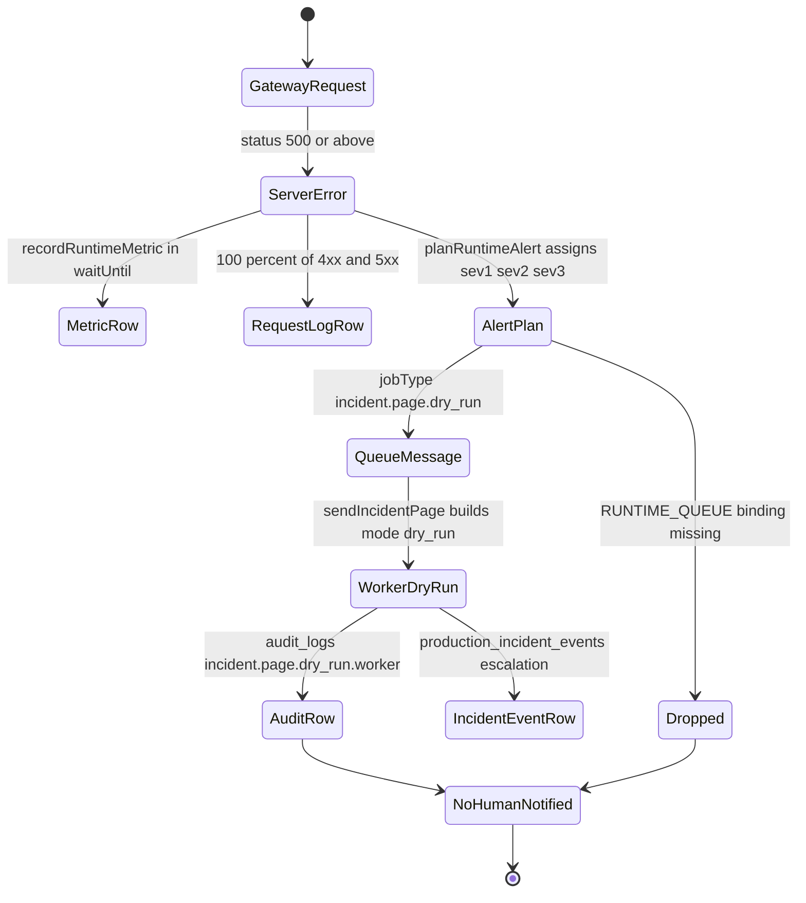
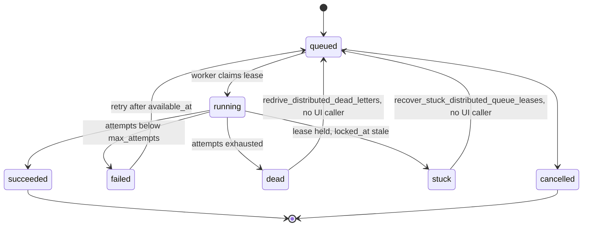

# 24 — OBSERVABILITY, OPERATIONS, AND SUPPORT READINESS

| Field | Value |
|---|---|
| Run ID | `2026-08-04T225330+0530-ee371182` |
| Branch | `stepup/main` |
| Commit | `ee371182` |
| Run date | 2026-08-04 (+0530) |
| Scope | Alerting and incident response · audit trails on merchant money and security actions · operator (platform-console) money-operations surfaces · the observability emit→store→query chain · DLQ / retry / stuck-job visibility · reconciliation-break visibility · webhook-failure visibility · support answerability · backup, rollback and recovery evidence |
| Evidence basis | Agent M notes (`_agent-notes/M-quality-observability-operations.md`, 741 lines) plus first-hand re-verification of 21 cited source locations in this session |
| **METHOD DISCLOSURE** | **Nothing in this document was runtime-verified. No service was started, no request was issued, no production or staging system was contacted, no live telemetry was read. Every status here is static source, schema, configuration or test-code evidence. The ceiling for any claim in this document is `IMPLEMENTED_NOT_RUNTIME_VERIFIED`; nothing is `VERIFIED_E2E`.** |
| Secrets / PII | No secrets or PII appear in this document. Environment variable **names** appear; no values, tokens, connection strings, customer identifiers, email addresses, phone numbers or payment identifiers appear. |

> **Structural vs live.** Every number in this document is a count of code artifacts (files, routes, call sites, columns, triggers), not a runtime measurement. LetBuyy's own honesty contract applies without exception: **every live value — latency, error rate, queue depth, DLQ size, revenue, page-delivery success — is NOT CONNECTED in this document.** No metric has been fabricated, estimated or inferred from a graph.

---

## 1. Recommendation / verdict

**LetBuyy cannot be operated in production today. Not "needs polish" — four structural layers that a money platform requires are absent, and each one is absent completely rather than partially.**

**Layer 1 — Nothing wakes a human.** Every 5xx alert path in the repository terminates in a queue job type literally named `incident.page.dry_run` (`services/api-gateway/src/lib/runtime-alerting.ts:7`), and the worker that consumes it builds `mode: 'dry_run'`, writes a row, and returns (`services/queue-workers/src/incident-command.ts:93-127`). Repo-wide, the strings `pagerduty` and `opsgenie` appear only as Zod enum values, TypeScript union members, a SQL `CHECK` constraint and one advisory comment — **no adapter implements either.** Mean time to detection for a total payment outage is bounded by a human happening to look.

**Layer 2 — Money actions leave no audit trail.** Zero `audit_logs` writes exist in any merchant-facing money or security gateway route: refunds, payout release, settlement ingestion, gift-card disable, tax configuration, KYC submission, step-up token issuance and **2FA disable** all execute unattributed. The tamper-evident hash-chained audit writer that *was* built (`services/api-gateway/src/identity-foundation/audit-dual-write.ts`) has **zero callers repo-wide** and there is **zero write traffic to `audit_events` anywhere in the codebase** — re-verified this session. Meanwhile the operator console renders a "Recent Audit" panel backed by that permanently empty table, which reads to an operator as *no privileged activity* rather than *not instrumented*.

**Layer 3 — The operator console cannot operate merchant payments.** Of the four named ART-24 gates, **none exists in `apps/platform-console`**: no refund surface, no maker-checker payout release, no dispute/chargeback log, no KYC review queue. Re-verified by keyword sweep this session: `kyc`, `dispute`, `chargeback` and `settlement` return **zero files** in `apps/platform-console/src`; `refund` returns exactly one match, inside a keyword list on the audit-log page. Payout release today is **single-control by the merchant on their own money** — and irreversible.

**Layer 4 — The observability chain breaks at the last mile.** Request IDs and trace IDs are generated, echoed to the client (`X-Trace-ID`), propagated into queue messages and stored on every 4xx/5xx — and the only query API over that store, `GET /v1/operations/request-logs`, **cannot filter by `request_id` or `trace_id`** (`services/api-gateway/src/routes/operations.ts:73-86, 384-408`). The single most useful support action in existence — "give me your reference ID" — is not possible. The same omission applies to `GET /v1/operations/jobs` and `GET /v1/operations/webhook-deliveries`.

**Support readiness, stated bluntly: of the four canonical merchant questions, zero are answerable end-to-end today.** "My payout did not arrive" — no operator money panel, no settlement view, no recon-break view, no release audit row. "My invoice is wrong" — the merchant sees an invoice *number* and nothing else; no document, no breakdown, no export. "A webhook failed" — no merchant UI and no operator UI at all; the data is one un-surfaced endpoint away. "An order is stuck" — no order timeline, no order→job correlation, and the queue-job endpoint cannot be filtered by anything that identifies an order.

**What is genuinely good, stated for balance.** The emit side of observability is serious engineering: structured JSON logs with status-derived level, request/trace correlation honouring `Traceparent`, Analytics Engine data points, durable Postgres metrics and request logs with *intelligent* sampling that records **100 % of 4xx/5xx, auth, payment, admin and authenticated traffic** and samples only anonymous storefront GETs, plus secret redaction in alert payloads. Nine real runbooks exist. The `money_ledger_site_reconciliations` break queue in the console is a well-built, MFA-gated, second-approver, reason-required workflow — it is the proof that this team knows how to build the missing gates. The failures below are **missing layers, not sloppy ones.**

**Recommended sequencing (highest value first):**

1. **MCP-DISC-760** — implement one paging adapter. Nothing else in this list matters if no one is woken.
2. **MCP-DISC-761 / 764 / 765** — decide the single canonical audit sink (`audit_events` already has the chain columns), wire it, and emit from every money and security mutation, inside the `SECURITY DEFINER` RPC transaction where the mutation already lives.
3. **MCP-DISC-762 / 763** — put a platform gate in front of payout release before any real merchant money moves.
4. **MCP-DISC-767** — two filter fields and two `.eq()` calls unlock the entire support-investigation workflow. This is the highest ratio of value to effort in the document.
5. **MCP-DISC-777 / 778** — a money platform with no rollback script for its baseline schema and no restore drill is one bad migration from an unbounded outage.

---

## 2. Scope

**In scope for this document**

- Alerting, paging and incident response (`services/api-gateway/src/lib/runtime-alerting.ts`, `services/queue-workers/src/incident-command.ts`, `services/api-gateway/src/routes/operations/incident-command.ts`).
- Audit trails: what is written, what is not, tamper-evidence, actor attribution.
- The observability chain: emit → store → query, and its sampling, cost and failure modes.
- Operator surfaces in `apps/platform-console` — specifically the four ART-24 money gates, DLQ/stuck-job handling, webhook-failure handling, reconciliation-break handling, support tooling.
- Support answerability for four canonical merchant questions.
- Backup, migration rollback and recovery evidence.
- Test integrity for the operational/e2e layer.

**Out of scope (carried by other documents in this run)**

| Area | Owner document |
|---|---|
| Merchant QA/UX defects: dashboard rendering failure as ₹0, missing pagination, client-side search, CSV truncation, timezone/currency formatting, accessibility, design-system drift (source-note gaps `G-M-22`–`G-M-35`) | Quality / UX / accessibility document — **not allocated MCP-DISC IDs here**, see §17 |
| Ledger law, refund RPC correctness, payout mechanics, the direct `db.from('settlements').insert(...)` at `services/api-gateway/src/routes/settlements.ts:346-348` | 11 / 12 (payments, ledger) |
| GST computation and invoice immutability (this document covers only *visibility* of the invoice) | 13 (GST) |
| RBAC model design, session issuance, identity invariants (this document covers only *operator attribution* and *ops-route authorization granularity*) | 09 (customers/staff/RBAC) |
| Build and test execution results | 02 / Agent L |

**Explicitly not counted as an operator surface:** `apps/platform-operations-portal` is frozen and is not a production deploy target per `CLAUDE.md`. It contains source (a `developers` page was observed in a grep) but was not inventoried. If the commander wants it inventoried, that is a separate pass. No claim in this document depends on it.

---

## 3. Current merchant and operator journeys — what can actually be done today

### 3.1 What a merchant can do today (operational visibility)

| Journey | Reality | Evidence |
|---|---|---|
| See whether their own store is healthy | **Nothing.** No status page, no incident banner, no system-health surface. Keyword sweep of `apps/merchant-control-plane/src` (`*.tsx`) for `system status`, `incident`, `activity log` → **zero files** | `UI_CODE` (re-verified this session) |
| See whether their webhook endpoint is failing | **Nothing.** Keyword sweep for `webhook` across all merchant `.tsx` → **zero files**, against 73 merchant `page.tsx` routes | `UI_CODE` (re-verified) |
| See who changed what on their store | **Nothing.** No merchant-facing audit or activity log exists; the only `audit` hit in the merchant app is an unrelated string on the export page | `UI_CODE` (re-verified) |
| See a payout's status | Yes — `status`, `utr`, `failure_reason` render on `apps/merchant-control-plane/src/app/[store]/payouts/page.tsx`; period dates render as raw unformatted API strings (`:181-183`) | `UI_CODE` |
| Release their own payout | **Yes — single-control, self-approved**, gated only by their own TOTP step-up (`payouts/page.tsx:204-215, 224-233`) | `UI_CODE` |
| See an order's fulfillment state | A single badge — `fulfillment_status` (`orders/[orderId]/page.tsx:243-244`). No timeline, no event history, no job trace | `UI_CODE` (re-verified) |
| See or download a GST invoice | **No.** Only the invoice *number* renders (`orders/[orderId]/page.tsx:91,175,276-277`) | `UI_CODE` |

### 3.2 What a platform operator can do today

| Journey | Reality | Evidence |
|---|---|---|
| Work a money-ledger reconciliation break | **Yes, and well.** MFA-required session, mandatory second approver, reason ≥ 8 chars, refresh via `db.rpc('refresh_money_ledger_site_reconciliation')` | `apps/platform-console/src/app/(dashboard)/money-reconciliation/page.tsx`; `services/api-gateway/src/routes/internal-console/money-reconciliation.ts:72,78-80,150,215,243` |
| Approve or investigate a merchant refund | **No surface exists** | Console keyword sweep: `refund` matches only `(dashboard)/audit-logs/page.tsx` (a keyword list) |
| Dual-approve a merchant payout release | **No surface exists.** The only payout view is marketplace-*developer* payouts, where release is deliberately omitted: `// Payouts — read-only; release action intentionally omitted (payout:release / dual-control)` | `apps/platform-console/src/app/(dashboard)/developers/page.tsx:536,543` |
| Record or respond to a chargeback | **No model, no route, no surface** | `dispute` / `chargeback` → zero files in `apps/platform-console/src` (re-verified) |
| Review a KYC submission | **No surface exists**; `routes/kyc.ts` has exactly three merchant-facing routes | `services/api-gateway/src/routes/kyc.ts:278,286,298` |
| See a settlement or a `recon_break` | **No surface exists** | `settlement` → zero files in `apps/platform-console/src` (re-verified) |
| Inspect or redrive an individual dead letter | **No.** An aggregate DLQ count tile and a per-queue one-line string only | `apps/platform-console/src/app/(dashboard)/operations/page.tsx:316,338,372` |
| Look up a merchant's request by reference ID | **No.** The filter does not exist | `services/api-gateway/src/routes/operations.ts:73-86` |
| Work a support ticket | **Read-only list only.** Merchant-360 renders ticket subject + status; there is no reply, assign, escalate, resolve, CSAT or macro UI anywhere in the console | `apps/platform-console/src/app/(dashboard)/merchants/[id]/page.tsx:236-249` (re-verified) |
| Page the on-call engineer | **Dry-run only**, and honestly labelled as such — the button reads "Dry-run page" | `apps/platform-console/src/app/(dashboard)/operations/page.tsx:234,520` |
| Impersonate a merchant read-only for support | Yes — time-boxed read-only operator sessions | `apps/platform-console/src/app/(dashboard)/merchants/[id]/page.tsx:281` |

The impersonation primitive is genuinely good. Its value is capped by the fact that it lands the operator in the same merchant UI that also cannot answer any of the four support questions.

---

## 4. Feature matrix

Status strings are from the fixed taxonomy. **`IMPL_NRV` = `IMPLEMENTED_NOT_RUNTIME_VERIFIED`.**

### 4.1 Observability

| Capability | Status | Evidence | Gap |
|---|---|---|---|
| Structured JSON request logs, level derived from status | `IMPL_NRV` | `services/api-gateway/src/middleware/observability.ts:80-92` `[GATEWAY_CODE]` | — |
| Request-ID + Trace-ID generation, `Traceparent` honoured, echoed as `X-Trace-ID` | `IMPL_NRV` | `observability.ts:48-49,217,220`; CORS expose `index.ts:660` `[GATEWAY_CODE]` | — |
| Middleware mounted globally on the gateway | `IMPL_NRV` | `services/api-gateway/src/index.ts:643` (requestId), `:652` (observability) `[GATEWAY_CODE]` | — |
| Analytics Engine data points written | `IMPL_NRV` (write path only) | `observability.ts:165-192`; binding `services/api-gateway/wrangler.toml:211-212, 340-341` `[GATEWAY_CODE]` `[PROVIDER_OR_CONFIG_EVIDENCE]` | MCP-DISC-783 |
| Analytics Engine **read** path | `NOT_IMPLEMENTED` | `packages/lcis-adapters/src/catalog.ts:109` (`reachable: false`, AE SQL API is POST-only) `[SERVICE_CODE]` | MCP-DISC-783 |
| Durable per-request metrics in Postgres | `IMPL_NRV` | `observability.ts:265-275` → `execution/observability-execution.adapter.ts:127` `[GATEWAY_CODE]` `[DB_SCHEMA]` | MCP-DISC-784 |
| Durable request logs with sampling; 100 % of 4xx/5xx, auth, payment, admin, authenticated | `IMPL_NRV` | `observability.ts:195-212, 338-350` (re-verified) `[GATEWAY_CODE]` | — |
| Query request logs by `request_id` / `trace_id` | `NOT_IMPLEMENTED` | `routes/operations.ts:73-86` (filters: `status`, `site_id`, `queue_name`, `limit` only) `[GATEWAY_CODE]` | **MCP-DISC-767** |
| Cloudflare Workers Logs enabled | `PROVIDER_OR_CONFIG_EVIDENCE` | `services/api-gateway/wrangler.toml:13-20, 226-232` — `head_sampling_rate = 0.1` in both staging-flavoured and `env.production` blocks (re-verified) | MCP-DISC-785 |
| Secret redaction in alert payloads | `IMPL_NRV` | `lib/runtime-alerting.ts:13, 71-92` `[SERVICE_CODE]` | — |
| Queue-worker structured logs + batch/DLQ metrics | `IMPL_NRV` | `services/queue-workers/src/index.ts:292-350, 425-438` (re-verified) `[SERVICE_CODE]` | — |
| SLO / error-budget computation | `NOT_IMPLEMENTED` | `sre_error_budget_snapshots` + `record_sre_error_budget_snapshot` exist (`database/supabase/migrations/000_baseline.sql:6740,6767`) with **zero TypeScript callers** `[DB_SCHEMA]` `[RPC_FUNCTION]` | **MCP-DISC-781** |
| Telemetry write failure surfacing | `PARTIAL` | `execution/observability-execution.adapter.ts:47-49` swallows the error when the message names the table and `schema cache` `[GATEWAY_CODE]` | MCP-DISC-780 |
| Observability unit tests | `UNIT_TEST` | `services/api-gateway/src/__tests__/observability.test.ts` — 8 pure decision-function tests; **no integration test asserts a row is written** | — |

### 4.2 Alerting and incident response

| Capability | Status | Evidence | Gap |
|---|---|---|---|
| 5xx classified into sev1/sev2/sev3 | `IMPL_NRV` | `lib/runtime-alerting.ts:95-110` (payments/settlements/auth routes → sev2) `[SERVICE_CODE]` | — |
| Alert enqueued to a runtime queue | `IMPL_NRV` | `observability.ts:305`; `runtime-alerting.ts:154-190` `[SERVICE_CODE]` | — |
| Fail-closed when the queue binding is absent | `IMPL_NRV` + `UNIT_TEST` | `runtime-alerting.ts` returns `{queued:false, reason:'missing-runtime-queue-binding'}`; tested at `__tests__/observability.test.ts:167` | — |
| **Page delivered to a human** | **`STUB_OR_MOCK`** | `runtime-alerting.ts:7`; `services/queue-workers/src/incident-command.ts:93-127` (re-verified: `mode: 'dry_run'`, writes `production_incident_events` + `audit_logs`, returns) `[SERVICE_CODE]` `[WEBHOOK_OR_JOB]` | **MCP-DISC-760** |
| PagerDuty / Opsgenie adapters | `NOT_IMPLEMENTED` | Repo-wide re-verified: enum `routes/operations/incident-command.ts:55`, types `packages/typescript/api-client/src/index.ts:1752,1863,1900`, `CHECK` constraint `database/supabase/migrations/133_internal_os_incident_command.sql:16`, one comment in `packages/lcis-operations`. No adapter code. | **MCP-DISC-760** |
| Alert deduplication | `BROKEN` | `runtime-alerting.ts:112-115` interpolates `input.requestId` into the key; the key becomes the queue message `id` (`:154`) and `alert_dedupe_key` (`:171`) (re-verified) `[SERVICE_CODE]` | **MCP-DISC-776** |
| On-call schedule resolution | `IMPL_NRV` | `services/queue-workers/src/incident-command.ts:80-92` reads `oncall_schedules` with team + window matching `[WEBHOOK_OR_JOB]` | — |

### 4.3 Audit

| Capability | Status | Evidence | Gap |
|---|---|---|---|
| `audit_logs` written on operator/internal actions | `IMPL_NRV` | 14 writer files re-verified: `middleware/rbac.ts`, `lib/internal-developer-ops.ts`, `lib/internal-compliance.ts`, `routes/{admin,operations,employee,internal-console}.ts`, `routes/internal-console/money-reconciliation.ts`, `routes/operations/{marketplace-reviews,rbac,trust-safety,support,risk,incident-command}.ts` `[GATEWAY_CODE]` | — |
| `audit_logs` written on **merchant money/security** actions | **`NOT_IMPLEMENTED`** | Zero matches in `routes/{payouts,payments,orders,returns,gift-cards,settlements,tax,kyc,security,two-factor,wallet,commission,cod-reconciliation}.ts` `[GATEWAY_CODE]` | **MCP-DISC-761** |
| Tamper-evident hash chain implemented | `NOT_IMPLEMENTED` (built, never wired) | `identity-foundation/audit-dual-write.ts:179-198, 200-218, 220+`; re-verified this session: the three exported symbols match **only inside that file**, and `from('audit_events')` matches **nowhere** `[GATEWAY_CODE]` | **MCP-DISC-764** |
| `audit_events` chain columns exist | `DB_SCHEMA` | `database/supabase/migrations/159_identity_foundation_core.sql:540-542` (`seq`, `prev_hash`, `hash`), index `:584` | MCP-DISC-764 |
| `audit_logs` append-only / tamper-evident | `PARTIAL` | Schema `000_baseline.sql:8440-8455` has no `seq`/`prev_hash`/`hash`; `:24380` `CREATE POLICY audit_insert ON public.audit_logs FOR INSERT WITH CHECK (true);` `[DB_SCHEMA]` `[RLS_POLICY]` | **MCP-DISC-765** |
| Operator identity independently attested | `PARTIAL` | `routes/internal-console/money-reconciliation.ts:105-129` takes `actor_id`/`actor_email` from the request body and hardcodes `actor_type: 'super_admin'`; one shared static bearer token `apps/platform-console/src/lib/console-api.ts:56` `[GATEWAY_CODE]` `[UI_CODE]` | **MCP-DISC-766** |
| DB trigger audit coverage | `PARTIAL` | `log_audit_event()` `000_baseline.sql:4436-4466`, attached at `:19274, 19281, 19288, 19295` — `employee_invites`, `employees`, `subscriptions`, `super_admin_allowlist`. No money table, no `orders`, no `sites` `[DB_SCHEMA]` | MCP-DISC-786 |

### 4.4 Operator money gates (ART-24) and ops surfaces

| Capability | Status | Evidence | Gap |
|---|---|---|---|
| Operator refund gate | `NOT_IMPLEMENTED` | Console keyword sweep re-verified: `refund` → 1 file, a keyword list at `(dashboard)/audit-logs/page.tsx:321` | **MCP-DISC-763** |
| Maker-checker payout release | `NOT_IMPLEMENTED` | Merchant self-release `payouts/page.tsx:204-215`; console defers release `(dashboard)/developers/page.tsx:536,543`; backend `routes/payouts.ts:553` `POST /:id/settle` is merchant-invoked | **MCP-DISC-762** |
| Dispute / chargeback log | `NOT_IMPLEMENTED` | `dispute`/`chargeback` → zero files in `apps/platform-console/src`; in the gateway they appear only in marketplace-developer scope | **MCP-DISC-771** |
| KYC review queue | `BACKEND_ONLY` (submission only) | `routes/kyc.ts:278,286,298` — three merchant-facing routes; no review, approve, reject or queue | **MCP-DISC-770** |
| DLQ inspect / lease recovery / redrive endpoints | `BACKEND_ONLY` | `routes/operations.ts:566-576` (`inspect_distributed_queue`), `:578-598` (`recover_stuck_distributed_queue_leases`), `:600-621` (`redrive_distributed_dead_letters`) `[RPC_FUNCTION]`; no console caller | **MCP-DISC-772** |
| Queue-job list endpoint | `BACKEND_ONLY` | `routes/operations.ts:241-262` — selects `event_id, request_id, trace_id, error_message`, but filters only `status`, `site_id`, `queue_name` (re-verified) | MCP-DISC-772 / **774** |
| Webhook delivery + subscription health endpoints | `BACKEND_ONLY` | `routes/operations.ts:281-302` (`attempts`, `max_attempts`, `next_attempt_at`, `failed_at`, `response_status`, `error_message`, `request_id`, `trace_id`), `:305-325` (`failure_count`, `last_success_at`, `last_failure_at`) — re-verified; no merchant UI, no console UI | **MCP-DISC-773** |
| `recon_breaks` surfacing | `BACKEND_ONLY` | Table `migrations/151_executable_settlement_ledger.sql`; joined at `routes/settlements.ts:309`; status set at `:345` (re-verified). No console file mentions `settlement`; `settlements` is not exported by `@letbuyy/api-client` | **MCP-DISC-768** |
| `money_ledger_site_reconciliations` break queue | `IMPL_NRV` | `apps/platform-console/src/app/(dashboard)/money-reconciliation/page.tsx`; `routes/internal-console/money-reconciliation.ts:72,78-80,150,215,243` | — |
| Support ticketing backend | `BACKEND_ONLY` | 11 permission-gated handlers re-verified at `routes/operations/support.ts:338,370,402,432,501,566,597,641,686,729,741`; mounted `index.ts:818`. Console shows a read-only ticket list only | **MCP-DISC-779** |
| Fine-grained permission gating on ops routes | `PARTIAL` | 31 handlers in `routes/operations.ts`; only **5** carry `requirePermission` (`:622,641,717,731,778`) — re-verified. Redrive and lease recovery are not among them | MCP-DISC-787 |

### 4.5 Recovery and test integrity

| Capability | Status | Evidence | Gap |
|---|---|---|---|
| Worker deployment rollback | `IMPL_NRV` | `docs/runbooks/deployment-rollback.md`; named script `infrastructure/scripts/deploy/production-rollback.mjs --environment=production --worker=<worker> --version-id=<version>` `[DOC_CLAIM]` `[PROVIDER_OR_CONFIG_EVIDENCE]` | — |
| Migration rollback scripts | `PARTIAL` | Re-verified this session: **126** migrations (`000_baseline.sql` … `197_letbuyy_core_first_class_theme.sql`), **48** rollback scripts, numerically lowest `139_executable_foundation_ledger_core.rollback.sql`. **Zero below 139.** | **MCP-DISC-777** |
| Database restore / PITR procedure | `PARTIAL` (documented, not proven) | `docs/runbooks/infra-recovery.md:18-23` — four bullets, no RPO, no RTO, no schedule, no command, no provider capability, no drill record | **MCP-DISC-778** |
| Runbook library | `IMPL_NRV` | 17 files in `docs/runbooks/` including `incident-sev1.md`, `queue-dlq-redrive.md`, `secret-rotation.md`, `feature-flag-rollback.md`, `staging-rehearsal.md`, `live-certification-execute.md` (re-verified) | — |
| Merchant e2e journey as a canary | `BROKEN` | `tests/e2e/merchant-journey.spec.ts:9-13` — `test.skip` on unreachable **and** on `status >= 500`; default targets `*-staging.letbuyy.com` (`:3-5`) (re-verified) | **MCP-DISC-782** |

---

## 5. UI / route inventory

### 5.1 `apps/platform-console` — 20 dashboard routes (re-verified this session)

`analytics` · `audit-logs` · `compliance` · `dashboard` · `developers` · `employees` · `founding` · `incidents` · `marketplace-governance` · `merchants` (+ `merchants/[id]`) · `money-reconciliation` · `operations` · `revenue` · `risk` · `settings` · `stores` · `subscriptions` · `trust-safety` · `users` · root `page.tsx`.

This is a substantial console. The gap is **specifically the money-operations plane**, and it is total:

| Expected operator route | Present? |
|---|---|
| `refunds` / refund review | **absent** |
| `payouts` (merchant) / maker-checker release | **absent** |
| `disputes` / `chargebacks` | **absent** |
| `kyc` review queue | **absent** |
| `settlements` / `recon-breaks` | **absent** |
| `support` (ticket workspace) | **absent** (read-only list inside `merchants/[id]` only) |
| `webhooks` / delivery failures | **absent** |
| `queues/[name]` / dead-letter detail | **absent** (aggregate tile only) |
| `request-logs` / trace lookup | **absent** |

### 5.2 `apps/merchant-control-plane` — 73 `page.tsx` routes under `[store]`, zero operational surfaces

No webhook page, no activity/audit log, no system-status surface, no incident banner. Re-verified by keyword sweep. The merchant's only operational feedback channels are per-page toasts and error banners, plus the global error boundary at `apps/merchant-control-plane/src/app/error.tsx`, which correctly surfaces `error.digest` as a support reference — a reference that, per MCP-DISC-767, **support cannot look up**.

### 5.3 Gateway operations endpoints with no UI consumer

| Endpoint | UI consumer |
|---|---|
| `GET /v1/operations/request-logs` | none |
| `GET /v1/operations/jobs` | none |
| `POST /v1/operations/jobs/consume` | none |
| `GET /v1/operations/webhook-deliveries` | none |
| `GET /v1/operations/webhook-subscriptions` | none |
| `GET /v1/operations/runtime/queues/:queueName` | none |
| `POST /v1/operations/runtime/queues/:queueName/recover-leases` | none |
| `POST /v1/operations/runtime/queues/:queueName/redrive-dead-letters` | none |
| `routes/operations/support.ts` — 11 handlers | read-only ticket list in `merchants/[id]` only |
| `GET /v1/settlements/:site` (returns `recon_breaks`) | none |

---

## 6. Backend / API / RPC / database mapping

### 6.1 Data stores in the operational plane

| Store | Written by | Read by | Note |
|---|---|---|---|
| `worker_request_logs` | `execution/observability-execution.adapter.ts:86,98` | `routes/operations.ts:389` (no ID filter) | Unsampled for all ≥400 |
| `runtime_telemetry_metrics` | `observability-execution.adapter.ts:127`; `services/queue-workers/src/index.ts:292` | `services/queue-workers/src/executive-analytics.ts:353` (only for `metric_name ilike *error_budget*`) | See MCP-DISC-781 |
| Analytics Engine dataset (`RUNTIME_TELEMETRY`) | `observability.ts:165-192`; `queue-workers/src/index.ts:316,340` | **nobody** | MCP-DISC-783 |
| `platform_queue_jobs` (partitioned, `082_partition_platform_queue_jobs.sql`) | queue-workers | `routes/operations.ts:246` | Carries `request_id`, `trace_id`, `event_id`, `error_message`; statuses `queued/running/succeeded/failed/dead/cancelled` |
| `webhook_deliveries` (partitioned, `083_partition_webhook_deliveries.sql`) | webhook-service | `routes/operations.ts:287` | No UI |
| `settlements` + `recon_breaks` (`151_executable_settlement_ledger.sql`) | `routes/settlements.ts:346-348` (direct TS insert — flagged to the payments document) | `routes/settlements.ts:309` | No UI |
| `money_ledger_site_reconciliations` | `refresh_money_ledger_site_reconciliation` RPC | `routes/internal-console/money-reconciliation.ts:150,215` | **Has a good UI** |
| `audit_logs` | 14 operator/internal gateway files + `queue-workers/src/incident-command.ts` | console `audit-logs` page, merchant-360 | Not tamper-evident |
| `audit_events` | **nobody** | `routes/internal-console.ts:1126,273,520` → console merchant-360 + dashboard counters | Chain columns exist; permanently empty |
| `sre_error_budget_snapshots` | **nobody** (`record_sre_error_budget_snapshot` has zero TS callers) | nobody | Dormant SLO layer |
| `production_incidents` / `production_incident_events` / `oncall_schedules` | `queue-workers/src/incident-command.ts`; ops routes | console `incidents`, `operations` | Whether populated in production is `UNVERIFIED_RUNTIME` |
| `metric_rollups` | `queue-workers/src/executive-analytics.ts` (cron `17 */6 * * *`) | `routes/internal-console.ts:678-691` | Executive health is a **6-hourly batch**, not live |

### 6.2 Required end-to-end traces

Format: entry point → route → app proxy → typed client → `/v1` gateway route → auth issuer + authz + ownership → validation / server-authoritative computation → RPC/tables + RLS → webhook/queue/provider → downstream consequence → tests → runtime observation. `**MISSING**` marks a broken link.

---

**Trace A — A payment route returns 500 and an engineer is woken**

1. Entry point: any shopper or merchant request producing ≥500.
2. Route: any `/v1/payments/*` handler.
3. App proxy / typed client: n/a (server-side).
4. Gateway middleware: `observability` mounted globally, `services/api-gateway/src/index.ts:652`.
5. Authz: n/a.
6. Computation: `planRuntimeAlert` → `alertSeverity` returns `sev2` for payments/settlements/auth routes (`lib/runtime-alerting.ts:95-110`); `alertDedupeKey` (`:112-115`) — **BROKEN, includes `requestId`** (MCP-DISC-776).
7. Tables: `recordRuntimeMetric` → `runtime_telemetry_metrics` (`runtime-alerting.ts:180`).
8. Queue: `createCloudflareQueueProducer(...).enqueue(plan.queueMessage)` with `jobType = 'incident.page.dry_run'`.
9. Worker: `services/queue-workers/src/incident-command.ts:93-127` `sendIncidentPage` → resolves the on-call schedule, builds `mode: 'dry_run'`, writes `production_incident_events` (only if an incident id exists) and one `audit_logs` row, returns.
10. Provider delivery: **MISSING — no adapter exists** (MCP-DISC-760).
11. Human notified: **MISSING**.
12. Tests: unit tests for classification, redaction and fail-closed enqueue (`__tests__/observability.test.ts`). **No test asserts delivery** — there is nothing to assert.
13. Runtime observation: **MISSING**.

---

**Trace B — A merchant issues a refund and the platform can prove who did it**

1. Entry point: merchant order detail → refund action.
2. Page/route: `apps/merchant-control-plane/src/app/[store]/orders/[orderId]/`.
3. Step-up gate: `components/security/StepUpDialog.tsx:6` (`'refund.approve'`) — the gate exists.
4. App proxy → typed client → `/v1` gateway route: `routes/orders.ts` / `routes/payments.ts`.
5. Auth issuer + ownership: merchant ES256 + `verifySiteOwnership` (payments-document scope).
6. Money mutation: `SECURITY DEFINER` RPC on the canonical ledger (payments-document scope).
7. **Audit row: MISSING** — zero `audit_log|audit_event|recordAudit|writeAudit` matches in `routes/orders.ts`, `routes/payments.ts`, `routes/returns.ts` (MCP-DISC-761).
8. Operator review: **MISSING** (MCP-DISC-763).
9. Attribution at dispute time: **MISSING** — no actor, no reason, no request ID persisted anywhere queryable.
10. Tests: **MISSING** for the audit dimension.
11. Runtime observation: **MISSING**.

---

**Trace C — A payout is released (the current, single-control path)**

1. Entry point: `apps/merchant-control-plane/src/app/[store]/payouts/page.tsx:204-215` — the **merchant** presses Release on their own pending payout.
2. Gate: their own TOTP step-up (`:224-233`) — the only control.
3. Gateway: `routes/payouts.ts:553` `POST /:id/settle`.
4. Platform maker-checker: **MISSING** (MCP-DISC-762). The pattern exists and is proven 30 metres away at `routes/internal-console/money-reconciliation.ts:78-80` (MFA + `secondary_approver_id` + reason ≥ 8 chars) and was deliberately *withheld* on the developer payout page (`(dashboard)/developers/page.tsx:536`).
5. Audit row: **MISSING** (MCP-DISC-761).
6. Settlement / recon consequence: `recon_breaks` may be created; **no human surface** (MCP-DISC-768).
7. Support consequence: "my payout did not arrive" is unanswerable (MCP-DISC-769).
8. Reversibility: **money movement is irreversible** `[IRREVERSIBLE]`.
9. Tests / runtime observation: **MISSING** for the maker-checker dimension (nothing to test).

---

**Trace D — A webhook delivery fails and the merchant finds out**

1. Emit: order/payment event → `webhook-service` → `webhook_deliveries` row with `status`, `attempts`, `max_attempts`, `next_attempt_at`, `failed_at`, `response_status`, `error_message`, `request_id`, `trace_id`.
2. Gateway read: `GET /v1/operations/webhook-deliveries` (`routes/operations.ts:281-302`) — exists, well-shaped, gated `requireRoleCategory('ops') + requireSuperAdmin`.
3. Filterable by delivery/request/trace ID: **MISSING** (`status` and `site_id` only).
4. Operator UI: **MISSING**.
5. Merchant UI: **MISSING** — zero merchant `.tsx` files mention `webhook`.
6. Merchant notification (email/banner) on repeated failure: **MISSING** — `webhook_subscriptions.failure_count` is tracked and never surfaced.
7. Replay action: **MISSING** from every UI.
8. Tests / runtime observation: **MISSING**. Whether the retry/backoff engine in `services/webhook-service` actually works is **out of this document's scope and UNVERIFIED**.

---

**Trace E — An operator resolves a money-ledger reconciliation break (the one that works)**

1. Entry point: console → Money Reconciliation.
2. Page: `apps/platform-console/src/app/(dashboard)/money-reconciliation/page.tsx`.
3. Typed access: `apps/platform-console/src/lib/console-api.ts` with a **single shared static bearer token** (`:56`) and `X-Request-ID: platform-console-${Date.now()}` (`:70`) — **weak link**, MCP-DISC-766.
4. Gateway route: `routes/internal-console/money-reconciliation.ts`.
5. Authz: `requireConsoleSession({ mfa: true })` (`:72`) — good.
6. Validation: `secondary_approver_id` required, reason ≥ 8 chars (`:78-80`) — good.
7. Data: `money_ledger_site_reconciliations` (`:150,215`); refresh via `db.rpc('refresh_money_ledger_site_reconciliation')` (`:243`) — good.
8. Audit: `writeConsoleAudit` (`:105-129`) — **actor is client-asserted and `actor_type` is hardcoded `'super_admin'`** (MCP-DISC-766).
9. Tests: not located in this pass — `UNVERIFIED_RUNTIME`.
10. Runtime observation: **MISSING**.

This trace is the template for MCP-DISC-762, 763, 768, 770 and 772. The remediation for all five is "do what this page already does."

---

## 7. State machines

### 7.1 The 5xx alert lifecycle — terminal at dry-run

Every path terminates in `NoHumanNotified`. There is no transition out of it because no adapter exists.

### 7.2 Queue job lifecycle and the redrive gap

Statuses are from the `CHECK` constraint at `database/supabase/migrations/082_partition_platform_queue_jobs.sql:33`.

Both recovery transitions exist as gateway routes over Postgres RPCs and **neither is reachable from any UI**. The console shows only a DLQ count (`operations/page.tsx:316,338`) and a per-queue `depth … | dlq …` string (`:372`). The documented alternative is a manual runbook (`docs/runbooks/queue-dlq-redrive.md`) — a procedure, not a surface.

---

## 8. Auth / tenant / invariant analysis

| Invariant | Finding | Evidence | Gap |
|---|---|---|---|
| Operator routes are super-admin gated | Holds at the router level — `router.use('*', requireRoleCategory('ops'), requireSuperAdmin)` | `routes/operations.ts:46` | — |
| Fine-grained permission per operator action | **26 of 31 handlers have none.** Only incident view/command carry `requirePermission` (`:622,641,717,731,778`). Dead-letter redrive and lease recovery are super-admin-gated only | re-verified | MCP-DISC-787 `[HIGH-STAKES]` |
| Audit actor is attested by the platform, not asserted by the caller | **Violated on the money plane.** `actor_id`/`actor_email` come from the request body; `actor_type` is hardcoded `'super_admin'`; the console authenticates with one shared static token | `routes/internal-console/money-reconciliation.ts:105-129`; `apps/platform-console/src/lib/console-api.ts:56` | MCP-DISC-766 `[HIGH-STAKES]` |
| Correlation IDs are unique | **Violated for console-originated requests** — `X-Request-ID: platform-console-${Date.now()}` collides for same-millisecond actions | `apps/platform-console/src/lib/console-api.ts:70` | MCP-DISC-766 |
| Audit rows cannot be forged | **Violated.** `CREATE POLICY audit_insert ON public.audit_logs FOR INSERT WITH CHECK (true);` | `000_baseline.sql:24380` `[RLS_POLICY]` | MCP-DISC-765 `[HIGH-STAKES]` |
| Audit rows cannot be altered or removed | **Not enforced.** No `seq`, no `prev_hash`, no `hash`, no anchor; the gateway writes with the service role via `getSupabaseAdmin`, which bypasses RLS entirely, so nothing at the DB layer constrains UPDATE/DELETE for the writer | `000_baseline.sql:8440-8455` | MCP-DISC-765 `[HIGH-STAKES]` |
| Money movement requires two humans | **Violated.** Payout release is single-control by the merchant | `payouts/page.tsx:204-215` | MCP-DISC-762 `[HIGH-STAKES]` `[IRREVERSIBLE]` |
| Money mutations go through `SECURITY DEFINER` RPCs | Out of scope here; flagged to the payments document that `routes/settlements.ts:346-348` inserts into `settlements` directly from TypeScript | re-verified | payments doc |
| Tenant scoping on operational reads | Ops endpoints are cross-tenant by design and gated by super-admin; `GET /v1/settlements/:site` correctly resolves ownership via `resolveTenantContextForOwnedSite` and enforces a path/query match (`routes/settlements.ts:300-313`) | `[GATEWAY_CODE]` | — |
| Secrets never enter alerts | Enforced by `ALERT_SECRET_KEY_PATTERN` + `redactAlertValue`, and unit-tested | `lib/runtime-alerting.ts:13,71-92` | — |

---

## 9. Runtime and test evidence — and what was NOT verified

### 9.1 What exists as test evidence

| Test asset | Type | What it proves |
|---|---|---|
| `services/api-gateway/src/__tests__/observability.test.ts` (8 tests) | `UNIT_TEST` | Sampling-rate bounds, protected-path sampling, deterministic anonymous sampling, rollback behaviour, envelope redaction, metric-registry accumulation, alert classification/redaction, fail-closed enqueue when the binding is missing (`:167`). All are pure decision-function tests. |
| `tests/e2e/merchant-journey.spec.ts` | `E2E_TEST` | Nothing reliable — it self-skips when the target is unreachable **or** returns ≥500 (`:9-13`), which is precisely the failure it should catch. |

### 9.2 What was NOT verified — stated exhaustively

- **No integration test anywhere asserts that a real request produces a `worker_request_logs` row or a `runtime_telemetry_metrics` row.** The emit path is proven only by reading it.
- **No test asserts an alert is delivered** — there is no delivery to assert.
- **No test asserts an audit row is written for any money action** — no such write exists.
- **No restore drill record exists anywhere in `docs/`.** Database recovery is four sentences.
- **No accessibility, contrast or load test exists** in the operational plane.
- **Whether the operational tables are populated in production** — `runtime_health_projections`, the distributed-queue tables, `queue_health`, `production_incidents`, `oncall_schedules`, `metric_rollups` — is `UNVERIFIED_RUNTIME`. The console reads them; whether any writer runs on schedule in production was not observed. The one scheduled writer found is `services/queue-workers` with `crons = ["17 */6 * * *"]` in the default, `env.staging` and `env.production` blocks — i.e. **executive health metrics can be up to six hours stale by construction**.
- **Whether `PLATFORM_CONSOLE_API_TOKEN`, `PLATFORM_CONSOLE_ALLOWED_EMAILS`, `PLATFORM_CONSOLE_TOTP_SECRETS`, `REQUEST_LOG_SAMPLE_RATE`, `RUNTIME_QUEUE`, `RUNTIME_TELEMETRY` are configured in production** is `BLOCKED_EXTERNAL`. Variable **names** only are recorded, per the safety rules.
- **Whether an out-of-repository dashboard queries the Analytics Engine dataset.** Nothing in-repo does. An external Grafana or Cloudflare dashboard is possible and would partially answer MCP-DISC-783. This must be answered by the founder, not inferred.
- **Whether the `webhook-service` retry/backoff engine works.** Only the schema and the read endpoint were inspected.

### 9.3 Divergences from the source notes found during re-verification (declared)

| Item | Notes said | Re-verified this session | Effect |
|---|---|---|---|
| Migration count | 125 `.sql` files, highest `196_theme_rls_tenant_hardening.sql` | **126** files, highest **`197_letbuyy_core_first_class_theme.sql`** | None on any finding. The worktree carries ~6800 uncommitted modifications; a file may have appeared between passes. The rollback conclusion is unchanged: **48** rollback scripts, numerically lowest `139_…`, **zero below 139**. |
| `routes/operations/support.ts` handler count | 12 endpoints | **11** handlers (`^router.(get\|post\|patch\|put\|delete)`) | Cosmetic. The finding — a complete ticketing backend with no operator workspace — is unchanged. |
| Support in the console | "no support page" | Correct: no support page. **Refinement:** merchant-360 does render a **read-only** ticket list (`merchants/[id]/page.tsx:236-249`) | Softens nothing: there is still no reply, assign, escalate, resolve, CSAT or macro UI. |
| `sendIncidentPage` side effects | Writes an audit row and returns | Correct, **plus** it writes a `production_incident_events` row of type `escalation` when an incident id is present (`incident-command.ts:110-124`) | Strengthens the finding: the system records that it *would* have paged. |
| AE read path | "Nothing in the repo reads telemetry" | Correct for **Analytics Engine**. **New:** `services/queue-workers/src/executive-analytics.ts:353` does read the Postgres table `runtime_telemetry_metrics`, but only for `metric_name ilike '*error_budget*'` — a metric name **nothing ever writes** | Produces the new gap MCP-DISC-781 |

---

## 10. Implemented vs missing

### 10.1 Implemented (structurally; none runtime-verified)

- Global observability middleware with structured logs, request/trace correlation, `X-Trace-ID` response header and CORS exposure.
- Status-aware, route-aware, identity-aware request-log sampling that never drops an error, an auth call, a payment call, an admin call or an authenticated call.
- Analytics Engine write path and Postgres durable metric/log write path, both fired in `waitUntil`.
- Alert planning with sev1/sev2/sev3 classification biased correctly toward payments, settlements and auth, with secret redaction and fail-closed behaviour when the queue binding is absent.
- Queue-worker structured logs and batch/DLQ metrics including p95 and max lag.
- On-call schedule modelling and resolution.
- A rich, permission-aware operations API: queue inspect, lease recovery, dead-letter redrive, queue jobs, webhook deliveries, webhook subscriptions, request logs, runtime control commands, incident CRUD.
- A complete support-ticketing backend (11 handlers, `support:view` / `support:reply` / `support:manage`).
- A genuinely good, MFA-gated, dual-approver, reason-required money-break resolution workflow in the console.
- Read-only time-boxed merchant impersonation for support.
- 17 runbooks including sev1 incident response, DLQ redrive, secret rotation, deployment rollback and feature-flag rollback.
- A named, concrete worker rollback script.
- 48 migration rollback scripts for the 139+ range.

### 10.2 Missing

- Any paging adapter. Any delivery of any alert to any human.
- Working alert deduplication.
- Any audit trail on merchant refunds, payout release, payout settlement, gift-card status change, tax configuration, KYC submission, step-up issuance, 2FA enrol/disable.
- Any write to the tamper-evident `audit_events` chain; any caller of `emitAuditDualWrite`.
- Tamper-evidence or append-only enforcement on `audit_logs`.
- Platform-attested operator identity on the money plane.
- Operator refund surface. Maker-checker payout release. Dispute/chargeback model and surface. KYC review queue.
- Any UI over dead letters, stuck leases, webhook delivery failures, request logs, queue jobs, settlements or `recon_breaks`.
- Any merchant-facing webhook-health, activity-log or system-status surface.
- Query-by-request-ID / trace-ID / event-ID anywhere in the operations API.
- Any SLO or error-budget computation.
- Any read path for Analytics Engine.
- Rollback scripts for migrations 000–138, including the baseline money, order, RLS and auth structure.
- A real database recovery procedure, an RPO, an RTO, and any evidence of a restore drill.
- An e2e canary that fails when the environment is broken.

---

## 11. Gap register

Severity is P0–P3. `[HIGH-STAKES]` marks money, payments, refunds, gift cards, payouts, settlements, GST, auth, tenancy or RLS. `[IRREVERSIBLE]` marks a gap guarding an irreversible action. Confidence reflects static-only evidence.

**Standing constraint on every remediation below: money mutates only via `SECURITY DEFINER` RPCs. No remediation in this document proposes, or may be implemented as, a direct write to a money table.**

---

### MCP-DISC-760 — No alert in the system ever reaches a human `[HIGH-STAKES]`

| Field | Value |
|---|---|
| Domain | Observability / incident response |
| Status | `STUB_OR_MOCK` |
| Severity · Likelihood · Confidence | **P0** · HIGH · HIGH |

**User/business impact.** A total payment outage, a checkout 500 storm or an auth failure produces structured logs, a metric row, a request-log row and a queue message — and nobody is notified. Mean time to detection is bounded by a human happening to look at a console whose executive metrics refresh at best every six hours. For a platform that moves merchant money, this is the difference between a 10-minute incident and a multi-hour one.

**Evidence.** `services/api-gateway/src/lib/runtime-alerting.ts:7` — `export const RUNTIME_ALERT_JOB_TYPE = 'incident.page.dry_run';` `[SERVICE_CODE]`. Consumer `services/queue-workers/src/incident-command.ts:93-127` — `sendIncidentPage` builds `payload = { mode: 'dry_run', adapter: … || 'dry_run', … }`, writes `production_incident_events` (`:110-124`) and one `audit_logs` row with `action: 'incident.page.dry_run.worker'`, and returns; there is no delivery branch `[WEBHOOK_OR_JOB]`. Enum only: `services/api-gateway/src/routes/operations/incident-command.ts:55` `z.enum(['dry_run','pagerduty','opsgenie']).default('dry_run')`; `packages/typescript/api-client/src/index.ts:1752,1863,1900`; `database/supabase/migrations/133_internal_os_incident_command.sql:16` `[DB_SCHEMA]`. Console hardcodes the adapter and labels the button honestly: `apps/platform-console/src/app/(dashboard)/operations/page.tsx:234,520` `[UI_CODE]`. Re-verified repo-wide this session: no file implements either adapter.

**Expected behavior.** A ≥sev2 5xx on a payment, checkout or auth route delivers a page to the resolved on-call engineer through a real provider within minutes, carrying the request ID.

**Missing link / root cause.** No adapter implementation behind the existing `paging_adapter` boundary. The boundary, the enum, the schedule model and the queue contract were all built; only delivery was left.

**Blast radius.** Every runtime, every incident, every merchant.

**Dependencies.** A paging-provider account and credentials — `BLOCKED_EXTERNAL` until procured. On-call rotation data already modelled in `oncall_schedules`. Should be fixed together with MCP-DISC-776, or the first real page becomes a page storm.

**Remediation approach.** Implement exactly one paging adapter behind the existing `paging_adapter` selection; resolve the target from the on-call schedule the worker already reads; keep `dry_run` as the default wherever no credential is configured, and keep it selectable. Do not widen the queue contract. Do not add a second alerting path.

**Acceptance criteria.** A synthetic 503 on a `/v1/payments/*` route in staging delivers a page to a test rotation within 120 s, with the request ID in the payload and no secret value in it; with no credential configured the system still selects `dry_run` and does not error.

**Required tests.** Adapter unit tests (payload shape, redaction, retry/backoff); an integration test asserting adapter invocation on a 5xx; a recorded staging fire-drill.

**Required owner.** Lead engineer + founder (vendor selection and cost).

**Reversibility.** Fully reversible — flag back to `dry_run`.

---

### MCP-DISC-761 — Zero audit trail on every merchant money and security action `[HIGH-STAKES]`

| Field | Value |
|---|---|
| Domain | Audit / compliance |
| Status | `NOT_IMPLEMENTED` |
| Severity · Likelihood · Confidence | **P0** · HIGH · HIGH |

**User/business impact.** There is no record of **who** issued a refund, released a payout, settled a statement, disabled a gift card, changed tax settings, submitted KYC, minted a step-up token, or **disabled 2FA**. A disputed refund cannot be attributed to a person. A compromised merchant account leaves no forensic trail — an attacker who disables 2FA and drains a payout leaves the same evidence as a legitimate merchant doing routine work: none. This is a dispute-defence and compliance failure, not a logging preference. The consequence of the un-audited actions is `[IRREVERSIBLE]` even though the fix is additive.

**Evidence.** Grep for `audit_log|audit_event|recordAudit|writeAudit` returns **0** in every one of `services/api-gateway/src/routes/`: `payouts.ts`, `payments.ts`, `orders.ts`, `returns.ts`, `gift-cards.ts`, `settlements.ts`, `tax.ts`, `kyc.ts`, `security.ts` (step-up issuance), `two-factor.ts` (enrol/verify/disable), `wallet.ts`, `commission.ts`, `cod-reconciliation.ts` `[GATEWAY_CODE]`. All `audit_logs` writers are operator/internal — re-verified as 14 files: `middleware/rbac.ts`, `lib/internal-developer-ops.ts`, `lib/internal-compliance.ts`, `routes/{admin,operations,employee,internal-console}.ts`, `routes/internal-console/money-reconciliation.ts`, `routes/operations/{marketplace-reviews,rbac,trust-safety,support,risk,incident-command}.ts`. DB triggers cover four non-money tables only (`database/supabase/migrations/000_baseline.sql:19274,19281,19288,19295`) `[DB_SCHEMA]`.

**Expected behavior.** Every privileged, money-affecting or security-affecting merchant action writes an actor-attributed, reason-carrying, request-ID-carrying audit record in the same transaction as the mutation.

**Missing link / root cause.** Audit writing was built for the operator plane and never extended to the merchant plane. There is no gateway-level helper and no validator that would have caught the omission.

**Blast radius.** Refunds, payouts, settlements, gift cards, tax configuration, KYC, 2FA, step-up — i.e. the entire money and security surface of the merchant product.

**Dependencies.** MCP-DISC-764 must be decided first so this is not implemented twice into two different sinks.

**Remediation approach.** Choose the canonical sink (MCP-DISC-764), define one audit-emit helper at the gateway boundary, and call it from every money and security mutation with actor, action, resource, reason and request ID. Prefer emitting **inside the `SECURITY DEFINER` RPC** where the mutation is already transactional, so the audit row shares the transaction and cannot be lost when the mutation succeeds. Never implement audit as a direct write to a money table. Add a governance validator that fails a money route which mutates without emitting.

**Acceptance criteria.** For each of refund, payout release, payout settle, gift-card status change, tax-config change, KYC submission, step-up issuance and 2FA enrol/disable, a test asserts **exactly one** audit row with a non-null actor, a reason and a request ID, written in the same transaction as the mutation, and asserts that a rolled-back mutation leaves no audit row.

**Required tests.** Per-route integration tests; a transaction-rollback test; a governance validator with its own tests.

**Required owner.** Lead engineer + security + ARB (money path).

**Reversibility.** Additive, fully reversible.

---

### MCP-DISC-762 — No platform maker-checker on payout release; merchants self-approve their own money `[HIGH-STAKES]` `[IRREVERSIBLE]`

| Field | Value |
|---|---|
| Domain | Operator tooling (ART-24 gate 2) / money control |
| Status | `NOT_IMPLEMENTED` |
| Severity · Likelihood · Confidence | **P0** · HIGH · HIGH |

**User/business impact.** Payout release is single-control: the merchant presses Release on their own pending payout, gated only by their own TOTP. A compromised merchant session, an insider, or a simple mistake moves real money out of the platform with no second human, no platform review, and (per MCP-DISC-761) no audit row naming anyone. The movement is irreversible.

**Evidence.** Merchant self-release: `apps/merchant-control-plane/src/app/[store]/payouts/page.tsx:90-122, 204-215`, step-up at `:224-233` `[UI_CODE]`. Backend: `services/api-gateway/src/routes/payouts.ts:553` `POST /:id/settle` — merchant-invoked `[GATEWAY_CODE]`. The only console payout surface is marketplace-developer scoped and **deliberately withholds release**: `apps/platform-console/src/app/(dashboard)/developers/page.tsx:536` — `// Payouts — read-only; release action intentionally omitted (payout:release / dual-control)` — and `:543` — "Payout release is money-sensitive and requires dual-control approval — contact the finance team to trigger a release." `[UI_CODE]`. So the dual-control requirement is *known and documented in code*, and is enforced for developer payouts while merchant payouts have no equivalent.

**Expected behavior.** Per ART-11/R-7: a platform maker-checker in front of settlement, with a second approver distinct from the requester, a statement mirror and reconciliation.

**Missing link / root cause.** The operator approval step in front of `POST /:id/settle` does not exist. UNKNOWN whether this was a conscious sequencing decision; the developer-payout comment suggests the requirement is understood.

**Blast radius.** All merchant payouts; platform float; dispute exposure; regulatory posture.

**Dependencies.** MCP-DISC-761 (the approval must be audited to mean anything). Payments-provider input on the settlement contract.

**Remediation approach.** Introduce an operator approval gate in front of settlement, mirroring the shape already proven at `services/api-gateway/src/routes/internal-console/money-reconciliation.ts:72,78-80` — MFA-required console session, mandatory `secondary_approver_id`, reason ≥ 8 chars. Do **not** weaken the merchant-side step-up; add the platform gate on top. All money movement stays inside the existing `SECURITY DEFINER` RPC path.

**Acceptance criteria.** Settlement cannot execute without two distinct authenticated approvers; a self-approval attempt (`secondary_approver_id === requester`) is rejected; both approvers and the reason appear in one audit row; the merchant-side step-up still applies.

**Required tests.** Route test rejecting self-approval; route test rejecting a missing second approver; audit-row assertion; an idempotency test proving a retried approval does not double-release.

**Required owner.** Founder + ARB + payments-provider.

**Reversibility.** The gate is additive and reversible. **The money movement it guards is not.**

---

### MCP-DISC-763 — No operator refund surface `[HIGH-STAKES]`

| Field | Value |
|---|---|
| Domain | Operator tooling (ART-24 gate 1) |
| Status | `NOT_IMPLEMENTED` |
| Severity · Likelihood · Confidence | **P0** · HIGH · HIGH |

**User/business impact.** Platform staff cannot review, approve, reverse or even inspect a merchant refund. Every refund is merchant self-service with zero platform oversight and zero audit record. Refund abuse, refund-based fraud and refund disputes are all undetectable and undefendable.

**Evidence.** Re-verified this session: a keyword sweep of `apps/platform-console/src` for `refund` matches exactly one file — a keyword list at `(dashboard)/audit-logs/page.tsx:321`. No refund route, panel, component or action exists in the console `[UI_CODE]`. Merchant-side refund lives in `services/api-gateway/src/routes/orders.ts` / `payments.ts` `[GATEWAY_CODE]`.

**Expected behavior.** An operator refund queue with order and ledger context, step-up, dual control and audit.

**Missing link / root cause.** The operator plane was built for subscriptions, risk, trust-and-safety, compliance and developer marketplace, and not for merchant payments.

**Blast radius.** Refund oversight, fraud detection, dispute defence, merchant trust.

**Dependencies.** MCP-DISC-761 (audit). Refund RPC semantics owned by the payments document.

**Remediation approach.** Build the operator surface on the **existing** refund RPC path — never a direct money-table write. Require step-up plus a second approver, following the money-reconciliation page's proven shape. Start read-only (list + context) and add action behind the gate.

**Acceptance criteria.** An operator can list refunds requiring review, see the order, payment transaction and ledger context, and act only with step-up plus a second approver, producing exactly one audit row per action.

**Required tests.** Route tests for the approval gate; audit assertions; tenant-scoping test proving cross-tenant reads are super-admin-only.

**Required owner.** Founder (scope) + ARB (money).

**Reversibility.** Additive.

---

### MCP-DISC-764 — The tamper-evident hash-chained audit writer is dead code with zero writers `[HIGH-STAKES]`

| Field | Value |
|---|---|
| Domain | Audit integrity |
| Status | `NOT_IMPLEMENTED` (built, never wired) |
| Severity · Likelihood · Confidence | **P1** · HIGH · HIGH |

**User/business impact.** The correct solution to MCP-DISC-765 already exists and is inert. Worse, `audit_events` is **read** by the console merchant-360 panel and by dashboard counters, so an operator is shown an "audit" panel backed by a table nothing writes. It will always be empty, and an empty audit panel reads as *"this merchant had no privileged activity"* rather than *"we do not instrument this"*. That is a false negative presented to a human making a trust decision.

**Evidence.** Columns: `database/supabase/migrations/159_identity_foundation_core.sql:540-542` (`seq bigint`, `prev_hash text`, `hash text`), chain index `:584` `[DB_SCHEMA]`. Implementation: `services/api-gateway/src/identity-foundation/audit-dual-write.ts:179-198` `computeAuditHashChain` (`seq = previousSeq+1`, `hash = 'sha256:' + base64url(digest)`), `:200-218` `prepareCanonicalAuditRow`, `:220+` `emitAuditDualWrite` `[GATEWAY_CODE]`. **Re-verified this session:** a repo-wide search for those three symbols across `services`, `apps`, `packages` and `tools` matches **only lines 179, 200, 205, 220 and 235 inside `audit-dual-write.ts` itself** — the only references are the file's own internal calls. A repo-wide search for a write to `audit_events` returns **zero results**. Reads exist: `services/api-gateway/src/routes/internal-console.ts:1126` (`recent_audit_events`) → `apps/platform-console/src/app/(dashboard)/merchants/[id]/page.tsx:262-267`; counters at `internal-console.ts:273,520` → console `dashboard` and `analytics` pages. **Contradicting documentation:** `services/api-gateway/src/identity-foundation/repository-boundary.ts:64` declares `audit_events: 'services/api-gateway/src/identity-foundation/audit-dual-write.ts via AuditRepository'` — a documented wiring that does not exist in code `[DOC_CLAIM]` vs `[GATEWAY_CODE]` → `CONTRADICTORY_EVIDENCE` on the doc-comment specifically.

**Expected behavior.** Either wire it as the canonical audit sink, or delete it and remove the console panels that imply it exists.

**Missing link / root cause.** No call site; no `AuditRepository` implementation matching the documented boundary. UNKNOWN why it was left unwired.

**Blast radius.** All audit integrity; operator trust decisions made against an empty panel.

**Dependencies.** Decided jointly with MCP-DISC-761 and MCP-DISC-765 — this is the "choose the sink" decision that the other two depend on.

**Remediation approach.** Wire `emitAuditDualWrite` as the single audit sink for the actions listed in MCP-DISC-761, computing the chain server-side under a lock so `seq` is gap-free under concurrency. Until it is wired, change the console panels to state "not instrumented" instead of rendering an empty list. Correct or remove the false doc-comment at `repository-boundary.ts:64` either way.

**Acceptance criteria.** A privileged action produces an `audit_events` row with non-null `seq`, `prev_hash` and `hash`; a chain-verification query over the sequence passes; a deliberately tampered row is detected; the console panel renders it.

**Required tests.** Chain-continuity test under concurrent writes (no gaps, no duplicate `seq`); a tamper-detection test; a test that the console panel distinguishes empty from uninstrumented.

**Required owner.** Security + ARB.

**Reversibility.** Additive.

---

### MCP-DISC-765 — `audit_logs` is not tamper-evident and has an unrestricted INSERT policy `[HIGH-STAKES]`

| Field | Value |
|---|---|
| Domain | Audit integrity |
| Status | `PARTIAL` |
| Severity · Likelihood · Confidence | **P1** · MEDIUM · HIGH |

**User/business impact.** The audit table that *is* written cannot be relied on as evidence. Rows can be forged by any role that reaches the table, and the service-role writer can silently modify or delete them. In a dispute, a regulatory review or an insider investigation, this log proves nothing.

**Evidence.** Schema `database/supabase/migrations/000_baseline.sql:8440-8455` — no `seq`, no `prev_hash`, no `hash`, no signature `[DB_SCHEMA]`. Policy `:24380` — `CREATE POLICY audit_insert ON public.audit_logs FOR INSERT WITH CHECK (true);` `[RLS_POLICY]`. Reads are correctly restricted to super-admins (`:24393`, `:27490`). The gateway writes via `getSupabaseAdmin` (service role), which bypasses RLS entirely, so nothing at the DB layer constrains UPDATE or DELETE for the writer. No append-only trigger, no `REVOKE UPDATE/DELETE`, no periodic anchor.

**Expected behavior.** Append-only, tamper-evident, with UPDATE and DELETE revoked from every role the gateway uses, and INSERT restricted to the writing role.

**Missing link / root cause.** The hash chain and append-only enforcement were built for `audit_events` (MCP-DISC-764) and never applied to the table actually in use.

**Blast radius.** All operator audit evidence; every compliance claim that rests on it.

**Dependencies.** MCP-DISC-764 — converge on one table rather than building a second chain.

**Remediation approach.** Choose `audit_events` as canonical (it already carries the columns), migrate writers, and enforce append-only at the DB layer: `REVOKE UPDATE, DELETE` from the writing role plus a rule or trigger that rejects them. Tighten the `WITH CHECK (true)` INSERT policy to the service role. Author the rollback script alongside (see MCP-DISC-777).

**Acceptance criteria.** An UPDATE or DELETE against the canonical audit table fails for every role the gateway uses; an INSERT from a non-writer role fails; a chain-verification query detects any inserted or removed row.

**Required tests.** Migration test asserting the revoke and the policy tightening; a chain-verification test over a seeded sequence; a negative test attempting UPDATE as the service role.

**Required owner.** Security + ARB.

**Reversibility.** Reversible via a rollback script, which must be authored (MCP-DISC-777).

---

### MCP-DISC-766 — Console operator identity is client-asserted under a single shared token `[HIGH-STAKES]`

| Field | Value |
|---|---|
| Domain | Audit integrity / auth |
| Status | `PARTIAL` |
| Severity · Likelihood · Confidence | **P1** · MEDIUM · HIGH |

**User/business impact.** The gateway records whichever `actor_id` and `actor_email` the console sends in the request body and hardcodes `actor_type: 'super_admin'`. Anyone holding the shared console API token can attribute a money-break resolution to any operator. Operator attribution on the money plane is therefore not independently attestable — which means the one money workflow that *is* audited still cannot prove who did it.

**Evidence.** `services/api-gateway/src/routes/internal-console/money-reconciliation.ts:105-129` — `writeConsoleAudit` inserts `actor_id: input.actorId`, `actor_email: input.actorEmail`, `actor_type: 'super_admin'` hardcoded `[GATEWAY_CODE]`. Caller supplies them from its own session: `apps/platform-console/src/app/(dashboard)/money-reconciliation/page.tsx:86-94` `[UI_CODE]`. Single shared credential: `apps/platform-console/src/lib/console-api.ts:56` reads one `PLATFORM_CONSOLE_API_TOKEN` for the whole console (name only; no value recorded). Console session strength rests on an env-var email allowlist plus per-principal TOTP secrets (`console-auth-server.ts`, env var names only). Related: `console-api.ts:70` sets `X-Request-ID` to `platform-console-${Date.now()}` — a millisecond timestamp, so two concurrent operator actions in the same millisecond share a request ID, defeating correlation exactly when two operators are working an incident together.

**Expected behavior.** Operator identity carried in a per-operator verifiable credential that the gateway validates; body-supplied actor fields ignored.

**Missing link / root cause.** No per-operator token or signed operator assertion exists between console and gateway.

**Blast radius.** Every console-originated audited action; the integrity of the one money workflow that is audited.

**Dependencies.** ART-05 — identity-platform is the sole issuer; this must reuse it rather than invent a third scheme.

**Remediation approach.** Issue a short-lived per-operator token from identity-platform at console login; have the gateway derive `actor_id`, `actor_email` and `actor_type` from the verified token and **ignore** body-supplied actor fields entirely. Replace the timestamp request ID with a UUID.

**Acceptance criteria.** A request whose body asserts a different `actor_id` than the token is either rejected or audited under the token's identity, never the body's; `actor_type` is derived, never hardcoded; two concurrent console actions carry distinct request IDs.

**Required tests.** Route test for actor-spoofing rejection; a concurrency test asserting request-ID uniqueness; a test that a valid token with an absent body actor still audits correctly.

**Required owner.** Security + ARB.

**Reversibility.** Reversible.

---

### MCP-DISC-767 — Correlation IDs are emitted and stored but cannot be queried

| Field | Value |
|---|---|
| Domain | Observability / support |
| Status | `PARTIAL` |
| Severity · Likelihood · Confidence | **P1** · HIGH · HIGH |

**User/business impact.** The single most useful support action — *"give me your reference ID and I'll tell you exactly what happened"* — is impossible. The entire correlation investment (generation, `Traceparent` propagation, `X-Trace-ID` response header, CORS exposure, storage on 100 % of errors) is unrealised at the last step. Note the compounding insult: the merchant error boundary deliberately shows the user an `error.digest` as a support reference, and support has no way to look it up.

**Evidence.** IDs generated and returned: `services/api-gateway/src/middleware/observability.ts:48-49` (`getTraceId` honours `X-Trace-ID` and `Traceparent`), `:217,220` (`c.header('X-Trace-ID', traceId)`); CORS exposure `services/api-gateway/src/index.ts:660` `[GATEWAY_CODE]`. Stored: `:338-350` → `execution/observability-execution.adapter.ts:86,98` → `worker_request_logs`. Query endpoint: `services/api-gateway/src/routes/operations.ts:384-408` **selects** `request_id, trace_id` — and its filter parser `parseListQuery` at `:73-86` accepts only `status`, `site_id`, `queue_name`, `limit` (re-verified verbatim). The same omission applies to `GET /jobs` (`:241-262`) and `GET /webhook-deliveries` (`:281-302`).

**Expected behavior.** `GET /v1/operations/request-logs?request_id=…`, `?trace_id=…`, plus a `from`/`to` time range; the same filters on `/jobs` and `/webhook-deliveries`.

**Missing link / root cause.** Two fields in `OperationsListQuerySchema` and two `.eq()` calls per endpoint. This is the smallest fix in the document and the largest unlock.

**Blast radius.** All support and incident investigation.

**Dependencies.** None. Should verify supporting indexes exist on the partitioned `worker_request_logs`.

**Remediation approach.** Extend `OperationsListQuerySchema` with `request_id`, `trace_id`, `event_id`, `from`, `to`; apply them in `/request-logs`, `/jobs` and `/webhook-deliveries`; confirm or add the supporting indexes on the partitioned tables before shipping the filter, so an ID lookup does not become a partition-wide scan.

**Acceptance criteria.** A known request ID returns its log row with method, path, status, latency, site, auth source and error code; the same ID returns any related queue jobs and webhook deliveries; the query plan uses an index.

**Required tests.** Route test per new filter; an index-presence assertion in the migration test suite; a test that an unknown ID returns an empty result rather than an error.

**Required owner.** Lead engineer.

**Reversibility.** Fully reversible.

---

### MCP-DISC-768 — Reconciliation breaks (`recon_breaks`) have no human surface `[HIGH-STAKES]`

| Field | Value |
|---|---|
| Domain | Money operations |
| Status | `BACKEND_ONLY` |
| Severity · Likelihood · Confidence | **P1** · MEDIUM · HIGH |

**User/business impact.** A settlement recorded as `break_detected` is visible to nobody — not the merchant, not an operator. Money discrepancies between what the provider settled and what the ledger expected accumulate silently until someone notices a balance is wrong, by which time the trail is cold.

**Evidence.** Table: `database/supabase/migrations/151_executable_settlement_ledger.sql` `[DB_SCHEMA]`. Returned by `services/api-gateway/src/routes/settlements.ts:309` — `.select('*, recon_breaks(*), payouts(*, payout_items(*))')` (re-verified); status assigned at `:345` — `const status = plan.recon_break_minor === 0 ? 'recorded' : 'break_detected';` `[GATEWAY_CODE]`. Re-verified this session: `settlement` matches **zero files** in `apps/platform-console/src`. `settlements` is not exported by `@letbuyy/api-client`, so no typed client path exists. In the merchant app, "settlement" appears only in navigation labels and `commission/route.ts`.

**Expected behavior.** A non-zero `recon_break_minor` appears in an operator queue promptly and cannot be cleared without a second approver and a reason.

**Missing link / root cause.** Two reconciliation systems exist; one (`money_ledger_site_reconciliations`) is surfaced well, and the other (`recon_breaks`) is not surfaced at all. The pattern to copy is already in the repository.

**Blast radius.** Platform float accuracy, merchant payouts, GST-period money reporting.

**Dependencies.** MCP-DISC-761 (resolution must be audited). Cross-reference: the payments document owns the direct `db.from('settlements').insert(...)` at `routes/settlements.ts:346-348`.

**Remediation approach.** Extend the existing console money-reconciliation page with a settlement-break panel reading the existing endpoint, using the same MFA + second-approver + reason resolution shape. Export the settlements types from `@letbuyy/api-client` so the console uses the typed client rather than an ad-hoc fetch. No direct money-table writes.

**Acceptance criteria.** A settlement with a non-zero `recon_break_minor` appears in an operator queue within one refresh cycle; it cannot be cleared without a second approver and a reason ≥ 8 chars; clearing produces one audit row.

**Required tests.** Route test for the resolution gate; a fixture test proving a break-producing settlement surfaces; an audit assertion.

**Required owner.** ARB + lead engineer.

**Reversibility.** Additive.

---

### MCP-DISC-769 — "My payout did not arrive" is unanswerable by support `[HIGH-STAKES]`

| Field | Value |
|---|---|
| Domain | Support readiness |
| Status | `NOT_IMPLEMENTED` |
| Severity · Likelihood · Confidence | **P1** · HIGH · HIGH |

**User/business impact.** The highest-emotion, highest-stakes support call a commerce platform receives cannot be answered. The operator cannot see the payout, cannot see the originating settlement, cannot see who released it, cannot see whether a reconciliation break exists, and cannot look the merchant's reference ID up. The only available action is to impersonate the merchant read-only and look at the same page the merchant is already looking at.

**Evidence.** Console merchant-360 panels are Identity `:175`, Subscription `:196`, Risk & Trust `:211`, Support `:236`, Apps & Theme `:253`, Recent Audit `:262`, Impersonation `:281`, Moderation `:326` (`apps/platform-console/src/app/(dashboard)/merchants/[id]/page.tsx`) — **no payments, payouts, orders or settlements panel** `[UI_CODE]`. Compounded by MCP-DISC-761 (no release audit), MCP-DISC-768 (no break visibility), MCP-DISC-767 (no reference-ID lookup), and by the fact that the "Recent Audit" panel is backed by the permanently empty `audit_events` (MCP-DISC-764).

**Expected behavior.** Given a store and a payout reference, an operator can state the payout's status, UTR, failure reason, originating settlement, any recon break, and who released it and when.

**Missing link / root cause.** Merchant-360 was designed for trust, risk and subscription context, not money.

**Blast radius.** Every payout support interaction; merchant trust; escalation volume.

**Dependencies.** MCP-DISC-761, 767, 768.

**Remediation approach.** Add a read-only money panel to merchant-360 composing payouts, settlements, recon breaks and the relevant audit rows, read via the gateway only — the console must not read the database directly.

**Acceptance criteria.** As in "Expected behavior", demonstrated against a seeded store with one released payout, one failed payout and one settlement carrying a break.

**Required tests.** Route tests for the composed read; a tenant-scoping test; a fixture-driven UI test.

**Required owner.** Founder (support model) + lead engineer.

**Reversibility.** Additive.

---

### MCP-DISC-770 — No KYC review queue `[HIGH-STAKES]`

| Field | Value |
|---|---|
| Domain | Operator tooling (ART-24 gate 4) / compliance |
| Status | `BACKEND_ONLY` (submission only) |
| Severity · Likelihood · Confidence | **P1** · HIGH · HIGH |

**User/business impact.** Merchants can submit KYC documents and nobody can review, approve or reject them. Onboarding to money movement cannot be gated on verified identity, which is both a fraud exposure and a regulatory exposure for an India-first payments platform.

**Evidence.** `services/api-gateway/src/routes/kyc.ts` has exactly three routes — `:278` `GET /`, `:286` `POST /documents`, `:298` `POST /documents/:id/refresh` — all merchant-facing `[GATEWAY_CODE]`. Re-verified: `kyc` matches **zero files** in `apps/platform-console/src` `[UI_CODE]`.

**Expected behavior.** An operator review queue with a decision, a reason and an audit row; a rejected or unverified merchant is blocked from payout release.

**Missing link / root cause.** Only the submission half of the workflow was built.

**Blast radius.** Merchant onboarding, payout eligibility, regulatory posture, fraud exposure.

**Dependencies.** MCP-DISC-761 (audit), MCP-DISC-762 (the payout gate is where a KYC decision must bite).

**Remediation approach.** Add an operator review queue with decision + reason + audit; consider provider-assisted verification. Treat documents as sensitive data throughout — **no PII in logs, audit metadata, alert payloads or error messages**; store references, not contents, in anything queryable.

**Acceptance criteria.** An operator can list pending submissions, view the document through a controlled, access-logged path, approve or reject with a reason, and the decision is audited; a rejected merchant is blocked from payout release by the gate in MCP-DISC-762.

**Required tests.** Route tests for approve/reject and for the payout block; a test asserting no document content appears in logs or audit metadata.

**Required owner.** Compliance / founder + security.

**Reversibility.** Additive.

---

### MCP-DISC-771 — No dispute / chargeback log for merchant payments `[HIGH-STAKES]`

| Field | Value |
|---|---|
| Domain | Operator tooling (ART-24 gate 3) |
| Status | `NOT_IMPLEMENTED` |
| Severity · Likelihood · Confidence | **P1** · MEDIUM · HIGH |

**User/business impact.** When a shopper raises a chargeback with their bank, there is nowhere to record it, no evidence workflow, no link to the order or payment transaction, no deadline tracking and no reserve/hold mechanism. Combined with MCP-DISC-761 (no audit trail), the platform cannot assemble a dispute defence at all — it cannot even prove who processed the original transaction.

**Evidence.** Re-verified: `dispute` and `chargeback` match **zero files** in `apps/platform-console/src`. In the backend they appear only in marketplace-developer scope — `database/supabase/migrations/124_internal_os_risk_detection.sql`, `134_internal_os_developer_360_payout_reconciliation.sql`, `services/api-gateway/src/routes/operations/support.ts`, `routes/operations/developers.ts`, `lib/internal-developer-ops.ts`, `tenant/tenant-tables.registry.ts` `[DB_SCHEMA]` `[GATEWAY_CODE]`. There is no payment-dispute model, route or UI.

**Expected behavior.** A provider dispute webhook creates a dispute record linked to the order and payment transaction, visible to an operator, with an evidence-submission deadline and a defined effect on payout eligibility.

**Missing link / root cause.** The dispute lifecycle was never modelled for merchant payments.

**Blast radius.** Chargeback losses, provider standing, merchant reserves, payout eligibility.

**Dependencies.** Razorpay dispute lifecycle definition — requires payments-provider input. MCP-DISC-761 for the evidence trail.

**Remediation approach.** Model payment disputes against the canonical ledger and the order; ingest provider dispute webhooks through the existing HMAC-verified webhook path; provide an operator evidence workflow with deadline tracking. Any money effect (reserve, hold, reversal) goes through `SECURITY DEFINER` RPCs, never a direct write.

**Acceptance criteria.** A provider dispute webhook creates a dispute linked to the order and payment transaction, visible to an operator with an evidence deadline; a dispute in flight is visible on the payout eligibility decision.

**Required tests.** Webhook ingestion test including signature verification and replay; a linkage test; a payout-eligibility test.

**Required owner.** Payments-provider + ARB.

**Reversibility.** Additive.

---

### MCP-DISC-772 — Dead letters and stuck jobs cannot be inspected or redriven from any UI

| Field | Value |
|---|---|
| Domain | Operations |
| Status | `BACKEND_ONLY` |
| Severity · Likelihood · Confidence | **P1** · HIGH · HIGH |

**User/business impact.** During an incident an operator sees a DLQ **count** and nothing else. They cannot list the dead letters, read why they died, select a subset or redrive them — despite all three RPCs existing and working behind gateway routes. Recovery therefore requires a human with database or raw-HTTP access under incident pressure.

**Evidence.** Backend exists: `services/api-gateway/src/routes/operations.ts:566-576` → `db.rpc('inspect_distributed_queue')`, `:578-598` → `db.rpc('recover_stuck_distributed_queue_leases')`, `:600-621` → `db.rpc('redrive_distributed_dead_letters')`, `:241-262` queue-jobs list `[RPC_FUNCTION]` `[GATEWAY_CODE]`. Console: aggregate tile `apps/platform-console/src/app/(dashboard)/operations/page.tsx:316,338`; per-queue one-liner `:372`; the only redrive path is the free-text Runtime Controls form `:536-564`, where the operator hand-types a `command_id`, a `target_id` and a second approver — and that writes a `runtime_control_commands` row rather than invoking the redrive RPC `[UI_CODE]`. A manual runbook exists (`docs/runbooks/queue-dlq-redrive.md`) — a procedure, not a surface.

**Expected behavior.** An operator opens a queue, reads individual dead letters with failure reason and attempt count, selects a subset and redrives them with a recorded reason.

**Missing link / root cause.** The console's operations page was built as a status board, not a control surface.

**Blast radius.** Order events, payment events, inventory jobs, webhook deliveries, search indexing, fulfillment jobs, bulk admin jobs — every queue in the `CHECK` constraint at `migrations/082_partition_platform_queue_jobs.sql:32`.

**Dependencies.** MCP-DISC-767 (filtering by `request_id`/`event_id` makes the detail view usable), MCP-DISC-761 (audit the redrive).

**Remediation approach.** Add a queue-detail page calling the existing inspect endpoint; list messages with failure reason and attempt count; offer multi-select redrive with reason plus second approver, matching the existing runtime-control approval shape. Redrive of money-related jobs must remain idempotent — confirm the RPC's idempotency guarantees before exposing bulk redrive.

**Acceptance criteria.** An operator can open a queue, read individual dead letters, select a subset, and redrive them with a recorded reason and one audit row; redriving the same message twice does not double-execute its effect.

**Required tests.** Route tests for inspect/recover/redrive; an idempotency test for redrive; an audit assertion.

**Required owner.** Lead engineer.

**Reversibility.** Additive.

---

### MCP-DISC-773 — Failed webhook deliveries are invisible to both merchant and operator

| Field | Value |
|---|---|
| Domain | Operations / merchant self-service |
| Status | `BACKEND_ONLY` |
| Severity · Likelihood · Confidence | **P1** · HIGH · HIGH |

**User/business impact.** A merchant whose integration silently stops receiving order events has no way to discover it — their ERP, their shipping tool or their accounting sync goes quiet and nothing tells them. Support cannot answer "a webhook failed" either. The data — attempts, response status, error message, next retry, request ID, trace ID, per-subscription failure count and last success time — is already collected and one un-surfaced endpoint away.

**Evidence.** `services/api-gateway/src/routes/operations.ts:281-302` returns `id, site_id, subscription_id, event_id, event_type, target_url, status, attempts, max_attempts, next_attempt_at, delivered_at, failed_at, response_status, error_message, request_id, trace_id, created_at` (re-verified verbatim); `:305-325` returns `failure_count, last_success_at, last_failure_at` `[GATEWAY_CODE]`. Table `database/supabase/migrations/083_partition_webhook_deliveries.sql` `[DB_SCHEMA]`. UI: `webhook` matches **zero** merchant `.tsx` files; no console page (re-verified) `[UI_CODE]`.

**Expected behavior.** A merchant sees the last N deliveries per subscription with status and error and can replay a failed one; an operator can filter failures across tenants; repeated failure notifies the merchant.

**Missing link / root cause.** The delivery-visibility UI was never built on either plane.

**Blast radius.** Every merchant integration; support load; silent data divergence between LetBuyy and merchant systems.

**Dependencies.** MCP-DISC-767 for ID-based lookup. Whether the retry engine in `services/webhook-service` actually retries correctly is **UNVERIFIED** and owned elsewhere — surfacing failures without a working retry engine would expose a second problem, which is a reason to check it, not to delay.

**Remediation approach.** Add a merchant-facing, tenant-scoped delivery log served through the gateway proxy (the app must not read the database), with a manual replay action; add an operator cross-tenant view; consider a notification when `failure_count` crosses a threshold. Replay must be idempotent from the subscriber's perspective and must carry the original event ID.

**Acceptance criteria.** A merchant sees the last N deliveries per subscription with status and error and can replay a failed one; an operator can filter failures across tenants by status, site and request ID.

**Required tests.** Tenant-scoping test proving one merchant cannot see another's deliveries; replay idempotency test; route tests for the new filters.

**Required owner.** Lead engineer.

**Reversibility.** Additive.

---

### MCP-DISC-774 — "An order is stuck" cannot be traced from the order to its jobs or deliveries

| Field | Value |
|---|---|
| Domain | Support readiness / operations |
| Status | `NOT_IMPLEMENTED` |
| Severity · Likelihood · Confidence | **P1** · HIGH · MEDIUM |

**User/business impact.** When a merchant reports an order that will not progress — payment captured but not confirmed, fulfillment not triggered, no confirmation email, no webhook — nobody can trace it. There is no order timeline, no order event history, and the queue-job endpoint cannot be filtered by anything that identifies an order. The operator's only tool is to list the most recent jobs for the whole site and read them by eye.

**Evidence (new this session, consistent with the notes).** Merchant order detail renders a single `fulfillment_status` badge — `apps/merchant-control-plane/src/app/[store]/orders/[orderId]/page.tsx:243-244`; the file has no timeline, event list or job reference `[UI_CODE]`. No `order_events`, `order_status_history` or `order_timeline` table is referenced anywhere in `services/api-gateway/src` `[GATEWAY_CODE]`. `platform_queue_jobs` **does** carry `event_id`, `request_id`, `trace_id` and `error_message` (`database/supabase/migrations/082_partition_platform_queue_jobs.sql:8,22-23,20`) and is indexed on `event_id` (`:46-48`) `[DB_SCHEMA]` — but `GET /v1/operations/jobs` filters only `status`, `site_id`, `queue_name` (`routes/operations.ts:241-262`). The same applies to `webhook_deliveries`.

**Expected behavior.** Given an order ID, an operator sees the order's state transitions, the queue jobs emitted for it (including dead ones with their failure reason), the webhook deliveries attempted for it, and the request IDs tying them together.

**Missing link / root cause.** No order-level event/timeline model, and no `event_id` / `request_id` filter on the operations job and delivery endpoints. Confidence is MEDIUM on the *root cause* only: whether an order-to-event mapping exists elsewhere (e.g. an outbox table keyed to orders) was not exhaustively established — `outbox_event_id` exists on `platform_queue_jobs:7`, so a join path may already be constructible without new schema. That should be confirmed before designing new tables.

**Blast radius.** Every stuck-order support interaction; fulfillment SLAs; merchant trust.

**Dependencies.** MCP-DISC-767 (filters), MCP-DISC-773 (delivery visibility), MCP-DISC-772 (dead-letter detail).

**Remediation approach.** First confirm whether `outbox_event_id` / `event_id` already links jobs to order events; if it does, add the filters and compose an order-trace read rather than adding schema. Only if no link exists should an order event/timeline model be introduced. Expose the trace read-only to operators first, then consider a merchant-facing order timeline.

**Acceptance criteria.** Given an order ID, an operator can list that order's queue jobs (including `dead` ones with `error_message`), its webhook deliveries, and the request IDs correlating them, in one view, without database access.

**Required tests.** A fixture test seeding an order with one dead job and one failed delivery and asserting both appear in the trace; a tenant-scoping test.

**Required owner.** Lead engineer (with the orders-domain owner to confirm the event linkage).

**Reversibility.** Additive.

---

### MCP-DISC-775 — "My invoice is wrong" is unanswerable; no GST invoice document or register export `[HIGH-STAKES]`

| Field | Value |
|---|---|
| Domain | Support readiness / GST |
| Status | `PARTIAL` |
| Severity · Likelihood · Confidence | **P1** · HIGH · HIGH |

**User/business impact.** The merchant sees an invoice **number** and nothing else — no document, no tax breakdown, no download, no reprint — and cannot export an invoice register for GST filing. Support cannot render the invoice either. Every invoice question becomes a manual database query or an unanswered ticket, and the merchant's CA has no artifact to work from.

**Evidence.** Endpoint exists: `services/api-gateway/src/routes/tax.ts:119` `GET /invoice/:orderId` `[GATEWAY_CODE]`. Merchant UI shows only the number: `apps/merchant-control-plane/src/app/[store]/orders/[orderId]/page.tsx:91,175,276-277` (`gst_invoice_number`) `[UI_CODE]`. Export datasets are products, orders and customers only: `apps/merchant-control-plane/src/app/[store]/export/page.tsx:24,40,46,52` — no GST invoice register, no GSTR export `[UI_CODE]`. Compounded by the CSV 100-row truncation defect owned by the quality document, which would make any such export unreliable anyway.

**Expected behavior.** A merchant can open, print and download the GST invoice for an order, and export all invoices for a GST period with the fields a CA needs.

**Missing link / root cause.** The invoice render and register-export surfaces were never built on top of an existing endpoint.

**Blast radius.** GST filing, merchant accounting, support load, CA relationships.

**Dependencies.** The GST document (13) owns the correctness of invoice content and immutability; this gap owns only its visibility. The export truncation defect must be fixed before a register export can be trusted.

**Remediation approach.** Render the invoice document from the existing endpoint on the order page with a download action; add a period-scoped invoice register export. Invoices are immutable — every surface here is strictly read-only, and no surface may offer edit or regenerate.

**Acceptance criteria.** A merchant can open, print and download the GST invoice for an order; a period-scoped register export contains every invoice in the period with the fields a CA requires, with no silent truncation.

**Required tests.** A render test against a seeded invoice; an export completeness test over a dataset larger than any page cap; a negative test asserting no mutation route exists.

**Required owner.** CA-tax + lead engineer.

**Reversibility.** Additive.

---

### MCP-DISC-776 — The alert "dedupe" key is unique per request, so it never deduplicates `[HIGH-STAKES]`

| Field | Value |
|---|---|
| Domain | Observability / alerting |
| Status | `BROKEN` |
| Severity · Likelihood · Confidence | **P1** · HIGH · HIGH |

**User/business impact.** During a sustained outage every single 5xx enqueues its own alert message **and** its own `recordRuntimeMetric` database write. Today that is a queue- and database-amplification hazard at precisely the moment the system is already failing. The moment MCP-DISC-760 is fixed it becomes a page storm that will bury the on-call engineer under thousands of identical pages.

**Evidence.** `services/api-gateway/src/lib/runtime-alerting.ts:112-115` (re-verified verbatim): the key interpolates `input.requestId`, which is unique per request. It is used as the queue message `id` (`:154`) and as `alert_dedupe_key` in the payload (`:171`); the metric write happens unconditionally before enqueue (`enqueueRuntimeAlert` → `recordRuntimeMetric`) `[SERVICE_CODE]`.

**Expected behavior.** Dedupe on a stable identity — environment + route + status class + time bucket — so N failures in a window collapse into one alert carrying an occurrence count.

**Missing link / root cause.** `requestId` must not participate in a dedupe key. It belongs in the payload as an exemplar.

**Blast radius.** Alerting, `RUNTIME_QUEUE` volume, `runtime_telemetry_metrics` write volume, on-call sanity.

**Dependencies.** Should land **before or with** MCP-DISC-760.

**Remediation approach.** Replace `requestId` in the key with a time-bucketed composite; carry `requestId` in the payload as an exemplar; add an occurrence counter. Do not change the queue contract shape.

**Acceptance criteria.** 500 identical 5xx events inside one time bucket produce exactly one alert message carrying an occurrence count of 500; two different routes in the same bucket still produce two alerts.

**Required tests.** Unit test asserting `alertDedupeKey` stability across differing request IDs and instability across differing routes/status classes; a burst test asserting message count.

**Required owner.** Lead engineer.

**Reversibility.** Fully reversible.

---

### MCP-DISC-777 — No rollback script exists for any migration below 139 `[HIGH-STAKES]`

| Field | Value |
|---|---|
| Domain | Recovery |
| Status | `PARTIAL` |
| Severity · Likelihood · Confidence | **P1** · MEDIUM · HIGH |

**User/business impact.** The baseline schema and 138 subsequent migrations — including the original money, order, RLS and auth structure — have no scripted reversal. A bad forward migration in that range must be undone by hand, under incident pressure, on a production database that holds merchant money.

**Evidence (re-verified this session).** `database/supabase/migrations/` contains **126** `.sql` files, from `000_baseline.sql` to `197_letbuyy_core_first_class_theme.sql`. `database/supabase/rollback/` contains **48** files; sorted numerically, the lowest is `139_executable_foundation_ledger_core.rollback.sql`, then `141`, `142`, `143`, `144`. **Zero rollback scripts exist below 139** `[DB_SCHEMA]`. (The source notes recorded 125 migrations and 47 rollbacks with the same lowest rollback; the one-file difference is declared in §9.3 and changes no conclusion.)

**Expected behavior.** Every migration touching a money table, an RLS policy or an auth table has a tested rollback, and a rollback script is a merge requirement for new migrations.

**Missing link / root cause.** The rollback discipline started at 139 and was never backfilled.

**Blast radius.** Every recovery scenario involving the core schema.

**Dependencies.** Interacts with MCP-DISC-765 — the audit-table hardening migration will itself need a rollback script.

**Remediation approach.** Author rollback scripts for the money- and RLS-bearing migrations in the 000–138 range first, prioritised by blast radius; make a rollback script a merge requirement going forward and enforce it in the existing validator gate. Do not attempt a mechanical bulk backfill — a wrong rollback script is more dangerous than a missing one.

**Acceptance criteria.** Every migration touching a money table, an RLS policy or an auth table has a rollback script that has been applied and re-applied successfully in a test harness; the gate rejects a new migration without one.

**Required tests.** Apply → rollback → re-apply in the migration test harness for each authored script.

**Required owner.** ARB + lead engineer.

**Reversibility.** Additive.

---

### MCP-DISC-778 — Database recovery is four bullet points and has never been drilled `[HIGH-STAKES]`

| Field | Value |
|---|---|
| Domain | Recovery |
| Status | `PARTIAL` (documented, not proven) |
| Severity · Likelihood · Confidence | **P1** · MEDIUM · HIGH |

**User/business impact.** There is no stated RPO, no RTO, no backup schedule, no point-in-time-recovery procedure, no restore command, no named provider capability, and no evidence anywhere in the repository that a restore has ever been performed. In a data-loss event the team would be improvising against a live money system.

**Evidence (re-verified this session).** `docs/runbooks/infra-recovery.md:18-23`, the "Supabase Recovery" section **in full**: (1) run verification SQL in plan/preflight first; (2) for recovery drills, restore into an isolated environment; (3) run RLS, migration, operational-dashboard and deployment-health verification; (4) promote only after the restored environment passes production readiness gates `[DOC_CLAIM]`. The Worker Rollback section immediately above names a concrete script (`infrastructure/scripts/deploy/production-rollback.mjs --environment=production --worker=<worker> --version-id=<version>`) — that is the standard this section should meet and does not. No drill record exists anywhere in `docs/`.

**Expected behavior.** A documented provider backup/PITR capability, a stated RPO and RTO, a step-by-step restore procedure with real commands, and a dated drill record.

**Missing link / root cause.** The recovery procedure was written as intent rather than as an executable runbook, and never exercised.

**Blast radius.** Total — every merchant, every order, every ledger row.

**Dependencies.** Provider capability facts must come from the founder (account tier, retention, PITR window). Interacts with MCP-DISC-777: a restore is only as good as the ability to move the schema back.

**Remediation approach.** Document the provider backup/PITR capability actually in force, state RPO and RTO explicitly, write a step-by-step restore procedure with real commands, then **execute a restore drill into an isolated environment and record the evidence and elapsed time**. Never drill against production.

**Acceptance criteria.** A dated drill record showing a successful restore into an isolated environment, the measured RTO against the stated target, and verification that RLS, migrations and readiness gates passed post-restore.

**Required tests.** The drill itself is the test; add a scheduled re-drill cadence.

**Required owner.** Founder + lead engineer.

**Reversibility.** n/a — documentation plus a drill.

---

### MCP-DISC-779 — A complete support-ticketing backend has no operator workspace

| Field | Value |
|---|---|
| Domain | Operations / support |
| Status | `BACKEND_ONLY` |
| Severity · Likelihood · Confidence | **P1** · HIGH · HIGH |

**User/business impact.** Merchant support requests have no operator workspace. Tickets can be listed read-only inside merchant-360, but nobody can reply, assign, escalate, resolve, capture CSAT or use a macro. Eleven permission-gated endpoints and an SLA-clock model sit unused, and `ticket_sla_clocks` breaches are counted into executive rollups that nobody can act on.

**Evidence (re-verified).** `services/api-gateway/src/routes/operations/support.ts` — 11 handlers: `/overview` `:338`, `GET /tickets` `:370`, `GET /tickets/:id` `:402`, `POST /tickets` `:432`, `POST /tickets/:id/messages` `:501`, `PATCH /tickets/:id/assign` `:566`, `POST /tickets/:id/escalate` `:597`, `POST /tickets/:id/resolve` `:641`, `POST /tickets/:id/csat` `:686`, `GET /macros` `:729`, `POST /macros` `:741`, each gated `support:view` / `support:reply` / `support:manage`; mounted at `services/api-gateway/src/index.ts:818` `[GATEWAY_CODE]`. Console: no `support` route; only a read-only ticket list at `apps/platform-console/src/app/(dashboard)/merchants/[id]/page.tsx:236-249` `[UI_CODE]`. SLA breaches are counted at `services/queue-workers/src/executive-analytics.ts:349` (`ticket_sla_clocks`, `breached: eq.true`).

**Expected behavior.** Either an operator works a ticket end-to-end in the console, or an ADR records that an external helpdesk is authoritative and these endpoints are marked dormant.

**Missing link / root cause.** UNKNOWN — this may be a deliberate deferral pending a helpdesk-tooling decision. That decision is not recorded anywhere in the repository, which is itself the problem.

**Blast radius.** All merchant support; SLA credibility; the executive support metrics.

**Dependencies.** A founder decision on the support tooling model.

**Remediation approach.** Decide first, build second. If in-house: build the console surface against the existing endpoints. If external: write the ADR, mark the endpoints `DORMANT_FLAGGED`, and stop counting SLA clocks nobody can satisfy.

**Acceptance criteria.** Either an operator works a ticket end-to-end in the console (create → message → assign → escalate → resolve → CSAT), or an ADR records the external tool and the endpoints are flagged dormant with a dated decision.

**Required tests.** If built: route tests per transition plus a permission-matrix test. If deferred: a governance assertion that dormant endpoints are labelled.

**Required owner.** Founder (tooling decision).

**Reversibility.** Additive.

---

### MCP-DISC-780 — Observability writes silently no-op when the telemetry tables are absent

| Field | Value |
|---|---|
| Domain | Observability |
| Status | `PARTIAL` |
| Severity · Likelihood · Confidence | **P2** · MEDIUM · MEDIUM |

**User/business impact.** If `worker_request_logs`, `runtime_telemetry_metrics` or `operation_metrics` are missing from the PostgREST schema cache in any environment, every request log and every metric write is silently discarded with no error, no warning and no counter. The system looks healthy and observable while recording nothing — the worst possible failure mode for an observability layer, because it is indistinguishable from "no traffic". Compounding this, the internal-console read path has a matching `shouldReturnEmptyForMissingLocalSchema` branch that returns a successful empty payload when the schema is missing, so the console renders "no data" rather than "not connected".

**Evidence (new this session).** `services/api-gateway/src/execution/observability-execution.adapter.ts:47-49` — `isMissingOptionalOperationalTable` returns true when the error message contains both the table name and `schema cache`; it is used to swallow errors at `:89`, `:101` (`worker_request_logs`), `:120` (`operation_metrics`) and `:140` (`runtime_telemetry_metrics`) `[GATEWAY_CODE]`. Read-side counterpart: `services/api-gateway/src/routes/internal-console.ts:694-700` returns `success({ … metrics: [] })` when `shouldReturnEmptyForMissingLocalSchema` matches `[GATEWAY_CODE]`. Confidence on impact is MEDIUM because whether these tables are actually present in production is `UNVERIFIED_RUNTIME`.

**Expected behavior.** A missing operational table degrades **loudly** — a startup-time or first-write assertion, a distinguishable "telemetry not connected" state, and a console that says NOT CONNECTED rather than rendering an empty success.

**Missing link / root cause.** The tolerance was almost certainly added to keep local development working without the operational schema; it was never bounded to local.

**Blast radius.** The entire observability substrate in any environment where the migration did not apply.

**Dependencies.** None.

**Remediation approach.** Bound the tolerance to non-production environments explicitly (by `ENVIRONMENT`), and in production emit a distinct, loud, once-per-deployment signal when an operational table is missing. On the read side, return an explicit NOT CONNECTED state rather than an empty success, consistent with the repository's existing honesty contract.

**Acceptance criteria.** With an operational table absent in a production-like environment, the system reports a distinguishable "telemetry not connected" condition; the console shows NOT CONNECTED, not an empty list; local development still starts without the operational schema.

**Required tests.** Unit test of the environment-bounded branch; a route test asserting the console read returns NOT CONNECTED rather than an empty success.

**Required owner.** Lead engineer.

**Reversibility.** Fully reversible.

---

### MCP-DISC-781 — No SLO or error budget is ever computed; the executive error-budget metric is structurally always empty

| Field | Value |
|---|---|
| Domain | Observability / executive reporting |
| Status | `NOT_IMPLEMENTED` (schema present, never written) |
| Severity · Likelihood · Confidence | **P2** · HIGH · HIGH |

**User/business impact.** The executive company-health rollup includes `error_budget.latest`, which reads `runtime_telemetry_metrics` for a metric name matching `*error_budget*`. **No such metric is ever written.** The rollup therefore always emits `value: 0, unit: 'unavailable'`, and the console surfaces it alongside real counts. A reader cannot distinguish "error budget healthy" from "error budget never measured". Separately, an entire SLO layer exists in the schema and is dormant.

**Evidence (new this session).** Reader: `services/queue-workers/src/executive-analytics.ts:353-358` — `readRows(env, 'runtime_telemetry_metrics', { metric_name: 'ilike.*error_budget*', … limit: '1' })`; the rollup row at `:369-375` sets `unit: errorBudget ? … : 'unavailable'` and `value: 0` when absent `[SERVICE_CODE]`. Writers: the only metric names written anywhere are `letbuyy.runtime.request` (`middleware/observability.ts:166,270`), `letbuyy.alert.runtime.error` (`lib/runtime-alerting.ts`), `letbuyy.replay.lag.seconds` (`index.ts:601,622`), `letbuyy.queue.delivery.batch` and `letbuyy.queue.dead_letter.total` (`queue-workers/src/index.ts:294,305,318,342`), `app_function.execution.count`, `app_extension.lifecycle.status_changed` — **none matches `*error_budget*`** `[GATEWAY_CODE]` `[SERVICE_CODE]`. Dormant SLO layer: `sre_error_budget_snapshots` table (`database/supabase/migrations/000_baseline.sql:6740`) and `record_sre_error_budget_snapshot(...)` RPC (`:6767`) have **zero TypeScript callers** repo-wide `[DB_SCHEMA]` `[RPC_FUNCTION]`. Consumer: `services/api-gateway/src/routes/internal-console.ts:678-691` selects `error_budget.latest` into the executive health response.

**Expected behavior.** Either SLOs and error budgets are computed and recorded through the existing RPC, or the metric is removed from the executive rollup so no reader is misled.

**Missing link / root cause.** The SLO layer was schema-modelled and never wired to a producer, and the consumer was built anyway.

**Blast radius.** Executive reporting honesty; any launch decision that consults company health.

**Dependencies.** MCP-DISC-783 (deciding the authoritative metric read source) determines where an error budget would be computed from.

**Remediation approach.** Decide whether SLOs are in scope now. If yes, compute burn from the unsampled error records and record via the existing `record_sre_error_budget_snapshot` RPC. If not now, remove `error_budget.latest` from the executive rollup, or render it explicitly as NOT CONNECTED. Do not leave a metric that reads as 0.

**Acceptance criteria.** Either the executive health response carries a real, sourced error-budget value, or it reports the metric as NOT CONNECTED with its exact intended source — never `0`.

**Required tests.** A rollup test asserting the metric is either sourced or explicitly not-connected; if implemented, an RPC round-trip test.

**Required owner.** Lead engineer + founder (whether SLOs are in scope pre-launch).

**Reversibility.** Fully reversible.

---

### MCP-DISC-782 — The merchant e2e journey self-skips when staging is unreachable and reports green

| Field | Value |
|---|---|
| Domain | Test integrity |
| Status | `BROKEN` |
| Severity · Likelihood · Confidence | **P2** · HIGH · HIGH |

**User/business impact.** The one end-to-end merchant journey silently opts out in exactly the conditions it exists to catch — staging unreachable or 5xx-ing — and the suite reports success. Every launch gate that consults it inherits false confidence. A skipped test is not a passing test.

**Evidence (re-verified).** `tests/e2e/merchant-journey.spec.ts:9-13` — `requireReachable` performs a 3-second GET with `.catch(() => null)`, then `test.skip(!response, …)` and `test.skip(response !== null && response.status() >= 500, …)`. Default targets are `*-staging.letbuyy.com` (`:3-5`) `[E2E_TEST]`.

**Expected behavior.** In CI, an unreachable or 5xx-ing target **fails** the job. The skip remains only for local developer runs, behind an explicit opt-in.

**Missing link / root cause.** A developer-convenience skip was never bounded to local runs.

**Blast radius.** Every launch gate and release decision that reads the e2e result.

**Dependencies.** None.

**Remediation approach.** Make reachability a hard precondition that fails when a CI environment variable indicates the journey is required; retain the skip only behind an explicit local opt-in flag.

**Acceptance criteria.** A CI run against an unreachable staging **fails** the merchant-journey job; a local run without the stack still skips with a clear message.

**Required tests.** A meta-test or CI job asserting the failure path with an unreachable target.

**Required owner.** Lead engineer.

**Reversibility.** Fully reversible.

---

### MCP-DISC-783 — Analytics Engine telemetry is write-only; no read path exists

| Field | Value |
|---|---|
| Domain | Observability |
| Status | `PARTIAL` |
| Severity · Likelihood · Confidence | **P2** · HIGH · HIGH |

**User/business impact.** Latency, error-rate, traffic and queue data points are written to a Cloudflare dataset that nothing in the repository reads. No dashboard, no threshold and no SLO can be computed from them today. Cost is incurred for data nobody consumes, and the team may believe metrics exist because the write path is visible in code.

**Evidence.** Write path `services/api-gateway/src/middleware/observability.ts:165-192`; queue-worker writes `services/queue-workers/src/index.ts:316,340`; bindings `services/api-gateway/wrangler.toml:211-212, 340-341` `[GATEWAY_CODE]` `[PROVIDER_OR_CONFIG_EVIDENCE]`. The repository's own honest statement of unreachability: `packages/lcis-adapters/src/catalog.ts:109` — the Analytics Engine SQL API is POST-only and therefore unrepresentable in the GET-only adapter boundary, `reachable: false`; `packages/lcis-adapters/src/analytics-engine/AnalyticsEngineAdapter.ts:14-16,48` `[SERVICE_CODE]`. Related honesty defect: the console's `StatusPanel` renders "No live records returned." for both *healthy* and *not connected* (`apps/platform-console/src/app/(dashboard)/operations/page.tsx:703`).

**Expected behavior.** Either a POST-capable query path, or an explicit written decision that Postgres `runtime_telemetry_metrics` is the read source and Analytics Engine writes are retained deliberately.

**Missing link / root cause.** No POST-capable telemetry reader; the adapter boundary is GET-only by design.

**Blast radius.** All metric-based decision-making; MCP-DISC-781 depends on the outcome.

**Dependencies.** Founder input on whether an out-of-repository dashboard already queries the dataset — this is `UNKNOWN` and must not be assumed either way.

**Remediation approach.** Decide **one** read source. If Analytics Engine stays, add a POST-capable adapter behind the existing LCIS boundary and keep the NOT CONNECTED contract until credentials exist. If Postgres is the read source, record an ADR and keep the Analytics Engine writes only if a named future consumer justifies the cost. Never fabricate a value. Fix the ambiguous "No live records returned." string to distinguish healthy from not-connected.

**Acceptance criteria.** A named surface renders p50/p95 latency and 5xx rate for `api-gateway` from a real source, **or** a written ADR records the read source and the retention rationale; no surface renders an ambiguous empty state for a not-connected source.

**Required tests.** If an adapter is added: adapter tests plus a NOT-CONNECTED-path test. Otherwise: a UI test asserting the two empty states are distinguishable.

**Required owner.** Lead engineer (+ founder for the cost decision).

**Reversibility.** Fully reversible.

---

### MCP-DISC-784 — A Postgres write on 100 % of requests, including anonymous storefront reads

| Field | Value |
|---|---|
| Domain | Observability / scale and cost |
| Status | `IMPLEMENTED_NOT_RUNTIME_VERIFIED` |
| Severity · Likelihood · Confidence | **P2** · MEDIUM · MEDIUM |

**User/business impact.** Every storefront page view costs a Supabase INSERT into `runtime_telemetry_metrics`. Request-log sampling exists and is well designed, but it is applied only to the request log, not to the metric write. At scale this is a cost and connection-pool risk, and it couples storefront availability to database write availability — a database write-capacity incident becomes a storefront latency incident.

**Evidence (re-verified).** `services/api-gateway/src/middleware/observability.ts:265-275` — `getSupabaseAdmin(c)` and `service.recordRuntimeMetric({ metricName: 'letbuyy.runtime.request', … })` scheduled in `waitUntil` unconditionally; the sampling gate at `:338-347` applies only to `recordRequestLog` `[GATEWAY_CODE]`. Every 5xx additionally triggers a second metric write via `enqueueRuntimeAlert` (`:305` → `runtime-alerting.ts:180`), which MCP-DISC-776 multiplies.

**Expected behavior.** Metrics aggregated in-process or in Analytics Engine; Postgres reserved for errors and low-cardinality rollups.

**Missing link / root cause.** The sampling decision was computed for the request log and never reused for the metric.

**Blast radius.** Database cost, connection pool, storefront tail latency under load.

**Dependencies.** MCP-DISC-783 — if Analytics Engine becomes the metric read source, the Postgres metric write can be reduced rather than sampled.

**Remediation approach.** Apply the same sampling decision to the metric write, or batch/aggregate in-process before writing. Keep error, auth, payment and admin routes at 100 %.

**Acceptance criteria.** Storefront GET volume no longer produces 1:1 metric INSERTs; error and money routes remain at 100 %; a load test shows the write rate scaling sub-linearly with anonymous traffic.

**Required tests.** Unit test asserting the shared sampling decision; a load-shaped test asserting write counts.

**Required owner.** Lead engineer.

**Reversibility.** Fully reversible.

---

### MCP-DISC-785 — Cloudflare Workers Logs are 10 % head-sampled, including 5xx

| Field | Value |
|---|---|
| Domain | Observability |
| Status | `PARTIAL` |
| Severity · Likelihood · Confidence | **P2** · MEDIUM · HIGH |

**User/business impact.** Head sampling decides at invocation start, so roughly 90 % of failing invocations produce **no** Cloudflare-side log — including stack traces and any `console.error` emitted outside the observability middleware, such as an exception thrown before the middleware completes. Debugging a rare crash becomes a waiting game.

**Evidence (re-verified).** `services/api-gateway/wrangler.toml:13-20` (`[observability]` and `[observability.logs]`, `head_sampling_rate = 0.1`, `invocation_logs = true`) and `:226-232` (identical under `[env.production...]`); identical blocks in `services/queue-workers/wrangler.toml:7-13`, `services/webhook-service/wrangler.toml:7-13`, `services/mobile-bff/wrangler.toml:7-13` `[PROVIDER_OR_CONFIG_EVIDENCE]`. **Stated for balance:** the Postgres path records 100 % of ≥400 (`middleware/observability.ts:199`), so full-fidelity records of HTTP-shaped errors do exist in the database — they simply cannot be searched by request ID (MCP-DISC-767).

**Expected behavior.** A written, explicit statement of which store is authoritative for error investigation, and a sampling rate consistent with it.

**Missing link / root cause.** A cost-driven sampling rate applied uniformly, including to errors, without a recorded decision about which store is authoritative.

**Blast radius.** Incident debugging speed, especially for non-HTTP-shaped failures.

**Dependencies.** MCP-DISC-767 — if Postgres is authoritative, it must be searchable.

**Remediation approach.** Either raise the production `head_sampling_rate` (a cost trade-off, founder decision), or document explicitly that Postgres is the authoritative error log and Cloudflare Logs are best-effort — and then make Postgres searchable.

**Acceptance criteria.** A written statement of which store is authoritative for error investigation exists, and the configured sampling rate is consistent with it.

**Required tests.** None beyond a configuration assertion; the decision is a document.

**Required owner.** Founder (cost) + lead engineer.

**Reversibility.** Fully reversible.

---

### MCP-DISC-786 — DB audit triggers cover only four non-money tables

| Field | Value |
|---|---|
| Domain | Audit |
| Status | `PARTIAL` |
| Severity · Likelihood · Confidence | **P2** · MEDIUM · HIGH |

**User/business impact.** Even the trigger-based safety net — the mechanism that would have caught the application-level omission in MCP-DISC-761 — covers only `employee_invites`, `employees`, `subscriptions` and `super_admin_allowlist`. It misses `orders`, `sites`, tax configuration and every money table.

**Evidence.** `log_audit_event()` at `database/supabase/migrations/000_baseline.sql:4436-4466`; attached by exactly four triggers at `:19274`, `:19281`, `:19288`, `:19295` `[DB_SCHEMA]`.

**Expected behavior.** A deliberate, recorded decision about which tables carry trigger-level auditing, with application-level emission preferred for money so a reason field can be populated.

**Missing link / root cause.** Trigger auditing was applied to the employee/subscription surface and never revisited.

**Blast radius.** Audit completeness as a defence in depth.

**Dependencies.** MCP-DISC-761 and 764 — decide the application-level sink first; triggers are the backstop, not the primary mechanism.

**Remediation approach.** Decide deliberately whether trigger-level auditing extends to tenant configuration tables. Prefer explicit application-level emission for money so the reason field is populated; consider triggers only as a tamper backstop on configuration tables. Note that trigger-level auditing on high-write money tables carries a real write-amplification cost.

**Acceptance criteria.** A recorded decision listing which tables carry trigger auditing and why, with the money path served by application-level emission.

**Required tests.** Migration test asserting the trigger set matches the recorded decision.

**Required owner.** ARB.

**Reversibility.** Reversible.

---

### MCP-DISC-787 — 26 of 31 operations handlers rely only on router-level super-admin, including dead-letter redrive `[HIGH-STAKES]`

| Field | Value |
|---|---|
| Domain | Operations authorization |
| Status | `PARTIAL` |
| Severity · Likelihood · Confidence | **P2** · MEDIUM · HIGH |

**User/business impact.** Every operations handler is gated by `requireRoleCategory('ops') + requireSuperAdmin` at the router level, which is a real control — but there is no least-privilege separation beneath it. Dead-letter redrive, stuck-lease recovery, queue consumption and webhook subscription creation are all available to any super-admin, with no distinct permission and (for most of them) no audit row naming the operator. The source notes recorded this as an observation rather than a gap; it is promoted here because it sits directly on the recovery path this document recommends building UIs for.

**Evidence (re-verified).** `services/api-gateway/src/routes/operations.ts:46` — `router.use('*', requireRoleCategory('ops'), requireSuperAdmin);`. The file has **31** top-level handlers; `requirePermission` appears on exactly **5** of them — `:622` (`incident:view`), `:641` (`incident:command`), `:717` (`incident:view`), `:731` (`incident:command`), `:778` (`incident:command`) — plus the import at `:9`. Redrive (`:600-621`), lease recovery (`:578-598`) and `POST /jobs/consume` (`:264-280`) carry none `[GATEWAY_CODE]`. Contrast: `routes/operations/support.ts` gates all 11 handlers with `support:view|reply|manage`, so the permission model exists and is used elsewhere.

**Expected behavior.** Least privilege: destructive or money-adjacent operations carry a distinct permission and an audit row, consistent with the incident and support routes.

**Missing link / root cause.** Fine-grained permissions were introduced for incident and support routes and not backfilled to the queue and webhook routes.

**Blast radius.** Queue integrity, webhook configuration, and any UI built on top of these routes.

**Dependencies.** MCP-DISC-761 (audit) and MCP-DISC-772 (the UI that will make these routes routinely used).

**Remediation approach.** Assign a distinct permission to each destructive operations handler following the existing `requirePermission` pattern; emit audit on every state-changing call. Do this **before** shipping the DLQ UI, not after, so the UI is built against the final authorization shape.

**Acceptance criteria.** Every state-changing operations handler carries a named permission and writes one audit row; a permission-matrix test covers the full route set.

**Required tests.** Permission-matrix route tests; audit assertions on redrive and lease recovery.

**Required owner.** Security + lead engineer.

**Reversibility.** Fully reversible.

---

## 12. Completion contract and acceptance criteria

This document's domain is complete when **all** of the following hold. Each item is objectively checkable.

### 12.1 Alerting (MCP-DISC-760, 776)

1. A synthetic 503 on a `/v1/payments/*` route in staging delivers a real page to a test rotation within 120 s, carrying the request ID and no secret value.
2. 500 identical 5xx events in one time bucket produce exactly one alert carrying an occurrence count.
3. With no paging credential configured, the system selects `dry_run`, does not error, and says so.
4. A dated staging fire-drill record exists.

### 12.2 Audit (MCP-DISC-761, 764, 765, 766, 786)

5. One canonical audit sink is chosen and recorded in an ADR.
6. Each of refund, payout release, payout settle, gift-card status change, tax-config change, KYC submission, step-up issuance and 2FA enrol/disable writes exactly one audit row with a non-null actor, a reason and a request ID, in the same transaction as the mutation.
7. A rolled-back mutation leaves no audit row.
8. UPDATE and DELETE against the canonical audit table fail for every role the gateway uses; the `WITH CHECK (true)` INSERT policy is tightened.
9. A chain-verification query detects any inserted or removed row.
10. The gateway derives operator identity from a verified per-operator credential and ignores body-supplied actor fields; console request IDs are UUIDs.
11. The false doc-comment at `identity-foundation/repository-boundary.ts:64` is corrected or removed.

### 12.3 Operator money plane (MCP-DISC-762, 763, 768, 770, 771)

12. Payout settlement cannot execute without two distinct authenticated approvers; self-approval is rejected; both approvers and the reason are audited.
13. An operator can list refunds requiring review with order and ledger context and act only with step-up plus a second approver.
14. A settlement with a non-zero `recon_break_minor` appears in an operator queue within one refresh cycle and cannot be cleared without a second approver and a reason.
15. An operator can review KYC submissions and approve or reject with a reason; a rejected merchant is blocked from payout release.
16. A provider dispute webhook creates a dispute linked to the order and payment transaction, visible to an operator with an evidence deadline.
17. No remediation above writes to a money table outside a `SECURITY DEFINER` RPC.

### 12.4 Support answerability (MCP-DISC-767, 769, 773, 774, 775)

18. Given a request ID or trace ID, an operator retrieves the request log row, related queue jobs and related webhook deliveries.
19. Given a store and a payout reference, an operator states status, UTR, failure reason, originating settlement, any recon break, and who released it.
20. A merchant sees their webhook delivery history with status and error and can replay a failed delivery; an operator can filter failures across tenants.
21. Given an order ID, an operator lists that order's queue jobs (including dead ones with failure reasons) and webhook deliveries in one view.
22. A merchant can open, print and download the GST invoice for an order and export a complete period register.

### 12.5 Operations surfaces (MCP-DISC-772, 779, 787)

23. An operator opens a queue, reads individual dead letters, selects a subset and redrives with a recorded reason and an audit row; redrive is idempotent.
24. Either an operator works a support ticket end-to-end in the console, or an ADR records the external tool and the endpoints are flagged `DORMANT_FLAGGED`.
25. Every state-changing operations handler carries a named permission and writes an audit row.

### 12.6 Observability honesty and cost (MCP-DISC-780, 781, 783, 784, 785)

26. A written decision records which store is authoritative for error investigation, and the sampling rate is consistent with it.
27. No surface renders an ambiguous empty state for a not-connected source; NOT CONNECTED states name their exact source.
28. The executive error-budget metric is either sourced or explicitly NOT CONNECTED — never `0`.
29. A missing operational table degrades loudly in production and quietly only in local development.
30. Storefront GET volume no longer produces 1:1 Postgres metric INSERTs.

### 12.7 Recovery and test integrity (MCP-DISC-777, 778, 782)

31. Every migration touching a money table, an RLS policy or an auth table has a rollback script that has been applied, rolled back and re-applied in a test harness; the gate enforces it for new migrations.
32. A dated restore-drill record exists showing a successful restore into an isolated environment, the measured RTO against a stated target, and post-restore RLS/migration/readiness verification.
33. A CI run against an unreachable staging fails the merchant-journey job.

---

## 13. Risks

| # | Risk | Likelihood | Severity | Mitigation |
|---|---|---|---|---|
| R1 | A production incident goes undetected for hours because nothing pages | **HIGH** | **Critical** | MCP-DISC-760; until then, treat launch as requiring a staffed human watch and say so explicitly in the launch decision |
| R2 | A disputed refund or payout cannot be attributed to anyone | **HIGH** | **Critical** | MCP-DISC-761 + 764; no launch of merchant-facing money without an audit trail |
| R3 | A compromised merchant session releases a payout irreversibly, single-control | MEDIUM | **Critical** | MCP-DISC-762; the merchant-side TOTP is the only control today |
| R4 | Fixing paging (760) before dedupe (776) produces a page storm that trains the on-call to ignore alerts | **HIGH** if sequenced wrongly | High | Land 776 with or before 760 — this is a sequencing risk, not a design risk |
| R5 | Money discrepancies accumulate silently through unsurfaced `recon_breaks` | MEDIUM | High | MCP-DISC-768; interim: a scheduled query with a named human owner |
| R6 | A support call cannot be answered, escalating to founder-level manual database access | **HIGH** | High | MCP-DISC-767 first — it is the cheapest unlock in the document |
| R7 | A bad migration below 139 requires hand-written reversal under incident pressure | MEDIUM | **Critical** | MCP-DISC-777, prioritised by blast radius |
| R8 | A data-loss event meets an undrilled, four-sentence recovery procedure | LOW | **Critical** | MCP-DISC-778 — the drill is the deliverable, not the document |
| R9 | Launch gates read a green e2e result that was actually a skip | **HIGH** | High | MCP-DISC-782 |
| R10 | Telemetry silently records nothing in an environment where the tables did not migrate | MEDIUM | High | MCP-DISC-780 |
| R11 | Building operator UIs on routes with no fine-grained permission bakes in over-broad access | MEDIUM | Medium | MCP-DISC-787 **before** MCP-DISC-772 |
| R12 | Remediation of audit is implemented twice into two sinks because the canonical sink was never chosen | MEDIUM | Medium | Make MCP-DISC-764 a decision gate on 761 and 765 |
| R13 | Surfacing webhook failures reveals that the retry engine itself is broken | UNKNOWN | Medium | Verify `services/webhook-service` retry behaviour before or alongside MCP-DISC-773 |

---

## 14. Tradeoffs

| Decision | Option A | Option B | This document's view |
|---|---|---|---|
| Audit sink | Harden `audit_logs` in place (26 existing call sites keep working) | Migrate to `audit_events`, which already has `seq`/`prev_hash`/`hash` and an index | **B.** The chain exists; building a second one is waste. But B requires migrating every existing writer, so it is more work now and less work forever. This is a real cost, not a free win. |
| Audit emission point | Application layer at the gateway boundary (easy, carries `reason` and request ID) | Inside the `SECURITY DEFINER` RPC (transactional with the mutation) | **Inside the RPC for money.** An audit row that can be lost when the mutation succeeds is worse than useless because it produces confident gaps. Gateway-level emission is acceptable for non-money security events. |
| Metric read source | Analytics Engine with a new POST-capable adapter | Postgres `runtime_telemetry_metrics` as the single source | Either is defensible; **having neither decided is not.** Postgres is already unsampled for errors and already queryable, which argues for B and for retiring or justifying the AE writes. |
| Workers Logs sampling | Raise to 100 % for errors (cost) | Declare Postgres authoritative and keep 10 % (cheap, but only HTTP-shaped errors are captured) | Founder cost decision. **B is only honest if MCP-DISC-767 lands**, because an authoritative log you cannot search is not authoritative. |
| Operator money gates | Build all four ART-24 gates | Build the payout maker-checker first, defer disputes and KYC | **Payout maker-checker first.** It guards the only irreversible action of the four. Deferring disputes and KYC is survivable at low merchant count; deferring the payout gate is not. |
| Support tooling | Build the console workspace on the 11 existing endpoints | Adopt an external helpdesk and mark the endpoints dormant | Either, **decided and written down**. The current state — a full backend, an SLA-clock model feeding executive metrics, and no workspace — is the worst of both. |
| Metric write volume | Sample the metric write like the request log | Aggregate in-process before writing | Sampling is a one-line reuse of an existing decision; aggregation is better but needs care in a Workers isolate. Prefer sampling now, aggregation later. |
| Trigger auditing on money tables | Add triggers as a backstop | Application-level only | Triggers cannot capture a `reason` and cost write amplification on the hottest tables. Prefer application-level for money, triggers for configuration. |

---

## 15. Open questions / human approvals needed

| # | Question | Who must answer | Blocks |
|---|---|---|---|
| Q1 | Which paging provider, on which account, at what cost? | Founder | MCP-DISC-760 |
| Q2 | Is there an out-of-repository dashboard (Grafana, Cloudflare) already querying the Analytics Engine dataset? Nothing in-repo does; this must not be assumed either way. | Founder | MCP-DISC-783, 781 |
| Q3 | Which table is the canonical audit sink — `audit_logs` or `audit_events`? | ARB + security | MCP-DISC-761, 764, 765, 786 |
| Q4 | Is support handled in-house or by an external helpdesk? | Founder | MCP-DISC-779 |
| Q5 | What is the acceptable RPO and RTO for the production database, and what provider backup/PITR capability is actually in force? | Founder | MCP-DISC-778 |
| Q6 | Is the Razorpay dispute lifecycle in scope pre-launch, and what does the provider contract require of us? | Payments-provider + ARB | MCP-DISC-771 |
| Q7 | Does a KYC decision block payout release, and who owns the approve/reject authority? | Compliance / founder | MCP-DISC-770, 762 |
| Q8 | Are SLOs and error budgets in scope pre-launch, or should `error_budget.latest` be removed from executive reporting for now? | Founder | MCP-DISC-781 |
| Q9 | Is the production `head_sampling_rate` of 0.1 an accepted cost trade-off, and which store is authoritative for error investigation? | Founder + lead engineer | MCP-DISC-785 |
| Q10 | Are `PLATFORM_CONSOLE_API_TOKEN`, `PLATFORM_CONSOLE_TOTP_SECRETS`, `PLATFORM_CONSOLE_ALLOWED_EMAILS`, `REQUEST_LOG_SAMPLE_RATE`, `RUNTIME_QUEUE` and `RUNTIME_TELEMETRY` configured in production? (Names only — no values are recorded in this dossier.) | Founder / lead engineer | Confidence in every `IMPLEMENTED_NOT_RUNTIME_VERIFIED` status here |
| Q11 | Do the operational tables actually receive writes in production (`runtime_health_projections`, distributed-queue tables, `queue_health`, `production_incidents`, `oncall_schedules`, `metric_rollups`)? | Lead engineer (runtime check) | Whether the console's operations page shows real state or permanent emptiness |
| Q12 | Does an order-to-event linkage already exist via `outbox_event_id` / `event_id`, avoiding new schema for order tracing? | Orders-domain owner | MCP-DISC-774 |
| Q13 | Should `apps/platform-operations-portal` (frozen) be inventoried for the ART-24 gates before concluding they do not exist anywhere? | Commander / founder | Confidence in MCP-DISC-762, 763, 770, 771 (currently HIGH for `apps/platform-console`, the only production console) |

---

## 16. Confidence and the main uncertainty

**Confidence in the findings: HIGH for existence and absence claims; NIL for behaviour.**

Absence claims — no paging adapter, no `audit_events` write, no console refund/KYC/dispute/settlement surface, no `request_id` filter, no rollback below migration 139, no restore drill — rest on exhaustive repository sweeps that were re-run first-hand in this session and returned zero matches. These are the strongest claims in the document: a zero-match sweep across `services`, `apps`, `packages` and `tools` is hard to be wrong about, and each one was cross-checked against the source it should have matched.

Existence claims — the observability middleware, the sampling logic, the ops endpoints, the money-reconciliation workflow — rest on reading the code, and were spot-verified against the exact line ranges cited.

**The main uncertainty is that none of it was executed.** Every "implemented" status in this document could fail in production for reasons static reading cannot reveal: a binding that is not configured, a table that never migrated, a `waitUntil` that is dropped under load, a cron that is not registered, a Supabase connection that exhausts under storefront volume. The `isMissingOptionalOperationalTable` finding (MCP-DISC-780) is the sharpest illustration — the code is written so that the entire durable observability path can be a silent no-op, and no static reading can tell you whether it currently is.

**Two consequences follow.** First, the four missing layers are stated with high confidence because they are absences, and absences do not need a runtime to be proven. Second, everything this document credits as *present* should be treated as unproven until a runtime pass exists — do not let the quality of the emit-side code substitute for evidence that it emits.

**Not fabricated, and deliberately so:** no latency number, no error rate, no queue depth, no DLQ size, no page-delivery figure, no cost estimate appears anywhere above. Every live value in this domain is **NOT CONNECTED**, and the exact source for each is named in §6.1 so it can be wired.

---

## 17. Provisional-ID → MCP-DISC-NNN mapping (mandatory, last)

### 17.1 Allocated in this document (block MCP-DISC-760–789; used 760–787)

| Provisional | Final | Severity | Title |
|---|---|---|---|
| G-M-01 | **MCP-DISC-760** | P0 | No alert in the system ever reaches a human |
| G-M-07 | **MCP-DISC-761** | P0 | Zero audit trail on every merchant money and security action |
| G-M-13 | **MCP-DISC-762** | P0 | No platform maker-checker on payout release; merchants self-approve their own money |
| G-M-12 | **MCP-DISC-763** | P0 | No operator refund surface |
| G-M-09 | **MCP-DISC-764** | P1 | The tamper-evident hash-chained audit writer is dead code with zero writers |
| G-M-08 | **MCP-DISC-765** | P1 | `audit_logs` is not tamper-evident and has an unrestricted INSERT policy |
| G-M-10 | **MCP-DISC-766** | P1 | Console operator identity is client-asserted under a single shared token |
| G-M-04 | **MCP-DISC-767** | P1 | Correlation IDs are emitted and stored but cannot be queried |
| G-M-19 | **MCP-DISC-768** | P1 | Reconciliation breaks (`recon_breaks`) have no human surface |
| G-M-20 | **MCP-DISC-769** | P1 | "My payout did not arrive" is unanswerable by support |
| G-M-15 | **MCP-DISC-770** | P1 | No KYC review queue |
| G-M-14 | **MCP-DISC-771** | P1 | No dispute / chargeback log for merchant payments |
| G-M-17 | **MCP-DISC-772** | P1 | Dead letters and stuck jobs cannot be inspected or redriven from any UI |
| G-M-16 | **MCP-DISC-773** | P1 | Failed webhook deliveries are invisible to both merchant and operator |
| *(new — this document)* | **MCP-DISC-774** | P1 | "An order is stuck" cannot be traced from the order to its jobs or deliveries |
| G-M-21 | **MCP-DISC-775** | P1 | "My invoice is wrong" is unanswerable; no GST invoice document or register export |
| G-M-02 | **MCP-DISC-776** | P1 | The alert "dedupe" key is unique per request, so it never deduplicates |
| G-M-36 | **MCP-DISC-777** | P1 | No rollback script exists for any migration below 139 |
| G-M-37 | **MCP-DISC-778** | P1 | Database recovery is four bullet points and has never been drilled |
| G-M-18 | **MCP-DISC-779** | P1 | A complete support-ticketing backend has no operator workspace |
| *(new — this document)* | **MCP-DISC-780** | P2 | Observability writes silently no-op when the telemetry tables are absent |
| *(new — this document)* | **MCP-DISC-781** | P2 | No SLO or error budget is computed; the executive error-budget metric is structurally always empty |
| G-M-38 | **MCP-DISC-782** | P2 | The merchant e2e journey self-skips when staging is unreachable and reports green |
| G-M-03 | **MCP-DISC-783** | P2 | Analytics Engine telemetry is write-only; no read path exists |
| G-M-06 | **MCP-DISC-784** | P2 | A Postgres write on 100 % of requests, including anonymous storefront reads |
| G-M-05 | **MCP-DISC-785** | P2 | Cloudflare Workers Logs are 10 % head-sampled, including 5xx |
| G-M-11 | **MCP-DISC-786** | P2 | DB audit triggers cover only four non-money tables |
| *(§7.7 observation, promoted here)* | **MCP-DISC-787** | P2 | 26 of 31 operations handlers rely only on router-level super-admin, including dead-letter redrive |

**Unused in this block: MCP-DISC-788, MCP-DISC-789.**

### 17.2 Provisional IDs from the same source notes NOT allocated here — commander action required

These are QA / UX / accessibility / formatting findings from `_agent-notes/M-quality-observability-operations.md`. They are **out of this document's scope** and carry **no MCP-DISC ID yet**. They must be allocated by the quality/UX/accessibility document, or the commander must allocate them directly — otherwise they will be lost from the global register.

| Provisional | Notes severity | Title (verbatim intent) |
|---|---|---|
| G-M-22 | P1 | The merchant dashboard renders API failure as ₹0 with a reassuring banner |
| G-M-23 | P1 (P0 for a merchant with >50 orders) | No pagination on any merchant list page; older orders are unreachable |
| G-M-24 | P1 | CSV export silently truncates at 100 rows and reports the truncated count as success |
| G-M-25 | P1 | Search on customers/products/inventory only searches the fetched page |
| G-M-26 | P2 | Orders search fires one gateway request per keystroke |
| G-M-27 | P2 | `settings/custom-data` shows a "backend needed" placeholder for a capability that ships |
| G-M-28 | P2 | Gift-card disable executes with no confirmation |
| G-M-29 | P1 | Only one date formatter pins IST; the rest render in the runtime (UTC) zone |
| G-M-30 | P2 | Three parallel money formatters with inconsistent minor-unit handling |
| G-M-31 | P1 | Zero accessibility tooling and zero accessibility tests, against a stated WCAG AA floor |
| G-M-32 | P1 | The refund/payout step-up dialog has no focus trap, no Escape and no focus restore |
| G-M-33 | P2 | `StepUpDialog` mutates state and starts a fetch during render |
| G-M-34 | P1 | `apps/platform-console` is dark-only in practice while shipping a light/dark toggle (UI-R3) |
| G-M-35 | P3 | The merchant error boundary bypasses the design system entirely |

Three of these are load-bearing for **this** document's conclusions and are cross-referenced above: G-M-24 (export truncation undermines any GST register export, MCP-DISC-775), G-M-29 (timezone drift changes which day an order, refund or payout appears to belong to — directly a support-answer and GST-boundary problem), and G-M-32/33 (the money step-up dialog, which is the only control standing between a compromised session and an irreversible payout release, MCP-DISC-762).
