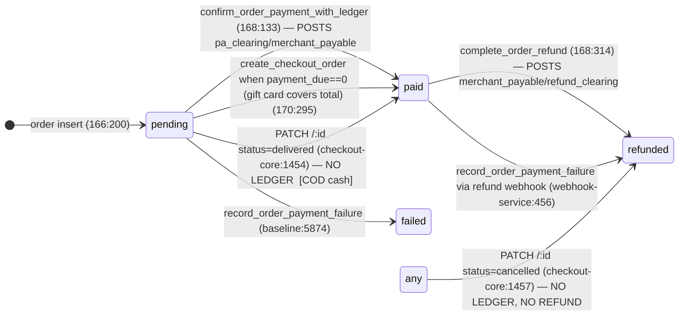
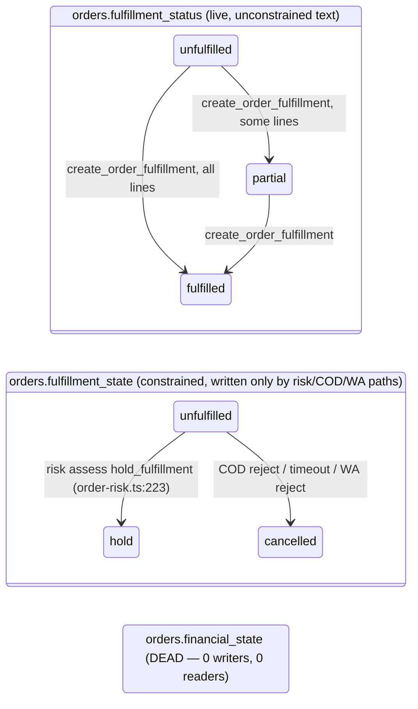

# AGENT E — Orders, Fulfillment, Shipping, Returns, COD

Run: `docs/merchant-system-discovery/2026-08-04T225330+0530-ee371182`
Branch `stepup/main` @ `ee371182` (working tree — many files carry uncommitted user modifications; all findings below are against the **working-tree state**, which is what was assigned for audit).
Method: static reading of gateway/app/DB source + SQL, plus **one local runtime probe** of the tenant-guard proxy module (no network, no production, no writes outside this file).

---

## 0. Executive summary of this domain

The order/fulfilment/shipping/COD domain has a **large, mostly well-shaped backend** (RPCs with idempotency keys, `FOR UPDATE` locks, outbox events, a real cart-bound HMAC handoff design, a COD reconciliation ledger RPC) and a **very thin, partly non-functional merchant surface**. The gap is not "features missing from the roadmap"; it is that several of the built pieces are **wired to nothing**, several are **wired to the wrong thing**, and at least one guard makes a large slice of the merchant order lifecycle **throw at runtime**.

Highest-severity items found (detail + evidence below):

| ID | One line | Sev |
|----|----------|-----|
| G-E-01 | Tenant-guard proxy rejects `resolveTenantContextForOrder`'s own query → every order mutation route + order detail read appears to throw | P0 |
| G-E-02 | Live storefront order-create is an **unsigned public path**; the cart-bound signed handoff exists but has **zero consumers** (ART-14 / R-11) | P0 |
| G-E-03 | Order creation **hard-commits inventory before payment** in the same transaction (ART-14 "no pre-payment decrement") | P0 |
| G-E-04 | Cancelling an order sets `payment_status='refunded'` with **no refund, no ledger entry, no provider call** | P0 |
| G-E-05 | COD "delivered" sets `payment_status='paid'` + emits `order.paid` with **zero canonical ledger posting**; `cod_receivable` is never credited at confirm (PAY-R2 / R-5) | P0 |
| G-E-06 | Three refund routes (`/orders/:id/refund`, `/orders/:id/refund/complete`, `/returns/:id/refund/complete`) have **no step-up** (R-10) | P0 |
| G-E-07 | `pending_cod` is absent from the merchant web console → **COD orders have no actions at all** | P0 |
| G-E-08 | Payment-failure webhook cancels the order with `releaseInventory: false` → **stock destroyed permanently** | P0 |
| G-E-09 | Merchant fulfil path hardcodes `mode: 'sandbox'` and drops `testMode` → **fake Shiprocket tracking numbers persisted as real** (ANTI-R9) | P1 |
| G-E-10 | Zero real carriers. `shiprocket`/`delhivery`/`pickrr` are all the same scaffold (ART-15 "one real carrier") | P1 |
| G-E-11 | `shipping_serviceability_rules` has **no writer anywhere** → pincode + COD serviceability is a hardcoded fiction | P1 |
| G-E-12 | Storefront requests shipping rates with `pincode: '000000'` → merchant-configured rates are **never applied** at checkout | P1 |
| G-E-13 | Order edit (`PATCH /orders/:id/line-items`) has no inventory effect, no GST recompute, no status guard, no `items` jsonb sync | P1 |
| G-E-14 | Risk assessment + COD-confirm/timeout routes have **zero callers** — the India COD-confirm fraud lever never fires | P1 |
| G-E-15 | WhatsApp COD reject cancels the order **without** releasing inventory or restoring gift cards; so does the queue-worker expiry | P1 |
| G-E-16 | Return refund amount = `unit_price × qty` only — ignores discount, GST, shipping; no gift-card restore | P1 |
| G-E-17 | Merchant order **detail** page is 100% read-only; no invoice view/download, no packing slip, no timeline/notes | P1 |
| G-E-18 | `financial_state`, `order_source`, `order_locked_at`, `immutable_snapshot`, `checkout_session_id` are dead columns → the order-immutability trigger **never fires** | P1 |
| G-E-19 | Multiple order-status writers bypass `VALID_TRANSITIONS` entirely (COD confirm, risk assess, fulfil RPC, payment-failure RPC, WhatsApp webhook, queue worker) | P1 |
| G-E-20 | WhatsApp inbound webhook accepts **unsigned** requests in any non-production runtime and trusts a client-supplied `store_id` | P1 |
| G-E-21 | Order money is `numeric(12,2)` rupees end-to-end, not `bigint` paise (R-8 / ART-13) | P2 |
| G-E-22 | Refund idempotency key is regenerated per click in the UI → **double-refund on double-submit** | P2 |
| G-E-23 | `canonical-ledger-only-validator` evidence check is file-level → un-ledgered COD "collect" write passes the gate | P2 |
| G-E-24 | Gateway holds `service_role` on `orders` (RLS bypassed); isolation depends only on TS `.eq()` filters | P2 |
| G-E-25 | Order tests are source-regex assertions; the behavioural Postgres tests need an external docker container | P2 |
| G-E-26 | No shipped/delivered customer email; no exchanges; no returns UI in the web console | P2 |
| G-E-27 | Doc drift: root `AGENTS.md` PAY-R2 claims `confirm_order_payment_with_ledger` posts zero ledger entries — false since migration 168 | P3 |

---

## 1. Inventory — what exists in this domain

### 1.1 Merchant web surface (`apps/merchant-control-plane`)

| Path | Lines | What it actually does |
|---|---|---|
| `apps/merchant-control-plane/src/app/[store]/orders/page.tsx` | 923 | Order list. Filters (status/payment/search), bulk actions, **row actions**: Confirm / Process / Ship (+tracking) / Deliver / Cancel / Refund (step-up modal). |
| `apps/merchant-control-plane/src/app/[store]/orders/[orderId]/page.tsx` | 699 | Order detail. **Read-only.** Summary, customer, line items, addresses, payment summary. **No actions whatsoever.** |
| `apps/merchant-control-plane/src/app/[store]/settings/shipping/page.tsx` | 620 | Shipping **zones + rates** CRUD only. |
| `apps/merchant-control-plane/src/app/api/stores/[store]/orders/route.ts` | 43 | Proxy → `GET /v1/orders`. |
| `apps/merchant-control-plane/src/app/api/stores/[store]/orders/[orderId]/route.ts` | 47 | Proxy → `GET /v1/orders/:id`, `PATCH /v1/orders/:id`. |
| `apps/merchant-control-plane/src/app/api/stores/[store]/orders/[orderId]/refund/route.ts` | 65 | Resolves `payment_id` then proxies → `POST /v1/payments/:paymentId/refund` **with `X-Step-Up-Token`**. |
| `apps/merchant-control-plane/src/app/api/stores/[store]/shipping/{zones,rates}/**` | — | Proxies → `/v1/shipping-tax/*`. |

**Absent from the web merchant console entirely:** returns page, draft orders, order edit, packing slip, shipping label purchase, tax-invoice view/download, order timeline/notes/activity, COD reconciliation, COD confirm/reject, risk review, RTO handling, exchanges, carrier configuration, pincode serviceability configuration.

### 1.2 Flutter merchant app (`apps/mobile/merchant-app`) — materially richer for orders

`apps/mobile/merchant-app/lib/services/order_service.dart` exposes: list, get, draft list, draft create, draft convert, status update, cancel, fulfil, **line-item edit**, **packing slip**, **shipping-label rates**, **buy shipping label**, **refund**, **complete refund**, export. Evidence: `order_service.dart:38,105,131,158,187,217,247,267,308,335,339,359,386,409`.
This is a **surface-parity contradiction**: the mobile app can do things the web console cannot.

### 1.3 Gateway routes (`services/api-gateway/src/routes/`)

| File | Lines | Routes |
|---|---|---|
| `orders.ts` | 1467 | `GET /`, `GET /drafts`, `POST /drafts`, `POST /drafts/:id/convert`, `GET /:id/packing-slip`, `GET /:id`, `PATCH /:id/line-items`, `PATCH /:id`, `POST /`, `POST /:id/fulfill`, `POST /:id/refund/complete`, `POST /:id/refund` |
| `order-risk.ts` | 510 | `POST /risk/assess`, `POST /orders/:id/cod/confirm`, `POST /orders/:id/cod/timeout` |
| `returns.ts` | 295 | `GET /returns`, `GET /returns/:id`, `POST /returns`, `PATCH /returns/:id`, `POST /returns/:id/refund/complete` |
| `checkout.ts` | 816 | Hosted checkout: `POST /checkout/:cartId/{contact,delivery,payment-intent,confirm}`, `GET /checkout/:id` — **all gated by the cart-bound HMAC handoff** |
| `shipping.ts` | 175 | `GET /shipping/serviceability/:pincode`, `POST /shipping/rates`, `GET /shipping/track/:trackingNumber` |
| `shipping-labels.ts` | 427 | Label rate/buy/list — honest sandbox/live mode + `test_mode` persisted |
| `shipping-tax.ts` | 473 | Zones/rates/taxes CRUD |
| `cod-reconciliation.ts` | 382 | `GET /cod/reconciliation`, `POST /cod/reconciliation` (collect), `POST /cod/reconciliation/:id/reconcile` |
| `storefront/checkout-payment-routes.ts` | — | `POST /storefront/:subdomain/orders` (**public order create**), razorpay order/verify |
| `storefront/cart-routes.ts` | — | `GET /storefront/:subdomain/cart/:cartToken/checkout-url` (**issues the signed handoff — no consumers**) |

Mount points: `services/api-gateway/src/index.ts:724` (`/checkout`, public), `:769-774` (`/orders`, `/risk`, `/returns`, `/shipping/labels`, `/shipping` — all after `api.use('/*', authMiddleware)` at `:750`), `:782` (`/cod`), `:802` (`/shipping-tax`). Storefront router is mounted at `:723`, i.e. **before** the auth middleware.

### 1.4 Database

Core tables: `orders`, `order_items`, `order_line_adjustments`, `order_shipping_lines`, `order_tax_lines`, `fulfillment_orders`, `fulfillment_order_lines`, `shipments`, `shipment_events`, `returns`, `return_lines`, `refunds`, `refund_lines`, `refund_transactions`, `restock_events`, `inventory_reservations`, `inventory_levels`, `inventory_events`, `inventory_adjustments`, `draft_orders`, `draft_order_lines`, `checkout_sessions`, `carts`, `order_risk_assessments`, `cod_confirmation_requests`, `cod_reconciliation_entries`, `shipping_zones`, `shipping_rates`, `shipping_serviceability_rules`, `outbox_events`.

Key RPCs (all `SECURITY DEFINER`, `SET search_path TO 'public'`):
`create_checkout_order` (latest: `database/supabase/migrations/170_v1_shipping_rates_gst.sql:31`), `create_order_with_inventory_reservations` (latest: `166_d6_checkout_handoff_inventory.sql:8`), `create_order_fulfillment` (`000_baseline.sql:2353`), `create_order_return_and_refund` (`000_baseline.sql:2678`), `complete_order_refund` (latest `168_b1_b2_capture_refund_ledgering.sql:314`), `confirm_order_payment_with_ledger` (latest `168:133`), `record_order_payment_failure(_with_ledger)` (`000_baseline.sql:5803` / `:5948`), `release_order_inventory(_with_ledger)` (`000_baseline.sql:6995` / `:7120`), `reconcile_cod_remittance_with_ledger` (`165_d5_canonical_money_paths.sql:267`), `restore_gift_card_on_refund` (migration 174).

---

## 2. State machines

### 2.1 Order status — enum and where it is enforced

DB `CHECK` (authoritative for *values*, not transitions) — `database/supabase/migrations/147_executable_order_state_risk.sql:34-44`:
`pending | pending_cod | confirmed | processing | shipped | delivered | cancelled | refunded | returned | rto`

TypeScript transition table — `packages/checkout-core/src/index.ts:1424-1433`:

```
pending      -> confirmed, cancelled
pending_cod  -> confirmed, cancelled
confirmed    -> processing, cancelled
processing   -> shipped, cancelled
shipped      -> delivered, cancelled
delivered    -> refunded
cancelled    -> (terminal)
refunded     -> (terminal)
returned     -> ABSENT FROM THE TABLE
rto          -> ABSENT FROM THE TABLE
```

**There is NO database-level transition guard.** No trigger, no `CHECK (old,new)` pair. The only transition enforcement is `planOrderStatusTransition()` (`packages/checkout-core/src/index.ts:1445-1468`), reached only through `OrderExecutionAdapter.transitionStatus()` (`services/api-gateway/src/execution/order-execution.adapter.ts:414-463`), reached only from `PATCH /v1/orders/:id` (`services/api-gateway/src/routes/orders.ts:1142`).

```mermaid
stateDiagram-v2
    direction LR
    [*] --> pending: create_order_with_inventory_reservations (non-COD)
    [*] --> pending_cod: same RPC (COD) + trg_orders_pending_cod_status
    [*] --> confirmed: create_checkout_order when payment_due == 0

    pending --> confirmed: PATCH /:id  (guarded)
    pending --> cancelled: PATCH /:id  (guarded, releases inventory)
    pending_cod --> confirmed: PATCH /:id (guarded)
    pending_cod --> cancelled: PATCH /:id (guarded, releases inventory)
    confirmed --> processing: PATCH /:id (guarded)
    confirmed --> cancelled: PATCH /:id (guarded)
    processing --> shipped: PATCH /:id -> delegates to fulfillOrder
    processing --> cancelled: PATCH /:id (guarded)
    shipped --> delivered: PATCH /:id (guarded; sets payment_status=paid, NO LEDGER)
    shipped --> cancelled: PATCH /:id (guarded)
    delivered --> refunded: PATCH /:id (guarded; sets payment_status=refunded, NO LEDGER)

    state "UNGUARDED WRITERS (no transition check)" as U
    U --> confirmed: POST /orders/:id/cod/confirm  (order-risk.ts:348-368)
    U --> cancelled: POST /orders/:id/cod/confirm (reject branch)
    U --> cancelled: POST /orders/:id/cod/timeout (order-risk.ts:450-465, filtered to pending*/pending_cod)
    U --> pending_cod: POST /risk/assess (order-risk.ts:217)
    U --> confirmed: WhatsApp inbound webhook (whatsapp.ts:452-468)
    U --> cancelled: WhatsApp inbound webhook (reject branch, NO inventory release)
    U --> cancelled: queue worker COD expiry (platform-queue-consumer.ts:1120-1133)
    U --> shipped: create_order_fulfillment RPC (baseline:2610) forces shipped/processing
    U --> cancelled: record_order_payment_failure RPC (baseline:5874)
    U --> refunded: record_order_payment_failure RPC (refund webhook)

    state "UNREACHABLE" as X
    X --> returned: allowed by DB CHECK, absent from VALID_TRANSITIONS, no writer
    X --> rto: allowed by DB CHECK, absent from VALID_TRANSITIONS, no writer
```



**Transitions reachable from a client without a server-side transition guard:** every arrow in the `UNGUARDED WRITERS` block that is behind a merchant session — specifically `POST /v1/orders/:id/cod/confirm` (no current-status filter at all: `services/api-gateway/src/routes/order-risk.ts:362-368` updates by `id`+`store_id` only, so a `delivered` order can be pushed back to `confirmed`), and `POST /v1/risk/assess` (`order-risk.ts:210-232` can set `status='pending_cod'` on any order, including a delivered one).

### 2.2 Payment status

DB `CHECK` — `database/supabase/migrations/000_baseline.sql:10168`: `pending | paid | failed | refunded`. **No `partially_refunded`, no `authorized`, no `voided`** despite `refund_status` having `partially_refunded` (`:10170`).



The two `NO LEDGER` arrows are G-E-04 and G-E-05.

### 2.3 Fulfillment status / fulfillment state

There are **two** parallel fulfilment fields and one is dead:

- `orders.fulfillment_status` — text, default `'unfulfilled'`, **no CHECK constraint at all** on `orders` (the CHECK at `000_baseline.sql:10043` is on `order_items`, not `orders`). Written by `create_order_fulfillment` (`baseline:2610`) to `fulfilled | partial`.
- `orders.fulfillment_state` — CHECK `unfulfilled | hold | partial | fulfilled | delivered | returned | rto | cancelled` (`147:53-54`). Written only from `order-risk.ts:223,353,359,455`, `whatsapp.ts:460,465`, `platform-queue-consumer.ts:1125`. **Never written by the actual fulfilment RPC.**
- `orders.financial_state` — CHECK with 7 values (`147:51-52`). **Written by nothing, read by nothing** (see §7 dead columns).



---

## 3. Order creation — every path, and the ART-14 signed-handoff test

ART-14 / R-11 forbid *"An unsigned public order-create path"* and require the HMAC to bind *"a hash of sorted line items + coupons + subtotal"*.

Every code path that can insert into `public.orders`:

| # | Entry point | Auth | Signed cart-bound handoff? | Verdict |
|---|---|---|---|---|
| 1 | `POST /v1/storefront/:subdomain/orders` → `registerStorefrontCheckoutPaymentRoutes` (`services/api-gateway/src/routes/storefront/checkout-payment-routes.ts:251`) | **PUBLIC** (mounted at `index.ts:723`, before `authMiddleware` at `:750`). Only per-IP `authRateLimit` (`public-routes.ts:737-741`) | **NO — none at all.** Nothing in the handler reads a signature, digest, cart token or expiry | **VIOLATION of ART-14 / R-11.** This is the path the live storefront uses. |
| 2 | `POST /v1/checkout/:cartId/confirm` (`services/api-gateway/src/routes/checkout.ts:598`) | Public but gated | **YES** — `verifyCheckoutHandoff` (`checkout.ts:221-297`): requires `site_id`, `cart_token`, `expires_at`, `cart_digest`, `signature`; recomputes `sha256Hex(canonicalCheckoutCartBinding(...))` from the **live cart row** and `timingSafeEqualHex`-compares; then HMAC-SHA256 over `canonicalCheckoutHandoffPayload` (`checkout.ts:276-287`) | Correct design — but **DORMANT** (see below) |
| 3 | `POST /v1/orders` (admin create, `orders.ts:1232`) | Merchant session + `resolveTenantContextForOwnedSite` | N/A (merchant-authored) | Acceptable |
| 4 | `POST /v1/orders/drafts/:id/convert` (`orders.ts:776`) | Merchant session | N/A | Acceptable |
| — | DB: only two `INSERT INTO orders` statements exist — `000_baseline.sql:3413` (superseded) and `166_d6_checkout_handoff_inventory.sql:165` (live). All four entry points funnel through `create_checkout_order` → `create_order_with_inventory_reservations`. | | | |

**Proof the signed handoff is dead code.** The signature is issued by `GET /v1/storefront/:subdomain/cart/:cartToken/checkout-url` (`services/api-gateway/src/routes/storefront/cart-routes.ts:528-597`), which builds a URL on `CHECKOUT_ORIGIN` (`services/api-gateway/wrangler.toml:286` → `https://checkout.letbuyy.com`). A repo-wide search for consumers of `checkout-url` in `apps/**` and `packages/typescript/api-client/src` returns **no callers** (only unrelated Flutter `checkoutUrl` symbols for Razorpay subscription webviews). There is no `apps/checkout` runtime in the canonical topology, and `apps/checkout` is on the deprecated-alias list in `CLAUDE.md`. So `checkout.letbuyy.com` is not built.

**Proof the live path is #1.** `apps/storefront-runtime/src/app/store/[subdomain]/checkout/checkout-client.tsx:414` → `fetch('/api/orders', …)` → `apps/storefront-runtime/src/app/api/orders/route.ts:48` → `createStorefrontApiClient().storefront.createOrder(subdomain, …)` → `packages/typescript/api-client/src/index.ts:5429` → `POST /v1/storefront/:subdomain/orders`.

**Cart-binding content (path #2 only).** `canonicalCheckoutCartBinding` (`packages/checkout-core/src/index.ts:510-547`) hashes: version, site_id, cart_id, cart_token, channel, expires_at, **de-duplicated + sorted uppercase coupon codes**, and **lines sorted by product_id/variant_id/quantity with `unit_price_minor` and `line_total_minor`**. There is **no explicit `subtotal` field**; the per-line `line_total_minor` values make the subtotal implicit but not stated. Against the literal ART-14 wording this is `PARTIAL`.

**Secret fallback.** `checkoutSigningSecret` (`services/api-gateway/src/routes/checkout.ts:87-92`) returns the hardcoded string `'letbuyy-local-sandbox-checkout-handoff-secret'` whenever `ENVIRONMENT`/`APP_ENV` is not `production` and no real secret is configured. Production fails closed (`return null` → 503 `CHECKOUT_SETUP_REQUIRED`), which is correct; staging is forgeable.

---

## 4. Server-authoritative amounts

**Verified server-authoritative:**
- Line prices: `create_order_with_inventory_reservations` reads `products.price` / `product_variants.price` under `FOR UPDATE` and computes `v_line_total := v_unit_price * v_quantity` (`166:97-162`). The client only sends `product_id`, `variant_id`, `quantity` — enforced by `checkoutOrderItems` (`checkout.ts:163-169`) and by the storefront mapping at `checkout-payment-routes.ts:372-376`.
- Shipping: resolved from `shipping_rates` joined to `shipping_zones` scoped to `sz.site_id = p_store_id` (`170:112-133`), with an explicit `RAISE EXCEPTION 'shipping rate not found or does not belong to this store'`.
- Discount: `evaluate_checkout_promotion(...)` server-side (`170:184-191`).
- Gift card: balance derived from `gift_card_ledger_entries` sum (`170:214-229`), redemption capped by `LEAST(balance, grand_total)`.

**Client-influenced amount that reaches persistence — `p_tax_amount`.** `create_checkout_order` accepts `p_tax_amount numeric(12,2)` and writes it straight to `orders.tax` (`170:46`, `170:157`, `170:291`). The value comes from `OrderExecutionAdapter.createOrder(input.tax_amount)` (`services/api-gateway/src/execution/order-execution.adapter.ts:175`). In the live storefront path the gateway computes it itself (`checkout-payment-routes.ts:291-357`) from `tax_registrations` + `tax_rates` + DB product prices — so **not** attacker-controlled today. But `POST /v1/orders` (admin) also flows through the same adapter, and the RPC itself performs **no validation** of `p_tax_amount` against the lines. The DB is not the tax authority; the gateway is. Record as a **latent** server-authority weakness, not a live exploit.

**GST computation is best-effort and silently degrades to zero.** `checkout-payment-routes.ts:355-357`: `catch { computedTaxAmount = null; }` — any failure in the tax lookup produces a **₹0 tax order** with no signal. Same shape in `OrderExecutionAdapter.generateAndPersistGstInvoice` which `return null`s on missing supplier state code (`order-execution.adapter.ts:259`) or missing recipient state (`:268`).

---

## 5. Idempotency, locks, retry safety

### 5.1 Gateway layer

`IdempotencyExecutionAdapter.begin()` (`services/api-gateway/src/execution/idempotency-execution.adapter.ts:59-143`) is sound: unique-constraint insert into `idempotency_keys`, request-hash comparison (`ConflictError` on body mismatch), completed-replay return, 120 s lock with `ConflictError` while active, reclaim after lock expiry. Applied to: `PATCH /:id` (`orders.ts:1152`), `POST /` (`:1237`), `POST /:id/fulfill` (`:1301`), `POST /:id/refund` (`:1436`), `POST /:id/refund/complete` (`:1351`), `PATCH /:id/line-items` (`:990`), drafts create/convert, `POST /risk/assess`, COD confirm/timeout, storefront order create (`checkout-payment-routes.ts:264`).

**Not** idempotency-protected: `POST /v1/returns` (`returns.ts:186` — passes `body.idempotency_key` to the RPC but takes no gateway claim), `PATCH /v1/returns/:id` (`returns.ts:214` — no key at all), `POST /v1/cod/reconciliation` (`cod-reconciliation.ts:311` — hand-rolled key lookup, no lock).

### 5.2 DB layer — proven from SQL

| RPC | idempotency key required? | Replay guard | Row lock |
|---|---|---|---|
| `create_checkout_order` | YES — `RAISE EXCEPTION 'idempotency_key is required'` (`170:76-78`) | `SELECT order_id FROM checkout_sessions WHERE site_id=… AND idempotency_key=…` returns the existing order (`170:84-102`) | `SELECT * FROM orders … FOR UPDATE` (`170:169-172`); gift card `FOR UPDATE` (`170:208`) |
| `create_order_with_inventory_reservations` | **NO key parameter at all** (`166:8-20`) | none of its own — relies entirely on the caller | `products … FOR UPDATE` (`166:87`) |
| `create_order_fulfillment` | YES (`baseline:2369-2371`) | `fulfillment_orders` lookup by `(site_id, idempotency_key)` → `idempotent_replay: true` (`baseline:2389-2401`) | `orders … FOR UPDATE` (`:2378`), `order_items … FOR UPDATE` (`:2447`) |
| `create_order_return_and_refund` | YES (`baseline:2701-2703`) | `returns` lookup by `(site_id, idempotency_key)` (`:2724-2737`) | `orders … FOR UPDATE` (`:2708`), `order_items … FOR UPDATE` (`:2785`), `inventory_levels … FOR UPDATE OF il` (`:2853`) |
| `release_order_inventory` | no key; **idempotent by state** — `IF EXISTS (… status='released') RETURN TRUE` (`baseline:7015-7022`) | see left | `orders … FOR UPDATE` (`:7009`) |
| `reconcile_cod_remittance_with_ledger` | YES (`165:291-293`) | lookup by `reconciliation_idempotency_key` (`165:296-304`) | `cod_reconciliation_entries … FOR UPDATE` (`165:306-312`) |

**Retry hazards found:**
1. **Double refund via the merchant UI.** `apps/merchant-control-plane/src/app/[store]/orders/page.tsx:394` builds `idempotency_key: \`refund-${refundingOrderId}-${crypto.randomUUID()}\`` — a **new key on every submit**. Two submits = two distinct keys = two independent refunds. Same pattern for status changes at `:266` and bulk at `:344` (less harmful there because the state machine rejects the second). **[HIGH-STAKES]**
2. `release_order_inventory`'s guard is "any released reservation exists" (`baseline:7015`), not per-reservation. A partial prior release short-circuits the rest.
3. `order_shipping_lines` INSERT inside `create_checkout_order` (`170:339-357`) has **no `ON CONFLICT`** — safe only because the whole RPC is one transaction guarded by the `checkout_sessions` replay check.

---

## 6. THE BIG ONE — G-E-01: the tenant guard rejects the order-lifecycle path

`getSupabaseAdmin` returns a **Proxy-guarded** client: `services/api-gateway/src/lib/supabase.ts:13-19` → `createTenantGuardedSupabaseClient(createSupabaseServiceClient(env))` (`services/api-gateway/src/tenant/tenant-scoped.ts:112-124`). The guard rejects the awaited query unless a scope predicate was seen (`tenant-scoped.ts:78-110`), and the scope columns recognised for `orders` are exactly `["site_id","store_id"]` (`services/api-gateway/src/tenant/tenant-tables.registry.ts:1466-1471`). `markScopeFromCall` (`tenant-scoped.ts:52-77`) only marks scope for `eq | in | filter | match | or | insert | upsert` — **not** for `select`, and **not** for `is`.

`resolveTenantContextForOrder` (`services/api-gateway/src/lib/tenant-context.ts:244-258`) does:

```ts
const { data: order } = await db
    .from('orders')
    .select('id, store_id')     // 'select' does not mark scope
    .eq('id', orderId)          // 'id' is not a scope column
    .is('deleted_at', null)     // 'is' is not handled
    .maybeSingle();
```

**RUNTIME_OBSERVATION.** I executed the real `tenant-scoped.ts` module against the repo's real `@supabase/postgrest-js@2.95.3` builder (network stubbed, no DB, no writes) in the session scratchpad:

```
A resolveTenantContextForOrder-shape (REAL builder): THREW: Tenant table orders requires a tenant/owner predicate before execution
B store_id-scoped        (REAL builder): RESOLVED {"error":null,"data":null,...}
```

The guard rejects the promise, so `await` throws — it does **not** surface as `{ error }`, meaning the `isMissingColumnError(error,'deleted_at')` fallbacks never run.

**Blast radius — every route that calls `resolveTenantContextForOrder` first:**
`PATCH /v1/orders/:id` (`orders.ts:1146`), `PATCH /v1/orders/:id/line-items` (`:988`), `POST /v1/orders/:id/fulfill` (`:1296`), `POST /v1/orders/:id/refund` (`:1431`), `POST /v1/orders/:id/refund/complete` (`:1346`), `GET /v1/orders/:id/packing-slip` (`:879`), `POST /v1/orders/:id/cod/confirm` (`order-risk.ts:319`), `POST /v1/orders/:id/cod/timeout` (`:423`), `POST /v1/returns` (`returns.ts:189`), `shipping-labels.ts:188` (`loadOwnedOrder`).

Two more unscoped `orders` reads fail the same way, independently of `resolveTenantContextForOrder`:
- `GET /v1/orders/:id` — `services/api-gateway/src/routes/orders.ts:954-962` (`.select(...).eq('id', orderId)` only). This is what the **merchant order detail page** calls.
- `GET /v1/tax/invoice/:orderId` — `services/api-gateway/src/routes/tax.ts:125-129`.

(Scoped and therefore fine: `orders.ts:503,570,882,1086,1102,1115`, `order-execution.adapter.ts:235,338,386,421,454`, `order-risk.ts:175,228,363,451`, `whatsapp.ts:454`, `cod-reconciliation.ts:143,170`, `shipping-labels.ts:193`.)

**Residual uncertainty (stated honestly):** I could not probe a deployed gateway (forbidden). It is conceivable that a deployment-time build, an env flag, or a divergence between this working tree and the deployed artifact changes the outcome. But the guard module, the registry entry, and the calling query shape are all in this working tree and the local reproduction used the real modules. Status: `CONTRADICTORY_EVIDENCE` leaning **BROKEN**; must be confirmed by a single authenticated `PATCH /v1/orders/:id` against staging before any remediation is designed.

---

## 7. Dead state machine columns → the immutability trigger never fires

Migration `147_executable_order_state_risk.sql:7-21` adds `order_source` (default `'admin'`), `checkout_session_id`, `channel`, `financial_state`, `order_locked_at`, `immutable_snapshot`.

Repo-wide search across `services`, `apps`, `packages`, `database`, `tests` (excluding `dist/`, `node_modules`, `.claude/worktrees`):
- `financial_state` — appears **only** in `147` and its rollback. **Zero writers, zero readers.**
- `order_source` / `order_locked_at` / `immutable_snapshot` — appear only in `147`, its rollback, and a source-regex test (`services/api-gateway/src/__tests__/orders-v1.test.ts:58,69`). **No code ever sets them.**
- `checkout_session_id` — never populated (`create_checkout_order` inserts into `checkout_sessions` with `order_id`, but never back-fills `orders.checkout_session_id`).

Consequence: `prevent_checkout_order_immutable_update()` (`147:125-148`) begins with

```sql
IF OLD.order_source = 'checkout' AND OLD.order_locked_at IS NOT NULL AND (...)
```

Because `order_source` is always `'admin'` (the column default) and `order_locked_at` is always NULL, the trigger `trg_orders_checkout_immutable` (`147:150-153`) **can never raise**. Order commercial fields (items, subtotal, tax, discount, total, currency, addresses) are freely mutable. `PATCH /orders/:id/line-items` exercises exactly this.

---

## 8. Merchant-side cancel / return / refund — what actually happens

### 8.1 Cancel (`PATCH /v1/orders/:id` with `status: 'cancelled'`)

| Step | Evidence | Result |
|---|---|---|
| Transition allowed from `pending/pending_cod/confirmed/processing/shipped` | `packages/checkout-core/src/index.ts:1424-1431` | OK |
| Sets `payment_status = 'refunded'` and `notes = cancellation_reason` | `packages/checkout-core/src/index.ts:1456-1459` | **G-E-04 — lies about money.** No `refunds` row, no `refund_transactions` row, no provider refund, no canonical ledger entry. A paid prepaid order cancelled by the merchant reports `refunded` while the buyer's money is still with the merchant's Razorpay. **[HIGH-STAKES] [IRREVERSIBLE-ish]** |
| Releases inventory | `order-execution.adapter.ts:449-451` → `release_order_inventory_with_ledger` | **Works** |
| Restores gift card | `orders.ts:1195-1211` → `restore_gift_card_on_refund`, wrapped in try/catch, "never blocks" | Works but **best-effort**; a failure is only `console.warn`-ed and the cancel still succeeds → silent gift-card loss |
| Customer email | `orders.ts:1177-1192` → `enqueueOrderLifecycleEmail(kind:'cancelled')` | Works (best-effort) |

### 8.2 Return + refund (`POST /v1/orders/:id/refund` → `create_order_return_and_refund`)

| Question | Answer + evidence |
|---|---|
| Does a return restock? | **Yes, when `p_restock=true`** — `baseline:2853-2872` / `:3013-3032` directly `UPDATE inventory_levels SET available = available + v_restock_quantity`, plus `restock_events` and `inventory_events` rows with `ON CONFLICT (site_id, idempotency_key) DO NOTHING`. **But it bypasses the reserve→commit RPC lifecycle entirely** — a second inventory-mutation door (ART-15 forbids multiple inventory paths). |
| Is the refund amount correct? | **No.** `v_refund_amount := ROUND(COALESCE(v_item.unit_price,0) * v_quantity, 2)` (`baseline:2793` and `:2969`). It ignores `order_items.discount_amount`, `order_items.tax_amount` / `cgst_amount` / `sgst_amount` / `igst_amount`, and any shipping apportionment. A discounted line **over-refunds**; a GST line **under-refunds**. **[HIGH-STAKES]** |
| Does it restore a gift card? | **No.** `restore_gift_card_on_refund` is called from `orders.ts:1195` (PATCH cancel/refund), `orders.ts:1392` (refund/complete) and `order-risk.ts:304` (COD cancel) — **not** from `create_order_return_and_refund` and **not** from `POST /v1/returns`. |
| Does it post to the canonical ledger? | No — it creates `refunds`/`refund_transactions` with `status='pending'`. The ledger posting happens in `complete_order_refund` (`168:314`). |
| Step-up required? | **No.** See §8.4. |
| Status guard | Only `IF v_order.status IN ('cancelled','refunded') THEN RAISE` (`baseline:2718-2721`). A `pending` (unpaid) order can be "returned and refunded". |

### 8.3 Refund completion

`POST /v1/orders/:id/refund/complete` (`orders.ts:1342`) and `POST /v1/returns/:id/refund/complete` (`returns.ts:259`) both call `complete_order_refund`. I opened `168_b1_b2_capture_refund_ledgering.sql:314` — this one **does** post `merchant_payable` / `refund_clearing` via `post_settlement_ledger_transaction`, per the validator assertions at `scripts/validators/canonical-ledger-only-validator.mjs:155-162`.

### 8.4 Step-up (R-10) — G-E-06

`verifySensitiveActionStepUp` (`services/api-gateway/src/lib/security-controls.ts:160`) is real HMAC-SHA256 (`security-controls.ts:31,233` `step_up_crypto: 'hmac-sha256'`). Call sites, exhaustively:

```
services/api-gateway/src/routes/payments.ts:497
services/api-gateway/src/routes/payouts.ts:576
services/api-gateway/src/routes/security.ts:317
```

**Not** at `orders.ts:1427` (`POST /:id/refund`), `orders.ts:1342` (`POST /:id/refund/complete`), or `returns.ts:259` (`POST /returns/:id/refund/complete`). All three move money and all three are reachable with only a merchant session cookie. The merchant web UI happens to use the *payments* path (which is protected, `refund/route.ts:45-52`), so the gap is in the **API surface**, not the current UI click-path — but the API is the security boundary. **[HIGH-STAKES] P0.**

Also missing on the refund/return routes: `assertStaffPermission` is applied to `PATCH /:id`, `/:id/fulfill`, `/:id/refund`, `/:id/refund/complete` (`orders.ts:1148,1299,1349,1434`) but **not** to `PATCH /:id/line-items`, `POST /orders` (create), the drafts routes, any `returns.ts` route, or any `order-risk.ts` route.

---

## 9. COD lifecycle — full trace

Governance target (root `AGENTS.md:246`, PAY-R2): *"COD → `cod_receivable` at confirm, relieved at remittance with signed breaks."*

| Link | Implementation | Status |
|---|---|---|
| **1. Order placed COD** | `create_order_with_inventory_reservations` inserts `status = CASE WHEN payment_method='cod' THEN 'confirmed' ELSE 'pending' END` (`166:199`), then trigger `set_pending_cod_order_status` (`074:26-47`, re-created at `109:19-24`) rewrites it to `pending_cod`. | IMPLEMENTED_NOT_RUNTIME_VERIFIED |
| **2. Risk assessment → request COD confirmation** | `POST /v1/risk/assess` (`order-risk.ts:153`) sets `cod_confirmation_status='requested'`, a 12 h `cod_expires_at`, inserts `cod_confirmation_requests`, emits `cod.confirmation_requested`. | **DORMANT — zero callers.** No storefront call, no merchant UI, no worker, no test invokes it. Repo-wide search for `risk/assess` finds only the route definition + a source-regex test. |
| **3. WhatsApp COD-confirm message** | `POST /v1/whatsapp/send` with `template:'cod_confirmation'` renders *"Reply YES to confirm COD order …"* (`packages/infrastructure/whatsapp-commerce-adapter/index.ts:294`) and opens a `wa_sessions` row (`whatsapp.ts:771-780`). Provider defaults to `letbuyy_sandbox` unless `ENVIRONMENT=production` **and** Twilio creds present (`whatsapp-commerce-adapter/index.ts:145-148,274-280`). | STUB_OR_MOCK by default; `[HUMAN-REQUIRED] HR-WHATSAPP-LIVE` recorded at `order-risk.ts:130-132`. Nothing triggers the send automatically. |
| **4. Customer replies YES/NO** | `whatsappInboundRouter.post('/')` (`whatsapp.ts:791`) → `closeCodSessionFromReply` (`whatsapp.ts:398-479`). | See G-E-15 + G-E-20 below |
| **5. Timeout / expiry** | Gateway `POST /orders/:id/cod/timeout` (`order-risk.ts:419`, no callers) **and** queue worker `expireCodConfirmationRequest` (`platform-queue-consumer.ts:1095-1135`). | Worker path is live (fires from `processNotificationSideEffect` → `expireDueCodConfirmations`, `platform-queue-consumer.ts:1110`) |
| **6. Inventory effect on COD** | Inventory is **committed at order creation** for COD exactly as for prepaid (`166:221-227`). | **G-E-03** |
| **7. Delivery** | `PATCH /v1/orders/:id status='delivered'` → `payment_status='paid'` (`checkout-core:1453-1455`) + emits `order.paid` **and** `order.delivered` (`orders.ts:436`). | **G-E-05 — no ledger, no `cod_receivable`, no link to `cod_reconciliation_entries`** |
| **8. Cash collected** | `POST /v1/cod/reconciliation` (`cod-reconciliation.ts:311`) — a **direct `.from('cod_reconciliation_entries').update({status:'collected', …})` from TypeScript** (`:332-349`), no RPC, no ledger. | **Un-ledgered money-table write.** `cod_reconciliation_entries` is on the money-table list at `scripts/validators/canonical-ledger-only-validator.mjs:19`. |
| **9. Remittance** | `POST /v1/cod/reconciliation/:id/reconcile` → `reconcile_cod_remittance_with_ledger` (`165:267`) → posts `debit cod_receivable` / `credit merchant_payable` (`165:352-378`) with a real idempotency key + `FOR UPDATE`. | **Works** — the only COD ledger posting that exists |
| **10. Reconciliation / breaks** | `v_status := 'short' | 'over' | 'reconciled'` from `deposited vs expected` (`165:326-330`), signed `difference_amount_minor` persisted. | Works |
| **11. Merchant UI for any of steps 2,4,5,8,9,10** | — | **MISSING entirely from `apps/merchant-control-plane`.** Only `apps/mobile/merchant-app` has COD reconciliation. |

**COD ledger asymmetry (G-E-05).** `cod_receivable` appears in exactly one posting in the whole schema — the *debit* at remittance (`165:359-366`). There is **no credit at COD confirm or delivery**. PAY-R2's "at confirm, relieved at remittance" two-legged model is not implemented; there is one leg, triggered manually by the merchant, long after the cash event.

**COD receivable seeding is wrong (G-E-05b).** `ensureEntriesForCodOrders` (`cod-reconciliation.ts:166-205`) lazily creates a `pending` entry for **every non-cancelled COD order**, including `pending_cod` orders the customer has not confirmed and orders not yet shipped. `expected_amount_minor` is derived from `orders.total` at read time. The COD receivable therefore over-states expected cash.

**COD orders are un-actionable in the web console (G-E-07).** `apps/merchant-control-plane/src/app/[store]/orders/page.tsx:57` declares
`type OrderStatus = 'all' | 'pending' | 'confirmed' | 'processing' | 'shipped' | 'delivered' | 'cancelled' | 'refunded'` — **`pending_cod` is not in the union**, not in the `statuses` filter list (`:62-70`), and not in the row-action conditionals (`:746` Confirm only for `'pending'`; `:766` Cancel only for `['pending','confirmed','processing']`) or the bulk actions (`:449,453,457`). A COD order therefore shows **no Confirm, no Process, no Ship, no Cancel** button. A repo-wide search shows `pending_cod` is handled in `apps/storefront-runtime/.../orders-client.tsx:20` (buyer view), `services/api-gateway/src/routes/stores.ts:192`, `order-risk.ts:217,463`, `platform-queue-consumer.ts:1131`, `packages/shared-types/src/index.ts:630`, `packages/checkout-core/src/index.ts:21,884,1428` — and **nowhere in `apps/merchant-control-plane` or `apps/mobile/merchant-app`**. COD is the dominant Indian tender; this is a launch blocker.

---

## 10. Shipping

### 10.1 Carriers — ART-15 "one real carrier (Shiprocket), others mocked behind the adapter"

`packages/infrastructure/logistics-adapter/index.ts` is 263 lines and contains **no HTTP client and no carrier API call of any kind**. All three providers are the same function:

```
createShiprocketLogisticsProvider  -> createScaffoldLogisticsProvider('shiprocket', …)   (index.ts:229-231)
createDelhiveryLogisticsProvider   -> createScaffoldLogisticsProvider('delhivery', …)    (:233-235)
createPickrrLogisticsProvider      -> createScaffoldLogisticsProvider('pickrr', …)       (:237-239)
```

`createScaffoldLogisticsProvider` fabricates a tracking number `SR<ORDERNUM><IDEMPREFIX>` (`:165-168`), a **real-looking public URL** `https://shiprocket.co/tracking/<fake>` (`:170-174`), and a label URL on `logistics.sandbox.letbuyy.com` (`:176-178`). `assertSandboxMode` (`:143-146`) throws `LogisticsLiveProviderUnavailableError` in live mode, so **live fails closed** — good. `liveLogisticsProviderAvailable()` is hardcoded `return false` (`services/api-gateway/src/routes/shipping-labels.ts:113-115`). This is registered as `SKIP-CAP-LOGISTICS-LIVE-PROVIDER` in `SKIPPED_HUMAN_DECISIONS.md:59`.

**Status: ART-15's "one real carrier" requirement is NOT_IMPLEMENTED, honestly declared.**

### 10.2 ANTI-R9 — a mock that reads as success (G-E-09)

`shipping-labels.ts` is honest: it derives mode from `LOGISTICS_MODE`, blocks live (`shouldBlockLiveLogistics`, `:117-119`), and persists `test_mode: result.testMode` (`:331`) + `provider_mode` (`:246-247`).

`orders.ts` is **not**. `applyLogisticsLabel` (`services/api-gateway/src/routes/orders.ts:494-539`) does:

```ts
const provider = createLogisticsProvider(input.logistics_provider as LogisticsProviderName, { mode: 'sandbox' });   // orders.ts:513 — HARDCODED
...
const tracking = toFulfillmentTrackingFields(label);   // orders.ts:531
return { ...input, carrier: ..., tracking_number: ..., tracking_url: ... };
```

- The mode is hardcoded `'sandbox'` — it ignores `LOGISTICS_MODE` and `shouldBlockLiveLogistics` entirely, so this path produces a fake label **even in production**.
- `toFulfillmentTrackingFields` (`logistics-adapter/index.ts:257-263`) returns only `{carrier, tracking_number, tracking_url}` — **`testMode` is discarded**.
- The result is written by `create_order_fulfillment` into `orders.carrier`, `orders.tracking_number` and a `shipments` row (`baseline:2558-2612`) with **no sandbox marker**.

Net effect: a merchant clicks "Ship" with `create_shipping_label=true` and the system persists `carrier: "Shiprocket"` + a `shiprocket.co` tracking link that resolves to nothing, and emails/announces it as real. The `ProviderModeBadge` in the UI (`orders/page.tsx:781`) is fed from `/shipping/zones` `provider_mode`, not from this label, so it cannot warn about it.

### 10.3 Serviceability — a fabricated fallback nobody can override (G-E-11)

`services/api-gateway/src/routes/shipping.ts:77-88`:

```ts
const { data, error } = await db.from('shipping_serviceability_rules')...;
if (error) return defaultRules(pincode);
return rows.length > 0 ? rows : defaultRules(pincode);
```

`defaultRules` (`shipping.ts:53-66`) asserts `serviceable: /^[1-9][0-9]{5}$/.test(pincode)`, `cod_available: <same test>`, COD limits ₹1–₹2,00,000, 3–7 day ETA, provider `'shiprocket'`.

A repo-wide search for `shipping_serviceability_rules` finds it in migration `145_executable_shipping_serviceability.sql` (table + RLS), the tenant registry, two source-regex tests, and exactly one runtime reference — the **read** at `shipping.ts:79`. **There is no API, no UI, no seed and no import that ever writes a row.** The table is permanently empty, so serviceability and COD-availability are *always* the hardcoded fiction, and a DB error silently produces the same "yes" answer.

Additionally `GET /v1/shipping/serviceability/:pincode` sits behind `authMiddleware` and calls `assertStoreAccess` (`shipping.ts:107-109`) — a **buyer** can therefore never check serviceability. There is no public storefront serviceability endpoint.

### 10.4 Merchant-configured shipping rates never reach checkout (G-E-12)

`apps/storefront-runtime/src/app/store/[subdomain]/checkout/checkout-client.tsx:216-223` fetches rates with a literal placeholder:

```ts
body: JSON.stringify({ store_id: storeId, pincode: '000000', subtotal_minor: subtotalMinor })
```

with the inline comment `// placeholder — real pincode available at form-fill`. The proxy passes it straight through (`apps/storefront-runtime/src/app/api/shipping/rates/route.ts:25`). `'000000'` fails `/^[1-9][0-9]{5}$/`, so `planShippingServiceability` returns `serviceable: false` and `POST /v1/shipping/rates` short-circuits to `{ serviceability, rates: [] }` (`shipping.ts:123-125`). The client then sets `storeRates = null` (`checkout-client.tsx:236`) and falls back to the hardcoded `standard = ₹0 / express = ₹99` (`checkout-client.tsx:249`). The pincode the buyer actually types (`checkout-client.tsx:808`) is never used to re-fetch rates.

**Consequence: every shipping zone and rate a merchant configures in `Settings → Shipping` is ignored at checkout.** The `create_checkout_order` server-side rate resolution (`170:112-133`) is correct but is never reached with a real `p_shipping_rate_id` from the live storefront.

Also, when rates *are* returned, `shipping.ts:149-159` substitutes a fabricated `{id:'sandbox-standard', amount_minor: 6000}` (₹60) row when the store has none — presented in the same shape as a real rate with no sandbox flag (the client filters it by id at `checkout-client.tsx:229`, but any other consumer would not).

### 10.5 Tracking

`GET /v1/shipping/track/:trackingNumber` (`shipping.ts:163-173`) takes a bare tracking number with **no store scoping and no ownership check** — any authenticated merchant can query any tracking number. In sandbox it always returns a single `label_created` event (`logistics-adapter/index.ts:208-225`), i.e. tracking never progresses. There is no carrier tracking webhook ingestion anywhere (`shipment_events` is only written by `create_order_fulfillment` at `baseline:2588-2606`).

---

## 11. Order edit (`PATCH /v1/orders/:id/line-items`) — G-E-13

`services/api-gateway/src/routes/orders.ts:984-1141`.

| Concern | Finding |
|---|---|
| Status guard | **None.** A `delivered`, `shipped`, `cancelled` or `refunded` order can have its lines rewritten. |
| Staff permission | **None** (`assertStaffPermission` absent — contrast `orders.ts:1148`). |
| Inventory | **No effect at all.** Adding items (`:1044-1073`), removing items (`:1035-1043`) and changing quantities (`:1009-1032`) touch only `order_items`. No `reserve_inventory`, no `commit_inventory_reservation`, no `release_order_inventory`. Inventory silently desyncs from the order. |
| Prices | Server-side: existing lines keep their persisted `unit_price` (`:1029`); added lines read `products.sale_price ?? products.price` scoped to `store_id` (`:1049-1056`). Good. |
| Totals | Recomputed in TypeScript floats and written straight to `orders.subtotal`/`orders.total` (`:1099-1112`). |
| GST | **Not recomputed.** `orders.tax` is read and re-used verbatim (`:1085-1097`). `orders.gst_invoice` / `gst_invoice_number` are **not regenerated and not voided** — the "immutable tax invoice" now disagrees with the order it describes. Per-line `cgst/sgst/igst/taxable_amount` are stale. |
| `orders.items` jsonb | **Not updated.** The RPC writes both `orders.items` (`166:192`) and `order_items` rows (`166:250-273`); the edit path updates only the relational rows. When `ORDER_ITEMS_RELATIONAL_READS=off` (`orders.ts:239-241`, default `on`) reads fall back to the now-stale jsonb. |
| `order_line_adjustments` / `order_tax_lines` / `order_shipping_lines` | Untouched. |
| Atomicity | 5+ separate Supabase round-trips with no transaction; a mid-sequence failure leaves lines edited and totals stale. `idempotency.fail()` does not roll anything back. |
| Web merchant UI | **Not exposed.** Only the Flutter app calls it (`order_service.dart:308`). |

---

## 12. Queue / webhook side effects on order events

### 12.1 Domain events emitted

`orderEventsForStatus` (`services/api-gateway/src/routes/orders.ts:435-441`):
```
delivered -> ['order.delivered', 'order.paid']     <-- emits "paid" with no money event
shipped   -> ['order.fulfilled']
cancelled -> ['order.cancelled']
refunded  -> ['order.returned', 'order.refunded']
```
Plus `order.created` from `create_order_with_inventory_reservations` into `outbox_events` with `ON CONFLICT (idempotency_key) DO NOTHING` (`166:276-302`), `fulfillment.shipped` from `create_order_fulfillment` (`baseline:2612-2652`, `ON CONFLICT DO NOTHING`), `refund.requested` from `create_order_return_and_refund` (`baseline:3222-3252`, `ON CONFLICT DO NOTHING`), `cod.confirmation_requested` / `order.risk_assessed` / `order.confirmed_cod` from `order-risk.ts:104-147`.

### 12.2 Consumers

`services/queue-workers/src/platform-queue-consumer.ts`:
- `order.created` → `incrementOrderItemRollups` (`:569-570`, `:584-608`) — analytics rollups, upserted with `onConflict: 'event_id'`.
- Any notification-contracted event → `processNotificationSideEffect` (`:607-624`), which also runs `expireDueCodConfirmations` (`:1110`) and can plan in-app + WhatsApp notifications.
- `aggregateType === 'order'` → `applyOrderSearchIndex` (`:1281-1283`).

### 12.3 Envelope signing

`signQueueTenantEnvelope` (`services/api-gateway/src/lib/queue-tenant-envelope.ts:34`) is used for `NOTIFICATION_QUEUE` sends in `transactional-email.ts:117`, `order-confirmation-email.ts:128,228`, `gift-card-email.ts:96`, `storefront.ts:251`, `app-store/shared.ts:189`. The **DB outbox path** (`outbox_events` → `platform_queue_jobs`) is in-database and not HMAC-signed — it is a same-transaction outbox, which ART-19 explicitly prefers, so this is by design, not a gap.

### 12.4 Payment webhooks acting on orders — G-E-08

`services/webhook-service/src/index.ts`:
- `markOrderPaid` (`:353-385`) → `confirmGatewayOrderPayment` with `idempotencyKey: payment-webhook:<provider>:<eventId>:paid`. Good.
- `markOrderFailed` (`:388-422`) → `recordGatewayOrderPaymentFailure({ orderStatus: 'cancelled', releaseInventory: false })` — **`releaseInventory: false` is hardcoded at `:459`… no, at `:404-412`**. Because order creation hard-commits inventory (§G-E-03), a failed payment **cancels the order and permanently destroys the stock**. `record_order_payment_failure` only releases when `p_release_inventory` is true (`baseline:5879-5881`).
- `markOrderRefunded` (`:425-470`) correctly guards out-of-order delivery (`if (order.payment_status !== "paid") … return;` at `:441-450`, with a G7 comment) and **does** pass `releaseInventory: Boolean(order.inventory_reserved_at && !order.inventory_released_at)` (`:459`).
- `findOrderByPaymentCandidates` (`:331-352`) resolves orders by `payment_id` **across all tenants** via a raw REST `or(...)` filter, then acts on `order.store_id` without cross-checking the webhook's own site. Provider event ids are globally unique so this is low-risk, but it is an unscoped tenant read.
- `record_order_payment_failure` (`baseline:5874-5877`) sets `status` and `payment_status` directly with **no transition guard** — `VALID_TRANSITIONS` is bypassed.

### 12.5 WhatsApp inbound — G-E-15, G-E-20

`closeCodSessionFromReply` (`services/api-gateway/src/routes/whatsapp.ts:398-479`):
- Flips `orders.status` to `confirmed` or `cancelled` (`:452-468`) with **no current-status filter** — any status can be overwritten.
- On the **reject** branch it does **not** call `release_order_inventory_with_ledger` and does **not** call `restore_gift_card_on_refund`. Contrast the gateway COD paths, which do (`order-risk.ts:287-313`, invoked at `:401` and `:495`). **Inventory and gift-card value leak on every WhatsApp COD rejection.**
- Same omission in the queue worker: `expireCodConfirmationRequest` (`platform-queue-consumer.ts:1120-1133`) cancels the order and never releases inventory (the file contains no `release_order_inventory_with_ledger` call — only `claim_/complete_/fail_/quarantine_platform_queue_job` and `increment_analytics_rollup` RPCs).

`verifyInboundWebhook` (`packages/infrastructure/whatsapp-commerce-adapter/index.ts:324-337`):

```ts
if (mode === 'sandbox') {
  const expected = credentials.webhookSecret;
  if (!isConfigured(expected)) return !isProductionRuntime(credentials);   // <-- returns TRUE off-prod
  return input.headers['x-letbuyy-whatsapp-webhook-secret'] === expected;   // <-- plain string compare, not timing-safe
}
```
`normalizeMode` defaults to `'sandbox'` whenever `ENVIRONMENT`/`APP_ENV`/`NODE_ENV` is not `production` (`:145-148`). So on **staging and local**, with no `webhookSecret` set, an **unauthenticated public POST** to `/v1/whatsapp/inbound` can flip order status. It also trusts `form.store_id` (`parseInboundWebhook` `:352`) which `resolveInboundCustomer` accepts as authoritative (`whatsapp.ts:526-541`). Production is fail-closed (live mode requires a Twilio signature via `timingSafeEqual`, `:331-336`).

---

## 13. Invoice access from the order page (link to Agent H)

- The merchant order detail page renders `gst_invoice_number` as **plain text only** — `apps/merchant-control-plane/src/app/[store]/orders/[orderId]/page.tsx:276-278`. **There is no view, no download, no PDF, no link.**
- A retrieval endpoint exists: `GET /v1/tax/invoice/:orderId` (`services/api-gateway/src/routes/tax.ts:118-180`). **No app calls it.** (It is also one of the unscoped `orders` reads from §6, so it likely throws.)
- **Two invoice authorities.** The immutable table `gst_invoices` has real UPDATE/DELETE-reject triggers (`144_executable_tax_gst_invoices.sql:131-146`), **but nothing in the order path ever inserts into it** — a repo-wide search finds `gst_invoices` only in `tax.ts:48,83,144` (reads) and the tenant registry. The invoice actually produced is `orders.gst_invoice` jsonb + `orders.gst_invoice_number`, written by `OrderExecutionAdapter.generateAndPersistGstInvoice` (`order-execution.adapter.ts:337-350`) via a **plain `.update()` on `orders`** with **no immutability protection**. `tax.ts:159-166` explicitly falls back to `source: 'orders.gst_invoice'`.
- Therefore: **the merchant's tax invoice is a mutable JSON column, and order edit (§11) silently invalidates it.** Handing to Agent H.
- Packing slip: `GET /v1/orders/:id/packing-slip` returns HTML + text + base64 PDF (`orders.ts:876-942`). Consumed **only** by the Flutter app (`order_service.dart:335-337`, `orders_screen.dart:626`). Not in the web console.

---

## 14. End-to-end traces

### 14.1 Buyer places a prepaid order (the live path)

```
storefront checkout form
  -> checkout-client.tsx:414  fetch POST /api/orders
  -> apps/storefront-runtime/src/app/api/orders/route.ts:48
  -> packages/typescript/api-client/src/index.ts:5429  storefront.createOrder
  -> POST /v1/storefront/:subdomain/orders     [PUBLIC, index.ts:723 before authMiddleware]
       auth issuer: NONE                                      <-- MISSING (ART-14 signed handoff)
       verifySiteOwnership: N/A (tenant from subdomain, loadPublishedStore)
       rate limit: authRateLimit per-IP (public-routes.ts:737-741)
  -> checkout-payment-routes.ts:251
       shipping rate: resolveShippingRate(db, store.id, body.shippingRateId)   [always null in practice, §10.4]
       GST: computed in TS from tax_registrations + tax_rates (:291-357); silent 0 on any throw
  -> OrderExecutionAdapter.createOrder (order-execution.adapter.ts:146)
       assertOrderQuota  -> subscription entitlement check
  -> RPC create_checkout_order (170:31)
       idempotency: checkout_sessions(site_id, idempotency_key)  OK
       -> RPC create_order_with_inventory_reservations (166:8)
            reserve_inventory(TTL 1200)  -> commit_inventory_reservation  IN THE SAME TX   <-- G-E-03
            INSERT orders (166:165), INSERT order_items (166:250)
            INSERT outbox_events 'order.created' (166:276)
       shipping/tax/discount/gift-card applied, UPDATE orders totals (170:288-300)
  -> completeOrderPostCommitWork -> generateAndPersistGstInvoice -> UPDATE orders.gst_invoice (adapter:337)
  -> emitStorefrontOrderCreatedEvent
  -> Razorpay order -> buyer pays -> POST /storefront/:subdomain/payments/razorpay/verify
  -> confirm_order_payment_with_ledger (168:133)   [POSTS pa_clearing/merchant_payable]  OK
  -> enqueueOrderConfirmationEmail (payment-route-support.ts:336, signed queue envelope)
  -> queue-workers: analytics rollups + notification side effects
  -> merchant sees it in GET /v1/orders  (list works — scoped query)
  -> merchant opens detail -> GET /v1/orders/:id  -> UNSCOPED QUERY  <-- G-E-01 likely throws
```

### 14.2 Merchant ships an order

```
orders/page.tsx:757 "Ship" -> :308 handleFulfill -> PATCH /api/stores/:store/orders/:id {status:'shipped', tracking_number}
  -> merchant proxy route.ts:34  orders.update()
  -> PATCH /v1/orders/:id (orders.ts:1142)
       resolveTenantContextForOrder  <-- G-E-01 UNSCOPED QUERY, guard rejects
       assertStaffPermission 'orders:write'   (never reached)
       idempotency key = admin-order-<id>-shipped-<uuid>   (new every click)
  -> planOrderStatusTransition -> delegatesToFulfillment (checkout-core:1466)
  -> OrderExecutionAdapter.fulfillOrder -> applyLogisticsLabel (orders.ts:494)  <-- G-E-09 hardcoded sandbox
  -> RPC create_order_fulfillment (baseline:2353)
       forces orders.status='shipped', fulfillment_status, tracking_number, carrier (baseline:2610-2617)
       does NOT write fulfillment_state
       INSERT shipments + shipment_events + outbox 'fulfillment.shipped'
  -> emitOrderEvent 'order.fulfilled'
  -> customer email:  MISSING (enqueueOrderLifecycleEmail only supports 'cancelled' | 'refunded',
                      order-confirmation-email.ts:215)
  -> storefront buyer order page shows tracking_number (fabricated in prod, §10.2)
  -> tests: services/api-gateway/src/__tests__/orders-v1.test.ts is source-regex only
  -> runtime observation: NONE
```

### 14.3 Merchant refunds

```
orders/page.tsx:772 "Refund" -> StepUp modal -> :388
  -> POST /api/stores/:store/orders/:id/refund   (merchant proxy)
  -> proxy resolves payment_id via GET /v1/orders/:id   <-- G-E-01 UNSCOPED, likely throws first
  -> POST /v1/payments/:paymentId/refund with X-Step-Up-Token   [step-up IS enforced, payments.ts:497]
  idempotency_key = refund-<orderId>-<uuid>   <-- new per click, G-E-22 double-refund
ALTERNATIVE API SURFACE (no UI, no step-up):
  POST /v1/orders/:id/refund            -> create_order_return_and_refund  (no step-up)
  POST /v1/orders/:id/refund/complete   -> complete_order_refund           (no step-up)  [posts ledger]
  POST /v1/returns/:id/refund/complete  -> complete_order_refund           (no step-up)  [posts ledger]
```

---

## 15. Gap list

Each gap: title / domain / status / impact / evidence / expected / root cause / blast radius / invariant / severity / likelihood / deps / remediation approach / acceptance / tests / owner / reversibility / confidence.

---

**G-E-01 — Tenant-guard proxy rejects the order-lifecycle tenant resolver**
Domain: orders/platform. Status: `CONTRADICTORY_EVIDENCE` (leaning BROKEN).
Impact: every merchant order mutation (confirm, process, ship, deliver, cancel, fulfil, refund, refund-complete, line-item edit, packing slip, COD confirm/timeout, create return, buy shipping label) and the order **detail** read appear to fail with a 500 before doing any work. The merchant cannot operate a single order.
Evidence: guard `services/api-gateway/src/tenant/tenant-scoped.ts:52-124`; scope columns `services/api-gateway/src/tenant/tenant-tables.registry.ts:1466-1471`; offending queries `services/api-gateway/src/lib/tenant-context.ts:246-251`, `services/api-gateway/src/routes/orders.ts:954-962`, `services/api-gateway/src/routes/tax.ts:125-129`; client construction `services/api-gateway/src/lib/supabase.ts:13-19`. RUNTIME_OBSERVATION: local execution of the real guard module against real `@supabase/postgrest-js@2.95.3` → `THREW: Tenant table orders requires a tenant/owner predicate before execution`.
Expected: the tenant resolver's own bootstrap read is either exempted from the guard or performed with an explicitly scoped query / dedicated RPC.
Root cause: the resolver must read the order *to discover* its tenant, which is inherently pre-tenant; the guard has no exemption for that bootstrap.
Blast radius: 10+ gateway routes; both merchant surfaces; the entire order lifecycle.
Invariant: none directly, but it blocks all [HIGH-STAKES] order paths. Severity **P0**. Likelihood **HIGH**. Dependencies: none.
Remediation approach: confirm against staging with one authenticated request first; then give the tenant bootstrap an explicit, audited escape hatch (a named `SECURITY DEFINER` resolver RPC that returns only `(order_id, site_id)`, or a registry-level `bootstrapColumns` allowance for `orders.id`), and add the same for `GET /orders/:id` and `GET /tax/invoice/:orderId`. Do **not** relax the guard globally.
Acceptance: `PATCH /v1/orders/:id` succeeds on staging; a red-team test proves a cross-tenant order id still returns 403/404; the guard still rejects a genuinely unscoped list query.
Tests: an integration test that exercises each of the 10 routes against a real (or emulated) postgrest builder through the guard; a tenant red-team case for cross-tenant order ids.
Owner: lead engineer + security. Reversibility: reversible. Confidence: **high** on the mechanism, **medium** that it is live in the deployed artifact (no production probe permitted).

---

**G-E-02 — Unsigned public order-create path is the live checkout** `[HIGH-STAKES]`
Domain: checkout/orders. Status: `IMPLEMENTED_NOT_RUNTIME_VERIFIED` (the violation is implemented and live-wired).
Impact: `POST /v1/storefront/:subdomain/orders` accepts an order from any unauthenticated caller with only a per-IP rate limit. The cart-bound HMAC handoff that ART-14 requires exists and is well-built, but has **zero consumers**, so the guarantee is not in force anywhere.
Evidence: public mount `services/api-gateway/src/index.ts:723` vs auth at `:750`; handler `services/api-gateway/src/routes/storefront/checkout-payment-routes.ts:251-290` (no signature/digest/expiry read anywhere); rate limit only `services/api-gateway/src/routes/storefront/public-routes.ts:737-741`; live client path `apps/storefront-runtime/src/app/store/[subdomain]/checkout/checkout-client.tsx:414` → `apps/storefront-runtime/src/app/api/orders/route.ts:48`; the unused signed path `services/api-gateway/src/routes/storefront/cart-routes.ts:528-597` and its verifier `services/api-gateway/src/routes/checkout.ts:221-297`; hosted origin `services/api-gateway/wrangler.toml:286` with no corresponding runtime in the canonical topology.
Expected (ART-14 / R-11): orders created only behind a cart-bound signed handoff; no unsigned public order-create path.
Root cause: the hosted `checkout.letbuyy.com` origin was never built (`[HUMAN-REQUIRED] HR-DNS-CHECKOUT`, `checkout.ts:176-178`), so the legacy unsigned route remained the production path.
Blast radius: all storefront orders; inventory; coupon/gift-card redemption; GST invoices.
Invariant: **[HIGH-STAKES]**. Severity **P0**. Likelihood **HIGH**. Dependencies: G-E-03 (inventory), G-E-12 (rates).
Remediation approach: decide the strategic path (build the hosted origin, or move the handoff verification in front of the existing storefront route). Either way the handoff must be *required* before the order-create RPC runs, and the binding must include an explicit subtotal field. Do not weaken the existing verifier.
Acceptance: an unsigned `POST /v1/storefront/:subdomain/orders` returns 401; a replay against a mutated cart returns 401; the happy path still creates an order.
Tests: contract tests for missing signature, expired handoff, mutated cart line, mutated coupon, mutated quantity.
Owner: founder + ARB + lead engineer. Reversibility: reversible. Confidence: high.

---

**G-E-03 — Inventory is hard-decremented before payment** `[HIGH-STAKES]`
Domain: orders/inventory. Status: `IMPLEMENTED_NOT_RUNTIME_VERIFIED`.
Impact: `reserve_inventory(..., 1200)` is immediately followed by `commit_inventory_reservation` and a `-quantity` `inventory_adjustments` row **inside the same transaction as the order insert**, for both prepaid and COD. Reserve-with-TTL is nominal only. An attacker (or an abandoned checkout) can zero a merchant's stock without paying; combined with G-E-08 a failed payment destroys the stock permanently.
Evidence: `database/supabase/migrations/166_d6_checkout_handoff_inventory.sql:134-145` (reserve), `:215-227` (commit, same TX), `:229-248` (`inventory_adjustments -qty`), `:182` (`inventory_reserved_at = now()`).
Expected (ART-14): "Inventory uses reserve-with-TTL, not pre-payment hard-decrement." Forbids "Decrementing stock before payment for pre-pay/COD."
Root cause: the D6 migration wired the reserve→commit *API* but collapsed both calls into order creation.
Blast radius: every order; oversell/denial-of-inventory; merchant trust.
Invariant: **[HIGH-STAKES]**. Severity **P0**. Likelihood **HIGH**. Dependencies: needs the stale-reservation sweeper wired in `queue-workers` (ART-15) before commit can be deferred.
Remediation approach: split the lifecycle — reserve at order creation, commit only on `confirm_order_payment_with_ledger` (prepaid) or COD confirmation; wire a TTL sweeper that releases expired reservations. Never add a second decrement door.
Acceptance: after order create the stock is *reserved* not decremented; an unpaid order expiring returns the stock; a paid order commits exactly once.
Tests: Postgres behavioural tests for reserve→expire→release, reserve→pay→commit, double-commit idempotency, concurrent oversell.
Owner: lead engineer + ARB. Reversibility: reversible with care (needs backfill reasoning for in-flight orders). Confidence: high.

---

**G-E-04 — Cancel marks the order `payment_status='refunded'` with no refund** `[HIGH-STAKES] [IRREVERSIBLE reporting]`
Domain: orders/money. Status: `IMPLEMENTED_NOT_RUNTIME_VERIFIED`.
Impact: a merchant cancelling a **paid** order produces an order row claiming the buyer was refunded. No `refunds` row, no `refund_transactions` row, no provider refund, no canonical ledger entry. Reporting, reconciliation and buyer support all read a lie; the money is still in the merchant's Razorpay.
Evidence: `packages/checkout-core/src/index.ts:1456-1459` (`updates.payment_status = 'refunded'`); applied by `services/api-gateway/src/execution/order-execution.adapter.ts:453-462`; reached from `services/api-gateway/src/routes/orders.ts:1142`; contrast the real refund path `database/supabase/migrations/168_b1_b2_capture_refund_ledgering.sql:314`.
Expected (R-5): every refund posts to the canonical ledger idempotently; a status may not assert a money fact that did not occur.
Root cause: a convenience assignment in the transition planner.
Blast radius: order reporting, GMV/refund analytics, settlements, buyer disputes.
Invariant: **[HIGH-STAKES]**. Severity **P0**. Likelihood **HIGH** (Cancel is on the primary merchant screen). Dependencies: none.
Remediation approach: cancelling must not set `payment_status`. A paid order should require an explicit refund (which posts the ledger) before or alongside cancellation; an unpaid order should move to a `voided`/`failed` payment state. Never write a money-fact column outside a money RPC.
Acceptance: cancelling a paid order either refuses ("refund first") or triggers the real refund RPC; `payment_status='refunded'` only ever coexists with a completed `refunds` row + `canonical_ledger_transaction_id`.
Tests: reconciliation test asserting `count(orders where payment_status='refunded') == count(orders with a completed refund)`.
Owner: founder + payments-provider + ARB. Reversibility: forward-fixable; historical rows need a data-truth review. Confidence: high.

---

**G-E-05 — COD cash has no canonical ledger event; `cod_receivable` is never credited** `[HIGH-STAKES]`
Domain: COD/money. Status: `PARTIAL`.
Impact: marking a COD order `delivered` sets `payment_status='paid'` and emits an `order.paid` domain event with **zero** ledger posting; the separate "collect" step is a raw TypeScript `.update()` on a money table with no posting either. The only COD ledger entry is a manual remittance debit. PAY-R2's "`cod_receivable` at confirm, relieved at remittance" is not implemented, and the two COD surfaces (order status vs `cod_reconciliation_entries`) are never linked.
Evidence: `packages/checkout-core/src/index.ts:1453-1455`; event emission `services/api-gateway/src/routes/orders.ts:436`; un-ledgered collect `services/api-gateway/src/routes/cod-reconciliation.ts:332-349`; the sole `cod_receivable` posting `database/supabase/migrations/165_d5_canonical_money_paths.sql:352-378`; requirement `AGENTS.md:246`; entry seeding from *all* COD orders `services/api-gateway/src/routes/cod-reconciliation.ts:166-205`.
Expected (R-5 / PAY-R2): every COD/tender posts to the canonical ledger idempotently.
Root cause: COD reconciliation was built as a standalone mobile feature, not as the COD leg of the order lifecycle.
Blast radius: COD revenue truth, settlement, merchant payouts, tax reporting.
Invariant: **[HIGH-STAKES]**. Severity **P0**. Likelihood **HIGH**. Dependencies: G-E-07 (no COD UI at all in the web console).
Remediation approach: define the two COD legs (receivable created at delivery/collection, relieved at remittance), implement both inside `SECURITY DEFINER` RPCs with idempotency keys, and make the order lifecycle call the first one instead of writing `payment_status` directly. Seed reconciliation entries only from delivered/collected COD orders.
Acceptance: a COD order that is delivered and remitted produces exactly two balanced ledger transactions; `cod_receivable` nets to zero for fully remitted orders; no COD money mutation exists outside an RPC.
Tests: a Postgres money-certification scenario covering place→confirm→deliver→collect→remit→reconcile with a zero-break assertion.
Owner: founder + payments-provider + CA-tax + ARB. Reversibility: forward-fixable. Confidence: high.

---

**G-E-06 — Three refund routes require no step-up** `[HIGH-STAKES]`
Domain: orders/returns/security. Status: `PARTIAL`.
Impact: `POST /v1/orders/:id/refund`, `POST /v1/orders/:id/refund/complete` and `POST /v1/returns/:id/refund/complete` move money with only a merchant session — a stolen/XSS'd session can drain refunds without the second factor. R-10 requires real cryptography on the second factor for refund/payout; here there is no factor at all on these routes.
Evidence: call sites of `verifySensitiveActionStepUp` are exactly `services/api-gateway/src/routes/payments.ts:497`, `services/api-gateway/src/routes/payouts.ts:576`, `services/api-gateway/src/routes/security.ts:317`; the three unprotected handlers are `services/api-gateway/src/routes/orders.ts:1427`, `orders.ts:1342`, `services/api-gateway/src/routes/returns.ts:259`; the HMAC implementation itself is genuine (`services/api-gateway/src/lib/security-controls.ts:160-244`).
Expected (R-10 / ART-11): the second factor on refund is real cryptography and is enforced on **every** refund path.
Root cause: step-up was retrofitted onto the payments route only; the order/return refund routes predate it.
Blast radius: all refunds; merchant funds.
Invariant: **[HIGH-STAKES]**. Severity **P0**. Likelihood **MEDIUM** (needs a session, but the routes are documented and reachable). Dependencies: none.
Remediation approach: apply the same `verifySensitiveActionStepUp` + `stepUpErrorBody` (428) gate to all three, and add a validator that fails the build if any route calling `complete_order_refund` / `create_order_return_and_refund` lacks it.
Acceptance: all three return 428 without a valid step-up token; a forged/expired token is rejected; the payments route behaviour is unchanged.
Tests: contract tests per route for missing/forged/expired/replayed token.
Owner: security + lead engineer. Reversibility: reversible. Confidence: high.

---

**G-E-07 — COD orders have no actions in the merchant web console** `[HIGH-STAKES]` (business, not money)
Domain: COD/merchant UX. Status: `NOT_IMPLEMENTED`.
Impact: `pending_cod` is missing from the merchant order list's status union, filter list, row actions and bulk actions. A COD order — the dominant Indian tender — shows **no Confirm, no Process, no Ship, no Cancel** and cannot be filtered for. The merchant cannot fulfil COD from the web console at all.
Evidence: `apps/merchant-control-plane/src/app/[store]/orders/page.tsx:57` (union), `:62-70` (filters), `:746` (Confirm gated on `'pending'`), `:766` (Cancel gated on `['pending','confirmed','processing']`), `:449,453,457` (bulk); status is produced by `database/supabase/migrations/074_cod_pending_status.sql:26-47`; supported everywhere else (`packages/checkout-core/src/index.ts:1428`, `packages/shared-types/src/index.ts:630`, `services/api-gateway/src/routes/stores.ts:192`). Neither `apps/merchant-control-plane` nor `apps/mobile/merchant-app` contains the string `pending_cod`.
Expected: COD orders progress through the same lifecycle as prepaid, with the COD-confirm step surfaced.
Root cause: the `pending_cod` status was added at the DB/API layer (074, 147) and never propagated to the merchant UI.
Blast radius: every COD merchant. Severity **P0**. Likelihood **HIGH**. Dependencies: G-E-14 (the confirm flow it should surface).
Remediation approach: add `pending_cod` to the status model, filters, badge, row actions (Confirm COD / Reject COD wired to `/orders/:id/cod/confirm`), and bulk eligibility.
Acceptance: a COD order is filterable and fully actionable end-to-end from the web console.
Tests: e2e merchant journey covering a COD order from placed → confirmed → shipped → delivered.
Owner: founder + lead engineer. Reversibility: reversible. Confidence: high.

---

**G-E-08 — Payment failure cancels the order without releasing inventory** `[HIGH-STAKES]`
Domain: orders/inventory. Status: `BROKEN`.
Impact: because stock is hard-committed at order creation (G-E-03), a failed payment webhook cancels the order and leaves the decrement permanent. Repeated failed checkouts silently zero a merchant's inventory.
Evidence: `services/webhook-service/src/index.ts:404-412` (`releaseInventory: false`); the release is conditional in the RPC at `database/supabase/migrations/000_baseline.sql:5879-5881`; contrast the refund path which does pass the flag (`services/webhook-service/src/index.ts:459`).
Expected: any terminal failure that cancels an order returns the reserved/committed stock.
Root cause: the flag was left `false` (probably safe under a reserve-only model that was never actually implemented).
Blast radius: all prepaid orders with failed payments. Severity **P0**. Likelihood **HIGH**. Dependencies: G-E-03.
Remediation approach: pass `releaseInventory` based on `inventory_reserved_at && !inventory_released_at` (mirroring the refund branch) — and fix G-E-03 so the release is a reservation expiry rather than a stock correction.
Acceptance: a failed-payment webhook restores available stock exactly once; a replayed webhook does not double-restore.
Tests: webhook replay test asserting single restoration; oversell test after N failed checkouts.
Owner: lead engineer. Reversibility: reversible. Confidence: high.

---

**G-E-09 — Merchant fulfil path fabricates carrier facts in production (ANTI-R9)**
Domain: shipping. Status: `BROKEN`.
Impact: `applyLogisticsLabel` hardcodes `{ mode: 'sandbox' }`, so even in production it produces a fabricated `SR…` tracking number and a real-looking `https://shiprocket.co/tracking/<fake>` URL, discards the `testMode` flag, and persists them into `orders.tracking_number`, `orders.carrier` and `shipments` with no sandbox marker. The merchant and the buyer both see a dead tracking link presented as real.
Evidence: `services/api-gateway/src/routes/orders.ts:513` (hardcoded mode), `:531-538` (`toFulfillmentTrackingFields` drops `testMode` — see `packages/infrastructure/logistics-adapter/index.ts:257-263`); persistence `database/supabase/migrations/000_baseline.sql:2558-2617`; the honest counterpart `services/api-gateway/src/routes/shipping-labels.ts:110-141,331`.
Expected: no mock output may read as a real provider fact; live mode must fail closed exactly as `shipping-labels.ts` does.
Root cause: the fulfil route bypasses the `LOGISTICS_MODE` / `shouldBlockLiveLogistics` gate that the labels route implements.
Blast radius: every fulfilment with `create_shipping_label=true`; buyer trust; support load. Severity **P1** (P0 if any real merchant ships with it). Likelihood **MEDIUM** (requires the flag; the web UI does not set it, the mobile app does).
Remediation approach: route `applyLogisticsLabel` through the same mode resolution + `shouldBlockLiveLogistics` guard, and persist `test_mode` alongside the tracking fields so every consumer can render "sandbox".
Acceptance: with `LOGISTICS_MODE=live` and no provider client, the fulfil route returns `CARRIER_SETUP_REQUIRED` instead of a fake label; in sandbox the persisted record is explicitly marked test.
Tests: assert no route constructs a logistics provider with a literal mode; assert `test_mode` survives to the DB.
Owner: lead engineer. Reversibility: reversible. Confidence: high.

---

**G-E-10 — No real carrier exists (ART-15)**
Domain: shipping. Status: `NOT_IMPLEMENTED` (honestly declared).
Impact: label creation, AWB, rate lookup and tracking are all scaffolds. Merchants cannot actually ship.
Evidence: `packages/infrastructure/logistics-adapter/index.ts:180-255` (single scaffold factory for all three providers, no HTTP anywhere in 263 lines); `services/api-gateway/src/routes/shipping-labels.ts:113-115` (`liveLogisticsProviderAvailable(){ return false }`); registered as `SKIP-CAP-LOGISTICS-LIVE-PROVIDER` in `SKIPPED_HUMAN_DECISIONS.md:59`.
Expected (ART-15): one real carrier (Shiprocket), others mocked behind the adapter.
Blast radius: fulfilment, ETA, COD serviceability, RTO. Severity **P1** (P0 for launch). Likelihood **HIGH**. Dependencies: external credentials + legal/pickup setup.
Remediation approach: implement the Shiprocket client behind the existing adapter interface (create label, AWB, rate, tracking, cancel), keep the other two as declared mocks, and add a tracking webhook so `shipment_events` progresses.
Acceptance: a live Shiprocket label + AWB + tracking round-trip with stored provider evidence; live mode no longer fails closed for Shiprocket.
Owner: founder + logistics/platform operations + lead engineer. Reversibility: N/A (additive). Confidence: high. Status note: `BLOCKED_EXTERNAL` on credentials.

---

**G-E-11 — Pincode and COD serviceability are a hardcoded fiction with no writer**
Domain: shipping/COD. Status: `STUB_OR_MOCK`.
Impact: `shipping_serviceability_rules` is never written by any code path, so `loadRules` always returns `defaultRules`, which declares **any** well-formed 6-digit pincode serviceable and COD-available with a ₹1–₹2,00,000 COD band and a 3–7 day ETA. A DB error produces the same optimistic answer. Merchants cannot restrict COD by pincode — the single most important Indian COD fraud/RTO control.
Evidence: `services/api-gateway/src/routes/shipping.ts:53-66` (fabricated rules), `:77-88` (fallback on both empty **and** error); the only reference to the table outside migrations/registry/tests is that read (migration `database/supabase/migrations/145_executable_shipping_serviceability.sql:45`). Also: the serviceability endpoint is merchant-auth-only (`shipping.ts:107-109`), so buyers can never check it.
Expected (ART-15): pincode + COD serviceability ships as a real, merchant-configurable capability.
Blast radius: COD fraud/RTO exposure; buyer experience. Severity **P1**. Likelihood **HIGH**. Dependencies: G-E-10 (a real carrier would supply the rules).
Remediation approach: add merchant CRUD (or a carrier-fed sync) for serviceability rules, expose a **public** storefront serviceability endpoint, make an empty ruleset fail explicitly rather than defaulting to "yes", and never treat a DB error as serviceable.
Acceptance: a merchant can block COD for a pincode and the storefront honours it; with no rules configured the storefront states the limitation rather than guessing.
Tests: serviceability contract tests for configured/unconfigured/DB-error; a COD-blocked pincode cannot select COD at checkout.
Owner: founder + lead engineer. Reversibility: reversible. Confidence: high.

---

**G-E-12 — Merchant-configured shipping rates never apply at checkout**
Domain: shipping/checkout. Status: `BROKEN`.
Impact: the storefront requests rates with the literal placeholder pincode `'000000'`, which fails the serviceability regex, so the API returns `rates: []` and the client silently falls back to hardcoded `standard = ₹0 / express = ₹99`. Every zone and rate the merchant configures is ignored; the merchant under-charges shipping on every order.
Evidence: `apps/storefront-runtime/src/app/store/[subdomain]/checkout/checkout-client.tsx:216-223` (placeholder, with the developer's own TODO comment), `:229-237` (fallback), `:249` (hardcoded prices); proxy `apps/storefront-runtime/src/app/api/shipping/rates/route.ts:25`; early return `services/api-gateway/src/routes/shipping.ts:123-125`; the (correct, unreached) server-side resolution `database/supabase/migrations/170_v1_shipping_rates_gst.sql:112-133`.
Expected: rates are fetched with the buyer's real pincode and the selected `shipping_rate_id` is passed to `create_checkout_order`.
Root cause: the rate fetch fires once on mount before the address form is filled and is never re-run.
Blast radius: every storefront order; merchant shipping margin. Severity **P1**. Likelihood **HIGH**. Dependencies: G-E-11.
Remediation approach: re-fetch rates when the pincode reaches 6 digits, block the rate list until a valid pincode exists, and remove the fabricated `sandbox-standard` fallback rate from the API response (or mark it explicitly).
Acceptance: a merchant-configured rate appears at checkout for a serviceable pincode and is the amount persisted on the order.
Tests: e2e customer journey asserting the merchant rate (not ₹0/₹99) lands on the order.
Owner: lead engineer. Reversibility: reversible. Confidence: high.

---

**G-E-13 — Order edit desyncs inventory, GST and the items snapshot**
Domain: orders. Status: `PARTIAL`.
Impact: `PATCH /v1/orders/:id/line-items` changes quantities, removes lines and adds products with **no inventory effect**, **no GST recomputation**, **no invoice invalidation**, **no `orders.items` jsonb sync**, **no order-status guard**, **no staff-permission check**, and **no transaction**. Editing a delivered order is permitted. The persisted GST invoice silently stops matching the order it describes.
Evidence: `services/api-gateway/src/routes/orders.ts:984-1141` — quantity patch `:1009-1032`, removal `:1035-1043`, add `:1044-1073`, totals `:1075-1112`; tax carried over verbatim `:1085-1097`; no `reserve_inventory`/`release_order_inventory` anywhere in the handler; no `assertStaffPermission` (contrast `:1148`); the jsonb snapshot written at order creation `database/supabase/migrations/166_d6_checkout_handoff_inventory.sql:192`; the reads that use it `services/api-gateway/src/routes/orders.ts:239-241`.
Expected: an order edit adjusts inventory through the single canonical inventory path, recomputes GST, voids/reissues the invoice, keeps both item representations consistent, and is atomic.
Blast radius: inventory accuracy, GST correctness, invoice integrity, buyer refunds. Severity **P1**. Likelihood **MEDIUM** (mobile-only surface today). Dependencies: G-E-03, G-E-18, Agent H (GST).
Remediation approach: move the whole edit into a single `SECURITY DEFINER` RPC that recomputes lines, inventory deltas, tax lines and totals atomically; guard on order status; require `orders:write`; void-and-reissue the tax invoice rather than mutating it.
Acceptance: after an edit, stock, `order_items`, `orders.items`, `order_tax_lines` and the invoice all agree; editing a shipped/delivered/refunded order is refused.
Tests: Postgres behavioural test for add/remove/change with inventory and tax assertions; an "edit a delivered order" refusal test.
Owner: lead engineer + CA-tax. Reversibility: reversible. Confidence: high.

---

**G-E-14 — Risk assessment and COD confirmation are dormant (no callers)**
Domain: COD/risk. Status: `DORMANT_FLAGGED`.
Impact: `POST /v1/risk/assess`, `POST /v1/orders/:id/cod/confirm` and `POST /v1/orders/:id/cod/timeout` are fully implemented and mounted but **nothing calls them** — not the storefront, not either merchant app, not a queue worker, not a test. No order ever automatically enters `cod_confirmation_status='requested'`, so the COD-confirm-over-WhatsApp fraud lever (the stated India differentiator) never fires. `order_risk_assessments` and `cod_confirmation_requests` stay empty except when the queue worker's expiry sweeps rows that were never created.
Evidence: routes `services/api-gateway/src/routes/order-risk.ts:153,315,419`; mounts `services/api-gateway/src/index.ts:770-771`; repo-wide search for `risk/assess`, `cod/confirm`, `cod/timeout` across `services`, `apps`, `packages`, `tests` returns only the definitions and source-regex assertions (`services/api-gateway/src/__tests__/orders-v1.test.ts:14-38`). The merchant order detail page reads `risk_level` (`apps/merchant-control-plane/src/app/[store]/orders/[orderId]/page.tsx:249-251`) but nothing ever populates it.
Expected (ART-16): scoped WhatsApp commerce = order-lifecycle utility messages + COD-confirm.
Root cause: the capability was built without an invocation point in the checkout or fulfilment flow.
Blast radius: COD fraud/RTO rate; the India-first differentiator. Severity **P1**. Likelihood **HIGH**. Dependencies: G-E-07 (UI), `HR-WHATSAPP-LIVE` credentials (`BLOCKED_EXTERNAL`).
Remediation approach: invoke risk assessment at COD order creation (server-side, inside or immediately after the order RPC), surface the resulting hold/confirm state in both merchant surfaces, and schedule the timeout via the existing worker rather than an unauthenticated route.
Acceptance: a high-risk COD order is created in `pending_cod` with `cod_confirmation_status='requested'` and a `cod_confirmation_requests` row, and expires or confirms without manual API calls.
Tests: integration test placing a high-risk COD order and asserting the request row + event; expiry test.
Owner: founder + lead engineer. Reversibility: reversible. Confidence: high.

---

**G-E-15 — WhatsApp COD rejection and worker expiry leak inventory and gift-card value**
Domain: COD/inventory. Status: `BROKEN`.
Impact: two of the three COD-cancellation paths cancel the order without releasing inventory or restoring redeemed gift-card balance. Only the (dormant) gateway routes do it correctly.
Evidence: correct path `services/api-gateway/src/routes/order-risk.ts:287-313` invoked at `:401` and `:495`; **missing** in `services/api-gateway/src/routes/whatsapp.ts:452-468` (no `release_order_inventory_with_ledger`, no `restore_gift_card_on_refund` in `closeCodSessionFromReply`, `whatsapp.ts:398-479`); **missing** in `services/queue-workers/src/platform-queue-consumer.ts:1120-1133` (the file's only RPC calls are `claim_/complete_/fail_/quarantine_platform_queue_job` and `increment_analytics_rollup`).
Expected: every path that cancels an order performs the same compensations.
Blast radius: inventory accuracy, gift-card liability. Severity **P1**. Likelihood **MEDIUM-HIGH** (the worker expiry path is live). Dependencies: G-E-03.
Remediation approach: extract the compensation into one shared routine (or, better, into the cancellation RPC itself) so no cancellation path can omit it.
Acceptance: all four cancellation paths (PATCH cancel, COD confirm-reject, COD timeout, WhatsApp reject, worker expiry) release inventory and restore gift cards exactly once.
Tests: parametrised test over every cancellation entry point asserting stock and gift-card balance restoration.
Owner: lead engineer. Reversibility: reversible. Confidence: high.

---

**G-E-16 — Return refund amount ignores discount, GST and shipping; no gift-card restore** `[HIGH-STAKES]`
Domain: returns/money. Status: `PARTIAL`.
Impact: `create_order_return_and_refund` computes `unit_price × quantity` only. A discounted line **over-refunds** (the merchant refunds more than the buyer paid); a GST line **under-refunds** (the tax is not returned). Shipping is never apportioned. The RPC also never restores a gift card, so a gift-card-funded order refunded through `POST /v1/returns` loses the balance.
Evidence: `database/supabase/migrations/000_baseline.sql:2793` and `:2969` (`v_refund_amount := ROUND(COALESCE(v_item.unit_price,0) * v_quantity, 2)`); available-but-unused columns `order_items.discount_amount`, `tax_amount`, `cgst_amount`, `sgst_amount`, `igst_amount` (`000_baseline.sql:10028-10041`); gift-card restore call sites are only `services/api-gateway/src/routes/orders.ts:1195,1392` and `services/api-gateway/src/routes/order-risk.ts:304`.
Expected: a refund returns exactly what the buyer paid for the returned lines, tax included, discount netted, with the gift-card portion returned to the gift card.
Blast radius: every return; merchant margin; GST credit notes. Severity **P1**. Likelihood **HIGH**. Dependencies: Agent G (money mechanics), Agent H (GST credit notes).
Remediation approach: compute the refundable amount from the persisted line economics (taxable + tax − line discount, plus a defined shipping policy) inside the RPC; split the refund across the original tender(s) including gift card; emit a GST credit note.
Acceptance: refunding a discounted, taxed line returns exactly the amount that line contributed to `orders.total`; a gift-card-funded order restores the gift-card portion.
Tests: Postgres test matrix over discount × tax × partial-quantity × gift-card combinations, asserting sum(refunds) ≤ order total.
Owner: founder + payments-provider + CA-tax. Reversibility: forward-fixable. Confidence: high.

---

**G-E-17 — Merchant order detail page is read-only; no invoice, no packing slip, no timeline**
Domain: merchant UX. Status: `UI_ONLY`.
Impact: the natural order workspace offers zero actions. `gst_invoice_number` is shown as text with no view or download despite `GET /v1/tax/invoice/:orderId` existing. No packing slip despite `GET /v1/orders/:id/packing-slip` existing. No order timeline/activity, no notes, no fulfilment history, no refund history, no COD state, no returns.
Evidence: `apps/merchant-control-plane/src/app/[store]/orders/[orderId]/page.tsx` — the only network call is the `GET` at `:579`; the render tree at `:686-693` is five read-only cards; invoice number at `:276-278`. Unused endpoints: `services/api-gateway/src/routes/tax.ts:118`, `services/api-gateway/src/routes/orders.ts:876`. The Flutter app consumes both (`apps/mobile/merchant-app/lib/services/order_service.dart:335`, `apps/mobile/merchant-app/lib/screens/orders/orders_screen.dart:626`).
Expected: the order detail page is the operational surface for the order.
Blast radius: daily merchant operations. Severity **P1**. Likelihood **HIGH**. Dependencies: G-E-01 (the page's own read likely throws).
Remediation approach: move the list's row actions onto the detail page and add invoice view/download, packing slip, fulfilment/refund/return history and an activity timeline sourced from `audit_activity_events` + `outbox_events`.
Acceptance: a merchant can complete the full order lifecycle from the detail page without returning to the list.
Owner: founder + lead engineer. Reversibility: reversible. Confidence: high.

---

**G-E-18 — Dead order-state columns make the immutability trigger unreachable**
Domain: orders. Status: `DORMANT_FLAGGED`.
Impact: `financial_state`, `order_source`, `order_locked_at`, `immutable_snapshot` and `checkout_session_id` are created by migration 147 and written by nothing. Because `order_source` always holds its default `'admin'` and `order_locked_at` is always NULL, `trg_orders_checkout_immutable` can never raise — checkout order commercial fields are freely mutable, and the second (constrained) financial state machine is inert while the unconstrained `payment_status` remains the live one.
Evidence: `database/supabase/migrations/147_executable_order_state_risk.sql:7-21` (columns), `:125-153` (trigger + its `OLD.order_source='checkout' AND OLD.order_locked_at IS NOT NULL` precondition); repo-wide search finds these identifiers only in 147, its rollback, and `services/api-gateway/src/__tests__/orders-v1.test.ts:58,69`.
Expected: either the columns are populated and the trigger enforces immutability, or the migration's claim is retracted.
Blast radius: order integrity guarantees that the codebase and tests currently assert but do not have. Severity **P1**. Likelihood **HIGH**. Dependencies: G-E-13.
Remediation approach: decide (ARB) whether the 147 state model is the target. If yes, set `order_source='checkout'`, `checkout_session_id` and `order_locked_at` inside `create_checkout_order`, and migrate reads/writes from `payment_status` to `financial_state`. If no, remove the dead columns and the trigger rather than leaving a false guarantee.
Acceptance: attempting to mutate a locked checkout order's totals raises; or the columns and trigger no longer exist.
Tests: a Postgres test that the trigger actually fires (the current test only asserts the migration text).
Owner: ARB + lead engineer. Reversibility: reversible. Confidence: high.

---

**G-E-19 — Six writers bypass the order state machine entirely**
Domain: orders. Status: `PARTIAL`.
Impact: `VALID_TRANSITIONS` is enforced only inside `OrderExecutionAdapter.transitionStatus`. Six other writers set `orders.status` directly, two of them with **no current-status filter at all**, so backwards and illegal transitions are reachable from a merchant session.
Evidence: guarded writer `services/api-gateway/src/execution/order-execution.adapter.ts:433-462`. Unguarded: `services/api-gateway/src/routes/order-risk.ts:362-368` (COD confirm — no status filter; can push `delivered` → `confirmed`), `order-risk.ts:210-232` (risk assess — can set `pending_cod` on any order), `order-risk.ts:450-465` (COD timeout — *does* filter to `pending_cod|pending`), `services/api-gateway/src/routes/whatsapp.ts:452-468` (no filter), `services/queue-workers/src/platform-queue-consumer.ts:1120-1133` (filters), `database/supabase/migrations/000_baseline.sql:2610` (`create_order_fulfillment` forces `shipped`/`processing`), `database/supabase/migrations/000_baseline.sql:5874` (`record_order_payment_failure` sets any of `cancelled`/`refunded`). No DB trigger or `CHECK` validates transitions anywhere.
Expected: one enforcement point for order status transitions; ideally in the database so no writer can bypass it.
Blast radius: order integrity, analytics, reporting, buyer communications. Severity **P1**. Likelihood **MEDIUM-HIGH**. Dependencies: G-E-18.
Remediation approach: move transition validation into a DB trigger on `orders` (allowing an explicit override list for the settlement/webhook paths), and add a validator forbidding raw `status` writes to `orders` outside the sanctioned RPC(s).
Acceptance: an illegal transition raises at the database regardless of which route attempted it; a red-team test proves `delivered → confirmed` is refused.
Tests: Postgres transition matrix test covering every (from, to) pair.
Owner: lead engineer + ARB. Reversibility: reversible. Confidence: high.

---

**G-E-20 — WhatsApp inbound webhook is unauthenticated off-production and trusts a client-supplied `store_id`**
Domain: COD/webhooks/security. Status: `PARTIAL`.
Impact: in any runtime where `ENVIRONMENT`/`APP_ENV`/`NODE_ENV` is not exactly `production` and no `webhookSecret` is configured, `verifyInboundWebhook` returns `true` unconditionally. An unauthenticated public POST to `/v1/whatsapp/inbound` can then flip an order to `confirmed`/`cancelled` for an attacker-chosen `store_id`. The sandbox secret comparison is also a plain `===` rather than a timing-safe compare.
Evidence: `packages/infrastructure/whatsapp-commerce-adapter/index.ts:324-337` (`return !isProductionRuntime(credentials)`), `:145-148` (mode defaults to sandbox off-prod), `:352` (`storeId: form.store_id`); trust of that value `services/api-gateway/src/routes/whatsapp.ts:526-541`; public mount `services/api-gateway/src/index.ts:728`; order write `whatsapp.ts:452-468`. Production is fail-closed (live mode requires the Twilio signature, `:331-336`).
Expected: a webhook that mutates order state is authenticated in every environment; tenant is derived server-side, never from the request body.
Blast radius: staging data integrity; any environment misconfigured as non-production. Severity **P1**. Likelihood **MEDIUM**. Dependencies: none.
Remediation approach: require a configured shared secret in every environment (fail closed when absent), use a timing-safe comparison, and resolve the tenant from the `wa_sessions` / prior outbound message rather than the request body.
Acceptance: an unsigned inbound webhook is rejected in staging and local; a forged `store_id` cannot address another tenant's order.
Tests: webhook auth tests for missing/wrong secret in each mode; a cross-tenant `store_id` rejection test.
Owner: security + lead engineer. Reversibility: reversible. Confidence: high.

---

**G-E-21 — Order money is `numeric(12,2)` rupees, not `bigint` paise** `[HIGH-STAKES]`
Domain: orders/money representation. Status: `PARTIAL`.
Impact: `orders.subtotal/shipping_cost/tax/discount/total/coupon_discount` and all of `order_items`, `order_tax_lines`, `order_line_adjustments`, `order_shipping_lines`, `returns`/`refunds` amounts are `numeric(_,2)` rupees. Conversion to minor units happens ad hoc in TypeScript and SQL (`Math.round(x*100)` in at least `order-execution.adapter.ts:110-112`, `order-risk.ts:52-59`, `cod-reconciliation.ts:82-84`, `shipping.ts:140`; `round(COALESCE(v_order.total,0)*100)::bigint` at `168:178`). R-8/ART-13 require `bigint` minor units on **every** money path.
Evidence: `database/supabase/migrations/000_baseline.sql:10129-10136,10010-10041`; widened but still numeric by `database/supabase/migrations/109_orders_money_width.sql:11-17`, whose own header says *"Storefront order money remains numeric(_,2)"*.
Expected (R-8): `bigint` paise everywhere; amounts derived from minor units.
Blast radius: every money computation on the order path; rounding drift at scale. Severity **P2** (P1 in aggregate with Agent G's findings). Likelihood **HIGH**. Dependencies: Agent G owns the ledger cutover.
Remediation approach: expand/contract migration adding `*_minor bigint` columns with a verified zero-loss backfill, then switch all readers/writers, then contract. Hand to Agent G for sequencing.
Acceptance: no money value on the order path is stored or computed as a decimal rupee; a reconciliation harness proves zero drift.
Owner: ARB + payments-provider + lead engineer. Reversibility: reversible with backfill verification. Confidence: high.

---

**G-E-22 — Refund idempotency key is regenerated on every click** `[HIGH-STAKES]`
Domain: orders/money. Status: `BROKEN`.
Impact: the merchant refund UI mints a fresh UUID per submit, so a double-click or a retry after a slow response produces two distinct idempotency keys and therefore **two independent refunds** for the same order.
Evidence: `apps/merchant-control-plane/src/app/[store]/orders/page.tsx:394` (`refund-${refundingOrderId}-${crypto.randomUUID()}`); the same anti-pattern for status at `:266` and bulk at `:344`. The gateway idempotency layer is correct (`services/api-gateway/src/execution/idempotency-execution.adapter.ts:59-143`) — it simply never sees a repeated key.
Expected: the idempotency key is derived from the user's *intent* (order + amount + reason), stable across retries, and only regenerated on an explicit new refund.
Blast radius: merchant funds. Severity **P2** (would be P1 but requires a double-submit). Likelihood **MEDIUM**. Dependencies: G-E-06.
Remediation approach: generate the key once when the refund form is opened (as `checkout-client.tsx:257-262` already does with `idempotencyKeysRef`) and reuse it for all retries of that form; disable the button while in flight.
Acceptance: a double-submit produces exactly one refund; a genuinely new refund produces a new key.
Tests: UI test double-clicking Refund and asserting a single `refunds` row.
Owner: lead engineer. Reversibility: reversible. Confidence: high.

---

**G-E-23 — Canonical-ledger validator evidence check is file-level, so the un-ledgered COD write passes**
Domain: governance/validators. Status: `PARTIAL`.
Impact: the validator flags any `.from(<moneyTable>).update|insert|upsert|delete` **unless the file contains a canonical-ledger token anywhere**. `cod-reconciliation.ts` contains `canonical_ledger_transaction_id` only in a type declaration and a serializer, yet that is enough to whitelist the genuinely un-ledgered `.update()` at `:332-349`. The gate reports green on a real violation.
Evidence: `scripts/validators/canonical-ledger-only-validator.mjs:19` (`cod_reconciliation_entries` is a money table), `:44-47` (mutation pattern), `:49-51` (`canonicalLedgerEvidence` regex), `:131` (`canonicalLedgerEvidence.test(entry.text)` — whole-file); the offending write `services/api-gateway/src/routes/cod-reconciliation.ts:332-349`; the tokens that satisfy it `cod-reconciliation.ts:65,102`.
Expected (R-18): a green gate means conformance; no validator certifies a forbidden capability.
Blast radius: every money-table mutation in a file that mentions the ledger anywhere. Severity **P2**. Likelihood **HIGH**. Dependencies: G-E-05.
Remediation approach: scope the evidence window to the matched mutation (a bounded character window around the match, or an AST-level check), so a token elsewhere in the file cannot launder an unrelated write.
Acceptance: the validator fails on `cod-reconciliation.ts:332` as it stands, and passes once the write moves into an RPC.
Owner: ARB + lead engineer. Reversibility: reversible. Confidence: high.

---

**G-E-24 — Gateway operates on `orders` as `service_role`, so RLS is bypassed for the whole domain** `[HIGH-STAKES]`
Domain: tenancy. Status: `PARTIAL` (hand to Agent D for the cross-cutting view).
Impact: `orders` has `service_role_orders FOR ALL TO service_role USING(true) WITH CHECK(true)`, and every gateway order read/write uses the service client. Isolation therefore rests entirely on TypeScript `.eq('store_id', …)` filters plus the guard proxy — the tenant GUC policy `orders_tenant_site_guc` (`TO authenticated`) never applies to gateway traffic. ART-08/R-3 says the gateway must not connect as blanket service_role for tenant data.
Evidence: `database/supabase/migrations/163_d2_live_data_leak_rls.sql:10-21`; client `services/api-gateway/src/lib/supabase.ts:13-19`; the transaction helper that would set the GUC (`services/api-gateway/src/lib/tenant-context.ts:67-73`, `withTenantTx`) is **not imported** by `orders.ts`, `order-risk.ts`, `returns.ts`, `shipping.ts` or `cod-reconciliation.ts`. Also stale: the baseline `store_owner_orders` policy (`database/supabase/migrations/000_baseline.sql:27118-27121`) has no `TO` clause and was never dropped (benign today because its subquery yields nothing for `anon`, but it is dead surface).
Expected: tenant data is read under a per-transaction tenant GUC; an unset GUC yields zero rows.
Blast radius: all order tenancy. Severity **P2** for this agent (Agent D owns the platform-level call). Likelihood **HIGH**. Dependencies: G-E-01.
Remediation approach: route order reads/writes through `withTenantTx` so the GUC is set per transaction, keeping the guard proxy as defence-in-depth; drop the stale `store_owner_orders` policy.
Owner: security + ARB. Reversibility: reversible. Confidence: high.

---

**G-E-25 — Order tests assert source text, not behaviour**
Domain: testing. Status: `PARTIAL`.
Impact: `orders-v1.test.ts` is a set of `assert.match(source, /regex/)` checks against route and migration **file text**. It would pass unchanged while every gap in this report exists — indeed it passes today alongside G-E-01. The behavioural coverage lives in `tests/executable/order-postgres.test.mjs`, which shells out to `docker exec <container> psql` and is skipped/failed without an externally provisioned container.
Evidence: `services/api-gateway/src/__tests__/orders-v1.test.ts:1-38`; `tests/executable/order-postgres.test.mjs:17-24` (docker requirement); `package.json:107` (`pnpm test` runs `tests/*/*.test.mjs`), `package.json:115` (wave7 runs the regex test).
Expected: the order state machine, idempotency, inventory compensation and refund arithmetic have executable behavioural tests in CI.
Blast radius: every gap in this report went undetected. Severity **P2**. Likelihood **HIGH**.
Remediation approach: add an ephemeral-Postgres order suite (the repo already has `scripts/governance/foundation-ephemeral-postgres.mjs` used by the money waves) covering the transition matrix, inventory reserve/commit/release, refund arithmetic and COD lifecycle; add gateway integration tests that exercise the routes through the real guard.
Owner: lead engineer. Reversibility: N/A. Confidence: high.

---

**G-E-26 — Missing lifecycle communications and capabilities**
Domain: orders/notifications. Status: `NOT_IMPLEMENTED`.
Impact: (a) there is no "your order has shipped" or "delivered" customer email — `enqueueOrderLifecycleEmail` supports only `cancelled` and `refunded` (`services/api-gateway/src/lib/order-confirmation-email.ts:215`), and `enqueueOrderConfirmationEmail` fires only on payment (`services/api-gateway/src/lib/payment-route-support.ts:336`, `services/api-gateway/src/routes/storefront.ts:326`); (b) **exchanges do not exist** anywhere (a repo-wide search finds only policy copy and an app-marketplace category seed); (c) there is no returns UI in the merchant web console at all despite a complete `/v1/returns` API; (d) `orders.status` values `returned` and `rto` are allowed by the DB but have no writer and are absent from `VALID_TRANSITIONS`; (e) there is no order timeline/activity/notes surface even though `audit_activity_events` rows are written at order creation (`database/supabase/migrations/166_d6_checkout_handoff_inventory.sql:304-327`).
Severity **P2**. Likelihood **HIGH**. Owner: founder + lead engineer. Confidence: high.

---

**G-E-27 — Documentation drift**
Domain: governance docs. Status: `CONTRADICTORY_EVIDENCE`.
Impact: root `AGENTS.md:246` (PAY-R2) states that *"the legacy `confirm_order_payment_with_ledger` posts **zero** ledger entries despite its name."* I opened the SQL as instructed: the latest definition (`database/supabase/migrations/168_b1_b2_capture_refund_ledgering.sql:133-303`) **does** call `post_settlement_ledger_transaction` with `pa_clearing` debit / `merchant_payable` credit at `:232-259`, and the canonical-ledger validator asserts exactly that (`scripts/validators/canonical-ledger-only-validator.mjs:146-153`). The doc claim is **stale**. The *second* half of PAY-R2 (`cod_receivable` at confirm) remains genuinely unimplemented — see G-E-05. Separately, the commander noted `AGENTS.md` still claims "current max 161" migrations while `database/supabase/migrations/` holds 187 files up to 195.
Severity **P3**. Owner: ARB. Confidence: high.

---

## 16. Contradictions

1. **`AGENTS.md` PAY-R2 vs migration 168** — the doc says `confirm_order_payment_with_ledger` posts zero ledger entries; the SQL posts a balanced two-leg transaction. Doc is stale (G-E-27).
2. **Migration 147's stated intent vs reality** — the file header says *"immutable order state"* and installs `trg_orders_checkout_immutable`, but nothing ever sets the two columns the trigger requires, so order state is not immutable (G-E-18).
3. **Migration 166's header vs its body** — the header says *"bind order inventory writes to the reserve → commit RPC lifecycle"*; the body reserves and commits in the same transaction, which is a hard decrement, not a reservation (G-E-03).
4. **Web merchant console vs Flutter merchant app** — the mobile app has draft orders, line-item edit, packing slips, shipping labels and refund-completion; the web console has none of them. Two different products for the same role.
5. **Signed handoff exists and is well-built vs the live path is unsigned** — `checkout.ts` implements a genuinely good cart-bound HMAC that no client uses, while the unsigned storefront route serves production (G-E-02).
6. **`shipping-labels.ts` is honest about sandbox vs `orders.ts` hardcodes it** — two implementations of the same carrier concern with opposite integrity properties (G-E-09).
7. **Two GST invoice authorities** — the immutable `gst_invoices` table (with real reject triggers) is never written by the order path; the mutable `orders.gst_invoice` column is (§13).
8. **Two fulfilment fields and two financial fields** — `fulfillment_status` vs `fulfillment_state`, `payment_status` vs `financial_state`; in each pair the constrained one is dead and the unconstrained one is live (§2.3).
9. **`orders_v1` tests assert the routes are "mounted and sandbox-gated" and pass** — while the routes they cover appear to throw at runtime (G-E-01) and the COD flow they describe has no callers (G-E-14).

## 17. Unknowns (honest)

1. **Does G-E-01 actually manifest in the deployed gateway?** I reproduced it locally against the real guard + real postgrest builder, but I was not permitted to call staging or production. This single question changes the severity ordering of the whole report.
2. **Has any real order ever been fulfilled through `applyLogisticsLabel` with `create_shipping_label=true`?** Cannot query production data.
3. **Is `ORDER_ITEMS_RELATIONAL_READS` ever set to `off` in a deployed environment?** Not present in `services/api-gateway/wrangler.toml`; default is `on`. If it were ever flipped, G-E-13's stale `items` jsonb becomes a live correctness bug.
4. **Which environments have `WHATSAPP_WEBHOOK_SECRET` configured?** Only variable *names* are visible to me; presence per environment is deploy-time.
5. **Does the queue-worker COD expiry actually run?** It is reached only via `processNotificationSideEffect` for notification-contracted events; I did not enumerate the event contract to prove the reachability chain.
6. **Are there production COD orders currently sitting in `pending_cod` with no way to progress?** Requires production data.
7. **Whether `shipping_serviceability_rules` is populated out-of-band** (manual SQL / seed script outside the repo). No in-repo writer exists.
8. **Whether the working-tree modifications to `tenant-scoped.ts` / `tenant-context.ts` / `orders.ts` match what is deployed.** All three are `M` in `git status`.

## 18. Blockers

1. **No runtime environment.** Cannot call staging or production, so nothing in this domain can rise above `IMPLEMENTED_NOT_RUNTIME_VERIFIED`. G-E-01 in particular needs one authenticated staging request to settle.
2. **`BLOCKED_EXTERNAL` — carrier credentials.** `SKIP-CAP-LOGISTICS-LIVE-PROVIDER` (`SKIPPED_HUMAN_DECISIONS.md:59`) gates G-E-10.
3. **`BLOCKED_EXTERNAL` — WhatsApp WABA/BSP credentials and approved HSM templates.** `[HUMAN-REQUIRED] HR-WHATSAPP-LIVE` (`services/api-gateway/src/routes/order-risk.ts:130-132`) gates the live half of G-E-14.
4. **`BLOCKED_EXTERNAL` — hosted checkout origin DNS/certs/signing secret.** `[HUMAN-REQUIRED] HR-DNS-CHECKOUT` (`services/api-gateway/src/routes/checkout.ts:176-178`) gates one of the two remediation options for G-E-02.
5. **Behavioural DB tests need an externally provisioned Postgres container**, which I was not permitted to start.
6. **ARB decision required** before G-E-18 (keep or delete the 147 state model) and G-E-02 (build the hosted origin vs move the handoff in front of the storefront route) can be scoped.
