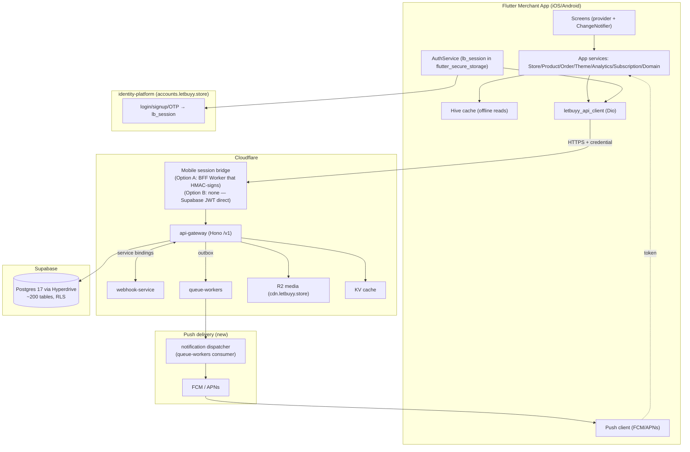

# MOBILE ARCHITECTURE V2 — Target Design, Workflows & Theme Editor

Covers Phases 6 (architecture), 7 (mobile-first commerce workflows), and 8 (theme editor strategy). Target infra: **Cloudflare + Supabase + Workers + Queues + API gateway** — the same backend the web app uses. **Assume the merchant never owns a laptop.**

---

## PART A — LetBuyy Mobile V2 Architecture

### A.1 Principles
1. **Thin native client over the single gateway.** No direct Postgres, no Firebase, no second backend. Business logic stays server-side.
2. **One identity, bridged for mobile.** Solve the gateway-auth mismatch once (§A.3).
3. **Shared contracts.** Deserialize `packages/dart/models` `*Contract` types; retire local model drift.
4. **Poll + pull-to-refresh now; realtime later.** The backend has no WS/SSE; design for it.
5. **Offline-aware reads.** `hive` is already a dependency in `core` — use it for cache, not as a source of truth.

### A.2 Layered architecture

### A.3 Authentication & session (the crux — pick one in P0)

The gateway's `authMiddleware` accepts **Supabase JWT** or **HMAC-signed internal headers**, not the app's raw `lb_session`. Options:

| | Option A — Mobile BFF Worker | Option B — Supabase JWT |
|---|---|---|
| Shape | New CF Worker holds `INTERNAL_API_SECRET`; app sends `lb_session`; BFF validates against `sessions` and re-signs internal headers to the gateway | Issue a real Supabase session for merchants; app sends `Authorization: Bearer <jwt>`; gateway validates via `supabase.auth.getUser` |
| Gateway change | None | None (Bearer branch already exists) |
| New infra | 1 Worker | Token-issuance flow + merchants in `auth.users` |
| Secret on device | None (good) | None (good) |
| Reconciles identity? | Keeps custom `sessions` canonical | Bridges custom ↔ Supabase Auth |
| Risk | Another hop/deployable | Two identity systems to keep in sync |
| **Recommendation** | **Default choice** — least disruptive, mirrors the web trusted-boundary model, keeps one canonical session store | Choose if you want to converge on Supabase Auth platform-wide |

**Session lifecycle (Option A):** login at identity (real Turnstile) → `lb_session` in `flutter_secure_storage` → every request to BFF → BFF injects `X-LetBuyy-Internal-Session-Token`+ts+sig → gateway resolves `sessions`→`users_custom`. Health probe: `GET /v1/auth/custom/session`. Honor 30-day TTL; refresh on use. Logout → `/sessions/destroy` + clear storage.

**Remove before production (either option):** hardcoded `turnstileToken:'dev-bypass-token'` and the dev-OTP signup path in `store_auth_service.dart`.

### A.4 Cross-cutting subsystems

| Subsystem | Target | Notes |
|---|---|---|
| **Session mgmt** | `flutter_secure_storage` (already used) for token; in-memory user; auto-restore on boot | exists; harden |
| **Caching** | Hive (in `core`) for last-known orders/products/store; cache-then-network | new; offline reads |
| **Offline support** | Read-only offline (view catalog/orders); queue mutations? defer — start read-only | hive |
| **File uploads** | `/v1/upload` → R2 → `cdn.letbuyy.store`; client-side compress (`flutter_image_compress` present) | exists |
| **Notifications/Push** | FCM (Android) + APNs (iOS) → `device_tokens` table → a `queue-workers` dispatcher consuming `/notifications` events | **new**, P1; device_tokens table already exists |
| **Analytics (product telemetry)** | Add Sentry or similar for crash/usage; consume `/analytics/dashboard` for business metrics (stop faking) | new |
| **Realtime** | None today → poll + pull-to-refresh; revisit when backend adds WS/SSE | design for poll |
| **Feature flags** | Read capability from server (gateway `FEATURE_*`), don't hardcode | — |
| **Navigation** | Keep Navigator 1.0 *or* adopt `go_router` for deep links (push → order, payment return) | decide P1 |
| **Multi-store** | Replace `getFirstStore()` with a store-context provider + switcher | P4 |
| **Config** | `--dart-define-from-file`; strip Supabase keys | exists; clean |

---

## PART B — Mobile-First Commerce Workflows

Each workflow is designed for a merchant with **only a phone**, and flags **web assumptions that break on mobile**.

### B.1 Store creation
- **Flow:** Splash → Login/Signup (real Turnstile/OTP) → Wizard (business type → channel → product type → category → name → subdomain availability → theme) → publish → "going live" animation → QR/share.
- **Status:** ✅ already built (`create_store_wizard.dart`); arguably better than web's redirect-to-accounts.
- **Mobile fix:** signup currently leaks `devOtp`; replace with real OTP delivery; ensure subdomain check (`GET /stores/public/{sub}`) handles slow networks.

### B.2 Configure store
- **Flow:** Settings tab → details, currency/language, policies, checkout prefs, notifications.
- **Breaks on mobile:** web's wide settings forms → use grouped sheets/sections; "Delete Store" needs a strong confirm.
- **Build:** policies, checkout, notifications screens over existing `/stores` PATCH + `/pages/policies`.

### B.3 Manage products
- **Flow:** Products tab → search/filter → create/edit (media from camera/gallery, variants, pricing, SEO) → save.
- **Status:** ✅ built. **Mobile win:** camera capture + on-device crop/compress (deps present).
- **Breaks:** variant *matrix* (web also incomplete) — design a mobile-friendly variant grid.

### B.4 Manage inventory
- **Flow:** Product → stock → adjust qty (+/- with reason); later: locations/transfers/PO receiving (barcode scan).
- **Status:** 🟠 viewer only. **Build:** adjust UI over `/inventory/adjust`; **leapfrog** web with WMS + barcode scanning (mobile-native).

### B.5 Order fulfillment
- **Flow:** Orders tab → status tabs → order detail → mark fulfilled + tracking → refund.
- **Status:** ✅ list/fulfill; 🟠 detail; ❌ refund. **Build:** rich detail screen + refund (`/orders/:id/refund`). **Mobile win:** push on new order; one-tap status.
- **Breaks:** bulk actions are easy on web tables; on mobile use multi-select mode.

### B.6 Customer support
- **Flow:** Customers → detail (orders, addresses, lifetime value) → contact (tel/email deep link).
- **Status:** 🟠 list only. **Build:** detail + addresses (backend ready — leapfrog web).

### B.7 Discounts & marketing
- **Flow:** Coupons CRUD + toggle; gift cards issue; reviews moderation.
- **Status:** 🟠 viewers. **Build:** coupon create/edit form; gift-card issue (needs mobile-safe contract).

### B.8 Analytics
- **Flow:** Home/Analytics → revenue, orders, AOV, top products, period selector.
- **Status:** 🟠 **faked**. **Fix:** consume `/analytics/dashboard` + `/analytics/orders` (retire client-side computation).

### B.9 Theme setup & customization → Part C.

### B.10 Domain setup
- **Flow:** Settings → Domains → subdomain (read) + custom domain → show DNS records → verify → SSL status.
- **Status:** 🟠 `DomainService` has `verifyDomain`/`setupCustomDomain`; UI thin. **Build:** copyable DNS records + verify button + status polling. **Breaks:** entering DNS on a phone is awkward — provide copy-to-clipboard + "email me these records".

### B.11 Payments & subscriptions
- **Flow:** Settings → Payments (connect Razorpay/COD/UPI); Plan → upgrade via Razorpay checkout.
- **Status:** ✅ config; **BROKEN** checkout (Razorpay TODO). **Build:** wire `razorpay_flutter` or a WebView checkout against `/payments/subscription/order` + `/verify`.

### B.12 Staff
- **Flow:** Settings → Users → invite/role/remove.
- **Status:** 🟠 viewer. **Build:** invite form + role picker over `/employees`. **Note:** enforce role gating client-side too (web doesn't — mobile should).

### General mobile-first principles
- **Sheets over modals**, tabs over sidebar, multi-select over bulk-checkbox tables, copy-to-clipboard for technical values, camera/scanner for input, push for time-sensitive events, optimistic UI + pull-to-refresh given no realtime.

---

## PART C — Theme Editor Strategy

The mobile app already ships a **strong on-device editor** (`section_editor_screen.dart` + native `preview_sections/*` + `device_frames/*`). Strategy = classify what's portable and lock the preview to the live engine.

### C.1 Current web editor (the target)
Sectioned editor (`online-store/themes/[themeId]/editor`, 1,891 LOC) + `theme-editor/*`: header/footer/template sections, blocks, **schema-driven settings forms** (`SchemaFormRenderer`), add-section modal, drag-reorder, visibility, theme settings, **versions/rollback**, **iframe live preview** via postMessage.

### C.2 Portability classification

| Capability | Class | Rationale |
|---|---|---|
| Browse/install/switch themes | **FULLY MOBILE** | already built (`theme_screen`) |
| Add / reorder / delete sections | **FULLY MOBILE** | built (drag, layers drawer) |
| Edit section settings via schema | **MOBILE ADAPTED** | generalize a schema-form renderer into sheets (mirror `SchemaFormRenderer`) |
| Block-level editing | **MOBILE ADAPTED** | `block_editor` exists; expand |
| Live preview | **MOBILE ADAPTED** | native renderers **or** WebView `/preview?theme_preview_token&settings_data_b64` |
| Device-frame preview (phone/tablet/laptop) | **FULLY MOBILE** (already a mobile strength) | `device_frames/*` |
| Draft save / discard / duplicate | **FULLY MOBILE** | `ThemeService` |
| Versions / releases / rollback | **MOBILE ADAPTED** | service supports; build list+rollback UI |
| Theme-level global settings | **MOBILE ADAPTED** | mirror `ThemeSettingsPanel` |
| Drag-precision layout, dense multi-panel editing | **DESKTOP ONLY** | small screens → use sheets + reorder handles, not 3-panel |
| Custom code / Liquid editing | **DESKTOP ONLY** | code editing is a laptop task; offer "edit on web" deep link |

### C.3 The critical risk — engine drift
The storefront renders **two engines in transition**: a legacy JSON-contract section system and a newer **Liquid** renderer (`theme-renderer.ts`, liquidjs). The repo even has **two draft stores** (`theme_editor_drafts` vs `theme_instance_drafts`). The mobile **native `preview_sections/*` renderers hand-mirror the React sections** — if the storefront moves to Liquid, the native preview **lies**.

**Decision required:** pick the canonical preview path.
- **Recommended:** **WebView preview against the real storefront `/preview`** (single source of truth, always correct), and treat the native `preview_sections` renderers as a fast *thumbnail*/offline approximation only — not the authoritative preview. This decouples mobile from engine churn.
- Keep native renderers for instant feedback while editing, but the "see it for real" button loads the WebView against the live engine with `theme_preview_token` + `settings_data_b64`.

### C.4 Recommended mobile theme-editing UX
1. **Theme tab:** library + active theme + "Customize".
2. **Editor:** vertical section list (drag handles) → tap section → settings **sheet** (schema-rendered) → live native thumbnail updates instantly.
3. **Preview button:** full-screen WebView against `/preview` (authoritative) with device-frame switcher.
4. **Save draft / publish / versions** in an app bar overflow.
5. **"Advanced / code" → deep-link to web editor** (don't attempt Liquid editing on phone).
