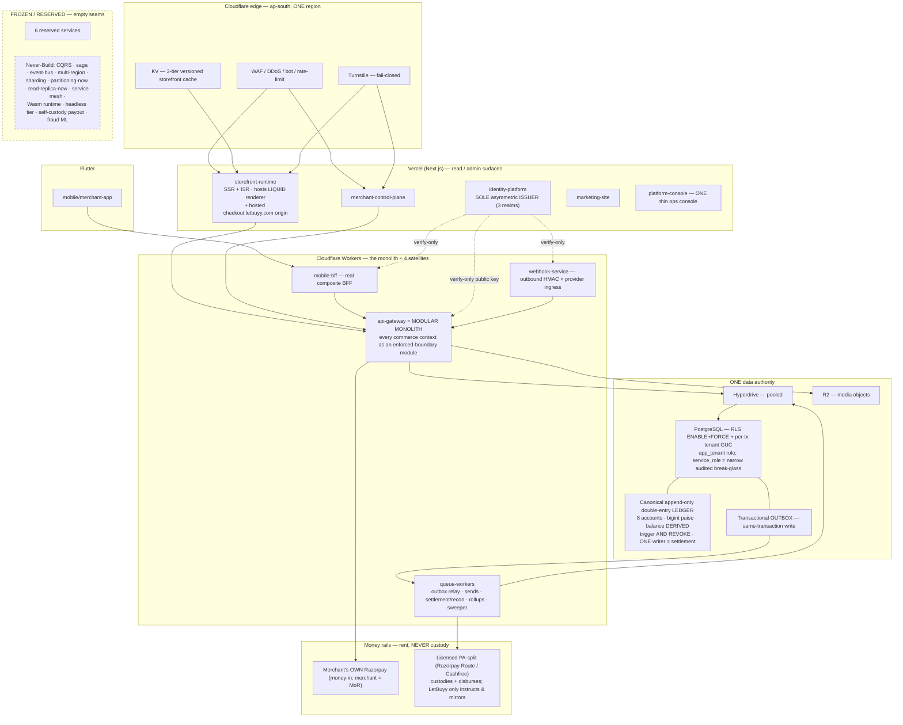

# 02 — The Governed Architecture (what current law requires)

> **RESEARCH — NOT AUTHORITY — NOT AN IMPLEMENTATION ORDER**
>
> This document *restates* current law for the purpose of testing conformance. Where it and the Constitution differ, the Constitution governs and this document is defective. It creates no obligation and changes nothing.
>
> Sources: `GOVERNANCE_REWRITE_2026_06_10/LETBUYY_CONSTITUTION.md` (DOC 01, ratified 2026-06-10), root `AGENTS.md` (DOC 02, `LETBUYY_AGENTS_V2`), `GOVERNANCE_REWRITE_2026_06_10/LETBUYY_CANONICAL_SYSTEMS.md` (DOC 03).
>
> **Every claim in this document has evidence state `GOVERNED`** — it states what law requires, *not* what the source implements. Conformance is tested in `03_CURRENT_ARCHITECTURE_AS_BUILT.md` and the gaps are registered in `05_DRIFT_AND_CONFLICT_REGISTER.md`.

---

## 1. The authority chain

| Rank | Document | Role | Changes by |
|---|---|---|---|
| 1 | `LETBUYY_CONSTITUTION.md` (DOC 01) | **Supreme.** Nothing overrides it. | ARB constitutional amendment (§14) at a named, evidenced trigger |
| 2 | root `AGENTS.md` (DOC 02) | Operating rules for every agent and engineer | Human ARB decision |
| 3 | `LETBUYY_CANONICAL_SYSTEMS.md` (DOC 03) | The winner registry — one true system per domain | ARB (DOC 01 §12.2.2) |
| 4 | `LETBUYY_LEGACY_ELIMINATION_MASTER_PLAN.md` + `LETBUYY_FOUNDATION_ROADMAP.md` (DOC 04/05) | How and when convergence happens | Ordinary review |
| 5 | `LETBUYY_UI_UX_GOVERNANCE.md` + surviving `docs/governance/*` (DOC 06) | Domain governance | Ordinary review |
| 6 | Evidence base (forensic + canonicalization archives) | **The "why", not authority** | — |

Two rules from this chain bear directly on this research packet:

- **DOC 01 P.3 item 6.** Where the Constitution and the evidence disagree on a *fact*, the **evidence governs the fact** and the Constitution must be amended. Where they disagree on *what is canonical*, the Constitution governs. This packet therefore may — and does — report facts that contradict constitutional prose, without that being insubordination.
- **DOC 02 `DOC-R1` / DOC 01 `ART-21` / `R-19`.** A generated document may **never** become authority. This packet is research output; it is explicitly not authority, and it does not modify `PROMPTS.md` or any governance file.

---

## 2. The scale envelope (constitutional constant)

> **India-only. Design for 100 → 1,000 → 10,000 merchants. NEVER optimize for 100,000+ or 1,000,000+.** — DOC 01 §6

- Top-of-envelope throughput: **~30,000 orders per month** (DOC 01 §6, citing FREEZE §8.1 / V1 §7).
- **Constitutional consequence:** *everything* is sized to this envelope. Any artifact — code, schema, validator, document, or topology manifest — that designs for 100,000+ merchants is **out of scope by constitutional rule, not by opinion**, and is void to the extent it does so.
- **Designing past this envelope requires a constitutional amendment under §14, justified by named, measured demand — never anticipation.**

`06_10M_WORKLOAD_DEFINITION.md` §5 Band G converts this envelope into engineering terms: **~20 origin requests per second at peak, one order every 22 seconds.**

---

## 3. The governed topology

### 3.1 The canonical 8 runtimes (`ARCH-R1`)

| # | Runtime | Kind | Governed role |
|---|---|---|---|
| 1 | `services/api-gateway` | Cloudflare Worker — **the modular monolith** | All commerce: auth, products, cart/checkout, orders, payments, inventory, discounts, GST, shipping, settlement, customers, themes, WhatsApp, notifications, billing, analytics-read |
| 2 | `services/queue-workers` | Worker (satellite) | Outbox relay, WhatsApp/email send, settlement & reconciliation, abandoned-cart, rollups, **stale-reservation sweeper** |
| 3 | `services/mobile-bff` | Worker (satellite) | A real composite/fan-in BFF (`/v1/dashboard`) for the Flutter app |
| 4 | `apps/identity-platform` | Issuer satellite | The **sole** asymmetric token issuer for all three realms |
| 5 | `services/webhook-service` | Worker (satellite) | Outbound webhooks (HMAC + dedupe) and provider callback ingress |
| 6 | `apps/storefront-runtime` | Vercel / Next.js | The one buyer runtime; hosts the Liquid renderer **and** the hosted `checkout.letbuyy.com` origin |
| 7 | `apps/merchant-control-plane` | Vercel / Next.js | The merchant web OS (operator-first IA) |
| 8 | `apps/marketing-site` | Vercel / Next.js | Public marketing/pricing (no auth pages) |

*Plus supporting, non-extractable surfaces:* `apps/mobile/merchant-app` (Flutter) and **one** thin ops console, `apps/platform-console` (`ARCH-R10`).

- **`ARCH-R2`** — MUST NOT add, deploy, or wire any runtime not in this list. A new runtime root requires a Constitution amendment + ARB approval + DOC 03/04 updates **before source is created.**
- **`ARCH-R3`** — MUST NOT extract any domain into its own microservice. Extraction is reversible only at a **named, measured scale trigger** under human approval.

### 3.2 Reserved services stay empty (`ART-19`, `ARCH-R4/R5/R6`, `R-16`)

Six services MUST remain **manifest-only / empty**:
`services/checkout-runtime` · `services/event-bus` · `services/notification-service` · `services/analytics-pipeline` · `services/media-service` · `services/search-service`

Plus two reserved mobile roots: `apps/mobile/shopper-app` · `apps/mobile/operator-app`.

MUST NOT add source, tests, or deploy config to any of them, and MUST NOT declare any of them `environment:"production"` in any topology file.

### 3.3 Frozen surfaces (`ART-22`, `ARCH-R10`)

`apps/app-marketplace` and `apps/developer-portal` are **frozen and de-deployed**, with the OAuth2/PKCE seam kept; reopened only at **≈5,000 merchants + inbound developer demand**. `apps/platform-operations-portal` is the fold-then-delete loser to `apps/platform-console`. `apps/theme-marketplace` machinery is canonical with a dormant catalog by design (DOC 03 §3.10).

### 3.4 Deprecated aliases — never active topology (`ARCH-R10`)

`apps/admin` · `apps/auth` · `apps/checkout` · `apps/internal` · `apps/merchant` · `apps/storefront` · `apps/analytics` · `apps/mobile/operator-team-app` · `apps/storefront-runtime/consumer-storefront`

### 3.5 Governed topology diagram

---

## 4. The 23 Constitutional Rules (the testable invariants)

These are DOC 01 §13 verbatim in substance. The right-hand column names how this packet tests each.

### Tenancy

| Rule | Requirement | Tested in |
|---|---|---|
| **R-1** (MUST) | Every tenant table has RLS `ENABLE`+`FORCE` and a per-transaction tenant-GUC policy; unset/wrong GUC ⇒ **zero rows** | `03` §data, `08` |
| **R-2** (MUST-NOT) | No tenant query under a `BYPASSRLS` / blanket `service_role` connection | `03` §data |
| **R-3** (MUST-NOT) | No `USING(true)` policy to PUBLIC/anon/authenticated; no anon write to tenant or ownership columns | `03` §data, `05` |
| **R-4** (MUST) | Tenant GUC set only from a **validated asymmetric claim**, never an unvalidated parameter | `03` §identity |

### Money

| Rule | Requirement | Tested in |
|---|---|---|
| **R-5** (MUST) | Append-only double-entry with **derived** balance; every capture/refund/COD/tender posts idempotently | `03` §commerce |
| **R-6** (MUST-NOT) | No mutable balance as truth; no `UPDATE`/`DELETE` of a posted entry; **exactly one** ledger writer | `03` §commerce |
| **R-7** (MUST-NOT) | **Never custody.** Money moves only via licensed PA-split; no self-custody rail | `03` §commerce, `08` |
| **R-8** (MUST) | `bigint` minor units (paise) on every path; never int32, never float | `03` §data |
| **R-9** (MUST) | `commission_bps = 0`; no GMV/transaction fee on any paid tier | `03` §commerce |
| **R-10** (MUST) | Second factor on refund/payout is **real cryptography**, not a forgeable check | `03` §commerce, `08` |

### Commerce

| Rule | Requirement | Tested in |
|---|---|---|
| **R-11** (MUST) | Orders created **only** via the server-authoritative checkout flow behind a **cart-bound signed handoff**; inventory uses reserve-with-TTL, not pre-payment hard-decrement | `03` §commerce |
| **R-12** (MUST-NOT) | No third-party / extension / Wasm code executes in the live checkout or storefront path | `03` §commerce |
| **R-13** (MUST-NOT) | No consent-gated message without a consent record; the gate **fails closed** | `03` §async, `08` |

### Identity

| Rule | Requirement | Tested in |
|---|---|---|
| **R-14** (MUST) | `identity-platform` is the **sole** token issuer, asymmetric sole-signer; every other service verify-only; **no shared symmetric signing secret** | `03` §identity, `05` |

### Architecture / single source of truth

| Rule | Requirement | Tested in |
|---|---|---|
| **R-15** (MUST) | **Exactly one** canonical system per domain (one ledger, one canonical renderer, one auth issuer, one storefront runtime, one token source, one app shell, one ops console) | `05` |
| **R-16** (MUST-NOT) | No reserved service deployed or declared `production`; events flow through a **same-transaction outbox**, not an event bus | `03` §topology, `03` §async |
| **R-17** (MUST-NOT) | Nothing on the Never-Build List built, activated, or designed for; nothing designed for 100,000+/1,000,000+ merchants | `05`, `11`, `15` |

### Governance / operations

| Rule | Requirement | Tested in |
|---|---|---|
| **R-18** (MUST) | The validator suite enforces **this** Constitution; a green gate means "conforms"; no validator certifies a forbidden capability; no green build coexists with a known un-waived S0 | `03` §tests |
| **R-19** (MUST-NOT) | No generated document declares topology, architecture, or scale as law | `05` |
| **R-20** (MUST) | Deployment from the canonical branch; the branch-lag guard stays green | `03` §deploy, `04` |
| **R-21** (MUST-NOT) | No secret committed; live paths gated `[HUMAN-REQUIRED]`; every external provider defaults to **mock** | `03` §deploy, `08` |
| **R-22** (MUST) | Every money/fulfilment surface carries a truthful provider-mode honesty badge; **a stub MUST NEVER read as `success`** | `03`, `08` |
| **R-23** (MUST) | Every migration ships a **paired rollback**; nothing load-bearing deleted before its winner is live and a zero-drift / zero-importer proof passes; no migration regresses accessibility | `03` §data, `05` |

---

## 5. The Never-Build List (DOC 01 §10) — constitutional prohibition

Each item is a **frozen seam** or **deleted dead weight**, reopened **only** at its named trigger under human approval — never by an agent or a default.

| # | Forbidden capability | Named reopen trigger |
|---|---|---|
| 1 | A 22-service / microservice-per-domain fleet | A **measured** hot-path or team boundary forces extraction of **one specific module**, with ARB sign-off — never a wholesale fleet |
| 2 | CQRS / event-sourcing / saga / replay / projection engine | **Not in this envelope** |
| 3 | Multi-region | A data-residency mandate, **or** 10,000+ with genuinely global merchants |
| 4 | Sharding / partitioning **now** | Sustained table growth makes vacuum/query latency bite near ~1k–10k merchants; the partition helper seam exists, **disabled** |
| 5 | Service mesh | Not in this envelope (~5 processes, not 30) |
| 6 | Self-custody payout / disbursement engine | **Never** in this envelope — moving money in India requires a PA/PG licence |
| 7 | Cross-merchant wallet / Shop-Pay-style vault | Millions of buyers |
| 8 | Third-party app marketplace + checkout extensions + Wasm runtime | ≈5,000 merchants + inbound developer demand; keep the OAuth2/PKCE seam |
| 9 | Headless Hydrogen/Oxygen storefront tier | A revenue-bearing headless-merchant need |
| 10 | Fraud ML | 10,000+ with order history; until then COD-confirm heuristic + RTO gate |
| 11 | Full in-WhatsApp checkout / commerce stack | Order-lifecycle + COD-confirm shipped, adopted, **and** the consent ledger proven |
| 12 | Any GMV / transaction fee | A **business re-ratification** under §14 |
| 13 | Filling any of the six reserved services | A proven hot-path forces extraction of that specific capability, with ARB sign-off |

> **The one-line constitutional rule (DOC 01 §10):** *if a thing imitates Shopify's end-state and no beta merchant would notice its absence, it is forbidden until a named trigger fires.*

### 5.1 Which Never-Build items a 10M workload would touch

This is the constitutional-conflict surface for the founder's question. Detailed in `15_ARB_AMENDMENT_PACKET.md`.

| Band (from `06`) | Never-Build items engaged | Amendment class |
|---|---|---|
| **Band G** (governed) | none | none |
| **Band A** (~100k online) | none — vertical scaling and cache tuning are Class-C implementation | **none required** |
| **Band B** (~1M online) | **#4** (read-replica-now is explicitly out of envelope per §6) | Constitutional amendment (envelope + §6 phrase "no read replica-now") |
| **Band C** (~10M online) | **#3, #4**, possibly **#1** | Constitutional amendment — envelope, Never-Build 3 & 4 |
| **Band D** (10M active) | **#1, #2, #3, #4, #5** | Wholesale re-ratification — effectively a new Constitution |
| **Band E** (hot-SKU skew) | **none** — admission control and per-SKU sharding of a *counter* are implementation, not topology | **none required** ⚠️ *important: the most likely real failure needs no amendment* |

---

## 6. The winner registry (DOC 03) — one system per domain

Condensed from `LETBUYY_CANONICAL_SYSTEMS.md` §2. The "loser" column is what must be frozen then deleted under DOC 04's gates. Conformance is tested in `05_DRIFT_AND_CONFLICT_REGISTER.md` §A.

| Domain | Canonical winner | Named loser(s) |
|---|---|---|
| Topology / Deployment | Modular monolith + 4 satellites; `main` is the deploy branch | 9-app topology; CQRS package cluster; 3 staging workflows; branch lag |
| Identity | `apps/identity-platform` — sole issuer, 3 realms | gateway `routes/auth.ts`; `identity-foundation` shadow; Supabase `/auth/*`; 6 identity micro-packages |
| Sessions | One identity-platform session service — single revocation authority | 4 per-app hand-rolled session libs; gateway mint authority; `sessions_v2` |
| Tenant isolation | 3-layer fail-closed; **RLS+FORCE+GUC is load-bearing** | 6 `USING(true)`→PUBLIC policies; anon `super_admin_allowlist`; `store_id`≡`site_id` |
| Payments | Single capture adapter posting the canonical ledger | legacy `confirm_order_payment_with_ledger`; `payment_transactions` dual row; forgeable step-up |
| Ledger | Canonical 8-account append-only double-entry ledger | 4 compat "ledger" tables; mutable balances; int32/numeric money columns |
| Settlement | PA-split mirror; never custody; settlement = single writer | hardcoded `razorpayx` self-custody rail |
| Orders | The one server-side `create_checkout_order` RPC | `orders.items` JSONB; `orders.store_id`; numeric amount columns |
| Checkout | **Hosted `checkout.letbuyy.com` origin + cart-bound signed handoff** (BUILD) | client React cart → thin view; Wasm checkout-extensions in the payment route |
| Cart | Server-authoritative cart | client-only React cart |
| Inventory | Single reserve→commit lifecycle + **scheduled** sweeper | direct-decrement side doors |
| Discounts | Typed 3-class `combines_with` engine (ACTIVATE) | scalar single-code RPC |
| Theme runtime | **Liquid / portable-theme renderer** | React section-registry renderer → **FROZEN, explicitly NOT deleted for completeness** |
| Theme engine | `@letbuyy/theme-engine` — one schema, one draft spine, one compose path | storefront `RUNTIME_SECTION_SCHEMAS`; storefront compose fork; `theme_editor_drafts` |
| Storefront runtime | ONE `storefront-runtime` + the 3-tier KV-versioned cache | `runtime-composition` (unwire, then delete); headless tier (frozen) |
| Events | Transactional outbox, **same-transaction write** | `event-bus` frozen-empty; CQRS/projection/saga cluster DEAD |
| Design system | ONE token source → generated Dart bridge; ONE `AppNavigation` shell; systemic `ProviderModeBadge` | 3 token sources; 4 mobile colour classes; 8 hand-rolled shells |
| Infrastructure | One RLS Postgres (ap-south) + Cloudflare Workers + Vercel; `letbuyy.com` canonical | `letbuyy.store` literals; k8s/Helm; `legacy/firebase`; fabricated `production-topology.json` |
| Ops console | `apps/platform-console` | `apps/platform-operations-portal` (fold, then delete) |

---

## 7. Decision classes — who may decide what (DOC 01 §11)

This governs every recommendation in `14`, `15`, and `16`.

| Class | Scope | Who decides |
|---|---|---|
| **A — Constitutional** | Alters an Article, the authority hierarchy, **the scale envelope**, the Never-Build List, a Constitutional Rule, or a canonical winner | **ARB amendment under §14 only.** No agent, no engineer alone. |
| **B — Operative** | Governed by DOC 02/03 without altering §9/§10/§13 — how a canonical system is implemented, a validator's logic, roadmap sequencing, resolving an UNVERIFIED item | ARB review where it touches a canonical contract or go-live gate |
| **C — Implementation** | Routine engineering inside an already-canonical system that conforms | An agent or engineer alone, provided it conforms to every Article and Rule, builds nothing on the Never-Build List, does not design past the envelope, and passes the validator suite |

**The default rule (§11.3):** when in doubt about the class, **treat it as the higher class and escalate.**

### 7.1 The seven things an agent must never decide alone (§11.2)

1. Build, activate, or design for anything on the Never-Build List or past the envelope.
2. Introduce a **second canonical system** for any domain.
3. Change a permanent decision (§9) or a Constitutional Rule (§13).
4. Promote a generated document to operative authority.
5. Reopen a frozen capability or fill a reserved service.
6. Resolve an `UNVERIFIED` item by silently upgrading it to fact.
7. Deploy, delete a load-bearing system, or relax a go-live gate in violation of ART-03 / ART-24.

---

## 8. Items the Constitution itself carries as `UNVERIFIED` (§14.4)

These are **not settled fact** and must not be treated as such. Each is revisited in `05_DRIFT_AND_CONFLICT_REGISTER.md` §D with a statement of exactly what access would resolve it.

1. **The six anon RLS-to-PUBLIC table GRANTs** are set by Supabase's managed bootstrap, not repo SQL — confirm live state with an anon-key probe / `\dp public.orders` before final S0 sign-off.
2. **The final ARB signature for the ops-console survivor** (`SKIP-GATE-OPS-SURVIVOR-ARB`) is a human seam; the repository survivor is fixed as `apps/platform-console`.
3. **Full RLS/FORCE coverage per tenant table**, and the live writers of the "product-dead" tables, need **live database introspection** before any DROP.
4. **Live deployment state of every "complete" wave is ~0%** until the deploy meta-blocker clears — *completion-% measures the working tree, not production.*

> **Item 4 is the single most important sentence in the governance corpus for this research packet.** It is the Constitution's own statement that repository completeness is not production truth — which is precisely why `03_CURRENT_ARCHITECTURE_AS_BUILT.md` and `04_LIVE_DEPLOYMENT_TRUTH.md` are kept strictly separate and never merged.

---

## 9. What "governed" does and does not prove

| Statement | What it proves | What it does **not** prove |
|---|---|---|
| "The Constitution requires RLS FORCE on every tenant table" | An obligation exists | That any table has it |
| "DOC 03 names Liquid the canonical renderer" | Liquid is the winner | That Liquid renders anything, or that React has been frozen |
| "`ARCH-R4` requires reserved services to be empty" | An obligation exists | That they are empty |
| "The envelope is 10,000 merchants" | Design authority is bounded | That the system can serve 10,000 merchants |
| "The Never-Build List forbids partitioning-now" | A prohibition exists | That no partitioning machinery is scheduled |

Everything in this document is `GOVERNED`. Nothing in it is evidence about the code. That separation is the whole method of this packet.
