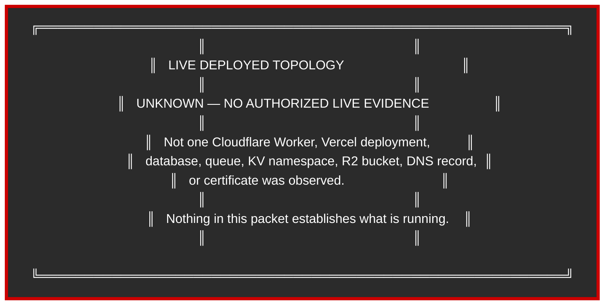

# 04 — Live Deployment Truth (a gap register, not a description)

> **RESEARCH — NOT AUTHORITY — NOT AN IMPLEMENTATION ORDER**
>
> Audited commit `5af69e0c080503765dec361eae2128ba860cf529` · branch `stepup/main` · 2026-08-16.

---

## 1. The finding that governs this entire document

> **No authorised live provider, runtime, or database access was available for this study. Therefore nothing in this packet is `VERIFIED-LIVE`, and no statement about what LetBuyy is *currently running in production* can be made.**

This is not a hedge. It is the honest boundary of the evidence, and it is exactly the position the Constitution itself takes:

> *"Live deployment state of every 'complete' wave is ~0% until the deploy meta-blocker clears — **completion-% measures the working tree, not production**."*
> — `LETBUYY_CONSTITUTION.md` §14.4, item 4

Accordingly this document does **not** describe the live estate. It enumerates precisely **what is unknown, why, and what single action would resolve each item.** Everything below is `UNKNOWN` or `HUMAN-REQUIRED` unless explicitly marked otherwise.

---

## 2. The live topology diagram

This diagram is deliberately not merged with the governed diagram (`02` §3.5) or the as-configured diagram (`03`). Merging them is the specific failure mode the Constitution names **governance theater** (DOC 01 §5.5, `ANTI-R3`): presenting configuration as production truth.

---

## 3. Why configuration cannot substitute for live evidence

The repository contains a large amount of material that *reads* like deployment truth and is not. Each row below is a trap this packet declines to fall into.

| Artefact | What it actually is | What it is **not** |
|---|---|---|
| `config/runtime/production-topology.json` | A governance contract, hand- or tool-maintained | A record of deployed resources |
| `config/runtime/cloudflare-topology.json` | Self-labelled `governance-contract-not-live-evidence` | Live binding state |
| `config/runtime/live-production-certification.json` | A schema + policy for what certification *would* assert | A certification that has run |
| `services/*/wrangler.toml` `env.production` blocks | Declared intent for a `wrangler deploy` | Proof any deploy succeeded |
| Committed resource IDs (D1 `76d197a5…`, KV, Hyperdrive) | Evidence a resource was **created at some point** | Evidence it is bound, used, or current |
| `.github/workflows/production-deploy.yml` | A pipeline definition | A pipeline **run** |
| "110/110 validators pass" | A claim about a structural gate | Behaviour, deployment, or production health |
| A file named `production-*` | A filename | Anything at all |

> **The strongest live-adjacent signal in the repository** is the set of committed provider resource identifiers (the D1 `database_id`, the KV namespace id, the Hyperdrive id). These are `VERIFIED-CONFIG` and they make it *likely* a Cloudflare account exists with resources provisioned at some past date. They do **not** establish that the current `wrangler.toml` has ever been deployed, nor which code version is serving.

---

## 4. The live-evidence gap register

Each item states the question, why it is unresolvable from source, and the **single** read-only action that would settle it.

### 4.1 Deployment state

| ID | Question | Resolving action | Access needed |
|---|---|---|---|
| L-01 | Which Worker script versions are live for `letbuyy-api`, `letbuyy-queue-workers`, `letbuyy-mobile-bff`, `letbuyy-webhook`? | `wrangler deployments list` per worker, or `GET /accounts/{id}/workers/scripts` | Cloudflare API token, **read-only** |
| L-02 | Do the live Worker bindings match `wrangler.toml` `env.production`? | `GET /accounts/{id}/workers/scripts/{name}/bindings` | same |
| L-03 | Which Vercel projects exist, and what commit is each production deployment on? | `GET /v9/projects` + `GET /v6/deployments` | Vercel read token |
| L-04 | Is `checkout.letbuyy.com` resolvable and serving? (`ART-14` hosted origin) | DNS lookup + `HEAD https://checkout.letbuyy.com` | none — **this one is free** |
| L-05 | Are `app-marketplace` / `developer-portal` deployed? (`ART-22` violation if yes) | Vercel project list; DNS for their hostnames | Vercel read token |
| L-06 | Has `production-deploy.yml` ever completed successfully, and when? | `gh run list --workflow=production-deploy.yml` | repo access — **available to the founder now** |
| L-07 | Do the six reserved services have any deployed artefact? | Cloudflare script list ∩ reserved names | Cloudflare read token |

> **L-04 and L-06 require no new credentials and would materially improve this packet.** They are the two highest-value, lowest-cost live probes available and are listed first in `17_OPEN_QUESTIONS_AND_HUMAN_ACTIONS.md`.

### 4.2 Database state — the items the Constitution itself flags `UNVERIFIED`

| ID | Question | Resolving action | Constitution reference |
|---|---|---|---|
| L-10 | Are the six anon RLS-to-PUBLIC GRANTs live? | `\dp public.orders` and an anon-key probe against `orders`, `store_customers`, `sites`, `products`, `billing`, `subscriptions` | §14.4 item 1 |
| L-11 | What is the real RLS `ENABLE`/`FORCE` coverage per tenant table? | `SELECT relname, relrowsecurity, relforcerowsecurity FROM pg_class …` | §14.4 item 3 |
| L-12 | What policies actually exist? | `SELECT * FROM pg_policies` | §14.4 item 3 |
| L-13 | Which "product-dead" tables have live writers? | `SELECT relname, n_tup_ins, n_tup_upd, n_tup_del FROM pg_stat_user_tables` | §14.4 item 3, `DEL-R5` |
| L-14 | Does the gateway connect as `service_role` or `app_tenant` in production? | `SELECT usename, count(*) FROM pg_stat_activity GROUP BY 1` | `R-2`, `SEC-R9` |
| L-15 | Which migrations have actually been applied? | The migration bookkeeping table vs `database/supabase/migrations/` | `R-23` |
| L-16 | Actual Supabase compute tier, connection ceiling, disk, IOPS | Supabase project settings (read) | `07`, `10` |

**Access needed for L-10…L-15:** one read-only PostgreSQL role. This is the **single highest-value credential** for closing this packet's gaps — it resolves six items including three the Constitution has carried as `UNVERIFIED` since 2026-06-10.

### 4.3 Runtime behaviour and capacity

| ID | Question | Why it is unresolvable from source | Resolving action |
|---|---|---|---|
| L-20 | What is the real cache hit ratio by route class? | No cache-hit telemetry is emitted (see `03` §observability) | Instrument, then read Analytics Engine |
| L-21 | What is p50/p95/p99 latency per surface? | No latency telemetry sink is connected | Cloudflare Analytics + Vercel Analytics |
| L-22 | What is the actual KV write rate? | Not emitted | Cloudflare KV analytics — **critical for the rate-limiter ceiling, see `07`** |
| L-23 | What is real queue depth and drain rate? | Not emitted | Cloudflare Queues dashboard/API |
| L-24 | What are real Postgres connection counts, lock waits, and slow queries? | Not observable from source | `pg_stat_activity`, `pg_stat_statements`, `pg_locks` |
| L-25 | Is there any production traffic at all? | Unknowable | Any request-count metric |

> **L-25 is not a rhetorical item.** The Constitution states LetBuyy has **zero production merchants** (§3.7, `WIN-R1`). If that is still true, then every "production" concern in this packet is *prospective*, and the correct posture is to fix the foundation before traffic — which is materially easier and cheaper than fixing it after. `HUMAN-REQUIRED`: confirm whether any real merchant or buyer traffic exists today.

### 4.4 Provider and secret state

| ID | Question | Resolving action |
|---|---|---|
| L-30 | Which of the required secrets are actually set in each environment? | `wrangler secret list` per worker; Vercel env var list (names only, **never values**) |
| L-31 | Is Upstash provisioned? (drives the rate-limiter ceiling) | Check for `UPSTASH_REDIS_REST_URL` presence — **name only** |
| L-32 | Are Razorpay/Shiprocket/WhatsApp/ESP credentials live or sandbox? | Provider dashboards; config declares `sandbox` for AI and WhatsApp (`VERIFIED-CONFIG`) |
| L-33 | Is a KMS key provisioned for the asymmetric issuer? (`ART-05`) | Provider console |
| L-34 | Do custom domains resolve, and how many are attached? | DNS + Vercel domain list — **drives a hard platform ceiling, see `10`** |

---

## 5. What *can* be said, and at what strength

| Statement | Evidence state | Basis |
|---|---|---|
| The repository declares a production Cloudflare Worker `letbuyy-api` with KV, R2, Hyperdrive, D1, a Durable Object, 5 queue producers, a `WEBHOOK_SERVICE` service binding, an Analytics Engine dataset, and a `*/15 * * * *` cron | `VERIFIED-CONFIG` | `services/api-gateway/wrangler.toml:218-345` |
| Production feature flags set `FEATURE_GRAPHQL=false`, `FEATURE_EXTENSIONS=false`, `FEATURE_LIQUID=false` | `VERIFIED-CONFIG` | `wrangler.toml` `env.production.vars` |
| Production routes rate limiting to a **Cloudflare KV fallback** because Upstash is not provisioned | `VERIFIED-CONFIG` (flag + committed comment) | `wrangler.toml`; `evidence/03-rate-limiter-backend.txt` |
| Provider modes for AI and WhatsApp are declared `sandbox`, with `SKIP_NEEDS_HUMAN_*` placeholders for credentials | `VERIFIED-CONFIG` | `wrangler.toml` `env.production.vars` |
| `PRIMARY_REGION = "ap-south-1"` — one India region | `VERIFIED-CONFIG` | same |
| `main` and `stepup/main` are **identical** (`git rev-list --left-right --count` returns `0 0`) — the ART-03 branch-lag meta-blocker is **closed at this SHA** | `VERIFIED-SOURCE` | `evidence/00-preflight.txt` |
| Anything about what is *serving traffic* | `UNKNOWN` | — |

> **The branch-lag result deserves emphasis.** ART-03 named the ~30-commit lag between `main` and the fix branch as *the keystone meta-blocker* — the reason every remediation was undeployable and every "complete" wave was "~0% live." At this SHA that lag is **zero**. The pipeline's structural precondition for shipping is satisfied. Whether it has *shipped* is L-06, and is answerable today from the GitHub Actions run history without any new credential.

---

## 6. Priority order for closing the live-evidence gap

Ranked by (value of the answer) ÷ (cost of obtaining it).

| Rank | Action | Cost | Resolves |
|---|---|---|---|
| 1 | `gh run list --workflow=production-deploy.yml --limit 20` | Zero — repo access already exists | L-06, and by inference much of §4.1 |
| 2 | `curl -I https://checkout.letbuyy.com` + DNS lookup | Zero | L-04 — settles whether the `ART-14` hosted origin exists |
| 3 | Confirm whether any real merchant/buyer traffic exists | One founder sentence | L-25 — **reframes the urgency of everything else** |
| 4 | Provision one **read-only** PostgreSQL role | Minutes | L-10…L-15 — closes three long-standing constitutional `UNVERIFIED` items |
| 5 | Provision a **read-only** Cloudflare API token | Minutes | L-01, L-02, L-07, L-22 |
| 6 | Provision a **read-only** Vercel token | Minutes | L-03, L-05, L-34 |
| 7 | Wire the already-declared `RUNTIME_TELEMETRY` Analytics Engine dataset | Hours of work | L-20…L-23 — the capacity model's missing inputs |

Items 1–3 cost essentially nothing and would upgrade a meaningful fraction of this packet from `UNKNOWN`. They are carried into `17_OPEN_QUESTIONS_AND_HUMAN_ACTIONS.md` as the first three human actions.

---

## 7. Standing rule for this packet

Any statement elsewhere in this packet that appears to describe production behaviour is either (a) explicitly marked `VERIFIED-CONFIG` or `VERIFIED-SOURCE` and therefore describes *the repository*, or (b) a defect in that document. Where the two conflict, this document governs: **there is no live evidence.**
