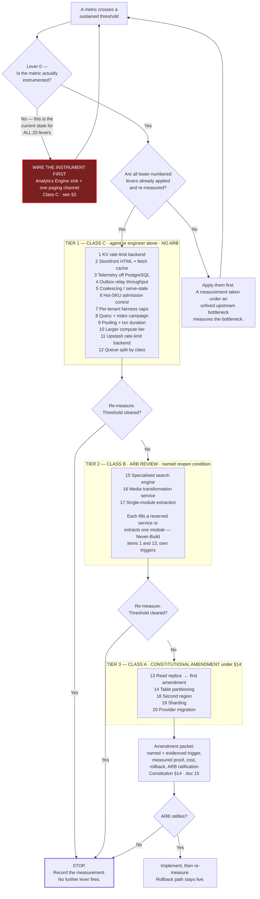

# 12 — Trigger-Based Evolution Ladder

> **RESEARCH — NOT AUTHORITY — NOT AN IMPLEMENTATION ORDER**
>
> Audited commit `5af69e0c080503765dec361eae2128ba860cf529` · branch `stepup/main` · 2026-08-16.

---

## 1. The rule, and the headline

The Constitution already requires this discipline. An amendment "MUST cite a **named, evidenced trigger** … Anticipation, elegance, or 'to be ready' are not valid triggers" (`GOVERNANCE_REWRITE_2026_06_10/LETBUYY_CONSTITUTION.md:434`, `GOVERNED`). This document extends the same rule *below* the constitutional line: no lever fires — not even a Class-C one — without a named metric, a sustained threshold, a window, a user-visible symptom, and a rollback.

Three statements govern everything below.

> **1. Levers 1–12 are Class-C implementation. Not one of them requires ARB approval, an amendment, a new runtime, a new service, or a new provider.** They are engineering inside already-canonical systems (`LETBUYY_CONSTITUTION.md:339`). `07_CAPACITY_MODEL.md` §4 ranks 1–8 the same way, and §5 concludes that clearing them plausibly carries the platform to Band A — roughly 100× its own ratified envelope.
>
> **2. Levers 13, 14, 18, 19 and 20 require a Class-A constitutional amendment.** Read replicas, partitioning, multi-region and sharding are named forbidden in one sentence of §6 (`LETBUYY_CONSTITUTION.md:112`); a provider migration alters the Infrastructure canonical winner, which §11.1 places in Class A (`:337`). Levers 15, 16 and 17 require **ARB review** because they fill a reserved service or extract a module — reopen conditions the Never-Build List itself names (`:311`, `:322`).
>
> **3. The trigger variable is never merchant count.** `07` §4's bottleneck order proves it: the first bottleneck binds at approximately **two concurrent requests sharing one rate-limit key**, and the last binds at Band C. Merchant count correlates monotonically with neither. `06_10M_WORKLOAD_DEFINITION.md` §2.1 (input M-2) puts the share of merchants receiving traffic at peak somewhere between 5% and 40% — an unknown that alone breaks any merchant-count trigger.

---

## 2. Authority classification — the whole ladder on one page

| # | Lever | Bottleneck rank in `07` §4 | Authority class | Constitutional basis |
|---|---|---|---|---|
| 1 | Replace the KV rate-limit backend (sharded DO or CF Rate Limiting binding) | 1 | **Class C — implementation** | Inside the canonical gateway; no Never-Build item engaged (`:339`) |
| 2 | Restore storefront HTML + fetch caching | 2 | **Class C** | Canonical storefront + KV-versioned cache (`:260` keeps the cache canonical) |
| 3 | Move telemetry writes off PostgreSQL to Analytics Engine | 3 | **Class C** | Binding already declared; *reduces* a live Never-Build breach (see §7.2) |
| 4 | Raise outbox relay throughput | 4 | **Class C** | Two config values |
| 5 | Request coalescing / serve-stale in the Worker cache | 5 | **Class C** | Code-local, no governance requirement either way |
| 6 | Hot-SKU admission control / sharded counters | 6 | **Class C** | `02_GOVERNED_ARCHITECTURE.md` §5.1: Band E engages **no** Never-Build item |
| 7 | Per-tenant fairness caps in the four claim RPCs | 7 | **Class C** | One paired migration (R-23) |
| 8 | Query and index optimisation campaign | 8 | **Class C** | Routine engineering |
| 9 | Connection pooling and transaction-duration discipline | 8 | **Class C** | Routine engineering |
| 10 | Larger Supabase compute tier | 8 | **Class C** | Buying a tier is not a topology change |
| 11 | Dedicated rate-limit backend (Upstash), if chosen over the DO route | 1 | **Class C** | Code path already exists (`rateLimit.ts:850`, `:912`) |
| 12 | Queue split by workload class | — | **Class C** | A queue binding is not a runtime; `ARCH-R2` not engaged |
| 13 | **Read replica** | 9 | **Class A — constitutional amendment** | "no read replica-now" (`:112`) |
| 14 | **Table partitioning** | 11 | **Class A — constitutional amendment** | Never-Build #4 (`:316`) |
| 15 | Specialised search engine | — | **Class B — ARB review** | Fills `services/search-service`; Never-Build #13 (`:322`) |
| 16 | Media transformation service | — | **Class C** for the Cloudflare-Images path; **Class B — ARB** if it fills `services/media-service` | Never-Build #13 (`:322`) |
| 17 | Targeted single-module extraction | — | **Class B — ARB** into a reserved service; **Class A** if it creates a new runtime root | Never-Build #1 (`:311`); `ARCH-R2` |
| 18 | **Second region** | — | **Class A — constitutional amendment** | Never-Build #3 (`:315`) |
| 19 | **Sharding** | 11 | **Class A — constitutional amendment** | Never-Build #4 (`:316`) |
| 20 | **Provider migration (e.g. to AWS)** | — | **Class A — constitutional amendment** | Alters a canonical winner (`:337`) |

All rows: `GOVERNED` for the authority column; the rank column is `INFERRED` over `VERIFIED-SOURCE` inputs per `07_CAPACITY_MODEL.md` §4.

**§11.3 default applies throughout** (`LETBUYY_CONSTITUTION.md:354`): when the class of a specific change is unclear, treat it as the higher class and escalate.

---

## 3. The blocking prerequisite: none of these triggers can be measured today

This is the most important section of this document, and it is not a caveat — it is a gate.

> **Lever 0 — instrument before you escalate.** Every `CURRENT VALUE` cell in §5–§7 is `UNKNOWN`. Not because the audit was lazy, but because **no metric pipeline exists that could produce one**, and no authorised live access was available (`04_LIVE_DEPLOYMENT_TRUTH.md` §1).

What actually emits, and where it goes:

| Signal | Emitted? | Read by anything? | Evidence |
|---|---|---|---|
| Analytics Engine data points (`RUNTIME_TELEMETRY`) | Yes, one per request | **No.** Nothing outside `packages/lcis-adapters` reads the dataset, and that adapter states its own values are NOT CONNECTED | `services/api-gateway/src/middleware/observability.ts:254-263`; `services/api-gateway/wrangler.toml:341`; `evidence/11-discovery-digest.md` observability narrative |
| Structured console logs | Yes | Cloudflare Workers Logs, at **10% head sampling**, short retention | `evidence/02-api-gateway-wrangler-production.txt` (`head_sampling_rate = 0.1`) |
| Prometheus / Grafana / OTel metrics | **No.** The declared alert rules fire on metric names with **zero emitters** repo-wide; the collector targets a Kubernetes cluster that exists nowhere in the repo | — | `evidence/11-discovery-digest.md` observability narrative |
| Incident paging | Emitted as a **hardcoded dry run** — no human is ever notified | Database rows only | `services/queue-workers/src/incident-command.ts:94-127` (`VERIFIED-SOURCE`) |
| SLOs | Exactly one, measured against `/v1/health`, which returns a hardcoded `status: 'healthy'` literal with no dependency probe | — | `services/api-gateway/src/index.ts:307-315` |
| Outbox backlog age | **Not emitted.** The cron's only lag metric reads `replay_operation_schedules`, not outbox age | On-demand via `GET /operations/outbox` | `services/api-gateway/src/index.ts:557-563`; `services/api-gateway/src/routes/operations.ts:187` |

Two consequences follow, and both are load-bearing:

1. **A trigger ladder without instruments is a wish list.** The first work item is not lever 1 — it is wiring one metric sink and one paging channel. `04` §6 ranks this action 7; on the evidence of this document it belongs much higher, because it is the precondition for every other row.
2. **One gating unknown could silently void lever 3.** Analytics Engine `writeDataPoint` requires the Workers Paid plan, and several `wrangler.toml` comments say "Beta free-tier" (`services/api-gateway/wrangler.toml:22`, `:235`). If the account is on the free plan, every AE point is already being dropped, and "move telemetry to Analytics Engine" moves it to nowhere. `HUMAN-REQUIRED`: confirm the account plan before lever 3 is scheduled.

---

## 4. Trigger hygiene — six rules that apply to every record below

| Rule | Why |
|---|---|
| **Sustained, not spike.** Every threshold carries a window. A single 30-second excursion is not a trigger. | One spike is noise; the levers below are irreversible-ish work. |
| **Absolute, not relative.** "Traffic doubled" is not a threshold when the base is unknown. | `06` §2 records that essentially every workload input is `HUMAN-REQUIRED`. |
| **A user-visible symptom must be nameable.** If no merchant or buyer can perceive the condition, it is not yet a capacity problem. | Prevents optimising invisible numbers. |
| **Lowest-complexity response first.** Escalation only after the first response is applied *and re-measured*. | The bottleneck order in `07` §4 shows the cheap fixes dominate; a bigger tier hides a bad query, it does not fix it. |
| **Proof before acting, rollback before acting.** Both columns are mandatory. Rollback is designed before the change, not after. | R-23 requires paired rollback for migrations (`02` §4). |
| **Never skip a level.** If lever *n*'s trigger fires but levers 1–(*n*−1) have not been applied, the measurement is contaminated by an unfixed upstream bottleneck. | Ranks 1–4 in `07` §4 bind at or below the governed envelope; anything measured under them is measuring them. |

---

## 5. Tier 1 — Class-C implementation levers (1–12). No ARB approval required.

### Lever 1 — Replace the KV rate-limit backend

| Field | Value |
|---|---|
| **Metric** | Count of HTTP `503` responses carrying `error.code = RATE_LIMIT_UNAVAILABLE` on `/v1` (`services/api-gateway/src/middleware/rateLimit.ts:1078-1088`). Secondary: KV `429` error rate on writes to the `CACHE` namespace. |
| **Threshold** | **Zero tolerance.** ≥1 `RATE_LIMIT_UNAVAILABLE` 503 not attributable to a deliberate test, in any rolling 24 h window. Secondary: ≥1 KV write/second to the same rate-limit key sustained over any 60 s window — the vendor's documented hard limit is "1 write to the same key per second … will cause rate limiting (429) errors to be thrown" (`evidence/21-vendor-digest.md`, cf-storage, primary source, HARD). |
| **Window / percentile** | Alert on a 5-minute rolling count ≥1; page on 2 occurrences in 24 h. Not a percentile — a count. |
| **CURRENT VALUE** | `UNKNOWN`, for two independent reasons. (a) No metric pipeline reads the signal (§3). (b) **Which backend is live is unresolved**: `wrangler.toml:250-259` and `docs/runbooks/production-api-rate-limit-backend.md:81-82` (both dated 2026-08-01) say Upstash is absent and KV is in use, while `.github/workflows/production-deploy.yml:111-112,327-328` makes the two Upstash secrets release-blocking and writes them to the Worker. The adversarial pass corrected this finding to **S1 / `INFERRED`** precisely because the repository cannot settle live secret state. |
| **User-visible symptom** | Every non-exempt `/v1` data route returns **503, not 429**, for 60 s — or **10 minutes** on a quota-shaped error (`rateLimit.ts:577-583`). The backoff variable `queryCostKvUnavailableUntil` is module-scoped (`rateLimit.ts:42`), so one KV error suppresses the limiter for *every key in that isolate*. Storefront reads, cart, checkout and merchant admin all fail together. |
| **First response (lowest complexity)** | **Do not change the backend first — remove the amplifier.** Scope the backoff per key instead of per isolate, and stop converting backend-unavailable into a blanket 503 on every route. This is a code-local change to two functions and it removes the isolate-wide outage class without touching infrastructure. |
| **Escalation if that fails** | Sharded Durable Object keyed by `idFromName(identity)` — Cloudflare's own documented remedy, with the sizing formula `Required DOs = total_rps / per-DO capacity` and a soft ceiling of ~1,000 rps per object (`evidence/21-vendor-digest.md`, cf-storage). Alternatively Cloudflare's native Rate Limiting binding, whose limits and pricing are `UNKNOWN` — no primary source was captured for it. Or lever 11 (Upstash). **Do not promote the existing single `RUNTIME_COORDINATOR` object into a global limiter** — Cloudflare names "using a Durable Object for global rate limiting or global counters" as an explicit anti-pattern, and a singleton serialises everything addressed to it (`evidence/04-d1-durable-object-second-authority.txt`, finding 3). |
| **Proof required before acting** | (i) `wrangler secret list --env production` — **names only, never values** — to establish which backend is live. (ii) The staging reproduction from `07` §6: fire N concurrent requests sharing one rate-limit key, observe the KV 429 and the subsequent 503 window. Without (i), the lever may be a no-op against dead code. |
| **Expected incremental cost** | Derived from vendor unit prices at a sustained 20 rps (Band G peak per `06` §5): KV route ≈ 51.8M writes/month × $5.00/M = **≈$259/month**; DO route ≈ 50.8M billable requests × $0.15/M = **≈$7.6/month** plus a duration component that is `UNKNOWN` (400,000 GB-s/month included ≈ 36 always-on object-days). **The correct fix is cheaper than the defect.** (`evidence/21-vendor-digest.md`, cf-storage pricing.) |
| **Rollback method** | Backend selection is already environment-driven: `rateLimit.ts:850` and `:912` compute `useRedis` from secret presence, and `RATE_LIMIT_KV_FALLBACK` at `wrangler.toml:259` selects the KV path. Removing the DO binding or unsetting the secrets reverts. **Known drift hazard:** setting the Upstash secrets makes `RATE_LIMIT_KV_FALLBACK` silently inert without removing it. |
| **AUTHORITY CLASS** | **Implementation (Class C).** |

> Note one asymmetry the fixed-window and query-cost limiters do not share: the fixed-window KV path is auto-enabled in production regardless of the flag (`isProduction || kvRateLimitFallbackEnabled(env)`, `rateLimit.ts:860`), so if Upstash is absent the non-atomic counter unconditionally governs the login / OTP / password-reset abuse limiters. That is a security finding as well as a capacity one: a non-atomic read-modify-write **under-counts during a burst**, which is exactly when it matters (`evidence/03-rate-limiter-backend.txt`, finding 2).

### Lever 2 — Restore storefront HTML + fetch caching

| Field | Value |
|---|---|
| **Metric** | (a) Gateway fetches per storefront page render (amplification ratio). (b) `x-vercel-cache` HIT ratio on `/store/*`. (c) Vercel function invocations per storefront page view. |
| **Threshold** | Amplification ratio **> 1.5 sustained over 24 h**; or function invocations per page view **> 1.05**; or `x-vercel-cache` HIT ratio **< 50%** on the top-20 storefront paths over 24 h. |
| **Window / percentile** | 24 h rolling, measured at the daily peak hour (20:00–23:00 IST per `06` §2.2 input B-12). |
| **CURRENT VALUE** | Measured value `UNKNOWN` (no telemetry). Source-derived: **≈22 gateway fetches against ≈8 distinct URLs for one product-detail render, ≈2.5–3× amplification** (`VERIFIED-SOURCE`, adversarial-corrected). Cause: `apps/storefront-runtime/src/lib/api/client.ts:45` sets a fresh `X-Request-ID: crypto.randomUUID()` on every server-side gateway fetch, and Next 16.1.6 hashes request headers into both the Data Cache key and the request-memoisation key, stripping only `traceparent`/`tracestate`. |
| **User-visible symptom** | p95 storefront TTFB rises linearly with traffic; at flash-sale onset the Vercel burst governor (1,000 concurrent executions per 10 s per region) returns **503 `FUNCTION_THROTTLED`** — rejected, not queued (`07` §3.7, Finding C-9). |
| **First response** | Delete the random `X-Request-ID` at `client.ts:45`. It costs nothing in traceability: `services/api-gateway/src/middleware/security.ts:292` already synthesises a request ID when the header is absent. This is a one-line change that restores both the Data Cache and per-render memoisation. |
| **Escalation if that fails** | Move the cookie read out of the tenant layout, or wrap it in a Suspense boundary: `apps/storefront-runtime/src/app/store/[subdomain]/layout.tsx:76` unconditionally awaits `resolveThemePreviewToken` → `cookies()`, forcing the entire `/store/[subdomain]/**` subtree dynamic and making every `export const revalidate` beneath it inert. PPR is off (`next.config.ts` has no `experimental` block; Next 16.1.6 defaults `cacheComponents: false`). Then wire on-demand purge — **`revalidateTag` is called zero times repo-wide**, so tag-based invalidation does not currently exist. |
| **Proof required before acting** | **Two audits, both before enabling shared caching.** (i) **Render determinism.** Vercel: "When revalidation runs and the content hasn't changed from the previous version, no ISR write units are incurred." Any `new Date()`, `Math.random()` or timestamp inside the ISR payload converts every revalidation into a billable write. (ii) **Cookie-variance safety.** `apps/storefront-runtime/next.config.ts:126` already marks *all* pages `public, max-age=300, stale-while-revalidate=3600` with **no `Vary: Cookie`**, while `layout.tsx:76` varies the render on a theme-preview cookie. If that directive is honoured by a shared cache, a merchant's unpublished draft theme can be served to the public. **Fix the `Vary` before improving the hit ratio.** |
| **Expected incremental cost** | Step 1 is cost-**negative**. Step 2 is not: ISR write units are $4.40/M (8 KB units, bom1) and the vendor-digest worked example — 1,000 tenants × 20 hot pages × 200 regenerations/day × 6 units — lands at **≈$3,168/month**, an order of magnitude above every other Vercel line. Determinism plus on-demand purge, not a shorter `revalidate`, is the cost control. |
| **Rollback method** | Revert the header line; restore the cookie read; remove the `Cache-Control` override in `next.config.ts`. All three are single-commit reverts. |
| **AUTHORITY CLASS** | **Implementation (Class C).** |

> **Multi-tenant invalidation defect to design around (not a trigger — a correctness constraint).** Vercel documents that on-demand revalidation "applies to the domain and deployment where you trigger it, and doesn't affect subdomains or other deployments." LetBuyy serves `{store}.letbuyy.com` **and** custom domains from one project, so purging `shopA.letbuyy.com` does not purge `shopA.com`. Any ISR adoption must fan the revalidate call across every domain a tenant owns.

### Lever 3 — Move telemetry writes off PostgreSQL to Analytics Engine

| Field | Value |
|---|---|
| **Metric** | (a) Share of PostgreSQL write statements attributable to `runtime_telemetry_metrics` + `worker_request_logs` and their shadow-mirror inserts, from `pg_stat_statements`. (b) Combined on-disk size of those four tables as a share of provisioned disk. (c) Disk utilisation percentage. |
| **Threshold** | Telemetry inserts **≥ 25% of total write statements over 24 h**; **or** the live + shadow telemetry tables **≥ 20% of provisioned disk**; **or** disk utilisation **≥ 70%**. The 70% figure is deliberately conservative: Supabase autoscale fires at 90%, grows +50%, and is capped at **4 modifications per rolling 24 h**; at 100% the project enters **read-only mode** and clears only below 95%. |
| **Window / percentile** | (a) and (b) daily; (c) continuous. |
| **CURRENT VALUE** | `UNKNOWN` — no database access (`04` §4.2, L-16). Source-derived cost per request: **≈6 statements for a recorded request, ≈3 for a sampled-out anonymous storefront GET**. `observability` is mounted globally (`services/api-gateway/src/index.ts:655`) and always inserts one `runtime_telemetry_metrics` row; `worker_request_logs` is unsampled for everything except anonymous storefront GET/HEAD, which is sampled at 2% (`wrangler.toml:61`). Migration `131_hot_table_partition_shadow_mirror.sql:112-140` then **doubles every one of those writes** with an AFTER-ROW trigger doing a `retention_policies` SELECT plus a dynamic shadow INSERT. |
| **User-visible symptom** | Rising p95 on every write path first; then the sharpest cliff in the stack — **disk full ⇒ project read-only ⇒ `cannot execute INSERT in a read-only transaction` ⇒ no orders can be placed at all.** Telemetry never adds in-band latency to the request that generated it (the writes run under `executionCtx.waitUntil`), which is exactly why this degrades silently. |
| **First response** | Two config-class actions, in order: (i) raise `REQUEST_LOG_SAMPLE_RATE` above `0.02`-equivalent coverage for non-storefront traffic; (ii) call the **already-shipped kill switch** `set_hot_table_partition_shadow_mirror_enabled(false)` (`database/supabase/migrations/131_hot_table_partition_shadow_mirror.sql:58`), which halves physical writes on five hot tables at once — `worker_request_logs`, `runtime_telemetry_metrics`, `outbox_events`, `platform_queue_jobs`, `webhook_deliveries`. That switch has **no caller anywhere in the repository**. |
| **Escalation if that fails** | Route `recordRuntimeMetric` to the already-declared `RUNTIME_TELEMETRY` Analytics Engine dataset and stop the PostgreSQL insert; and add a prune job for the live tables. **There is none today** — the sole `CONFIRMED` adversarial verdict on this dimension is that `worker_request_logs`, `runtime_telemetry_metrics` and `operation_metrics` are plain heap tables with no retention function, no prune job and no `DELETE` anywhere in `database/`, `services/` or `scripts/` (S1 / `VERIFIED-SOURCE`). Retention exists only on the shadow copies, and even there `detach_expired_hot_table_partitions()` only DETACHes and marks `cleanup-required` — nothing drops the partitions, so **shadow retention reclaims zero disk automatically**. |
| **Proof required before acting** | (i) Confirm the Cloudflare account is on **Workers Paid** — `writeDataPoint` requires it, and if it is not, AE points are already being silently dropped (§3). (ii) Confirm the `letbuyy-production-telemetry` dataset actually contains points. (iii) `SELECT tgenabled FROM pg_trigger WHERE tgname LIKE 'mirror_%'` — the mirror may already have been disabled out of band. |
| **Expected incremental cost** | Analytics Engine pricing is **`UNKNOWN`** — no primary source was captured for it in the vendor sweep. Avoided cost is concrete: PostgreSQL disk at $0.125/GB-month (gp3, 8 GB included on Pro/Team) and provisioned IOPS at $0.024/IOPS-month above 3,000. |
| **Rollback method** | `set_hot_table_partition_shadow_mirror_enabled(true)` restores the mirror; the PostgreSQL insert is a code revert. Both are reversible in minutes. |
| **AUTHORITY CLASS** | **Implementation (Class C).** Note the direction of travel: disabling the mirror moves *toward* compliance. The Constitution says the partition-shadow seam is "kept, **mirror disabled**" (`LETBUYY_CONSTITUTION.md:296`); it is currently enabled. Keeping it enabled is what would need an amendment — see §7.2. |

### Lever 4 — Raise outbox relay throughput

| Field | Value |
|---|---|
| **Metric** | **Age of the oldest unrelayed `outbox_events` row** (backlog age). Secondary: unrelayed depth trend over 24 h. |
| **Threshold** | Oldest-unrelayed age **> 15 minutes** (one cron period) for **3 consecutive ticks**; or depth strictly increasing across a 24 h window. |
| **Window / percentile** | Per cron tick (`*/15`); evaluate on a 3-tick sliding window. |
| **CURRENT VALUE** | `UNKNOWN`, and **structurally unmeasurable today**: the cron's only lag metric reads `replay_operation_schedules` (`services/api-gateway/src/index.ts:557-563`), not outbox age. Depth is readable on demand via `GET /operations/outbox` (`services/api-gateway/src/routes/operations.ts:187`). Configured ceiling: 50 events/tick (`services/api-gateway/src/index.ts:945`) × 96 ticks/day (`wrangler.toml:236`) = **4,800/day**, against an `INFERRED` top-of-envelope demand of ~6,000–8,000/day. |
| **User-visible symptom** | **Merchant webhook deliveries and the analytics/search fanout lag** by minutes to hours. **Not buyer order-confirmation emails** — those bypass the outbox entirely and go direct to `NOTIFICATION_QUEUE` (`services/api-gateway/src/lib/order-confirmation-email.ts:127-130`), which `queue-workers` consumes continuously. This narrows the blast radius that `07` §3.6 implies. |
| **First response** | Raise `outboxLimit` from 50 toward the RPC's hard cap of 100 (`index.ts:945`; `database/supabase/migrations/000_baseline.sql:756` clamps at `LEAST(GREATEST(p_limit,1),100)`). That alone doubles capacity to **9,600/day with no cron change** — the current setting uses half the available headroom. |
| **Escalation if that fails** | Restore the pre-throttle cron `*/1`, recorded verbatim in the comment above `wrangler.toml:236` and introduced by commit `ebaf61e2` for free-tier cost: 1,440 ticks × 50 = **72,000/day**, or × 100 = **144,000/day** — 9–18× the top-of-envelope requirement. If still insufficient, move the relay to a queue consumer rather than a cron. |
| **Proof required before acting** | **Emit the backlog-age metric first.** Depth alone is not evidence — a large depth that is draining is fine, and a small depth that is growing is not. `07` §6 names the falsifying test: synthesise 1,000 orders/day and measure unrelayed depth over 72 h. |
| **Expected incremental cost** | Worker cron invocations rise from 96/day to up to 1,440/day. The throttle exists for free-tier cost per the committed comment; the absolute magnitude at Workers Paid invocation pricing is small. Queue operations, if the relay moves to a consumer, are $0.40/M with ~3 operations per small message lifecycle. |
| **Rollback method** | Revert two configuration values (`outboxLimit`, `crons`). Single commit. |
| **AUTHORITY CLASS** | **Implementation (Class C).** The adversarial pass corrected this from S0 to **S2 / `VERIFIED-CONFIG`**: it is a beta tuning value, not an architectural ceiling, with 6–60× headroom at the 100- and 1,000-merchant tiers. |

### Lever 5 — Request coalescing / serve-stale in the Worker storefront cache

| Field | Value |
|---|---|
| **Metric** | Miss fan-out ratio = origin-producer executions ÷ distinct cache-key misses, per colo. Secondary: p95 producer latency during and after a theme-publish version bump. |
| **Threshold** | Fan-out ratio **> 3 on any single key over a 5-minute window**; or p95 producer latency during a version bump **> 2× steady state** for 15 minutes. |
| **Window / percentile** | 5-minute windows; p95. |
| **CURRENT VALUE** | `UNKNOWN`. Source: `cachedJson` calls `producer()` unconditionally on a miss (`services/api-gateway/src/lib/storefront-cache.ts:124`) — no in-flight promise map, no lock, no serve-stale branch. `stale-while-revalidate=300` exists only as a header string (`storefront-cache.ts:13`, `:24-26`, `:42`) and drives no background refresh. |
| **User-visible symptom** | Latency spikes immediately after a theme publish or rollback (the purge path runs at `services/api-gateway/src/routes/themes.ts:642` and `:697`). Bounded in practice: excess concurrency queues in the client because the pooled SQL adapter caps at 5 connections per isolate (`packages/infrastructure/pooled-sql-adapter/index.ts:52`), converting fan-out into latency rather than database overload. |
| **First response** | An in-isolate single-flight map keyed by cache key — dozens of lines, no infrastructure. |
| **Escalation if that fails** | A real serve-stale path: return a matched-but-expired response immediately while refreshing under `waitUntil`. |
| **Proof required before acting** | Measure the fan-out ratio. The adversarial pass corrected this finding to **S3 / `VERIFIED-SOURCE`** (code-absence confirmed; risk projection `INFERRED`) — do **not** action it ahead of levers 1–4. It is scale hardening, not a blocker. |
| **Expected incremental cost** | Zero infrastructure cost. |
| **Rollback method** | Remove the map / the stale branch. Single commit. |
| **AUTHORITY CLASS** | **Implementation (Class C).** No governance document requires single-flight; `LETBUYY_CONSTITUTION.md:260` requires only that the KV-versioned cache stays canonical. |

### Lever 6 — Hot-SKU admission control / sharded counters

| Field | Value |
|---|---|
| **Metric** | p95 row-lock wait time on `products` and `inventory_levels` during checkout (`pg_locks` + `pg_stat_activity`); achieved orders/second for a single SKU. |
| **Threshold** | p95 row-lock wait **> 250 ms** on the checkout transaction over a 15-minute window; **or** single-SKU order throughput below **10/s** during a sale event. |
| **Window / percentile** | 15-minute windows; p95 and p99 both reported (p99 is the buyer who abandons). |
| **CURRENT VALUE** | `UNKNOWN`. Structural, `VERIFIED-SOURCE`: `SELECT … FROM products FOR UPDATE` per SKU (`database/supabase/migrations/166_d6_checkout_handoff_inventory.sql:87`) and `inventory_levels FOR UPDATE` (`141_executable_inventory_reservations.sql:121`), both held to COMMIT across a 30–40 statement transaction that also does coupon evaluation, gift-card ledger writes, GST, five INSERT blocks and the outbox insert. **Concurrency for one hot SKU ≈ 1 ÷ transaction duration.** |
| **User-visible symptom** | During a flash sale on one SKU every buyer serialises on the same row; checkout latency climbs, then pool hold time climbs, then Little's Law converts it into pooler exhaustion and *every tenant's* checkout fails (`07` Finding C-4). A shared coupon code adds a second global serialisation point (`170_v1_shipping_rates_gst.sql:419-427`, in-place `usage_count` increments). |
| **First response** | Shorten the transaction, in this order: downgrade the `products FOR UPDATE` to a plain read (the price is immutable within the transaction and inventory is already locked separately); batch the per-item price lookup into one `.in('id', ids)` query (`services/api-gateway/src/routes/storefront/checkout-payment-routes.ts:338` currently queries inside a loop); cache the anonymous storefront tenant context, which costs 4 queries per anonymous order for data that is static per site. |
| **Escalation if that fails** | Per-SKU admission control (a token/queue in front of the reserve) and sharded counters. **Never advisory locks:** transaction-mode pooling never supports session-level advisory locks, and Cloudflare Hyperdrive independently does not support them either — a design that reaches for one fails on both poolers (`07` Finding C-5). Also convert coupon `usage_count` from an in-place increment to an append-only redemption count. |
| **Proof required before acting** | The N-concurrent-reserve test on one SKU from `07` §6: measure achieved throughput against lock-hold time. |
| **Expected incremental cost** | Zero infrastructure cost for the first response; admission control adds a coordination component whose cost depends on the mechanism chosen. |
| **Rollback method** | Code revert; the lock downgrade is a paired migration (R-23) with a rollback that restores `FOR UPDATE`. |
| **AUTHORITY CLASS** | **Implementation (Class C).** `02` §5.1 is explicit and worth repeating: **Band E (hot-SKU skew) engages no Never-Build item — the most likely real failure needs no amendment.** |

### Lever 7 — Per-tenant fairness caps in the four claim RPCs

| Field | Value |
|---|---|
| **Metric** | Top-1 tenant share of rows claimed per tick; p95 wait-to-claim by `site_id`. |
| **Threshold** | Any single `site_id` takes **> 50% of claimed rows across 3 consecutive ticks**; or p95 per-tenant claim delay **> 3 cron periods** (45 minutes at the current `*/15`). |
| **Window / percentile** | Per tick, evaluated on a 3-tick window; p95 across tenants. |
| **CURRENT VALUE** | `UNKNOWN` — no per-tenant claim metric is emitted. Structural, `VERIFIED-SOURCE`: all four claim functions order strictly by arrival with no `site_id` term and no per-site cap — `claim_outbox_events` (`000_baseline.sql:754`), `claim_platform_queue_jobs` (`:822`), `claim_webhook_deliveries` (`:966`), `expire_inventory_reservations` (`141_executable_inventory_reservations.sql:323`). A per-tenant quota model exists in the schema and has **zero readers**: `tenant_execution_quotas` with `max_queued_jobs`, `priority_class` and `noisy_neighbor_protection` (`000_baseline.sql:12506`). |
| **User-visible symptom** | One merchant's bulk product import (which emits a per-product domain event at `services/api-gateway/src/routes/products.ts:334`) delays every other merchant's webhook deliveries and search/analytics fanout. **Bounded, self-clearing head-of-line delay — not indefinite starvation** (adversarial correction: S2, not S1; `FOR UPDATE SKIP LOCKED` FIFO drains). It becomes unbounded only if arrival rate meets drain capacity, which is lever 4's problem, not this one. |
| **First response** | Add a per-site rank-and-cap to the claim query (e.g. `ROW_NUMBER() OVER (PARTITION BY site_id ORDER BY created_at)` with a per-tick cap), shipped as one migration with a paired rollback per R-23. |
| **Escalation if that fails** | Wire `tenant_execution_quotas` and `priority_class` into the claim path — the schema is already there. |
| **Proof required before acting** | A per-tenant claim-share metric over at least 7 days. Do not act on a single bulk-import anecdote. |
| **Expected incremental cost** | Zero infrastructure cost. Slightly higher query cost per claim (a window function over the candidate set). |
| **Rollback method** | The paired rollback migration restores the plain `ORDER BY created_at`. |
| **AUTHORITY CLASS** | **Implementation (Class C).** |

### Lever 8 — Query and index optimisation campaign

| Field | Value |
|---|---|
| **Metric** | `pg_stat_statements` `total_exec_time` share by normalised query; p95 statement time on the checkout path. |
| **Threshold** | Any single normalised statement **> 10% of total exec time** over 24 h; **or** checkout-path p95 **> 200 ms**; **or** any statement whose cost grows superlinearly with a tenant's row count. |
| **Window / percentile** | 24 h; p95 and p99. |
| **CURRENT VALUE** | `UNKNOWN`. One named candidate is already source-verified: `assertOrderQuota` runs before **every** `create_checkout_order` and issues `.select('id', { count: 'exact', head: true })` over `orders` filtered by `store_id` + `created_at`, against indexes that include **no `(store_id, created_at)` composite** (`services/api-gateway/src/execution/order-execution.adapter.ts:385-390`; `database/supabase/migrations/110_fk_hygiene_and_order_indexes.sql:7`). Its cost grows linearly with a merchant's lifetime order count and is paid on every checkout. |
| **User-visible symptom** | **The highest-volume merchants degrade first** — precisely the tenants a commerce platform cannot afford to degrade. Aggregate metrics look fine while the best customers get slower. |
| **First response** | `CREATE INDEX … ON public.orders (store_id, created_at) WHERE deleted_at IS NULL`; better, read the monthly count from the existing usage-metering path (`record_site_usage` at `order-execution.adapter.ts:201`) and delete the count entirely. That removes 2 of the ~15 synchronous round-trips on order create, one of which is O(orders-per-store). |
| **Escalation if that fails** | A ranked campaign driven by `pg_stat_statements`, plus autovacuum tuning on the high-churn commerce tables — default `autovacuum_vacuum_scale_factor` is 0.2, so a 50M-row `orders` table waits for ~10M dead tuples before vacuuming, and `orders` / `payment_transactions` / `inventory` are exactly the high-churn tables. |
| **Proof required before acting** | `pg_stat_statements` top-20 captured before and after each change. An index that is not measured is a guess with a write-cost penalty. |
| **Expected incremental cost** | Index storage at $0.125/GB-month plus write amplification; provisioned IOPS at $0.024/IOPS-month above the 3,000 included. |
| **Rollback method** | `DROP INDEX` in the paired rollback migration (R-23). |
| **AUTHORITY CLASS** | **Implementation (Class C).** |

### Lever 9 — Connection pooling and transaction-duration discipline

| Field | Value |
|---|---|
| **Metric** | Mean and p95 connection hold time; pooler client-slot utilisation (Little's Law: `clients_needed = arrival_rate × mean_hold_time`). |
| **Threshold** | Pooler client-slot utilisation **> 60% sustained for 15 minutes**; **or** mean hold time **> 100 ms**. Both are early-warning thresholds chosen deliberately below the cliff — at 400 ms mean hold time, 2,000 req/s consumes exactly the Large-tier's 800 client slots (`07` §3.4). |
| **Window / percentile** | 15-minute windows; mean and p95. |
| **CURRENT VALUE** | `UNKNOWN`. Structural: gateway data access runs over PostgREST / `supabase-js` (`services/api-gateway/src/lib/supabase.ts:13-19`) — a third path that Cloudflare's own Supabase guidance advises against, distinct from both the Direct connection string it recommends and Supavisor. The `postgres` client pool is `max: 5` and has only two consumers (`tenant-transaction.ts`, `routes/storefront.ts`). |
| **User-visible symptom** | The classic cascade: one slow RPC → pool exhaustion → **every tenant's checkout fails at once**. Latency degradation converts directly into connection exhaustion (`07` Finding C-4). |
| **First response** | Shorten transactions — the same work as levers 6 and 8. Separately, ensure Hyperdrive's **cached** binding is never used for read-after-write paths: Hyperdrive "does not purge or invalidate cached read query results when your application writes to your database," so cart, inventory, order status and auth need a second `--caching-disabled` binding. Using one cached binding for everything would be a money bug. |
| **Escalation if that fails** | Consolidate on one connection strategy. If the `app_tenant` + per-transaction GUC work proceeds, two constraints are decisive: `SET LOCAL` inside an explicit transaction **is safe** under Supavisor transaction mode, but `set_config(…, FALSE)` or a bare `SET` **is a cross-tenant data leak**, because PgBouncer does not run `DISCARD ALL` in transaction pooling and the GUC persists on the pooled backend for the next client (`07` §3.4). That is a one-character mistake with a tenancy-breach outcome. |
| **Proof required before acting** | The `07` §6 test: hold RPS fixed while stepping mean transaction duration, and observe pool wait time. |
| **Expected incremental cost** | Zero infrastructure cost. |
| **Rollback method** | Code revert. |
| **AUTHORITY CLASS** | **Implementation (Class C).** |

### Lever 10 — Larger Supabase compute tier

| Field | Value |
|---|---|
| **Metric** | Database CPU utilisation; IOPS utilisation against the provisioned ceiling. |
| **Threshold** | CPU **> 70% sustained for 30 minutes at peak on 3 separate days**; **or** IOPS at the provisioned ceiling for **> 10% of peak minutes**. |
| **Window / percentile** | 30-minute windows at daily peak; require recurrence across 3 days to exclude one-off events. |
| **CURRENT VALUE** | `UNKNOWN` — even the **current tier** is unknown (`04` §4.2, item L-16). Resolving it needs one read of Supabase project settings. |
| **User-visible symptom** | Latency growth across **all** surfaces simultaneously and proportionally. That simultaneity is the signature distinguishing genuine tier exhaustion from a single slow query, which degrades one path. |
| **First response** | One tier step: Large ≈$110/month → XL ≈$210/month. One step, then re-measure. |
| **Escalation if that fails** | Further steps: 2XL ≈$410, 4XL ≈$960, up to 16XL ≈$3,730/month. **Understand what you are buying.** Direct connections move 60 → 500 across the entire $10 → $3,730 range and plateau at 500 from 12XL upward. You are buying cores, RAM and IOPS — **not concurrency** (`07` Finding C-3). Beyond ~500 direct connections the only remaining levers are pooling discipline, shorter transactions, and read replicas (lever 13, an amendment). |
| **Proof required before acting** | CPU/IOPS saturation evidence **and** documented completion of levers 8 and 9. A bigger tier hides a bad query; it does not fix one, and it makes the next diagnosis harder. |
| **Expected incremental cost** | The tier delta, monthly, in USD. Compute Credits (−$10/month per organization) offset only a fraction. Indian GST treatment on Supabase's USD invoices is **`UNKNOWN`** — Supabase's own indirect-tax rollout is dated May–June 2026 and no India rate is published. |
| **Rollback method** | Tier down. This is a restart-class operation, not a config flip — plan a window. |
| **AUTHORITY CLASS** | **Implementation (Class C).** |

### Lever 11 — Dedicated rate-limit backend (Upstash), if chosen over the DO route

| Field | Value |
|---|---|
| **Metric** | As lever 1, plus rate-limit **decisions per second**. |
| **Threshold** | Fire the same trigger as lever 1. **Counter-threshold:** if projected rate-limit decisions exceed **≈3,300/s** (Upstash's 10,000 commands/s hard ceiling ÷ ~3 commands per sliding-window check), Upstash itself becomes the ceiling and the sharded-DO route is the correct choice instead. |
| **Window / percentile** | Same as lever 1. |
| **CURRENT VALUE** | `UNKNOWN` whether Upstash is provisioned at all. The code path exists and is atomic (`EVAL INCR` at `rateLimit.ts:170-187`); `rateLimit.ts:850` and `:912` short-circuit to Redis when both secrets are present. `production-deploy.yml` both requires the secrets (release-blocking) and writes them; the runbook says they do not exist. Only `wrangler secret list --env production` settles it. |
| **User-visible symptom** | Identical to lever 1 while unresolved. |
| **First response** | Provision an Upstash Redis database in **ap-south-1 (Mumbai)** — available, and co-located with Cloudflare's India PoPs — and set the two secrets. Fixed 250MB is $10/month with unlimited commands; Fixed 1GB is $20/month. |
| **Escalation if that fails** | The sharded-DO route (lever 1's escalation), if the command ceiling binds or if fail-open is unacceptable. |
| **Proof required before acting** | **A decision, not a measurement: the fail-open question.** The Upstash Ratelimit SDK's timeout feature will "allow by default" when Redis does not respond in time. During an Upstash incident, registration / login / checkout become **unprotected** — the exact inverse of the current fail-closed posture (`rateLimit.ts:880-884`, `:938-941`). This is a security-posture change and must be decided explicitly, not inherited from an SDK default. Also note Upstash's 99.99% SLA is **not included** on Free, Pay-as-you-go, or Fixed plans — it requires the $200/month Prod Pack add-on. |
| **Expected incremental cost** | $10–$20/month at the Fixed tiers; $200/month more if the SLA is required. Global-database replication doubles write command cost per read region. |
| **Rollback method** | Unset the two secrets — the code falls back to the KV path automatically. **Drift hazard:** setting them makes `RATE_LIMIT_KV_FALLBACK` at `wrangler.toml:259` inert without removing the line, which is exactly what the runbook instructs an operator to do by hand. |
| **AUTHORITY CLASS** | **Implementation (Class C).** |

### Lever 12 — Queue split by workload class

| Field | Value |
|---|---|
| **Metric** | Per-queue p95 message age; concurrent consumer invocations against the 250 hard limit; messages/second against the 5,000/queue hard limit. |
| **Threshold** | Any queue's p95 message age **> 5 minutes sustained for 30 minutes**; **or** concurrent consumer invocations at 250 for **> 5% of peak minutes**. |
| **Window / percentile** | 30-minute windows; p95. |
| **CURRENT VALUE** | `UNKNOWN`. Five queue producers are already declared in production — `EVENT`, `ANALYTICS`, `SEARCH`, `NOTIFICATION`, `RUNTIME` (`evidence/02-api-gateway-wrangler-production.txt`). The only queue metrics emitted today are `lag_p95_ms` / `lag_max_ms` on the queue-workers batch path (`services/queue-workers/src/index.ts:317,341`), and nothing reads them. |
| **User-visible symptom** | Latency-sensitive work queues behind bulk work — order-confirmation emails on `NOTIFICATION_QUEUE` delayed by a search reindex storm. |
| **First response** | Raise batch size and consumer concurrency on the affected queue before adding any queue. Batch limits are ≤100 messages, ≤60 s wait, ≤128 KB/message. |
| **Escalation if that fails** | Split the offending workload class into its own queue and consumer. **Add a dead-letter queue first** — Cloudflare Queues allow ≤100 retries and, **without a DLQ, exhausted messages are deleted permanently**. Delivery is at-least-once and explicitly unordered, so the consumer must already be idempotent before a split changes anything. |
| **Proof required before acting** | Per-queue message-age metric over at least 7 days. |
| **Expected incremental cost** | $0.40 per million operations, where an operation is each 64 KB written, read **or** deleted — ~3 operations per small message lifecycle, +1 read per retry. |
| **Rollback method** | Stop producing to the new queue, drain it, remove the binding. Reversible without data loss if drained first. |
| **AUTHORITY CLASS** | **Implementation (Class C).** A queue is a binding, not a runtime root — `ARCH-R2` is not engaged. |

---

## 6. Tier 2 — ARB-review levers (15, 16, 17). Human approval, no amendment.

These fire the Never-Build List's **own named reopen conditions**. They do not alter the list, so they are Class B, not Class A — but §11.2 item 5 forbids an agent deciding any of them alone.

### Lever 15 — Specialised search engine

| Field | Value |
|---|---|
| **Metric** | p95 latency of the catalogue search query; search's share of database `total_exec_time`. |
| **Threshold** | Search p95 **> 500 ms** sustained at peak **after** lever 8's indexing work; **or** search **> 20% of database exec time** over 7 days. |
| **Window / percentile** | 7-day evaluation; p95 at daily peak. |
| **CURRENT VALUE** | `UNKNOWN`. Production config already declares `STOREFRONT_SEARCH_PROJECTION = "on"` and a `SEARCH_QUEUE` producer (`evidence/02-api-gateway-wrangler-production.txt`), so a projection-based path exists in configuration. |
| **User-visible symptom** | Buyers wait on search; merchants report their catalogue "feels slow" while product pages are fine. |
| **First response** | PostgreSQL-side: GIN / trigram indexes and the existing search projection. This is lever 8 applied to one query family and requires no approval. |
| **Escalation if that fails** | An external search service. **This fills `services/search-service`, a reserved service** whose named reopen condition is "a proven hot-path forces extraction of that specific capability, with ARB sign-off" (`LETBUYY_CONSTITUTION.md:322`). |
| **Proof required before acting** | Measured search latency and exec-time share, plus evidence that PostgreSQL-side indexing has been applied and re-measured. "Postgres is bad at search" is an opinion, not a trigger. |
| **Expected incremental cost** | **`UNKNOWN`** — no search vendor was researched in the primary-source sweep (`evidence/21-vendor-digest.md` covers cf-compute, cf-storage, vercel-next, postgres, aws-alt, providers only). A vendor sweep is a prerequisite, not an afterthought. |
| **Rollback method** | Route search back to PostgreSQL. Feasible only if the projection remains maintained during the external period — design the rollback before the cutover. |
| **AUTHORITY CLASS** | **ARB review (Class B).** |

### Lever 16 — Media transformation service

| Field | Value |
|---|---|
| **Metric** | Image bytes served per page view; R2 Class A / Class B operation rates; origin CPU spent on image work. |
| **Threshold** | Image bytes per page view exceeding a named India-first budget (`HUMAN-REQUIRED` — no target exists; `06` §2.4 O-4 records that no infrastructure budget ceiling is defined); or p95 image latency **> 1 s** on 4G-class Indian connections. |
| **Window / percentile** | Daily; p95 by connection class. |
| **CURRENT VALUE** | `UNKNOWN`. The R2 bucket `letbuyy-media-production` is bound in production; R2 egress is explicitly free via the Workers API, S3 API and `r2.dev` domains. |
| **User-visible symptom** | Slow product pages on mobile India — the single most common storefront complaint in this market, and the one most likely to be misattributed to "the backend". |
| **First response** | Cloudflare Image Transformations against R2: $0.50 per 1,000 unique transformations (first 5,000/month free on Free and Paid), $1.00 per 100,000 delivered, $5.00 per 100,000 stored. **No new runtime, no new service** — this is Class C. |
| **Escalation if that fails** | Filling `services/media-service` — reserved, Never-Build #13, **ARB sign-off required** (`LETBUYY_CONSTITUTION.md:322`). |
| **Proof required before acting** | Measure bytes-per-page-view and transformation counts first. Note that Cloudflare's **source image size, dimension, megapixel and animated-image limits are `UNKNOWN`** — they are absent from every Images page fetched on 2026-08-16, so the input constraints must be established before committing. |
| **Expected incremental cost** | As quoted above for the Cloudflare path; `UNKNOWN` for a self-built service, which also adds an on-call surface. |
| **Rollback method** | Serve originals from R2. Trivially reversible for the Cloudflare path; not trivially reversible once a service owns the transformation pipeline. |
| **AUTHORITY CLASS** | **Class C** for the Cloudflare-Images path; **ARB review (Class B)** for the service-fill. |

### Lever 17 — Targeted single-module extraction

| Field | Value |
|---|---|
| **Metric** | One named module's share of api-gateway CPU time and p95 latency contribution; **and** an independent, evidenced deploy-cadence conflict (the team-boundary half of the Constitution's own trigger). |
| **Threshold** | One module **> 40% of gateway CPU time sustained over 30 days** **AND** that module's release cadence demonstrably blocked by unrelated changes. Both halves, or neither. |
| **Window / percentile** | 30 days minimum. This is the longest evaluation window in this document, deliberately. |
| **CURRENT VALUE** | `UNKNOWN` — **no per-module CPU attribution is emitted anywhere.** The metric that would justify this lever does not exist, which means the lever cannot currently be justified at all. |
| **User-visible symptom** | None directly. That is the point: extraction is an *organisational* remedy, and its symptom is organisational — releases blocked, not requests failing. |
| **First response** | None at implementation class. The modular monolith with enforced module boundaries **is** the canonical winner (`02` §3.1). Optimise in place: levers 6, 8, 9. |
| **Escalation if that fails** | Extract exactly **one** module, with ARB sign-off — Never-Build #1's own words: "a measured hot-path or team boundary forces extraction of a specific module … **never a wholesale fleet**" (`LETBUYY_CONSTITUTION.md:311`). |
| **Proof required before acting** | 30 days of per-module attribution, a named team boundary, and an answer to `06` §2.4 input **O-5 (engineering headcount and on-call roster)**, which the workload document flags as constraining architecture more than any technical limit. A 3-service estate and a 20-service estate need different teams, not different diagrams. |
| **Expected incremental cost** | A new deploy target, a new on-call surface, a new failure mode, and a new cross-service consistency problem. `11_ARCHITECTURE_OPTIONS.md` carries the comparative scoring. |
| **Rollback method** | Fold the module back — **possible only if the extraction preserved the single data authority.** If the extracted module gets its own datastore, there is no rollback, only a second migration. Make "one PostgreSQL" a non-negotiable of the extraction design. |
| **AUTHORITY CLASS** | **ARB review (Class B)** if the module lands in one of the six reserved services. **Class A — constitutional amendment** if it creates a new runtime root: `ARCH-R2` requires an amendment + ARB approval + DOC 03/04 updates **before source is created** (`02` §3.1). |

---

## 7. Tier 3 — Constitutional-amendment levers (13, 14, 18, 19, 20)

Each requires a Class-A amendment under §14, ratified by the ARB, citing a named, evidenced trigger (`LETBUYY_CONSTITUTION.md:428-436`). `15_ARB_AMENDMENT_PACKET.md` carries the draft text; nothing here is ratified.

### 7.1 Lever 13 — READ REPLICA (the first constitutional amendment on the ladder)

| Field | Value |
|---|---|
| **Metric** | Read share of database `total_exec_time`; primary CPU attributable to read queries; direct-connection count against the tier ceiling. |
| **Threshold** | Reads **> 70% of total exec time** **AND** primary CPU **> 70% sustained at peak on 3 separate days** **AND** levers 2, 3, 8, 9, 10 all applied and re-measured. All four conditions. |
| **Window / percentile** | 30-day evaluation; peak-hour p95. |
| **CURRENT VALUE** | `UNKNOWN`. `07` §5 places this at **Band B (~1M simultaneously online, ~17,867 origin RPS)** — roughly 100× the governed envelope. |
| **User-visible symptom** | Read latency degrades while write volume is flat — merchants report slow dashboards and slow catalogue pages while orders continue to place normally. |
| **First response** | **None at implementation class. Stop.** Prepare an amendment packet with the measured evidence. Attempting this as Class-C work is exactly the failure §11.2 exists to prevent. |
| **Escalation if that fails** | ARB amendment to §6's "no read replica-now" phrase (`LETBUYY_CONSTITUTION.md:112`), then one same-region replica. |
| **Proof required before acting** | The four threshold conditions, **plus an explicit, reviewed list of which reads are safe on a replica.** Supabase replication is asynchronous: "Replication is asynchronous to ensure that transactions on the Primary aren't blocked," and **read-after-write is therefore not guaranteed**. Order confirmation, payment status, inventory and auth must never read a replica. No numeric replication-lag figure (p50 or p99) is published by Supabase — that is an unknown you inherit. |
| **Expected incremental cost** | Replica compute **at the primary's size** (Large ≈$111/month) + disk at **1.25×** the primary's × $0.125/GB-month + inherited provisioned IOPS and throughput + optional IPv4 $4/month. **Compute Credits do not apply to replica compute, and replicas are not covered by the Spend Cap.** A second-order cost: an unhealthy or lagging replica holds back `xmin` on the **primary** and causes primary-side bloat — the replica can make the problem it was bought to solve worse. |
| **Rollback method** | Revert read routing first, then drop the replica; ensure the replication slot is cleaned up or the primary keeps retaining WAL. Reversible, but not instantly. |
| **AUTHORITY CLASS** | **Constitutional amendment (Class A).** |

### 7.2 Lever 14 — Table partitioning (Never-Build #4)

| Field | Value |
|---|---|
| **Metric** | Row count and physical size of the largest tables; autovacuum lag on them; p95 query latency trend on those tables over 90 days. |
| **Threshold** | The Constitution states its own trigger: "sustained table growth makes vacuum/query latency bite near ~1k–10k merchants" (`LETBUYY_CONSTITUTION.md:316`). Operationalised: a single table **> 100M rows** **AND** p95 latency on it degrading **> 2× over 90 days** **AND** autovacuum demonstrably unable to keep up **AND** retention (lever 3) already applied. |
| **Window / percentile** | 90-day trend. |
| **CURRENT VALUE** | Row counts `UNKNOWN`. **But the situation is inverted, and this is the sharpest governance finding on the ladder:** the partitioning machinery is **already live**. Migrations 079–083 create partitioned shadow tables, and `131_hot_table_partition_shadow_mirror.sql:112-140` installs AFTER INSERT/UPDATE/DELETE row triggers on five live hot tables — against a Constitution that says the seam is "kept, **mirror disabled**" (`:296`). |
| **User-visible symptom** | Today: none directly, but the mechanism has **already caused a total outage class**. Migration `179_outbox_partition_shadow_published_at.sql:1-11` exists solely because a shadow column drift raised SQLSTATE 42601 and "broke EVERY outbox write — including theme release publishing." A column mismatch between a live table and its shadow **aborts the live write**. |
| **First response** | **Retention, not partitioning.** Deleting telemetry is cheaper than partitioning it — see lever 3. Separately and immediately: ship a migration calling `set_hot_table_partition_shadow_mirror_enabled(false)` (`131:58`) with a paired rollback, restoring the constitutionally required disabled state. **Doing nothing is the one option that is not compliant** — the current state requires either that migration or an amendment. |
| **Escalation if that fails** | Amendment, then a real partition cutover. Note that what exists today is **not** a cutover: `079_partition_worker_request_logs.sql:1-2` states the live rename-swap is intentionally not performed, and `detach_expired_hot_table_partitions()` only DETACHes and marks `cleanup-required` — nothing drops anything. |
| **Proof required before acting** | Row counts, `pg_stat_user_tables` vacuum statistics, and documented evidence that retention has already been applied and was insufficient. Plus a column-drift guard, so a shadow mismatch can never abort a live write again. |
| **Expected incremental cost** | Engineering time, plus the demonstrated outage class above. No new provider spend. |
| **Rollback method** | `set_hot_table_partition_shadow_mirror_enabled(true/false)`; detach and drop shadows. The mirror is reversible; a real live-table cutover is not. |
| **AUTHORITY CLASS** | **Constitutional amendment (Class A)** to build it. **Class C** to *disable* the currently-enabled mirror, because that moves toward compliance. |

### 7.3 Lever 18 — Second region (Never-Build #3)

| Field | Value |
|---|---|
| **Metric** | Either (a) a legal data-residency mandate — an event, not a metric — or (b) measured p95 TTFB from a named non-India population against a named SLO, with a genuinely global merchant base at 10,000+ merchants. |
| **Threshold** | The Constitution's own text: "a data-residency mandate, or 10,000+ with genuinely global merchants" (`LETBUYY_CONSTITUTION.md:315`). |
| **Window / percentile** | (a) On legal determination. (b) 30-day p95 by geography. |
| **CURRENT VALUE** | One India region: `PRIMARY_REGION = "ap-south-1"` (`VERIFIED-CONFIG`, `evidence/02-api-gateway-wrangler-production.txt`). Data-residency obligation is `HUMAN-REQUIRED` + `LEGAL-REVIEW-REQUIRED` (`06` §2.4, input O-7). |
| **User-visible symptom** | Non-India buyers see high TTFB; or a regulator requires storage elsewhere. Note the second is not a performance symptom at all — it is a compliance event, and no amount of caching answers it. |
| **First response** | **None.** Edge caching (levers 2 and 5) removes most read latency without a second region. Establish whether the problem is latency or law before anything else. |
| **Escalation if that fails** | Amendment. Three supporting constraints bind the design and should be in the packet: Supabase notes "general regions aren't yet supported for read replicas or management via the API"; Cloudflare Durable Objects have **no India location hint** and no India jurisdiction (the jurisdiction list is EU / US / FedRAMP-Moderate); whether D1 supports an India jurisdiction is `UNKNOWN`. |
| **Proof required before acting** | A named legal opinion, or 30 days of geographic latency data against a named SLO. `06` §2.4 records that **no SLO exists** (input O-1) — so this lever cannot currently be triggered by latency at all, only by law. |
| **Expected incremental cost** | At minimum a cross-region replica (lever 13's cost structure, cross-region) or a second data authority. This is where the cost curve stops being linear. |
| **Rollback method** | **Not symmetric.** Decommissioning is technically possible, but data written under a residency mandate may be legally required to stay where it is. Treat this as one-way until legal says otherwise. |
| **AUTHORITY CLASS** | **Constitutional amendment (Class A).** |

### 7.4 Lever 19 — Sharding

| Field | Value |
|---|---|
| **Metric** | Sustained write TPS against the largest available tier's demonstrated capacity, after every other lever. |
| **Threshold** | Write TPS **> 80% of the largest tier's measured capacity for 30 consecutive days**, **AND** lever 14 (partitioning) already applied and insufficient, **AND** vertical scaling exhausted at 16XL (≈$3,730/month). |
| **Window / percentile** | 30 consecutive days. |
| **CURRENT VALUE** | `UNKNOWN`. `07` §5 places this at Band C/D — 10M simultaneously online or beyond, two orders of magnitude past the governed envelope. `07` Finding C-11 is blunt: that conversation is premature by two orders of magnitude, because the system does not currently serve Band G. |
| **User-visible symptom** | Writes queue regardless of tier; order placement fails under load that reads survive. |
| **First response** | **None.** |
| **Escalation if that fails** | Amendment, then a shard key. For a multi-tenant commerce platform the only defensible key is `site_id` — which makes cross-tenant queries, platform analytics, and the canonical ledger's reconciliation materially harder, permanently. |
| **Proof required before acting** | Every lever 1–14 applied and measured; 30 days of write-saturation evidence at the top tier; and a written answer to `06` §2.4 input **O-5 (headcount and on-call)**. |
| **Expected incremental cost** | The largest engineering cost in this document by an order of magnitude, and it is a permanent operating cost, not a one-time one. |
| **Rollback method** | **Effectively none.** Un-sharding a live commerce ledger is not a rollback; it is a second migration of equal size. Record this explicitly in any amendment packet. |
| **AUTHORITY CLASS** | **Constitutional amendment (Class A).** |

### 7.5 Lever 20 — Provider migration (e.g. to AWS)

| Field | Value |
|---|---|
| **Metric** | A named, repeated, **measured** failure of the current providers to meet a named SLO — never a preference, never a comparison. |
| **Threshold** | Example of an admissible trigger: Vercel burst-governor 503 `FUNCTION_THROTTLED` **> 0.1% of storefront requests during 3 separate sale events, after lever 2 is complete**. Or a demonstrated pattern of SLA breach. Note what you are actually holding: **Vercel Pro carries no SLA at all** (the 99.99% commitment is Enterprise-only, excludes the API and CLI, and caps credits at 50% of the monthly fee), and Supabase's SLA "will apply to the Services for **Enterprise Customers** specified in an Order Form." |
| **Window / percentile** | Per sale event; require 3 events. |
| **CURRENT VALUE** | `UNKNOWN` — and per `04` §4.3 item L-25, it is not even established that any production traffic exists. |
| **User-visible symptom** | Rejected requests at peak that survive elsewhere; or a provider outage class with no contractual remedy. |
| **First response** | **Negotiate before you migrate.** Vercel Enterprise for extended concurrency and cross-region failover; Supabase Enterprise for an actual SLA. This is also the answer to `07` Finding C-10 (custom-domain provisioning capped at 100 additions/hour and 50 verifications/hour per team — over 8 days to onboard 10,000 apex domains). Commercial conversations are cheaper than migrations by three orders of magnitude. |
| **Escalation if that fails** | Migrate. The comparative floor, from primary-source pricing: a minimum credible 2-AZ HA AWS stack at ~30k orders/month is **≈$334/month always-on before a single request** (≈$394 with 18% GST), rising to **≈$559/month** if the burstable `db.t4g.medium` is replaced with a production-class instance. The 100× floor is **≈$6,903/month before traffic**. The managed Cloudflare + Supabase stack has effectively **no always-on floor beyond plan fees** — no NAT hours, no ALB hours, no idle instance-hours, no public IPv4 charges, no support-contract requirement. |
| **Proof required before acting** | A named SLO, a measured breach across 3 events, and a **quoted commercial alternative that was refused**. Absent all three, this is preference. |
| **Expected incremental cost** | As above, plus a specific trap: **AWS is not a Cloudflare Bandwidth Alliance partner**, so a Cloudflare-in-front-of-AWS design gets no egress relief — $0.1093/GB out of Mumbai, plus $0.056/GB via NAT ($0.1653/GB combined). Plus operational obligations the managed stack does not have: VPC/subnet/route-table/security-group design across 2+ AZs, NAT gateway HA, a Service Quotas backlog (Fargate on-demand vCPU quota is **6 per region** — twelve 0.5-vCPU tasks — and is a support ticket, not a config change), and OS/engine patching with scheduled failover windows. |
| **Rollback method** | **None in practice.** |
| **AUTHORITY CLASS** | **Constitutional amendment (Class A).** DOC 03 names "One RLS Postgres (ap-south) + Cloudflare Workers + Vercel" the Infrastructure canonical winner (`02` §6), and §11.1 places any change to a canonical winner in Class A (`LETBUYY_CONSTITUTION.md:337`). |

---

## 8. The escalation ladder

---

## 9. ANTI-TRIGGERS — signals that look decisive and are not

Each row below has been used, somewhere, to justify an architecture change. None of them is admissible here.

| Anti-trigger | Why it is not a trigger | What to measure instead |
|---|---|---|
| **"We hit 1,000 merchants."** | Merchant count is not a capacity signal. `07` §4's first bottleneck binds at **~2 concurrent requests sharing one rate-limit key**; the last binds at Band C. No monotonic relationship exists. `06` §2.1 input M-2 puts merchants receiving traffic at peak anywhere between 5% and 40% — a 8× spread that alone breaks the mapping. | Origin RPS, database CPU, pooler utilisation, backlog age. Every row in §5–§7. |
| **"The database looks busy."** | Busy is not saturated. A database at 40% CPU with 3 slow queries and a database at 90% CPU need opposite responses. | CPU %, IOPS %, pooler client-slot utilisation, p95 lock wait, `pg_stat_statements` exec-time share. Without one of these, "busy" is a feeling. |
| **"A competitor uses microservices."** | `ARCH-R3` forbids extraction absent a measured trigger; Never-Build #1's reopen condition is "a measured hot-path or team boundary … **never a wholesale fleet**" (`LETBUYY_CONSTITUTION.md:311`). A competitor's architecture is evidence about their team, not about LetBuyy's load. | Lever 17's metric: one module >40% of gateway CPU over 30 days **and** a named team boundary. Neither exists today. |
| **"The validator gate is green — we're ready to scale."** | A green structural gate means "conforms", not "works" (`02` §4, R-18). The adversarial pass found only **2 of 110 gate-lane validators** execute work that reproduces the invariant; none makes an HTTP request or boots a runtime. `01` §2.2 records that no validator was executed for this study, so even the pass status is `REFERENCE-ONLY`. | The load and behaviour programme in `13_TEST_AND_LOAD_VALIDATION.md`. |
| **"Traffic doubled."** | A relative change against an unmeasured base is not a threshold. Doubling from 2 RPS to 4 RPS is nothing; doubling from 900 to 1,800 concurrent on Vercel crosses the burst governor. | Absolute thresholds only. Every threshold in §5–§7 is absolute. |
| **"We're seeing 429s from the rate limiter."** | A 429 from the limiter is the limiter **working**. The signal that matters is the **503 `RATE_LIMIT_UNAVAILABLE`** — the limiter *failing*, isolate-wide, for 60 s to 10 minutes (`rateLimit.ts:1078-1088`, `:577-583`). Confusing the two inverts the diagnosis. | Lever 1's metric: count of `RATE_LIMIT_UNAVAILABLE` 503s, not 429s. |
| **"A file is named `production-*` / a manifest says `status: active`."** | `04` §3 enumerates this trap row by row. `config/runtime/cloudflare-topology.json` self-labels `governance-contract-not-live-evidence`. A filename proves nothing. | The live probes in `04` §6 — ranks 1–3 cost essentially nothing. |
| **"We had one bad night."** | A single excursion is noise. Every threshold in this document carries a window precisely to exclude it. | The same metric over its stated window, recurring. |
| **"The bill went up."** | Cost is a budget signal, not a capacity signal, and the two often have opposite remedies. An ISR write bill of ≈$3,168/month is answered by **render determinism**, not by architecture. | The cost driver itself. `06` §2.4 input O-4 (budget ceiling) is `HUMAN-REQUIRED` and undefined — define it before treating cost as a trigger. |
| **"We need to be ready for 10 million users."** | `06` §1 shows the phrase resolves to ten different requirements differing by **four orders of magnitude**, and §1.2 shows that S7/S10 describe LetBuyy being larger at peak than the current Indian e-commerce market combined. Until `06`'s Decision D-1 is answered by the founder, it is not a target and cannot be a trigger. The Constitution is explicit that "anticipation, elegance, or 'to be ready' are **not valid triggers**" (`:434`). | Answer D-1 first. Then the bands in `06` §5 map to the levers here. |

---

## 10. Where this document refines `07_CAPACITY_MODEL.md`

My own source reading and the adversarial verdicts refine three claims in the sibling capacity document. Where they differ, the citation below governs.

| `07` states | Refinement | Evidence |
|---|---|---|
| §1 ceiling 2: "Storefront serves **no cached HTML**" | The source-verifiable claim is narrower: **no Next.js Full Route Cache entry can be created** (the cookie read at `layout.tsx:76` forces the subtree dynamic and PPR is off). But `apps/storefront-runtime/next.config.ts:126` **does** set `Cache-Control: public, max-age=300, stale-while-revalidate=3600` on `source: '/:path*'`, and Next 16 preserves a user-set `Cache-Control` rather than overriding it. Whether Vercel's Edge Network stores a dynamic function response carrying `public, max-age=300` (no `s-maxage`) is provider behaviour and is **`UNKNOWN`** without live access. **The adjacent finding is more serious than the capacity one:** that directive carries **no `Vary: Cookie`** while the render varies on a theme-preview cookie, so a shared cache could serve a merchant's unpublished draft theme to the public. Lever 2's proof column encodes this. | `apps/storefront-runtime/next.config.ts:126` (read directly); `apps/storefront-runtime/src/app/store/[subdomain]/layout.tsx:76` (read directly); adversarial verdict on "no ISR or edge HTML cache" → **S2 / `VERIFIED-SOURCE`** |
| §3.6 implies buyer-facing events flow through the outbox at 6–8/order | **Order-confirmation emails do not traverse the outbox.** They go direct to `NOTIFICATION_QUEUE`, which `queue-workers` consumes continuously. The 4,800/day relay ceiling gates **merchant webhook deliveries and the `platform_queue_jobs` analytics/search fanout only.** Lever 4's symptom column reflects this narrower blast radius. | `services/api-gateway/src/lib/order-confirmation-email.ts:127-130`; `wrangler.toml:305-307`; adversarial verdict → **S2 / `VERIFIED-CONFIG`**, corrected down from S0 |
| §3.2 Finding C-1 rates the KV limiter as an S0-class capacity defect on `VERIFIED-SOURCE` | The mechanism is confirmed line by line, but the finding's evidence state is **`INFERRED`, not `VERIFIED-SOURCE`**, because whether the KV path is live depends on unverified Upstash secret state (`production-deploy.yml:111-112,327-328` versus the runbook). Corrected rating: **S1 / `INFERRED`**. This does not weaken lever 1 — it adds a mandatory first proof step (`wrangler secret list`, names only), because acting on dead code is a wasted change. | Adversarial verdict on the KV rate-limit fallback; `evidence/03-rate-limiter-backend.txt` |

One further point of emphasis that `07` §4 makes and that this document depends on: **ranks 1–8 are all Class-C implementation work inside already-canonical systems.** Nothing in §5 of this document requires an ARB decision, a new runtime, a new service, or an amendment. That remains the central practical conclusion.

---

## 11. Falsification and cross-references

Every threshold in this document is a hypothesis. Each is falsified by the corresponding measurement:

| Lever | Falsifying measurement | Named in |
|---|---|---|
| 1, 11 | Fire N concurrent requests sharing one rate-limit key against staging; count KV 429s and the subsequent `RATE_LIMIT_UNAVAILABLE` window | `07` §6 |
| 2, 5 | Request the same product page twice; inspect `x-vercel-cache` and Worker cache headers; count gateway invocations per render | `07` §6 |
| 3 | `pg_stat_statements` for telemetry inserts versus total request count; table sizes versus provisioned disk | `07` §6 |
| 4 | Synthesise 1,000 orders/day; measure unrelayed `outbox_events` depth **and oldest-row age** over 72 h | `07` §6 |
| 6 | N concurrent reserves on one SKU; measure achieved throughput against lock-hold time | `07` §6 |
| 7 | Drive a bulk import on one tenant while measuring another tenant's claim delay | this document |
| 8, 9, 10 | Load test at fixed RPS while stepping mean transaction duration; observe pool wait time | `07` §6 |
| 12 | Ramp a single queue to saturation; measure message age against consumer concurrency | this document |
| 13–20 | Not falsifiable by test — they are gated on measurements that require levers 1–12 to be complete first | — |

**Sibling documents.** `02_GOVERNED_ARCHITECTURE.md` (authority classes, Never-Build List) · `04_LIVE_DEPLOYMENT_TRUTH.md` (why every current value is `UNKNOWN`) · `06_10M_WORKLOAD_DEFINITION.md` (bands, unknown-input register, Decision D-1) · `07_CAPACITY_MODEL.md` (bottleneck order this ladder follows) · `09_FAILURE_MODES_RECOVERY.md` (symptom-to-cause mapping) · `10_VENDOR_LIMITS_AND_COSTS.md` (the primary-source limits and prices quoted here) · `11_ARCHITECTURE_OPTIONS.md` (what levers 17–20 would actually buy) · `13_TEST_AND_LOAD_VALIDATION.md` (the programme that converts every `UNKNOWN` above into a number) · `14_FOUNDATION_ACTION_REGISTER.md` (levers 1–12 as work items) · `15_ARB_AMENDMENT_PACKET.md` (draft text for levers 13, 14, 18, 19, 20) · `18_TRACEABILITY_MATRIX.md` (finding → evidence → test → trigger → authority).

> **Closing statement.** Nothing in this document authorises any change. It defines the conditions under which a change would be justified, and — for the twelve levers that need no approval — the exact order in which to try the cheap thing first. As of this SHA, **no trigger in this document can be evaluated**, because the instruments that would evaluate them are not connected. That is the first finding, not the last caveat.
