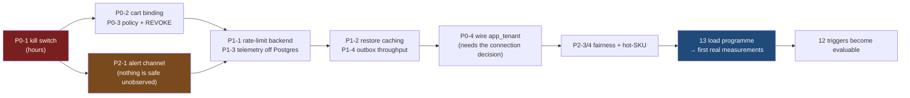

# 14 — Foundation Action Register

> **RESEARCH — NOT AUTHORITY — NOT AN IMPLEMENTATION ORDER**
>
> Audited commit `f52abca7ef6b2ddfc39f03b38206779cbe543e46` · branch `stepup/main` · 2026-08-16.
>
> Only actions that **strengthen the governed foundation now**. Every item is evidence-backed, sits inside an already-canonical system, and is Class-C implementation unless explicitly marked otherwise. Nothing here expands scope, adds a runtime, fills a reserved service, or requires an amendment.

---

## 0. The admission test every item passed

DOC 01 §11 and root `AGENTS.md` `PRIME-R3` require that work be *"merge, wire, set the right default, and delete two-of-everything"* — completion, not new construction. Every item below answers all eight questions:

1. Which current merchant/buyer risk does it reduce?
2. Which measured bottleneck does it address?
3. Which governing rule permits it?
4. Which canonical winner does it complete?
5. Why is it not a parallel second system?
6. How is it tested?
7. How is it rolled back?
8. What happens if it is deferred?

**Rejected from this register** (recorded so the omissions are deliberate): anything that adds a runtime; anything that fills a reserved service; read replicas and partitioning (`15`); an AWS migration (`11` Option 5); D1 as a tenant store (`11` Option 4b); any new observability *platform* (the Analytics Engine binding already exists); and any work justified by "we will need it at scale" without a measured trigger.

---

## 1. Priority P0 — correctness and security, unconditional

These are not capacity work. They are defects in canonical systems, and they are the reason the foundation is not yet "sufficient" for its own envelope.

### P0-1 · Close the checkout-confirm free-goods path — **the one CONFIRMED S0**

| | |
|---|---|
| **Finding** | `POST /v1/checkout/:cartId/confirm` (`services/api-gateway/src/routes/checkout.ts:596`) accepts any non-empty 1–200 char `provider_payment_id` (`packages/checkout-core/src/index.ts:113-118`; enforced at `checkout.ts:638`) and performs **no provider signature verification, no `assertProviderPaymentNotReplayed`, no provider-side payment fetch, and no amount or mode check** before calling `PaymentExecutionAdapter.confirmPayment` (`checkout.ts:691`) → `confirm_order_payment_with_ledger`. At replay-final SQL state that RPC validates only that `p_provider_payment_id` is non-empty (`168_b1_b2_capture_refund_ledgering.sql:154`), then `confirm_order_payment` (`000_baseline.sql:1439`) inserts `payment_webhook_events` with **`signature_valid = TRUE`** (`000_baseline.sql:1478-1504`), sets `orders.payment_status='paid'` / `status='confirmed'`, sets `payment_transactions.status='captured'` (`168:181`), and posts a balanced ledger transaction crediting `merchant_payable`. |
| **Verdict** | **CONFIRMED S0** by independent adversarial verification — the only S0 that survived challenge. `VERIFIED-SOURCE`. |
| **Attack chain** | Anonymous cart → `GET /v1/storefront/:subdomain/cart/:cartToken/checkout-url` (a legitimately obtained signed handoff, valid 10 minutes) → contact → payment-intent with `provider='razorpay'`, `mode` left at its `sandbox` default (`mode:'live'` is refused at `checkout.ts:573`) → `confirm` with `provider_payment_id: 'x'`. Result: a real, fully paid order, inventory committed, `merchant_payable` credited for money never received, and a webhook-event row asserting the signature was valid. |
| **Risk** | Free goods at unlimited scale against every merchant on the platform, with a **falsified money trail** — the ledger and `payment_webhook_events` both record the fraud as legitimate, so reconciliation will not flag it. |
| **Rules** | `R-11` (orders only via the server-authoritative flow), `SEC-R5` / `PAY-R8` (verify provider signature and record idempotency **before** any mutation), `R-22` (a stub must never read as `success`). |
| **Minimal fix** | Register a **fail-closed kill switch on the `/checkout` prefix** in `services/api-gateway/src/index.ts` before line 753, mirroring the existing `appPlatformKillSwitch` pattern at `index.ts:735-745`, defaulting **OFF**. No first-party client calls these endpoints — the shipped storefront uses `/storefront/:subdomain/payments/razorpay/*` — so this removes the entire attack surface with **zero functional regression**. |
| **Proper fix** | Verify the Razorpay signature server-side with `timingSafeEqualHex`, call `assertProviderPaymentNotReplayed`, fetch and compare the provider-side amount and status, and reject any `sandbox`-mode confirm from producing a `paid` order or a ledger posting. |
| **Not a second system** | It hardens the canonical hosted-checkout winner (DOC 03 §3.4). It builds nothing new. |
| **Test** | Behavioural: the full attack chain must return 4xx and produce no order, no ledger entry, and no `payment_webhook_events` row. Add to the money concurrency suite. |
| **Rollback** | The kill switch is a flag. The signature check is a single revertible commit. |
| **If deferred** | Every day this ships to real buyers is a day of unbounded, undetectable merchant loss. **Nothing else in this register outranks it.** |

### P0-2 · Bind the public order-create route to the server cart

| | |
|---|---|
| **Finding** | `POST /v1/storefront/:subdomain/orders` (`routes/storefront/checkout-payment-routes.ts:251`, registered `public-routes.ts:763`, mounted `index.ts:752`) is genuinely unauthenticated: `api.use('/*', authMiddleware)` is not registered until `index.ts:779`, and Hono composes handlers in registration order, so the handler returns **before** auth, CSRF (`:780`), and idempotency (`:781`) ever run. No customer session, no Turnstile, **no cart-bound signed handoff**. The shipped storefront genuinely uses it (`apps/storefront-runtime/src/app/store/[subdomain]/checkout/checkout-client.tsx:414`). |
| **Verdict** | **S1** (adversarially corrected down from S0 — a per-source-IP limit of 20 orders / 5 min applies, and products need an `inventory_levels` row). `VERIFIED-SOURCE`. |
| **Risk** | Anonymous COD order creation with inventory committed and zero payment; the client supplies `items`, so the server-authoritative cart is **not** the source of the order lines. This is `R-11` / `ART-14` inert on the live path. |
| **Fix** | Thread the existing `cart_token` (the storefront already holds it — `context/cart-context.tsx:153`) into `StorefrontCreateOrderSchema`, and derive `items` from the **server cart row** rather than `body.items`, rejecting any request whose token is absent, expired, or bound to a different site. |
| **Not a second system** | This completes the canonical server-authoritative cart and the ART-14 handoff. It deletes a bypass; it adds no path. |
| **Test** | Reject an order whose `items` differ from the bound cart; reject a token from another site; reject an expired token. |
| **If deferred** | Inventory-exhaustion denial of service against every merchant, and the platform's flagship checkout invariant remains decorative. |

### P0-3 · Re-scope `auth_password_set_intents` and harden the consume path

| | |
|---|---|
| **Finding** | `078_password_set_intents.sql:52-55` creates the policy with **no `FOR` and no `TO` clause** — at replay-final it is `PERMISSIVE, FOR ALL, TO PUBLIC, USING(true) WITH CHECK(true)` on a table with RLS enabled (`078:41`) and **no `REVOKE` anywhere**. Migration `163`'s REVOKE list (`163:202-215`) covers 11 other tables and misses this one. The consume path verifies nothing else: `apps/identity-platform/src/app/api/auth/set-password/route.ts:46` reads the intent id from an **unsigned cookie**; `services/api-gateway/src/routes/auth.ts:940-949` checks only `used_at IS NULL`, `deleted_at IS NULL`, `expires_at > now`; `auth.ts:1013-1027` overwrites `users_custom.password_hash` **with no "user has no password yet" check**; `set-password/route.ts:96` then mints a session for `intent.user_id`. |
| **Verdict** | **S1, `INFERRED`** (adversarially corrected from S0). The policy and the consume path are `VERIFIED-SOURCE`; the **GRANT is `UNKNOWN`** — `000_baseline.sql` is a `--no-privileges` pg_dump, so no repository evidence establishes whether `anon` holds `INSERT`. Migration `107:4-8` states sibling auth tables "were readable with the public anon key" in this very project, which points toward the grant existing. |
| **Risk** | If the grant exists, a single forged `INSERT` with only the public anon key is **provably sufficient** to take over any merchant account. |
| **Fix** | One migration mirroring the `107` + `163` pattern: `DROP POLICY` → recreate `FOR ALL TO service_role` → `REVOKE ALL ON TABLE public.auth_password_set_intents FROM PUBLIC, anon, authenticated`. **The REVOKE is required precisely because the grant state cannot be established from the repository.** Independently, add the missing "user has no password yet" guard and sign the intent cookie. |
| **Live probe** | `\dp public.auth_password_set_intents` settles the severity. `04` §4.2 L-10. This is one line of SQL and it decides whether this is S1 or S0. |
| **If deferred** | An unresolved account-takeover primitive on the identity system, with the deciding fact one query away. |

### P0-4 · Wire the `app_tenant` / tenant-GUC path that already exists

| | |
|---|---|
| **Finding** | The full non-BYPASSRLS stack exists and **survives replay**: `current_site_id()` reading `app.site_id` (`139:8-14`), `CREATE ROLE app_tenant NOLOGIN NOBYPASSRLS` (`164:11`), `ENABLE`+`FORCE` RLS with `FOR ALL TO app_tenant USING (site_id = current_site_id())` over every table carrying `site_id`/`store_id` (`164:63-73`), plus explicit policies on `sites`, `product_variants`, `product_options`. Migration `196` (the newest RLS migration) adds `FORCE` to 24 more theme tables and documents `app_tenant` as still live. **The only thing missing is call sites:** `withTenantTx` (`lib/tenant-transaction.ts:29`) is reached only via `withResolvedTenantTx` (`lib/tenant-context.ts:67`), which has **zero non-test callers**. All gateway traffic runs through `getSupabaseAdmin` → `SUPABASE_SERVICE_ROLE_KEY` (BYPASSRLS), wrapped only by a ~124-line app-layer query-shape lint. |
| **Verdict** | **S1, `VERIFIED-SOURCE`** (adversarially corrected from S0, with the central hypothesis corrected: this is a **missing control, not a self-contained exploit**). Converting it to cross-tenant access requires an *additional* route-level defect. |
| **Named gaps the verifier surfaced** | (a) tables absent from `tenant-tables.registry.ts` get **no guard at all** (`tenant-scoped.ts:119`); (b) **77 `.rpc(` call sites are never intercepted by the proxy** (`tenant-scoped.ts:115`). Each needs its own audit. |
| **Rules** | `R-1`, `R-2`, `R-4`, `SEC-R9`, `ART-08` — DOC 01 calls this layer *load-bearing*. |
| **Fix** | **Wire the seam that exists; do not build a new one.** Route tenant-table access through `withResolvedTenantTx`, starting with `orders`, `payment_transactions`, `store_customers`, `gift_card_*`, using the table list the `RT-2…RT-8` red-team suite already exercises. |
| **Two design constraints from primary sources (`07` §3.4)** | (1) `set_config(name, value, **TRUE**)` inside an explicit transaction **is safe** under Supavisor transaction-mode pooling — the planned design is sound. (2) `set_config(..., FALSE)` or a bare `SET` **would leak the tenant identity to the next pooled client**, because PgBouncer does not run `DISCARD ALL` in transaction mode. A one-character error converts this fix into the exact defect it prevents. |
| **Blocker to resolve first** | The current data path is PostgREST/`supabase-js`, which **cannot issue `SET LOCAL ROLE`**. This is very likely *why* `app_tenant` has no callers. Choosing the connection strategy (Hyperdrive + a real Postgres driver, per Cloudflare's own Supabase guidance) is a prerequisite, and it is Class-C. |
| **If deferred** | The database backstop the Constitution calls load-bearing does not exist on the live path, and `05`'s largest open obligation stays open. |

### P0-5 · Re-scope the 13 unintended PUBLIC-effective policies

| | |
|---|---|
| **Finding** | Replay-final analysis across all 126 migrations yields **680 policies, 110 with `USING(true)`/`WITH CHECK(true)`, of which 19 carry no `TO` clause** and are therefore PUBLIC-effective (`anon` + `authenticated`). Migration `163_d2_live_data_leak_rls.sql` fixes 12 tables (`orders`, `products`, `product_variants`, `product_options`, `sites`, `store_customers`, `customer_activity_log`, `wishlists`, `customer_wishlists`, `subscriptions`, `billing_history`, `super_admin_allowlist`) and **covers none of the 19.** |
| **Verdict** | **S1, `VERIFIED-SOURCE`** (adversarially corrected from S0, and corrected in composition — 19, not 18, and 6 of them are not defects at all). |

**Per-table replay-final verdict** — this precision matters, because acting on the unverified list would have "fixed" six deliberate policies:

| Table | Exposure | Evidence |
|---|---|---|
| **`auth_password_set_intents`** | **Full cross-tenant READ+WRITE — highest stakes.** Converges with P0-3; it is the only policy on the table | `078_password_set_intents.sql:52` |
| `pages` | Full READ+WRITE — `html_content`/`body` ⇒ cross-tenant defacement and stored XSS | `000_baseline.sql:26708` |
| `collections` · `collection_products` | Full READ+WRITE — cross-tenant catalog modification | `000_baseline.sql:26652, :26645` |
| `onboarding_attempts` | Full READ+WRITE — `ip_address`, `user_agent`, `user_id` ⇒ PII | `000_baseline.sql:26694` |
| `store_surveys` | Full READ+WRITE | `000_baseline.sql:26743` |
| `gift_cards` | Full READ+WRITE (**money**) | `000_baseline.sql:26666` |
| `audit_logs` | **INSERT-only** — audit forgery / log injection. Reads *are* gated by `is_super_admin`, so this is not an audit read leak | `000_baseline.sql:24380, :24393` |
| `ai_usage` | INSERT — **and worse than first reported**: the sibling policy `"Store owners view AI usage"` (`000_baseline.sql:24127`) is `USING (store_id IN (SELECT sites.id FROM public.sites WHERE true))` with no `TO` clause, so PUBLIC can also SELECT prompt/output text for any site row its own RLS exposes | `000_baseline.sql:23960, :24127` |
| `app_collections` · `app_collection_items` · `app_featured_placements` · `app_discovery_events` | Exposed but **low impact** — frozen app-marketplace, platform-global, no tenant data | `100_app_discovery_foundation.sql:133, :145, :152, :155` |
| `plans` · `employee_roles` · `employee_permissions` (+3 siblings) | **NOT vulnerabilities.** Deliberate SELECT-only global catalogs, explicitly allowlisted in `scripts/validators/foundation-sql-policy-residue-validator.mjs:13-23` | — |

| | |
|---|---|
| **Exploit preconditions** | The Supabase project **anon key** (a non-expiring `role=anon` JWT) plus network reach to the project's PostgREST endpoint (`database/supabase/config.toml [api]` exposes schema `public` with no IP allowlist). The key is not published by this repository, but it is distributed to five Vercel build environments (`production-deploy.yml:430-431`), four Cloudflare Worker secrets (`:313`), and GitHub Actions secrets — and Supabase treats it as public by design. Migration `107`'s own header calls it *"the public anon key."* Treat it as obtainable. |
| **Fix** | One additive, replayable migration (`198_*.sql`) mirroring `163`'s shape: for each of the 13 unintended policies, `DROP POLICY` → recreate `FOR ALL TO service_role` → `REVOKE` the PUBLIC/`anon`/`authenticated` grants. **No application code change is required**, because the api-gateway connects with the `service_role` key which bypasses RLS — the same safety argument migration `107:16-19` makes explicitly. Ship a paired rollback (`R-23`). |
| **Authority** | **ARB sign-off** — `CLAUDE.md` requires ARB approval for RLS changes on tenant tables. This is the one P0 item that is not purely Class-C. |
| **If deferred** | Cross-tenant catalog and page modification (including stored XSS), gift-card exposure, PII in onboarding attempts, and audit-log forgery that would undermine the money reconciliation this platform depends on. |

---

## 2. Priority P1 — the four ceilings binding at or below the governed envelope

From `07` §4. All Class-C. None requires ARB approval.

| ID | Action | Evidence | Fix | Test | Rollback |
|---|---|---|---|---|---|
| **P1-1** | **Replace the KV rate-limit backend.** Cloudflare documents KV at **1 write/second/key → HTTP 429**, states KV is unsuitable for atomic operations or write-heavy same-key workloads, and the code converts a KV error into an **isolate-global 60 s–10 min backoff returning `503 RATE_LIMIT_UNAVAILABLE` on every `/v1` route** (`rateLimit.ts:42,321-325,577-583,618-623,1078-1088`). Binds at ~2 concurrent requests sharing a key. | `evidence/03-rate-limiter-backend.txt`; vendor primary source | Move to a **sharded Durable Object** (`Required DOs = total_rps / ~1,000 rps per object`, keyed by `idFromName`) or Cloudflare's native Rate Limiting binding. A DO namespace is **already provisioned and unused** in production. ⚠️ **Shard from the first line — never promote the existing singleton `RUNTIME_COORDINATOR` into a global limiter.** | Fire 10 concurrent requests on one key; assert 429s stop and no `503 RATE_LIMIT_UNAVAILABLE` window follows | Flag between backends |
| **P1-2** | **Restore storefront caching.** Three independent, individually trivial causes make the effective hit ratio ≈ 0: a cookie read in `store/[subdomain]/layout.tsx:76` forces the whole subtree dynamic (so every `export const revalidate` beneath is inert); a fresh `X-Request-ID: crypto.randomUUID()` per fetch (`lib/api/client.ts:45`) enters the Next 16 Data Cache key **and** the request-memoisation key; and `cachedJson` (`lib/storefront-cache.ts:121-129`) has no request coalescing. | `07` §3.3 | Move the cookie read below a Suspense boundary or out of the layout; drop the random request-ID from the cache key (keep it as a log field); add single-flight coalescing to `cachedJson`. **⚠️ Also fan `revalidateTag` across every domain a tenant owns** — Vercel documents that on-demand revalidation does not cross domains or subdomains. | `x-vercel-cache` HIT on a repeated PDP; gateway invocation count drops; cache key contains no random component | Three independent reverts |
| **P1-3** | **Move telemetry writes off PostgreSQL.** The observability middleware is mounted globally (`index.ts:655`) and unconditionally inserts a `runtime_telemetry_metrics` row per request, plus a `worker_request_logs` row for all but 2%-sampled anonymous storefront GET/HEAD. **DB write load therefore scales with request volume, not commerce volume.** | `07` §3.5 | Route to the **already-bound `RUNTIME_TELEMETRY` Analytics Engine dataset**. No new platform, no new dependency, no new cost. | `pg_stat_statements` shows the inserts gone; metrics still queryable | Flag |
| **P1-4** | **Raise outbox relay throughput.** `50 events/tick × 96 ticks/day = 4,800/day` (`wrangler.toml:236`, `index.ts:945-947`) against ~6–8 events/order × 1,000 orders/day at the envelope top. The RPC already permits 100 rows/claim (`000_baseline.sql:756`), so **the current setting uses half the available headroom.** | `07` §3.6 | Raise the per-tick limit toward 100 and/or increase cron frequency; longer term, relay via a queue consumer. | Synthesise 1,000 orders/day; unrelayed depth must not grow over 72 h | Config revert |

---

## 3. Priority P2 — operability

| ID | Action | Evidence | Why it matters |
|---|---|---|---|
| **P2-1** | **Give incident paging a delivery channel.** Every 5xx plans an alert (`lib/runtime-alerting.ts:108-110`) with job type `incident.page.dry_run` (`:7`); the consumer sets `mode:'dry_run'` as a **literal** (`incident-command.ts:96`) regardless of the configured `paging_adapter`, then writes only database rows. **No human is pushed a notification for any production failure.** (S1, adversarially corrected from S0.) | `09` §C | Mean time to detection for a total checkout outage currently equals *the time until a merchant complains*. Every other item in this register is worth less without this one. |
| **P2-2** | **Alert on ledger reconciliation mismatches.** `runMoneyLedgerReconciliation` returns a `mismatches` count (`money-ledger-reconciliation.ts:102`) that the scheduled handler logs via `writeQueueLog('info', {status:'completed'})` (`queue-workers/src/index.ts:648-662`); `writeQueueLog` never inspects `result.mismatches`. Runs 6-hourly. (S1, corrected from S0.) | `09` §C | A ledger divergence is discovered up to 6 hours late, and only by someone reading 10%-sampled logs for a line whose level is `info`. GST invoices are immutable once issued. |
| **P2-3** | **Per-tenant fairness caps in the four claim RPCs.** `claim_outbox_events` (`000_baseline.sql:754`), `claim_platform_queue_jobs` (`:822`), `claim_webhook_deliveries` (`:966`), `expire_inventory_reservations` (`141:323`) all order strictly by arrival time with **no `site_id` term and no per-site cap.** | `07` §3.6 | One merchant's bulk import or flash sale starves every other merchant's order confirmations. This is the Band E failure and it needs no amendment. |
| **P2-4** | **Hot-SKU admission control.** A single-row lock serialises at `1 / lock_hold_time`, and every waiter holds a connection — so one hot SKU can exhaust the global pool and take down unrelated tenants. **Note:** session-level advisory locks are unavailable through both Supavisor transaction mode and Hyperdrive, so the fix must use row locks, optimistic version columns, or sharded counters. | `06` Band E; `07` §3.4 | The most likely real failure, and it arrives far below any volume band. |
| **P2-5** | **Add an SSRF guard to outbound webhook targets.** Validation is `url.protocol === 'https:' && url.hostname.length > 0` and nothing else (`packages/notification-core/src/index.ts:505-512`), applied identically at registration, fanout eligibility, and dispatch. (S2, corrected.) | `SEC-R11` | Private and link-local addresses are accepted as webhook targets. |
| **P2-6** | **Make email dispatch idempotent per message.** `dispatchEmailDeliveries` (`queue-workers/src/index.ts:482-526`) calls `sendResendEmail` with no already-sent lookup and no idempotency header, runs before the ack, and the outer catch retries the **whole batch** (`:620-621`). (S2, corrected.) | `09` | One transient 5xx on message 20 of 25 re-sends the 19 that already succeeded, on every retry — damaging shared-domain deliverability for all merchants. |

---

## 4. Priority P3 — governance hygiene and honesty

| ID | Action | Evidence | Authority |
|---|---|---|---|
| **P3-1** | **Ship rollbacks for the 12 unpaired migrations ≥ 138** (138, 140, 157, 170, 175, 179, 182, 183, 184, 186, 187, 194) and make the pairing validator actually gate merge. Nine of these are **new since governance recorded the known-unpaired set as 138/140/157** — the obligation has regressed. | `evidence/01`; `R-23`, `MIG-R3` | Implementation |
| **P3-2** | **Correct root `AGENTS.md` MIG-R2.** It states "current max (161), next is 162" and names a duplicate prefix 129. Neither is true: the tree holds `000` + `073…197` contiguous, with **no duplicates**, and `000_baseline.sql` is a `pg_dump` of PostgreSQL 17.6 (so 001–072 were squashed). | `evidence/01` | Implementation (doc correction) |
| **P3-3** | **Classify `services/lcis-api`** — delete, relocate under `tools/`, or adopt as a ninth runtime with an amendment. It is a real, buildable, launchable Hono service with 52 routes and **no authentication middleware**, absent from every topology file and from `canonicalServiceRoots`/`reservedServiceRoots`, yet inside the root build/typecheck/test graph. (S2, corrected.) | `03` §A | **ARB (Class B)** |
| **P3-4** | **Reserve the `checkout` subdomain.** `checkout` is absent from `RESERVED_STOREFRONT_LABELS` and `RESERVED_SUBDOMAINS` (`packages/tenant-core/src/index.ts:27-57`), so a merchant can claim the hostname the Constitution designates as the hosted checkout origin. (S2, corrected.) | `03` §A | Implementation — a one-line fix guarding an `ART-14` asset |
| **P3-5** | **Resolve the partition-maintenance ambiguity.** `.github/workflows/hot-table-partition-maintenance.yml` runs on a schedule while `ART-23` requires the partition mirror to stay disabled. Determine no-op vs live maintenance and either document or remove. | `15` §4.2 | **ARB (Class B)** |
| **P3-6** | **Retire or retarget the validators that protect dead infrastructure.** `scripts/validators/durable-object-validator.mjs:17-18` requires the unused DO class to keep existing. Two gate validators' offender-scan loops are **dead code during a real gate run** (`rls-force-coverage-validator.mjs:36`, `one-system-per-domain-validator.mjs:28` — both gated on `entry.extra`, true only for fixtures). | `evidence/04`; `13` §A | Implementation — `ART-02` / `R-18` |
| **P3-7** | **Build the behavioural coverage the gate lacks.** Of 110 gate-lane validators, **zero** make an HTTP request, boot a runtime, or connect to PostgreSQL. Implement TEST-R10's unimplemented "replay 000→197" clause. *(Credit where due: `ci.yml` genuinely runs `pnpm test:behavioral`, which docker-starts `postgres:16-alpine` and executes 21 real-SQL suites under 43 `SET ROLE` statements — that IS behavioural coverage, and the money-ledger criticism was **REFUTED**: `post_ledger_transaction` is the transitive kernel of every production money write.)* | `13` §A | Implementation |

---

## 5. Sequencing

**P0-1 first, today.** **P2-1 early**, because an unobserved system cannot be safely changed. **P1-3 before P1-2**, because restoring caching will change traffic shape and you want telemetry off the transactional database before that. **The load programme (`13`) is the gate to everything in `12`** — no trigger in the evolution ladder can fire until measurement exists.

---

## 6. What this register does *not* claim

- It does not claim these actions make LetBuyy "10M-ready." `07` §5 puts Option 0's ceiling at **Band A (~100× the governed envelope)**, and that figure is `INFERRED` until the load programme runs.
- It does not claim the list is complete. `05` reports 217 findings; this register carries the ones with the highest risk-reduction per unit of effort. `18_TRACEABILITY_MATRIX.md` carries the full set.
- It does not claim any item is done. **No code was changed by this study.**
