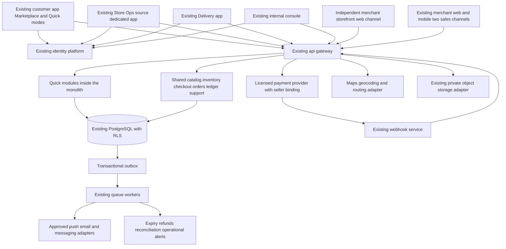
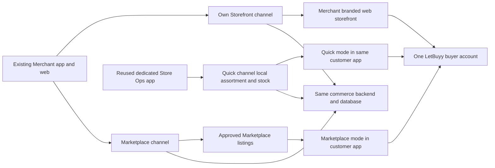
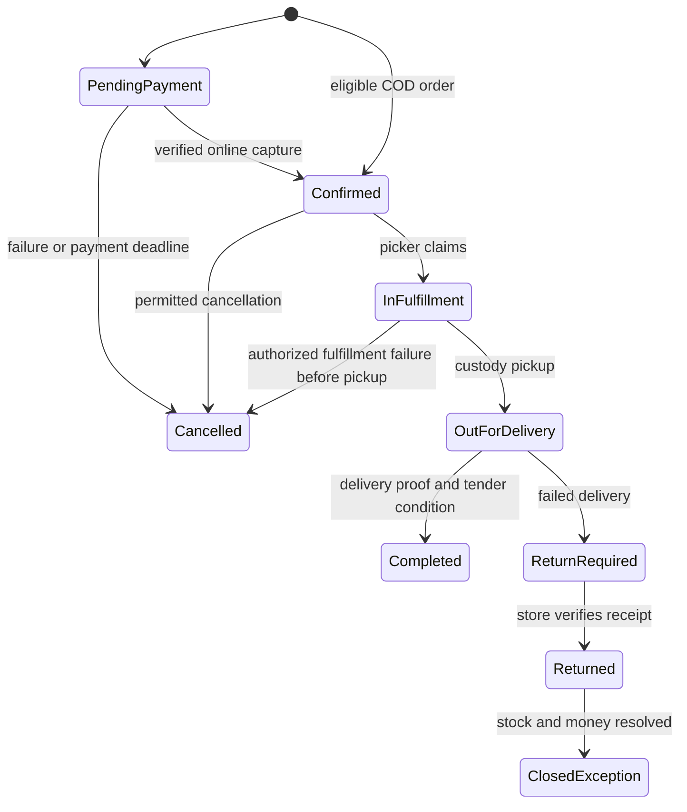
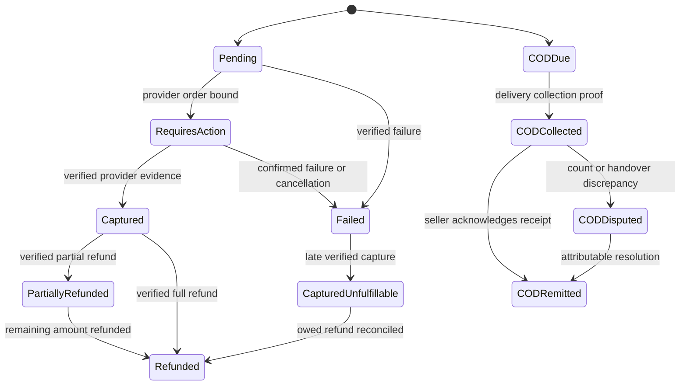
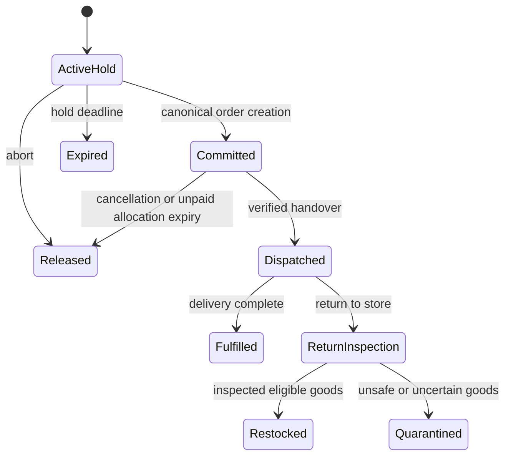
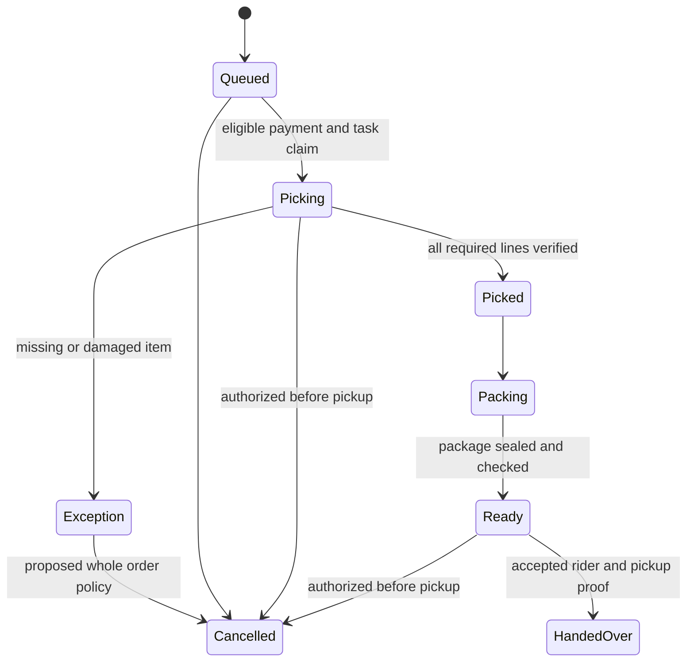
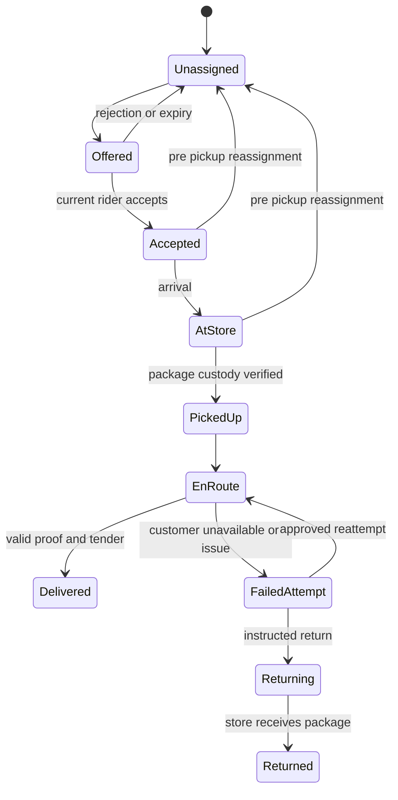
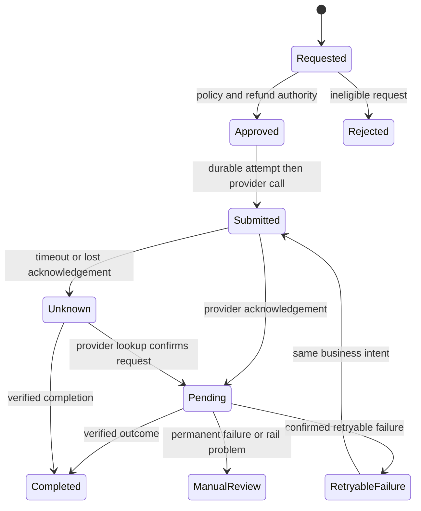
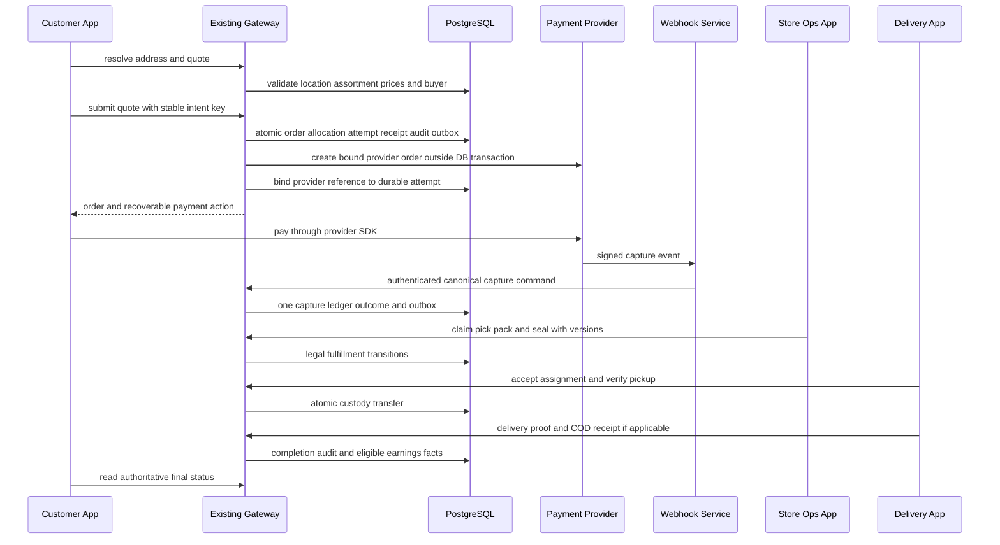

# LetBuyy Quick Commerce Architecture and Implementation Plan

> **Later owner direction:** the dedicated Marketplace Seller application, bidirectional shared-product model, three-channel commercial system and LetBuyy/LetKart brand proposal are now developed in the [three-channel research package](../three-channel-platform-2026-10-24/README.md). That package supersedes this plan where it keeps Marketplace operations inside Merchant or gives the older narrower launch estimate. This document remains supporting Quick source analysis; it does not authorize activation.

Prepared and revised 24 October 2026, Asia/Kolkata. **Revision 2: existing app reuse, one buyer app with two modes, and distinct merchant sales channels. Status: implementation planning for review.** The owner's decisions below supersede this plan's earlier standalone Quick customer app and rebuild recommendations. This remains research and preparation: it does not activate an application, apply a migration, amend governance by itself or establish production readiness.

## 1. Executive recommendation

Reuse the existing Marketplace customer app, Store Ops source and Delivery app. The target is one customer app at `apps/marketplace/mobile` with two clearly separated native shopping modes: **Marketplace** and **Quick**; the Quick mode still needs implementation. A seller page inside Marketplace is a view of that seller's approved Marketplace listings. The merchant's **Own Storefront** remains its independent sales channel through the existing storefront web runtime. It is not automatically imported into the Marketplace app or exposed as a native clone of the merchant website.

The Merchant web/mobile product manages **Own Storefront and Marketplace**, with their distinct eligibility, settings, publication, checkout and fee rules. **Quick dark-store operations use a dedicated Store Ops app**, adapting and promoting the preserved `reference/apps/store-operations` source rather than recreating it. Adapt and complete `apps/deferred/delivery/mobile` in place. Extend the surviving internal console for oversight. Reuse canonical identity, buyer accounts, API, catalog offering records, inventory kernel, order/checkout writers, ledger, provider adapters, jobs and support.

**Use the existing PostgreSQL commerce database initially, with franchise isolation and a quick-commerce module inside `services/api-gateway`.** Independent franchise businesses remain separate `sites`; each physical dark store is an `inventory_locations` entity belonging to its seller. Do not create a rival `stores` tenant table. A customer selects one delivery address, the backend resolves one eligible location and seller, and every item in that order comes from that location. Start with one seller and one location per checkout, even when coverage overlaps.

The selected strategy is **existing app reuse and canonical backend integration**. No new customer app, second merchant app, fourth admin app, commerce backend or commerce database is needed. Existing source is the starting point; replace only integrations or unsafe/incomplete components whose defects are evidenced. Preserve Store Ops and Delivery Git history and useful screens/controllers/repositories/tests. They currently have different donor API assumptions, so code preservation does not make them already integrated.

The active marketplace has retired its Firebase product SDK/auth dependency; the former Firebase admin is reserved. Retain the existing canonical backend choice. An FCM adapter remains a candidate push transport, subject to project ownership, actual delivery proof and explicit resolution of the earlier Firebase-retirement policy.

This preserves the requested business model. It changes the assumed infrastructure foundation because the inspected implementation supports a different conclusion. Shared accounts do not depend on physically sharing a database: the sole identity issuer can continue serving both products if a later, approved isolation requirement justifies separate commerce storage.

### Business decisions confirmed in this conversation

| Requirement | Status and consequence |
| --- | --- |
| One native customer app with Marketplace and Quick modes | Latest owner decision. Extend `apps/marketplace/mobile`; no standalone Quick customer app. |
| Merchant product has Own Storefront and Marketplace selling channels | Latest clarification, consistent with channel documents. A Marketplace seller page contains only eligible Marketplace listings; it never turns a storefront-only product into a Marketplace offer. |
| Dedicated Store Ops and separate Delivery clients | Latest owner decision. Reuse both existing source trees; promote/adapt Store Ops and complete Delivery, rather than rebuild from zero. Extend the existing admin console. |
| Same existing LetBuyy backend and PostgreSQL database | Explicitly confirmed by the owner; no longer an architecture option awaiting selection. |
| Marketplace unlock requires KYC, store setup and applicable approvals; commission depends on product category | Explicitly reaffirmed. Preserve progressive onboarding, category eligibility, effective-dated per-item commission and provider-managed settlement; rates are configuration, not invented here. |
| Delivery team | Owner chose **you + Codex, one implementation stream**, not a three-engineer parallel plan. |
| Independent businesses or franchisees own each store and sell on the invoice | Confirmed in the follow-up. Seller isolation, provider seller mapping and per-seller financial records are mandatory. |
| Packaged groceries, household essentials, fresh/chilled goods and broader mixed products | Follow-up: “all the above.” Support the category classes; approve the actual launch SKU list and handling requirements before stocking. |
| Online payment and cash on delivery | Confirmed in the follow-up. COD collection, handover, shortages and reconciliation belong in launch scope. |
| Multiple dark stores, one assigned fulfillment location per selected customer location | Confirmed. One city can contain many dark stores. |
| Approximately 7 km or 10 km configurable radius | Confirmed expectation, not a delivery-time guarantee or a hardcoded constant. |
| Reuse useful infrastructure and integrations; preserve Marketplace | Confirmed. Discovery and planning only are authorized now. |

### Proposed defaults and unresolved decisions

These are recommendations, not additional owner approvals.

| Decision | Proposed default | What remains to settle |
| --- | --- | --- |
| Catalog ownership | Administration controls a master product-information reference; franchisees activate approved offerings and manage their own stock | Central approval policy, editing rights, brand/content rights and emergency delisting authority |
| Customer packaging | Existing Flutter Marketplace binary, two native modes, shared account and scoped baskets | Mode labels/navigation details; preserve the existing published app identity |
| Store operations packaging | Preserve/promote the existing Flutter Store Ops source into its dedicated approved app, with scanning and reconnect recovery | Lifecycle/root/recipient governance alignment and final production identity; no source fork or blank-app replacement |
| Delivery packaging | Complete and adapt the deferred delivery client | Approved activation, product identity and canonical login mapping |
| Pricing | Versioned central suggested price; seller-authorized location price within approved rules; customer sees the actual seller's offer | Who can change prices, permitted overrides, fee beneficiary and franchise commercial terms |
| Missing item | Cancel the whole order and refund captured funds for the initial pilot | Whether launch instead requires item removal/partial fulfillment; that requires added tax/refund/customer-consent work |
| Substitutions | Disabled initially; never substitute silently | Later explicit opt-in, price limit and consent model |
| Fresh goods quantity | Fixed-price, prepacked sale units, including fresh/chilled products | Whether weighed-to-order goods are essential; those require authorization/adjustment and final-invoice design |
| Dispatch | Store-attached eligible riders, one active delivery each, manager assigns; acceptance has a short configurable expiry | Rider employment/contract model, earnings/rate rules and rejection timers |
| COD custody | Rider collects as the franchisee's authorized agent and remits directly to that seller with dual acknowledgement | Approved legal/provider arrangement, collection caps, deadlines, shortages, COD refunds and incident owner |
| Firebase | Retain no Auth/Firestore authority; evaluate FCM-only use of the existing project | Whether that narrow exception is desired and available, or another approved push transport is required |
| Geography and demand | Pilot 1–3 locations, approximately 50–150 orders/location/day and 1,000–5,000 active SKUs/location for estimation | City, real demand, hours, staffing, promised service window and launch budget |
| Category operations | Lot/expiry controls and basic cold-chain receiving/dispatch checks in MVP | Exact categories, temperature/shelf-life standards, permissions and necessary category/provider approvals |

The older product model put Store Ops inside the merchant product; the owner now explicitly wants its dedicated app. The subsequent implementation phase must record that narrow change, update reference/workspace/recipient boundaries, and promote/move the existing source with history. This is not a request to run the reference tree while it is still classified REFERENCE. Delivery activation and central cross-seller product-information ownership also need their scoped records. The unified customer app already matches the recorded one-buyer-app direction. No reserved service needs activation, and no new app source was created by updating this plan.

## 2. Audit scope and confidence

The inspected checkout is `/Volumes/Projects/LetBuyy`, branch `letbuyy/theme-release-performance-resume`, HEAD `85aac99043d8dc10469e12cbb810609a3b6f1b0d`. The local `develop` ref was `045a77003a019588a3878b80b9de43e1ce2dc84a`. Discovery started with 556 working-tree entries: 274 modified tracked paths and 282 untracked paths. Findings concern the inspected working files, including existing unpublished changes, rather than a pristine HEAD snapshot. The source hash manifest beside this plan records important inputs.

This is a source and documentation audit of the relevant first-party systems. It is not a line-by-line security audit of every repository file. Generated output, installed dependencies, signing material and unrelated projects were not used as source authority. No other business repository was inspected. No Firebase, Supabase or Cloudflare account connector was available in this session; cloud project ownership, deployed rules, hosted schemas, provider eligibility, current bills and deployed artifact identities remain unverified. Source capabilities are distinguished below from demonstrated live behavior.

| Lineage | What the source establishes | Interpretation |
| --- | --- | --- |
| Canonical commerce | Hono/Cloudflare gateway, Next.js web/identity/console, Flutter clients, Supabase/Postgres migrations and canonical SQL writers | Reusable foundation; each reused path still needs quick-specific integration and acceptance |
| Former Firebase marketplace | Active marketplace pubspec and sign-in wiring use canonical identity/API; Firebase product SDKs removed from that app's direct declarations | Historical lineage, now integrated with canonical commerce; do not restore the old entry path |
| Former Firebase seller/admin | Firebase dependencies remain in `reference/apps/marketplace-seller`; operator mobile is manifest-only/reserved | Donor evidence, not an active seller/admin foundation |
| Quick-commerce donor | Deferred Flutter delivery app, reference store-operations screens, `quickcommerce_*` packages and inert Agrimore compatibility handlers | Different schema/auth/API assumptions; workflow ideas can be adapted, backend cannot be treated as deployed |

The dated September marketplace channel document still contains early wiring-status claims. Actual current routes and later migrations supersede those historical implementation claims; its model description alone cannot establish present readiness. Similarly, old skill snapshots contain stale counts and fee assumptions. This plan does not infer current deployment or reopen settled marketplace commercial decisions from that prose.

## 3. Existing system findings and reuse assessment

Evidence IDs link to exact inspected source in section 20. “Reuse as-is” means retain the named authority or concept, not certify its live deployment. No component is certified production-ready by this planning exercise.

| Component | Classification | Evidence and reusable capability | Required work, dependencies and compatibility risk |
| --- | --- | --- | --- |
| Identity issuer | Reuse with changes | E01, E03: sole issuer, buyer PKCE wiring | Register approved client audiences/redirects; adapt staff/rider clients; verify revocation and live membership; no Firebase login |
| Buyer principal/profile | Reuse as-is as authority | E04, E05: `buyer_accounts`, cross-store address book | Keep the same buyer ID; do not merge by unverified phone/email; share only authorized profile data |
| Addresses/location | Reuse with changes | E05, E06: text address book and owned mutation routes | Add validated coordinates, accuracy/provenance and revision; existing address records are not evidence of a geo-serviceability engine |
| Admin console | Reuse with changes | E07: current operator app, approvals, listings, support, audit and money screens | Add Quick sections and backend capabilities; preserve current operator tiers, MFA and approval controls |
| Merchant app | Reuse and extend | E08: inventory locations, barcode lookup, receiving, supplier/PO/transfer clients | Keep Own Storefront and Marketplace management; share appropriate components/contracts with dedicated Ops without app-to-app imports |
| Marketplace customer app | Reuse as the one customer application, with changes | E03, E09, E41–E44: canonical sign-in, seller feed, native COD checkout and existing navigation | Add Quick mode and scope isolation; retain proper Marketplace listing/review/fee behavior; do not surface storefront-only catalog through seller pages |
| Delivery app | Reuse existing app; adapt integrations and finish gaps | E10–E12: assignment, shift, delivery, proof and earnings screens/repositories | Canonical auth/API, background GPS, assignment authority, verified custody and durable recovery; preserve useful source/tests |
| Store Ops source | Reuse existing source as dedicated app after admission | E13, E45: 18 application Dart files and four Dart test files preserved | Promote/move existing source with history; adapt auth/API/state/stock UI, complete handover and align design; no blank-app rewrite |
| Catalog/products | Reuse with changes | E14: site-owned products and `channel_listings` including `instant` | Central product-information reference plus tenant-owned offerings; verified mapping and versioned publication, not globalizing seller data |
| Inventory | Reuse with changes | E15–E18: location levels, reserve/commit/release, adjustment receipts and sweeper | Enforce resolved location; clarify quantity mirrors; add lot/blocked/expiry/pick accounting; test same-location and cross-location isolation |
| Orders/cart/checkout | Reuse with changes | E19–E21: canonical server writers, sales origin, owned buyer order links | Extend origin contracts for `instant`; add location/address/quote bindings; current writer picks a default location per line and commits at order creation |
| Payments | Reuse with changes | E22–E24: common verification, capture outcomes, webhook event claims | Seller/provider mapping, amounts/currency, quick attempt lifetime, provider sandbox and delayed-capture proof; never trust a client success screen |
| Refunds | Reuse with changes | E24, E25: canonical owned refund writer/provider reconciliation | Integrate cancellation and perishable exceptions; COD refund rail needs confirmation; refund requested is not refund completed |
| Notifications | Reuse with changes | E26, E27: worker FCM/APNs adapter and buyer inbox | App-scoped device token ownership, provider choice, real delivery, urgent operational fallback; adapter code is not working push enrollment |
| Permissions | Reuse with changes | E28, E29: live staff guard, tenant transaction | Add location-scoped capabilities and logistics-only membership; broad `products:write` is too coarse for picker/packer duties |
| Analytics | Reuse with changes | Existing console analytics and rollup patterns, E07 | Add seller/location/origin dimensions, denominator-defined operating metrics and bounded queries; no analytics service extraction |
| Support | Reuse with changes | E30: buyer-owned intake and operator support mutation paths | Link order, fulfillment and assignment IDs; distinguish refund pending, returned goods and actual resolution |
| Geospatial assignment | Add as new capability | No canonical dark-store/service-area/PostGIS assignment path located in inspected gateway/migrations | Spatial extension availability and real execution plans must be checked; deterministic algorithm in section 7 |
| Dispatch and partner earnings | Add canonical capability; donor concepts reusable | E10–E12 vs absence of canonical rider mounts in E31 | Implement assignment/custody/earnings in monolith; donor `/v1/rider/*` paths and `logistics` schema are not current gateway contracts |
| Cold chain and lot control | Add as new capability | No verified integrated perishable receiving/FEFO workflow located | Required for confirmed fresh/chilled scope; exact category controls and operating acceptance remain business dependencies |
| Firebase hosted estate | Insufficient evidence | No active Firebase config/rules in inspected active app/service roots; donor manifests remain | Read-only project/product/IAM/rules/billing inventory needed before claiming reuse or exposure; preserve existing hosted data |

### Concrete source-level gaps

These are static findings and launch design gaps, not claims of a reproduced production exploit.

| Finding | Impact and evidence | Required disposition before Quick pilot |
| --- | --- | --- |
| Default inventory location chosen per order line | E19 selects by default/updated order, not customer-assigned location; a basket could otherwise draw from the wrong location | Add trusted explicit location binding to the canonical writer and every item/reservation; deny any fallback for Quick |
| Channel vocabulary is incomplete end to end | E14 allows `instant` listings; E20 and current transport contracts allow only storefront/marketplace origin | Extend all relevant schemas, writers, SDKs, fee/reference-price rules, reads and reports together; adding a listing enum is insufficient |
| Site-wide permission is not location permission | E28 and inventory routes authorize a seller and broad product writes | Add current location membership and workflow-specific grants at API and SQL boundaries; test two locations under one seller |
| Existing inventory semantics differ from a payment-gated hold | E19 commits reservations during order creation; E18 separately expires unpaid committed allocations | Preserve and extend that lifecycle deliberately; do not design clients around an imaginary hold-until-payment implementation |
| Standalone reserve and event are separate calls | E32 shows `reserve_inventory` then `emitInventoryEvent` | Quick command's inventory change, mandatory audit, receipt and outbox must commit together; fault-test current reuse before choosing this route |
| Donor APIs/auth differ | E11 uses bearer tokens and donor routes; canonical merchant middleware uses internal signed transport, E33 | Adapt through approved first-party authentication and canonical contracts; never embed an internal signing secret in an app |
| Donor location fallbacks | E10 contains default coordinates; E11's geo parser falls back to zero | Missing/invalid GPS must be unknown, never a real rider position or assignment candidate |
| Global quantity mirrors cannot serve a location feed | E17 updates product/variant stock mirrors from a single location mutation | Quick availability reads exact location levels/lots; audit and repair aggregate mirror semantics without altering unrelated buyers' scope |
| Remote push delivery is not proven | E26 has provider send code; active marketplace dependency removal means this is not proof of working device registration | Complete provider/client registration and real-device receipt; app resume/polling must recover without push |

## 4. Whole project reuse assessment and architecture options

### Whole-project application and dependency coverage

The expanded inventory covers every governed application/donor root, all 55 package manifests and the service/tooling boundaries, with deeper source inspection on the customer, seller/channel, Store Ops, Delivery, identity, inventory, checkout, COD and release paths that change this plan. The initial filtered code/config/test inventory contained 6,422 paths. This establishes breadth; it does not mean 6,422 files were individually audited or executed. Generated/vendor/build output and duplicated evidence snapshots are not application authority. `PROJECT_REUSE_INVENTORY.json` records exact roots, exclusions, evidence and inspection depth.

| Existing app or root family | Current class | Reuse decision and required work |
| --- | --- | --- |
| `apps/marketplace/mobile` | Existing customer app | Keep the binary/identity, account, search/product/seller/cart/order/support foundations; add isolated Marketplace and Quick native modes |
| `apps/merchant/mobile` | Existing merchant app | Keep the owner/staff product and two selling-channel workspaces; reuse stock/scanning/settings components through shared packages |
| `apps/merchant/web` | Existing merchant web OS | Keep Own Storefront and Marketplace onboarding/listing/pricing/order/reporting management; extend readiness and channel distinction |
| `apps/commerce/web` | Existing buyer web runtime | Keep merchant-owned storefront sites, custom domains, Liquid themes, web checkout and scoped account pages; not a replacement Marketplace app |
| `apps/internal/console` | Existing internal admin | Extend the same console with seller unlock/review, dark-store configuration, dispatch, custody, cash, refund and incident views |
| `apps/platform/identity` | Sole issuer | Register/adapt workforce clients and approved audiences; no replacement account system or fourth realm |
| `apps/marketing/web` | Existing public web | Reuse for product/location/partner information; no new Quick marketing application needed for pilot |
| `reference/apps/store-operations` | REFERENCE source, not a current runnable product | Promote/adapt this actual source as the dedicated app in the future authorized phase; preserve history and useful workflows/tests |
| `apps/deferred/delivery/mobile` | Deferred app source | Complete in place, replacing donor auth/API assumptions and adding verified GPS/custody/cash recovery |
| `reference/apps/marketplace-seller` | Old Firebase seller donor | Inspect specific useful seller UX/reference rules if missing from Merchant; do not reactivate its Firebase auth, wallet or commission engine as a parallel app |
| `apps/frozen/operations-portal` | Frozen duplicate operations surface | Consult only for missing console capabilities under existing transfer gates; do not launch a second admin |
| `apps/frozen/app-store`, `theme-store`, `developer-portal` | Frozen ecosystem surfaces | These are extension/theme/developer products, not the consumer Marketplace channel. They are not Quick launch apps |
| Three `apps/reserved/*` mobile roots | Manifest-only reserved roots | No existing customer/operator implementation to reuse here; leave empty; do not use their names to imply recovered apps |

There are **no mandatory from-zero application codebases** in the selected product shape. There is substantial new capability work inside existing apps/backend: the mode controller and scope boundaries; deterministic serviceability; dark-store metadata and location permissions; approved local assortment/prices; perishable inventory details; trustworthy fulfillment/dispatch/custody; native prepaid integration; and the corresponding admin, recovery and operating controls. Reusing a screen does not supply its missing server transition.

The application index also records older Agrimore customer/admin/seller and web donors as historically bundled, not integrated. Their documented preservation locations were not found on this host, and the old donor commit object is absent from this repository's current object database. Do not assume those extra screens are available or lost permanently. Quick customer work can proceed in the existing Marketplace app; a later read-only backup inventory may recover more reusable UI, but it is not a prerequisite for a second customer app. See E46 and the exact lookup results in the inventory artifact.

| Backend/package family | Coverage and reuse conclusion | Integration or readiness limit |
| --- | --- | --- |
| `api-gateway` | Mounted public, buyer, merchant and operator routes inspected; canonical commerce domain/SQL writers retained | No canonical Quick serviceability, local task/dispatch or rider route implementation was established merely from donor route strings |
| `mobile-bff` | Existing package/runtime and auth/dashboard boundary retained | Reuse an actual needed composition path; not a replacement Quick backend |
| `queue-workers` | Existing expiry, notification, reconciliation, support/job modules inspected | Add typed Quick jobs and durable effects; real provider delivery and hosted cadence need evidence |
| `webhook-service` | Existing payment/refund gateway binding and durable event handling retained | Seller/provider/amount/reference mapping and late Quick capture/refund acceptance still need integration |
| Six reserved service roots | Manifest/classification checked | Remain empty; no inventory, dispatch, media, search or notification microservice extraction |
| Agrimore compatibility gateway/media/realtime | README, handler/API vocabulary and client mismatch inspected | Inert donor material; never deploy it as a second backend/database to make old clients appear functional |
| `lcis-api`, 19 `lcis-*` packages, graph/intelligence tools | Tooling ownership/manifests inventoried; excluded from commerce runtime readiness | They are not Quick application or production-authority substitutes; generated intelligence is evidence/navigation only |
| 18 canonical TS domain/infrastructure packages | Public-owner/dependency map, relevant catalog/checkout/money/permission/tenant/event/notification adapters inspected | Extend current owners. Product, ledger, identity and inventory authority remain single; do not count every export as delivered behavior |
| Three TS UI/client/compatibility packages | Shared UI/API boundary inventoried | Keep public exports/design tokens/contracts; do not create new app-local DTO or token systems |
| 15 Dart packages | Core/API/models/UI, four Marketplace and seven Quick package roots inventoried; selected API, model, UI, offline/realtime and observability paths read | Retain useful code; reconcile duplicated DTO/token/retry semantics through canonical owners, rather than shipping all donor conventions unchanged |
| Database/migrations/rollbacks | Existing inventory/order/origin/buyer/COD/category/financial writers and representative grants/rollback gates traced | File presence is not installed schema, live RLS or accounting correctness; use exact owned migration assembly and role tests before changes |
| CI/deployment/configuration | Workspace scripts, manual deploy workflows, runtime classifications and Vercel mapping inspected | Several production project IDs are populated, while staging and console mapping still contain placeholders. This contradicts old comments saying all IDs are placeholders; neither state proves deployment |
| Test/operational evidence | Current test entry points and dated owned-DB/native/browser records inspected | Earlier passing records are scoped historical evidence, not a fresh whole-project green verdict; no destructive full gate or hosted test was run for this plan |

### Findings that materially change reuse and launch estimates

| Finding | Source and classification | Plan consequence |
| --- | --- | --- |
| Native seller pages already exist and use seller-filtered Marketplace feed | E41/E42, current source | Reuse them for proper Marketplace channel shopping. Do not replace their listing filter with a generic storefront directory/catalog |
| Existing customer payment screen calls `placeCodOrder` | E43, current source | Native checkout transport/recovery is reusable; prepaid UI/provider confirmation is additional work, not completed because a payment SDK is installed |
| Exported inherited payment helper has placeholder key/order creation, unconditional signature success and local COD success | E44, source-level candidate; search found its export but no application call site in the inspected path | Do not reuse it for online/cash verification; prove its reachability and retire/fence it through normal gates. This is not a claim that the active COD path uses it |
| Store Ops has real source but empty API/realtime token providers and a display-only handoff page | E45/E13, current source | Preserve UI/controllers; implement canonical auth, current location grants and real custody commands |
| Store Ops/Delivery Dart code survived import/move | Git comparison: 22 and 24 Dart app/test files respectively match the original imported code after branding normalization | No recovery/rewrite from zero needed. Source age and fake-repository tests still require integration work |
| Existing COD writer and remittance owner exist | E47/E48, current SQL/routes | Extend these canonical records with assigned collector/location/custody; collection reporting alone does not recognize cash or prove bank remittance |
| Marketplace category snapshot exists but does not choose a fee | E49, current SQL and dated scope record | Complete effective category schedules, invoice/ledger allocation, refund reversal and statements; a category column or legacy site-wide fee is insufficient |
| Marketplace provider collection has an explicit fail-closed eligibility guard | E50, current source | Complete approved seller/provider readiness; do not bypass the guard to demonstrate native online checkout |
| Carrier logistics adapter is sandbox-only for its inspected implementation | E51, current source | Carrier/AWB scaffolding does not implement local riders. Quick needs its own canonical local fulfillment/custody behavior inside the monolith |
| Store Ops/reference and old product docs still prescribe merchant-app absorption | E46/E52 vs latest owner instruction | Record a narrow source promotion/ownership change in the implementation phase; preserve existing code and donor lineage, no second merchant OS |

This audit records reusable assets and required work. It does not declare all functionality production-ready, assign a reuse percentage from file counts, or certify that no other defects remain.

| Approach | Benefits | Material cost or limitation | Recommendation |
| --- | --- | --- | --- |
| A. One customer app plus existing dedicated operational code | Existing distribution and buyer/account/seller screens; retained Store Ops/Delivery workflows | Requires explicit mode/context separation and donor integration repair | **Selected:** Marketplace + Quick in the existing app; dedicated preserved Store Ops and Delivery source; existing merchant and admin apps extended |
| B. Fresh Quick customer and operational clients | Clean initial shell | Discards useful code, creates duplicate customer distribution and contradicts the latest owner direction | Superseded; no from-zero client construction |
| C. Separate commerce backend/database with selected integration | Stronger independent ownership/release isolation | Duplicate auth/catalog/checkout/ledger or integration consistency, additional operations and cross-business reporting | Not justified for the proposed pilot; revisit only against measured isolation/workload requirements and approved architecture change |

Separate legal sellers do not force separate databases. They require enforceable access and financial ownership boundaries. One database also shares failure and resource impact, so test Marketplace latency under Quick load, bound queries and jobs, and apply admission controls. Reuse is not permission for Quick clients to query unrestricted tenant tables.

## 5. Target system and application boundaries

The client boxes below reuse existing source. New capability boxes are proposed modules, not deployed services. Backend runtimes and the database remain shared.



| Boundary | Owns | Does not gain authority over |
| --- | --- | --- |
| Unified customer client | Marketplace/Quick mode choice, approved Marketplace seller pages, location browsing, separate basket contexts, native checkout and owned order/support views | Storefront-only offers, merchant/admin privileges, stock or payment authority |
| Dedicated Ops client | Assigned locations, receiving, stock checks, fulfillment queue, picking, packing and handover | Other sellers/locations, arbitrary master catalog edits or provider settlement |
| Delivery client | Own availability/offers, active assigned package, pickup, navigation, proof, cash receipt and problems | Order repricing, full buyer history, unassigned deliveries or platform balances |
| Existing admin console | Governed store/catalog/area/staff/rider configuration and interventions | Unlogged changes, unrestricted data export or direct DB bypass |
| `api-gateway` | Quick policies and commands plus existing commerce authority | New identity issuer, parallel ledger or donor backend authority |
| `queue-workers` | Existing durable jobs extended with typed Quick jobs | Independent order/inventory/money decisions outside canonical writers |
| Identity | One issuer; buyer, merchant/staff and operator authority separated | New realm merely because a client exists |

Recommend a logistics-only capability profile within the existing workforce identity model, normally the merchant/staff realm for store-contracted riders. Bind a delivery-partner record to the canonical subject. Review the exact claim/session contract before implementation: a rider never receives generic merchant access or an operator role. An approved client audience and current assignment grant access to narrow delivery endpoints. Platform dispatch reads across sellers only through an explicitly authorized operator contract.

The unified customer app is confirmed now. It retains the published Marketplace identity and adds two native modes with independent navigation/query/cart context. Marketplace seller pages reuse `SellerStoreScreen` and its seller-filtered approved listing feed. Native shopping stays on the canonical APIs and checkout writer; no merchant Liquid website is cloned into Flutter. Merchant storefront web behavior remains intact as its independent sales channel. Secure identity/provider handoffs may use their supported system flow; this is separate from the owner's requirement for native shopping screens.

Preserve LetBuyy's tokens, generated Dart bridge, Material icons, accessible controls, light/dark support and provider-mode indicators. Donor colors/navigation are not a new design system. Store staff need large scan targets and dense, resumable queues; customer screens need clear seller/location/ETA context; riders need safe, minimal actions.

### Channel map confirmed by the owner



| Concept | Correct boundary |
| --- | --- |
| Platform selling channels | Own Storefront, Marketplace and Quick have distinct policies over shared domain authorities |
| Merchant application workspaces | Own Storefront and Marketplace. Do not add a generic Quick seller toggle that bypasses dark-store enrollment/operations |
| Customer application modes | Marketplace and Quick. Seller pages are inside Marketplace and honor its approval/commission rules |
| Own storefront | Merchant's web storefront/custom domain, configured through the Merchant product; no automatic exposure of storefront-only products in native Marketplace |
| Dark-store operations | Dedicated reused Store Ops client for approved location staff; one operator may have both merchant and dark-store memberships, but each action checks the relevant grant |
| App labels versus channel enums | Mode labels do not rewrite `sales_origin`, `channel`, attribution or fulfillment semantics; map them explicitly in shared contracts |

The earlier answer proposing a native view of all merchant storefront products is superseded by the owner's clarification. “Native shopping” means native Marketplace/Quick catalog, seller pages, cart, payment selection and order UI. It does not mean reproducing the independent storefront channel's Liquid layouts or bypassing Marketplace seller/product approval.

### Marketplace seller unlock and category commission

This is an explicit confirmed requirement, not an optional future improvement. The existing commerce roadmap already distinguishes storefront-only onboarding from stronger Marketplace verification. Reuse that model and complete its current missing integration; do not build a second seller identity/KYC workflow solely for Quick.

| Stage | Stored readiness and checks | User-visible progress and refusal |
| --- | --- | --- |
| Account and channel intent | Verified owner, actual membership, selected storefront/Marketplace entitlement; preserve existing founding/plan rules | Merchant can prepare drafts; paying a subscription does not itself approve selling |
| Business/entity KYC | Appropriate business type, verified ownership/identity, required tax/category evidence, approval/expiry status | Required, pending review, correction requested, approved, rejected, expired and suspended remain distinct; do not demand every document from every entity |
| Store/business settings | Required legal/contact/support information, seller/invoice identity, pickup/service address, shipping/returns/refund settings and applicable disclosures | Checklist names each incomplete setting and opens its exact correction screen. Marketplace-only selling must not require publishing a Liquid theme merely to satisfy a generic checklist |
| Bank/beneficiary and payment provider | Approved seller/beneficiary mapping, permitted categories, verified provider readiness, refund/settlement responsibilities | Unknown/unconfigured/sandbox is not live-ready. Existing provider eligibility guard remains enforced |
| Marketplace seller approval | Current authorized platform review, verification evidence and applicable entitlements | Account/plan/store readiness and seller approval are separate; rejection/correction/appeal and emergency suspension are actionable |
| Category eligibility | Product category, necessary declarations/evidence and effective fee schedule | Unsupported/unapproved category cannot be selected to bypass review or obtain a cheaper commission |
| Product/variant listing approval | Selected Marketplace listing, approved material revision, seller ownership, price/stock eligibility | Storefront-only, pending, rejected, paused and revoked listings cannot appear via native seller pages, search, ads, deep links or checkout |
| Reel/media publication where used | Exact approved product/variant/media revision, match/claims/disclosures | Reel review is separate from seller/product approval; a video cannot make an ineligible product purchasable |
| Purchase-time revalidation | Recheck live seller, product/listing revision, channel, stock, price, provider readiness and commission policy | Previously cached approval cannot authorize a now-blocked purchase; preserve a clear customer recovery path |

The Merchant app should show two understandable channel cards/workspaces: **Own Storefront** with its publication/setup state, and **Marketplace** with its staged readiness checklist, review queue state, selected listings, fee schedule and settlements. Disabling Marketplace must not erase existing order/refund/statement access. A storefront product and Marketplace listing can share the same seller product/variant ID while their publication and price/fee policies remain separate.

Marketplace commission is **category-based and effective-dated per order line**, not a client-provided percentage or a global per-store default. Before publication/checkout, the seller must see the applicable category, effective rate/basis and examples generated from actual configured policy. At order creation, snapshot approved category, fee-schedule ID/version, basis, rate, rounding rule, calculated commission and associated tax treatment. The existing immutable category snapshot is a foundation; it does not prove commission selection/allocation is complete.

Refunds/returns/cancellations reference that original financial snapshot, with attributable compensating entries, rather than recalculating using today's category/rate. Statements show gross sale, seller discount, commission, tax/withholding/provider/logistics lines, holds, refunds and eligible/finalized provider settlement separately. Keep the accepted weekly eligible settlement direction, with actual cutoff/hold values confirmed through owner/provider policy. Storefront remains **0% LetBuyy sales commission**; provider/subscription/shipping/tax charges are separate. Quick franchise fees remain their own unresolved business policy and do not inherit Marketplace rates automatically.

Existing June governance and legacy zero-commission validators conflict with the later accepted Marketplace category-fee direction. Record and align that narrow commercial amendment before enabling charges; do not reopen the confirmed owner direction, disable the storefront-zero protection, edit historical financial facts or fabricate rate values. E49/E53 support this distinction. This planning update does not change fee configuration or charge anyone.

### Unified customer mode and state contract

Reuse `MainScreen`, routes, seller/product screens and shared account/order components. Add a single shared mode/context controller rather than scattering mode booleans through screens. Proposed minimum context is `buyer_or_guest`, `mode`, `sales_origin`, selected seller/listing where relevant, delivery-address revision, Quick location/service-context revision, basket ID/revision and request generation. A UI mode is not authorization or a reliable fee classifier.

| Interaction | Marketplace mode | Quick mode | Shared rule |
| --- | --- | --- | --- |
| Entry/search | Eligible Marketplace products, categories, reels and approved seller pages | Assigned dark-store assortment and local availability | Search scope shown clearly; switching mode retires old requests/subscriptions and does not mix result caches |
| Location | Shipping/serviceability checked for the selected seller/order | Required before a location-specific feed or order | Same owned address book; separate applicability and confirmed snapshots |
| Seller/store detail | Only seller-owned approved Marketplace listings and truthful public seller information | Assigned seller/location with hours and local fulfillment information | No generic storefront catalog fallback on missing Marketplace listing |
| Basket | Existing Marketplace origin; launch seller grouping policy retained | One assigned seller/location; origin `instant` | Separate stable basket/attempt namespaces. A mode switch preserves the other basket; it never silently converts items or adds a delivery charge |
| Checkout | Marketplace eligibility, provider/seller mapping and category commission policy | Quick serviceability, exact stock location, local pricing and delivery/COD rules | Native UI calls the same canonical server authority; preserve intent across interruption; no payment from an inactive mode's stale total |
| Orders/account | Owned Marketplace purchases and their seller/category/fulfillment context | Owned Quick order with picking/rider/cash milestones | One account and an owned All/Marketplace/Quick order filter; order links determine access, not active mode |
| Deep links/notifications | Restore the exact eligible listing/seller/order context | Resolve a current location before adding; open owned active order independently of current browse context | Never trust mode/seller/location from the URL as authorization; link to another mode requires clear context change |
| Outside Quick coverage | Marketplace remains available subject to its own shipping rules | Clear unserviceable/closed/busy state, manual address correction and explicit Marketplace switch | Do not imply a Marketplace product carries a Quick ETA |

Proposed shell: persistent Marketplace/Quick switch near the location header; context-specific home/search/categories; seller discovery inside Marketplace; visible current basket; shared Orders and Account. Preserve access to the existing Marketplace reels journey. Reuse navigation components after task/accessibility review; do not simply retain a six-tab shell plus more tabs. Amazon's historical app-in-app grocery description and Flipkart's current publisher listing support the general integrated-shopping pattern, not LetBuyy's permissions, fees or a guaranteed delivery time. [Amazon app-in-app example](https://www.aboutamazon.in/news/amazon-india-news/amazon-unifies-grocery-stores-into-a-single-online-store-called-amazon-fresh), [Flipkart publisher description](https://play.google.com/store/apps/details?id=com.flipkart.android&hl=en).

## 6. Permissions and security model

Every action checks signature/audience/session, active membership, seller, location or assignment, capability and current resource version. A stale role in a token or local cache cannot authorize an operation. New capability names below are conceptual until added to the canonical permission catalog.

| Role | Read scope | Allowed commands | Required restrictions |
| --- | --- | --- | --- |
| Platform administrator | Approved platform configuration and scoped audit | Configure franchise participation, areas, central catalog, pricing policy and role grants | MFA/step-up and existing maker-checker for sensitive approval types; no blanket ability inferred from role spelling |
| Operations administrator | Authorized Quick locations and current operational orders | Pause intake, intervene in dispatch, open incidents, initiate permitted refund workflow | No silent inventory/cash edit; reason, receipt and attributable audit |
| Store manager | Assigned seller and locations, local staff, stock, queue and cash handover | Open/pause within policy, assign work, approve corrections, record receipt of COD cash | Cannot grant platform privileges, edit another franchise or self-approve a sensitive dual-control action |
| Inventory staff | Assigned location assortment, receipt documents and lots | Receive, count, quarantine and request/perform permitted corrections | No arbitrary price/catalog change; correction reason and thresholds; no reduction that invalidates committed stock |
| Picker | Claimed local tasks and necessary product/bin/lot data | Claim, scan, mark picked, report missing/damaged | No cash/price/refund authority; order claim conflict handled by version/lease |
| Packer | Claimed local picked packages | Verify quantities/lot rules, seal and mark ready | No silent substitution; package ID required |
| Dispatch staff | Local ready queue and eligible riders | Offer assignment, verify handover, escalate/reassign before custody transfer | Cannot complete customer delivery or modify money outcome |
| Delivery partner | Own eligible offers and assigned delivery minimum fields | Accept/reject, arrival, pickup proof, own location, delivery proof, cash receipt, issue report | One active custody assignment; contact/address masked until needed; historical access expires |
| Buyer | Own profile, addresses, baskets, orders and tracking | Confirm address/quote, submit/cancel where allowed, open issue | No chosen seller/location override at checkout; ownership from verified buyer/order links |
| Backend job/service | One authenticated job type and its validated source record | Expire allocation, reconcile payment/refund, relay notifications, process alerts | Job ID is not permission; validate stored seller/order, durable dedupe and restricted SQL EXECUTE |

Site RLS/GUC remains the tenant backstop. Location membership adds an independent fence inside a site; composite foreign keys and SQL preconditions keep child rows in the same seller/location as their parent. Buyer-owned cross-site tables remain separately protected, as existing `buyer_accounts`/address/order-link design requires. Do not add `site_id` to a buyer's entire address book to make merchant reads easier.

Use narrow approved public catalog projections and private order/assignment projections. Pricing, stock, ownership and privileged transitions are backend-only. Recheck access before returning a cached idempotent result. Callback signatures cover the raw body; validate provider account, reference, amount/currency and current reconciliation state. Secrets stay in the existing managed server-secret mechanism; never ship service-role or signing credentials to a mobile app.

If any legacy Firebase database remains, its actual rules and IAM need a separate read-only audit. Do not deploy a rules lockdown from this plan. Firebase server SDKs bypass Firestore Security Rules and need IAM/backend authorization; Rules alone cannot secure server commands. [Official Firestore access-control documentation](https://firebase.google.com/docs/firestore/security/rules-conditions).

Apply quotas to sign-in, serviceability/geocoding, checkout, OTP/proof attempts, support and uploads. Restrict proof access, content type/size and retention; use private storage and expiring authorized reads. Log actor, seller/location, action, request, resource version, reason and result without tokens, full coordinates or personal documents in ordinary logs.

## 7. Location assignment and serviceability

### Definitions

| Concept | Representation | Purpose |
| --- | --- | --- |
| Customer delivery location | Confirmed address revision plus WGS84 point, coordinate source, accuracy and timestamp | Exact destination for this browsing/checkout context |
| Dark store | Existing inventory location plus a proposed Quick operational profile | Physical origin, franchise seller, hours and intake policy |
| Service area | Versioned coverage rule for a location, with radius and optional inclusion/exclusion polygons | Where orders may be accepted |
| Radius | Positive integer meters, e.g. 7,000 or 10,000 | Initial spatial eligibility; never a delivery ETA |
| Assignment | Server-issued context naming one seller/location/address revision and coverage revision | Pins one assortment and fulfillment origin |
| Delivery distance | Routing network result with travel mode and observed time | Route length, navigation and fee input if approved |
| ETA | Queue/pick/pack/dispatch plus travel estimate and uncertainty | Honest customer estimate, refreshed as work progresses |

### Resolution algorithm

1. Accept a saved address belonging to the buyer, or a guest's explicit map-confirmed destination. GPS is an aid, not the shipping address by itself. Validate finite latitude/longitude ranges, country/service region, address consistency and coordinate provenance. An unavailable GPS permission leads to manual address/pin entry. Never default to `(0,0)` or a developer's city.
2. Resolve coordinates through the chosen maps adapter when required, then require pin confirmation for ambiguous or low-accuracy results. Proposed UX threshold: request confirmation when accuracy is worse than 100 m or the uncertainty overlaps a service boundary. The accepted point remains the exact test input; do not expand coverage by the GPS accuracy radius.
3. Consider participating, seller-approved locations with enabled Quick profiles and valid coverage configuration. Evaluate open hours using `Asia/Kolkata`, holiday overrides, paused/closed state, and an operator-confirmed intake policy. Deny service where eligibility cannot be established.
4. For radius coverage test `distance_m <= radius_m` at full precision. With a polygon, require radius AND inclusion coverage and exclude explicitly blocked zones. Polygon boundaries count as inside an inclusion area and inside an exclusion area; exclusion wins. Polygon holes are outside coverage. Invalid polygons cannot be activated.
5. Rank eligible candidates by configured area priority descending, exact distance ascending, then immutable location UUID ascending. Priority is versioned and audited; no random selection or assortment-based reshuffling. Return one winner. If zero: distinguish out-of-area, temporarily closed/paused and capacity-limited without exposing another seller's private data.
6. Return an opaque assignment context with seller/site, inventory location, normalized address revision, policy/coverage revision, evaluated time, expiry and capability eligibility. Proposed browsing lifetime: five minutes, revalidated whenever needed. A context is a reference to trusted data, not permission to skip checkout validation.
7. A cart stays pinned to its accepted location. A changed address, invalidated coverage or unavailable store yields an explicit reassignment/requote action. Do not silently move a paid or submitted order, or silently combine stock from several stores.
8. At checkout, in the same transaction that allocates stock and creates the order, revalidate the exact location, address/coverage revisions, hours/intake state and approved assortment/quote. Serialize against location pause/configuration changes using a consistent row-lock order. Recheck database time immediately before acceptance; define “accepted before close” as the transaction's recorded acceptance instant.

Capacity is optional configuration, not speculative optimization: a manager pause is enough to start. If the pilot needs a maximum active work count, admission and the count/slot update must be atomic and released on terminal fulfillment/cancellation; retain the pinned assignment while showing “temporarily busy.” Do not reroute repeatedly as counters fluctuate.

For the small pilot, a bounded backend calculation over the few eligible locations can use a well-tested distance function if a spatial extension is unavailable. Prefer PostGIS after verifying its availability: `ST_DWithin` on `geography` uses meters and can use a spatial index; `ST_Covers` includes polygon boundaries. No extension is assumed installed. [Distance documentation](https://postgis.net/docs/ST_DWithin.html), [boundary documentation](https://postgis.net/docs/ST_Covers.html).

Straight-line distance is sufficient for an initial radius eligibility rule, but a river, one-way road or restricted crossing can make the actual trip much longer. Exclusion areas and a routing check before payment handle known barriers. Maps routing returns road distance and duration; provider timeout yields an explicit degraded estimate or unavailable checkout according to the configured policy, not a fabricated ten-minute promise. [Google Routes documentation](https://developers.google.com/maps/documentation/routes/compute_route_directions).

Client-side distance displays and cached maps are advisory. The backend owns serviceability, ranking, location binding, fee eligibility and checkout acceptance.

### Boundary and session cases

| Event | Required behavior |
| --- | --- |
| Two overlapping stores eligible | Deterministic rank produces one; response carries policy revision so support can explain it |
| Address point on radius boundary | Inclusive exact-distance test; display rounding never changes eligibility |
| Address belongs to another dark store | Preserve old cart as a scoped draft; create/revalidate new location basket, show unavailable lines and changed prices, require confirmation |
| Existing pin moved slightly | Increment address revision; re-resolve and requote; no stale async response may restore the old location |
| Store closes/pauses during browsing | Show browsing availability honestly; checkout refuses new intake and offers explicit reassignment |
| Store pauses after order accepted | Stop new orders; retain and finish existing work unless an explicit emergency cancellation policy is invoked |
| Customer edits a saved address after ordering | Existing order's address snapshot stays immutable; support-mediated change requires a new eligibility/route review |
| No store or no usable coordinates | Show unavailable/manual correction with a retry path; no default store fallback |

## 8. Catalog ownership and assortment

Centralized catalog control is the brief's working assumption and this plan's recommendation. It remains a product-policy decision. The follow-up establishes independent sellers, so centrally approved product information must not be confused with ownership of goods, sale proceeds or invoices.

| Concept | Proposed meaning and owner |
| --- | --- |
| Master product | Administration-governed manufacturer/merchandising information and approval revision; not a sale or stock record |
| Master variant | Precise pack/unit/options definition beneath the master item |
| Seller product/variant | Existing `products`/`product_variants`, owned by `site_id`, representing that seller's commercial offering |
| SKU | Seller or warehouse stock identifier; uniqueness scoped to its declared seller/location rules |
| Barcode/GTIN | Scan identifier for a precise pack/variant; validate format/check digit where applicable, allow approved multiple barcodes; never infer ownership from it |
| Category/brand | Governed reference classification; reuse existing category references where semantically appropriate |
| Pack size/unit | Typed quantity and unit, e.g. 500 g versus 1 kg; neither is interchangeable in a pick |
| Channel listing | Existing listing concept; `instant` is Quick's proposed internal channel value, with review/availability independent of Marketplace |
| Store assortment | Location-to-approved seller variant mapping with bin, enabled state and policy reference |
| Store price | Versioned seller-authorized offer, currency, tax basis, effective window and permitted local override |
| Store availability | Derived from approved information/listing/assortment, operational state and exact sellable local stock |

A proposed canonical product-information reference layer is necessary because existing products are tenant-owned. It belongs inside the existing commerce catalog boundary, with explicit field ownership and winner-registry alignment before implementation. It must not become a second transactional catalog/checkout engine. Master rows own shared descriptions, brand, pack and approval. Seller offerings own price/tax/commercial eligibility; location rows own assortment/stock. Existing denormalized display fields may hold immutable source-version snapshots during adaptation, not an independently editable competing master.

For the same seller, an existing Marketplace product can receive an approved `instant` listing and location assortment row using the same product/variant IDs. Across independent franchise sellers, reuse the approved master reference while retaining distinct seller offering IDs. Sharing one merchant's product row with another merchant would violate tenant ownership. This distinction prevents conflicting commercial records while avoiding duplicate manufacturer information.

Map existing data by reviewed GTIN/barcode, brand, exact pack and variant; never auto-merge products by title or image. Quarantine ambiguous matches, retain provenance and a reversible mapping report, and create no Quick stock until physically received/counted at the location. Material master changes invalidate the affected Quick eligibility until the approved revision is published; Marketplace's existing review rules continue independently. Emergency central delisting affects new checkouts immediately and creates explicit review tasks for already accepted orders.

## 9. Inventory and perishable goods

### Authority and quantity contract

Keep the existing location-level inventory kernel and its adjustment history as authority. Extend its canonical SQL writers for Quick; do not keep authoritative stock in Firestore, a cache, a device or a second inventory service.

The source uses `available`, `reserved`, `committed_quantity` and compatibility mirrors; it reserves and then commits within order creation. Do not relabel these columns as physical stock without a parity exercise. For Quick, expose the following normalized contract, implemented by the one inventory writer and reconciled to existing fields:

| Bucket | Meaning |
| --- | --- |
| Physical on premises | Counted goods still physically at the location, including reserved/allocated/staged and quarantined units |
| Blocked | Damaged, expired, recalled or temperature-rejected units; never available to order |
| Active hold | Short-lived reservation before commit; included in source stock pool but subtracted from availability |
| Allocated/committed | Accepted order units removed from saleable pool but not yet physically handed over |
| Picked/staged | Allocated units verified and packed; still part of physical-on-premises until custody transfer |
| Sellable | Free eligible units after holds, allocations, blocks and safety stock; never negative |

Conceptually, `sellable = eligible physical - active holds - allocated/staged - safety stock`, where staged is a subset of allocation and must not be subtracted twice. Implement a disjoint bucket representation or an equivalent proven formula. When existing `available` already excludes committed stock, do not subtract committed again. Receipts, lot allocations and these balances update atomically with their movement/audit record; mirrored totals are derived or maintained by that same writer only.

### Launch operations

| Flow | Authorized actor | Backend effect and recovery |
| --- | --- | --- |
| Receive stock | Inventory staff | Validate approved variant/pack, seller/location, receipt reference, quantity, lot/date and applicable temperature; accept or quarantine; one movement and durable receipt; same-key replay returns the result |
| Publish sellable stock | Inventory staff/manager | Only accepted, unblocked lots/assortment become eligible; receipt does not silently activate a delisted product |
| Stock count/correction | Inventory staff under threshold; manager approval above threshold | Record observed count, expected version, reason and evidence; writer computes delta; reject conflicts instead of overwriting another receipt/allocation |
| Order allocation | Trusted checkout | Lock exact location/variant/eligible lots; allocate all lines or none; source-compatible reserve/commit, order, audit, idempotency receipt and outbox in one transaction |
| Payment failure/timeout | Trusted reconciler | Confirm payment/order state and cancel eligible unpaid order; reverse allocation exactly once; preserve any ambiguous provider attempt for reconciliation |
| Cancel before handover | Buyer policy or authorized staff | Cancel work and return units to eligible/quarantine buckets based on physical condition; captured funds create refund owed; no second stock credit on retry |
| Missing/damaged pick | Picker reports; manager resolves | Block suspect stock, freeze affected task, verify count; proposed launch policy cancels whole order and refunds if paid; unpicked good units become eligible, damaged units remain blocked |
| Handover | Dispatch plus accepted rider | Verify package/assignment/proof; physical custody moves out of store, allocation recorded as dispatched once |
| Failed delivery/return | Rider plus manager on receipt | No automatic restock from a failure event; actual returned goods inspected, perishables quarantined/disposed where required; audited acceptance changes stock |

To prevent oversell, acquire a transaction-scoped command lock before replay lookup, bind key to buyer/seller/location/cart-version/payload, then lock stock/lot rows in stable location/variant/lot order. Validate all quantities and allocate atomically. Concurrent last-unit orders yield one allocation and one typed out-of-stock response. Database constraints protect nonnegative buckets and ownership. Bound lock waits and retry deadlocks/serialization errors only with the same intent key and fresh authentication. [PostgreSQL locking documentation](https://www.postgresql.org/docs/current/explicit-locking.html).

No long database transaction spans a PSP or maps call. Proposed Quick payment-allocation deadline: ten minutes, configurable after provider/device tests; the existing unpaid grace defaults to thirty minutes and needs an origin-specific extension, not a global reduction. The active reservation sweeper and unpaid committed-allocation sweeper are different paths in the source. Checkout/payment/cancellation/sweeper serialize on the order/attempt/allocation and resolve competing outcomes once. Expiry is validated in database operations as well as by scheduled cleanup.

Nightly and on-demand reconciliation compares location/lot movements, allocated orders, physical counts, cancelled/returned units and expired work. Produce explained discrepancies with owner and resolution; do not overwrite stock to make totals agree. Audit old global product stock mirrors so Marketplace is not broken by location-scoped mutation.

### Category-dependent MVP scope

Because fresh/chilled products are confirmed, baseline lot/expiry and handling cannot all be deferred.

| Capability | MVP disposition | Reason |
| --- | --- | --- |
| Lot/batch traceability, receipt date, applicable expiry/use-by/best-before | Required for applicable food/chilled SKUs; catalog declares which fields apply | Prevent sale of expired/recalled goods and support traceability |
| FEFO and minimum remaining shelf life | Required for expiry-controlled SKUs | Checkout and picking must select eligible lots using a tested delivery-time margin |
| Cold-chain receiving and dispatch checks | Required for chilled/frozen assortment actually launched | Record permitted range and evidence; out-of-range items quarantined; thermal packaging and maximum handover/travel policy verified operationally |
| Pack identification/barcode | Required scan workflow where barcode exists; controlled visual/manual fallback logged | Prevent wrong product/pack and support receiving/picking/handover |
| Fixed-weight fresh packs | Proposed MVP | Full fresh category support without final-weight repricing ambiguity |
| Basic supplier/receipt identity | Required | Trace stock origin; reuse supplier/PO infrastructure where practical |
| Full procurement/automated replenishment | Later | Manual approved receiving can operate the first locations |
| Stock transfers | Later UI automation; initial cross-seller transfer disabled | Same-seller transfer source/destination and transit accounting differ from inter-business sale; cannot silently move franchise-owned goods |
| Batch picking, substitutions, demand forecasting | Later | Add after single-order correctness and operational measurement |

## 10. Proposed data model

Names prefixed with `quick_` and the product-information reference names below are proposed structures, not tables that this audit found. Reuse existing entities where indicated. Select migration numbers only at implementation time after checking current tracked and untracked migrations and their rollback pairs. Discovery found files through 393; the old rulebook's “next 162” is historical, not a usable next migration number.

All new entity tables follow repository audit-column, `created_at`, `updated_at`, `deleted_at`, index and RLS requirements. Audit/movement/financial facts are append-only with trigger, revoked mutation grants and restrictive references; corrections are compensating events. Mutable configuration has a monotonic version and attributable history. Timestamps are UTC, with local operating-time rules explicitly stored. Monetary API values use integer paise, represented as decimal strings where necessary to avoid numeric precision loss. Existing numeric compatibility fields need exact conversion/parity tests; do not couple Quick to a wholesale money-representation rewrite.

| Entity | Identifier, ownership and important fields | Validation, access and primary query/index |
| --- | --- | --- |
| `buyer_accounts` existing | Canonical buyer UUID, existing verified identifiers/profile | Identity/account authority retained; no merchant enumeration |
| `users_custom` and `employees` existing | Canonical workforce subject and seller membership | Reuse live permission check; verify exact issuer/subject mapping, not donor `rider` strings |
| `quick_location_memberships` proposed | UUID, `site_id`, `location_id`, workforce subject, capabilities, active status, version | Location belongs to site; grant delegation bounded; unique active subject/location membership; query subject plus location |
| `sites` existing | Seller UUID, legal/provider participation references | Independent franchise seller; Quick participation/verification separate from existing site publication |
| `inventory_locations` existing | Physical location UUID, seller/site relation, address, current base status | Exactly one owner; composite owner/location reference; retain current meaning for other channels |
| `quick_location_profiles` proposed | Location UUID unique, coordinates, time zone, operational state, hours/overrides, intake cap, revision | State `draft/open/closed/paused/maintenance/retired`; approved config and seller eligibility required to open; index enabled locations |
| `quick_service_areas` proposed | UUID, site/location, version, radius_m, optional polygons/exclusions, priority, effective dates | Valid geography; positive configured radius; draft/published/retired versions; spatial index if PostGIS used; active policy/location lookup |
| `buyer_addresses` existing plus coordinate extension | Buyer-owned UUID, point, source, accuracy, confirmed_at, address revision | Buyer ownership; range/country checks; query buyer/id; merchants receive only an order snapshot |
| `quick_service_contexts` proposed | Opaque context UUID/hash, buyer or guest binding, address revision, seller/location, area revision, expiry | Server issued; cannot override seller/location; expiry index; no raw address in token/log |
| `catalog_reference_items` proposed | Platform UUID, brand/category/reference identity, approved revision/status | Central product information only; approved public projection; operator-controlled edits; no stock or money fields |
| `catalog_reference_variants` proposed | Platform UUID, reference item, pack amount/unit, approved barcode identifiers, handling/expiry rules | Exact pack identity; reviewed GTIN uniqueness rules and aliases; reference/pack lookup |
| `products`/`product_variants` existing | Seller-owned offering IDs with reference-variant mapping and source revision | One authoritative master source for shared fields; seller commercial fields remain scoped; unique mapping as required per seller |
| `channel_listings` existing | Listing UUID, site/product, channel `instant`, approved content revision/status | Existing listing review protections extended; query site/channel/status and exact approved revision |
| `quick_assortment` proposed | UUID, site/location, seller variant, listing, enabled state, bin and version | Composite same-site/location/variant/listing constraints; unique location/variant; index enabled listing/variant |
| `quick_prices` proposed | UUID, seller/location/variant, integer amounts, tax basis, currency, effective interval, version, approval actor | No overlapping effective active prices per scope; exact quote references one price revision; local permission threshold |
| `inventory_levels` existing | Level UUID and exact seller/product/variant/location, current quantities/version | Extend one writer; unique normalized location/variant key including null-variant policy; no product-global stock as Quick authority |
| `quick_inventory_lots` proposed | Lot UUID, level relation, supplier/receipt ref, batch, expiry, quality state, quantity buckets, version | Perishable allocation detail of the same inventory authority; aggregate parity constraint/proof; index location/variant/state/expiry for FEFO |
| `inventory_adjustments` and receipt authority existing | Movement UUID, site/location/variant/lot, delta/type, source, actor, reason, command key | Extend movement model with typed lot references; append-only facts; unique operation/source key; paginated location/time query |
| `inventory_reservations` existing | Reservation UUID, order, exact location/variant/lot allocations, quantity, status/deadline | Reuse reserve/commit/release lifecycle; no cross-location reservation; expiry and order indexes; legal-state writer |
| `carts`/`checkout_sessions` existing | Buyer/guest owner, site, origin `instant`, location/context, address revision, quote/cart revision, status | One active basket per identity/context policy; no mixed seller/location; context-bound cursor/cache keys |
| `purchases`/`orders`/`order_items` existing | Canonical IDs; seller/location/origin, buyer ownership link, immutable address/price/tax/pack snapshots, allocation references | One child order for launch; explicit location on all relevant effects; existing state adapters, ownership constraints and unique submit key |
| Existing payment attempts/transactions/ledger | Canonical attempt/provider IDs, seller account binding, amount/currency, durable outcome and refund liability | One source for paid/refunded truth; provider reference uniqueness; no Quick payment table that competes with ledger |
| Existing refund attempts | Canonical refund ID, original payment/COD collection, amount, idempotency, provider outcome | Refund cap and prior pending/refunded amounts serialized; original seller and tender route retained |
| `quick_fulfillments` and lines proposed | UUID, order/site/location unique, claimed actor/lease, state/version, picked lots, package IDs | Paid or eligible COD gate; one current claim; legal transitions and line/lot counts; index location/state/accepted_at/id |
| `quick_delivery_partners` proposed | UUID, canonical subject, contracting seller/memberships, onboarding state, availability, capabilities | Pending/approved/suspended/inactive onboarding distinct from online/busy; no arbitrary self-approval |
| `quick_delivery_assignments` proposed | UUID, order/fulfillment/site/location, partner, offer expiry, custody state, version | Unique live assignment per order and per rider for MVP; accepted/pickup transitions lock both records; index partner/state and location/state |
| `quick_delivery_events` and proof refs proposed | Event UUID, assignment version, actor, event type, server time, protected proof reference | Immutable audit facts; dedupe command/event ID; photo not mandatory by default; recipient read projection |
| `quick_partner_locations` proposed | Partner/assignment, sequence, received_at, sampled_at, point/accuracy, latest and bounded history | Active assignment grant, monotonic ordering, freshness/reasonability checks; query own/current assignment; approved retention/cleanup |
| Existing `cod_reconciliation_entries` plus custody references | Canonical collection ID, order/site, amount due/collected/remitted, collector, assignment/location, remittance acknowledgement/discrepancy | Extend `collect_cod_order_with_lock` and checked remittance/ledger authority; add immutable custody events as needed, not a competing Quick cash ledger. Current collection writer records a report, not cash recognition |
| Partner earnings records | Extend canonical financial obligation model with delivery source/rate revision/beneficiary | No mutable side wallet; once-per-delivery accrual, compensating adjustments and approved payout record; exact source ledger binding decided before build |
| Existing audit/outbox/job receipts | UUID, site/location/resource, event/action/version, actor, payload hash, durable effect status | Mandatory rows in the business transaction; append-only audit, worker dedupe and bounded retry/recovery |

Do not equate a franchise seller with a city or with one app login. One site may own several locations. Site-scoped RLS alone cannot prove an employee is authorized for all of them. A brand-level master reference is not a global merchant customer/product export.

Illustrative serviceability response, not an implemented API:

```json
{
  "success": true,
  "data": {
    "status": "serviceable",
    "context_id": "opaque-server-context",
    "seller_site_id": "11111111-1111-4111-8111-111111111111",
    "location_id": "22222222-2222-4222-8222-222222222222",
    "address_revision": 4,
    "coverage_revision": 8,
    "radius_m": 7000,
    "quote_required": true,
    "expires_at": "2026-10-24T12:05:00Z"
  }
}
```

## 11. Critical backend contracts

The paths below are proposed `/v1` Hono contracts inside the existing gateway; they are not claims that endpoints exist. Next composition boundaries retain `/api/v1` when needed. Zod/domain contracts belong in the canonical package public exports and shared-types aggregation; TS/Dart clients must agree on versions and serialized money/quantity fields. Public and buyer routes require careful production mount-order tests so merchant middleware neither exposes them nor accidentally blocks them.

All list APIs paginate with bounded `limit` and stable `(sort_value,id)` cursors. Private lists include identity, seller, location, origin, filters and versions in their cache scope. Public catalog cache keys include location, assortment/price revisions and origin; short-lived stock hints never replace checkout reads. Mutations return a durable command receipt, updated version and authoritative result, or `202` with a queryable operation state. Timeout is an unknown outcome, not a failed operation.

For commands, bind `Idempotency-Key` to operation, actor scope and normalized payload hash; lock before lookup; same key/same intent returns the stored result under current authorization, same key/different payload returns `409 IDEMPOTENCY_CONFLICT`. Mobile clients persist intent keys before sending and reuse them after restart. `expected_version` is required on contested staff/config/assignment actions. A new authentication credential can carry the same business command key.

| Proposed contract | Caller and authorization | Inputs and authoritative output | Principal errors and replay rule |
| --- | --- | --- | --- |
| `POST /v1/quick/serviceability/resolve` | Guest rate limit or verified buyer; owned saved address | Address/pin revision and optional previous context → one context or typed availability reason | `INVALID_LOCATION`, `ADDRESS_CONFIRMATION_REQUIRED`, `OUTSIDE_COVERAGE`, `STORE_CLOSED`, `TEMPORARILY_BUSY`; read-like recomputation, no stock effect |
| `GET /v1/quick/catalog` | Valid service context; safe public projection | Context, category/search/cursor → exact-location approved offers with price revision and stock hint | `CONTEXT_EXPIRED`, `ASSIGNMENT_CHANGED`; bounded read, no side-effect key |
| `POST /v1/quick/carts/validate` | Cart's buyer/guest owner | Cart/version/context → per-line eligibility, current prices, stock and changes | `CART_CHANGED`, `ASSORTMENT_UNAVAILABLE`, `STORE_UNAVAILABLE`; validation does not reserve stock |
| `POST /v1/quick/checkouts/quote` | Verified buyer and owned cart/address | Cart/address/context/payment preference → immutable quote reference, fees/tax, seller/location, expiry and expected total | `PRICE_CHANGED`, `ADDRESS_CHANGED`, `QUOTE_UNAVAILABLE`; stable quote key, no payment capture |
| `POST /v1/quick/checkouts/submit` | Verified buyer and current ownership/context | Quote/cart revision and accepted total, tender, command key → canonical pending/confirmed order plus recoverable payment attempt | `OUT_OF_STOCK`, `QUOTE_EXPIRED`, `PRICE_CHANGED`, `STORE_UNAVAILABLE`, `KEY_CONFLICT`; one order/allocation per accepted intent |
| `GET /v1/quick/operations/:receipt` | Original owner or specifically permitted staff | Receipt reference → committed/pending/rejected result and recovery action | Uniform not-found for foreign receipt; safe recovery after response loss |
| Internal reserve/commit/release | Trusted canonical order/cancellation SQL only | Validated site/location/order/variant/lot/quantity/key → allocation receipt | `INSUFFICIENT_INVENTORY`, `LOCATION_MISMATCH`, illegal state; no public buyer inventory mutation endpoint |
| Existing provider callback/verification | Signed provider callback or approved verified attempt path | Raw signed event/reference → durable canonical capture outcome | Invalid signature/account/amount/reference denied; same provider event/payment cannot charge or post twice |
| `POST /v1/quick/locations/:id/receipts` | Local receiving capability | Approved variants/lots/quantities/temperature/reference + key → receipt and authoritative stock | `NOT_APPROVED`, `LOT_INVALID`, `QUALITY_HOLD`, `KEY_CONFLICT`; one accepted movement per receipt |
| `POST /v1/quick/locations/:id/stock-adjustments` | Local adjustment capability/approval | Count or delta, reason, version, lot, key → canonical adjustment receipt | `VERSION_CONFLICT`, `BELOW_ALLOCATED`, `APPROVAL_REQUIRED`; extend existing inventory writer |
| `POST /v1/quick/fulfillments/:id/transitions` | Current local task capability | Target legal action, line scan/lot/package, expected version, key → task state/version | `CLAIMED_BY_OTHER`, `PAYMENT_PENDING`, `ITEM_MISSING`, `VERSION_CONFLICT`; audit/outbox in same transaction |
| `POST /v1/quick/deliveries/:id/offers` | Local dispatch/approved operator | Eligible partner, expected version, key → expiring offer | `RIDER_BUSY`, `PARTNER_INELIGIBLE`, `PACKAGE_NOT_READY`; one live offer/assignment policy |
| `POST /v1/quick/delivery-offers/:id/respond` | Offered canonical partner subject | Accept/reject, version, key → current assignment or released offer | `OFFER_EXPIRED`, `RIDER_BUSY`, `ASSIGNMENT_CHANGED`; atomic offer/order/rider claim |
| `POST /v1/quick/deliveries/:id/reassign` | Dispatcher/manager within scope | New partner, reason, expected version, key → new pre-pickup offer | `CUSTODY_TRANSFER_REQUIRED` after pickup; cancellation/revoke old grant atomically |
| `POST /v1/quick/deliveries/:id/pickup` | Accepted rider plus dispatch verification | Package ID, challenge/QR reference, version, key → picked-up custody event | `WRONG_PACKAGE`, `NOT_READY`, `PROOF_INVALID`; consume challenge once with custody/movement |
| `POST /v1/quick/deliveries/:id/location` | Currently assigned partner | Sequence, sample time, point/accuracy → accepted latest sample/freshness | `ASSIGNMENT_ENDED`, `STALE_SEQUENCE`, `INVALID_LOCATION`, rate limit; dedupe sequence, never state advancement |
| `POST /v1/quick/deliveries/:id/complete` | Current rider plus delivery proof | One-time proof, package/version, COD receipt if applicable, key → delivered state and money/earnings facts | `PROOF_INVALID`, `COD_AMOUNT_MISMATCH`, `ASSIGNMENT_CHANGED`; exact same-key completion safe |
| `POST /v1/quick/orders/:id/cancel` | Buyer within policy, local manager or authorized operator | Reason, expected version, key → cancelled order and explicit refund status | `PICKING_STARTED`, `ALREADY_PICKED_UP`, `VERSION_CONFLICT`; serialize order/assignment/allocation/capture and one reversal |
| `POST /v1/quick/orders/:id/refund-requests` | Existing refund authority; buyer uses issue intake | Approved reason/amount/source/key → canonical refund attempt, not an invented paid result | `AMOUNT_EXCEEDS_REMAINING`, `REFUND_PENDING`, `COD_RAIL_UNAVAILABLE`; reuse original attempt until terminal outcome |
| `POST /v1/quick/cod/remittances` | Rider and receiving manager, respective scope | Collection receipts, amount counted, remittance reference, key → acknowledged/disputed remittance | `AMOUNT_MISMATCH`, `ALREADY_REMITTED`; immutable cash chain and canonical accounting, no pooled platform balance |
| Admin configuration commands | Existing current operator capability and approvals | Store/area/hours/catalog/price/assignment change with version/reason/key → new config revision | `APPROVAL_REQUIRED`, `INVALID_COVERAGE`, `CONFLICT`; no direct console table writes |

The order/payment read model returns separate order, payment, allocation, fulfillment, delivery and refund fields. A client may display one understandable timeline, but must not infer “paid” from “confirmed,” “delivered” from a GPS position or “refund complete” from an accepted request.

## 12. Lifecycle models and transaction boundaries

The following diagrams describe target domain states. Implement them through explicit mappings to existing order/payment statuses and new Quick fulfillment detail; do not blindly insert these strings into existing constrained status columns.





`CODCollected` and `CODRemitted` are normalized tender/custody states, not new fake provider captures. A refund has its own state even when the order remains delivered. A PSP failure followed by a later capture is recorded as new evidence, not ignored because the earlier client timed out.









### Normal online order sequence



Store and device pushes are hints to refresh the authoritative state; they are not prerequisites for correctness. If provider-order creation succeeds but its binding response is lost, recover via the stored intent/provider reference/merchant receipt before creating another provider order. Provider capabilities must be verified; an HTTP retry header does not imply PSP idempotency.

### Transition responsibilities and failure effects

Every successful row below includes actor/source, old/new versions, command key, reason where applicable, mandatory audit and same-transaction outbox. Notification consumers dedupe their effects. Failed preconditions write no business effect. Retries preserve intent and recheck current access.

| Transition or failure | Actor and preconditions | Inventory and money effects | User visibility and recovery |
| --- | --- | --- | --- |
| Submit online order | Buyer, current quote/context, one location, stock locked | Canonical allocation committed; pending order/attempt created; no paid ledger entry | Payment required; lost response recovered by receipt/order lookup |
| Submit COD | Buyer, approved COD eligibility, cash collector capacity | Same allocation; order confirmed, COD due only | Store queue can begin; customer sees amount due, not paid |
| Confirm capture | Signed provider evidence matches seller/reference/amount/currency | One canonical ledger posting; order confirmed if still fulfillable | Notify buyer/store once; duplicate callback returns stored outcome |
| Callback arrives before other local binding | Webhook/reconciler, durable evidence validated | Hold retryable event/attempt, reconcile reference; no arbitrary order creation | “Confirming payment”; poll order/attempt, do not ask for a second payment |
| Confirmed payment failure | Provider evidence or expired attempt reconciled under lock | Cancel eligible unpaid order and reverse allocation once | Retry payment only through a valid new/recovered attempt and current stock check |
| Payment timeout/unknown | Deadline job or customer recovery lookup | Ambiguous money is not declared failed; paid evidence may still arrive | Query provider; if allocation expires/cancelled, any later capture becomes refund owed |
| Expire unpaid allocation | Worker, deadline due, pending payment, no qualifying capture | Cancel and release once; keep source attempt/reconciliation record | Expired payment context shown; no indefinite stock hold |
| Late capture after release/cancellation | Canonical payment writer | Record real capture once, mark unfulfillable/refund liability; never recreate stock allocation silently | Buyer sees refund pending and support reference; durable refund job reconciles |
| Start picking | Local picker, eligible order, current claim/version | Allocate exact eligible lot details; no payment mutation | Buyer sees preparing; lease expiry allows reviewed task recovery without duplicate pick |
| Missing/unsafe item | Picker report, manager resolution | Suspect goods blocked; cancel/refund under proposed initial policy; return only good units | Clear cancellation reason; queue refund, no hidden replacement or false stock credit |
| Pack and mark ready | Local packer, complete verified lines and suitable thermal package | Staged physical goods; stock not dispatched yet | Ready for pickup to dispatch/rider; wrong scan/version denied |
| Offer/accept/reject | Dispatcher and named eligible rider; unexpired offer/current versions | No money/stock consumption change; one rider claim and one current order assignment | Rejected/expired offer returns to queue; bounded manual intervention |
| Reassign before pickup | Authorized dispatcher, no custody transfer | Revoke old offer/grant, release old rider, create new offer atomically | Both clients refresh; old accept/pickup denied even if offline action arrives late |
| Reassign after pickup | Operator incident workflow and verified physical transfer | Freeze normal reassignment; record two-party custody handover/return; preserve cash responsibility | Current holder stays accountable; never just edit `rider_id` |
| Verify pickup | Accepted rider plus local dispatch proof, correct sealed package | Physical stock leaves premises; one custody event; no fake COD receipt | Tracking begins for buyer; lost acknowledgement read back before repeat |
| Deliver prepaid | Current rider, one-time delivery proof | Final custody/fulfillment; existing payment remains captured; eligible earnings accrual once | Delivered status and receipt; duplicate completion has no extra earnings |
| Deliver COD | Current rider, delivery proof, exact permitted collection | COD cash receipt/receivable posted through canonical accounting; no PSP capture fabricated | Buyer sees cash collected; seller/rider see remittance obligation |
| Customer unavailable | Rider within policy, reason/contact attempt, manager escalation | No delivered state; no automatic refund/restock; collect no fictitious COD | Approved wait/reattempt/return task; record attempt evidence and notifications |
| Customer cancels | Buyer, proposed eligibility before picking; order locked | Stop queue/allocation; captured funds become refund owed; concurrent capture handled canonically | Show accepted cancellation and separate refund state; disallowed cancellation opens support |
| Store cancels before pickup | Manager/authorized operator with reason | Same guarded cancellation; quarantine where needed; captured money refund owed | Notify customer and revoke delivery offer; no stranded assignment |
| Goods return to store | Receiving manager, actual package inspection | Good units restocked once; unsafe units quarantined/disposed by policy | Return case stays open until money/stock responsibility explained |
| Refund submit/retry | Existing refund authority, amount cap, canonical attempt reserved | External call outside transaction; provider result recorded and ledger reversed on verified completion | Requested/pending/failed/completed distinct; timeout triggers lookup, not duplicate refund |
| COD remittance | Rider and seller manager, exact collection receipt set | Cash liability transferred to seller with dual acknowledgement; shortage becomes dispute | No “settled” until acknowledged; daily cashier reconciliation and owner escalation |

Cross-state invariants: cancelled orders cannot be newly picked; unpaid online orders cannot enter fulfillment; packed is not delivered; a rider cannot complete another rider's assignment; delivery cannot complete without package/proof and required tender evidence; returned stock needs inspection; a captured cancelled order with refund pending is a valid recoverable state; a delivered order can later have a refund. Reject impossible combinations at the canonical writer, not only in UI buttons.

## 13. Application screen and workflow maps

### Quick mode in the existing customer app

Navigation: location header → home/categories/search → offer detail → location basket → quote/payment → active order → history/support. Account is the existing LetBuyy buyer account. Guest discovery is possible; submit requires the supported verified buyer flow. Product pages always expose the current seller, pack, current location eligibility, price/fees and applicable shelf-life/handling information.

| Screen/workflow | Needed information and action | State, backend effect and recovery |
| --- | --- | --- |
| Welcome/sign-in/account | Canonical sign-in, consent where relevant, profile/address access | Restore only the current buyer's session; logout/account switch clears private caches and pending display state; late responses cannot restore another account |
| Select location/address | GPS permission, manual address, map pin, saved addresses and confirmation | Skeleton while resolving; permission denied still permits manual flow; ambiguous point needs correction; no store/out-of-area/paused are distinct states |
| Home/category/search | Assigned store, approved available offers, pack sizes and estimated service window | Context-bound paginated queries; empty assortment separate from failed fetch; stale context offers resolve/retry; no global stock badge |
| Product detail | Product/variant/master revision, seller, exact price, stock hint, quantity limit | Changing variant changes offer/pack; sold-out/add-disabled state; material change requires reload/review |
| Cart | One location, line quantities, current quote changes and charges | Persist scoped draft; recover failed save; address/store change opens explicit migration comparison; unavailable lines highlighted; no silent removal |
| Checkout/payment | Address revision, authoritative fees/tax/discount/total, tender and quote expiry | Price changes require acknowledgement; sold-out returns actionable lines; submit uses stable persisted intent; disable duplicate button without relying on it for correctness |
| Confirming payment | Order/attempt reference and last verified state | Recover after restart/provider redirect/network loss; show confirming, retry status lookup; never invite another payment while the original is unresolved |
| Active order/tracking | Separate order/payment/fulfillment/delivery status, ETA freshness, support | Real preparing/ready/picked-up/delivered milestones; stale GPS labelled; cancellation button follows server eligibility |
| History/detail/issues | Owned order snapshot/invoice, tender/refund state, return policy and issue intake | Paginated history, foreign-order denial, pending-refund explanation and support receipt; case closure separate from refund success |

Default proposed customer cancellation cutoff is before picking starts. Store inability, unsafe goods and service failure remain support/manager cancellation paths after that point and before custody transfer. The owner must approve cancellation fees and category-specific return/refund policies; no penalty is invented here.

### Dedicated Dark Store Operations App

Navigation: assigned location chooser → shift dashboard → receiving/stock → new queue → picking → packing → dispatch → exceptions/history. A small team can hold several capability profiles; changing UI tabs does not grant a capability.

| Workflow | Actor, required data and permitted action | Permission and atomic backend effect | Other apps and failure recovery |
| --- | --- | --- | --- |
| Open/pause store | Manager reviews hours, staffing, stock exceptions and rider capacity | Local availability capability; versioned intake change with reason | New customer eligibility updates; accepted work remains visible; failed save keeps last confirmed state |
| Staff/shift view | Manager sees assigned current staff; worker selects allowed location | Membership read; approved role changes through existing admin/staff authority | Revocation affects existing sessions; removed location disappears without retaining private queues |
| Approved assortment | Inventory staff sees master pack, seller listing, bin and local status | Assortment read/update capability; cannot author arbitrary master item | Product request creates review task; not immediately sellable |
| Receive/count/quarantine | Inventory staff scans pack, lot, date, quantity, source and quality checks | Receive/adjust capability and threshold approval; one receipt/movement | Customer stock refreshes after commit; response loss recovers receipt; rejected temperature remains blocked |
| New order queue | Local staff sees age, due time, payment eligibility and line count | Queue read; trusted checkout auto-accepts eligible orders into work queue | Avoid a manual acceptance timeout as a second order-creation path; manager failure path is explicit cancellation |
| Claim/pick | Picker sees bin, exact pack/lot, quantity, shelf-life and task version | Fulfillment pick capability; exclusive claim/lease and per-line scan result | Buyer sees preparing; claim conflict shows current holder; offline pending action is not a completed pick |
| Missing/damaged | Picker records affected line/lot and reason; manager decides | Exception/report and cancellation/stock-quality capabilities separately | Customer notified truthfully; good/damaged buckets reconciled and refund initiated where owed |
| Pack/seal | Packer checks line quantities, thermal grouping and package identifier | Pack capability; verified lines → sealed ready package | Dispatch/rider see ready; mismatched scan blocks progression |
| Dispatch/handover | Dispatcher sees package code, order short code, expected rider identity/assignment | Dispatch capability plus rider proof; one package custody transition | Use package QR/code bound to assignment and rider identity; no handover from matching a customer name alone |
| Cash close/operational history | Manager reviews rider cash receipts, counted remittance, discrepancies, events | Cash acknowledge/dispute capability; immutable attributable record | Rider sees acknowledgement/dispute; manager cannot erase shortage by editing balance |
| Escalation/recovery | Authorized staff sees failed command receipt, blocked work, audit and support link | Scope-specific recovery action with current version | Read back after reconnect, retry same command, or escalate; no “force success” button |

Barcode scanning is a first-launch capability where items/packages have codes. Manual fallback needs reason and the same authorization. Batch picking is later. Expiry checks apply at receiving, allocation and picking; thermal packing rules apply at packing/handover. Basic SKU/bin layout is enough initially; route-optimized warehouse picking is not required.

### Delivery Partner App

Navigation: canonical sign-in/onboarding → availability → offer → travel to store → package pickup → customer route → delivery or problem → cash/earnings/history. Unapproved or suspended partners cannot go eligible-online. A rider can pause future offers while still completing an existing custody obligation.

| Workflow | Required data/action | Trusted effect and recovery |
| --- | --- | --- |
| Sign-in/onboarding | Canonical identity and current contracting seller/partner approval | No client-supplied role approval; blocked status explains required operational action |
| Online/offline/pause | Location permission/accuracy, availability and active assignment | Explicit availability update; going offline cannot discard a picked-up order; stale location removes new assignment eligibility |
| Offer accept/reject | Store, approximate trip/work details, remuneration disclosure if defined, expiry | One current named offer; accept locks rider/order/offer; late or competing accept rejected; rejection returns work to dispatch |
| Travel/arrive | Store address, navigation launch, contact/support and assignment | Arrival is an explicit event; GPS proximity is a warning/input, not sufficient proof of pickup |
| Pickup | Sealed package code/QR, order short reference and dispatch challenge | Two-party verified handover; wrong package or revoked assignment denied; recover committed result after lost response |
| Navigate/customer contact | Active destination and minimal contact details, external navigation | Destination immutable without reviewed change; location sampled only under active policy; customer data unavailable after grant ends |
| Complete delivery | Order-bound recipient OTP or approved alternate proof; COD amount if due | Consume one-time proof with delivery/cash event; failure displays real state; no default OTP or photo-only automatic success |
| Customer unavailable/problem | Contact-attempt reason, safe wait/reattempt/return instruction | Manager/support owns exception policy; rider never marks delivered to clear queue; preserve custody and cash chain |
| Cash remittance/earnings | Own collected amount, seller handover receipt, verified earning source/rate | Cash due/acknowledged/disputed separate from earned/payable/paid; duplicate delivery cannot accrue twice |

Proposed pickup proof is package QR plus a short-lived assignment-bound challenge confirmed by dispatch and rider. Delivery uses a rate-limited, one-time recipient challenge with a separately approved support alternative for accessibility/network failure. OTP delivery transport and recipient verification must be proven; a contact phone field is not proof of verified phone ownership. Photos are optional incident evidence with consent/retention rules, not a default image of every customer. Never photograph an ID document to prove ordinary delivery.

### Existing admin console extensions

Add Quick navigation groups to the surviving console: locations/coverage/hours; franchise participation; master item review and seller mappings; assortment/pricing; staff/partner permissions; live orders/work/dispatch; stock/quality exceptions; COD/remittance/refunds; support and operational reports/audit. Reuse current table/form/approval patterns, not a new fourth admin app.

Configuration pages need draft/review/publish history, overlap preview, sample address tests, affected-live-order counts and rollback-to-prior-config capability. Dispatch intervention pages show current custody, offer expiry, rider eligibility and last-location age. Cash/refund pages show provenance and outstanding liability, with current MFA/approval requirements. Platform-wide access is an explicit operator permission, distinct from a manager's local view. Exports must be scoped, audited and bounded.

## 14. Delivery assignment, tracking and partner money

### Launch dispatch comparison

| Policy | Strength | Weakness | Launch choice |
| --- | --- | --- | --- |
| Manager assigns one eligible local rider | Simple, explainable, handles a small store roster | Dispatcher workload and potential delay | Recommended first pilot, with server eligibility and expiring acceptance |
| FIFO/round-robin eligible rider offers | Simple automation and more even offer distribution | Needs accurate presence/fairness policy; sequential offers add delay | Next small improvement after rejection/expiry evidence |
| Nearest-rider selection | Can reduce travel to pickup | Stale GPS, fairness and road barriers can mislead | Optional later rule based on measured pickup delays |
| Global optimization/batched multi-drop | Potential utilization gains at scale | More state, custody and timing complexity | Deferred; no optimization service or dispatch engine required |

Eligibility requires approved active partner, correct store/contract membership, current availability, no conflicting assignment, acceptable fresh location where needed, permitted vehicle/category capability and COD collection limit. Readiness should allow a short pre-ready offer only after its timing is defined; the simple pilot offers after packing is complete. Lock assignment and rider occupancy together. Manual override changes a policy with reason; it never bypasses custody or suspended-partner restrictions.

### Tracking contract

- Store/rider dispatch location may start while a partner explicitly goes online; coarse updates are visible only to the authorized dispatcher. Customer-visible tracking starts after verified pickup and belongs only to that buyer's active delivery.
- Proposed cadence: 10–15 seconds or meaningful movement during active travel, 30–60 seconds when stationary/available, with backoff for low battery or poor network. These are desired operating settings, not guaranteed OS scheduling.
- Android needs a correctly declared location foreground service/permissions and user-visible behavior for continuous active-trip tracking. Ordinary background execution is limited. Verify OS versions, denied/approximate permission, screen-off, reboot and force-stop. [Android background location documentation](https://developer.android.com/develop/sensors-and-location/location/background).
- iOS requires its supported Core Location authorization/background lifecycle and device tests; do not promise a periodic Dart timer survives suspension. [Apple background location guidance](https://developer.apple.com/documentation/corelocation/handling-location-updates-in-the-background).
- Include client sample time, server receive time, monotonically increasing sequence, accuracy and assignment identity. Store bounded samples; reject impossible/future/stale data and prevent older uploads from replacing the latest sample. Missing position is unknown, not zero or a default city.
- Proposed freshness display: flag stale after 90 seconds; after three minutes show tracking unavailable and alert dispatch while preserving last-observed time. Calibrate on real devices. Never represent interpolated coordinates as current observed location.
- Stop buyer access immediately on completion/cancellation/revocation. Stop off-shift collection; return journeys retain only the authorized custody/operations scope. Retention periods and any history export require a specific policy before launch.
- Offline buffers are encrypted/bounded; upload only samples still relevant to the active assignment and policy. Persisted fulfillment/cash commands recover by command receipt; GPS replay cannot prove pickup or delivery.

Initial status delivery can use authenticated conditional polling through the existing gateway: foreground Ops queue around five seconds, active customer order around ten to fifteen seconds, slower/background backoff, and push-triggered refresh. Pilot benchmarks determine final settings. Donor WebSocket code is not a verified canonical server. If true subscriptions are later justified, add an authorized transport within approved infrastructure with reauthorization, version-gap recovery and identity change handling; do not activate the reserved event-bus or build a separate realtime authority.

Partner earnings are not proven implemented by the donor earnings screen. Define contracting seller, rate revision, distance basis, eligible completion event, cancellation compensation and adjustment approval. Accrue a payable exactly once from a verified delivery through canonical financial authority, then mirror approved provider/seller payment evidence. Do not pay earnings from a pooled COD balance or create a transferable rider wallet. COD remittance goes directly to the franchise seller under the approved arrangement; LetBuyy records evidence and reconciliation.

## 15. Firebase and integration decisions

| Service | Current evidence | Proposed Quick role and operational implication |
| --- | --- | --- |
| Firebase Authentication | Removed from active marketplace dependency declarations; present in reference seller donor | Do not restore as a second issuer. Existing project status is unknown; canonical identity serves all new clients |
| Cloud Firestore | Active marketplace no longer declares it; donor seller depends on it; no active rules deployment identified | Do not use for commerce truth or mirror every stock/order. Preserve any existing hosted data pending inventory |
| Realtime Database | No verified active canonical use found | No launch requirement; not an automatic rider-location database |
| Cloud Functions | Historical/donor dependency, no active canonical function deployment verified | Existing Workers/queue jobs own backend work; no new function fleet |
| Cloud Run | No relevant deployed service established | No proposed role at pilot scale |
| Firebase Cloud Storage | Historical seller donor dependency | Reuse existing canonical private object storage adapter; do not split proof/media authority without reason |
| FCM | Existing queue-worker HTTP v1 adapter with credential seams; actual project/client receipt unverified | Potential narrow existing-project reuse for Android push. Requires approved policy, app registration, token lifecycle and device delivery; it is not an Auth/Firestore dependency |
| App Check | No active integration established | Not necessary for canonical login correctness; possible later app-attestation defense after product/provider decision; never replaces authorization |
| Google Maps/geolocation | Marketplace declares maps/geolocator packages | Reuse device UX patterns; implement verified backend geocoding/routing contract and restricted keys/quotas; Maps is separate from Firebase Auth/Firestore |
| Payment provider | Canonical Razorpay/UPI/COD contracts and webhook/refund foundation | Reuse one verification/ledger path; verify seller onboarding, approved collection/refund rail and actual sandbox account capabilities |
| Outbox/queues/scheduled jobs | Existing canonical workers and sweeper | Add typed Quick jobs; durable effect receipts and recovery; no new event bus |
| Notifications/support/monitoring | Existing buyer inbox, push adapter, support mutations and console operations | Extend real effect delivery, freshness, alert ownership and origin/location tags; measure rather than infer live operation |

Firestore could implement a greenfield small commerce system with trusted transactions; it is not intrinsically incapable of inventory correctness. However, transactions can rerun under contention and client transactions fail offline, so payment/network effects cannot run inside a retryable transaction function. High-contention stock documents need per-variant/location modeling and bounded retries. Geohash radius queries require multiple approximate queries and exact distance filtering; associated reads/indexes and access rules need explicit design. [Transaction behavior](https://firebase.google.com/docs/firestore/manage-data/transactions), [geoquery behavior](https://firebase.google.com/docs/firestore/solutions/geoqueries).

Those are additional design/verification obligations if Firebase commerce is reconsidered, not evidence that it should replace the existing PostgreSQL kernel. Reusing a Firebase project solely for an approved messaging transport avoids a stock/payment dual-write boundary. Keeping Firestore as a writable mirror of Postgres would create conflict resolution work with no demonstrated launch benefit.

External effects run after durable local intent. Cloudflare Queues provide at-least-once delivery, so duplicated jobs must not duplicate cash receipts, stock adjustments, PSP refunds or notifications. Business sequence comes from legal states and resource versions, not delivery order. [Cloudflare delivery guarantees](https://developers.cloudflare.com/queues/reference/delivery-guarantees/).

PSP callback handling must tolerate retries and non-sequential events. Keep raw-body signature validation and durable provider-event claims, acknowledge only after durable acceptance, and reconcile ambiguous acknowledgements through provider lookup. [Razorpay webhook guidance](https://razorpay.com/docs/webhooks/best-practices/). The existing `captured_unfulfillable` outcome is a foundation for delayed money recovery, not permission to mark cancelled stock as fulfillable.

### Cost and capacity drivers

Measure database/connection/row-lock time, location catalog queries, polling fan-out, rider sample writes/history, geocoding/routes calls, provider costs, push/SMS/email, private proof bytes, logging and retention. No cloud price or account quota is assumed from the repository.

For scale intuition, 15 foreground staff polling every five seconds over ten hours produces 108,000 requests/day before customer polling. Ten active riders sampled every fifteen seconds over eight hours produce 19,200 samples/day. These are explicit arithmetic scenarios, not measured demand. Use conditional responses, scoped queue snapshots, changed-version reads, bounded history and foreground-only polling. Route on relevant checkout/trip changes rather than on every GPS sample. Reprice the cost model with current provider rates and the actual account/region before procurement.

Define metrics with exact populations: accepted orders; allocated-versus-physical variance by location/variant/lot; payment-unresolved age; paid-unfulfillable/refund-owed count and age; pick/pack/ready-to-pickup/delivery durations with p50/p95; order rejection/stockout/expiry rates; stale rider samples; open COD collection/remittance discrepancies; job retry age/DLQ count; API error/lock-wait rate; and Marketplace latency during Quick load. Assign an accountable person to each alert and exercise delivery to that person before launch.

## 16. MVP and following releases

Competitor research informs visible service expectations, not claims about their private backend architecture. Blinkit's [official FAQ](https://blinkit.com/faq) describes a broad grocery/fresh/household assortment. Zepto's [publisher listing](https://play.google.com/store/apps/details?id=com.zeptoconsumerapp&hl=en) describes mixed categories and store-to-door tracking. Instamart's [published service terms](https://instamart.in/instamart-terms-of-use/) distinguish merchant availability and approximate delivery time. The useful design implication is location-relevant offers, transparent charges, preparation/travel milestones and recoverable issues. These sources do not establish a safe 7–10 km delivery promise or justify copying their scale machinery. Zepto's terms page returned HTTP 403; no decision here relies on an unread terms passage.

The MVP must complete both prepaid and COD journeys across all three clients and the existing admin console. It supports several stores in the model and tests, even if only one location begins taking real orders.

| MVP capability | Why needed for launch |
| --- | --- |
| One buyer account; separate staff/rider/operator authorization | Existing customers can use Quick without exposing franchise or platform privileges |
| Franchise onboarding and seller/provider configuration | Inventory owner, invoice issuer, money beneficiary and support responsibility are unambiguous |
| Multi-location model, hours/pause, deterministic serviceability | A customer sees one real fulfillment source and staff can stop unsafe intake |
| Centrally approved product information and local assortment/price | Independent sellers stock approved packs without arbitrary marketplace product creation |
| Receiving, stock history, exact-location allocation and correction | Prevent oversell and explain discrepancies |
| Applicable batch/expiry/FEFO and cold-chain checks | Confirmed fresh/chilled scope cannot safely use only a generic quantity counter |
| Location basket, authoritative quote, prepaid and COD checkout | Full business entry loop with correct charges and explicit money status |
| Order/payment/refund reconciliation and cancellation | Interrupted or late payments cannot strand money or double stock |
| Pick/pack/package ID/dispatch verification | Store staff can reliably fulfill the correct items and package |
| Simple eligible-rider offers and custody proof | Assignment rejection and handover have controlled recovery |
| Active-trip tracking, proof and failed-delivery path | Buyer visibility and real physical completion, including stale/offline states |
| COD collection, direct seller remittance and discrepancies | Cash support includes accountability, not just a checkout option |
| Basic earnings/contracted payment evidence if riders are paid per delivery | Rider work has a defined obligation and no fabricated payout status |
| Existing admin extensions, support, audit and alerts | Operators can recover failures, see liabilities and trace sensitive actions |
| Shared design, accessibility, no-network recovery and tested devices | Staff and buyers can complete work under actual launch conditions |

Following releases, in order of evidence: round-robin/nearest eligible dispatch if pickup waits justify it; partial fulfillment and explicit substitutions if cancellation losses justify the added money/invoice work; PO procurement/automated replenishment; same-seller stock transfers and more advanced expiry tooling; batch picking and multi-drop delivery; forecasting and richer promotions. Category-specific controls required for the actual launch assortment remain launch requirements. Weighed-to-order goods, regulated product categories or a broad rider network require their own confirmed policies and vertical acceptance before activation.

## 17. Dependency-aware roadmap and estimates

The owner selected **you + Codex working through one implementation stream**. This supersedes the first draft's three-engineer estimate. Work can benefit from automation and faster iteration, but this plan has no measured evidence for a fixed AI speed multiplier. It does not schedule parallel agents. Assume roughly five focused implementation days per week, timely owner decisions, available test devices/stores and provider access. Operations, contracting and professional/provider approvals remain human work.

Estimate the retained-source adaptation and new business behavior, not a blank application build. The following ranges include focused implementation and its immediate meaningful tests/rework. Existing Marketplace seller unlock, category-fee behavior and native prepaid readiness are shared launch prerequisites where touched; their current source is not assumed already production-accepted.

| Programme stage | Objective and deliverables | Dependencies and code areas | Acceptance and validation | Focused implementation days |
| --- | --- | --- | --- | --- |
| Q0 Exact baseline and source admission | Reuse smoke fixtures; provider/project facts; record dedicated Store Ops promotion and existing customer/Delivery identities; confirm remaining policies | Current plan and shared foundation programme | Positive/negative current-source paths reproduced; source preservation and actual launch blockers identified | 5–8 |
| Q1 Unified native app and channel contracts | Marketplace/Quick context, independent baskets/requests, seller pages restricted to Marketplace; account/order/native navigation retained | Q0; existing customer app, shared TS/Dart contracts, Merchant channel model | Mode/account/location switches and deep links cannot mix data, stock, price or order authority | 10–15 |
| Q2 Local catalog serviceability and inventory | Location profiles/grants, radius/overlap, approved local assortment/prices, lot/quality/FEFO and exact-location allocation | Q0/Q1; existing catalog/inventory writers, gateway/DB/admin | Last-unit/overlap/boundary/quality and same-seller cross-location denial; movements tie to stock | 20–30 |
| Q3 Native checkout payment and recovery | Reuse existing server state machine and native COD transport; add prepaid Quick/Marketplace integration, origin/quote/attempt and late capture/refund recovery | Q2 plus actual provider eligibility; canonical payments/webhooks/jobs | One order/capture/refund/allocation under retries, outage and expiration; native normal paths and provider sandbox separately proven | 10–16 |
| Q4 Dedicated Store Ops source adaptation | Promote existing source; retain queue/inventory/pick-pack UI/controllers/tests; wire login/location/claim/pack/handover and interruption recovery | Q2/Q3, approved lifecycle/root update | No blank-app replacement; wrong item/lot/task/rider refused; actual staff/canonical DB flow passes | 12–18 |
| Q5 Existing Delivery source adaptation | Retain assignment/shift/delivery screens; canonical membership/API, offers, background tracking, proof/returns and cash custody | Q3/Q4 and approved collection/rider policies | Current assignment/custody enforced through rejection/reassignment/network loss and physical devices | 15–22 |
| Q6 Merchant unlock commission admin and cash closure | Finish relevant KYC/settings/provider/seller/listing readiness, effective category-fee snapshots/reversals, existing COD collection/remittance/ledger extension, console/support/alerts | Readiness and fee-policy subset after Q0/Q1 and before Q3 acceptance; operational closure after Q4/Q5; existing Merchant/console/KYC/money authorities | Marketplace-only/Storefront-only separation, product-category fees, actual cash/PSP reconciliation and actionable admin recovery | 12–20 |
| Q7 Integrated release hardening | Current-source regression, tenant/auth/money security, real DB race/fault tests, device/permission/background checks, provider sandbox, load/soak and restore/rollback | All preceding slices and agreed pilot demand | Release candidate and artifacts, not historical test totals, meet section 19 | 15–24 |
| Q8 Pilot operating acceptance | Staff rehearsal, chilled receiving/packing, COD cashier close, incidents, customer support and controlled rollout | Q7, approved locations/SKUs/hours and later release authorization | Accountable shift operation; no unexplained stock/money/custody discrepancy; safe intake disable | 6–10 |

The arithmetic is **105–163 focused implementation days** before contingency. With **20% contingency**, that is approximately **126–196 days**, or **25–40 working weeks** at five focused days/week: roughly **6–10 months for a controlled production launch from this audited position**. This includes the original broad category classes and both prepaid/COD; it does not assume an unsafe “just wire the screens” shortcut. At three focused days/week, the same day budget becomes roughly **42–66 calendar weeks**. Provider/property/staffing delays can extend the critical path beyond those ranges even if the code is ready.

| Milestone | Planning window for the one-stream scenario | What it actually proves |
| --- | --- | --- |
| Early integrated preview | About 6–10 weeks after implementation starts | Existing customer modes plus one synthetic/sandbox ordering/operations slice; not production readiness |
| Full-loop staging candidate | About 16–24 weeks, subject to completion of upstream slices | Buyer → store → rider → admin normal/failure paths in controlled environments; remaining release/operations gates visible |
| Controlled production pilot | About 25–40 weeks, approximately 6–10 months | Section 19 accepted for approved locations, SKU list, hours, methods and exact release candidate |
| Broader stable rollout | Budget roughly 32–48 weeks and expand from measured pilot results | More locations/hours/SKUs only after reliability, cash/stock reconciliation and staffing support it; not a promise of national scale |

These are planning ranges, not a committed launch date or measured project velocity. Reforecast after the first two weeks from actual accepted end-to-end slices and newly verified provider/device facts. Use completed, tested business outcomes per week, not lines of code, screens, migration count or a self-declared completion percentage. Do not retain the previous multi-engineer calendar estimate after changing team size.

The estimate is for the defined unified-app Quick pilot and its necessary shared Marketplace/channel readiness. It does not silently delete the existing V1 reels, advertising, merchant, privacy or settlement programme requirements. Q0 must determine which current accepted launch gates are already satisfied and which sit on this release's critical path. Unrelated full-platform expansion is not included; any mandatory unresolved predecessor is added explicitly to the revised critical path rather than waived to keep a date.

These stages are programme budget buckets, not a strict finish-one-row-before-starting-the-next schedule. Q6's seller readiness and fee-contract prerequisites must be completed before the corresponding Q3 prepaid acceptance; its cash/admin closure follows the operational slices. Sequence those tasks in the same implementation stream using the backlog dependencies below; do not assume parallel engineering. Split implementation into independently reviewable repository phases, normally around two focused days each, following the existing phase/branch/gate process. The current request updates planning and evidence; it does not authorize code implementation, migrations or release.

### Implementation task backlog for the next phase

Each row is a reviewable task candidate. It is not an instruction to execute under this planning request. Runtime root names and branch claims are selected only after collision and governance checks.

| Task | Dependency | Deliverable and acceptance | Likely ownership area |
| --- | --- | --- | --- |
| QC01 Baseline reuse fixture | None | Pin source/migration/config hashes; run one positive/negative buyer, staff, inventory and refund fixture without touching development data | Existing owned DB harness and phase evidence |
| QC02 Project/provider inventory | QC01 | Sanitized environment/project ownership, services/rules/IAM, seller payment capability, maps/push configuration and mode inventory | Existing cloud/provider ownership records; read-only |
| QC03 Business decision closure | QC01 | Exact pilot locations/SKUs, master edit rights, prices/fees, cancellation, cash collection/refund and earnings policies with named owners | Existing decisions/governance records |
| QC04 Architecture admission | QC02/QC03 | Recorded one-customer-app/two-mode model, preserved Store Ops promotion, Delivery activation and catalog-reference ownership; scoped governance alignment | Constitution/registry/topology owners; no reserved service activation |
| QC05 Shared identity/client contract | QC04 | Approved audiences, callback allowlists, current rider/staff subject/capabilities, same buyer tests | Identity plus canonical clients |
| QC06 Location membership contract | QC05 | Two locations under one seller; exact local grants and live revoke test | Permission-core, gateway and paired SQL |
| QC07 Quick origin contract sweep | QC04 | `instant` listing/origin mapping across cart, checkout, orders, price history, SDKs and reporting; old origins unchanged | Shared types, commerce-core, database, clients |
| QC08 Location profile and coverage | QC06 | Coordinates/hours/overrides/radius/versioned areas, admin draft validation | Inventory location extension and console |
| QC09 Resolver and boundary fixture | QC08 | Deterministic overlap/ties/boundary/no-service tests and trusted context contract | Gateway Quick module and geo adapter |
| QC10 Master reference/offer mapping | QC04/QC07 | One approved item/pack maps to two isolated seller offerings; mismatches quarantined | Existing catalog boundary and paired SQL |
| QC11 Assortment and price policy | QC08/QC10 | Approved local offer and versioned pricing; wrong seller/listing rejected | Commerce-core, console and SQL |
| QC12 Quantity semantics proof | QC01 | Document existing `available/reserved/committed` behavior and global mirror use; parity and reconciliation fixture | Existing inventory kernel/read adapters |
| QC13 Receipt and quality lots | QC11/QC12 | Receive same-key once, record applicable lot/expiry/temperature, quarantine and FEFO | Inventory writer and Ops shared UI/contracts |
| QC14 Exact-location order binding | QC07/QC09/QC13 | All order lines reserve/commit at assigned location; default fallback forbidden; last-unit concurrency | Existing checkout/order SQL and gateway |
| QC15 Quote and attempt recovery | QC14 | Address/cart/price revision quote; stable submit key, recover unknown local/provider outcomes | Checkout, payment adapter and clients |
| QC16 Prepaid late-capture/refund | QC15 | Cancel/expiry versus webhook race, one ledger posting, refund owed and eventual verified reconciliation | Payment/webhook/queue canonical paths |
| QC17 COD financial contract | QC03/QC15 | Extend existing locked collection and checked remittance/ledger writers with assignment/custody; direct seller handover and refund recovery | Existing COD/money authority; no side wallet or parallel receipt truth |
| QC18 Unified customer vertical slice | QC05/QC11/QC15/QC31/QC33/QC36 | Existing app Marketplace/Quick native journeys, proper approved seller pages, own orders and address/mode/account recovery | Existing marketplace/mobile and shared Dart packages |
| QC19 Ops queue and task claim | QC06/QC14/QC34 | Adapt preserved queue/controllers; local paid/COD visibility, claim/version/lease and revoke/reconnect proof | Promoted existing Store Ops source and canonical fulfillment module |
| QC20 Pick pack and exception | QC13/QC19 | Scan exact pack/lot, missing item policy, sealed package and auditable cancellation | Ops app, inventory/fulfillment writers |
| QC21 Partner membership/availability | QC05/QC06 | Current approved rider, online/offline, invalid/stale GPS denied; no merchant privilege leakage | Existing deferred delivery root after admission |
| QC22 Assignment offers | QC20/QC21 | Manager offer/accept/reject/expiry and rider occupancy race tests | Gateway delivery module and delivery app |
| QC23 Pickup proof/custody | QC22 | Correct package/actor/challenge; one transition and post-pickup reassignment refusal | Ops/delivery clients and SQL writer |
| QC24 Active-trip telemetry | QC21/QC23 | Sequence/freshness/privacy and real Android background/screen-off evidence | Delivery client and canonical bounded tracking APIs |
| QC25 Delivery proof/returns | QC23/QC24 | One-time recipient proof, failed delivery/return inspection and offline receipt recovery | Delivery, support, Ops and stock writers |
| QC26 Cash close and earnings | QC17/QC25 | Verified collection/remittance/dispute and once-only earnings source; no pooled platform funds | Existing canonical ledger with Quick source adapters |
| QC27 Push/inbox integration | QC02/QC05 | Approved transport/token lifecycle, real device receipt, revoked-token removal, resume-without-push recovery | Existing worker notifications and shared clients |
| QC28 Console/support/reporting | QC08/QC16/QC20/QC26 | Scoped location/config/dispatch/money/support views with approval/audit; metrics reconcile | Existing internal console and support routes |
| QC29 Compatibility/load/recovery | QC18–QC28/QC31–QC36 | Actual-worker/role/device/security, mode/channel/fee regressions, realistic load/soak, restore and flag-disable rehearsal | Existing test/operational evidence lanes |
| QC30 Pilot launch review | QC29 | Evidence checklist signed by accountable owners; approved sites/SKUs/hours/limits; manual operating drill | Existing phase acceptance and release process |
| QC31 Mode context and basket isolation | QC05/QC07 | One controller; persisted mode, identity/origin/seller/location keys, retired responses and mode-aware deep links | Existing MainScreen, routes, cart/session/attempt stores |
| QC32 Marketplace seller unlock and fees | QC03/QC05/QC35 | KYC/settings/provider/seller/category/listing progress; effective category commission snapshots and reversals, old-order access retained | Merchant web/mobile, existing KYC/listing/checkout/ledger/statement owners |
| QC33 Channel leakage regression | QC31/QC32 | Storefront-only product never appears or checks out in Marketplace; native seller page returns only approved Marketplace listings | Existing seller screen/feed, channel contracts and actual worker tests |
| QC34 Store Ops source promotion | QC04 | Move/promote existing source with Git history, approved workspace/identity/recipient records; retain source inventory and useful tests | Existing reference/apps/store-operations; no blank app or duplicated canonical source |
| QC35 Scoped commercial alignment | QC03 | Record confirmed storefront-zero/Marketplace-category direction and align scoped policy/validators before activation; rates remain real owner configuration | Existing authority and commercial configuration owners |
| QC36 Native prepaid integration | QC15/QC16/QC32 | Adapt canonical attempt/state-machine transport and provider SDK; no inherited always-true helper; delayed/duplicate/unknown outcome recovery | Existing customer payment UI, canonical adapter/webhook/ledger paths |

The immediate next bounded work is QC01–QC04 exact baseline and source-admission preparation; the one customer app and both operational source trees already exist. If implementation is later authorized, QC01 should first reproduce the exact reusable paths and expose any baseline blockers; follow-up phases then own only the newly admitted Quick slice.

## 18. Introduction, migration, rollout and rollback

### Data and compatibility plan

| Change group | Expand/backfill/verify | Contract/rollback condition |
| --- | --- | --- |
| Quick origin and contracts | Add compatible origin handling and SDK support; keep existing origins exact; mark only genuinely new Quick data | Old clients continue old channels; disable Quick submit while keeping existing order recovery supported |
| Location operational profile and memberships | Add separate Quick profile/service areas/local grants referencing current owner/location IDs; seed pilot config as draft | Compare authorized location lists and positive/denied reads; no change to other sellers' inventory permissions |
| Master references and seller offerings | Import reviewed reference information and explicit seller mappings; verify pack/GTIN/provenance/revision | Never rewrite unrelated marketplace product ownership; leave ambiguous rows in review; reversible mapping before any field contraction |
| Inventory lots and quantity semantics | Physical counts/opening receipts per location; map lots to existing levels; reconcile aggregate buckets and all active orders | Zero unexplained variance before enablement; any legacy mirror change waits for per-consumer parity and rollback proof |
| Order/fulfillment/delivery links | Add origin/location/context snapshots and dedicated fulfillment/assignment facts for new Quick orders | Existing Marketplace orders keep original writer/history; Quick records retain read/resolve support after intake disabled |
| Money/COD/earnings source extension | Add canonical source bindings/receipts and ledger rules; verify every event balances and ties to payment/cash evidence | Do not rewrite past ledger entries; compensate/reconcile; no schema rollback that drops financial/audit records |
| Buyer coordinates | Add optional metadata/revision to owned address records; ask for confirmation when missing | Preserve old text addresses and immutable order snapshots; no speculative mass geocoding/export of real buyer data |

Every implementation migration has paired DOWN and an upgrade/rollback fixture, current max numbering, explicit ownership/index/RLS/EXECUTE changes and generated tenant-registry update where required. Verify schema profiles and grants in the test database, not only migration-history presence. Additive data structures can stay after a feature rollback. Destructive contraction/deletion is a separate gated later task after proven parity, importer checks and live writer checks where required by repository law.

Do not migrate historical Firebase users/data just because donor code references them. The recorded marketplace decision says no real users needed that historical migration. If a live project inventory finds relevant data, classify it and obtain a scoped preservation/mapping decision; never delete or blindly import it. Discovery leaves existing hosted data and backups untouched.

### Rollout sequence

1. Develop in an approved isolated phase checkout with owned synthetic database fixtures. Keep the shared dirty checkout and unrelated work intact. Record schema/API/client/flag identities and provider modes.
2. In staging, use two sellers, at least two locations for one seller, overlapping/non-overlapping coverage, one packaged and one chilled/expiry-controlled sample, and both prepaid/COD fixtures. No production payments or customer messages are part of this planning exercise.
3. Deploy only after the later release authorization and approved cloud targets. Enable staff-only rehearsal, then a small invited customer cohort at one configured store with capped intake/hours and an accountable shift manager.
4. Reconcile stock, money, cash and task/custody events after every pilot shift. Expand to a second dark store only after address reassignment and cross-location isolation are demonstrated and operations can explain all exceptions.
5. Increase hours, SKU count and order limits from observed pick/pack/rider capacity and category handling evidence, not a competitor's advertised time.

Use server-controlled, audited flags scoped by environment/seller/location for discovery, checkout intake, fulfillment and dispatch capability. New-order intake can be disabled independently of existing-order tracking, cash close, refunds and support. Frontend hiding alone is not a kill switch.

### Recovery rules

For a bad customer release, disable new Quick orders while preserving order lookup/reconciliation; deploy a compatible prior client/server artifact. For a location incident, pause only that location, keep accepted work visible and initiate explicit cancellation/return/refund where necessary. For uncertain payment/refund/cash effects, query durable receipt/provider evidence before retrying. For queue failure, retain outbox and jobs, alert on age and reprocess idempotently after repair.

Never “roll back” by dropping active order/allocation/ledger/audit tables, restoring a stale database over valid sales, or forgetting outstanding cash. After data has committed, recovery may require a forward fix and compensating events. Disaster recovery requires coordinated DB/object/key backups and a restore drill with measured RPO/RTO. Those targets and the maintenance owner must be agreed in Q0/Q6; a backup checkbox is not a demonstrated recovery.

## 19. Validation and launch evidence

Use owned ephemeral PostgreSQL fixtures and the real gateway worker/middleware/mount order. Separately execute actual non-superuser `app_tenant`/GUC/RLS tests: a service-role fixture can prove application guards and transactions but not row isolation. Use positive controls before denials. Provider stubs are for deterministic failure tests; they do not satisfy sandbox or live device/provider evidence.

| Scenario | Automated evidence | Device/operational proof and required outcome |
| --- | --- | --- |
| Two buyers buy final unit | Real DB concurrency and actual worker route | One accepted allocation/order, one stock error; no negative stock |
| Same key retried concurrently or after response loss | Unit/contract plus DB fault injection after commit | One order/movement/money effect; same receipt recovered; changed payload conflicts |
| Address moves to other store | Client controller/integration and server contract | Explicit basket migration, repricing and unavailable lines; no old async response restores previous context |
| Store pauses/closes at checkout | DB race with config lock and clock-boundary cases | Accepted-before-close rule deterministic; otherwise typed refusal with no partial stock/order |
| Overlap/exact boundary/polygon hole | Unit/property tests plus spatial integration | Stable priority/distance/UUID winner; inclusivity/exclusions documented and tested |
| Price/fee/listing revision changes | Quote/submit contract and DB tests | Explicit requote; no client total/provider choice trusted |
| Payment success with delayed/lost callback | Actual webhook worker, DB and provider fixture | Confirming UI recovers one capture; later real sandbox transaction verifies provider behavior |
| Duplicate/out-of-order webhooks | Signature/claim integration and concurrent delivery | One ledger effect; legal monotonic evidence handling; fake/wrong-seller/amount callbacks rejected |
| Allocation expires then payment arrives | Worker/DB race, fault-injected PA-success/local-fail | Cancelled stock not resold to old order; capture once, explained refund owed/suspense, durable reconciliation |
| Missing/damaged chilled item | Stock/fulfillment/refund integration | Staff walkthrough verifies quarantine, whole-order cancel policy, safe restock and customer notification |
| Expired/near-expiry/wrong pack | Unit FEFO and DB/scan integration | Receive/pick/dispatch checks block unsafe lot; manual fallback audited |
| Partner rejects/expires or two accepts race | Assignment/rider occupancy concurrency | Work returns to queue; one active accepted assignment, no ghost rider claim |
| Reassign after pickup | State/security tests | Normal reassignment refused; supervised custody-transfer/return drill retains package/cash accountability |
| Customer unavailable | State/support/return integration | Wait/reattempt/return, never false delivery; goods inspection before stock return |
| Wrong seller/location access | Real role RLS plus actual worker tests | A sees A first; B denied; include two locations inside A and forged body/GUC/worker payload |
| Another buyer's order/address/proof | Identity and actual route security | Uniform refusal, no existence/PII leak, shared sign-in gives no extra merchant privileges |
| Permission revoked with pending offline command | Session/membership race and restart tests | Old action denied before cached receipt disclosure; committed outcomes recover only under current permission |
| Lost network while picking/packing/pickup/delivery | Persisted intent/fault tests | Kill/restart actual app, reconnect, recover receipt; no repeated package transfer or local false completion |
| Background/stale/missing GPS | Emulator/controller sequence tests | Physical Android screen-off/low-battery/permission tests; iOS if shipped; stale label and dispatch alert without invented movement |
| COD collection/remittance/shortage | Canonical ledger property/concurrency tests | Two-party cashier drill, exact amount receipt, direct seller handover, dispute and eligible refund with actual approved rail |
| Refund timeout/failure/duplicate request | Actual worker/provider fixture with amount caps | One refund intent; provider lookup and retry; pending status retained until verified result |
| Marketplace coexistence | Existing buyer/cart/checkout/price-history/order/support regression and load tests | Existing app/storefront journeys keep their source, access and origin; no stock cache leakage from Quick |
| Switch Marketplace/Quick during a request or payment recovery | Controller, deep-link and actual route integration tests | Separate basket/attempt/query contexts; late response cannot replace the active mode; an existing payment remains recoverable in its original context |
| Storefront-only or unapproved seller listing | Feed/search/ad/detail/checkout contract and security tests | The native seller page exposes only eligible Marketplace listings; direct links cannot bypass channel approval |
| Seller unlock or approval is revoked | KYC/settings/provider/listing state and purchase-time race tests | Pending, rejected, expired and suspended capabilities stay blocked; existing-order support, refund and statement access remains available |
| Category or commission schedule changes | Effective-date, snapshot, rounding, refund and ledger tests | New orders use the approved effective policy; existing orders and reversals retain original category/fee facts; storefront sales commission remains zero |
| Broken worker/maps/push/provider dependency | Integration failure injection and bounded timeouts | Truthful unavailable/degraded state; outbox/jobs recover; customer can resume without notification receipt |
| Restore/rollback | Paired migration and compatible-version fixtures | Restore DB/objects/keys in owned environment; verify order/ledger/stock counts and pending-work recovery |

Additional money gates: randomized debit/credit balance; concurrent capture/cancel/refund/settlement; provider/COD reconciliation with zero unexplained break; no mutable side balance. Preserve the existing cross-tenant red-team RT-1/RT-2/RT-7 and other applicable tests; Quick adds coverage rather than weakening those gates. Auth tests include signature/algorithm/audience/realm forgery, expired/replayed authorization proof and revoked grants. Theme renderer behavior is reused unchanged, so new theme migration/security work is not a Quick requirement unless implementation touches it.

Proposed initial technical budgets for agreement and measurement: p95 serviceability under 500 ms excluding a separately displayed geocoding interaction; local order submit under 1.5 seconds excluding external payment interaction; foreground Ops queue visibility within ten seconds; active-location freshness normally within thirty seconds; no unexplained financial/stock drift. Measure on the real pilot network/dataset at twice agreed peak, with at least a 24-hour soak. These are candidate acceptance targets, not measured capabilities or a promised customer delivery time. Sustained contention or provider limits change admission and staffing before adding architecture.

### Minimum evidence to enable a pilot

1. Approved client/topology/catalog/identity decisions and named operational owners; seller/provider collection/refund/COD arrangements verified for the actual franchise model.
2. Exact source SHA plus working-tree/release hashes, schema/grants, client build identities, flags and provider mode recorded; no unreviewed baseline changes swept into the release.
3. Two real end-to-end rehearsals across customer, Ops, rider and existing admin: one prepaid and one COD; include at least one failure/recovery cycle, a second seller/location denial and a returned/unsafe item path.
4. Actual-role isolation and highest-risk concurrency/fault tests pass with positive controls; canonical ledger ties to provider/cash evidence and inventory ties to movements/physical counts.
5. Provider sandbox evidence for online capture/refund and actual approved operational proof for cash collection/refund; simulator/stub results labelled separately.
6. Physical device proof for scanning, normal sign-in/deep links, network loss/restart, background location and notification receipt. Keep Android/iOS/distribution claims separate.
7. Real people rehearse shift opening/closing, chilled receiving/packing, dispatch, customer-unavailable, stock correction, COD shortage, refund support and incident escalation.
8. Observability/alert delivery, feature disable, compatible rollback and owned restore drill measured; support contact and incident duty covered during all pilot hours.
9. No unresolved critical tenant, identity, money, custody or unsafe-goods defect; all other exceptions have accountable owners and explicit pilot impact. Gates evaluate the exact release candidate, not an old aggregate test count.

No launch-readiness gate above has been executed by preparing this plan.

## 20. Repository evidence index

The links identify source observations, not production certification. Lines refer to the inspected working tree. `SOURCE_SNAPSHOT.json` records content hashes so later changes can be detected.

| ID | Source and observation |
| --- | --- |
| E01 | [Constitution Amendment 3](/Volumes/Projects/LetBuyy/GOVERNANCE_REWRITE_2026_06_10/LETBUYY_CONSTITUTION.md:522): one issuer, one buyer and app/topology boundaries |
| E02 | [Root architecture rules](/Volumes/Projects/LetBuyy/AGENTS.md:75), [canonical registry](/Volumes/Projects/LetBuyy/GOVERNANCE_REWRITE_2026_06_10/LETBUYY_CANONICAL_SYSTEMS.md:86): approved foundation and one authority per domain |
| E03 | [Marketplace buyer sign-in wiring](/Volumes/Projects/LetBuyy/apps/marketplace/mobile/lib/auth/buyer_sign_in_wiring.dart:1): canonical sign-in and account/address/order/support clients |
| E04 | [Buyer account foundation](/Volumes/Projects/LetBuyy/database/supabase/migrations/223_platform_buyer_identity.sql:57): canonical buyer principal |
| E05 | [Buyer address schema](/Volumes/Projects/LetBuyy/database/supabase/migrations/260_buyer_profile_and_addresses.sql:38): cross-store buyer ownership and text address fields |
| E06 | [Buyer address routes](/Volumes/Projects/LetBuyy/services/api-gateway/src/routes/storefront/buyer-address-routes.ts:1): owned address API boundary |
| E07 | [Console operations page](</Volumes/Projects/LetBuyy/apps/internal/console/src/app/(dashboard)/operations/page.tsx:1>): existing session, API, UI and recovery composition |
| E08 | [Merchant inventory client](/Volumes/Projects/LetBuyy/apps/merchant/mobile/lib/services/inventory_service.dart:1): levels, locations, barcode lookup and operational contracts |
| E09 | [Marketplace checkout](/Volumes/Projects/LetBuyy/apps/marketplace/mobile/lib/data/marketplace_checkout.dart:1): existing customer-side checkout integration to assess before reuse |
| E10 | [Rider environment](/Volumes/Projects/LetBuyy/apps/deferred/delivery/mobile/lib/src/app/bootstrap/rider_environment.dart:1): donor URLs and default coordinate values |
| E11 | [Rider repositories](/Volumes/Projects/LetBuyy/apps/deferred/delivery/mobile/lib/src/core/data/rider_repositories.dart:1): donor auth, offers, transition, heartbeat/proof and parsing behavior |
| E12 | [Delivery local instructions](/Volumes/Projects/LetBuyy/apps/deferred/delivery/mobile/AGENTS.md:1): deferred and explicitly not production-ready |
| E13 | [Store Ops reference rules](/Volumes/Projects/LetBuyy/reference/apps/store-operations/AGENTS.md:1), [inventory controller](/Volumes/Projects/LetBuyy/reference/apps/store-operations/lib/src/features/inventory/presentation/inventory_controller.dart:1): reference-only source and optimistic local stock behavior |
| E14 | [Channel listing schema](/Volumes/Projects/LetBuyy/database/supabase/migrations/217_marketplace_channel_listings.sql:97): site ownership, `instant`, listing states and constraints |
| E15 | [Inventory baseline](/Volumes/Projects/LetBuyy/database/supabase/migrations/000_baseline.sql:9561): levels, locations, reservation buckets/statuses |
| E16 | [Reservation kernel](/Volumes/Projects/LetBuyy/database/supabase/migrations/141_executable_inventory_reservations.sql:65): explicit location, idempotency, tenant GUC and stock row lock |
| E17 | [Commit and stock mirrors](/Volumes/Projects/LetBuyy/database/supabase/migrations/216_sync_products_stock_on_checkout_paths.sql:37): allocation/available counters and global mirror updates |
| E18 | [Inventory sweeper](/Volumes/Projects/LetBuyy/services/queue-workers/src/inventory-reservations.ts:1): active-hold and unpaid-committed cleanup are distinct |
| E19 | [Current order writer](/Volumes/Projects/LetBuyy/database/supabase/migrations/388_cart_order_fact_snapshots.sql:265): default location selection; commit-at-creation follows at line 372 |
| E20 | [Cart sales origin constraints](/Volumes/Projects/LetBuyy/database/supabase/migrations/277_marketplace_cart_sales_origin.sql:10): storefront/marketplace origin restriction |
| E21 | [Buyer order ownership](/Volumes/Projects/LetBuyy/services/api-gateway/src/routes/storefront/buyer-order-routes.ts:1): verified links rather than email matching |
| E22 | [Provider payment verification](/Volumes/Projects/LetBuyy/services/api-gateway/src/lib/provider-payment-verification.ts:1): shared signature/reference authority |
| E23 | [Capture outcome adapter](/Volumes/Projects/LetBuyy/services/api-gateway/src/execution/payment-execution.adapter.ts:17): confirmed, duplicate and captured-unfulfillable outcomes |
| E24 | [Webhook event handling](/Volumes/Projects/LetBuyy/services/webhook-service/src/index.ts:64): durable event claim/reclaim foundation and canonical gateway integration |
| E25 | [Owned refund writer](/Volumes/Projects/LetBuyy/database/supabase/migrations/336_owned_refund_completion.sql:282): existing canonical refund ownership path |
| E26 | [Push dispatcher](/Volumes/Projects/LetBuyy/services/queue-workers/src/push-dispatcher.ts:1): FCM/APNs transport and provider configuration seams |
| E27 | [Buyer notification inbox](/Volumes/Projects/LetBuyy/services/api-gateway/src/routes/storefront/buyer-notification-routes.ts:1): buyer session scoping distinct from merchant inbox |
| E28 | [Staff permission guard](/Volumes/Projects/LetBuyy/services/api-gateway/src/middleware/staff-permission.ts:1): active seller membership and fail-closed authorization |
| E29 | [Tenant transaction](/Volumes/Projects/LetBuyy/services/api-gateway/src/lib/tenant-transaction.ts:145): real pooled transaction context, not a fake REST GUC |
| E30 | [Buyer support mutation adapter](/Volumes/Projects/LetBuyy/services/api-gateway/src/lib/buyer-support-mutations.ts:1): owned current-session commands and durable recovery conventions |
| E31 | [Gateway route mounting](/Volumes/Projects/LetBuyy/services/api-gateway/src/index.ts:868): canonical inventory mount; donor rider/store queue route strings are not evidence of canonical mounts |
| E32 | [Standalone reserve route](/Volumes/Projects/LetBuyy/services/api-gateway/src/routes/inventory.ts:639): seller/product permission, RPC and subsequent event emission |
| E33 | [Canonical merchant transport middleware](/Volumes/Projects/LetBuyy/services/api-gateway/src/middleware/auth.ts:73), [donor bearer client](/Volumes/Projects/LetBuyy/packages/dart/quickcommerce_api/lib/src/quickcommerce_api_client.dart:39): different authentication contracts |
| E34 | [Active marketplace dependencies](/Volumes/Projects/LetBuyy/apps/marketplace/mobile/pubspec.yaml:34), [marketplace services dependencies](/Volumes/Projects/LetBuyy/packages/dart/marketplace_services/pubspec.yaml:25): Firebase removal and independent Maps/geolocator declarations |
| E35 | [Reference seller dependencies](/Volumes/Projects/LetBuyy/reference/apps/marketplace-seller/pubspec.yaml:33): preserved Firebase lineage, not an active client |
| E36 | [Rider Android manifest](/Volumes/Projects/LetBuyy/apps/deferred/delivery/mobile/android/app/src/main/AndroidManifest.xml:1): inspected template manifest does not establish background GPS support |
| E37 | [Donor API route constants](/Volumes/Projects/LetBuyy/packages/dart/quickcommerce_api/lib/src/api_routes.dart:9): donor rider/store/transition route vocabulary |
| E38 | [Recorded Firebase-free owner direction](/Volumes/Projects/LetBuyy/docs/evidence/foundation-programme-2026-09-26/PHASE_1R_FIREBASE_FREE_MARKETPLACE_PLAN.md:5): historical decision; implementation claims checked against current source |
| E39 | [Atomic inventory adjustment adapter](/Volumes/Projects/LetBuyy/services/api-gateway/src/execution/inventory-adjustment.adapter.ts:1), [receipt writer](/Volumes/Projects/LetBuyy/database/supabase/migrations/356_inventory_adjustment_receipts.sql:36): existing durable command and audit pattern |
| E40 | [Governance plan-only behavior](/Volumes/Projects/LetBuyy/scripts/validate-governance.mjs:282): inventory mode exits before cleanup or validator execution |
| E41 | [Existing customer navigation](/Volumes/Projects/LetBuyy/apps/marketplace/mobile/lib/screens/main_screen.dart:35), [routes](/Volumes/Projects/LetBuyy/apps/marketplace/mobile/lib/app/routes.dart:78): existing app shell and native seller/product/checkout destinations |
| E42 | [Marketplace seller page](/Volumes/Projects/LetBuyy/apps/marketplace/mobile/lib/screens/shop/seller_store_screen.dart:27), [seller feed provider](/Volumes/Projects/LetBuyy/packages/dart/marketplace_services/lib/src/providers/product_provider.dart:173): seller-filtered Marketplace products, not an independent storefront replica |
| E43 | [Customer payment screen](/Volumes/Projects/LetBuyy/apps/marketplace/mobile/lib/screens/checkout/payment_method_screen.dart:71), [canonical Dart checkout client](/Volumes/Projects/LetBuyy/packages/dart/api_client/lib/src/api_client.dart:1933): native COD caller and reusable server checkout transport; prepaid completion remains separate |
| E44 | [Inherited payment helper](/Volumes/Projects/LetBuyy/packages/dart/marketplace_services/lib/src/payment_service.dart:77), [public export](/Volumes/Projects/LetBuyy/packages/dart/marketplace_services/lib/letbuyy_marketplace_services.dart:65): unsafe placeholder verification; no active application caller established by the source search |
| E45 | [Store Ops token providers](/Volumes/Projects/LetBuyy/reference/apps/store-operations/lib/src/core/providers/store_providers.dart:24), [handoff screen](/Volumes/Projects/LetBuyy/reference/apps/store-operations/lib/src/features/handoff/presentation/handoff_page.dart:1), [fake-repository test](/Volumes/Projects/LetBuyy/reference/apps/store-operations/integration_test/store_pick_pack_flow_test.dart:1): existing source and integration gaps |
| E46 | [Application ownership index](/Volumes/Projects/LetBuyy/docs/architecture/APPLICATION_OWNERSHIP.md:24): donor lineage and historical preservation references; current availability checked separately in the inventory artifact |
| E47 | [Canonical COD route](/Volumes/Projects/LetBuyy/services/api-gateway/src/routes/cod-reconciliation.ts:238): existing locked collection and checked remittance authority |
| E48 | [COD collection atomicity](/Volumes/Projects/LetBuyy/database/supabase/migrations/299_cod_collection_atomicity.sql:6), [remittance binding](/Volumes/Projects/LetBuyy/database/supabase/migrations/298_cod_remittance_request_binding.sql:1): collection reporting and remittance/ledger are distinct effects |
| E49 | [Category snapshot migration](/Volumes/Projects/LetBuyy/database/supabase/migrations/296_marketplace_order_category_snapshot.sql:1), [recorded scope](/Volumes/Projects/LetBuyy/docs/evidence/foundation-programme-2026-09-26/F3_7_MARKETPLACE_CATEGORY_ORDER_SNAPSHOT_2026-10-05.md:1): immutable category evidence does not select a commission policy |
| E50 | [Marketplace payment guard](/Volumes/Projects/LetBuyy/services/api-gateway/src/routes/checkout.ts:814): explicit fail-closed provider eligibility guard must be completed through approved collection behavior |
| E51 | [Carrier logistics adapter](/Volumes/Projects/LetBuyy/packages/infrastructure/logistics-adapter/index.ts:127): inspected implementation is sandbox-only and does not implement local rider custody |
| E52 | [Product channel model](/Volumes/Projects/LetBuyy/docs/architecture/PRODUCT_CHANNEL_MODEL.md:9), [Store Ops donor readme](/Volumes/Projects/LetBuyy/reference/apps/store-operations/README.md:40): correct one-buyer model; older Ops absorption direction superseded by the owner's dedicated-app decision |
| E53 | [Commerce roadmap](/Volumes/Projects/LetBuyy/docs/evidence/commerce-2026-09-26/COMMERCE_11_PHASE_ROADMAP.md:17), [accepted decisions](/Volumes/Projects/LetBuyy/docs/evidence/foundation-programme-2026-09-26/DECISIONS_AND_ACCEPTANCE.md:40): progressive Marketplace readiness, category commission and independent storefront rules |
| E54 | [Vercel mappings](/Volumes/Projects/LetBuyy/config/vercel/projects.json:1), [production deploy workflow](/Volumes/Projects/LetBuyy/.github/workflows/production-deploy.yml:11), [Dart workspace](/Volumes/Projects/LetBuyy/pubspec.yaml:10): configuration/classification facts, not proof of live deployment |
| E55 | [Inert compatibility bridge](/Volumes/Projects/LetBuyy/services/compatibility/agrimore_bridge/README.md:7): preserved donor backend vocabulary is not a second production backend |

External technical references were retrieved on 24 October 2026 and linked next to their supported claims. Provider documentation establishes public capability, not enablement or contractual eligibility in LetBuyy's account. Deployed database/PostGIS versions remain unknown; the current PostgreSQL documentation is design guidance, not a claim that this checkout runs that server version.

## 21. Material decisions and missing evidence

| Item | Owner/input needed | Engineering consequence |
| --- | --- | --- |
| Pilot city, locations, hours, orders/peak, devices and SKU list | Business/operations | Size load, staffing, service radius, cold handling and estimates |
| Central master catalog approval/editing and reference ownership | Founder/product/catalog lead and scoped architecture approval | Complete the reference-to-seller-offering model without competing catalog authority |
| Seller/provider and invoice configuration for independent franchisees | Business/finance/provider | Correct collection, tax/invoice, refund responsibility and settlement binding; ownership follow-up alone is not provider approval |
| COD collector, direct remittance, caps, shortage and refund procedure | Franchise/operations/finance with applicable contractual review | Required before COD can serve real orders; no pooled LetBuyy custody workaround |
| Exact fees, promotions, franchise commissions and rider rate/beneficiary | Founder/finance | Versioned quote and ledger rules; do not inherit a marketplace category commission or invent a new rate automatically |
| Missing-item and customer cancellation policy | Product/operations | Proposed full cancel and pre-pick cancellation cutoff remain reviewable defaults |
| Fresh/chilled lot/temperature/shelf-life/return standards | Category/operations and applicable professional review | Configure actual allowed categories/SKUs and acceptance; broad assortment is not blanket authorization for restricted products |
| Rider proof/contact delivery, privacy and retention | Product/security/operations | Supported OTP/alternate proof, bounded location history, private files and real messaging |
| FCM-only exception versus complete Firebase retirement | Founder/platform owner | Decide narrowly without reviving Auth/Firestore; do not request unnecessary Firebase login credentials |
| Real cloud/project state | Read-only Firebase/GCP product/IAM/rules/usage inventory; canonical DB schema/grants/extension/deploy identities; queue/storage and backups; provider/dashboard modes | Distinguish an existing usable project from a historical project name; identify live gaps without guessing |
| Production capability | Exact current CI/build, owned DB/security suites, provider sandbox, physical-device and hosted evidence | Source-level reuse is not production readiness |
| App lifecycle admission | Scoped records for Store Ops source promotion and Delivery activation; approved runtime/app identity mapping | Dedicated Ops and Delivery use preserved source; the existing customer root gains modes; no reserved service activation |

The confirmed independent-franchise, broad-assortment, online-plus-COD, same-backend/database, one-stream team, unified native customer modes, two Merchant selling channels, dedicated preserved Store Ops/Delivery, and Marketplace KYC/settings/category-commission decisions are already incorporated; do not ask those again. Open details above do not prevent completing the planning package. They gate the relevant implementation or live activation step, not unrelated discovery.

## 22. Planning verification and handoff

| Assessment item | Result |
| --- | --- |
| Executive verdict | Planning package complete after document checks; recommend existing customer modes and preserved operational apps over canonical backend |
| Repository identity | Root/branch/HEAD/dirty baseline in section 2; one registered worktree observed |
| Phase/objective | Discovery and planning across canonical commerce, former Firebase lineage and Quick donors |
| Starting to ending state | Existing source preserved; research plan and supporting source snapshot/check evidence added only |
| Execution evidence | Read-only source/config-name inspection and official-document research; no application implementation |
| Completed | Requirements, evidence/reuse matrix, options, architecture, roles, serviceability, catalog/inventory, APIs/states/workflows, roadmap and validation/rollback |
| Partial/unknown | Hosted/provider/device readiness and exact historical deployed Firebase state |
| Not delivered | A working integrated customer/Store Ops/Delivery release, schema migration, provider activation or production operation |
| Regressions | No runtime behavior changed by this planning package; no runtime regression claim inferred from document checks |
| Contradictions resolved | Active Firebase four-app assumption vs current canonical source; donor scope vs runnable system; `instant` listing vs incomplete origin/checkout binding |
| Security | Static launch gaps in section 3; no production exploitability assertion or security certification |
| Tenant/money | Reuse canonical authorities; seller/location and COD custody controls specified; behavioral acceptance still required |
| Checks | Source links/line bounds, Markdown structure/examples, requirement coverage and source hashes recorded in `VERIFICATION.json`; no runtime suites represented as run |
| Source change inventory | No application/service/package/database configuration edits made by this task |
| Documentation inventory | This revised research plan, whole-project reuse inventory, source snapshot and verification record; no competing constitution or execution ledger created |
| Blockers | No blocker to the plan; implementation admission and relevant business/provider evidence remain open |
| Founder decisions | Follow-up decisions recorded as confirmed; remaining choices in section 21 are proposals/open decisions |
| Gate status | See below; real governance/runtime/deployment acceptance not claimed |
| Next bounded action | QC01–QC04 exact reuse baseline, cloud inventory and scoped architecture/business decision package, upon subsequent authorization |
| Execution mode | SINGLE AGENT; subagents/delegation/background agents/worktree agents: NO. No commit made, so commit-identity verification is not applicable |

| Gate group | Current verdict and meaning |
| --- | --- |
| Planning requirements and document integrity | Verified by document checks only; read `VERIFICATION.json` for exact results |
| Canonical backend direction | Existing constitutional choice retained; proposed Quick additions need admission |
| Identity/mobile auth, tenant/location isolation, catalog/origin, inventory/checkout | NOT_TESTED for the proposed Quick implementation |
| Payments/refunds, ledger/COD/settlement, privacy/files, GST/invoicing | NOT_TESTED for Quick; provider/business details remain dependencies |
| Customer, Ops, delivery and admin integration; design/feedback; Android/iOS | NOT_TESTED for Quick; donor or existing source is not acceptance |
| Data migration/reconciliation and operational recovery | Planned, not executed |
| Governance | `node scripts/validate-governance.mjs --lane=gate --plan` exited 0; 121 modules discovered, 115 executable, 114 selected. This enumerated the gate; zero validators executed, no first failing validator exists from this run |
| Live Firebase security/hosted configuration | UNKNOWN_LIVE_STATE; no hosted rules/IAM or deployed project inspected |
| Local E2E, CI/cloud signal, staging/main promotion and production | NOT_TESTED / not performed in this planning scope |
| Campaign credits, theme renderer and unrelated storefront changes | NOT_APPLICABLE as new Quick work; preserve existing contracts and regression coverage when shared code changes |
| Overall production and Quick launch | NO_GO for claiming a launched/readiness-verified Quick system; the package is an implementation plan |

The plan is ready to review as a whole. Engineering should begin with the admitted canonical vertical slice and its real failure tests, while the existing Marketplace and storefront authorities continue serving their own contracts.

