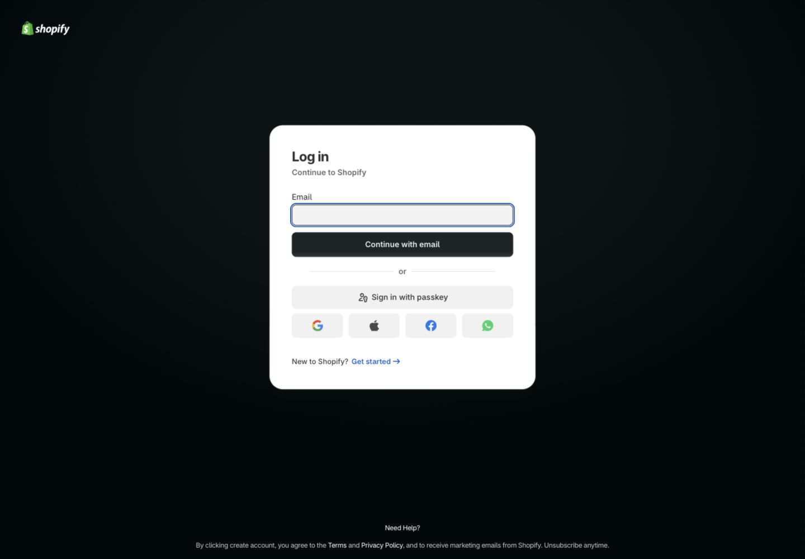
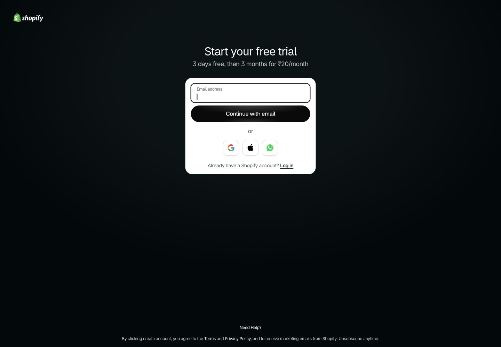
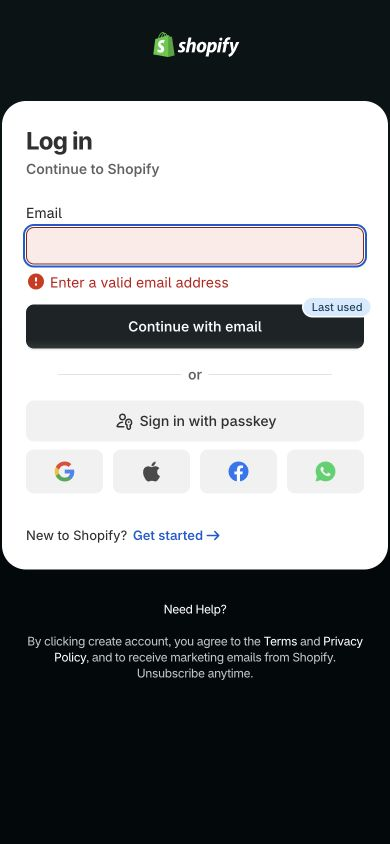
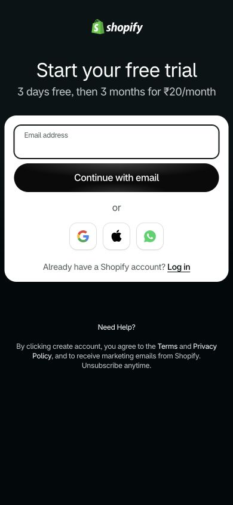

# Shopify Visual System

This chapter distinguishes **measured live account pages** from **archived Polaris reference values**. For the refreshed authenticated interface, use [Current admin visual reference](07_CURRENT_ADMIN_VISUAL_REFERENCE.md): its text, status colors and action shapes differ from the archive. Dimensions are CSS pixels, not screenshot pixels. The native browser initially reported device pixel ratio 2; explicit responsive overrides reported their own viewport conditions. Screenshots alone are not the source of exact measurements.

## Visual principles

**ANALYSIS.** The account screens allocate attention in four layers: recognizable brand, task title, one prominent next action, then lower-emphasis alternatives and help. The single column keeps reading order and action order close together. A white form on a nearly black green-tinted canvas makes the task area unmistakable without surrounding the form with marketing content.

The visual density is contextual. Login uses compact typography and generous card padding. Signup puts a larger offer heading above a smaller form. The admin is a recurring-work environment: useful density comes from comparable rows, durable object context, restrained decoration and consistent controls. A storefront belongs to a merchant's brand and cannot be inferred from the admin's neutral palette.

These are interpretations of composition, not measured conversion or cognitive-load effects. No controlled usability study or funnel telemetry was available.

## Live login palette

**MEASURED.** Source: public `/lookup` login, blank email and empty-submit error states. See `evidence/login-711.json`, `login-empty-error.json` and screenshots. The document intentionally omits session query parameters.

| Role | Exact sampled value | Context |
| --- | --- | --- |
| Page fallback | `#0A1314` | Body background color |
| Gradient outer stop | `#02090A` | Darker edge of body radial gradient |
| Card | `#FFFFFF` | White task container |
| Heading and input text | `#303030` | Main visible text |
| Inherited base text | `#202223` | Body/form defaults; individual elements can override it |
| Subtitle | `#616161` | Secondary heading |
| Focused email surface | `#F3F3F3` | Captured focused input state |
| Email border | `#1A1A1A` | 1 px focused-state border |
| Link and focus ring | `#005BD3` | Signup link and 2 px input outline |
| Main action sampled fill | `#0B1314` | Computed background at captured state |
| Main action text | `#FAFCFC` | Light label |
| Passkey/provider tiles | `#F1F1F1` | Neutral alternative-action surfaces |
| Invalid email surface | `#FEE9E8` | Empty-submit error |
| Invalid email border | `#8E1F0B` | 1 px error border |
| Footer links | `#FFFFFF` | Against the dark page |

The body gradient was computed as `radial-gradient(53.91% 53.91% at 50% 22.36%, #0A1314 50%, #02090A 100%)`. A sampled CSS background does not include every pseudo-element, blend layer or pointer state. The near-black action should therefore be treated as a captured rendered state, not a universal hover/active specification.

The invalid input kept its blue focus outline while gaining the error border and pale red surface. Focus and validity are independent states. The error also had an icon and a textual explanation, so color was not the only signal.

## Live signup palette and structure

**MEASURED.** Public `/signup` presented a different composition. Its 32 px offer heading was white; its 18 px subtitle was `#BFC7C8`. The floating field label was `#545D5E`; field text was `#0B1314`. The email action used `#0A0A0A` plus two subtle white radial highlight layers, `#FAFCFC` text and a pill radius of 9999 px.

Provider tiles on signup were **white**, 44 × 44 px, with 12 px corners. Login's provider tiles instead filled an equal-width row with `#F1F1F1` backgrounds and 8 px corners. Signup's inline login link was dark and underlined in the observed composition; login's signup link was blue with an arrow. These are deliberate surface differences, not evidence that one extracted component is used everywhere.

The visible India offer was 3 days free followed by 3 months at ₹20 per month. This is a dated regional screen observation, not a pricing recommendation or a promise for every account, plan or date.

## Exact login geometry

| Element | 1440 × 1000 observation | 711 × 1034 observation | 390 × 844 observation |
| --- | --- | --- | --- |
| Card width | 476 | 476 | 386 |
| Card x position | 482 | 117.5 | 2 |
| Card top | 224 | 101 | 101 |
| Card radius | 24 | 24 | 24 |
| Card padding | 40 | 40 | 24 |
| Inner form width | 396 | 396 | 338 |
| Heading size / line height | 24 / 32 | 24 / 32 | 24 / 32 |
| Main action height | 44 | 44 | 44 |
| Input height | 37.5 | 37.5 | 37.5 for visible email |
| Provider tile width | 91.5 | 91.5 | 77 |
| Provider tile height | 44 | 44 | 44 |

The 390 px measurement in the initial run was the **error** state; the later returning-login capture shows the corresponding no-error composition. Card height changes with errors and subtitle wrapping, so height is not a fixed token. The 1440 and 711 screenshots were captured before the empty-submit test. The viewport-dependent vertical positions are observations at these dimensions; no universal centering formula or exact breakpoint is asserted.

At 711 px, the logo header had 30 px top padding, the card had 28 px top margin, and the header-to-card composition placed the card at y = 101. At desktop width the whole task group sat lower. At 390 px the card was almost edge-to-edge, while its interior still had 24 px padding. That distinguishes **outer page gutter** from **inner card padding**.

### Spacing rhythm inside login

| Relationship | Measured value | Why the distinction matters |
| --- | --- | --- |
| H1 bottom margin | 2 px | Title and subtitle read as one unit |
| Title block to form | 24 px | Separates orientation from input |
| Label to input | 4 px | Keeps the label attached to its field |
| Input padding | 8 px block, 12 px inline | Text inset is separate from target height |
| Main button padding | 12 px block, 16 px inline | Captured 44 px overall target |
| Main button margins | 12 px block | Local separation from field and alternatives |
| Passkey button padding | 12 px block, 16 px inline | Captured 41 px overall target |
| Passkey bottom gap | 8 px | Groups the alternative methods |
| Social-row column gap | 10 px | Derived from measured adjacent tile edges |
| Social row to signup prompt | 32 px | Distinguishes alternate sign-in from new-account entry |
| Footer padding | 16 px block, 20 px inline at 711 px | Page-level legal/help region |
| Footer internal gap | 16 px | Help and legal copy remain separate |

This is not simply an 8 px-only grid: 2, 4, 8, 10, 12, 16, 24, 28, 32 and 40 px relationships appear. A useful design system assigns roles to these values rather than rounding everything to one step.

## Exact signup geometry

**MEASURED.** The 1440 px screenshot shows a 375 px white card with a 343 px-wide form, corresponding to 16 px horizontal card insets. The email host is 56 px tall; the inner input is 54 px tall because its wrapper contributes the boundary. The action is 343 × 48 px with 14 px block and 20 px inline padding. Field-to-action spacing is 8 px. The provider tiles are 44 px square with 12 px gaps.

| Typography role | Login | Signup |
| --- | --- | --- |
| Primary title | 24 / 32 px, weight 700, inside card | 32 / 32 px, weight 400, outside card |
| Subtitle | 14 / 20 px, weight 550 | 18 / 24 px, weight 420 |
| Field text | 16 px, weight 450 | 16 / 20 px, weight 400 |
| Field label | 14 / 20 px above field | 12 / 16 px floating label in captured state |
| Main action | 16 px, weight 500 | 16 / 20 px, weight 500 |
| New/existing account link | 13 / 20 px, weight 550 | 14 / 18 px, weight 520 |
| Footer link | 12 / 16 px, weight 420 | 12 / 16 px, weight 420 |

The computed font stack starts with `ShopifyInter`, then Noto Arabic/Hebrew fallbacks, UI sans and system sans. A computed family name does not independently prove which fallback supplied every glyph. Weights such as 420, 450, 520 and 550 show why substituting only 400/600 can change line widths and perceived density.

The signup field and action are custom elements with open shadow roots. The evidence includes a deep DOM measurement because inspecting only ordinary document-level `input` and `button` nodes missed their internal controls. The floating-label field keeps the label visible after entry; its captured internal padding was 26 px top, 4 px right/bottom and 16 px left. That inset belongs to this label treatment, not to every email field.

## Radius, boundary and elevation

**LIVE / MEASURED.** Login's outer card had no computed box shadow and no border; the white-to-dark surface contrast supplied its separation. Its 24 px corners were much larger than the 8 px control corners. Signup used a pill main action and 12 px provider tiles. Signup provider tiles combined a faint one-pixel edge with low-opacity, short shadows. The login main action had a short downward shadow: `0 3px 1px -1px rgba(26,26,26,0.07)` in the captured computed style.

**ANALYSIS.** Boundary treatments communicate different jobs: container grouping, editable input boundary, focus, error and elevation. Treating all five as the same gray border would erase information. Conversely, putting a large shadow under every section would weaken the overlay hierarchy in a work-heavy admin.

## Historical Polaris color reference

**ARCHIVE.** Pinned revision: `3f7954ae42fabf26d63cee68c23ceebfd7ef0972`, dated 9 September 2026; downloaded 22 October. The repository is now archived and directs new Shopify app development to web components. [Archive and status](https://github.com/Shopify/polaris-react-archive), [pinned base color source](https://github.com/Shopify/polaris-react-archive/blob/3f7954ae42fabf26d63cee68c23ceebfd7ef0972/polaris-tokens/src/themes/base/color.ts), [pinned color scales](https://github.com/Shopify/polaris-react-archive/blob/3f7954ae42fabf26d63cee68c23ceebfd7ef0972/polaris-tokens/src/colors.ts).

| Semantic role | Historical token | Value |
| --- | --- | --- |
| Admin canvas | `color-bg` | `#F1F1F1` |
| Main surface | `color-bg-surface` | `#FFFFFF` |
| Secondary surface | `color-bg-surface-secondary` | `#F7F7F7` |
| Tertiary surface | `color-bg-surface-tertiary` | `#F3F3F3` |
| Main action | `color-bg-fill-brand` | `#303030` |
| Main action hover / active | `color-bg-fill-brand-hover`, `-active` | `#1A1A1A` |
| Disabled main fill | `color-bg-fill-brand-disabled` | black at 17% alpha |
| Main text | `color-text` | `#303030` |
| Secondary text | `color-text-secondary` | `#616161` |
| Disabled text | `color-text-disabled` | `#B5B5B5` |
| Links / focus | `color-text-link`, `color-border-focus` | `#005BD3` |
| Link hover | `color-text-link-hover` | `#004299` |
| Standard border | `color-border` | `#E3E3E3` |
| Secondary border | `color-border-secondary` | `#EBEBEB` |
| Input border | `color-input-border` | `#8A8A8A` |
| Input border hover | `color-input-border-hover` | `#616161` |
| Input surface | `color-input-bg-surface` | `#FDFDFD` |
| Navigation canvas | `color-nav-bg` | `#EBEBEB` |
| Navigation selection | `color-nav-bg-surface-selected` | `#FAFAFA` |

### Historical status families

| Meaning | Surface | Strong fill | Text |
| --- | --- | --- | --- |
| Success | `#CDFED4` | `#047B5D` | `#014B40` |
| Information | `#EAF4FF` | `#91D0FF` | `#003A5A` |
| Caution | `#FFF8DB` | `#FFE600` | `#4F4700` |
| Warning | `#FFF1E3` | `#FFB800` | `#5E4200` |
| Critical | `#FEE8EB` | `#C70A24` | `#8E0B21` |
| AI or magic | `#F8F7FF` | `#8051FF` | `#5700D1` |

Surface, fill, text and icon roles are separate. A pale information fill needs its designated dark foreground; white text on every status color is not safe. Note the live login error uses a warm red family different from the archived critical family. Numeric similarity is not identity between systems.

The derived [JSON reference](evidence/archived-polaris-token-reference.json) contains the resolvable archived base entries, and the [CSV](evidence/archived-color-reference.csv) contains the color group. It is not a complete runtime theme compiler: theme overrides and complex expressions require their own resolution. It includes `color-scheme`, which is a scheme declaration rather than a color.

## Historical Polaris geometry and type

**ARCHIVE.** These values describe the pinned source, not a current admin screenshot.

| Spacing token suffix | Pixels | Spacing token suffix | Pixels |
| --- | --- | --- | --- |
| 0 | 0 | 400 | 16 |
| 025 | 1 | 500 | 20 |
| 050 | 2 | 600 | 24 |
| 100 | 4 | 800 | 32 |
| 150 | 6 | 1000 | 40 |
| 200 | 8 | 1200 | 48 |
| 300 | 12 | 1600 / 2000 | 64 / 80 |
| 2400 / 2800 / 3200 | 96 / 112 / 128 | button-group gap | 8 |
| card gap / padding | 16 / 16 | table-cell padding | 6 |

Historical radius values: 0, 2, 4, 6, 8, 12, 16, 20, 30 and 9999 px. Border widths include 0, 0.66, 1, 2 and 4 px. Historical breakpoint aliases map to 0, 490, 768, 1040 and 1440 px. These are not proven identity-page breakpoints.

| Historical text variant | Size / line height | Weight |
| --- | --- | --- |
| Heading 3xl | 36 / 48 | 700 |
| Heading 2xl | 30 / 40 | 700 |
| Heading xl | 24 / 32 | 700 |
| Heading lg | 20 / 24 | 650 |
| Heading md | 14 / 20 | 650 |
| Heading sm | 13 / 20 | 650 |
| Heading xs | 12 / 16 | 650 |
| Body lg | 14 / 20 | 450 |
| Body md | 13 / 20 | 450 |
| Body sm | 12 / 16 | 450 |
| Body xs | 11 / 12 | 450 |

The archived mobile theme changes several text sizes and removes several button/elevation effects. For example, body md becomes 16 / 24 rather than 13 / 20. This demonstrates why a desktop token table cannot be applied to mobile by shrinking the entire page.

Historical elevation ranges from no shadow through short edge shadows to broader overlay shadows. Motion durations include 0, 50–500 in 50 ms increments, and a 5000 ms token. Their presence does not establish the duration used by any particular live transition.

Sources: pinned [spacing](https://github.com/Shopify/polaris-react-archive/blob/3f7954ae42fabf26d63cee68c23ceebfd7ef0972/polaris-tokens/src/themes/base/space.ts), [font](https://github.com/Shopify/polaris-react-archive/blob/3f7954ae42fabf26d63cee68c23ceebfd7ef0972/polaris-tokens/src/themes/base/font.ts), [text](https://github.com/Shopify/polaris-react-archive/blob/3f7954ae42fabf26d63cee68c23ceebfd7ef0972/polaris-tokens/src/themes/base/text.ts), [mobile theme](https://github.com/Shopify/polaris-react-archive/blob/3f7954ae42fabf26d63cee68c23ceebfd7ef0972/polaris-tokens/src/themes/light-mobile.ts), [border](https://github.com/Shopify/polaris-react-archive/blob/3f7954ae42fabf26d63cee68c23ceebfd7ef0972/polaris-tokens/src/themes/base/border.ts), [breakpoints](https://github.com/Shopify/polaris-react-archive/blob/3f7954ae42fabf26d63cee68c23ceebfd7ef0972/polaris-tokens/src/themes/base/breakpoints.ts), [shadow](https://github.com/Shopify/polaris-react-archive/blob/3f7954ae42fabf26d63cee68c23ceebfd7ef0972/polaris-tokens/src/themes/base/shadow.ts) and [motion](https://github.com/Shopify/polaris-react-archive/blob/3f7954ae42fabf26d63cee68c23ceebfd7ef0972/polaris-tokens/src/themes/base/motion.ts).

## Current Polaris concepts

**DOC.** Current web-component guidance expresses appearance through semantic properties: tone communicates meaning, color changes intensity and variant changes presentation. Spacing uses a middle-out scale around `base`, with smaller and larger named steps. Responsive values can depend on container size. These API concepts do not publish one pixel mapping that can safely replace live measurement. Extension surfaces also constrain styling; their rules must not be generalized to every native Shopify screen. [Using web components](https://shopify.dev/docs/api/polaris/using-polaris-web-components).

## Contrast calculations

The following are opaque sRGB pair calculations using WCAG relative luminance, rounded here for display. Unrounded results are in [contrast evidence](evidence/contrast-pairs.json).

| Pair | Ratio | Interpretation |
| --- | --- | --- |
| Live `#303030` on white | 13.20:1 | Main text has ample contrast |
| Live `#616161` on white | 6.19:1 | Secondary text clears normal-text threshold |
| Live blue link on white | 6.11:1 | Link text clears normal-text threshold |
| Live focus blue on `#F3F3F3` | 5.51:1 | One relevant focus-boundary pair |
| Live action text on sampled fill | 18.25:1 | High-contrast action label |
| Signup floating label on white | 6.76:1 | Label pair clears normal-text threshold |
| Archived success text / surface | 8.99:1 | Correctly paired semantic family |
| Archived critical text / surface | 8.09:1 | Correctly paired semantic family |
| Archived warning text / surface | 8.40:1 | Correctly paired semantic family |
| Archived light border on white | 1.28:1 | Decorative separator; insufficient by itself as an essential 3:1 boundary |

Normal text generally needs 4.5:1; qualifying large text needs 3:1, with specified exceptions. A palette calculation does not establish full-page accessibility, all gradient positions, disabled-state treatment or focus visibility. [W3C contrast explanation](https://www.w3.org/WAI/WCAG22/Understanding/contrast-minimum.html).

## Responsive and accessibility interpretation

**LIVE.** At 390 px the login and signup remained single-column; visible labels, alternative methods and legal text wrapped within the viewport. The login's mobile outer gutter was unusually small. Screens at 320 px, landscape, enlarged text, forced colors and real mobile keyboard occlusion remain separate checks.

The 44 px social tiles and 44/48 px main actions are comfortably larger than the WCAG 2.2 AA baseline target size of 24 × 24 CSS px. That baseline has exceptions, including inline links and spacing alternatives; 44 px is not the universal AA minimum. [Target size](https://www.w3.org/WAI/WCAG22/Understanding/target-size-minimum.html).

The observed login headings went from H1 to H3 for the subtitle. A visual subtitle can be ordinary text; copying that hierarchy without examining semantics would be unwise. DOM checks found `aria-invalid` and `aria-describedby` on the erroneous email field. Actual announcement order, screen-reader behavior and complete keyboard navigation still require assistive testing.

## Visual evidence

