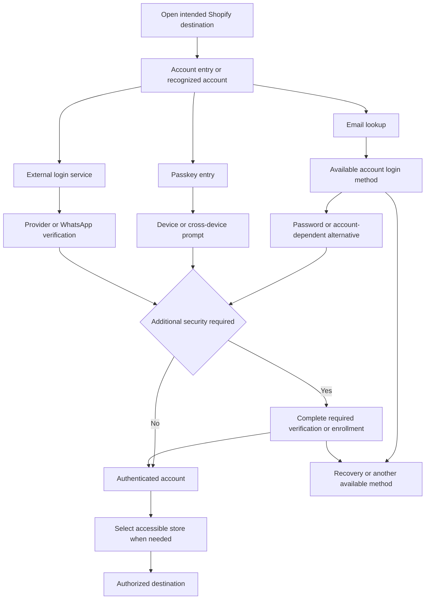
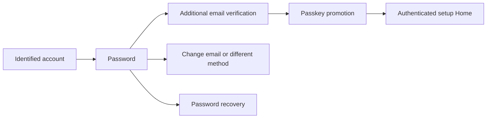
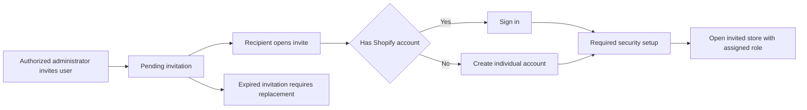

# Shopify Identity and Existing Login Flows

The account UI must answer three different questions: **who is this person, which business can they access, and what work may they do there?** The public login answers the first; store selection and permissions answer the others. A successful sign-in is not evidence that every store, organization or financial action is authorized.

Evidence labels follow the [research index](README.md). Public screens were inspected without the agent submitting a real identifier, password, verification code or account-creation agreement. The user subsequently completed login and supplied screenshots; the authenticated landing and admin were then inspected directly.

## Identity surfaces and boundaries

| Surface | Person's task | Evidence |
| --- | --- | --- |
| Shopify account | Authenticate, maintain personal security, recover access | LIVE entry; USER password/verification/promotion; DOC recovery |
| Store selection | Choose among businesses available to the account | LIVE single-store menu; DOC multi-store chooser |
| Merchant admin | Operate the selected store under assigned permissions | LIVE authenticated inspection; PRIOR historical records |
| Organization administration | Manage people, roles and security across organization scope | DOC; plan-dependent |
| Staff invitation | Join an existing business using an individual account | DOC |
| Partner or Dev Dashboard | Enter development/partner work where permitted | DOC store-switcher entry; private screens OPEN |
| POS | Operate an in-person surface, including POS-only users | DOC; native execution OPEN |
| Storefront customer accounts | Buyer orders, profile, addresses and account actions | DOC; separate buyer journey |
| Shop / accelerated purchase | Buyer identity/payment convenience | DOC entry relationship; full flow OPEN |

Shopify describes a Shopify ID as belonging to an individual, rather than a store, and usable across the stores and resources they can access. It does not turn staff into owners, and its setup does not replace customer accounts or POS PINs. [Shopify ID](https://help.shopify.com/en/manual/your-account/logging-in/sso-migration-guide).

## Public email login anatomy

**LIVE.** The supplied link rendered `/lookup`. Its visible sequence was brand → Log in → destination subtitle → email → Continue with email → alternative methods → Get started → help/legal footer. The destination subtitle was initially Continue to Shopify; entry from signup later showed Continue to Shopify account. Preserve that context distinction when interpreting screenshots.

The DOM contained an offscreen password control during email lookup. It was not visible in the accessibility view of the actual task area and does **not** prove the password step was displayed. Inspecting all DOM inputs without checking geometry would have misclassified the screen.

**LIVE.** An empty submission produced an inline invalid-email explanation, error icon, pale red field and red border, with focus remaining at email. The field exposed `aria-invalid=true` and linked descriptive/error nodes. The method then gained a Last used label. This run proves a recently attempted method can be visually marked; it does not prove the label records only successful authentication. Temporary disabled states appeared during transitions and were not treated as the stable empty-field policy.

**ANALYSIS.** Email-first lookup keeps the initial choice narrow and permits account-dependent routing later. Its quality depends on the next steps: retaining the identifier, offering a safe way to change it, preserving the intended destination, and giving a recovery path when the preferred method is unavailable. These properties were not all executable from the public state.

## Returning login flow

The diagram joins public observations with documented branches. A branch in the diagram is not a claim that its account-specific screen was exercised.

Shopify's documented standard path is account identifier, password, optional two-step challenge and store selection when several stores are associated. A previously used device can show a remembered store instead of asking for email again. [Login and logout](https://help.shopify.com/en/manual/your-account/logging-in/log-in).

### Returning login supplied by the user

**USER.** The screenshots establish a concrete sequence: identified account → password → additional email verification → optional passkey promotion → authenticated setup Home. They are evidence of this user's path, not a universal sequence for every Shopify account.

The password step displayed the chosen identifier in a summary block with Change email, followed by a labeled password control, eye/reveal icon, Forgot password?, Log in and Log in using a different method. At the displayed 671 px responsive width the identifier and change action shared a row; at 390 px the change action wrapped beneath the identifier. This retains account context while allowing correction.

The email-verification screen explained the security purpose and destination, then used six separate visual cells, Resend code and Verify. The supplied email showed an expiry instruction and a warning against sharing the code. The code and personal address are deliberately omitted here. Paste, automatic focus movement, autofill, resend delay, failed attempts and expiry enforcement were not exercised by the agent.

The later “Faster, safer login” card used a purple security illustration and explained fingerprint, face or screen lock. Add passkey was primary, Not now secondary, with Learn more in the explanation. This is post-login security education with a defer path, not proof that a passkey was enrolled or mandatory.

**ANALYSIS.** The sequence separates identity entry, a risk/security challenge and an improvement suggestion. The six-cell challenge here must not be described as proof of passwordless email login or every configured MFA method. The successful authenticated session was provided by the user; credential handling was not part of the research.

## Login method inventory

| Method | Public entry observed | Downstream evidence and qualification |
| --- | --- | --- |
| Email and password | Email lookup | USER password screen; agent did not submit a password |
| Email code | No dedicated initial button | DOC account-dependent alternative in passkey recovery guidance; not universally available |
| Passkey | Sign in with passkey | DOC; OS/browser prompt not invoked |
| Google | Icon tile with accessible provider name | LIVE entry; provider consent and callback OPEN |
| Apple | Icon tile with accessible provider name | LIVE entry; provider consent and callback OPEN |
| Facebook | Present on login | DOC existing connections only; absent on observed signup |
| WhatsApp | Icon tile | LIVE phone-entry screen; no code requested |
| Enterprise SAML | Not on the generic public card | DOC organization/Plus path; OPEN private execution |
| POS PIN | Not an account-card option | DOC POS-only access; not merchant web login |

Login-service eligibility varies by region and provider account. Shopify requires an email for recovery and communications, and documents restrictions on linking multiple services. Facebook cannot be newly connected, though an existing connection can still authenticate. [Login services](https://help.shopify.com/en/manual/your-account/logging-in/login-services).

### WhatsApp login and signup are different entries

**LIVE.** WhatsApp login used a Log in with WhatsApp title, explanation of code delivery, a labeled Country selector, India +91 preselected, a Phone number field and Send code. The selector and number appeared side by side; long explanatory copy wrapped on mobile. No code delivery, resend countdown or verification was tested.

**LIVE.** WhatsApp signup instead used Sign up with WhatsApp and account-creation wording. Its public form also disclosed WhatsApp marketing/admin messaging and an unsubscribe instruction. That additional disclosure was visible before a number was sent. The signup and login routes must not be treated as a single identical form.

**DOC.** WhatsApp recovery guidance addresses unavailable sign-in, incorrect country/number, inactive WhatsApp, resend waiting and falling back to email. A phone number links to one Shopify account, which may access several stores. These are eligibility/recovery concepts, not proof of the observed screen's exact resend timer or code length. [Login services](https://help.shopify.com/en/manual/your-account/logging-in/login-services).

### Passkeys and two-step authentication

**DOC.** Shopify distinguishes a passkey replacing a password from a separately configured two-step method. The help describes synced versus device-only passkeys, verified-email prerequisites, multiple backup passkeys, cross-device QR use and alternate login methods. Losing a device and losing access to a synced password manager are different recovery situations. [Passkeys](https://help.shopify.com/en/manual/your-account/logging-in/passkeys).

**ANALYSIS.** A passkey journey needs clear outcomes for cancellation, unsupported browser, no eligible credential, wrong device, unavailable password manager and required additional verification. A dismissed native prompt should return the person to usable alternatives. Neither a visible button nor a successful device prompt alone certifies a complete login and return to the intended store.

**DOC.** Two-step login can use an authenticator app, security key, existing SMS method, existing built-in authenticator or Shopify mobile backup prompt. Some legacy methods cannot be newly enrolled. The method presented depends on account setup; a universal six-box OTP screen would not represent all of these paths. [Two-step login](https://help.shopify.com/en/manual/your-account/logging-in/secure-sign-in/two-step-login).

Shopify can require enrollment before admin access. Current guidance says SMS cannot be set up as a new two-step method. Recovery and backup choices therefore deserve first-class design, rather than being treated as an optional help article after launch. [Two-step security](https://help.shopify.com/en/manual/your-account/logging-in/secure-sign-in).

### Enterprise identity

**DOC.** Shopify Plus organizations can configure SAML, including required, selected-user and off enforcement modes. Their identity provider manages those credentials; Shopify's password reset is not the SAML password-recovery route. A domain policy can change the method a user must follow even when the generic account entry looks familiar. [SAML](https://help.shopify.com/en/manual/your-account/users/security/advanced-security-features/saml), [password recovery](https://help.shopify.com/en/manual/your-account/logging-in/reset-password).

This enterprise branch is included to make the Shopify map complete at the conceptual level. It is not an instruction to build enterprise SSO in LetBuyy.

## Recovery and account security

| Task | Documented path | UI research concern |
| --- | --- | --- |
| Forgotten password | Request reset email, follow reset link, set new password, sign in | Delivery delay, expired link, clear next action |
| Third-party-only account | Password reset may not be offered if no password was set | Explain available method; avoid dead-end instructions |
| Lost passkey | Try configured alternatives; recover only as needed | Device loss differs from credential removal |
| Lost two-step method | Backup method or recovery code; dedicated recovery path | Resetting a password does not remove MFA |
| Lost email access | Account recovery and possible identity verification | Ownership proof and pending review |
| Suspicious access | Security review, device history, support as appropriate | Separate incident from ordinary forgotten password |
| Sensitive change while signed in | Account verification prompt | Reauthentication is a distinct task from initial login |
| Staff cannot access a store | Contact store/organization owner | Membership recovery differs from account recovery |

Shopify documents that a password reset removes passkeys and external login-service connections, while two-step requirements remain. It also documents different lost-email recovery branches for recent versus older access; the published examples use different verification-code lengths. A designer should not hardcode one universal account-recovery code shape. [Resetting passwords](https://help.shopify.com/en/manual/your-account/logging-in/reset-password).

For some recovery or risk situations, identity verification can require government ID, liveness and manual review; completion and approval are distinct outcomes. [Identity verification](https://help.shopify.com/en/manual/your-account/logging-in/identity-verification). Those screens were not entered and no identity documents were handled.

**ANALYSIS.** Recovery should preserve safe context while avoiding revealing whether an arbitrary account exists. A robust research test distinguishes invalid entry, delivery pending, wrong code, expired code, exhausted attempts, unavailable service and review pending. These are evaluation requirements, not claims that Shopify exposed each exact message in this session.

## Store switching and access context

**DOC.** Shopify offers recent stores and a searchable full list; the refreshed admin can place the switcher in the sidebar instead of the top bar. Dashboard links depend on permissions. Frozen, paused and closed stores are omitted until reactivated. [Store switcher](https://help.shopify.com/en/manual/your-account/logging-in/store-switcher).

**LIVE.** In this authenticated store, the sidebar account/business menu exposed the selected business, View Dev Dashboard, Create store, the signed-in account and Log out. No second store was selected, no new store created and no logout/session revocation performed. The menu supports the visible account/business boundary; a large-membership chooser remains document-backed.

**ANALYSIS.** The switcher's job is to reduce business-context mistakes. Research should check similar store names, an empty accessible-store list, many memberships, suspended access and a deep link to an unauthorized store. Recent-store ordering is a convenience signal, not permission evidence. The selected business should remain visible at destructive, financial and publishing actions.

## Invitation and staff onboarding

**DOC.** An invitation can be accepted by signing in or creating an individual Shopify account. It expires after seven days. The inviter assigns roles, and current guidance describes secure sign-in as enabled by default for admin-user invitations, subject to organization enforcement. POS-only users are a different case and can use PINs without email. [Inviting users](https://help.shopify.com/en/manual/your-account/users/invite-users).

**ANALYSIS.** Staff should not be pushed through owner-oriented business creation or provider onboarding. Acceptance needs the invited store and account identity to be understandable before access is granted. Wrong-account, revoked invitation, expired invitation and already-accepted cases deserve separate tests; exact Shopify UI for those cases remains OPEN.

## Buyer identity is a separate research track

**DOC.** Current customer accounts use an emailed one-time six-digit code as the default passwordless entry; Shop and eligible social/identity-provider alternatives are separate options. A new email can produce a customer profile automatically. Buyer account actions include orders, profile, addresses, returns and reorder. [Customer accounts](https://help.shopify.com/en/manual/customers/customer-accounts).

**ANALYSIS.** Do not infer buyer permissions, merchant MFA, account duration or checkout authority from the merchant login card. A merchant profile, an individual staff identity and a storefront customer relationship serve different jobs even where terminology overlaps.

## Flow coverage register

The register includes both observed and unexecuted paths so omissions remain visible. “Entry” means the entry screen or control was seen, not successful completion.

| ID | Branch | Status | Next evidence needed |
| --- | --- | --- | --- |
| I01 | Generic email login | LIVE / MEASURED; user supplied signed-in session | Agent-observed end-to-end continuation |
| I02 | Empty-email validation | LIVE / MEASURED | Repeated-entry and announcement behavior |
| I03 | Invalid email syntax | OPEN | Controlled malformed input test |
| I04 | Existing password account | USER / DOC | Incorrect-password and alternate-method interaction |
| I05 | Incorrect password / throttling | OPEN | Dedicated account and bounded negative test |
| I06 | Remembered account or store | DOC | Consented returning-account session |
| I07 | Last-used method | LIVE | Successful-login versus attempted-method semantics |
| I08 | Change account or identifier | USER control | Executed change and return |
| I09 | Passkey entry | LIVE entry / DOC | OS prompt and cancel path |
| I10 | Cross-device passkey | DOC | Two owned devices |
| I11 | Lost or unavailable passkey | DOC | Controlled recovery fixture |
| I12 | Google login | LIVE entry | Provider consent/cancel/callback |
| I13 | Apple login | LIVE entry | Provider consent/cancel/callback |
| I14 | Existing Facebook connection | LIVE entry / DOC | Existing connected test account |
| I15 | WhatsApp login phone entry | LIVE / MEASURED | Code delivery and verification |
| I16 | WhatsApp resend or delivery failure | DOC | Owned number and delivery fixture |
| I17 | Account-dependent email code | DOC; USER additional security challenge | Passwordless alternative remains distinct and untested |
| I18 | Authenticator challenge | DOC | Enrolled account |
| I19 | Security key challenge | DOC | Owned enrolled key |
| I20 | Legacy SMS / built-in method | DOC | Eligible existing enrollment |
| I21 | Mobile authentication prompt | DOC | Enrolled mobile app |
| I22 | Recovery code | DOC | Disposable account and code |
| I23 | Required security enrollment | DOC | Account under requirement |
| I24 | Forgot-password request and completion | DOC | Owned inbox; user completes credential change |
| I25 | Lost-email recovery | DOC | Approved recovery scenario |
| I26 | Identity verification / manual review | DOC | Authorized test fixture |
| I27 | Store chooser and search | LIVE single-store menu / DOC chooser | Multiple accessible stores and search |
| I28 | Store missing / suspended membership | DOC / OPEN UI | Controlled membership states |
| I29 | Staff invitation acceptance | DOC | Existing invitation fixture |
| I30 | Expired / revoked / wrong-account invite | OPEN | Dedicated invitation fixtures |
| I31 | SAML organization login | DOC | Eligible organization |
| I32 | Profile and security settings | DOC | Authenticated test session |
| I33 | Device history and logout | DOC | Authenticated test session |
| I34 | Sensitive-action verification | DOC | Safe reversible action fixture |
| I35 | Buyer passwordless sign-in | DOC | Test storefront and owned inbox |
| I36 | Mobile app / POS identity | DOC | Installed test app and permitted role |
| I37 | Expired session / deep-link return | OPEN | Controlled session expiry |
| I38 | No store / no permission outcome | OPEN | Dedicated account state |
| I39 | Post-login passkey promotion | USER | Enrollment, defer result and repeat-prompt behavior |

Device management is documented separately from store membership: a person can review devices and revoke sessions. A logout-all action also ends their current session. [Login and device management](https://help.shopify.com/en/manual/your-account/logging-in/log-in). No sessions were revoked during this research.

## Identity acceptance questions

These are **ANALYSIS** questions for the next observed session, not an assertion of defects: Is the intended destination preserved across provider handoffs? Can a user correct a mistaken identifier without restarting? Does Back return to a useful state? Can a staff member recognize the invited business? Are verification requirements explained without implying that they can be skipped? Does a failed login retain only safe input? Is every icon-only provider tile named for assistive technology? Is an expired session distinguishable from a permission denial?
