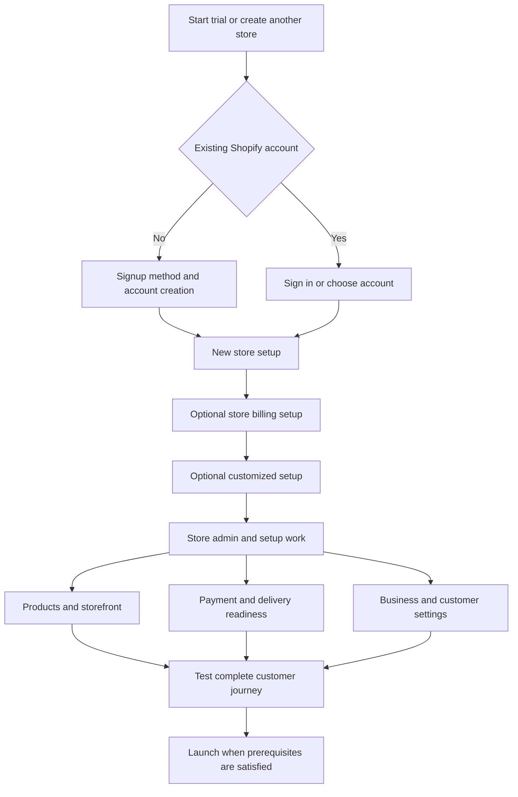
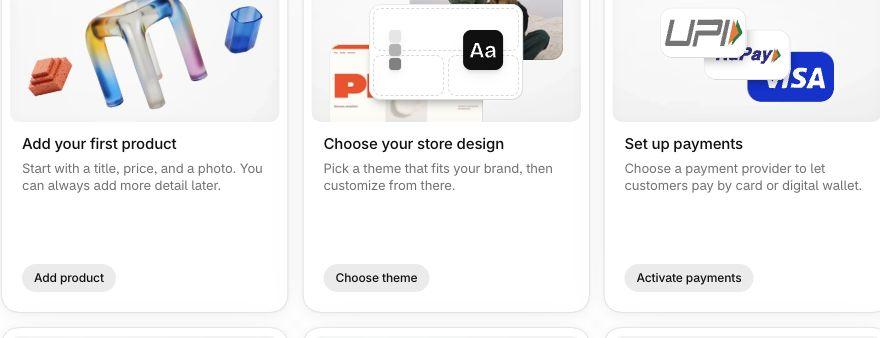

# Shopify Signup and Merchant Onboarding

Shopify onboarding is best understood as **account access → store creation → business configuration → tested selling readiness → ongoing operation**. These stages can overlap, but they are not interchangeable. A completed questionnaire is not a configured payment method, and a created product is not proof that a buyer can complete an order.

The public signup and WhatsApp signup entries were observed. After the user completed login, the current setup Home, task destinations and all visible Settings categories were inspected directly. Account creation and personalized signup questions remain document-backed. The [coverage register](06_EVIDENCE_AND_COVERAGE.md) distinguishes task entry from completed setup.

## Public trial signup

**LIVE.** `/signup` showed a brand mark, a large trial heading and a regional offer, then a compact white card containing email, Continue with email, an alternative-method separator, Google/Apple/WhatsApp icon tiles and an existing-account login link. Help and terms/privacy text sat outside the card. Facebook and passkey entry were absent from this observed signup screen even though they appeared on login.

The form's floating label, large field and pill action create a different emphasis from returning login. The single initial input delays asking for business details until the person chooses to continue. This is a composition observation; its effect on signup conversion was not measured.

The screen's legal text referred to account creation and marketing emails. The presence of a nearby Continue button does not establish the exact later point at which the account is created or terms accepted. No real identifier was submitted to discover that boundary.

### New and existing account entry

**DOC.** Shopify's setup guide supports creating a new account or choosing an existing account. Billing information can be deferred, and a customized setup questionnaire can be skipped. The guide then describes entry to the new admin. This supports optional personalization, not one universal sequence of questionnaire screens for every country and cohort. [Initial setup](https://help.shopify.com/en/manual/intro-to-shopify/initial-setup).

The diagram is an explanatory stage model. It does not claim the precise UI order, wording or screen count for the pending test account.

## Onboarding principles

**ANALYSIS.** Several useful principles follow from the observed entry and documented optional setup:

1. Ask for what is needed to advance the current task. Business questionnaires, payment setup and security enrollment should have distinct purposes.
2. Make optional personalization visibly optional. A skip action should not look like an error or a failed step.
3. Route by the person's role. An owner starting a business and an invited staff member have different next actions.
4. Treat a returning merchant creating another store as experienced, while still checking store-specific prerequisites.
5. Keep progress tied to durable outcomes. “Visited payment settings” and “provider ready to accept the intended payment method” are different states.
6. Resume from the remaining task after interruption. Browser Back, refresh and sign-in handoffs are normal parts of setup.
7. Show external dependencies clearly. DNS propagation, provider review, document review and email delivery can be pending without being failed.
8. Separate readiness from growth suggestions. An optional app or campaign should not obscure a broken checkout prerequisite.

These are research conclusions and evaluation criteria. They do not establish that Shopify executes every property for every branch.

## Personalized setup questions

**OPEN.** The exact live questions, options, sequence, skip placement, back navigation, progress indicator and completion persistence require an authenticated new-store session. Commonly discussed topics such as experience, selling channels, products, business location and migration must not be presented as verified current screens merely because they appeared in old videos or screenshots.

For each actual question, capture: the decision it changes; allowed single/multiple selection; whether it is required; default/preselection; help text; Continue/Back/Skip behavior; whether selecting an option creates an external object; and where the answer can be changed later. This is more useful than transcribing a sequence without understanding its consequence.

## From first admin visit to first sale

**DOC.** Shopify's general checklist groups work into preparing the business, configuring the store, organizing products and design, testing, launching and promoting. Key setup areas include business settings, domain/email, shipping/tax/payment, policies, customer accounts and checkout. Testing includes successful/failed orders, cancellation/refund and fulfillment. [General checklist](https://help.shopify.com/en/manual/intro-to-shopify/initial-setup/new-to-shopify-checklists/general-checklist).

The following is an **ANALYSIS task map** for researching those dependencies. It is not a claim that every row is a mandatory wizard step or that each screen was executed.

| Stage | Merchant's question | Durable outcome to inspect | Failure or interruption worth testing |
| --- | --- | --- | --- |
| Business identity | What business am I setting up? | Correct business/store details | Required-field error; later correction |
| Locale | Which operating defaults apply? | Appropriate region, currency, units and time context | Wrong default; region-dependent limitation |
| Product | What can I sell? | A valid product available in the intended channel | Draft saved but unavailable to buyers |
| Product variants | What exactly is purchasable? | Understandable variant, price and stock | Unavailable combination; missing image |
| Inventory | Can I fulfill the item? | Correct location and available quantity | No stock; wrong location |
| Theme | What does the buyer see? | Previewable and suitable storefront | Empty sections; unpublished changes |
| Navigation | Can buyers find it? | Useful collection/menu destinations | Broken link; product hidden from navigation |
| Domain | Can buyers reach the business? | Intended domain and connection state | DNS pending; ownership mismatch; SSL pending |
| Email | Can customers recognize messages? | Appropriate sender and delivery readiness | Unverified sender; failed delivery |
| Checkout | Can the order be completed? | Clear contact, delivery and payment choices | Missing required field; stale availability |
| Payments | Can the merchant accept the intended tender? | Provider readiness and clear mode | Setup incomplete; review pending; failed payment |
| Delivery | Can the order reach this buyer? | Valid rate/service for relevant destination | No available rate; unsupported location |
| Taxes | Are amounts and documents appropriate? | Correct settings for the merchant's business | Missing product tax classification |
| Policies | Can customers understand terms and support? | Accessible, relevant policy/contact content | Placeholder policy; missing contact route |
| Customer accounts | How do buyers return? | Working buyer sign-in and order access | Code delivery failure; wrong account |
| Staff | Who can help operate? | Individual invited members with appropriate roles | Expired invite; denied action |
| Trial and plan | What is available now and later? | Understandable entitlement and billing choice | Trial ends; gated launch or operation |
| Test order | Does the whole journey work? | Expected order, notification and fulfillment behavior | Lost response; failed tender; cancellation |
| Launch | Is the business ready for public buyers? | Intended visibility and verified prerequisites | A setup task appears done but checkout fails |
| Daily operation | What requires attention next? | Relevant orders/tasks and business context | Misleading empty dashboard; no next step |

### Home as the transition from setup to operation

**LIVE.** This trial store's Home greeted the merchant, showed remaining trial time and offered a large Sidekick composer. The visible setup feed included Add your first product, Choose your store design, Set up payments, Get a custom domain, Review shipping rates and an India optimization guide. Each card paired a concise task explanation with an action and contextual illustration; dismiss controls were present but not used.

The store name had an editable/clickable affordance in the greeting. The product, theme, domain, payments and shipping destinations led to the relevant operational/configuration work. Product authoring was explored through an unsaved HTML and AI preview, then discarded. The research did not complete tasks or verify the checklist's persistence/completion rules.

**USER.** The responsive screenshot showed stacked setup cards, floating navigation and Sidekick launchers, and an expanded trial offer. A preceding screenshot showed optional post-login passkey promotion. This distinguishes account-security education from merchant-business setup; they are separate tasks even when shown consecutively.

**DOC.** Shopify Home combines tasks, metrics, recommendations and guides. Its public documentation distinguishes setup tasks while a store is in private mode from the activity globe after private mode is disabled. It also describes user-specific metric customization and reduced-motion behavior for the globe. [Shopify Home](https://help.shopify.com/en/manual/shopify-admin/shopify-home).

**ANALYSIS.** The useful pattern is a changing home purpose: first help a merchant become ready, then help them operate. Fake zero metrics, celebratory graphics or a 100% questionnaire indicator should not substitute for readiness evidence. A task should lead to the actual work and return with a truthful result.

## Alternate onboarding paths

| Entry situation | How the research should differ | Evidence |
| --- | --- | --- |
| First-time owner | Understand account creation and guided setup | LIVE signup entry; DOC overall stages |
| Existing Shopify user | Separate personal identity reuse from new-store configuration | DOC initial setup |
| Invited staff member | Join an existing store; avoid owner-creation detour | DOC invitation flow |
| Multiple-store operator | Test chooser, recency and similar business names | DOC switcher |
| Migrating merchant | Preserve catalog, navigation, URLs and operational continuity | DOC checklist; exact import UI OPEN |
| Partner preparing a merchant store | Distinguish partner work and owner handover | Contextual DOC; dashboard UI OPEN |
| Physical retail / POS | Hardware, location and staff context change the work | Contextual DOC; device UI OPEN |
| B2B or enterprise | Entitlements, organization roles and identity policy differ | Plan-dependent DOC; UI OPEN |
| Buyer creating an account | Study storefront email-code entry rather than merchant setup | DOC customer accounts |
| Store reactivation | Explain unavailable store and recovery of business access | DOC switcher context; reactivation UI OPEN |

The research does not assume that the broad Shopify product catalog belongs in LetBuyy's beta. A workflow can be worth studying while its capability remains outside the approved product envelope.

## Required state inventory for observing onboarding

**ANALYSIS.** A careful follow-up should collect the same fields for each step:

| State | What the observer must establish |
| --- | --- |
| Initial | Default answer, required information and next action are understandable |
| Choice selected | Selection remains visible without relying only on hue |
| Validation error | Error points to the relevant control and retains safe answers |
| Submission pending | Duplicate actions are prevented and waiting is explained |
| Recoverable failure | Retry has a clear scope; earlier completed work survives |
| External review | Pending approval is distinct from success and rejection |
| Skipped | Person reaches a useful next state and can return later |
| Interrupted | Refresh/relogin/back does not silently lose completed work |
| Completed | The underlying resource or setting exists; completion is durable |
| No permission | Person gets an appropriate explanation and owner/admin route |
| Unavailable entitlement | Capability and prerequisite are understandable without deceptive affordances |

## Onboarding coverage register

| ID | Journey | Current coverage | What remains |
| --- | --- | --- | --- |
| O01 | Public regional trial entry | LIVE / MEASURED | Other region/cohort comparison |
| O02 | Email signup entry | LIVE / MEASURED | Owned-account continuation |
| O03 | Google signup entry | LIVE control | Provider and account completion |
| O04 | Apple signup entry | LIVE control | Provider and account completion |
| O05 | WhatsApp signup entry | LIVE / MEASURED | Code, email requirement and account completion |
| O06 | Existing-account link | LIVE navigation; USER subsequent returning login | New-store handoff remains untested |
| O07 | Credential creation / email verification | DOC / OPEN UI | User-completed creation boundary |
| O08 | Optional billing during setup | DOC | Exact skip and review screens |
| O09 | Customized questionnaire | DOC | Actual questions, branches and resume |
| O10 | Setup Home | LIVE / MEASURED; USER responsive view | Durable task completion and mature-store transition |
| O11 | Product → theme → domain work | LIVE task entries, unsaved product editor and domain validation | Saved/published journey and interrupted saves |
| O12 | Payment → delivery → checkout readiness | LIVE Settings entry / DOC readiness | Provider activation, actual rates and test checkout |
| O13 | Test order and launch | DOC | Safe test-order flow; no paid commitment |
| O14 | Staff onboarding | DOC | Invitation fixture and assigned-role landing |
| O15 | Existing user creates another store | DOC | Current chooser and new-store path |
| O16 | Migration / partner / POS / enterprise | Contextual DOC | Separate eligible test environments |

## What a follow-up capture must record

Use a fresh, authorized test context and record the role, region, plan/trial state, entry URL without tokens, viewport, chosen branch and durable outcome. Capture both forward and recovery behavior. Do not infer progress persistence from a screenshot, a successful page navigation or a completion checkmark. Stop before real subscription, provider activation, publication or account-security changes unless separately authorized.
