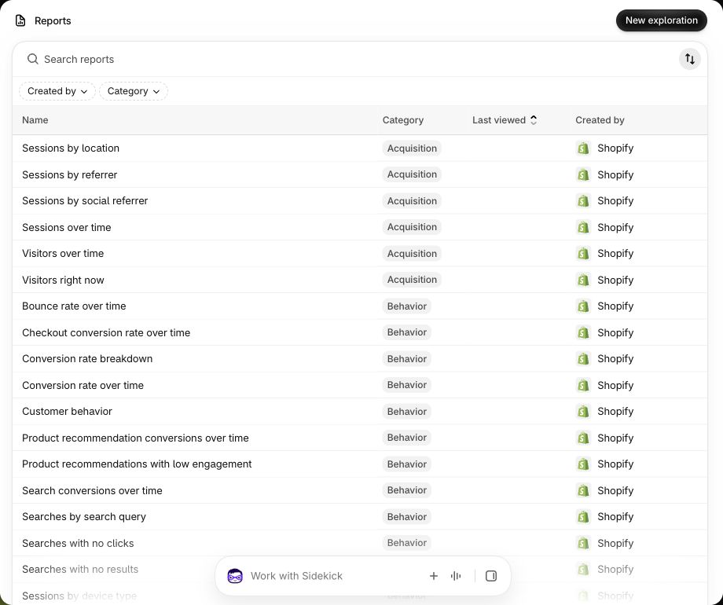
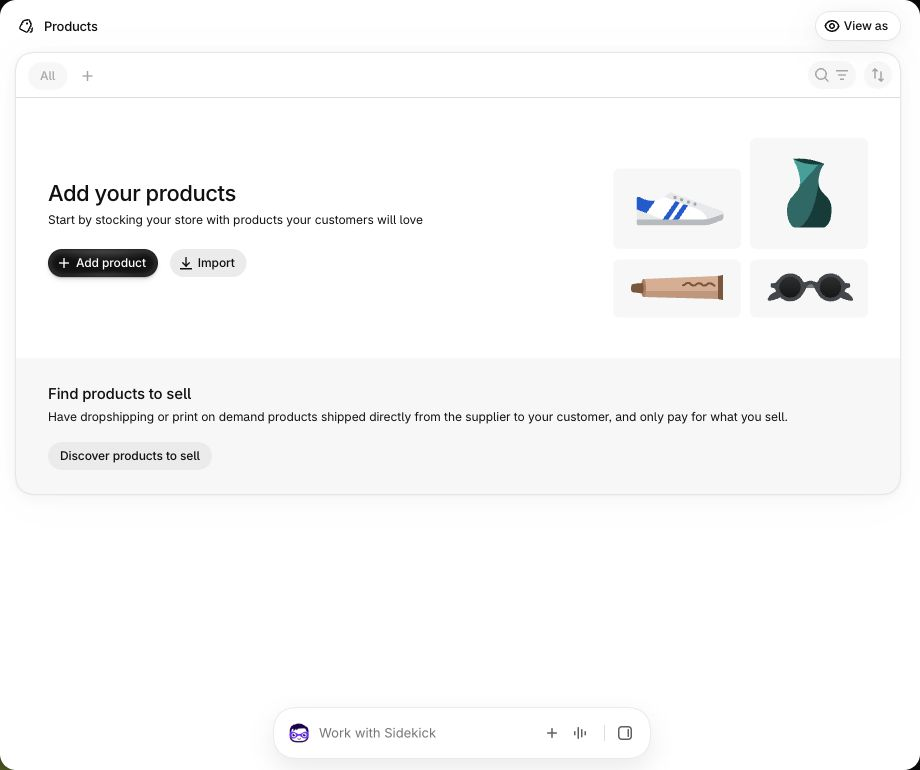
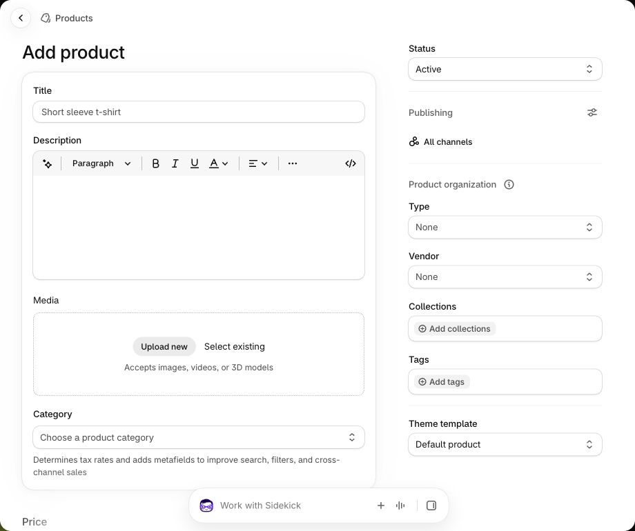
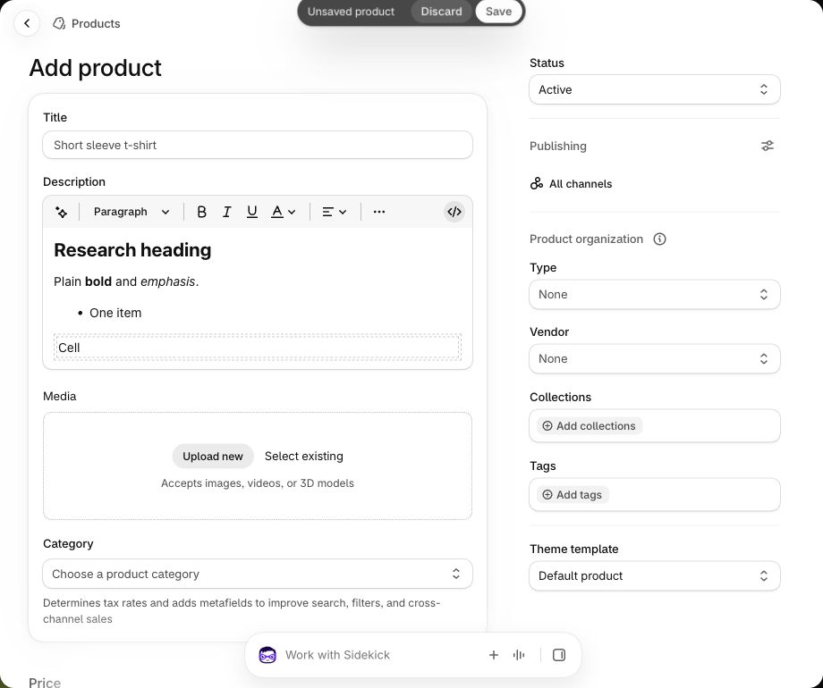
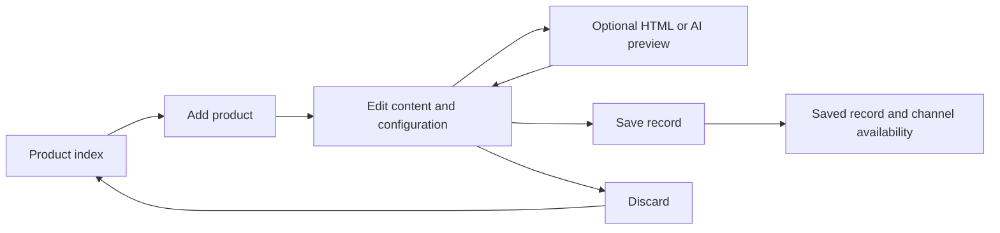
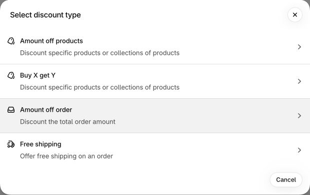
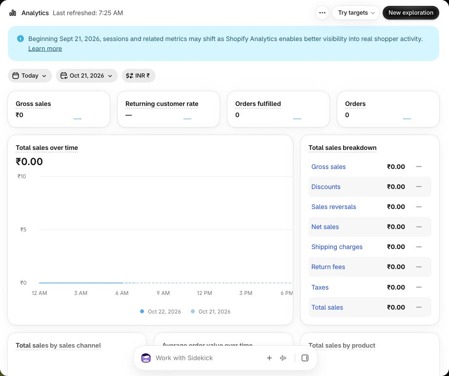
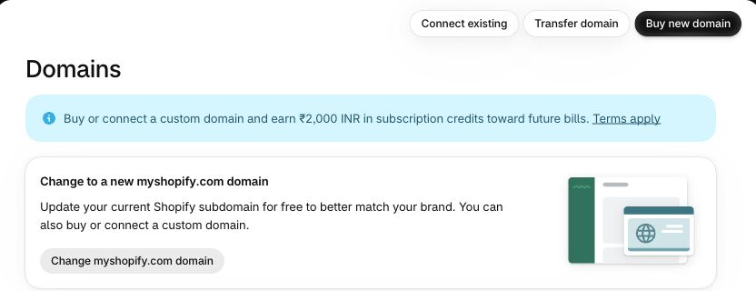
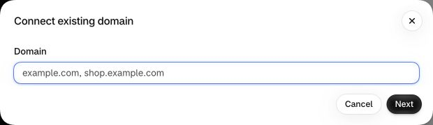

# Shopify Authenticated Admin and Commerce Patterns

The refreshed Shopify admin uses a stable business navigation shell around task-specific workspaces. Lists support comparison and retrieval; editors expose the record and its configuration; Settings provides a separate administrative navigation system. This chapter describes the authenticated India trial store observed on 22 October 2026. Exact visual measurements are in [the current admin visual reference](07_CURRENT_ADMIN_VISUAL_REFERENCE.md); AI and speed are in [AI motion and performance](08_AI_MOTION_AND_PERFORMANCE.md).

The follow-up [surface/loading study](09_SURFACE_CONTAINERS_AND_NAVIGATION_LOADING.md), [Themes reference](10_THEMES_PAGE_DETAILED_REFERENCE.md), [theme-editor reference](11_THEME_EDITOR_DETAILED_REFERENCE.md) and [Apps reference](12_APPS_AND_EXTENSION_SURFACES.md) deepen those branches with additional live evidence. The later Settings snapshot omitted Markets and contained 19 entries; the 20-entry list below is the first-pass inventory.

**LIVE** means a screen or interaction was observed. Opening a form is not a completed creation workflow. No product, customer, purchase order, transfer, gift card, domain connection, discount, subscription or configuration change was saved.

## Sidebar and information architecture

The expanded global sidebar measured **220 px** wide at a **1144 × 778 CSS px** viewport. Collapsing it produced a **60 px** icon rail. The workspace stayed recognizable while gaining horizontal room. The active destination used a rounded, subtly illuminated pill; inactive items used muted icons and lighter text against black.

| Navigation item | Visible icon concept | Children or behavior observed |
| --- | --- | --- |
| Home | Home outline | Setup-oriented home for this store |
| Orders | Order tray | Plan-gated order workspace |
| Products | Price tag | Products, Collections, Inventory, Purchase orders, Transfers, Gift cards |
| Customers | Person | Customer workspace; Segments and Companies links |
| Growth | Gauge | Attribution, Autopilot, Campaigns |
| Discounts | Discount badge | Discount index and creation-type chooser |
| Content | Image/content | Metaobjects, Files, Menus, Blog posts |
| Markets | Globe | Market hierarchy; Catalogs and Rollouts links |
| Analytics | Vertical bars | Analytics, Reports and Live View links |
| Sales channels | Group disclosure | Online Store with Pages and Preferences; Agentic channel |
| Apps | Group disclosure | Add affordance; installed-app area |
| Settings | Gear | Separate Settings navigation |
| Store/account | Colored initials avatar | Business/account context menu |
| Alerts | Bell | Unread count and empty feed |
| Trial | Progress/billing motif in compact rail | Persistent conversion area at the bottom |

These icon descriptions identify meanings, not SVG paths or a verified third-party icon library. Shopify's icon family should not be confused with LetBuyy's required Lucide React icons.

Expanded child destinations are indented and omit redundant parent icons. The parent keeps its category identity while the child shows the selected task. Multiple branch disclosures were visible during navigation; the evidence does not establish a strict one-open-branch accordion.

**USER.** The supplied collapsed-sidebar screenshot shows a black Products flyout containing six labeled destinations, with the current item highlighted. Its position bridges the rail to the white workspace. The screenshot establishes the flyout's appearance; pointer-hover activation, keyboard opening and dismissal were not independently tested. Live collapse and expansion were exercised.

**ANALYSIS.** The shell supports recognition in three ways: consistent icon location, persistent business context, and a selected item that differs by shape and contrast. Collapsing removes labels, so the flyout and accessible names become more important. An icon-only rail should be evaluated for discovery, focus, tooltips and narrow-screen behavior rather than judged solely by appearance.

## Search as another route into the product

**LIVE.** Search appears near the top of the sidebar with **⌘K**. Opening it exposes a focused searchbox and entity filters for Apps, Customers, Orders, Products and Sales channels. A search for “products” showed a pending “Searching your store…” state, then groups for Navigation, Reports and Settings, with counts.

Results included the Products destination, relevant system reports, Themes and Add collection. Matched words were highlighted, and explanatory text described what a destination does. The overlay also exposed Open/Enter, Ask Sidekick/⌘Enter and Search in App Store/⌘ShiftEnter. Those secondary actions were observed but not executed.

**ANALYSIS.** Search combines object retrieval and command discovery. Someone who does not remember whether a task lives in Products, Analytics or Settings can still reach it. It also introduces competing interpretations of Enter and modified Enter; focus and the selected result need to remain unambiguous. Search is not a replacement for navigable information architecture.

Evidence: [resolved global search](evidence/admin-global-search-dom.txt). Current Shopify documentation describes admin search as a cross-admin facility, with differences by navigation rollout. [Admin search](https://help.shopify.com/en/manual/shopify-admin/admin-search).

## Business context, alerts and trial promotion

**LIVE.** The sidebar footer displayed the store avatar/name, Settings and an alerts bell. Opening the store menu exposed business context, View Dev Dashboard, Create store, the signed-in account and Log out. Account identifiers were redacted from saved evidence. A multi-store search/chooser was not exercised in this single-store view.

The alerts control named its unread count. The empty feed explained that store and account alerts would appear there. This is a different state from operational work lists: it tells a person where future notifications belong without inventing an action to resolve.

The expanded trial area combined a green/yellow glow, a separator, days remaining and a white subscription action. That accent is promotional and spatially isolated from the neutral record workspace. It is not the universal success or action treatment.

**USER.** At the supplied 671 × 787 responsive view, a black trial popover showed the end date, a regional introductory offer, a domain-credit offer and Select a plan. It overlapped setup content near the bottom of the view. The mobile screenshot also showed separate floating menu and Sidekick launchers.

**ANALYSIS.** The trial area makes entitlement visible without requiring a billing visit. The responsive popover can also compete with the primary setup task and obscure content; evaluation should include collapse, dismissal, keyboard order and overlapping fixed controls. Offers in the screenshot are account-, region- and date-specific.

## Lists and tables

Shopify does not render every index as the same table. The observed records included a populated system-report catalog, a one-row collection index, empty inventory, a customer query workspace and instructional catalog empty states.

| Pattern | Observed example | Interaction value |
| --- | --- | --- |
| View tabs | Products All and create-view affordance | Preserve a task-specific retrieval context |
| Query workspace | Customers segment editor and natural-language prompt | Supports more complex targeting than one search field |
| Search and filters | Reports and Collections | Narrow results without leaving the index |
| Display options | Customers and Collections | Controls columns/sort presentation |
| Sortable headers | Reports category/name columns; collection title | Associates ordering with the compared attribute |
| Explicit selection scope | Collections “Select all 1 on page” | States the scope of a bulk selection |
| Row utility action | Report pin controls | Keeps a frequent action close to its object |
| Pagination | Reports, 50 per page and next/previous | Bounds the result set |
| Status column | Domains and Markets | Makes readiness scannable alongside identity |

### The report catalog

**LIVE / MEASURED.** The Reports table had Name, Category, Last viewed, Created by and Pinned columns. The header row measured 36.5 px; the first body row measured 33.5 px. Header text was 12/20 px, weight 500, on `#F7F7F7`; body text was 13/20 px, weight 400. Cells used 6 px vertical padding, with 12 px outer-edge insets. These measurements describe this table, not every admin row.

Search for a deliberately unmatched phrase resolved to **No reports found**, with an empty-search illustration and guidance to change search or filters. Clearing the query restored the system catalog. This establishes a real no-result recovery path, not merely an empty initial screenshot. Pinning and export were not performed.



**ANALYSIS.** Compact rows increase comparison capacity, while subdued header fill and fine separators keep the table readable. More density is not always better: long names, localization, narrow screens, zoom and touch need separate evaluation. A disabled sort or empty list should not look like a failed data request.

Current app-facing Polaris Table guidance includes responsive table/list behavior and explicit loading/pagination support. That is a developer component contract; it does not prove the native Reports page uses the same implementation. [Polaris Table](https://shopify.dev/docs/api/app-home/latest/web-components/layout-and-structure/table).

## Empty states and unavailable states

| State | Observed treatment | Appropriate next action |
| --- | --- | --- |
| First product not created | Large illustration, short instruction, Add product and Import | Begin catalog work |
| No matching report | Empty-search image and query/filter guidance | Change or clear the query |
| Empty inventory | No inventory found and clear-filter action | Recover retrieval context |
| Orders unavailable during trial/plan state | Explanation and subscription action | Understand the entitlement prerequisite |
| No uploaded files | Upload from URL / Upload files | Add the first asset |
| No blog posts | Editorial illustration, Learn more, Create blog post | Create content or learn its purpose |
| No custom pixels | Pixel/app entry choices | Choose the required integration method |
| No analytics data | Metric-specific zero, dash or no-data message | Adjust range or generate real activity |
| No alerts | Explanation of future store/account notifications | Continue work |

**ANALYSIS.** These states answer different questions: “What is this?”, “Why is nothing matching?”, “What prerequisite is missing?” and “Has anything happened yet?” Reusing one generic “No data” block would lose those distinctions. Illustrations occupy more space on first-use pages than on repetitive record rows.



## The product creation workspace

**LIVE.** Add product opens a full-page editor. The broad left column holds content and commerce fields; the narrower right column holds status, publishing and organization. The shell preserves the Products context and supplies a back affordance. This is a substantial record task, so it is not squeezed into a small modal.



| Area | Controls observed | Progressive disclosure |
| --- | --- | --- |
| Content | Title and rich Description | Formatting, HTML and generated text |
| Media | Upload new; Select existing | Images, video or 3D models |
| Category | Product category chooser and explanatory copy | Tax/metafield relevance |
| Price | INR price | Compare-at price, unit price, charge tax, cost per item |
| Inventory | Tracking and location quantities | SKU, barcode and sell-when-out-of-stock controls |
| Shipping | Physical product, package, dimensions and weight units | Country of origin and HS code |
| Variants | Add options | Variant combinations require a populated fixture |
| Custom data | Product metafields | Add definition |
| Search listing | Search-engine listing preview | Edit |
| Status | Active, Draft, Unlisted | Availability is distinct from form completion |
| Publishing | Manage and channel scope | Channel access is distinct from status |
| Organization | Type, Vendor, Collections, Tags | Existing-object selection and additions |
| Theme | Product template | Default product template in this account |

**ANALYSIS.** The primary record is readable before advanced fields are expanded. Currency and units are attached to the field, while explanatory copy explains consequences such as category-driven tax and metadata. The right column groups “where and how this appears,” keeping it separate from “what this product is.”

### Description editor and HTML

**LIVE.** The rich editor used a TinyMCE iframe. Its toolbar exposed Generate text, Paragraph formatting, Bold, Italic, Underline, Color, Alignment, Additional controls and Show HTML. The extra controls included link, image, video, table, lists, indentation and clear formatting. Link insertion was disabled without an applicable selection.

Show HTML switched to source editing and offered Show editor to return. Rich formatting controls became unavailable while source mode was active. A benign unsaved sample with a heading, paragraph, emphasis, list and table rendered correctly when returned to the editor.

```html
<h2>Research heading</h2>
<p>Plain <strong>bold</strong> and <em>emphasis</em>.</p>
<ul><li>One item</li></ul>
<table><tbody><tr><td>Cell</td></tr></tbody></table>
```

The sample was cleared and the form discarded. This verifies those content structures in the editor; **it does not mean every HTML element, script, style, embed or external resource is accepted or safe**. Storefront rendering and sanitization were not security-tested.



The public editor documentation covers formatting, media and HTML editing, while warning that unsupported content can be filtered or rewritten. “HTML capable” should therefore describe controlled content authoring, not unrestricted code execution. [Rich text editor](https://help.shopify.com/en/manual/shopify-admin/productivity-tools/rich-text-editor).

### Unsaved changes and completion

**LIVE.** The form provided Save and Discard through its unsaved-work state. Discard returned to the empty Products index, confirming the research product had not been created. AI output had a separate Add/Discard preview, so accepting generated copy and saving a product are separate commitments.



Only the edit, preview and discard branch was exercised. Save success, failed save, duplicate submission, reload recovery and channel publication remain OPEN.

## Other creation patterns

| Task | Observed composition | What the research exercised |
| --- | --- | --- |
| Add customer | Full page; contact details, language, tax settings; notes/tags aside | Opened form; inspected disabled blank-contact marketing choices |
| Customer address | Nested address dialog | Country India, names/company/address/city/state/PIN/phone; canceled |
| Create discount | Type-selection dialog before editor | Four types: amount off products, Buy X get Y, amount off order, free shipping; canceled |
| Create purchase order | Full page with supplier, destination and product selection | Inspected search/import/barcode affordances and cost summary |
| Create transfer | Origin/destination and products with reference metadata | Inspected blank form, no transfer submitted |
| Create gift card | Code, initial value, customer and internal note | Inspected unsaved form, no card issued |
| Connect domain | Small focused dialog | Empty-input validation; canceled |
| Metaobject definition | Definition-management entry | Opened index; no schema/definition created |
| Blog/menu/file creation | Domain-specific entry actions | Index and actions observed, no content published/uploaded |

**ANALYSIS.** Shopify chooses the interaction container by the task's scope. A domain name fits a focused dialog. An address is a subordinate object within a customer task. A discount type is a decision before a longer editor. A product, purchase order or transfer needs its own workspace. “Everything in a modal” would erase this useful distinction.



Marketing consent is not silently assumed in the blank customer form. The email, SMS and WhatsApp subscription choices had prerequisite/permission copy and were disabled while the corresponding contact information was absent. This is a UI observation, not a legal-compliance certification.

## Analytics and statistics

**LIVE.** Analytics provided a date range, comparison date, INR currency, refresh context and a grid of metric cards. The stable state contained a mixture of zero values, dashes and “No data for this date range.” Charts exposed data-table content in the accessibility representation. The first captured state was a skeleton and was not treated as the final metric value.



**ANALYSIS.** A metric card combines value, time context, comparison and an explanation or visualization. Zero events differs from an undefined conversion rate. A dash should not be reformatted as zero merely for visual consistency. Comparison controls need to state what period is being compared, especially when the current day is incomplete.

This account does not establish populated chart interactions, drilldown fidelity, timezone correctness, large datasets, custom report saving or permissions across roles. Those require dedicated fixtures.

## Content and sales channels

**LIVE.** Content grouped structured data, assets, navigation and editorial content. Metaobjects showed definition/entry management and status summaries. Files offered URL/device upload choices. Menus listed the main menu, footer and customer-account navigation separately. Blog posts used an instructional empty state with Create and Manage blogs.

Online Store opened a channel workspace with Private visibility, Preview store, a Horizon theme preview, Domain settings, Edit theme, plan-gated launch, theme discovery and Import/New theme actions. The theme collection included Horizon, Tinker, Dwell, Savor and Atelier at this observation. No theme was added, published or edited.

Agentic opened a separate channel page with setup tasks, channel statuses and source eligibility. Its state is detailed in [the AI chapter](08_AI_MOTION_AND_PERFORMANCE.md). Sales channels are not merely extra links: they have their own availability, configuration and eligibility concepts.

Growth showed early-access Autopilot promotion, performance, attribution and campaign entry points. Markets showed a hierarchy/tree and a tabular regional list, including the active India market and suggested additions. These indexes were inspected; full campaign automation, attribution modeling, market creation and rollout execution were not.

## Settings as a separate navigation system

**LIVE / MEASURED.** Opening Settings collapsed the global shell to 60 px and introduced an approximately 240 px local navigation pane. The white main surface began at x = 300. The local pane contained a Settings title, search, business context, administrative destinations and an account footer. Selected local rows used an 8 px radius and 28 px height.

This separates infrequent configuration from daily operational objects without losing the global business context. The visible **Back from Settings** route returned to Markets in the observed sequence after the Settings Markets link had opened the global Markets workspace; it should not be described as a guaranteed return to the original pre-Settings page.

All 20 visible Settings destinations were opened:

| Destination | Main controls and groups observed | Boundary |
| --- | --- | --- |
| General | Business/contact details; regional defaults; order ID prefix/suffix; fulfillment/archive behavior; resources; store transfer | Private values omitted; defaults and transfer not changed |
| Plan | Trial detail, choose plan and cancel-trial entry | No plan purchase or cancellation |
| Billing | Upcoming/past bills, payment method, bill filters and India billing requirements | No financial action; private details omitted |
| Users | Searchable user table, Add users, import/export | No invitation or role change |
| Payments | Provider choice, additional methods/PayPal, manual methods, capture behavior, gift-card expiry and wallet passes | No provider activation |
| Checkout | Contact choice, customer information, marketing, tipping/language, address/cart limits and rules | No checkout change |
| Customer accounts | Sign-in links, customization/management, returns/cancellation and store credit | No account policy change |
| Shipping and delivery | Profiles/zones, delivery dates, labels/rates, packages/carriers, local delivery/pickup, packing slips and custom fulfillment | No rates or fulfillment service changed |
| Taxes and duties | Tax service, regions, duties/import setup, customs and additional tax behavior | UI inventory, not tax advice |
| Locations | Searchable location table, Add location and POS context | No location created |
| Markets | Opens global Markets workspace | No new region/catalog enabled |
| Apps | Installed-app area, app discovery and development entry | No installation or app permission grant |
| Sales channels | Installed-channel management | No channel added or removed |
| Domains | Connect, transfer, buy, default subdomain, primary/connected states | Blank connection validation only |
| Customer events | Custom/app pixels and integration entry | No tracking pixel added |
| Notifications | Sender configuration and customer/staff/fulfillment/webhook categories | No message or webhook sent |
| Metafields and metaobjects | Entity-specific definitions/counts and metaobject management | No definition/schema change |
| Languages | Language table, Add language, domain/actions and account-language link | No language published |
| Customer privacy | Privacy policy, cookies, opt-out/data sharing, double opt-in and storage context | No privacy setting changed |
| Policies | Return/cancellation rules and written policies/contact/legal editors | No policy accepted or published |

The role inventories in `evidence/settings-*-roles.txt` preserve detail without contact values. Early `*-controls.json` files use light-DOM selectors and are incomplete for shadow components; use the role inventories for coverage.

## Domains in detail

The page separates four layers:

1. **Task identity and actions:** Domains title plus Connect existing, Transfer domain and Buy new domain. The purchase action is visually strongest; the other two remain available as peer tasks.
2. **Contextual information:** A cyan banner describes a regional domain-credit promotion with Terms apply.
3. **Education:** A separate illustrated card explains changing the Shopify subdomain and provides its own action.
4. **Operational truth:** The domain table presents the address, Primary role, Connected status and row-level actions/preview.



**MEASURED.** The title was 26/32 px, weight 500. Header actions were 28 px high with 12/16 px, weight 500 labels, 6 × 12 px padding, full pill corners and approximately 6 px between adjacent action rectangles. The white Settings workspace had 16 px corners and a 4 px outer inset.

**LIVE.** Connect existing opened a focused 620 × 180 px dialog at this viewport. Its placeholder illustrated both a root domain and a subdomain. Next with the field empty produced “Domain can't be blank.” Cancel closed the task without connecting anything.



**ANALYSIS.** The professional impression comes from readable hierarchy, bounded tasks, consistent alignment and separate meanings for status versus action. “Primary” is a role; “Connected” is readiness. They deserve separate signals. DNS propagation, ownership verification, SSL pending, failed connection, redirect changes, transfer and purchase completion remain untested.

## Component boundaries and implementation lessons

Current developer guidance describes Polaris web components with semantic variants, tones, responsive layout and accessibility behavior. The native admin also contains internal components, shadow roots and embedded channel workspaces. A token named “brand” or a public component property does not establish the native page's implementation. [Current Polaris](https://shopify.dev/docs/api/polaris), [using web components](https://shopify.dev/docs/api/polaris/using-polaris-web-components).

The transferable principles are task hierarchy, explicit state, correct entity context, progressive disclosure and recoverable interaction. Their adoption in LetBuyy must extend its canonical components and approved capabilities; this research does not authorize another design system or Shopify's full product scope.
