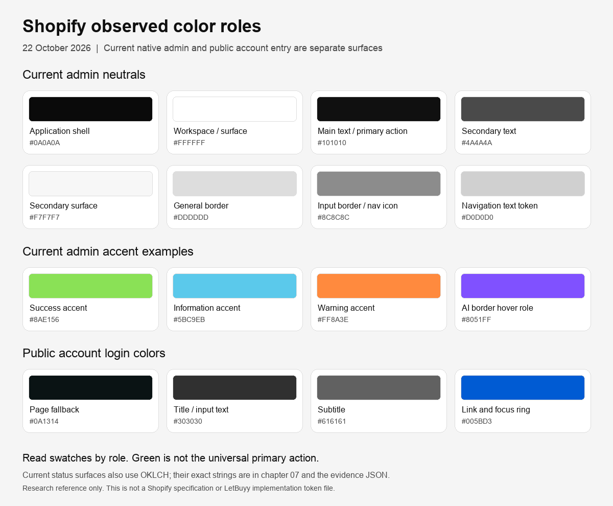

# Shopify Current Admin Visual Reference

**LIVE / MEASURED — 22 October 2026.** The authenticated trial store used the refreshed black sidebar and white workspace. Measurements below came from the rendered interface at **1144 × 778 CSS px, device pixel ratio 1**. A requested desktop override did not change that measured viewport; these are not 1440 px admin measurements.

These values describe that native-admin capture. The later [Themes](10_THEMES_PAGE_DETAILED_REFERENCE.md) and [editor](11_THEME_EDITOR_DETAILED_REFERENCE.md) captures used working explicit viewport overrides and exposed an embedded `#303030` / `#F1F1F1` visual system. Their measured font weights, radii and panel sizes differ; do not apply this chapter's native values universally.

The account pages in [Visual system](01_VISUAL_SYSTEM.md) and the archived Polaris React tokens are separate references. The current admin uses different text colors, status families, action geometry and semantic token meanings.

## Palette at a glance

The atlas reproduces sampled color roles as research swatches. It is not an exported Shopify specification, and its text layout is original. A [vector version](evidence/color-atlas.svg) is also included.

## Neutral and interaction roles

| Role | Live computed value | Interpretation |
| --- | --- | --- |
| Application shell | `#0A0A0A` | Black background behind navigation and the white workspace |
| Main background | `#FFFFFF` | Workspace and primary surface |
| Secondary surface | `#F7F7F7` | Subdued grouping/header surface |
| Main text | `#101010` | Current admin text, darker than archived `#303030` |
| Secondary text | `#4A4A4A` | Explanations and secondary information |
| General border | `#DDDDDD` | Fine separation |
| Input surface | `#FFFFFF` | Field fill |
| Input border | `#8C8C8C` | Stronger boundary than a decorative divider |
| Primary button fill | `#101010` | Dedicated primary-button role |
| Primary button text | `#FFFFFF` | High-contrast label |
| Primary active fill | `#0A0A0A` | Sampled root role |
| Brand-fill token | `#F7F7F7` | **Not** the current primary-button fill |
| Brand-fill hover / active | `#F2F2F2` / `#EBEBEB` | Root role values, not a verified hover test of every button |
| Navigation text token | `#D0D0D0` | Root role; individual links sampled `#DCDCDC` |
| Navigation icon token | `#8C8C8C` | Muted inactive icon |
| Navigation selected surface | `rgba(255,255,255,.11)` | Translucent layer over the dark shell |
| Selected-link text sample | `#FCFCFC` | Captured selected navigation |
| Link | `oklch(.484 .2413 262.8)` | Current blue link role |
| Link hover | `oklch(.4441 .2201 262.81)` | Root role |
| Focus border | `oklch(.6289 .2036 263.44)` | Current focus role |
| Backdrop | `#000000B5` | Root overlay role; final compositing depends on context |

Sources: [targeted role values](evidence/live-admin-role-tokens.json), [root variable sample](evidence/live-admin-css-variables.json), [Domains geometry](evidence/admin-domains-safe.json). Blank values in the targeted file mean that exact variable name was not defined in the sampled root; they are not missing-color fallbacks.

### Why the palette feels restrained

**ANALYSIS.** Most of the working area is neutral. Color carries a specific job: blue for focus/link context, status hue for readiness, purple for AI identity, green/yellow atmosphere in the trial promotion, and brand colors within illustrations/provider marks. The black/white split makes navigation and work visibly different without tinting every card.

Text contrast is strong while decorative borders are deliberately quiet. A darker input boundary gives editable controls more definition than a card divider. Repeating the brand's green on every action would collapse the distinction among promotion, success, identity and action.

## Status and AI families

The current semantic colors use a mixture of hex, RGBA and OKLCH. Preserve the original notation when documenting an exact value. A screenshot sampled through a color-managed display is not a reliable substitute for the computed token.

| Family | Accent or strong value | Soft surface | Deeper text example |
| --- | --- | --- | --- |
| Success | `#8AE156`; hover `#75D63B` | `oklch(.9672 .0599 131.73)` | `oklch(.2334 .0796 134.14)` |
| Information | `#5BC9EB` | `oklch(.95 .0448 212.63)` | Secondary `#01596F` |
| Warning | `#FF8A3E` | `oklch(.9557 .035 67.45)` | Secondary `#6F2E01` |
| Critical | `oklch(.5656 .2454 28.92)` | `oklch(.947 .03 20.5)` | Secondary `#7E100C` |
| Caution | `oklch(.9662 .0722 97.61)` fill | Context-dependent | `oklch(.2708 .0638 90.28)` on fill |
| AI | Hover fill `oklch(.876 .0571 297.82)` | `oklch(.9376 .0337 299.07)` | Icon `oklch(.2658 .1635 279.85)` |

The success badge fill role was `oklch(.9053 .1942 133.49)`. The Domains Connected badge visibly used the bright lime family, alongside its text. The Primary badge was separately outlined. One semantic state can have soft surface, strong badge, accent icon and deeper text roles; those are not interchangeable paints.

Root tokens describe available roles, not proof that every state was triggered. Error-state evidence in this run includes public email validation and the blank domain dialog, not a full critical-state audit of every admin component.

## Contrast calculations

Opaque hex pairs were calculated using the WCAG sRGB relative-luminance formula. These are nominal fill comparisons; layered gradients, alpha, antialiasing, images and pointer states require rendered-context analysis.

| Pair | Ratio | What it establishes |
| --- | --- | --- |
| Current `#101010` on white | 19.03:1 | Strong primary-text and solid-button-label contrast |
| Current `#4A4A4A` on white | 8.86:1 | Secondary text remains readable |
| Current nav `#D0D0D0` on `#0A0A0A` | 12.84:1 | Nominal root navigation-text pairing |
| Sampled nav `#DCDCDC` on `#0A0A0A` | 14.44:1 | Captured link pairing |
| Icon `#8C8C8C` on `#0A0A0A` | 5.89:1 | Inactive-icon pairing on plain shell |
| Input border `#8C8C8C` against white | 3.36:1 | Nominal field-boundary contrast |
| Divider `#DDDDDD` against white | 1.36:1 | Quiet separator, not sufficient evidence for an essential control boundary |
| Login `#303030` on white | 13.20:1 | Account heading/input text |
| Login `#616161` on white | 6.19:1 | Account subtitle |
| Login blue `#005BD3` on white | 6.11:1 | Account text link |
| Login `#FAFCFC` on `#0B1314` | 18.25:1 | Nominal identity CTA |

Exact output and method are in [current admin contrast](evidence/current-admin-contrast.json) and [identity and archive contrast](evidence/contrast-pairs.json). Do not reuse these ratios for OKLCH status pairs or translucent selected states without a color conversion/compositing calculation.

WCAG AA generally requires 4.5:1 for normal text and 3:1 for qualifying large text; non-text boundaries and focus have their own criteria. A high text ratio does not establish complete accessibility. [Text contrast](https://www.w3.org/WAI/WCAG22/Understanding/contrast-minimum.html), [non-text contrast](https://www.w3.org/WAI/WCAG22/Understanding/non-text-contrast.html).

## Layout and geometry

| Component or relationship | Measured current value | Scope |
| --- | --- | --- |
| Expanded global navigation | 220 px | Native desktop viewport |
| Collapsed global navigation | 60 px | Live collapse |
| Settings local pane | Approximately 240 px | Between x = 60 and x = 300 |
| Settings main rectangle | x 300, y 4, w 840, h 770 | 1144 × 778 viewport |
| Main outer inset | 4 px top/right/bottom | Settings state |
| Main corner radius | 16 px | Settings white workspace |
| Main global nav row | 30 px | Links sampled |
| Collapsed link target | 32 × 30 px | At x = 14 |
| Main selected nav radius | 12 px | Captured link/rail treatment |
| Settings local row | 28 px | Local destination links |
| Settings local selected radius | 8 px | Local selected row |
| Domains heading left | x = 332 | 32 px inside main's left edge |
| Domains top actions | y = 16, h = 28 | Header action cluster |
| Header action gap | Approximately 6 px | Adjacent Domains button rectangles |
| Report header / first row | 36.5 / 33.5 px | Reports table |
| Report table cell block padding | 6 px | Captured body cells |
| Report outer cell inset | 12 px | First/last edges |
| Domain connection dialog | 620 × 180 px | Blank focused task |
| Discount-type chooser | 620 × 391 px | Four-type choice state |

Card, input and button wrappers can add boundaries/shadows outside an inner element. The light-DOM input measurement alone sometimes reported zero radius even when its surrounding field was rounded. This is why the saved screenshots and semantic-role measurements should be read together.

### Spacing scale versus actual placement

Targeted current root reads gave `--p-space-100` = .25rem, 150 = .375rem, 200 = .5rem, 300 = .75rem, 400 = 1rem, 500 = 1.25rem and 600 = 1.5rem. At a 16 px root these correspond to 4, 6, 8, 12, 16, 20 and 24 px. The table-cell role is .375rem and button-group gap .5rem.

**ANALYSIS.** A spacing token catalog is not a layout map. The actual Domains header has approximately 6 px action gaps, while the general button-group token is 8 px. The shell's 4 px inset, card's interior space, field label gap and table edge inset serve different purposes. A faithful specification should name the relationship being measured.

## Typography

The current font stack starts with ShopifyInter and includes Noto Arabic/Hebrew, UI sans and system fallbacks. Fractional or intermediate weights are present. The following values were read from actual rendered roles:

| Role | Size / line height | Weight | Other detail |
| --- | --- | --- | --- |
| Admin body default | 13 / 20 px | 400 | `#101010` |
| Main navigation link | 13 / 20 px | 450 | Sampled expanded/collapsed links |
| Settings local navigation | 13 / 20 px | 400 | 28 px row |
| Domains heading | 26 / 32 px | 500 | -0.52 px tracking |
| Home visible title spans | 28 / 33.6 px | 500 | -0.7 px tracking |
| Home setup-card heading | 15 / 18.75 px | 500 | -0.15 px tracking |
| Domains header action | 12 / 16 px | 500 | 28 px total height |
| Report table header | 12 / 20 px | 500 | `#4A4A4A` |
| Report table body | 13 / 20 px | 400 | `#101010` |
| Rich-editor toolbar | 12 px | 400 | Captured formatting controls |

The Home H1 wrapper inherited 13 px, while its visible child spans were 28 px. Reporting only the H1's computed style would incorrectly describe the visual headline. [Home heading measurements](evidence/admin-home-heading-metrics.json).

## Buttons and physical depth

The Domains primary action combines a `#101010` fill with two radial white highlights: a 20% white upper-center highlight and a 15% lower highlight. Its shadows include several low-opacity outer layers and inset layers. The result reads as a slightly dimensional pill, not a flat rectangle.

Its measured padding is **6 px block × 12 px inline**, label **12/16 px at weight 500**, height **28 px** and radius **9999 px**. The two secondary actions had the same geometry, dark labels and transparent inner button backgrounds; their visible outer treatment may live on surrounding/pseudo layers. [Exact action styles](evidence/admin-domains-action-metrics.json).

The product editor's icon buttons measured 24 × 24 px with pill corners. Color/alignment controls were wider; Paragraph was 100 px wide. A 24 px toolbar target and a 44 px identity button are different density decisions. WCAG 2.2 AA's target-size minimum is generally 24 × 24 CSS px with specified exceptions; 44 × 44 is not a universal AA rule. Narrow-screen/touch suitability still needs testing. [Target size](https://www.w3.org/WAI/WCAG22/Understanding/target-size-minimum.html).

## Borders radii and shadows

The system layers several scales: a 16 px main window, softer card corners, full-pill actions, 12 px selected navigation, 8 px selected Settings rows and compact internal control corners. A root corner-shape token also exposed `superellipse(1.333)`; support/application was not verified across every shape. Do not reduce the whole appearance to “border-radius 12 everywhere.”

Fine borders and layered, low-opacity shadows separate white cards from white workspaces. Stronger depth belongs to dialogs, floating Sidekick and menus. The hierarchy conveys elevation without adding saturated card backgrounds. Exact root shadow strings are retained in the variable evidence; they should not be treated as screenshot-certified application on every component.

## Responsive evidence

Public identity screens were measured at 1440, 711 and 390 px widths. Current authenticated geometry was measured at 1144 px. The user's screenshots additionally show a 671 px responsive admin and a collapsed rail. Those sources establish responsive compositions, not a complete breakpoint contract.

At the supplied narrower admin view, the setup feed becomes stacked, a floating menu launcher appears and Sidekick remains accessible. The trial popover overlays content. The collapsed rail offers a flyout rather than inline child labels.

Reflow at 320 px, 200–400% zoom, virtual keyboard overlap, touch gestures, reduced motion and full mobile Settings remain OPEN. No desktop measurement here should be presented as proof of mobile accessibility.

## Color system interpretation

**ANALYSIS.** Shopify's coherence comes from role consistency more than hue repetition. The operational shell, identity entry and trial signup can differ in scale and surface while keeping one clear primary action, readable supporting text, named alternatives and visible context.

For a design review, compare roles before values: text on its actual surface, essential control boundary, selected navigation, focus, error, pending, success, promotion and AI assistance. Only then compare the exact color and geometry. LetBuyy's canonical token source remains the implementation authority.
