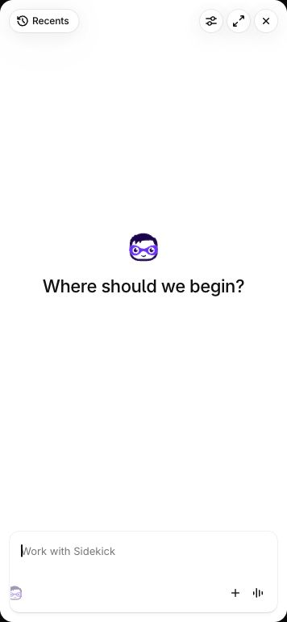

# Shopify AI Motion and Performance

The observed admin places AI at both the global workspace level and inside individual authoring tasks. Motion supports the shell, floating assistance and setup presentation. Speed has two separate meanings: how quickly the interface provides orientation, and how quickly the requested data or work is actually ready.

## AI entry points observed

| Surface | LIVE observation | Execution boundary |
| --- | --- | --- |
| Home | Large prompt composer; changing suggestions such as Help me get started / Create a product listing | No global prompt sent |
| Persistent assistant | Bottom composer with purple Sidekick identity, text entry, add, voice and open controls | Opened and closed |
| Sidekick drawer | Recents, Memory settings, Expand, Close and a resize separator | Controls inspected, preferences unchanged |
| Attachment/context menu | Files, Upload from device, Target, Mention, Skills, Apps | No file upload or contextual target selected |
| App generation | Generate apps switch shown checked in menu | Existing state observed; not changed or executed |
| Product description | Generate text plus instruction field | One benign preview generated, discarded |
| Customers | Natural-language segment description alongside a query editor | No segment generated or saved |
| Growth | Early-access Autopilot promotion and campaign entry | No activation or campaign execution |
| Agentic sales channel | Setup tasks, channel statuses, source/eligibility context | Read-only inspection |

**ANALYSIS.** Shopify offers both “tell me what to do” and “help me with this field.” The product editor preserves the immediate task, while the drawer creates space for a longer exchange. Recents and memory signal continuity beyond a single prompt. Context and capability need to be understandable before a user submits information or authorizes an action.

The drawer exposed a memory explanation about updating/accessing preferences shared with Sidekick. That is evidence of an available interface, not a test of what was stored, retained or used. Microphone, screen sharing, uploads and app generation were not invoked.

## Product description preview test

**LIVE.** The product's Generate text control opened an instruction field and a Generate action. The empty instruction state was disabled. The research prompt supplied only a plain reusable cotton tote bag and explicitly asked for no invented certifications.

The generated preview described everyday uses and added **“Durable”** and **“eco-friendly”** claims. The preview offered **Add** and **Discard**. The output was not added, the preview was closed, the HTML field was cleared, and the product form was discarded. Returning to the empty Products page confirmed that no research product was saved.

**ANALYSIS.** The interaction has a useful review boundary: a generated draft is separate from accepted field content, which is separate from saving the product. However, even a simple prompt can produce claims beyond the supplied facts. A visually polished preview is not evidence of factual grounding, certification, commercial suitability or regulatory approval.

The observation suggests evaluating AI on:

- Faithfulness to supplied product facts.
- Whether generated content is visibly provisional.
- Clear Add, discard, retry and undo behavior.
- Distinction between editing a draft and publishing/saving a record.
- Permission and confirmation before actions with business effects.
- Recovery from generation failure, cancellation or interrupted sessions.

Evidence: [probe notes](evidence/product-ai-probe.json), [preview state](evidence/product-ai-preview-dom.txt). The elapsed observation recorded in the probe included intervening research work; it is **not an AI latency benchmark**.

Shopify's documentation describes broader Sidekick assistance and generated content, including guidance, content work, images and task-specific operations. Availability and limits can depend on plan and rollout. These documented capabilities must not be read as a claim that every one was executed here. [Sidekick overview](https://help.shopify.com/en/manual/ai-powered-tools/sidekick), [content generation](https://help.shopify.com/en/manual/ai-powered-tools/sidekick/generate-content), [setup and permissions](https://help.shopify.com/en/manual/ai-powered-tools/sidekick/set-up).

## Agentic storefronts are a separate AI surface

**LIVE.** The Agentic channel explained that Agentic Storefronts were not live for this store, while products might still surface through alternate sources. Tasks included adding a first product and reviewing policies. The channel list named ChatGPT, Microsoft Copilot, Shop and other channels, each shown inactive in this account.

The page separated **Channels** from **Sources**. Knowledge Base was not installed; Shopify Catalog was ineligible. The channel descriptions distinguished discovery from checkout destination. A checked “Allow Shopify to manage for me” control was already present; it was not changed. Supplemental Terms and Learn more were visible.

**ANALYSIS.** This is not the same thing as Sidekick. Sidekick assists the operator; Agentic concerns external product discovery and sales-channel readiness. A store can have an AI assistant while lacking eligibility for an AI distribution channel. Availability needs to be stated at the correct level.

The account's inactive/ineligible state does not establish global launch availability. No supplemental terms were accepted, apps installed or channels activated. [Live channel evidence](evidence/channel-agentic-dom.txt).

## Illustration system

The observed illustration families had different jobs:

| Family | Observed appearance | Role in the interface |
| --- | --- | --- |
| Setup product art | Glass-like arch/object, small colorful blocks | Gives an early task a tangible focal point |
| Theme art | Layout panels, type/grid collage | Connects customization to a visual outcome |
| Payments art | Payment/provider marks including regional cues | Makes setup recognizable without a long explanation |
| Shipping/domain art | Package, route and browser/domain motifs | Describes an abstract configuration task |
| Editorial empty state | Document with formatting/media imagery | Explains the purpose of blog creation |
| Empty search | Search-result illustration | Identifies retrieval failure, distinct from first use |
| Account passkey promotion | Purple security, face and fingerprint motifs in user screenshot | Explains a security method through familiar device cues |
| Sidekick | Purple character mark | Makes assistance recognizable across entry points |

**MEASURED.** Home media inspection found PNG and SVG image assets, including product, theme, domain and shipping images. A static PNG can be moved or transformed by CSS; a screenshot does not establish that the illustration is a video or 3D runtime. The inspected Home media did not expose an autoplay video element.

Several setup images had empty alt text, consistent with decorative treatment when neighboring text explains the task. A regional guide illustration had descriptive alt text. This is a local observation, not a complete alternative-text audit.

**ANALYSIS.** Richer art is concentrated in setup, education and absence of records. Operational tables stay comparatively plain. The useful principle is purposeful placement: illustrations explain, orient or encourage, while rows preserve comparison density. Recreating every illustration's aesthetic would not reproduce the underlying task design.

## Motion specifications observed

The rendered CSS exposed these examples:

| Context | Computed duration and easing | What the evidence means |
| --- | --- | --- |
| Navigation width and related sizes | 250 ms, cubic-bezier(.2,.8,0,1) | Shell transition declaration |
| Navigation label/row opacity, translation and filter | 400 ms, same easing, small staggered delays | Disclosure/expansion choreography |
| Navigation icon opacity | 150 ms, cubic-bezier(.25,.1,.25,1) | Local transition declaration |
| Home layout opacity/transform | 200 ms, cubic-bezier(.25,.1,.25,1) | Content transition |
| Home title margin | 200 ms | Layout adjustment |
| Prompt/container presentation | 300–400 ms; one translate declaration 900 ms | Multiple layers, not one global duration |
| Trial/status pip animation | 500 ms, cubic-bezier(.34,1.65,.5,1) | Pop-style keyframe declaration |
| Prompt suggestion opacity/filter | 500 ms | Text/prompt presentation layer |

Sources: [Home motion styles](evidence/admin-home-motion-styles.json) and [media and shell motion sample](evidence/admin-home-motion.json). These are computed declarations from elements with positive geometry; some content extends below the viewport. They do not establish how many animation frames were delivered or whether every declaration was active at capture.

The read-only browser scope did not expose the Web Animations enumeration API. No frame trace, dropped-frame count, reduced-motion toggle or interaction video was captured. Shopify Home documentation describes reduced-motion handling for its activity globe; that globe was not the setup Home shown in this store. [Shopify Home](https://help.shopify.com/en/manual/shopify-admin/shopify-home).

**ANALYSIS.** Motion can preserve continuity while the shell changes width and can stage a setup prompt without blocking the next action. Evaluation should check interrupted/reversed transitions, layout shift, reduced motion, CPU-constrained devices and whether the floating assistant obscures focused controls.

## How fast the app was in this session

The follow-up [navigation-loading study](09_SURFACE_CONTAINERS_AND_NAVIGATION_LOADING.md) captures the top strip, sparse embedded workspace and retained-old-content branches. The [theme-editor study](11_THEME_EDITOR_DETAILED_REFERENCE.md) also separates storefront animation settings from admin route motion and records contextual AI entry points without submitting theme-generation requests.

Four navigation samples timed a sidebar click until the destination's named main heading became visible:

| Destination | Observed elapsed time |
| --- | --- |
| Orders | 887 ms |
| Customers | 2061 ms |
| Discounts | 1715 ms |
| Analytics | 1283 ms |

These are single observations with automation/tool overhead in one signed-in session. They are not clean browser timing marks, percentiles, cold-load comparisons or measurements of full data readiness. The Analytics page still progressed through a skeleton before the stable no-data/zero state.

The practical observation is that shell and route context appeared promptly, while content had its own loading progression. No global claim that Shopify is “instant,” faster than another app or consistently below a particular latency is supported.

Evidence: [route timing notes](evidence/route-observation-timings.json), [initial Analytics state](evidence/admin-analytics-dom.txt), [stable Analytics state](evidence/admin-analytics-stable-dom.txt).

## Why it can feel responsive

**ANALYSIS.** Several observed design choices reduce uncertainty even without proving lower backend latency:

- Navigation stays in a stable location as the workspace changes.
- Selected route and heading give early orientation.
- Loading states are distinguishable from empty data.
- Progressive disclosure limits the initial complexity of forms.
- Search shows a pending state before grouped results.
- AI shows generation progress and then an explicit preview.
- An index remains useful through search/filter recovery.

These are perceptual and interaction explanations, not verified claims about Shopify's caching, prefetching, framework, server topology, CDN behavior or request strategy. No such internal implementation was inspected.

## Performance evaluation that remains

A comparative study needs the same device, browser, network, store data, account permissions and route sequence. Record cold entry, warm navigation, list ready, query ready, editor interactive, save acknowledgement and durable read-back separately. Include representative populated records and error states.

For an implementation review, measure LCP, INP and CLS in their proper browser contexts; record route task completion independently. Repeat enough runs to report distributions. Test long product descriptions, media-heavy editors, long tables, slow/error responses and AI cancellation. The current evidence establishes a useful baseline observation and a measurement plan, not a complete performance certification.
