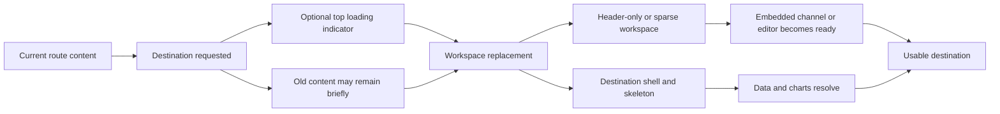

# Shopify Surface Containers and Navigation Loading

This follow-up examines **where a task happens**, how much surrounding context stays visible, and what happens between destinations. The findings combine direct inspection of the refreshed admin, the Online Store channel, Horizon 4.3.0 and app discovery on 22 October 2026.

Shopify uses more than “modal or page.” The observed family includes full record pages, administrative detail pages, dedicated editors, anchored pickers, large discovery dialogs, subordinate forms, split panels, mobile sheets, previews and external detail tabs. The same accessible role can appear in visually different containers.

## Container inventory

| Container | Directly observed examples | Context and commitment |
| --- | --- | --- |
| Operational index | Products, Reports, Customers, inventory | Find, compare, filter or begin work |
| Full record form | Product, customer, purchase order, transfer, gift card | Many fields, relationships and meaningful save/discard state |
| Administrative detail page | Online Store app management, App development | Durable object/configuration context and related sections |
| Nested Settings workspace | Domains and Apps | Global shell plus administrative navigation |
| Dedicated visual editor | Horizon editor | Global admin navigation removed; task-specific toolbar and preview |
| Code workbench in a new tab | Edit code | File tree, editor groups, search and status bar |
| Full wording editor | Edit default theme content | Many strings organized into categories and search/filter |
| Focused centered dialog | Connect domain; Rename theme | One bounded input task with cancel/commit |
| Subordinate form dialog | Default customer address | An object inside a larger parent task |
| Decision dialog | Create discount | Choose the kind of task before entering its editor |
| Upload dialog | Upload theme ZIP | Explain format/limit, choose file, then submit |
| Large discovery dialog | Picked for you apps | Browse relevant options without losing the admin route |
| Anchored command menu | Theme actions, channel actions, editor View actions | Select an operation; the menu itself is not the operation |
| Anchored navigation picker | Editor template selector | Search and descend into page/template types |
| Value picker | Editor color and dynamic-source controls | Change one setting while retaining its object context |
| Catalog with isolated preview | Add section | Search/browse types and inspect a visual example |
| Block catalog | Add block, including Apps/Generate branches | Choose a component in its insertion context |
| Persistent split panel | Outline plus selected section/block properties | Keep structure and the selected object's settings available |
| Bottom sheet | Narrow theme editor properties | Preview stays behind a compact or expanded editing surface |
| Floating assistance | Sidekick composer and contextual editing toolbar | Help/actions close to the current task |
| External detail page | App Store listing opened from a recommendation | Deeper evaluation outside the discovery dialog |

The first-pass commerce examples are documented in [Admin and commerce patterns](04_ADMIN_AND_COMMERCE_PATTERNS.md). This follow-up adds the theme and app cases, rather than assuming every creation action has the same container.

## Modal and popover are different decisions

**LIVE.** The theme Rename task opened a 620 × 189 px centered dialog at the captured native viewport. It used 8 px corners and substantial layered shadow. Its single field was prefilled with Horizon; Save was disabled until a change. Cancel dismissed it.

The refreshed Domains connection dialog also measured 620 px wide, but its treatment differed from the embedded theme dialog. The app recommendation dialog used a **980 px visible white panel with 24 px corners**. A color picker was **256 × 353 px with 12 px corners**. A template selector was a narrow anchored navigation surface. Similar widths or a common ARIA dialog role do not establish one identical component.

The outer app-discovery dialog wrapper measured the whole viewport width and had a transparent background. Its visible inner card was 980 px wide. Measuring only the role wrapper would incorrectly describe a full-width white modal.

| Question | Interpretation supported by the examples |
| --- | --- |
| Is this a short interruption with a clear return? | A focused dialog can preserve the parent task |
| Does it configure a subordinate object? | A nested address or selection task can remain inside the parent journey |
| Is the user choosing among operations? | Use the command menu as an entry, then the appropriate task container |
| Is it a long record with related configuration? | A full page provides room and a stable object location |
| Does structure need to remain visible while editing? | A split outline/properties workspace supports the relationship |
| Does the task need its own tools and preview? | A dedicated editor can replace global navigation |
| Does the person need to compare or evaluate a new product? | Discovery can lead to a separate detail page |

These are **ANALYSIS** conclusions from Shopify's choices, not universal rules about field count. A two-field task can still need a page if its history, permissions, recovery or related information makes it substantial.

## Scope is part of the container

The editor makes several scopes explicit:

- Theme settings affect the storefront theme broadly.
- Hero properties affect the selected section.
- Heading properties affect a selected block.
- Section CSS describes a local scope; theme CSS describes the whole storefront.
- App blocks occupy a position in content; app embeds are managed in their own panel.
- Mobile preview changes the preview mode; it does not publish a mobile-specific theme.
- Theme Active status, storefront Private status and a missing plan are separate states.

**ANALYSIS.** A well-chosen container explains what a change belongs to. The field label alone cannot do that. Keeping a selected object title, outline highlight and preview boundary synchronized reduces ambiguity about scope.

## Navigation loading has several layers

The user's observation of a top strip and a temporarily sparse/blank page is supported by the Themes transition capture. It is **not** the sequence of every sampled navigation.

This diagram distinguishes observed states; it does not assert an internal router, rendering framework, cache or scheduling algorithm.

### Top loading strip

**LIVE / MEASURED.** An early Themes navigation snapshot exposed a progressbar named **Page loading bar**. A related progress element measured **2 px high**, positioned at **x = 0, y = 0**, spanning approximately the viewport width. The capture was already in a completion/rushing state.

The child element's transparent computed background is not the strip's final visible color: paint can belong to another layer. The later attempt to collect its styling found the element had already been removed. No exact strip fill, animation duration, easing or truthful percentage is inferred from that failed capture.

Evidence: [early Themes DOM](evidence/deep-dive-02/navigation-to-themes-early-dom.txt), [early geometry](evidence/deep-dive-02/navigation-to-themes-early.json).

**DOC.** App Bridge exposes a Loading API that lets an embedded app show and stop an admin-header indicator for transitions and asynchronous work. The developer controls its start/stop state. This explains the supported app-facing contract; it does not prove the native shell's private implementation. [Loading API](https://shopify.dev/docs/api/app-home/latest/apis/user-interface-and-interactions/loading-api).

### Sparse workspace before embedded content

**LIVE.** On the Themes transition, the early main workspace contained only a short header-sized amount of text while the Online Store iframe had not yet supplied its full contents. The global shell remained present. This is the closest captured counterpart to the user's “page goes blank, then the switched page appears” observation.

Leaving Settings also briefly exposed an AppFrameMain container without the destination body in the native accessibility view. A later computed sample already contained the Agentic destination. That establishes an intermediate state, not the exact number of blank frames or duration.

The visual theme editor had another loading layer: its first native accessibility capture exposed a 10% progress indicator before the outline and preview arrived. No timed percentage series was captured, and that editor indicator should not be confused with the 2 px global route strip.

The initial editor percentage and bodyless Settings-exit accessibility state were observed in tool output without preserving their original raw snapshots. They are retained as observer notes with lower reproducibility than the saved route probes; the later Settings-exit JSON already shows destination content. See [follow-up observation notes](evidence/deep-dive-02/observation-notes.json).

### Old content can remain before replacement

**LIVE.** In a later Products → Customers sample, the first three probes still read the old Products body approximately 278–535 ms after the automated click. In Customers → Analytics, probes at approximately 455 and 566 ms still read Customers; a probe around 1313 ms read the new Analytics header/range notice with sparse metric content.

These observations include automation overhead and gaps between probes. They are **not** exact browser paint timestamps. No top progress strip was caught in those later samples. Its absence from a sample does not prove it never appeared between probes.

| Transition capture | What was observed | What it does not prove |
| --- | --- | --- |
| Settings exit | Main container briefly had no body in AX | A universal blank-page policy |
| Online Store / Themes entry | Top progress role; 2 px related element; sparse main | Exact color, duration or real completion percentage |
| Visual editor initial entry | 10% indicator before tools/preview | Linear progress or total load time |
| Products → Customers | Old Products content retained in early probes | No later intermediate loading state |
| Customers → Analytics | Old content, then destination shell/sparse content | Full metric readiness at heading arrival |

Sources: [Customers samples](evidence/deep-dive-02/navigation-customers-samples.json), [Analytics samples](evidence/deep-dive-02/navigation-analytics-samples.json). The file named first-main is an **old-content** capture, not proof of a blank workspace.

## Loading design implications

**ANALYSIS.** The shell, route, embedded surface and data can become ready independently. A route heading tells a person where they are; a chart skeleton tells them its data is still pending. The two indicators should not be collapsed into one “loaded” flag.

A robust implementation should preserve safe context, prevent actions against the wrong record, distinguish stale content from current content, and give failure/retry feedback when readiness does not arrive. This research does not establish Shopify's handling of every timeout, offline route or interrupted save.

During this follow-up, Sidekick displayed an offline-messaging notice even while other admin pages and public listings continued to load. That is evidence of a surface-specific availability state, not proof that the entire app was offline. These conditions limit any global speed comparison.

The current-theme preview image probes also retained a spinner while the Themes controls and discovery images were available. That embedded preview was not certified ready. Route availability, a usable management toolbar and completion of a preview are distinct milestones.

## Further verification

The next useful measurements would record browser paint/frame timing, loading announcements, focus and action availability across cold/warm transitions, slower networks, failed routes and deep links. For dialogs, verify focus containment/return, Escape, scroll locking and narrow-screen occlusion. For editor panels, verify keyboard selection, divider resizing and preservation of the selected object across layout modes.

None of these checks should be marked passed solely because a component exposes a role or a screenshot looks polished.
